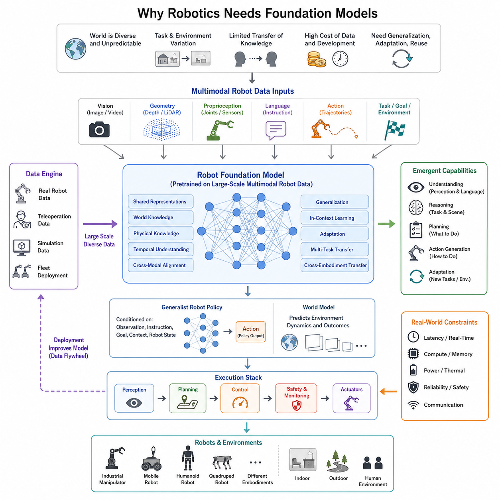
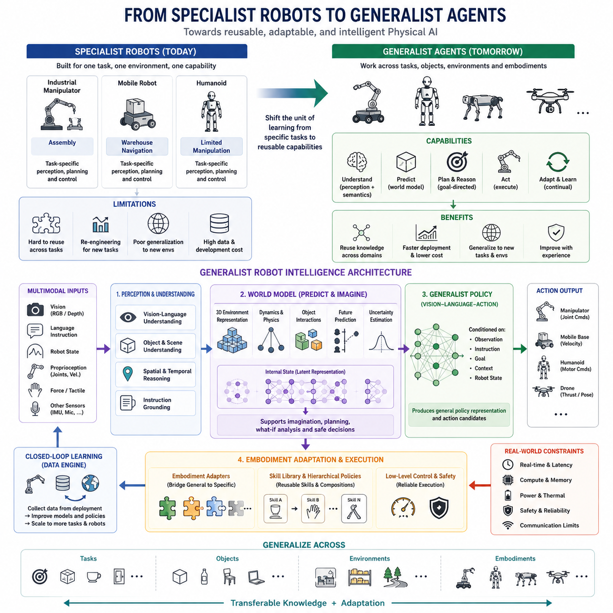
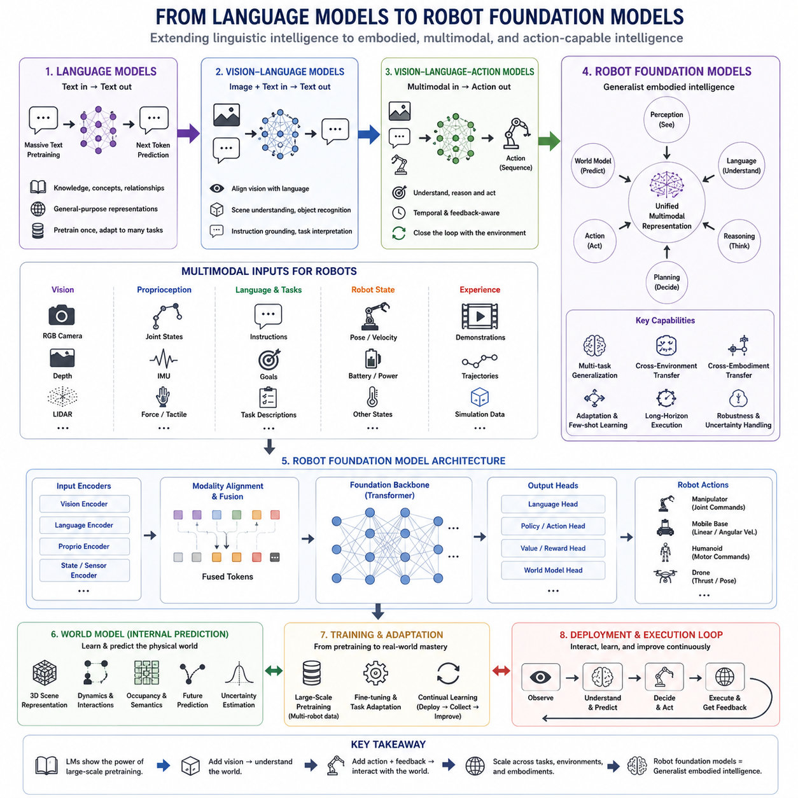
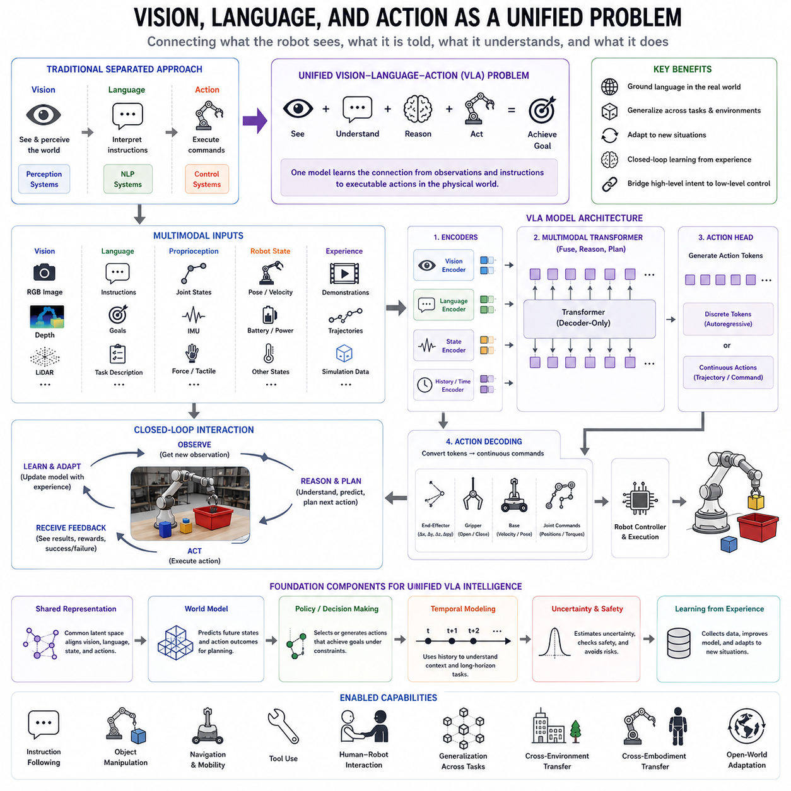
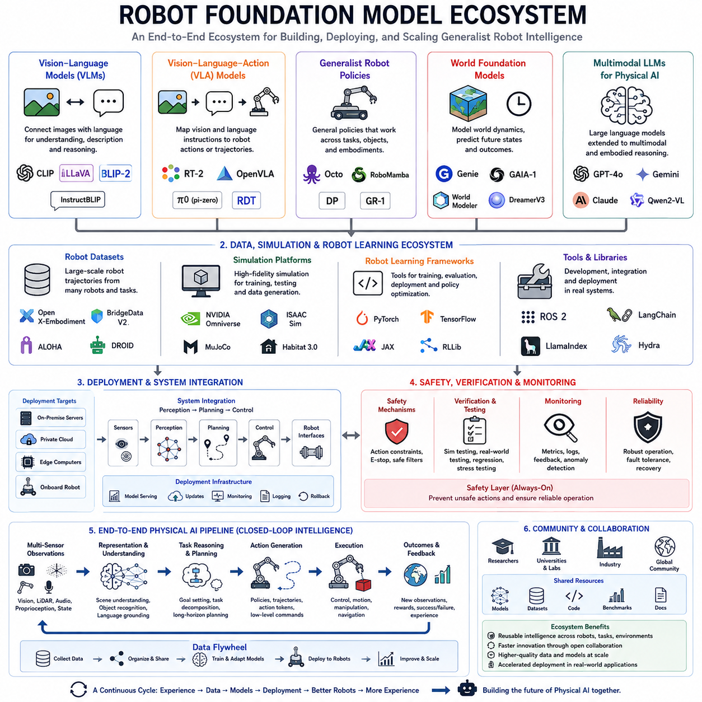
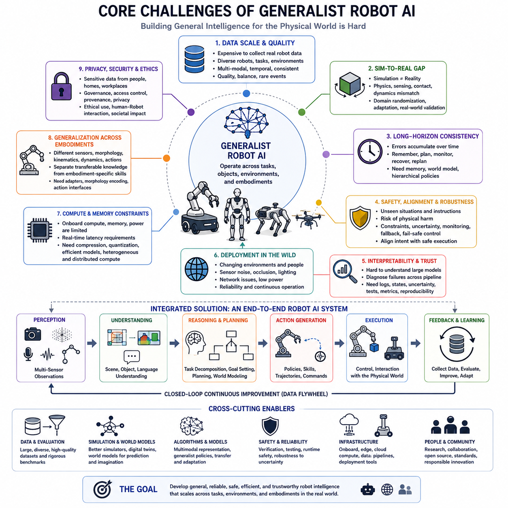
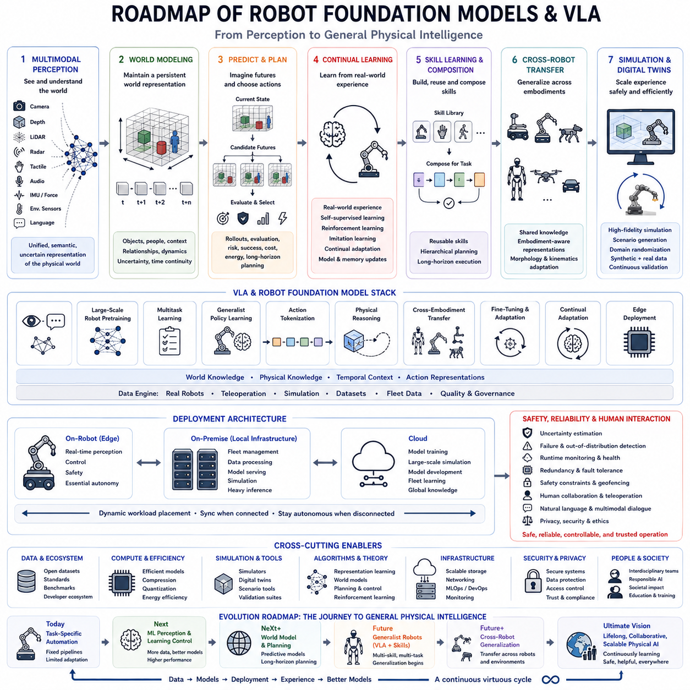

**Volume 08. Robot Foundation Models and VLA**

# Chapter 00. Introduction

## 00.01. Why Robotics Needs Foundation Models

{width="7.268055555555556in" height="7.268055555555556in"}

Robotics has traditionally been developed through task-specific engineering, where each robot is designed around a relatively narrow set of environments, objects, behaviors, and operating assumptions. A navigation robot, industrial manipulator, warehouse system, or humanoid platform may therefore require a separate perception stack, planner, controller, and learning pipeline. This specialization can produce reliable systems, but it also makes development expensive and limits the ability to reuse knowledge across tasks, environments, and robot embodiments.

The physical world is considerably more diverse than the assumptions encoded in conventional robotic systems. Objects vary in shape, material, position, and physical properties, while environments change continuously because of lighting, weather, people, obstacles, and unexpected events. A robot operating in such conditions cannot depend entirely on manually enumerated rules or narrowly trained models. It needs representations that capture reusable knowledge about objects, scenes, actions, spatial relationships, temporal context, and the consequences of interaction with the physical environment.

Foundation models provide a potential mechanism for building this reusable layer of intelligence. Rather than training a completely independent model for every downstream task, a large model can first learn general representations from diverse data and then be adapted to particular tasks or embodiments. In robotics, this principle extends beyond conventional image or language understanding because the model must connect observations to physical actions. Robot observations, instructions, actions, task objectives, and environmental context therefore become parts of a common learning problem.

The need for foundation models becomes especially clear when considering the diversity of robot data. A robot may receive images and video from cameras, geometric information from depth sensors or LiDAR, proprioceptive measurements from joints and actuators, language instructions from humans, and action trajectories generated through teleoperation or autonomous control. These modalities contain complementary information about the same physical situation. A foundation model can provide a shared representation in which visual, linguistic, geometric, temporal, and action-related information can be aligned rather than treated as completely independent subsystems.

Another important limitation of conventional robotics is the difficulty of transferring knowledge between tasks and environments. A model trained to manipulate one object may have limited ability to manipulate another object with a different shape or material. A navigation policy developed in one facility may degrade when deployed in another environment. Foundation-model approaches seek to learn more general representations from multi-task and multi-environment data so that knowledge acquired from one situation can contribute to performance in another. Generalization and adaptation consequently become central objectives rather than secondary capabilities.

This shift also changes the role of robot learning. Instead of viewing learning as a final optimization step applied to an already designed robotic system, learning can become a central mechanism for constructing general-purpose capabilities. Large-scale pretraining can provide broad perceptual and semantic knowledge, while downstream adaptation can specialize the model for a particular robot, environment, or task. Fine-tuning, parameter-efficient adaptation, imitation learning, reinforcement learning, and continual adaptation can then form successive stages between general knowledge and reliable physical behavior.

Foundation models are particularly important because robotics requires more than perception. A vision model may recognize a cup, but a useful robot must understand whether the cup can be grasped, where its handle is located, whether another object blocks the approach, how its motion should be coordinated with the arm, and what action should follow if the grasp fails. This creates a progression from vision-language understanding toward vision-language-action modeling. The central problem becomes the integration of observation, instruction, reasoning, and action within a system that can operate in a physical feedback loop.

World knowledge and physical knowledge must also be distinguished and connected. A foundation model may know from broad data that a glass is fragile or that a door can be opened, but a robot must additionally understand the specific geometry, contact conditions, dynamics, and affordances present in its current environment. Robot foundation models therefore need representations that connect abstract semantic knowledge with embodied experience. This connection is essential for transforming general information into behavior that is physically meaningful and executable.

The emergence of generalist robot policies follows naturally from this direction. Instead of maintaining one policy for every task, a generalist policy can condition behavior on observations, instructions, goals, task context, and robot state. Such a policy may learn common behavioral structures across multiple tasks and environments while retaining embodiment-specific components where necessary. The objective is not simply to make one robot perform more tasks, but to establish a reusable policy foundation that can be adapted across different robots and operating conditions.

Cross-embodiment transfer further strengthens the motivation for foundation models. Robots differ substantially in morphology, kinematics, sensor configurations, actuator capabilities, and action spaces. A useful foundation model therefore cannot assume that every robot has the same physical interface. Instead, shared perceptual and semantic representations can be combined with embodiment-conditioned representations that describe morphology, kinematics, and available actions. This creates a pathway toward transferring knowledge from one robot to another without requiring complete retraining from scratch.

The scaling principle is another fundamental motivation. Robotics data are expensive because physical interaction requires hardware, time, safety supervision, and controlled environments. However, robots can also generate large quantities of multimodal experience through autonomous operation, teleoperation, simulation, and fleet-scale deployment. If these data can be combined with appropriate representations and training methods, larger and more diverse datasets may support increasingly general models. The resulting data engine can create a feedback loop in which deployment produces experience, experience improves the model, and the improved model enables broader deployment.

Foundation models do not eliminate the engineering requirements of robotics. Real robots still face strict constraints on latency, compute, memory, power, thermal behavior, communication, safety, and reliability. Large models that perform well in an offline environment may be unsuitable for direct real-time control. Consequently, robot foundation models must be integrated with specialized perception, planning, control, safety monitoring, and fallback mechanisms. Edge deployment, model compression, quantization, efficient inference, and adaptive model partitioning become essential for converting foundation-model capability into dependable physical autonomy.

The resulting architecture is therefore better understood as a layered intelligence system rather than a single model replacing the entire robot software stack. Foundation models can provide general representations, semantic understanding, task reasoning, and policy priors, while world models can represent and predict physical states and future outcomes. Specialized controllers can translate high-level decisions into real-time actuator commands, and safety mechanisms can constrain or override learned behavior when necessary. This combination provides a path from general learned knowledge to controlled physical action.

The broader significance is that foundation models can change robotics from a collection of isolated, task-specific systems toward a more reusable intelligence platform. The progression is from specialist models toward general representations, from separate perception and action pipelines toward multimodal integration, from single-task learning toward multi-task learning, and from robot-specific training toward adaptation and cross-embodiment transfer. Vision-language-action models, generalist policies, world models, and large-scale robot pretraining consequently become interconnected components of a common strategy for building more capable Physical AI systems.

로보틱스(Robotics)는 전통적으로 작업별 엔지니어링(task-specific engineering)을 중심으로 개발되어 왔으며, 각 로봇은 비교적 제한된 환경, 객체, 행동 및 운용 가정을 기반으로 설계되어 왔습니다. 따라서 내비게이션 로봇(navigation robot), 산업용 매니퓰레이터(industrial manipulator), 물류 로봇(warehouse system), 휴머노이드 플랫폼(humanoid platform) 등은 서로 다른 인식 스택(perception stack), 플래너(planner), 제어기(controller), 학습 파이프라인(learning pipeline)을 필요로 할 수 있습니다. 이러한 전문화는 높은 신뢰성을 제공할 수 있지만, 개발 비용을 증가시키고 서로 다른 작업, 환경 및 로봇 형태 사이에서 지식을 재사용하는 능력을 제한합니다.

물리적 세계(physical world)는 기존 로봇 시스템에 내재된 가정보다 훨씬 다양합니다. 객체는 형태, 재질, 위치 및 물리적 특성이 서로 다르며, 환경은 조명, 날씨, 사람, 장애물 및 예기치 않은 사건에 의해 지속적으로 변화합니다. 이러한 환경에서 작동하는 로봇은 미리 정의된 규칙이나 좁은 범위에서 학습된 모델에만 의존할 수 없습니다. 로봇은 객체, 장면, 행동, 공간적 관계, 시간적 맥락 및 물리적 환경과의 상호작용 결과에 관한 재사용 가능한 지식을 포괄하는 표현(representation)을 필요로 합니다.

파운데이션 모델(foundation model)은 이러한 재사용 가능한 지능 계층을 구축하기 위한 하나의 잠재적인 방법을 제공합니다. 각각의 다운스트림 작업(downstream task)에 대해 완전히 독립적인 모델을 학습하는 대신, 대규모 모델이 먼저 다양한 데이터로부터 일반적인 표현을 학습하고 이후 특정 작업이나 로봇 형태에 맞게 적응될 수 있습니다. 로보틱스에서 이러한 원리는 기존의 이미지 또는 언어 이해를 넘어섭니다. 모델은 관측(observation)을 물리적 행동(physical action)과 연결해야 하기 때문입니다. 따라서 로봇의 관측, 명령, 행동, 작업 목표 및 환경적 맥락은 하나의 공통된 학습 문제의 구성요소가 됩니다.

파운데이션 모델의 필요성은 로봇 데이터의 다양성을 살펴보면 더욱 분명해집니다. 로봇은 카메라로부터 이미지와 비디오를 받고, 깊이 센서(depth sensor)나 LiDAR로부터 기하학적 정보를 얻으며, 관절과 액추에이터로부터 고유수용감각(proprioception) 정보를 받고, 사람으로부터 언어 명령을 받으며, 원격조작(teleoperation)이나 자율 제어를 통해 생성된 행동 궤적(action trajectory)을 사용할 수 있습니다. 이러한 여러 모달리티(modality)는 동일한 물리적 상황에 대한 상호 보완적인 정보를 포함합니다. 파운데이션 모델은 시각, 언어, 기하학, 시간 및 행동 관련 정보를 완전히 독립적인 하위 시스템으로 처리하는 대신, 이들을 하나의 공유 표현(shared representation) 안에서 정렬할 수 있는 기반을 제공합니다.

기존 로보틱스의 또 다른 중요한 한계는 작업과 환경 사이에서 지식을 전달하는 것이 어렵다는 점입니다. 하나의 객체를 조작하도록 학습된 모델은 형태나 재질이 다른 다른 객체를 조작하는 데 제한적인 능력만 가질 수 있습니다. 특정 시설에서 개발된 내비게이션 정책(navigation policy)은 다른 환경에 배치될 경우 성능이 저하될 수 있습니다. 파운데이션 모델 접근법은 다중 작업 및 다중 환경 데이터(multi-task and multi-environment data)로부터 보다 일반적인 표현을 학습하여, 한 상황에서 습득한 지식이 다른 상황에서도 활용될 수 있도록 하는 것을 목표로 합니다. 따라서 일반화(generalization)와 적응(adaptation)은 부차적인 기능이 아니라 핵심적인 목표가 됩니다.

이러한 변화는 로봇 학습(robot learning)의 역할 자체도 변화시킵니다. 학습을 이미 설계된 로봇 시스템에 적용하는 최종적인 최적화 단계로 보는 대신, 학습을 범용적인 능력을 구축하는 핵심 메커니즘으로 볼 수 있습니다. 대규모 사전학습(large-scale pretraining)은 광범위한 지각 및 의미적 지식을 제공할 수 있으며, 다운스트림 적응(downstream adaptation)은 모델을 특정 로봇, 환경 또는 작업에 맞게 특화할 수 있습니다. 이후 미세조정(fine-tuning), 매개변수 효율적 적응(parameter-efficient adaptation), 모방학습(imitation learning), 강화학습(reinforcement learning), 지속적 적응(continual adaptation)이 일반적인 지식과 신뢰할 수 있는 물리적 행동 사이를 연결하는 연속적인 단계가 될 수 있습니다.

파운데이션 모델은 로보틱스가 인식만을 필요로 하는 것이 아니기 때문에 특히 중요합니다. 비전 모델(vision model)은 컵을 인식할 수 있지만, 유용한 로봇은 그 컵을 잡을 수 있는지, 손잡이가 어디에 있는지, 다른 객체가 접근 경로를 막고 있는지, 팔의 움직임을 어떻게 조정해야 하는지, 그리고 그립(grasp)이 실패할 경우 어떤 행동을 수행해야 하는지를 추가적으로 이해해야 합니다. 따라서 문제는 비전-언어 이해(vision-language understanding)에서 비전-언어-행동 모델링(vision-language-action modeling)으로 확장됩니다. 핵심 문제는 물리적 피드백 루프(physical feedback loop) 안에서 관측, 명령, 추론 및 행동을 하나의 시스템으로 통합하는 것이 됩니다.

세계 지식(world knowledge)과 물리적 지식(physical knowledge)은 또한 구분하면서 연결해야 합니다. 파운데이션 모델은 광범위한 데이터로부터 유리잔이 깨지기 쉽다거나 문을 열 수 있다는 사실을 알고 있을 수 있지만, 로봇은 현재 환경에 존재하는 구체적인 형상, 접촉 조건, 동역학 및 어포던스(affordance)를 추가적으로 이해해야 합니다. 따라서 로봇 파운데이션 모델(robot foundation model)은 추상적인 의미 지식과 체화된 경험(embodied experience)을 연결하는 표현을 필요로 합니다. 이러한 연결은 일반적인 정보를 물리적으로 의미 있고 실제로 실행 가능한 행동으로 변환하는 데 필수적입니다.

범용 로봇 정책(generalist robot policy)의 등장은 이러한 방향에서 자연스럽게 이어집니다. 각 작업마다 하나의 정책을 유지하는 대신, 범용 정책은 관측, 명령, 목표, 작업 맥락 및 로봇 상태를 조건으로 행동을 생성할 수 있습니다. 이러한 정책은 여러 작업과 환경에서 공통적인 행동 구조를 학습하면서도, 필요한 경우 로봇 형태에 특화된 구성요소(embodiment-specific component)를 유지할 수 있습니다. 목표는 단순히 하나의 로봇이 더 많은 작업을 수행하도록 만드는 것이 아니라, 서로 다른 로봇과 운용 조건에 맞게 재사용할 수 있는 정책 기반(policy foundation)을 구축하는 것입니다.

교차 체화 전달(cross-embodiment transfer)은 파운데이션 모델의 필요성을 더욱 강화합니다. 로봇은 형태(morphology), 운동학(kinematics), 센서 구성, 액추에이터 능력 및 행동 공간(action space)에서 상당한 차이를 보입니다. 따라서 유용한 파운데이션 모델은 모든 로봇이 동일한 물리적 인터페이스를 갖는다고 가정할 수 없습니다. 대신 공유된 지각 및 의미 표현(shared perceptual and semantic representation)을 형태, 운동학 및 사용 가능한 행동을 설명하는 체화 조건 표현(embodiment-conditioned representation)과 결합할 수 있습니다. 이를 통해 완전히 처음부터 재학습하지 않고도 하나의 로봇에서 다른 로봇으로 지식을 전달할 수 있는 경로가 만들어집니다.

스케일링 원리(scaling principle) 역시 중요한 동기가 됩니다. 로봇 데이터는 실제 물리적 상호작용에 하드웨어, 시간, 안전 감독 및 통제된 환경이 필요하기 때문에 수집 비용이 높습니다. 그러나 로봇은 자율 운용, 원격조작, 시뮬레이션 및 플릿 규모 배치(fleet-scale deployment)를 통해 대량의 멀티모달 경험(multimodal experience)을 생성할 수도 있습니다. 이러한 데이터를 적절한 표현 및 학습 방법과 결합할 수 있다면, 더 크고 다양한 데이터셋이 점점 더 일반적인 모델의 학습을 지원할 수 있습니다. 결과적으로 데이터 엔진(data engine)은 배치가 경험을 생성하고, 경험이 모델을 개선하며, 개선된 모델이 더욱 광범위한 배치를 가능하게 하는 피드백 루프를 형성할 수 있습니다.

파운데이션 모델이 로보틱스의 엔지니어링 요구사항을 없애는 것은 아닙니다. 실제 로봇은 여전히 지연시간(latency), 연산량(compute), 메모리, 전력, 열 거동(thermal behavior), 통신, 안전 및 신뢰성에 대한 엄격한 제약을 받습니다. 오프라인 환경에서 높은 성능을 보이는 대규모 모델이 직접적인 실시간 제어에 적합하지 않을 수도 있습니다. 따라서 로봇 파운데이션 모델은 특화된 인식, 계획, 제어, 안전 모니터링 및 폴백 메커니즘(fallback mechanism)과 통합되어야 합니다. 엣지 배포(edge deployment), 모델 압축(model compression), 양자화(quantization), 효율적인 추론(efficient inference), 적응형 모델 분할(adaptive model partitioning)은 파운데이션 모델의 능력을 신뢰할 수 있는 물리적 자율성으로 전환하기 위한 필수 요소가 됩니다.

따라서 결과적인 아키텍처는 전체 로봇 소프트웨어 스택을 하나의 모델이 대체하는 구조라기보다 계층형 지능 시스템(layered intelligence system)으로 이해하는 것이 적절합니다. 파운데이션 모델은 일반적인 표현, 의미적 이해, 작업 추론 및 정책 사전지식(policy prior)을 제공할 수 있으며, 월드 모델(world model)은 물리적 상태와 미래 결과를 표현하고 예측할 수 있습니다. 특화된 제어기(specialized controller)는 상위 수준의 결정을 실시간 액추에이터 명령으로 변환하고, 안전 메커니즘(safety mechanism)은 필요한 경우 학습된 행동을 제한하거나 재정의할 수 있습니다. 이러한 조합은 일반적인 학습 지식에서 통제된 물리적 행동으로 이어지는 경로를 제공합니다.

더 넓은 관점에서 파운데이션 모델은 로보틱스를 서로 고립된 작업별 시스템의 집합에서 보다 재사용 가능한 지능 플랫폼으로 변화시킬 수 있습니다. 이러한 발전은 전문 모델(specialist model)에서 일반 표현(general representation)으로, 분리된 인식 및 행동 파이프라인에서 멀티모달 통합(multimodal integration)으로, 단일 작업 학습에서 다중 작업 학습(multi-task learning)으로, 로봇별 학습에서 적응 및 교차 체화 전달로 이어지는 흐름으로 이해할 수 있습니다. 따라서 비전-언어-행동 모델(vision-language-action model), 범용 정책(generalist policy), 월드 모델(world model) 및 대규모 로봇 사전학습(large-scale robot pretraining)은 더욱 강력한 물리적 AI(Physical AI) 시스템을 구축하기 위한 하나의 공통 전략을 구성하는 상호 연결된 요소가 됩니다.

## 00.02. From Specialist Robots to Generalist Agents

{width="7.268055555555556in" height="7.268055555555556in"}

Traditional robotics has largely evolved around specialist robots, in which a particular platform is optimized for a defined task, environment, and operating condition. An industrial manipulator may be engineered for assembly, a mobile robot for warehouse navigation, and a humanoid for a limited collection of manipulation behaviors. This approach can achieve high performance within a controlled domain, but each new task or environment often requires substantial engineering, data collection, testing, and model development. The result is a fragmented robotics ecosystem in which capabilities are difficult to reuse across systems.

The specialist paradigm assumes that the task can be sufficiently specified in advance. Perception is designed to recognize relevant objects, planning is constructed around known goals, and control is tuned to the physical characteristics of a particular robot. When the environment changes significantly, however, these assumptions begin to fail. New objects, unexpected obstacles, unfamiliar layouts, different lighting conditions, human behavior, and previously unseen task combinations can expose limitations that were not represented during development. General-purpose physical agents therefore require a fundamentally broader form of intelligence than isolated task-specific policies.

The transition toward generalist agents begins by changing the unit of learning from an individual task to a reusable capability. Instead of learning only how to perform one predefined behavior, a generalist system seeks representations that can support many tasks, objects, environments, and situations. The same learned knowledge may contribute to navigation, manipulation, interaction, or planning depending on the current observation, instruction, goal, and context. This does not mean that every robot must use an identical policy. Rather, it means that a common foundation can provide transferable knowledge while specialized components adapt that knowledge to particular physical systems.

A key requirement for this transition is multi-task and multi-environment learning. Generalist robots must encounter sufficient diversity during training to avoid simply memorizing narrow correlations between observations and actions. Robot datasets can therefore contain demonstrations, trajectories, sensor observations, language instructions, robot states, and action sequences collected from different tasks and platforms. Simulation and synthetic experience can further expand this diversity. The objective is to learn representations that remain useful when the robot encounters combinations of tasks, objects, environments, and conditions that were not explicitly present during training.

Multimodal learning becomes central because generalist behavior cannot be derived from a single information source. A robot must combine visual observations with language instructions, proprioceptive state, geometric information, temporal history, and action experience. A command such as "move the object to the table" is meaningful only when the system can connect language with the objects, spatial relationships, available actions, and current robot state. Vision-language models provide an important foundation for semantic understanding, while vision-language-action models extend this connection toward executable behavior by mapping multimodal context into actions or action sequences.

The concept of a generalist robot policy consequently differs from a collection of independent specialist policies. A specialist policy may map a narrow observation space directly to actions for one task, whereas a generalist policy can be conditioned on observations, instructions, goals, context, and robot state. It can select or generate different behaviors according to the current situation. Hierarchical policies and skill-based representations can further organize complex behavior into reusable components, allowing a system to combine learned skills into longer-horizon tasks rather than requiring every complete task to be learned independently.

World models provide another important component of generalist intelligence because acting successfully requires predicting what may happen after an action. A robot should not merely react to the current observation; it should estimate future states, environmental dynamics, object interactions, and possible outcomes. A world model can provide an internal predictive representation that supports imagination, candidate action evaluation, and planning. The combination of a world model with a generalist policy therefore creates a stronger architecture in which the system can observe, understand, predict, select an action, execute it, and use the resulting observation to update its behavior.

Generalization must also extend beyond tasks and environments to different robot embodiments. Wheeled robots, mobile manipulators, quadrupeds, humanoids, and industrial manipulators have different sensors, kinematics, action spaces, and physical capabilities. A generalist agent therefore needs a mechanism for separating transferable knowledge from embodiment-specific execution. Shared perceptual and semantic representations can capture concepts that are common across robots, while embodiment-conditioned representations or lightweight adapters can translate general intentions into robot-specific actions. This creates a pathway from specialist hardware to increasingly general intelligence.

The transition also changes the economics of robot development. Under a specialist model, every new application can require a new data collection and engineering cycle. Under a foundation-model approach, large-scale pretraining creates a reusable base model, after which adaptation can require substantially less task- or robot-specific data. Fine-tuning, parameter-efficient adaptation, imitation learning, reinforcement learning, and few-shot adaptation can specialize the general model. Deployment then becomes part of a continuing data engine in which robots collect new experiences, those experiences improve the model, and the improved model supports additional tasks and environments.

Generalist agents nevertheless do not eliminate specialization. Physical robots still require reliable localization, mapping, motion planning, low-level control, actuator management, safety supervision, power management, and hardware-specific interfaces. Real-time latency, compute and memory limits, power and thermal constraints, communication limitations, and functional safety requirements also restrict how large models can be deployed. The practical architecture is therefore likely to combine a generalist foundation model with specialized execution layers. General intelligence operates above, around, and together with these deterministic and safety-critical components rather than simply replacing them.

The broader transition can therefore be understood as a movement from isolated task intelligence toward reusable physical intelligence. Specialist robots remain valuable where environments and tasks are stable and performance requirements are tightly defined, but generalist agents aim to operate across greater diversity while continuously adapting through experience. Robot foundation models, multimodal representations, world models, generalist policies, cross-embodiment transfer, and closed-loop learning form complementary elements of this transition. The long-term objective is not merely a robot that performs many predefined tasks, but an agent that can understand new situations, transfer existing knowledge, reason about possible actions, adapt to unfamiliar conditions, and improve through continued interaction with the physical world.

전통적인 로보틱스(Traditional Robotics)는 특정 작업, 환경 및 운용 조건에 맞게 특정 플랫폼을 최적화하는 전문 로봇(specialist robot)을 중심으로 발전해 왔습니다. 산업용 매니퓰레이터(industrial manipulator)는 조립을 위해, 이동 로봇(mobile robot)은 창고 내비게이션을 위해, 휴머노이드(humanoid)는 제한된 범위의 조작 행동을 위해 설계될 수 있습니다. 이러한 접근은 통제된 영역에서 높은 성능을 달성할 수 있지만, 새로운 작업이나 환경이 추가될 때마다 상당한 엔지니어링, 데이터 수집, 시험 및 모델 개발이 필요합니다. 그 결과 시스템 간에 능력을 재사용하기 어려운 파편화된 로보틱스 생태계가 형성됩니다.

전문 로봇 패러다임(specialist paradigm)은 작업을 사전에 충분히 정의할 수 있다고 가정합니다. 인식(perception)은 관련 객체를 식별하도록 설계되고, 계획(planning)은 알려진 목표를 중심으로 구성되며, 제어(control)는 특정 로봇의 물리적 특성에 맞게 조정됩니다. 그러나 환경이 크게 변화하면 이러한 가정은 한계에 도달하기 시작합니다. 새로운 객체, 예상하지 못한 장애물, 익숙하지 않은 공간 배치, 서로 다른 조명 조건, 인간의 행동 및 이전에 경험하지 못한 작업 조합은 개발 과정에서 고려되지 않았던 한계를 드러낼 수 있습니다. 따라서 범용 물리 에이전트(general-purpose physical agent)는 고립된 작업별 정책(task-specific policy)보다 근본적으로 더 폭넓은 형태의 지능을 필요로 합니다.

범용 에이전트(generalist agent)로의 전환은 학습의 단위를 개별 작업에서 재사용 가능한 능력(reusable capability)으로 변화시키는 것에서 시작됩니다. 미리 정의된 하나의 행동만 수행하는 방법을 학습하는 대신, 범용 시스템은 다양한 작업, 객체, 환경 및 상황을 지원할 수 있는 표현(representation)을 학습하는 것을 목표로 합니다. 동일하게 학습된 지식이 현재의 관측(observation), 명령(instruction), 목표(goal) 및 맥락(context)에 따라 내비게이션, 조작, 상호작용 또는 계획에 활용될 수 있습니다. 이것은 모든 로봇이 동일한 정책(policy)을 사용해야 한다는 의미는 아닙니다. 오히려 공통된 기반(foundation)이 전이 가능한 지식(transferable knowledge)을 제공하고, 특화된 구성요소가 그 지식을 특정 물리 시스템에 맞게 조정한다는 의미입니다.

이러한 전환을 위한 핵심 요구사항은 다중 작업 및 다중 환경 학습(multi-task and multi-environment learning)입니다. 범용 로봇은 학습 과정에서 충분한 다양성을 경험해야 하며, 그렇지 않으면 관측과 행동 사이의 좁은 상관관계를 단순히 암기하는 데 그칠 수 있습니다. 따라서 로봇 데이터셋은 서로 다른 작업과 플랫폼에서 수집된 시연(demonstration), 궤적(trajectory), 센서 관측(sensor observation), 언어 명령(language instruction), 로봇 상태(robot state) 및 행동 시퀀스(action sequence)를 포함할 수 있습니다. 시뮬레이션(simulation)과 합성 경험(synthetic experience)은 이러한 다양성을 더욱 확장할 수 있습니다. 목표는 학습 과정에서 명시적으로 경험하지 않았던 작업, 객체, 환경 및 조건의 조합을 로봇이 만났을 때에도 유용하게 유지되는 표현을 학습하는 것입니다.

멀티모달 학습(multimodal learning)은 범용 행동이 하나의 정보원만으로 만들어질 수 없기 때문에 핵심적인 역할을 합니다. 로봇은 시각적 관측(visual observation)을 언어 명령(language instruction), 고유수용감각 상태(proprioceptive state), 기하학적 정보(geometric information), 시간적 이력(temporal history) 및 행동 경험(action experience)과 결합해야 합니다. 예를 들어 "물체를 테이블로 옮겨라"라는 명령은 시스템이 객체, 공간적 관계, 가능한 행동 및 현재 로봇 상태와 언어를 연결할 수 있을 때에만 의미를 가집니다. 비전-언어 모델(vision-language model)은 의미적 이해를 위한 중요한 기반을 제공하며, 비전-언어-행동 모델(vision-language-action model)은 멀티모달 맥락을 행동 또는 행동 시퀀스로 연결함으로써 이러한 관계를 실행 가능한 행동으로 확장합니다.

따라서 범용 로봇 정책(generalist robot policy)의 개념은 서로 독립적인 전문 정책(specialist policy)의 집합과 다릅니다. 전문 정책은 하나의 작업을 위해 제한된 관측 공간을 직접 행동으로 매핑할 수 있지만, 범용 정책은 관측, 명령, 목표, 맥락 및 로봇 상태를 조건으로 행동을 생성할 수 있습니다. 현재 상황에 따라 서로 다른 행동을 선택하거나 생성할 수 있는 것입니다. 계층형 정책(hierarchical policy)과 스킬 기반 표현(skill-based representation)은 복잡한 행동을 재사용 가능한 구성요소로 조직함으로써 이러한 능력을 더욱 확장할 수 있습니다. 이를 통해 각각의 완전한 작업을 독립적으로 학습하지 않고도 여러 학습된 스킬을 조합하여 장기 작업(long-horizon task)을 수행할 수 있습니다.

월드 모델(world model)은 범용 지능의 또 다른 중요한 구성요소입니다. 성공적인 행동을 위해서는 특정 행동 이후에 무엇이 발생할지를 예측해야 하기 때문입니다. 로봇은 현재 관측에 단순히 반응하는 것이 아니라 미래 상태, 환경의 동역학(environmental dynamics), 객체 간 상호작용 및 가능한 결과를 추정해야 합니다. 월드 모델은 상상(imagination), 후보 행동 평가(candidate action evaluation) 및 계획(planning)을 지원하는 내부 예측 표현(internal predictive representation)을 제공할 수 있습니다. 따라서 월드 모델과 범용 정책을 결합하면 시스템이 관측하고, 이해하고, 예측하고, 행동을 선택하고, 실행한 다음, 그 결과로 얻은 관측을 이용하여 자신의 행동을 업데이트하는 더욱 강력한 구조를 만들 수 있습니다.

일반화(generalization)는 작업과 환경을 넘어 서로 다른 로봇 형태(embodiment)까지 확장되어야 합니다. 바퀴형 로봇(wheeled robot), 모바일 매니퓰레이터(mobile manipulator), 사족보행 로봇(quadruped), 휴머노이드(humanoid) 및 산업용 매니퓰레이터는 서로 다른 센서, 운동학(kinematics), 행동 공간(action space) 및 물리적 능력을 갖습니다. 따라서 범용 에이전트는 전이 가능한 지식과 로봇 형태에 특화된 실행을 분리할 수 있는 메커니즘을 필요로 합니다. 공유된 지각 및 의미 표현(shared perceptual and semantic representation)은 여러 로봇에 공통적인 개념을 표현할 수 있으며, 체화 조건 표현(embodiment-conditioned representation)이나 경량 어댑터(lightweight adapter)는 일반적인 의도를 로봇별 행동으로 변환할 수 있습니다. 이를 통해 전문 하드웨어에서 점점 더 범용적인 지능으로 발전할 수 있는 경로가 만들어집니다.

이러한 전환은 로봇 개발의 경제성도 변화시킵니다. 전문 로봇 모델에서는 새로운 애플리케이션마다 새로운 데이터 수집과 엔지니어링 사이클이 필요할 수 있습니다. 반면 파운데이션 모델(foundation model) 접근법에서는 대규모 사전학습(large-scale pretraining)을 통해 재사용 가능한 기본 모델(base model)을 구축하고, 이후에는 상대적으로 적은 양의 작업 또는 로봇별 데이터로 적응(adaptation)을 수행할 수 있습니다. 미세조정(fine-tuning), 매개변수 효율적 적응(parameter-efficient adaptation), 모방학습(imitation learning), 강화학습(reinforcement learning) 및 소수 샘플 적응(few-shot adaptation)을 통해 범용 모델을 특화할 수 있습니다. 이후 실제 배포(deployment)는 지속적인 데이터 엔진(data engine)의 일부가 되어, 로봇이 새로운 경험을 수집하고, 이러한 경험이 모델을 개선하며, 개선된 모델이 다시 더 많은 작업과 환경을 지원하게 됩니다.

그러나 범용 에이전트가 전문화를 완전히 제거하는 것은 아닙니다. 실제 로봇은 여전히 신뢰할 수 있는 위치추정(localization), 매핑(mapping), 모션 플래닝(motion planning), 저수준 제어(low-level control), 액추에이터 관리(actuator management), 안전 감독(safety supervision), 전력 관리(power management) 및 하드웨어별 인터페이스(hardware-specific interface)를 필요로 합니다. 실시간 지연시간(real-time latency), 연산량과 메모리(compute and memory) 제한, 전력 및 열 제약(power and thermal constraints), 통신 제한(communication limitations), 기능 안전(functional safety) 요구사항 역시 대규모 모델의 배포 방식을 제한합니다. 따라서 실제 아키텍처는 범용 파운데이션 모델과 특화된 실행 계층(specialized execution layer)을 결합하는 방향으로 발전할 가능성이 높습니다. 범용 지능은 이러한 결정론적이고 안전이 중요한 구성요소를 단순히 대체하는 것이 아니라, 그 위에서 그리고 그들과 함께 작동하게 됩니다.

따라서 이러한 전환은 고립된 작업 지능(isolated task intelligence)에서 재사용 가능한 물리 지능(reusable physical intelligence)으로 이동하는 과정으로 이해할 수 있습니다. 환경과 작업이 안정적이고 성능 요구사항이 명확하게 정의된 경우에는 전문 로봇이 여전히 매우 유용하지만, 범용 에이전트는 더 높은 다양성의 환경에서 작동하면서 경험을 통해 지속적으로 적응하는 것을 목표로 합니다. 로봇 파운데이션 모델(robot foundation model), 멀티모달 표현(multimodal representation), 월드 모델(world model), 범용 정책(generalist policy), 교차 체화 전달(cross-embodiment transfer) 및 폐루프 학습(closed-loop learning)은 이러한 전환을 구성하는 상호 보완적인 요소입니다. 장기적인 목표는 단순히 많은 사전 정의된 작업을 수행하는 로봇을 만드는 것이 아니라, 새로운 상황을 이해하고, 기존 지식을 전이하며, 가능한 행동을 추론하고, 익숙하지 않은 조건에 적응하고, 물리적 세계와 지속적으로 상호작용하면서 스스로를 개선할 수 있는 에이전트를 구축하는 것입니다.

## 00.03. From Language Models to Robot Foundation Models

{width="7.268055555555556in" height="7.268055555555556in"}

Language models demonstrated that large-scale pretraining can produce reusable representations of knowledge, concepts, relationships, and patterns from enormous collections of text. Their importance to robotics is not that robots need to communicate in natural language alone, but that language models introduced a powerful paradigm for building general-purpose models that can be pretrained once and adapted to many downstream tasks. This paradigm provides an important conceptual starting point for developing foundation models that operate beyond language and eventually connect knowledge to physical perception and action.

The central difference is that language models primarily operate over symbolic sequences, while robots must operate in a continuously changing physical world. A language model can predict or generate the next token, but a robot must interpret sensor observations, estimate its physical state, understand objects and spatial relationships, select an appropriate action, and observe the consequences of that action. Robot foundation models therefore extend the foundation-model paradigm from linguistic prediction toward multimodal representation, physical understanding, action generation, and closed-loop interaction with the environment.

The first major transition is from language-only inputs to multimodal observations. A robot may simultaneously receive images, video, depth, LiDAR, proprioceptive measurements, force or tactile information, language instructions, and task context. These signals describe different aspects of the same physical situation and must be aligned within a common representation. The resulting model must therefore learn relationships not only between words and concepts, but also between language, visual scenes, geometry, robot state, temporal context, and possible actions.

Vision-language models provide an important intermediate stage in this evolution. They connect visual observations with linguistic concepts and can support object recognition, scene understanding, semantic reasoning, instruction grounding, and task interpretation. However, understanding a scene does not automatically provide the ability to manipulate it. A robot must transform semantic knowledge into physically executable behavior, which motivates the transition from vision-language models toward vision-language-action models and more general robot foundation models.

The addition of action changes the learning problem fundamentally. Actions are not merely another output modality because they modify the physical state of the world. A robot action can move an object, change the robot\'s position, create contact, alter the environment, or produce an unexpected consequence. The model therefore needs to learn relationships between observation, instruction, action, and subsequent state. This introduces temporal structure and feedback into the foundation-model paradigm, making robot learning inherently interactive rather than purely predictive.

Robot foundation models consequently require large and diverse robot data rather than only web-scale text or image data. Useful training data can include demonstrations, robot trajectories, sensor observations, robot states, action sequences, language instructions, human video, simulation experience, and data collected from multiple robot embodiments. Diversity across tasks, environments, objects, and operating conditions is particularly important because the objective is to learn transferable representations rather than memorize one fixed relationship between a specific observation and a specific action.

Large-scale pretraining creates the possibility of separating general knowledge from downstream specialization. A foundation model can first learn broad representations from heterogeneous data and subsequently be adapted to a particular robot, task, or environment. This follows the same general principle established by language foundation models, but the adaptation problem becomes more physically constrained. The model must ultimately produce behavior compatible with the robot\'s morphology, kinematics, sensors, actuators, action space, and real-time operating requirements.

This leads naturally to the concept of a robot foundation model as a policy backbone rather than a complete replacement for every robotic subsystem. The foundation model can provide general perception, semantic understanding, reasoning, task decomposition, skill selection, and action representations, while specialized modules handle robot-specific execution. Such an architecture allows general knowledge to remain reusable while embodiment-specific components translate that knowledge into executable commands for a particular platform.

World knowledge must also be connected with physical knowledge. Language models can contain extensive information about objects, activities, and human concepts, but a robot must understand how those concepts behave under physical interaction. Knowing that a cup is an object is different from understanding where it can be grasped, whether it is stable, how much force should be applied, or what may happen if it is pushed. Robot foundation models therefore need representations that connect semantic knowledge with geometry, dynamics, affordances, contact, temporal change, uncertainty, and action consequences.

The transition also requires multi-task and multi-environment learning. Language models gain broad capabilities partly because their training data contain enormous variation in subjects, writing styles, contexts, and linguistic structures. Robot foundation models require an analogous diversity of physical experience. Training across multiple tasks and environments can encourage representations that capture common structures underlying manipulation, navigation, interaction, and planning. This provides a foundation for transfer, adaptation, few-shot learning, and generalization to situations that were not explicitly represented during training.

Cross-embodiment transfer extends the concept even further. A language model does not need to know which physical body produced a sentence, but a robot policy must account for the capabilities and limitations of its embodiment. A wheeled robot, quadruped, humanoid, and manipulator may perceive similar concepts while having completely different ways of acting. Robot foundation models therefore need shared representations for transferable knowledge together with embodiment-conditioned mechanisms that translate general intentions and skills into robot-specific action spaces.

The final transition is from a static pretrained model to an interactive physical intelligence system. A deployed robot continuously observes the environment, acts upon it, receives new observations, encounters successes and failures, and can generate additional experience for adaptation or future training. Foundation models, world models, generalist policies, multimodal learning, fine-tuning, reinforcement learning, and continual learning can therefore become parts of a common development loop. The long-term objective is not simply to create a larger language model that controls a robot, but to develop a reusable intelligence foundation that connects language, perception, physical knowledge, reasoning, prediction, and action across tasks, environments, and embodiments.

언어 모델(Language Model)은 대규모 사전학습(large-scale pretraining)을 통해 방대한 텍스트 집합으로부터 지식(knowledge), 개념(concept), 관계(relationship) 및 패턴(pattern)에 대한 재사용 가능한 표현(reusable representation)을 학습할 수 있음을 보여주었습니다. 언어 모델이 로보틱스에 중요한 이유는 로봇이 단순히 자연어로 의사소통해야 하기 때문만은 아닙니다. 언어 모델은 한 번 사전학습된 범용 모델(general-purpose model)을 구축한 다음 다양한 다운스트림 작업(downstream task)에 적용할 수 있는 강력한 패러다임을 제시했습니다. 이러한 패러다임은 언어를 넘어 물리적 지각(physical perception)과 행동(action)을 연결하는 파운데이션 모델(foundation model)을 개발하기 위한 중요한 개념적 출발점이 됩니다.

핵심적인 차이점은 언어 모델이 주로 기호적 시퀀스(symbolic sequence)를 대상으로 작동하는 반면, 로봇은 지속적으로 변화하는 물리적 세계(physical world)에서 작동해야 한다는 것입니다. 언어 모델은 다음 토큰(next token)을 예측하거나 생성할 수 있지만, 로봇은 센서 관측(sensor observation)을 해석하고, 자신의 물리적 상태(physical state)를 추정하며, 객체와 공간적 관계를 이해하고, 적절한 행동을 선택하고, 그 행동의 결과를 관찰해야 합니다. 따라서 로봇 파운데이션 모델(robot foundation model)은 파운데이션 모델 패러다임을 언어적 예측(linguistic prediction)에서 멀티모달 표현(multimodal representation), 물리적 이해(physical understanding), 행동 생성(action generation) 및 환경과의 폐루프 상호작용(closed-loop interaction)으로 확장합니다.

첫 번째 주요 전환은 언어만을 입력으로 사용하는 것에서 멀티모달 관측(multimodal observation)으로 이동하는 것입니다. 로봇은 이미지(image), 비디오(video), 깊이(depth), LiDAR, 고유수용감각 정보(proprioceptive measurement), 힘 또는 촉각 정보(force or tactile information), 언어 명령(language instruction) 및 작업 맥락(task context)을 동시에 받을 수 있습니다. 이러한 신호들은 동일한 물리적 상황의 서로 다른 측면을 설명하며, 하나의 공통 표현(common representation) 안에서 정렬되어야 합니다. 따라서 결과적인 모델은 단순히 단어와 개념 사이의 관계만 학습하는 것이 아니라, 언어, 시각적 장면, 기하학(geometry), 로봇 상태(robot state), 시간적 맥락(temporal context) 및 가능한 행동(possible action) 사이의 관계까지 학습해야 합니다.

비전-언어 모델(vision-language model)은 이러한 진화 과정에서 중요한 중간 단계가 됩니다. 비전-언어 모델은 시각적 관측과 언어적 개념을 연결하며, 객체 인식(object recognition), 장면 이해(scene understanding), 의미적 추론(semantic reasoning), 명령 그라운딩(instruction grounding) 및 작업 해석(task interpretation)을 지원할 수 있습니다. 그러나 장면을 이해하는 것이 자동적으로 장면을 조작할 수 있는 능력을 의미하지는 않습니다. 로봇은 의미적 지식(semantic knowledge)을 물리적으로 실행 가능한 행동(physically executable behavior)으로 변환해야 하며, 이러한 요구가 비전-언어 모델에서 비전-언어-행동 모델(vision-language-action model)과 보다 일반적인 로봇 파운데이션 모델로의 전환을 촉진합니다.

행동(action)의 추가는 학습 문제를 근본적으로 변화시킵니다. 행동은 단순한 또 하나의 출력 모달리티(output modality)가 아닙니다. 행동은 물리적 세계의 상태를 변화시키기 때문입니다. 로봇의 행동은 객체를 이동시키고, 로봇의 위치를 변화시키며, 접촉을 발생시키고, 환경을 변화시키거나 예상하지 못한 결과를 만들어낼 수 있습니다. 따라서 모델은 관측(observation), 명령(instruction), 행동(action) 및 이후의 상태(subsequent state) 사이의 관계를 학습해야 합니다. 이는 학습에 시간적 구조(temporal structure)와 피드백(feedback)을 도입하며, 로봇 학습을 순수한 예측 문제가 아니라 본질적으로 상호작용적인 학습 문제로 만듭니다.

따라서 로봇 파운데이션 모델은 웹 규모의 텍스트나 이미지 데이터만이 아니라 크고 다양한 로봇 데이터(robot data)를 필요로 합니다. 유용한 학습 데이터에는 시연(demonstration), 로봇 궤적(robot trajectory), 센서 관측(sensor observation), 로봇 상태(robot state), 행동 시퀀스(action sequence), 언어 명령(language instruction), 인간 비디오(human video), 시뮬레이션 경험(simulation experience) 및 여러 로봇 형태(robot embodiment)에서 수집된 데이터가 포함될 수 있습니다. 작업, 환경, 객체 및 운용 조건의 다양성은 특히 중요합니다. 목표가 특정 관측과 특정 행동 사이의 하나의 고정된 관계를 암기하는 것이 아니라 전이 가능한 표현(transferable representation)을 학습하는 것이기 때문입니다.

대규모 사전학습(large-scale pretraining)은 일반적인 지식(general knowledge)과 다운스트림 특화(downstream specialization)를 분리할 수 있는 가능성을 제공합니다. 파운데이션 모델은 먼저 이질적인 데이터(heterogeneous data)로부터 광범위한 표현을 학습하고, 이후 특정 로봇, 작업 또는 환경에 맞게 적응될 수 있습니다. 이것은 언어 파운데이션 모델(language foundation model)이 확립한 일반적인 원리를 따르지만, 로봇의 적응 문제는 물리적 제약이 훨씬 강합니다. 모델은 궁극적으로 로봇의 형태(morphology), 운동학(kinematics), 센서, 액추에이터(actuator), 행동 공간(action space) 및 실시간 운용 요구사항(real-time operating requirement)에 적합한 행동을 생성해야 합니다.

이러한 관점은 자연스럽게 로봇 파운데이션 모델을 모든 로봇 하위 시스템을 완전히 대체하는 모델이 아니라 정책 백본(policy backbone)으로 보는 개념으로 이어집니다. 파운데이션 모델은 일반적인 인식(general perception), 의미적 이해(semantic understanding), 추론(reasoning), 작업 분해(task decomposition), 스킬 선택(skill selection) 및 행동 표현(action representation)을 제공할 수 있으며, 특화된 모듈(specialized module)은 로봇별 실행(robot-specific execution)을 담당합니다. 이러한 아키텍처를 사용하면 일반적인 지식을 재사용 가능한 상태로 유지하면서, 로봇별 구성요소(embodiment-specific component)가 해당 지식을 특정 플랫폼에서 실행 가능한 명령으로 변환할 수 있습니다.

세계 지식(world knowledge)은 또한 물리적 지식(physical knowledge)과 연결되어야 합니다. 언어 모델은 객체, 활동 및 인간의 개념에 대한 광범위한 정보를 포함할 수 있지만, 로봇은 이러한 개념이 물리적 상호작용(physical interaction)에서 어떻게 작동하는지를 이해해야 합니다. 컵이 객체라는 것을 아는 것과 컵을 어디에서 잡을 수 있는지, 안정적인지, 어느 정도의 힘을 가해야 하는지, 또는 컵을 밀었을 때 어떤 일이 발생할지를 이해하는 것은 서로 다른 문제입니다. 따라서 로봇 파운데이션 모델은 의미적 지식을 기하학, 동역학(dynamics), 어포던스(affordance), 접촉(contact), 시간적 변화(temporal change), 불확실성(uncertainty) 및 행동 결과(action consequence)와 연결하는 표현을 필요로 합니다.

이러한 전환에는 다중 작업 및 다중 환경 학습(multi-task and multi-environment learning)도 필요합니다. 언어 모델이 광범위한 능력을 확보할 수 있는 이유 중 하나는 학습 데이터에 매우 다양한 주제, 문체, 맥락 및 언어 구조가 포함되어 있기 때문입니다. 로봇 파운데이션 모델에도 이에 상응하는 수준의 물리적 경험 다양성이 필요합니다. 여러 작업과 환경에서 학습하면 조작(manipulation), 내비게이션(navigation), 상호작용(interaction) 및 계획(planning)의 기저에 존재하는 공통 구조를 표현하는 표현(representation)을 학습하도록 유도할 수 있습니다. 이는 전이(transfer), 적응(adaptation), 소수 샘플 학습(few-shot learning) 및 학습 과정에서 명시적으로 표현되지 않았던 상황에 대한 일반화(generalization)를 위한 기반을 제공합니다.

교차 체화 전달(cross-embodiment transfer)은 이러한 개념을 더욱 확장합니다. 언어 모델은 문장을 생성한 물리적 신체가 무엇인지 알 필요가 없지만, 로봇 정책(robot policy)은 자신의 체화(embodiment)가 가진 능력과 한계를 고려해야 합니다. 바퀴형 로봇(wheeled robot), 사족보행 로봇(quadruped), 휴머노이드(humanoid) 및 매니퓰레이터(manipulator)는 유사한 개념을 인식할 수 있지만 완전히 다른 방식으로 행동합니다. 따라서 로봇 파운데이션 모델은 전이 가능한 지식을 위한 공유 표현(shared representation)과 함께 일반적인 의도 및 스킬을 로봇별 행동 공간(robot-specific action space)으로 변환하는 체화 조건 메커니즘(embodiment-conditioned mechanism)을 필요로 합니다.

마지막 전환은 정적인 사전학습 모델(static pretrained model)에서 상호작용하는 물리 지능 시스템(interactive physical intelligence system)으로 이동하는 것입니다. 배치된 로봇은 지속적으로 환경을 관측하고, 환경에 행동을 가하고, 새로운 관측을 얻으며, 성공과 실패를 경험하고, 적응이나 향후 학습을 위한 추가 경험을 생성할 수 있습니다. 따라서 파운데이션 모델(foundation model), 월드 모델(world model), 범용 정책(generalist policy), 멀티모달 학습(multimodal learning), 미세조정(fine-tuning), 강화학습(reinforcement learning) 및 지속적 학습(continual learning)은 하나의 공통적인 개발 루프(common development loop)의 구성요소가 될 수 있습니다. 장기적인 목표는 단순히 로봇을 제어하는 더 큰 언어 모델을 만드는 것이 아니라, 언어(language), 지각(perception), 물리적 지식(physical knowledge), 추론(reasoning), 예측(prediction) 및 행동(action)을 작업, 환경 및 로봇 형태 전반에 걸쳐 연결할 수 있는 재사용 가능한 지능 기반(reusable intelligence foundation)을 개발하는 것입니다.

## 00.04. Vision Language and Action as a Unified Problem

{width="7.268055555555556in" height="7.268055555555556in"}

Vision, language, and action have traditionally been treated as separate problems in robotics. Vision systems identify objects and estimate scenes, language systems interpret human instructions, and control systems convert decisions into physical motion. This separation works well when tasks are narrowly defined, but it becomes increasingly limiting when robots must understand open-ended instructions and operate in changing environments. A general robot therefore needs a unified representation that connects what it sees, what it is told, what it understands, and what it does.

Vision provides the robot with information about the physical world, including objects, surfaces, geometry, spatial relationships, and changes over time. Modern robotic systems may combine RGB images, video, depth, LiDAR, and other sensors to construct richer observations. However, perception alone does not determine what the robot should do. The same object may require different actions depending on the instruction, task goal, surrounding objects, robot state, and environmental constraints. Visual information must therefore be interpreted in relation to language, context, and intended behavior.

Language provides a compact interface for expressing goals, constraints, and task intent. A human can specify an objective such as moving an object, inspecting a component, or navigating to a location without explicitly describing every motor command. For a robot to use such instructions, however, language must be grounded in the observed physical environment. The system must connect words with specific objects, locations, actions, and relationships. This process, known as instruction grounding, transforms abstract linguistic information into task-relevant representations that can influence physical behavior.

Action introduces a fundamentally different requirement because it changes the state of the physical world. A model cannot simply generate an appropriate textual answer after interpreting an image and instruction. It must produce an executable representation such as a trajectory, pose, velocity, joint command, gripper command, waypoint, or action sequence. These outputs must also respect the robot\'s embodiment, dynamics, actuator limitations, and safety constraints. Vision and language therefore become useful only when their information can be translated into actions that are physically meaningful and executable.

The unified problem can be expressed as a continuous relationship among observation, instruction, internal representation, action, and subsequent observation. A robot observes the environment, interprets the instruction and current state, reasons about the task, generates an action, executes that action, and then observes how the environment has changed. This creates a closed-loop perception-action process rather than a one-time prediction. The action itself becomes part of the information used for subsequent decisions, making temporal context and feedback essential components of the model.

A Vision-Language-Action model consequently needs to combine several types of information within a common computational architecture. Vision encoders can transform images, video, depth, or other sensory observations into visual representations, while language encoders transform instructions into linguistic representations. Robot-state encoders can represent joint positions, velocities, end-effector state, base pose, and other proprioceptive information. These representations can then be aligned and fused into multimodal tokens or latent features that provide a common context for reasoning and action generation.

The multimodal transformer can serve as the central integration mechanism. Visual tokens, language tokens, robot-state tokens, and temporal or history tokens can interact through cross-modal attention and temporal modeling. This allows the model to relate an instruction to specific objects, connect the current robot state to the task, reason about spatial relationships, and incorporate previous observations and actions. The resulting representation can support task reasoning, world awareness, goal understanding, and action generation rather than treating perception, language, and control as isolated stages.

Action representation is a critical bridge between high-level intelligence and low-level execution. Robot actions may be represented as discrete tokens, continuous trajectories, latent action embeddings, or hybrid combinations of these approaches. Tokenized actions can make physical behavior compatible with autoregressive transformer architectures, while continuous representations can preserve the precision required for smooth robot motion. Hybrid approaches can combine discrete reasoning with continuous execution. The appropriate representation depends on the robot, task, control frequency, precision requirements, and desired degree of generalization.

The unified model must also account for the fact that actions occur over time. A single action may be insufficient for a task requiring several sequential steps, such as approaching an object, grasping it, transporting it, and releasing it at a target location. Temporal history, action chunks, trajectories, and future context can therefore be incorporated into the model. This enables the system to reason not only about what action is appropriate now, but also about how the current action contributes to a longer-horizon task and how future observations may affect subsequent decisions.

A world model can strengthen this unified architecture by providing predictions about the consequences of possible actions. Instead of directly selecting an action from the current observation, the system can estimate how the environment may evolve under different candidate actions. Representations of geometry, dynamics, object interactions, future states, and uncertainty can support what-if reasoning and safer planning. In this architecture, perception describes the current world, the world model predicts possible futures, the policy selects actions, and feedback from execution updates the internal state.

The ultimate objective is not simply to combine three input and output modalities into a larger neural network. The deeper goal is to establish a unified physical intelligence loop in which seeing, understanding, reasoning, planning, acting, and learning are connected. Such a system can accept multimodal observations and human instructions, form a shared representation, predict relevant outcomes, generate robot-specific actions, execute them through reliable controllers, and learn from the resulting experience. This provides the foundation for generalist robot policies capable of transferring knowledge across tasks, environments, and embodiments while remaining connected to the physical constraints of real robots.

비전(vision), 언어(language), 행동(action)은 전통적으로 로보틱스(robotics)에서 서로 분리된 문제로 다루어져 왔습니다. 비전 시스템(vision system)은 객체를 식별하고 장면을 추정하며, 언어 시스템(language system)은 인간의 명령을 해석하고, 제어 시스템(control system)은 의사결정을 물리적 움직임으로 변환합니다. 이러한 분리는 작업이 좁게 정의되어 있을 때에는 효과적이지만, 로봇이 개방형 명령(open-ended instruction)을 이해하고 변화하는 환경에서 작동해야 할 경우 점점 한계가 커집니다. 따라서 범용 로봇(general robot)은 자신이 무엇을 보는지, 무엇을 지시받았는지, 무엇을 이해했는지, 그리고 무엇을 수행하는지를 연결하는 통합 표현(unified representation)을 필요로 합니다.

비전(vision)은 객체, 표면, 기하학(geometry), 공간적 관계(spatial relationship) 및 시간에 따른 변화에 관한 물리적 세계의 정보를 로봇에게 제공합니다. 현대 로봇 시스템은 더 풍부한 관측을 구성하기 위해 RGB 이미지(RGB image), 비디오(video), 깊이(depth), LiDAR 및 기타 센서를 결합할 수 있습니다. 그러나 인식(perception)만으로는 로봇이 무엇을 해야 하는지가 결정되지 않습니다. 동일한 객체라도 명령(instruction), 작업 목표(task goal), 주변 객체, 로봇 상태(robot state) 및 환경 제약(environmental constraint)에 따라 서로 다른 행동이 필요할 수 있습니다. 따라서 시각 정보(visual information)는 언어(language), 맥락(context) 및 의도된 행동(intended behavior)과 관련하여 해석되어야 합니다.

언어(language)는 목표(goal), 제약(constraint) 및 작업 의도(task intent)를 표현하기 위한 압축된 인터페이스를 제공합니다. 인간은 모든 모터 명령(motor command)을 일일이 설명하지 않고도 객체를 이동시키거나, 부품을 검사하거나, 특정 위치로 이동하라는 목표를 지정할 수 있습니다. 그러나 로봇이 이러한 명령을 사용하기 위해서는 언어를 관측된 물리적 환경에 그라운딩(grounding)해야 합니다. 시스템은 단어를 특정 객체, 위치, 행동 및 관계와 연결해야 합니다. 명령 그라운딩(instruction grounding)이라고 알려진 이 과정은 추상적인 언어 정보를 물리적 행동에 영향을 줄 수 있는 작업 관련 표현(task-relevant representation)으로 변환합니다.

행동(action)은 물리적 세계의 상태를 변화시키기 때문에 근본적으로 다른 요구사항을 도입합니다. 모델은 이미지와 명령을 해석한 후 적절한 텍스트 응답만 생성해서는 안 됩니다. 모델은 궤적(trajectory), 자세(pose), 속도(velocity), 관절 명령(joint command), 그리퍼 명령(gripper command), 웨이포인트(waypoint) 또는 행동 시퀀스(action sequence)와 같은 실행 가능한 표현(executable representation)을 생성해야 합니다. 이러한 출력은 로봇의 체화(embodiment), 동역학(dynamics), 액추에이터의 한계(actuator limitations) 및 안전 제약(safety constraints)도 만족해야 합니다. 따라서 비전과 언어는 그 정보가 물리적으로 의미 있고 실행 가능한 행동으로 변환될 수 있을 때 비로소 실질적인 가치를 갖습니다.

통합된 문제(unified problem)는 관측(observation), 명령(instruction), 내부 표현(internal representation), 행동(action) 및 이후 관측(subsequent observation) 사이의 지속적인 관계로 표현할 수 있습니다. 로봇은 환경을 관측하고, 명령과 현재 상태를 해석하며, 작업을 추론하고, 행동을 생성하고, 그 행동을 실행한 다음 환경이 어떻게 변화했는지를 다시 관측합니다. 이는 일회성 예측(one-time prediction)이 아니라 폐루프 지각-행동 과정(closed-loop perception-action process)을 형성합니다. 행동 자체가 이후 의사결정에 사용되는 정보의 일부가 되므로 시간적 맥락(temporal context)과 피드백(feedback)은 모델의 핵심 구성요소가 됩니다.

비전-언어-행동 모델(Vision-Language-Action model)은 따라서 여러 유형의 정보를 하나의 공통 계산 아키텍처(common computational architecture) 안에서 결합해야 합니다. 비전 인코더(vision encoder)는 이미지, 비디오, 깊이 또는 기타 센서 관측을 시각적 표현(visual representation)으로 변환할 수 있으며, 언어 인코더(language encoder)는 명령을 언어적 표현(linguistic representation)으로 변환합니다. 로봇 상태 인코더(robot-state encoder)는 관절 위치, 속도, 엔드이펙터 상태(end-effector state), 베이스 자세(base pose) 및 기타 고유수용감각 정보(proprioceptive information)를 표현할 수 있습니다. 이러한 표현들은 정렬되고 융합되어 멀티모달 토큰(multimodal token) 또는 잠재 특징(latent feature)을 구성하며, 이는 추론과 행동 생성을 위한 공통 맥락을 제공합니다.

멀티모달 트랜스포머(multimodal transformer)는 이러한 통합을 위한 핵심 메커니즘으로 사용될 수 있습니다. 시각 토큰(visual token), 언어 토큰(language token), 로봇 상태 토큰(robot-state token), 시간 또는 이력 토큰(temporal or history token)은 교차 모달 어텐션(cross-modal attention)과 시간적 모델링(temporal modeling)을 통해 서로 상호작용할 수 있습니다. 이를 통해 모델은 명령을 특정 객체와 연결하고, 현재 로봇 상태를 작업과 연결하며, 공간적 관계를 추론하고, 이전의 관측과 행동을 반영할 수 있습니다. 그 결과 만들어진 표현은 인식, 언어 및 제어를 서로 독립적인 단계로 처리하는 대신 작업 추론(task reasoning), 세계 인식(world awareness), 목표 이해(goal understanding) 및 행동 생성(action generation)을 지원할 수 있습니다.

행동 표현(action representation)은 상위 수준의 지능과 하위 수준의 실행을 연결하는 중요한 다리입니다. 로봇 행동은 이산 토큰(discrete token), 연속 궤적(continuous trajectory), 잠재 행동 임베딩(latent action embedding) 또는 이러한 방식의 혼합 형태로 표현될 수 있습니다. 토큰화된 행동(tokenized action)은 물리적 행동을 자기회귀 트랜스포머(autoregressive transformer) 아키텍처와 호환시키는 데 유리하며, 연속 표현(continuous representation)은 부드러운 로봇 움직임에 필요한 정밀도를 유지할 수 있습니다. 하이브리드 접근법(hybrid approach)은 이산적인 추론(discrete reasoning)과 연속적인 실행(continuous execution)을 결합할 수 있습니다. 적절한 표현 방식은 로봇, 작업, 제어 주파수(control frequency), 정밀도 요구사항 및 원하는 일반화 수준에 따라 달라집니다.

통합 모델은 또한 행동이 시간에 걸쳐 발생한다는 사실을 고려해야 합니다. 객체에 접근하고, 객체를 잡고, 이동시키고, 목표 위치에 놓는 것과 같이 여러 순차적 단계를 요구하는 작업에서는 하나의 행동만으로 충분하지 않습니다. 따라서 시간적 이력(temporal history), 행동 청크(action chunk), 궤적(trajectory) 및 미래 맥락(future context)을 모델에 포함할 수 있습니다. 이를 통해 시스템은 현재 어떤 행동이 적절한지만 판단하는 것이 아니라, 현재 행동이 장기 작업(long-horizon task)에 어떻게 기여하는지, 그리고 미래의 관측이 이후 의사결정에 어떤 영향을 미칠 수 있는지도 추론할 수 있습니다.

월드 모델(world model)은 가능한 행동의 결과에 대한 예측을 제공함으로써 이러한 통합 아키텍처를 강화할 수 있습니다. 현재 관측에서 직접 행동을 선택하는 대신, 시스템은 서로 다른 후보 행동(candidate action)에 따라 환경이 어떻게 변화할지를 추정할 수 있습니다. 기하학(geometry), 동역학(dynamics), 객체 상호작용(object interaction), 미래 상태(future state) 및 불확실성(uncertainty)에 대한 표현은 가정적 추론(what-if reasoning)과 더욱 안전한 계획(safe planning)을 지원할 수 있습니다. 이러한 아키텍처에서 인식은 현재 세계를 설명하고, 월드 모델은 가능한 미래를 예측하며, 정책(policy)은 행동을 선택하고, 실행으로부터 얻은 피드백은 내부 상태(internal state)를 업데이트합니다.

궁극적인 목표는 단순히 세 가지 입력 및 출력 모달리티(modality)를 하나의 더 큰 신경망(neural network)으로 결합하는 것이 아닙니다. 더 근본적인 목표는 보고, 이해하고, 추론하고, 계획하고, 행동하고, 학습하는 과정이 서로 연결된 통합 물리 지능 루프(unified physical intelligence loop)를 구축하는 것입니다. 이러한 시스템은 멀티모달 관측과 인간의 명령을 받아들이고, 공유 표현(shared representation)을 구성하며, 관련 결과를 예측하고, 로봇별 행동(robot-specific action)을 생성하고, 신뢰할 수 있는 제어기(reliable controller)를 통해 이를 실행하며, 그 결과로부터 얻은 경험을 학습할 수 있습니다. 이는 실제 로봇의 물리적 제약과 연결된 상태에서 작업, 환경 및 로봇 형태 전반에 걸쳐 지식을 전이할 수 있는 범용 로봇 정책(generalist robot policy)의 기반을 제공합니다.

## 00.05. Robot Foundation Model Ecosystem

{width="7.268055555555556in" height="7.268055555555556in"}

A robot foundation model ecosystem is not defined by a single model or company, but by the interaction of models, robot datasets, simulation platforms, learning frameworks, development tools, deployment infrastructure, and safety systems. The ecosystem connects research and engineering activities across the full lifecycle of Physical AI, from data collection and pretraining to adaptation, deployment, monitoring, and continuous improvement. Its purpose is to make intelligence reusable across robots, tasks, environments, and embodiments rather than rebuilding an independent system for every application.

At the model layer, several related families contribute different capabilities. Vision-language models connect images with language for understanding and reasoning, while vision-language-action models extend this capability by mapping visual and linguistic information to robot actions or trajectories. Generalist robot policies seek broader task and embodiment transfer, while world foundation models focus on dynamics, future-state prediction, and environmental outcomes. Multimodal large language models provide another layer by extending language-based intelligence toward multimodal and embodied reasoning. Together, these model families form complementary rather than completely isolated parts of the ecosystem.

The data and learning layer provides the foundation on which these models are trained and adapted. Robot datasets can contain large-scale trajectories collected from many robots and tasks, including resources such as Open X-Embodiment, BridgeData V2, ALOHA, and DROID. Simulation platforms such as NVIDIA Omniverse, Isaac Sim, MuJoCo, and Habitat 3.0 provide environments for training, testing, and synthetic data generation. Robot learning frameworks such as PyTorch, TensorFlow, JAX, and RLlib provide computational foundations for model training, evaluation, deployment, and policy optimization.

Tools and libraries connect models and learning algorithms to real robotic systems. Middleware and development tools such as ROS 2, together with other software libraries and integration frameworks, help connect perception, planning, control, robot interfaces, data pipelines, and deployment processes. This layer is important because a foundation model cannot operate as an isolated neural network; it must interact with sensors, actuators, simulation environments, robot operating systems, data repositories, and evaluation tools. Standard interfaces and reusable software components therefore reduce integration effort and accelerate experimentation.

The deployment layer determines how foundation models become practical physical systems. Models may run on on-premise infrastructure, private clouds, edge computers, or directly on onboard robot hardware, depending on latency, compute, memory, power, connectivity, privacy, and reliability requirements. Edge and onboard inference are particularly important when real-time response or autonomous operation must continue without a stable network connection. System integration must connect perception, planning, control, and robot interfaces, while deployment infrastructure must also support model distribution, updates, monitoring, and rollback when necessary.

Safety and verification form another essential part of the ecosystem because physical actions have consequences that ordinary digital inference does not. Safety systems can apply action constraints, monitor system behavior, provide emergency-stop mechanisms, and prevent unsafe commands from reaching actuators. Verification and testing should include simulation testing, real-world testing, regression testing, and stress testing. Monitoring systems can collect performance metrics, logs, feedback, and operational anomalies so that failures and degradation are detected rather than remaining hidden inside a deployed model.

The ecosystem can be viewed as an end-to-end Physical AI pipeline. Multi-sensor observations such as vision, LiDAR, audio, and proprioception enter the system and are transformed into representations for scene understanding, object recognition, spatial reasoning, and language grounding. The system can then perform task reasoning, goal setting, decomposition, and planning before generating actions for the physical robot. Execution produces new observations and outcomes, creating the possibility of a feedback loop in which deployment data are collected, evaluated, and used to improve future models and policies.

Open and collaborative data ecosystems are especially important because robot experience is expensive and fragmented. Shared datasets can combine demonstrations, trajectories, manipulation episodes, simulations, three-dimensional models, annotations, and other multimodal information. Standardized metadata, versioning, quality control, repository management, and traceability make these resources easier to combine and reproduce. When multiple operators, laboratories, robots, and research groups contribute compatible data, experience accumulated by one system can become useful to many others, increasing the effective scale of the overall learning ecosystem.

The training and adaptation loop connects these resources to foundation-model development. Large-scale pretraining can learn general physical representations from diverse robot data, after which smaller domain-specific datasets can adapt the model to new robots, tasks, and environments. Models may include vision-language-action transformers, diffusion policies, world models, and generalist policies. Deployment then generates additional experience that can be returned to the data ecosystem, creating a continuous cycle of pretraining, adaptation, deployment, data collection, evaluation, and improvement. This data flywheel is a central mechanism for scaling robot intelligence.

The ecosystem also depends on community and organizational participation. Researchers, universities, laboratories, industry, and the broader global community contribute code, datasets, models, documentation, benchmarks, and evaluation results. Open collaboration can provide shared models and datasets, reusable pipelines, collaborative research, and faster innovation, while commercial and industrial participants connect these technologies to manufacturing, logistics, inspection, agriculture, healthcare, service robotics, and other applications. A sustainable ecosystem therefore requires both technical interoperability and mechanisms for contribution, review, governance, and responsible deployment.

At the broadest level, the robot foundation model ecosystem forms a continuous intelligence cycle: robots generate experience, data are organized and shared, models learn general capabilities, specialized systems adapt those capabilities, and improved models are deployed to more robots and applications. Standard data formats, unified pipelines, reproducible research, modular architectures, pretrained models, standardized evaluation, and collaborative development make this cycle scalable. The desired outcome is not simply a collection of stronger models, but a continuously evolving Physical AI ecosystem in which shared knowledge produces better models, better models produce more capable robots, and those robots generate new experience that further advances the entire ecosystem.

로봇 파운데이션 모델 생태계(robot foundation model ecosystem)는 하나의 모델이나 기업으로 정의되는 것이 아니라, 모델, 로봇 데이터셋, 시뮬레이션 플랫폼, 학습 프레임워크, 개발 도구, 배포 인프라 및 안전 시스템이 상호작용하는 구조로 정의됩니다. 이 생태계는 데이터 수집과 사전학습(pretraining)에서부터 적응(adaptation), 배포(deployment), 모니터링(monitoring) 및 지속적인 개선(continuous improvement)에 이르기까지 물리적 AI(Physical AI)의 전체 생명주기에 걸친 연구와 엔지니어링 활동을 연결합니다. 그 목적은 각각의 애플리케이션마다 독립적인 시스템을 새롭게 구축하는 것이 아니라, 로봇, 작업, 환경 및 체화(embodiment) 전반에서 지능을 재사용할 수 있도록 만드는 것입니다.

모델 계층(model layer)에서는 여러 관련 모델 계열이 서로 다른 능력을 제공합니다. 비전-언어 모델(vision-language model)은 이미지와 언어를 연결하여 이해와 추론을 수행하며, 비전-언어-행동 모델(vision-language-action model)은 이러한 능력을 확장하여 시각 및 언어 정보를 로봇의 행동이나 궤적으로 매핑합니다. 범용 로봇 정책(generalist robot policy)은 더욱 폭넓은 작업 및 체화 간 전이(task and embodiment transfer)를 추구하며, 월드 모델(world model)은 동역학(dynamics), 미래 상태 예측(future-state prediction) 및 환경의 결과에 초점을 맞춥니다. 멀티모달 대규모 언어 모델(multimodal large language model)은 언어 기반 지능을 멀티모달 및 체화 추론(embodied reasoning)으로 확장하는 또 다른 계층을 제공합니다. 이러한 모델 계열은 완전히 분리된 요소라기보다는 서로 보완적인 생태계의 구성요소를 형성합니다.

데이터 및 학습 계층(data and learning layer)은 이러한 모델이 학습되고 적응되는 기반을 제공합니다. 로봇 데이터셋(robot dataset)은 여러 로봇과 작업에서 수집된 대규모 궤적(trajectory)을 포함할 수 있으며, Open X-Embodiment, BridgeData V2, ALOHA 및 DROID와 같은 자원을 포함할 수 있습니다. NVIDIA Omniverse, Isaac Sim, MuJoCo 및 Habitat 3.0과 같은 시뮬레이션 플랫폼(simulation platform)은 학습, 테스트 및 합성 데이터 생성(synthetic data generation)을 위한 환경을 제공합니다. PyTorch, TensorFlow, JAX 및 RLlib와 같은 로봇 학습 프레임워크(robot learning framework)는 모델 학습, 평가, 배포 및 정책 최적화(policy optimization)를 위한 계산 기반을 제공합니다.

도구 및 라이브러리 계층(tools and libraries layer)은 모델과 학습 알고리즘을 실제 로봇 시스템과 연결합니다. ROS 2와 같은 미들웨어 및 개발 도구(middleware and development tools)와 기타 소프트웨어 라이브러리 및 통합 프레임워크(integration framework)는 인식(perception), 계획(planning), 제어(control), 로봇 인터페이스(robot interface), 데이터 파이프라인(data pipeline) 및 배포 프로세스를 연결하는 데 도움을 줍니다. 이 계층은 파운데이션 모델이 고립된 신경망(isolated neural network)으로 작동할 수 없기 때문에 중요합니다. 파운데이션 모델은 센서, 액추에이터, 시뮬레이션 환경, 로봇 운영체제(robot operating system), 데이터 저장소 및 평가 도구와 상호작용해야 합니다. 따라서 표준 인터페이스와 재사용 가능한 소프트웨어 구성요소는 통합에 필요한 노력을 줄이고 실험을 가속합니다.

배포 계층(deployment layer)은 파운데이션 모델이 실제 물리 시스템으로 구현되는 방식을 결정합니다. 모델은 지연시간(latency), 연산량(compute), 메모리, 전력, 연결성(connectivity), 개인정보 보호(privacy) 및 신뢰성(reliability) 요구사항에 따라 온프레미스 인프라(on-premise infrastructure), 프라이빗 클라우드(private cloud), 엣지 컴퓨터(edge computer) 또는 로봇에 직접 탑재된 하드웨어에서 실행될 수 있습니다. 실시간 응답이나 자율 운용이 안정적인 네트워크 연결 없이도 계속되어야 하는 경우에는 엣지 및 온보드 추론(edge and onboard inference)이 특히 중요합니다. 시스템 통합은 인식, 계획, 제어 및 로봇 인터페이스를 연결해야 하며, 배포 인프라는 필요한 경우 모델 배포, 업데이트, 모니터링 및 롤백(rollback)도 지원해야 합니다.

안전 및 검증 계층(safety and verification layer)은 물리적 행동이 일반적인 디지털 추론과 달리 실제 결과를 발생시키기 때문에 생태계의 또 다른 필수적인 부분입니다. 안전 시스템(safety system)은 행동 제약(action constraint)을 적용하고, 시스템 동작을 모니터링하며, 비상정지(emergency stop) 기능을 제공하고, 안전하지 않은 명령이 액추에이터에 전달되는 것을 방지할 수 있습니다. 검증 및 테스트(verification and testing)에는 시뮬레이션 테스트(simulation testing), 실제 환경 테스트(real-world testing), 회귀 테스트(regression testing) 및 스트레스 테스트(stress testing)가 포함되어야 합니다. 모니터링 시스템(monitoring system)은 성능 지표, 로그, 피드백 및 운용 이상(operational anomaly)을 수집하여 배포된 모델 내부에 실패나 성능 저하가 숨겨진 채 남지 않도록 해야 합니다.

생태계는 엔드투엔드 물리적 AI 파이프라인(end-to-end Physical AI pipeline)으로 볼 수도 있습니다. 비전, LiDAR, 오디오 및 고유수용감각(proprioception)과 같은 멀티센서 관측(multi-sensor observation)이 시스템에 입력되고, 장면 이해(scene understanding), 객체 인식(object recognition), 공간적 추론(spatial reasoning) 및 언어 그라운딩(language grounding)을 위한 표현으로 변환됩니다. 이후 시스템은 작업 추론(task reasoning), 목표 설정(goal setting), 작업 분해(task decomposition) 및 계획(planning)을 수행한 다음 물리적 로봇을 위한 행동을 생성할 수 있습니다. 실행 결과로 새로운 관측과 결과가 생성되며, 이는 배포 데이터를 수집하고 평가하여 향후 모델과 정책을 개선하는 피드백 루프(feedback loop)를 형성할 수 있습니다.

개방형 및 협력형 데이터 생태계(open and collaborative data ecosystem)는 로봇 경험의 비용이 높고 데이터가 분산되어 있기 때문에 특히 중요합니다. 공유 데이터셋(shared dataset)은 시연, 궤적, 조작 에피소드(manipulation episode), 시뮬레이션, 3차원 모델, 주석(annotation) 및 기타 멀티모달 정보를 결합할 수 있습니다. 표준화된 메타데이터(standardized metadata), 버전 관리(versioning), 품질 관리(quality control), 저장소 관리(repository management) 및 추적성(traceability)은 이러한 자원을 더욱 쉽게 결합하고 재현할 수 있도록 합니다. 여러 운영자, 연구실, 로봇 및 연구 그룹이 호환 가능한 데이터를 제공하면 하나의 시스템에서 축적된 경험을 다른 시스템에서도 활용할 수 있으며, 결과적으로 전체 학습 생태계의 실질적인 규모를 확대할 수 있습니다.

학습 및 적응 루프(training and adaptation loop)는 이러한 자원을 파운데이션 모델 개발과 연결합니다. 대규모 사전학습(large-scale pretraining)은 다양한 로봇 데이터로부터 일반적인 물리적 표현(general physical representation)을 학습할 수 있으며, 이후 더 작은 규모의 도메인별 데이터셋(domain-specific dataset)을 사용하여 새로운 로봇, 작업 및 환경에 모델을 적응시킬 수 있습니다. 모델에는 비전-언어-행동 트랜스포머(vision-language-action transformer), 확산 정책(diffusion policy), 월드 모델(world model) 및 범용 정책(generalist policy) 등이 포함될 수 있습니다. 이후 배포 과정에서 추가적인 경험이 생성되고, 이러한 경험은 다시 데이터 생태계로 반환될 수 있습니다. 이를 통해 사전학습, 적응, 배포, 데이터 수집, 평가 및 개선이 반복되는 지속적인 사이클이 형성됩니다. 이러한 데이터 플라이휠(data flywheel)은 로봇 지능을 확장하는 핵심 메커니즘입니다.

생태계는 또한 커뮤니티와 조직의 참여에 의존합니다. 연구자, 대학, 연구소, 산업계 및 더 넓은 글로벌 커뮤니티는 코드, 데이터셋, 모델, 문서, 벤치마크 및 평가 결과를 기여합니다. 개방형 협력(open collaboration)은 공유 모델과 데이터셋, 재사용 가능한 파이프라인, 공동 연구 및 빠른 혁신을 제공할 수 있으며, 상업 및 산업 참여자는 이러한 기술을 제조, 물류, 검사, 농업, 의료, 서비스 로보틱스 및 기타 애플리케이션과 연결합니다. 따라서 지속 가능한 생태계(sustainable ecosystem)를 위해서는 기술적 상호운용성(technical interoperability)뿐만 아니라 기여(contribution), 검토(review), 거버넌스(governance) 및 책임 있는 배포(responsible deployment)를 위한 메커니즘도 필요합니다.

가장 넓은 관점에서 로봇 파운데이션 모델 생태계는 지속적인 지능 사이클(continuous intelligence cycle)을 형성합니다. 로봇은 경험을 생성하고, 데이터는 조직되고 공유되며, 모델은 일반적인 능력을 학습하고, 특화된 시스템은 이러한 능력을 적응시키며, 개선된 모델은 더 많은 로봇과 애플리케이션에 배포됩니다. 표준 데이터 형식(standard data format), 통합 파이프라인(unified pipeline), 재현 가능한 연구(reproducible research), 모듈형 아키텍처(modular architecture), 사전학습 모델(pretrained model), 표준화된 평가(standardized evaluation) 및 협력적 개발(collaborative development)은 이러한 사이클을 확장 가능하게 만듭니다. 궁극적인 결과는 단순히 더 강력한 모델들의 집합이 아니라, 공유된 지식이 더 나은 모델을 만들고, 더 나은 모델이 더욱 능력 있는 로봇을 만들며, 이러한 로봇이 다시 새로운 경험을 생성하여 전체 생태계를 발전시키는 지속적으로 진화하는 물리적 AI 생태계(Physical AI ecosystem)를 구축하는 것입니다.

## 00.06. Core Challenges of Generalist Robot AI

{width="7.268055555555556in" height="7.268055555555556in"}

Generalist robot AI aims to operate across many tasks, objects, environments, and robot embodiments rather than remaining optimized for a single predefined application. This ambition creates a substantially harder problem than conventional specialist robotics because generalization must occur under physical uncertainty, changing environments, different hardware configurations, and incomplete information. The central challenge is therefore not simply increasing model size, but building systems that can transfer knowledge reliably while maintaining consistent perception, reasoning, planning, action, and adaptation across diverse physical situations.

Data scale and quality are among the most fundamental challenges. Robot foundation models require diverse multimodal experience covering observations, actions, robot states, demonstrations, trajectories, environments, and task outcomes. Unlike web data, physical robot data are expensive to collect and may contain inconsistent sensors, action spaces, control frequencies, embodiment-specific behaviors, and failure patterns. Large datasets alone therefore do not guarantee useful generalization. Data curation, quality control, diversity, temporal consistency, and balanced coverage of robots, tasks, environments, and rare events are essential for learning reusable physical representations.

The sim-to-real gap creates another major obstacle. Simulation can provide large amounts of experience at lower cost and can expose a model to environments and situations that are difficult to collect in the real world. However, simulated physics, sensing, object properties, contact behavior, rendering, and environmental dynamics are approximations of reality. A policy that performs well in simulation may therefore fail when deployed on a physical robot. Domain randomization, domain adaptation, realistic simulation, digital twins, and carefully designed real-world validation are required to reduce this gap without allowing simulated experience to dominate the characteristics of real physical behavior.

Long-horizon consistency is particularly difficult because errors can accumulate across multiple decisions. A generalist robot may need to interpret an instruction, decompose a task, execute several skills, monitor progress, remember previous states, and recover from unexpected events. A small mistake early in the sequence can change the physical state and make later actions inappropriate. Generalist systems therefore require temporal memory, state tracking, hierarchical policies, world-model prediction, progress estimation, failure recovery, and closed-loop replanning so that long tasks remain coherent rather than becoming a sequence of disconnected short-term predictions.

Safety, alignment, and robustness become more demanding as the scope of robot behavior increases. A generalist policy may encounter objects, environments, instructions, and physical situations that were not represented during training. An incorrect prediction or action can consequently produce physical damage or unsafe interaction. Safety cannot depend only on the learned policy. Action constraints, uncertainty estimation, runtime monitoring, fallback behavior, collision prevention, force limits, emergency mechanisms, and reliable low-level control must operate around the learned intelligence. Alignment must also connect high-level task intent with physically acceptable execution.

Interpretability and trust present another challenge because users and engineers must understand whether a generalist system is behaving appropriately. Large multimodal models can contain complex internal representations whose relationship to individual actions is difficult to inspect. When a robot fails, it is important to determine whether the cause was perception, language grounding, world understanding, planning, action generation, control, or environmental uncertainty. Useful evaluation and monitoring therefore require more than a single success rate. Logs, intermediate states, uncertainty estimates, action histories, failure categories, and reproducible tests can help make system behavior more understandable and trustworthy.

Compute and memory cost create a practical boundary on generalist intelligence. Large foundation models may provide stronger representations and reasoning capabilities, but robots operate under strict limits involving onboard compute, memory, latency, power, and thermal capacity. Real-time control may require responses much faster than a large model can provide through unrestricted inference. Generalist robot AI therefore requires model profiling, compression, quantization, distillation, efficient attention, heterogeneous compute, adaptive inference, and appropriate partitioning between onboard, edge, on-premise, and cloud resources. The objective is to preserve useful intelligence while meeting physical deployment constraints.

Generalization across embodiments adds another layer of complexity. A mobile robot, manipulator, humanoid, quadruped, or aerial robot can encounter similar semantic concepts while having very different sensors, morphology, kinematics, dynamics, and action spaces. A generalist model must therefore separate transferable knowledge from embodiment-specific execution. Shared representations can capture common concepts, while embodiment-aware representations, adapters, morphology encoding, and robot-specific action interfaces can translate general knowledge into executable behavior. Achieving reliable zero-shot or few-shot transfer remains a central requirement for scalable robot foundation models.

Privacy, security, and ethics become increasingly important as robot foundation models depend on large-scale physical-world data. Robot datasets may contain people, homes, workplaces, operational environments, proprietary processes, sensor recordings, and other sensitive information. Large-scale data sharing and fleet deployment therefore require appropriate governance, access control, provenance, privacy protection, and security mechanisms. Ethical concerns also extend to how robots interpret human instructions, interact with people, make decisions under uncertainty, and operate in environments where failures can affect safety, property, or trust.

These challenges are interconnected rather than independent. Poor data quality can weaken generalization, weak simulation can produce deployment failures, long-horizon errors can amplify safety risks, larger models can increase compute requirements, and embodiment differences can make otherwise useful knowledge difficult to transfer. The core challenge of generalist robot AI is therefore to establish an integrated learning and execution system in which diverse data, multimodal representations, world models, generalist policies, embodiment adaptation, efficient deployment, safety mechanisms, and continuous evaluation reinforce one another. Solving these challenges is essential for moving from impressive demonstrations toward general, reliable, adaptable, and scalable Physical AI.

범용 로봇 AI(generalist robot AI)는 하나의 사전에 정의된 애플리케이션에 최적화된 상태에 머무르는 것이 아니라 다양한 작업, 객체, 환경 및 로봇 형태에서 작동하는 것을 목표로 합니다. 이러한 목표는 기존의 전문 로봇(specialist robotics)보다 훨씬 어려운 문제를 만들어냅니다. 일반화(generalization)는 물리적 불확실성(physical uncertainty), 변화하는 환경, 서로 다른 하드웨어 구성 및 불완전한 정보 속에서 이루어져야 하기 때문입니다. 따라서 핵심적인 과제는 단순히 모델의 크기를 증가시키는 것이 아니라, 다양한 물리적 상황에서 인식(perception), 추론(reasoning), 계획(planning), 행동(action) 및 적응(adaptation)을 일관되게 유지하면서 지식을 안정적으로 전이할 수 있는 시스템을 구축하는 것입니다.

데이터의 규모와 품질(data scale and quality)은 가장 근본적인 과제 중 하나입니다. 로봇 파운데이션 모델(robot foundation model)은 관측(observation), 행동(action), 로봇 상태(robot state), 시연(demonstration), 궤적(trajectory), 환경 및 작업 결과를 포함하는 다양한 멀티모달 경험(multimodal experience)을 필요로 합니다. 웹 데이터와 달리 물리적 로봇 데이터는 수집 비용이 높으며, 서로 다른 센서, 행동 공간(action space), 제어 주파수(control frequency), 체화별 행동(embodiment-specific behavior) 및 실패 패턴을 포함할 수 있습니다. 따라서 대규모 데이터셋만으로는 유용한 일반화를 보장할 수 없습니다. 데이터 큐레이션(data curation), 품질 관리(quality control), 다양성(diversity), 시간적 일관성(temporal consistency), 그리고 로봇, 작업, 환경 및 희귀 사건(rare event)에 대한 균형 잡힌 데이터 범위가 재사용 가능한 물리적 표현(physical representation)을 학습하는 데 필수적입니다.

시뮬레이션-현실 간극(sim-to-real gap)은 또 다른 중요한 장애물입니다. 시뮬레이션은 낮은 비용으로 대량의 경험을 제공할 수 있으며, 실제 세계에서 수집하기 어려운 환경과 상황에 모델을 노출할 수 있습니다. 그러나 시뮬레이션의 물리학, 센싱(sensing), 객체 특성, 접촉 행동(contact behavior), 렌더링(rendering) 및 환경 동역학(environmental dynamics)은 현실을 근사한 것입니다. 따라서 시뮬레이션에서 높은 성능을 보인 정책(policy)이 실제 로봇에 배포되었을 때 실패할 수 있습니다. 도메인 랜덤화(domain randomization), 도메인 적응(domain adaptation), 현실적인 시뮬레이션(realistic simulation), 디지털 트윈(digital twin) 및 신중하게 설계된 실제 환경 검증(real-world validation)이 필요하며, 동시에 시뮬레이션 경험이 실제 물리적 행동의 특성을 지나치게 지배하지 않도록 해야 합니다.

장기 작업의 일관성(long-horizon consistency)은 여러 의사결정 과정에서 오류가 누적될 수 있기 때문에 특히 어렵습니다. 범용 로봇은 명령을 해석하고, 작업을 분해하고, 여러 스킬(skill)을 실행하고, 진행 상황을 모니터링하며, 이전 상태를 기억하고, 예상하지 못한 사건으로부터 복구해야 할 수 있습니다. 시퀀스 초기에 발생한 작은 오류가 물리적 상태를 변화시키고 이후의 행동을 부적절하게 만들 수 있습니다. 따라서 범용 시스템은 시간적 메모리(temporal memory), 상태 추적(state tracking), 계층형 정책(hierarchical policy), 월드 모델 예측(world-model prediction), 진행 상태 추정(progress estimation), 실패 복구(failure recovery) 및 폐루프 재계획(closed-loop replanning)을 필요로 합니다. 이를 통해 장기 작업이 서로 연결되지 않은 단기 예측의 연속으로 변질되지 않고 일관성을 유지할 수 있습니다.

안전, 정렬 및 강건성(safety, alignment, and robustness)은 로봇 행동의 범위가 확대될수록 더욱 어려워집니다. 범용 정책(generalist policy)은 학습 과정에서 표현되지 않았던 객체, 환경, 명령 및 물리적 상황을 만날 수 있습니다. 따라서 잘못된 예측이나 행동은 물리적 손상이나 안전하지 않은 상호작용을 초래할 수 있습니다. 안전은 학습된 정책에만 의존해서는 안 됩니다. 행동 제약(action constraint), 불확실성 추정(uncertainty estimation), 런타임 모니터링(runtime monitoring), 폴백 행동(fallback behavior), 충돌 방지(collision prevention), 힘 제한(force limit), 비상 메커니즘(emergency mechanism) 및 신뢰할 수 있는 저수준 제어(low-level control)가 학습된 지능을 둘러싸고 함께 작동해야 합니다. 또한 정렬(alignment)은 높은 수준의 작업 의도(task intent)와 물리적으로 허용 가능한 실행 사이를 연결해야 합니다.

해석 가능성 및 신뢰성(interpretability and trust) 역시 중요한 과제입니다. 사용자와 엔지니어는 범용 시스템이 적절하게 작동하고 있는지를 이해할 수 있어야 합니다. 대규모 멀티모달 모델(large multimodal model)은 복잡한 내부 표현을 가질 수 있으며, 이러한 표현이 개별 행동과 어떤 관계를 갖는지 확인하기 어려울 수 있습니다. 로봇이 실패했을 때 그 원인이 인식(perception), 언어 그라운딩(language grounding), 세계 이해(world understanding), 계획(planning), 행동 생성(action generation), 제어(control) 또는 환경적 불확실성(environmental uncertainty) 중 어디에 있는지를 파악하는 것이 중요합니다. 따라서 유용한 평가와 모니터링은 단일 성공률(success rate)만으로 충분하지 않습니다. 로그(log), 중간 상태(intermediate state), 불확실성 추정, 행동 이력(action history), 실패 범주(failure category) 및 재현 가능한 테스트(reproducible test)는 시스템의 행동을 더욱 이해 가능하고 신뢰할 수 있도록 만드는 데 도움을 줄 수 있습니다.

연산 및 메모리 비용(compute and memory cost)은 범용 지능의 실질적인 한계를 형성합니다. 대규모 파운데이션 모델은 더 강력한 표현과 추론 능력을 제공할 수 있지만, 로봇은 온보드 연산(onboard compute), 메모리, 지연시간(latency), 전력 및 열 용량(thermal capacity)에 대해 엄격한 제한을 받습니다. 실시간 제어(real-time control)는 대규모 모델이 제한 없이 추론하는 것보다 훨씬 빠른 응답을 요구할 수 있습니다. 따라서 범용 로봇 AI는 모델 프로파일링(model profiling), 압축(compression), 양자화(quantization), 지식 증류(distillation), 효율적인 어텐션(efficient attention), 이기종 연산(heterogeneous compute), 적응형 추론(adaptive inference) 및 온보드, 엣지, 온프레미스 및 클라우드 자원 간의 적절한 분할(partitioning)을 필요로 합니다. 목표는 물리적 배포 제약을 만족하면서 유용한 지능을 최대한 유지하는 것입니다.

체화 간 일반화(generalization across embodiments)는 또 다른 복잡성을 추가합니다. 모바일 로봇(mobile robot), 매니퓰레이터(manipulator), 휴머노이드(humanoid), 사족보행 로봇(quadruped) 및 비행 로봇(aerial robot)은 유사한 의미적 개념을 접할 수 있지만 서로 다른 센서, 형태(morphology), 운동학(kinematics), 동역학(dynamics) 및 행동 공간을 가질 수 있습니다. 따라서 범용 모델은 전이 가능한 지식(transferable knowledge)과 체화별 실행(embodiment-specific execution)을 분리해야 합니다. 공유 표현(shared representation)은 공통적인 개념을 포착할 수 있으며, 체화 인식 표현(embodiment-aware representation), 어댑터(adapter), 형태 인코딩(morphology encoding) 및 로봇별 행동 인터페이스(robot-specific action interface)는 일반적인 지식을 실행 가능한 행동으로 변환할 수 있습니다. 신뢰할 수 있는 제로샷(zero-shot) 또는 소수샷(few-shot) 전이를 달성하는 것은 확장 가능한 로봇 파운데이션 모델의 핵심 요구사항으로 남아 있습니다.

개인정보 보호, 보안 및 윤리(privacy, security, and ethics)는 로봇 파운데이션 모델이 대규모 물리적 세계 데이터에 의존할수록 더욱 중요해집니다. 로봇 데이터셋에는 사람, 주거 공간, 작업장, 운용 환경, 독점적인 프로세스, 센서 기록 및 기타 민감한 정보가 포함될 수 있습니다. 따라서 대규모 데이터 공유와 플릿 배포(fleet deployment)를 위해서는 적절한 거버넌스(governance), 접근 제어(access control), 데이터 출처 관리(provenance), 개인정보 보호(privacy protection) 및 보안 메커니즘(security mechanism)이 필요합니다. 윤리적 문제는 로봇이 인간의 명령을 해석하는 방식, 사람과 상호작용하는 방식, 불확실한 상황에서 의사결정을 내리는 방식, 그리고 실패가 안전, 재산 또는 신뢰에 영향을 미칠 수 있는 환경에서 작동하는 방식까지 확장됩니다.

이러한 과제들은 서로 독립적인 것이 아니라 상호 연결되어 있습니다. 낮은 데이터 품질은 일반화를 약화시키고, 불충분한 시뮬레이션은 배포 실패를 유발할 수 있으며, 장기 작업의 오류는 안전 위험을 증폭시킬 수 있고, 더 큰 모델은 연산 요구사항을 증가시키며, 체화의 차이는 유용한 지식을 전이하기 어렵게 만들 수 있습니다. 따라서 범용 로봇 AI의 핵심 과제는 다양한 데이터, 멀티모달 표현(multimodal representation), 월드 모델(world model), 범용 정책(generalist policy), 체화 적응(embodiment adaptation), 효율적인 배포(efficient deployment), 안전 메커니즘(safety mechanism) 및 지속적인 평가(continuous evaluation)가 서로를 강화하는 통합 학습 및 실행 시스템(integrated learning and execution system)을 구축하는 것입니다. 이러한 과제를 해결하는 것은 인상적인 시연(impressive demonstration)을 넘어 일반적이고(general), 신뢰할 수 있으며(reliable), 적응 가능하고(adaptable), 확장 가능한(scalable) 물리적 AI(Physical AI)로 발전하기 위해 필수적입니다.

## 00.07. Roadmap of Robot Foundation Models and VLA

{width="7.268055555555556in" height="7.268055555555556in"}

The roadmap toward robot foundation models and Vision-Language-Action models begins with the integration of increasingly diverse multimodal observations. Early robotic systems typically relied on individual sensors and task-specific perception pipelines, but future systems must combine cameras, depth, LiDAR, radar, tactile sensing, audio, IMU, force information, environmental sensors, and language. The objective is not merely to collect more sensor streams, but to construct a unified semantic representation of the physical environment that connects objects, people, spatial relationships, context, and uncertainty. This multimodal foundation provides the perceptual basis for more general robot intelligence.

The next major step is persistent world modeling. A robot foundation model must move beyond recognizing what is present at the current moment and maintain an internal representation of the evolving physical world. Such a world model should represent objects, people, context, relationships, dynamics, and uncertainty while preserving information across time. This allows the robot to reason about states that are not directly visible, maintain continuity between observations, and provide a foundation for predicting how the environment may change after an action. World modeling therefore becomes a bridge between perception and proactive intelligence.

Predictive simulation and planning extend world modeling into decision making. Instead of selecting an action solely from the current observation, the system can simulate or imagine multiple possible futures before acting. Candidate outcomes can be evaluated according to interaction effects, physical dynamics, risk, probability of success, cost, and energy consumption. This creates a progression from reactive behavior toward proactive planning, in which the robot considers alternative futures and selects actions that are more likely to achieve its goal safely and efficiently. World-model rollouts can therefore become an important component of VLA reasoning and long-horizon autonomy.

Continual learning then connects deployed robots with the future development of their foundation models. Real-world operation produces corrections, successful behaviors, failures, edge cases, maintenance information, and fleet-scale experience that cannot all be anticipated during initial training. These experiences can become additional training or adaptation data through supervised, self-supervised, imitation, reinforcement, and continual learning methods. The objective is to create a learning loop in which deployment generates experience, experience improves representations and policies, and improved models produce better behavior during subsequent deployment. This transforms the robot foundation model from a static pretrained artifact into an evolving intelligence system.

Generalized skill learning and skill composition represent another important stage. A generalist robot should not need to learn every new task as an entirely independent behavior. Instead, reusable skills can become building blocks that are selected, adapted, and composed according to the current goal and environment. Skills for locomotion, grasping, manipulation, inspection, navigation, transportation, tool use, interaction, and other behaviors can be combined into longer task sequences. This direction connects generalist policies with hierarchical planning and provides a practical mechanism for extending the capabilities of a foundation model without requiring complete retraining for every new task.

Cross-robot transfer expands the roadmap from generalization across tasks to generalization across embodiments. A single foundation model may ultimately need to support mobile robots, manipulators, quadrupeds, humanoids, vehicles, drones, and other physical platforms. These robots differ in morphology, sensors, kinematics, dynamics, and action spaces, so universal intelligence cannot simply assume a common actuator interface. The roadmap therefore requires shared knowledge together with embodiment-aware representations, morphology and kinematics encoding, and adaptation mechanisms that translate general skills into robot-specific actions. The long-term objective is one model supporting many robot families while preserving the physical constraints of each embodiment.

Simulation and digital twins provide the scalable experimentation layer required to support this development. Real-world data are valuable but expensive, slow, and potentially unsafe to collect at large scale. High-fidelity simulation, digital twins, scenario generation, domain randomization, and synthetic data can provide additional experience and allow rare or dangerous situations to be explored before physical deployment. Simulation should therefore be integrated with real-world data rather than treated as an independent development environment. The roadmap points toward a continuous relationship between simulation, physical robots, data collection, model adaptation, and validation, reducing development cost while improving coverage of difficult conditions.

The roadmap also requires a transition from task-specific VLA systems toward general physical intelligence. VLA models connect visual and linguistic information to actions or trajectories, while increasingly capable robot foundation models must incorporate world knowledge, physical knowledge, temporal context, action representations, generalist policies, and adaptation. The broader architecture described for the volume therefore progresses through multimodal alignment, large-scale robot pretraining, multi-task learning, generalist policy learning, action tokenization, physical reasoning, cross-embodiment transfer, fine-tuning, continual adaptation, and edge deployment. These components form a connected technology stack rather than independent research topics.

Deployment architecture becomes increasingly important as models become larger and reasoning becomes more sophisticated. Foundation-model intelligence may be distributed across onboard edge computing, local or on-premise infrastructure, and cloud systems according to latency, compute, memory, power, connectivity, and safety requirements. Real-time perception, control, safety, and essential autonomy must remain available close to the robot, while heavier model training, simulation, fleet learning, and large-scale inference can use more powerful infrastructure. Dynamic workload placement, synchronization when connected, and autonomous operation during connectivity loss become important characteristics of a scalable physical AI architecture.

Safety, reliability, and human interaction must evolve together with model capability. As robots move from fixed automation toward general-purpose operation, they will encounter uncertainty, unfamiliar environments, novel instructions, and unexpected failures. The roadmap therefore includes uncertainty estimation, out-of-distribution and failure detection, runtime monitoring, redundancy, fault tolerance, safety constraints, geofencing, explainability, privacy, security, and ethical decision making. Human interaction also becomes more important through natural-language understanding, multimodal dialogue, intent recognition, collaboration, teleoperation, and mixed autonomy. General intelligence becomes practically useful only when it remains controllable, understandable, and safe in real-world operation.

The long-term roadmap can therefore be understood as a progression from perception and learning control toward world-model-based autonomy, general physical intelligence, and eventually lifelong, collaborative, scalable Physical AI. The transition is not a single leap from VLA models to a universal robot brain; it is a sequence in which multimodal perception becomes world understanding, world understanding becomes prediction and planning, policies become generalized skills, knowledge transfers across embodiments, and deployment becomes a source of continual learning. The ultimate target is a unified intelligent system that can perceive, understand, reason, act, learn, and adapt continuously across tasks, environments, and robot bodies, while maintaining real-time performance, safety, reliability, and efficient use of computational resources.

로봇 파운데이션 모델(robot foundation model)과 비전-언어-행동 모델(Vision-Language-Action model, VLA)로 향하는 로드맵은 점점 더 다양해지는 멀티모달 관측(multimodal observation)의 통합에서 시작됩니다. 초기 로봇 시스템은 일반적으로 개별 센서와 작업별 인식 파이프라인(task-specific perception pipeline)에 의존했지만, 미래의 시스템은 카메라, 깊이 센서, LiDAR, 레이더, 촉각 센싱(tactile sensing), 오디오, IMU, 힘 정보(force information), 환경 센서 및 언어를 결합해야 합니다. 목표는 단순히 더 많은 센서 스트림을 수집하는 것이 아니라, 객체, 사람, 공간적 관계, 맥락 및 불확실성을 연결하는 물리적 환경의 통합 의미 표현(unified semantic representation)을 구축하는 것입니다. 이러한 멀티모달 기반은 더욱 범용적인 로봇 지능을 위한 지각적 기반(perceptual foundation)을 제공합니다.

다음 주요 단계는 지속적인 월드 모델링(persistent world modeling)입니다. 로봇 파운데이션 모델은 현재 순간에 무엇이 존재하는지를 인식하는 것을 넘어, 변화하는 물리적 세계에 대한 내부 표현(internal representation)을 유지해야 합니다. 이러한 월드 모델(world model)은 객체, 사람, 맥락, 관계, 동역학(dynamics) 및 불확실성(uncertainty)을 표현하면서 시간에 따른 정보를 유지해야 합니다. 이를 통해 로봇은 직접 관측되지 않는 상태를 추론하고, 서로 다른 관측 사이의 연속성을 유지하며, 행동 이후 환경이 어떻게 변화할 수 있는지를 예측할 수 있는 기반을 확보합니다. 따라서 월드 모델링은 인식(perception)과 능동적 지능(proactive intelligence)을 연결하는 중요한 다리가 됩니다.

예측 시뮬레이션(predictive simulation)과 계획(planning)은 월드 모델링을 의사결정(decision making)으로 확장합니다. 현재 관측만을 기반으로 행동을 선택하는 대신, 시스템은 행동하기 전에 여러 가능한 미래를 시뮬레이션하거나 상상할 수 있습니다. 후보 결과(candidate outcome)는 상호작용 효과, 물리적 동역학, 위험, 성공 확률, 비용 및 에너지 소비에 따라 평가될 수 있습니다. 이는 반응적 행동(reactive behavior)에서 능동적 계획(proactive planning)으로의 발전을 의미하며, 로봇이 여러 가능한 미래를 고려하고 목표를 안전하고 효율적으로 달성할 가능성이 높은 행동을 선택하도록 합니다. 따라서 월드 모델 롤아웃(world-model rollout)은 VLA 추론(VLA reasoning)과 장기 자율성(long-horizon autonomy)의 중요한 구성요소가 될 수 있습니다.

지속적 학습(continual learning)은 배포된 로봇과 향후 파운데이션 모델 개발을 연결합니다. 실제 환경에서의 운용은 초기 학습 과정에서 모두 예상할 수 없는 수정 사항, 성공적인 행동, 실패, 엣지 케이스(edge case), 유지보수 정보 및 플릿 규모 경험(fleet-scale experience)을 생성합니다. 이러한 경험은 지도학습(supervised learning), 자기지도학습(self-supervised learning), 모방학습(imitation learning), 강화학습(reinforcement learning) 및 지속적 학습 방법을 통해 추가적인 학습 또는 적응 데이터가 될 수 있습니다. 목표는 배포가 경험을 생성하고, 경험이 표현과 정책을 개선하며, 개선된 모델이 이후 배포에서 더 나은 행동을 생성하는 학습 루프를 만드는 것입니다. 이를 통해 로봇 파운데이션 모델은 정적인 사전학습 산출물(static pretrained artifact)에서 지속적으로 진화하는 지능 시스템(evolving intelligence system)으로 변화합니다.

범용 스킬 학습(generalized skill learning)과 스킬 조합(skill composition)은 또 다른 중요한 단계입니다. 범용 로봇은 새로운 작업마다 완전히 독립적인 행동을 새롭게 학습할 필요가 없어야 합니다. 대신 재사용 가능한 스킬(reusable skill)이 현재의 목표와 환경에 따라 선택되고, 적응되고, 조합되는 기본 구성요소가 될 수 있습니다. 보행(locomotion), 파지(grasping), 조작(manipulation), 검사(inspection), 내비게이션(navigation), 운반(transportation), 도구 사용(tool use), 상호작용(interaction) 등의 스킬을 결합하여 더 긴 작업 시퀀스를 구성할 수 있습니다. 이러한 방향은 범용 정책(generalist policy)을 계층적 계획(hierarchical planning)과 연결하며, 새로운 작업마다 모델 전체를 다시 학습하지 않고도 파운데이션 모델의 능력을 확장할 수 있는 실질적인 방법을 제공합니다.

로봇 간 전이(cross-robot transfer)는 일반화를 작업 간 일반화에서 체화(embodiment) 간 일반화로 확장합니다. 하나의 파운데이션 모델이 궁극적으로 모바일 로봇, 매니퓰레이터, 사족보행 로봇, 휴머노이드, 차량, 드론 및 기타 물리적 플랫폼을 지원해야 할 수 있습니다. 이러한 로봇은 형태(morphology), 센서, 운동학(kinematics), 동역학(dynamics) 및 행동 공간(action space)이 서로 다르기 때문에 범용 지능이 공통적인 액추에이터 인터페이스(actuator interface)를 단순히 가정할 수는 없습니다. 따라서 로드맵은 공유 지식(shared knowledge)과 함께 체화 인식 표현(embodiment-aware representation), 형태 및 운동학 인코딩(morphology and kinematics encoding), 그리고 일반적인 스킬을 로봇별 행동으로 변환하는 적응 메커니즘(adaptation mechanism)을 필요로 합니다. 장기적인 목표는 각 체화의 물리적 제약을 유지하면서 하나의 모델이 여러 로봇 제품군을 지원하도록 만드는 것입니다.

시뮬레이션(simulation)과 디지털 트윈(digital twin)은 이러한 개발을 지원하는 확장 가능한 실험 계층(scalable experimentation layer)을 제공합니다. 실제 데이터는 매우 중요하지만 대규모로 수집하기에는 비용이 높고, 시간이 오래 걸리며, 잠재적으로 안전하지 않을 수 있습니다. 고충실도 시뮬레이션(high-fidelity simulation), 디지털 트윈, 시나리오 생성(scenario generation), 도메인 랜덤화(domain randomization) 및 합성 데이터(synthetic data)는 추가적인 경험을 제공하고 실제 배포 전에 희귀하거나 위험한 상황을 탐색할 수 있도록 합니다. 따라서 시뮬레이션은 독립적인 개발 환경으로 취급하기보다는 실제 데이터와 통합되어야 합니다. 로드맵은 시뮬레이션, 물리적 로봇, 데이터 수집, 모델 적응 및 검증 사이의 지속적인 관계를 지향하며, 이를 통해 개발 비용을 낮추면서 어려운 조건에 대한 데이터 커버리지를 향상시키고자 합니다.

로드맵은 또한 작업별 VLA 시스템(task-specific VLA system)에서 범용 물리 지능(general physical intelligence)으로의 전환을 필요로 합니다. VLA 모델은 시각 및 언어 정보를 행동이나 궤적으로 연결하며, 점점 더 발전하는 로봇 파운데이션 모델은 세계 지식(world knowledge), 물리적 지식(physical knowledge), 시간적 맥락(temporal context), 행동 표현(action representation), 범용 정책(generalist policy) 및 적응(adaptation)을 통합해야 합니다. 따라서 이 볼륨에서 설명하는 보다 광범위한 아키텍처는 멀티모달 정렬(multimodal alignment), 대규모 로봇 사전학습(large-scale robot pretraining), 다중 작업 학습(multi-task learning), 범용 정책 학습(generalist policy learning), 행동 토큰화(action tokenization), 물리적 추론(physical reasoning), 교차 체화 전이(cross-embodiment transfer), 미세조정(fine-tuning), 지속적 적응(continual adaptation) 및 엣지 배포(edge deployment)로 발전합니다. 이러한 구성요소는 서로 독립적인 연구 주제가 아니라 연결된 기술 스택(technology stack)을 형성합니다.

모델이 더욱 커지고 추론이 더욱 정교해짐에 따라 배포 아키텍처(deployment architecture)의 중요성도 증가합니다. 파운데이션 모델의 지능은 지연시간(latency), 연산량(compute), 메모리, 전력, 연결성(connectivity) 및 안전 요구사항에 따라 온보드 엣지 컴퓨팅(onboard edge computing), 로컬 또는 온프레미스 인프라(local or on-premise infrastructure), 클라우드 시스템(cloud system)에 분산될 수 있습니다. 실시간 인식(real-time perception), 제어(control), 안전(safety) 및 핵심 자율성(essential autonomy)은 로봇 가까이에 유지되어야 하며, 무거운 모델 학습, 시뮬레이션, 플릿 학습(fleet learning) 및 대규모 추론은 더욱 강력한 인프라를 활용할 수 있습니다. 동적 작업 배치(dynamic workload placement), 연결 상태에서의 동기화(synchronization) 및 연결이 끊어진 상황에서의 자율 운용은 확장 가능한 물리적 AI 아키텍처(scalable Physical AI architecture)의 중요한 특성이 됩니다.

안전(safety), 신뢰성(reliability) 및 인간 상호작용(human interaction)은 모델의 능력과 함께 발전해야 합니다. 로봇이 고정된 자동화(fixed automation)에서 범용 운용(general-purpose operation)으로 이동하면 불확실성, 익숙하지 않은 환경, 새로운 명령 및 예상하지 못한 실패를 만나게 됩니다. 따라서 로드맵에는 불확실성 추정(uncertainty estimation), 분포 외 상황 및 실패 탐지(out-of-distribution and failure detection), 런타임 모니터링(runtime monitoring), 중복성(redundancy), 고장 허용(fault tolerance), 안전 제약(safety constraint), 지오펜싱(geofencing), 설명 가능성(explainability), 개인정보 보호(privacy), 보안(security) 및 윤리적 의사결정(ethical decision making)이 포함됩니다. 인간 상호작용 또한 자연어 이해(natural-language understanding), 멀티모달 대화(multimodal dialogue), 의도 인식(intent recognition), 협업(collaboration), 원격조작(teleoperation) 및 혼합 자율성(mixed autonomy)을 통해 더욱 중요해집니다. 범용 지능은 실제 환경에서 통제 가능하고(controllable), 이해 가능하며(understandable), 안전한(safe) 상태를 유지할 때 비로소 실질적인 가치를 갖습니다.

장기적인 로드맵은 따라서 인식과 학습 제어(perception and learning control)에서 월드 모델 기반 자율성(world-model-based autonomy), 범용 물리 지능(general physical intelligence), 그리고 궁극적으로 평생 학습(lifelong learning), 협력적(collaborative), 확장 가능한(scalable) 물리적 AI(Physical AI)로 발전하는 과정으로 이해할 수 있습니다. 이러한 전환은 VLA 모델에서 범용 로봇 두뇌(universal robot brain)로 한 번에 도약하는 것이 아니라, 멀티모달 인식이 세계 이해(world understanding)가 되고, 세계 이해가 예측과 계획(prediction and planning)으로 발전하며, 정책이 범용 스킬(generalized skill)로 발전하고, 지식이 서로 다른 체화로 전이되며, 배포 자체가 지속적인 학습의 원천이 되는 일련의 과정입니다. 궁극적인 목표는 작업, 환경 및 로봇 형태 전반에서 지속적으로 지각하고, 이해하고, 추론하고, 행동하고, 학습하고, 적응할 수 있는 통합 지능 시스템(unified intelligent system)을 구축하는 것이며, 동시에 실시간 성능(real-time performance), 안전(safety), 신뢰성(reliability) 및 연산 자원의 효율적인 사용(efficient use of computational resources)을 유지하는 것입니다.
