**Volume 08. Robot Foundation Models and VLA**

# Chapter 01. Foundation Model Fundamentals

## 01.01. What is a Foundation Model

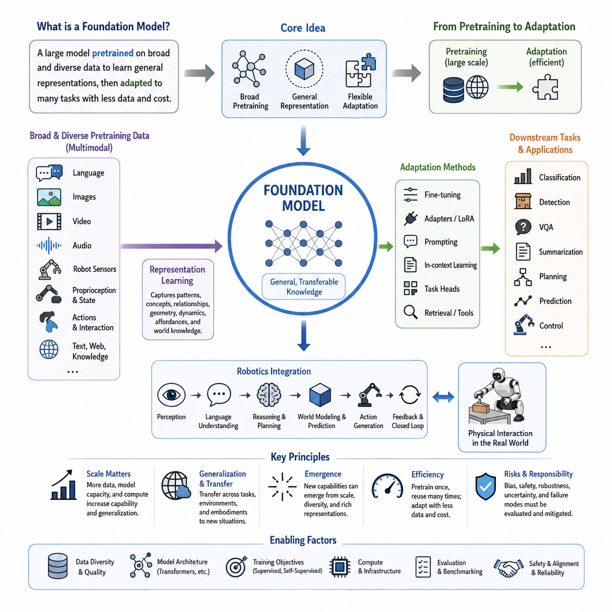{width="7.268055555555556in" height="7.268055555555556in"}

A foundation model is a large machine learning model trained on broad and diverse data so that it can serve as a reusable basis for many downstream applications. Instead of being designed for only one narrowly defined task, it learns general representations, patterns, relationships, and structures that can later be adapted to different objectives. This shift from task-specific models toward reusable computational foundations changes how intelligent systems are designed and deployed.

The defining idea is not simply that a foundation model contains many parameters. Its importance comes from the combination of broad pretraining, reusable representations, and adaptation across tasks. During pretraining, the model encounters sufficiently diverse examples to capture statistical regularities that are useful beyond the original training objective. The resulting knowledge can then be transferred through fine-tuning, prompting, adapters, task-specific heads, or other adaptation mechanisms.

Traditional supervised learning commonly begins with a specific problem, such as classifying images, detecting objects, predicting a numerical value, or controlling a particular robot. Engineers collect labeled data for that problem and train a model specifically for it. A foundation-model approach reverses much of this workflow. A broadly capable model is pretrained first, after which specialized capabilities are derived from the shared representation rather than independently learned from scratch.

This approach separates two important stages of machine learning: acquiring broadly reusable knowledge and adapting that knowledge to particular tasks. Pretraining can require enormous datasets, substantial computational resources, and long optimization cycles, but the resulting model may support many applications. Adaptation can then be performed with much smaller datasets and lower computational cost, making the initial investment reusable across a potentially large ecosystem of downstream systems.

Foundation models became especially visible through large language models, where models trained on massive text corpora learned representations useful for question answering, summarization, translation, reasoning, coding, and dialogue. However, the concept is not limited to language. Foundation models can be constructed for vision, audio, video, multimodal data, scientific data, robotics, and combinations of these modalities. The underlying principle remains broad pretraining followed by flexible reuse and adaptation.

A central capability of a foundation model is representation learning. Raw observations such as words, pixels, sounds, sensor measurements, or robot states are transformed into internal representations that capture meaningful relationships within the data. Good representations preserve information that is useful across many tasks rather than encoding only the distinctions required by one predefined objective. This shared representational space is one reason knowledge learned during pretraining can transfer to previously unseen problems.

Scale is closely associated with foundation models because broader data, larger model capacity, and greater compute can increase the range of patterns that a model can learn. Scaling, however, is not merely a matter of increasing parameter count. Dataset diversity, data quality, architecture, optimization, context length, training objectives, and computational efficiency all influence the resulting capabilities. A very large model trained on narrow or poor-quality data may remain substantially less general than its size suggests.

Another important property is adaptation. A pretrained model rarely provides the optimal solution to every downstream problem without modification. Full fine-tuning can update most or all model parameters, while parameter-efficient approaches modify only a relatively small subset. Prompting and in-context learning can sometimes alter model behavior without changing parameters at all. Task heads, adapters, low-rank updates, retrieval systems, and specialized modules provide additional mechanisms for converting general representations into practical capabilities.

Foundation models also encourage multitask and multimodal thinking. Instead of maintaining completely separate models for every input type and task, developers can build architectures in which multiple forms of information contribute to shared representations. Images can be connected with language, video with temporal descriptions, and physical observations with actions. Such integration becomes particularly important when intelligent agents must understand environments through several sensing channels while following human instructions.

For robotics, the foundation-model concept introduces an important transition from models that recognize information to models that can eventually support physical behavior. A robot receives camera images, depth measurements, proprioception, force signals, spatial information, language instructions, and histories of previous interactions. A broadly pretrained model can potentially connect these observations to semantic concepts, spatial relationships, task structures, affordances, predictions, and action-relevant representations.

This does not mean that a conventional language or vision foundation model automatically becomes a robot controller. Physical systems introduce requirements that digital applications do not face in the same way. Actions have real consequences, control operates under timing constraints, sensors are noisy, embodiment changes the available action space, and errors can damage equipment or harm people. Robot foundation models therefore extend the foundation-model principle toward representations and policies grounded in physical interaction.

The distinction between knowledge and action is especially important. A model may understand that a cup is fragile, recognize its location, and describe how a person might grasp it, yet still lack the precision required to control a manipulator. Physical intelligence requires connecting semantic knowledge with geometry, dynamics, contact, kinematics, uncertainty, and temporal feedback. Foundation models for physical agents must therefore bridge high-level generalization and low-level constraints rather than treating them as independent problems.

Foundation models can also provide a common backbone for multiple robot capabilities. Perception, language grounding, task interpretation, planning, prediction, and action generation may share learned representations instead of operating as completely isolated modules. This does not necessarily eliminate modular robotics architectures. Rather, a foundation model can become a reusable intelligence layer that interacts with world models, planners, controllers, safety monitors, localization systems, and embodiment-specific interfaces.

Generalization is one of the strongest motivations for this architecture. A useful foundation model should transfer knowledge across objects, environments, instructions, tasks, and eventually different embodiments. Knowledge learned from one dataset may help interpret another environment, while semantic concepts learned from language and vision may reduce the amount of robot-specific data required for a new task. The objective is not perfect universality, but progressively reducing how much new learning is required whenever the operating conditions change.

Emergent capabilities are another reason foundation models attract attention. As training diversity, model capacity, and contextual information increase, models can sometimes perform behaviors that were not individually programmed as separate functions. These behaviors may arise from combinations of representations acquired during pretraining. Emergence should not be interpreted as guaranteed intelligence, however, because new capabilities can remain inconsistent, difficult to predict, and sensitive to distribution shifts or prompting conditions.

Foundation models therefore introduce both leverage and concentration of risk. Because many downstream systems depend on the same pretrained backbone, improvements to that backbone can benefit numerous applications simultaneously. The opposite is also true: biases, representation failures, unsafe behaviors, data problems, or incorrect assumptions embedded during pretraining may propagate into many downstream systems. Evaluation must therefore examine not only individual task accuracy but also robustness, transfer behavior, uncertainty, safety, and failure modes.

In Physical AI, the long-term significance of foundation models lies in their potential to provide a shared learning substrate connecting perception, knowledge, prediction, reasoning, and action. Rather than training every robot capability independently, developers can begin with broadly pretrained representations and progressively adapt them to environments, tasks, embodiments, and operational constraints. This creates the conceptual foundation for robot foundation models, vision-language models, vision-language-action models, and generalist robot policies explored in subsequent sections.

파운데이션 모델(Foundation Model)은 광범위하고 다양한 데이터로 학습되어 여러 다운스트림 애플리케이션(downstream application)의 재사용 가능한 기반으로 활용될 수 있는 대규모 머신러닝 모델(machine learning model)이다. 하나의 좁게 정의된 작업만을 위해 설계되는 대신, 다양한 목적에 맞게 이후 적응시킬 수 있는 일반적인 표현(representation), 패턴(pattern), 관계(relationship), 구조(structure)를 학습한다. 이러한 작업 특화 모델(task-specific model)에서 재사용 가능한 계산 기반(computational foundation)으로의 전환은 지능형 시스템(intelligent system)의 설계와 배포 방식을 변화시킨다.

파운데이션 모델(Foundation Model)을 정의하는 핵심은 단순히 많은 수의 파라미터(parameter)를 가지고 있다는 점이 아니다. 그 중요성은 광범위한 사전학습(pretraining), 재사용 가능한 표현(reusable representation), 그리고 다양한 작업에 대한 적응(adaptation)의 결합에서 나온다. 사전학습 과정에서 모델은 충분히 다양한 사례를 접하면서 최초의 학습 목적을 넘어 활용할 수 있는 통계적 규칙성(statistical regularity)을 습득한다. 이렇게 형성된 지식은 파인튜닝(fine-tuning), 프롬프팅(prompting), 어댑터(adapter), 작업 특화 헤드(task-specific head) 또는 다른 적응 메커니즘(adaptation mechanism)을 통해 전이될 수 있다.

전통적인 지도학습(supervised learning)은 일반적으로 이미지 분류(image classification), 객체 탐지(object detection), 수치 예측(numerical prediction), 특정 로봇 제어(robot control)와 같은 구체적인 문제에서 시작한다. 엔지니어는 해당 문제를 위한 라벨 데이터(labeled data)를 수집하고 그 작업에 특화된 모델을 학습한다. 파운데이션 모델 접근법(Foundation Model approach)은 이러한 흐름의 상당 부분을 반대로 전환한다. 먼저 폭넓은 능력을 가진 모델을 사전학습하고, 이후 각각을 처음부터 독립적으로 학습하는 대신 공유 표현(shared representation)으로부터 특화된 능력을 만들어낸다.

이 접근법은 머신러닝(machine learning)의 두 가지 중요한 단계를 분리한다. 하나는 폭넓게 재사용할 수 있는 지식의 획득이고, 다른 하나는 그 지식을 특정 작업에 적응시키는 것이다. 사전학습(pretraining)은 막대한 데이터셋(dataset), 상당한 계산 자원(computational resource), 긴 최적화 과정(optimization cycle)을 요구할 수 있지만, 결과 모델은 다양한 애플리케이션을 지원할 수 있다. 이후 적응(adaptation)은 훨씬 작은 데이터셋과 낮은 계산 비용으로 수행할 수 있어 초기 투자를 광범위한 다운스트림 시스템(downstream system)에서 재사용할 수 있게 한다.

파운데이션 모델(Foundation Model)은 특히 대규모 언어 모델(Large Language Model, LLM)을 통해 널리 알려졌다. 대규모 텍스트 말뭉치(text corpus)로 학습된 모델은 질의응답(question answering), 요약(summarization), 번역(translation), 추론(reasoning), 코딩(coding), 대화(dialogue)에 유용한 표현을 학습했다. 그러나 이 개념은 언어에 한정되지 않는다. 비전(vision), 오디오(audio), 비디오(video), 멀티모달 데이터(multimodal data), 과학 데이터(scientific data), 로보틱스(robotics), 그리고 이러한 모달리티(modality)의 조합을 위한 파운데이션 모델도 구축할 수 있다. 핵심 원리는 광범위한 사전학습 이후 유연하게 재사용하고 적응시키는 것이다.

파운데이션 모델(Foundation Model)의 핵심 능력 가운데 하나는 표현 학습(representation learning)이다. 단어, 픽셀(pixel), 소리, 센서 측정값(sensor measurement), 로봇 상태(robot state)와 같은 원시 관측(raw observation)은 데이터 내부의 의미 있는 관계를 포착하는 내부 표현(internal representation)으로 변환된다. 좋은 표현은 하나의 미리 정의된 목표에 필요한 구분만을 인코딩(encoding)하는 것이 아니라 다양한 작업에서 유용한 정보를 보존한다. 이러한 공유 표현 공간(shared representation space)은 사전학습에서 획득한 지식이 이전에 보지 못한 문제로 전이될 수 있는 중요한 이유 중 하나이다.

스케일(scale)은 파운데이션 모델과 밀접하게 연관된다. 더 광범위한 데이터, 더 큰 모델 용량(model capacity), 더 많은 계산 자원(compute)은 모델이 학습할 수 있는 패턴의 범위를 확장할 수 있기 때문이다. 그러나 스케일링(scaling)은 단순히 파라미터 수를 늘리는 것만을 의미하지 않는다. 데이터셋 다양성(dataset diversity), 데이터 품질(data quality), 아키텍처(architecture), 최적화(optimization), 컨텍스트 길이(context length), 학습 목표(training objective), 계산 효율성(computational efficiency)이 모두 결과적인 능력에 영향을 미친다. 매우 큰 모델이라도 좁거나 품질이 낮은 데이터로 학습된다면 크기가 암시하는 것보다 훨씬 낮은 일반성을 보일 수 있다.

또 다른 중요한 특성은 적응(adaptation)이다. 사전학습된 모델(pretrained model)이 아무런 수정 없이 모든 다운스트림 문제에 최적의 해답을 제공하는 경우는 드물다. 전체 파인튜닝(full fine-tuning)은 모델 파라미터의 대부분 또는 전체를 업데이트하는 반면, 파라미터 효율적 접근(parameter-efficient approach)은 상대적으로 적은 일부만 수정한다. 프롬프팅(prompting)과 인컨텍스트 학습(in-context learning)은 경우에 따라 파라미터를 변경하지 않고도 모델의 행동을 변화시킬 수 있다. 작업 헤드(task head), 어댑터(adapter), 저랭크 업데이트(low-rank update), 검색 시스템(retrieval system), 특화 모듈(specialized module) 역시 일반 표현을 실용적인 능력으로 변환하는 추가적인 메커니즘을 제공한다.

파운데이션 모델(Foundation Model)은 멀티태스크(multitask)와 멀티모달(multimodal) 관점도 촉진한다. 모든 입력 유형과 작업마다 완전히 별도의 모델을 유지하는 대신 여러 형태의 정보가 공유 표현(shared representation)에 기여하는 아키텍처를 구축할 수 있다. 이미지는 언어와 연결될 수 있고, 비디오는 시간적 설명(temporal description)과 연결될 수 있으며, 물리적 관측(physical observation)은 행동(action)과 연결될 수 있다. 이러한 통합은 지능형 에이전트(intelligent agent)가 여러 센싱 채널(sensing channel)을 통해 환경을 이해하면서 인간의 명령을 따라야 할 때 특히 중요해진다.

로보틱스(robotics)에서 파운데이션 모델 개념은 정보를 인식하는 모델에서 궁극적으로 물리적 행동(physical behavior)을 지원할 수 있는 모델로의 중요한 전환을 가져온다. 로봇은 카메라 이미지(camera image), 깊이 측정(depth measurement), 고유수용감각(proprioception), 힘 신호(force signal), 공간 정보(spatial information), 언어 명령(language instruction), 이전 상호작용의 이력(history)을 입력으로 받는다. 광범위하게 사전학습된 모델은 이러한 관측을 의미적 개념(semantic concept), 공간 관계(spatial relationship), 작업 구조(task structure), 어포던스(affordance), 예측(prediction), 행동 관련 표현(action-relevant representation)과 연결할 수 있는 잠재력을 가진다.

그렇다고 기존의 언어 또는 비전 파운데이션 모델(Foundation Model)이 자동으로 로봇 제어기(robot controller)가 되는 것은 아니다. 물리 시스템(physical system)은 디지털 애플리케이션과는 다른 요구사항을 갖는다. 행동은 현실 세계에서 실제 결과를 발생시키며, 제어는 시간 제약(timing constraint) 아래에서 수행되고, 센서에는 잡음(noise)이 존재하며, 임바디먼트(embodiment)는 사용 가능한 행동 공간(action space)을 변화시키고, 오류는 장비를 손상시키거나 사람에게 피해를 줄 수 있다. 따라서 로봇 파운데이션 모델(Robot Foundation Model)은 파운데이션 모델의 원리를 물리적 상호작용(physical interaction)에 기반한 표현과 정책(policy)으로 확장해야 한다.

지식(knowledge)과 행동(action)의 구분은 특히 중요하다. 모델이 컵이 깨지기 쉽다는 사실을 이해하고 위치를 인식하며 사람이 어떻게 잡을 수 있는지를 설명할 수 있더라도, 매니퓰레이터(manipulator)를 제어하는 데 필요한 정밀도를 갖추었다는 의미는 아니다. 물리적 지능(physical intelligence)은 의미적 지식을 기하학(geometry), 동역학(dynamics), 접촉(contact), 운동학(kinematics), 불확실성(uncertainty), 시간적 피드백(temporal feedback)과 연결해야 한다. 따라서 물리 에이전트(physical agent)를 위한 파운데이션 모델은 고수준 일반화(high-level generalization)와 저수준 제약(low-level constraint)을 독립된 문제로 취급하지 않고 서로 연결해야 한다.

파운데이션 모델(Foundation Model)은 여러 로봇 능력을 위한 공통 백본(common backbone)을 제공할 수도 있다. 인식(perception), 언어 그라운딩(language grounding), 작업 해석(task interpretation), 계획(planning), 예측(prediction), 행동 생성(action generation)은 완전히 분리된 모듈로 동작하는 대신 학습된 표현을 공유할 수 있다. 이것이 반드시 모듈형 로보틱스 아키텍처(modular robotics architecture)를 제거한다는 의미는 아니다. 오히려 파운데이션 모델은 월드 모델(world model), 플래너(planner), 제어기(controller), 안전 모니터(safety monitor), 위치추정 시스템(localization system), 임바디먼트 특화 인터페이스(embodiment-specific interface)와 상호작용하는 재사용 가능한 지능 계층(intelligence layer)이 될 수 있다.

일반화(generalization)는 이러한 아키텍처를 추구하는 가장 강력한 동기 가운데 하나이다. 유용한 파운데이션 모델(Foundation Model)은 객체(object), 환경(environment), 명령(instruction), 작업(task), 그리고 궁극적으로 서로 다른 임바디먼트(embodiment) 사이에서 지식을 전이할 수 있어야 한다. 하나의 데이터셋에서 학습한 지식이 다른 환경을 해석하는 데 도움을 줄 수 있으며, 언어와 비전에서 학습한 의미적 개념은 새로운 작업에 필요한 로봇 특화 데이터(robot-specific data)의 양을 줄일 수 있다. 목표는 완벽한 보편성(universality)이 아니라 운용 조건이 변할 때마다 필요한 새로운 학습의 양을 점진적으로 감소시키는 것이다.

창발적 능력(emergent capability) 역시 파운데이션 모델(Foundation Model)이 주목받는 이유 중 하나이다. 학습 데이터의 다양성, 모델 용량(model capacity), 컨텍스트 정보(contextual information)가 증가하면 개별 기능으로 명시적으로 프로그래밍되지 않았던 행동이 나타나는 경우가 있다. 이러한 행동은 사전학습 과정에서 획득된 여러 표현의 조합에서 발생할 수 있다. 그러나 창발성(emergence)을 보장된 지능으로 해석해서는 안 된다. 새로운 능력은 일관성이 부족할 수 있고 예측하기 어려우며 분포 변화(distribution shift)나 프롬프팅 조건(prompting condition)에 민감할 수 있기 때문이다.

따라서 파운데이션 모델(Foundation Model)은 높은 활용 가능성과 동시에 위험의 집중(concentration of risk)을 가져온다. 많은 다운스트림 시스템이 동일한 사전학습 백본(pretrained backbone)에 의존하기 때문에 백본의 개선은 수많은 애플리케이션에 동시에 이점을 제공할 수 있다. 반대로 사전학습 과정에 포함된 편향(bias), 표현 실패(representation failure), 안전하지 않은 행동(unsafe behavior), 데이터 문제(data problem), 잘못된 가정은 여러 다운스트림 시스템으로 확산될 수 있다. 따라서 평가는 개별 작업 정확도뿐만 아니라 강건성(robustness), 전이 행동(transfer behavior), 불확실성(uncertainty), 안전성(safety), 실패 모드(failure mode)를 함께 검토해야 한다.

피지컬 AI(Physical AI)에서 파운데이션 모델(Foundation Model)의 장기적인 중요성은 인식(perception), 지식(knowledge), 예측(prediction), 추론(reasoning), 행동(action)을 연결하는 공유 학습 기반(shared learning substrate)을 제공할 수 있다는 데 있다. 모든 로봇 능력을 독립적으로 학습하는 대신 폭넓게 사전학습된 표현에서 시작하여 환경, 작업, 임바디먼트, 운용 제약에 맞게 점진적으로 적응시킬 수 있다. 이는 이후 절에서 다루게 될 로봇 파운데이션 모델(Robot Foundation Model), 비전-언어 모델(Vision-Language Model, VLM), 비전-언어-행동 모델(Vision-Language-Action Model, VLA), 범용 로봇 정책(Generalist Robot Policy)을 이해하기 위한 개념적 기반을 형성한다.

## 01.02. Pretraining Adaptation and Downstream Tasks

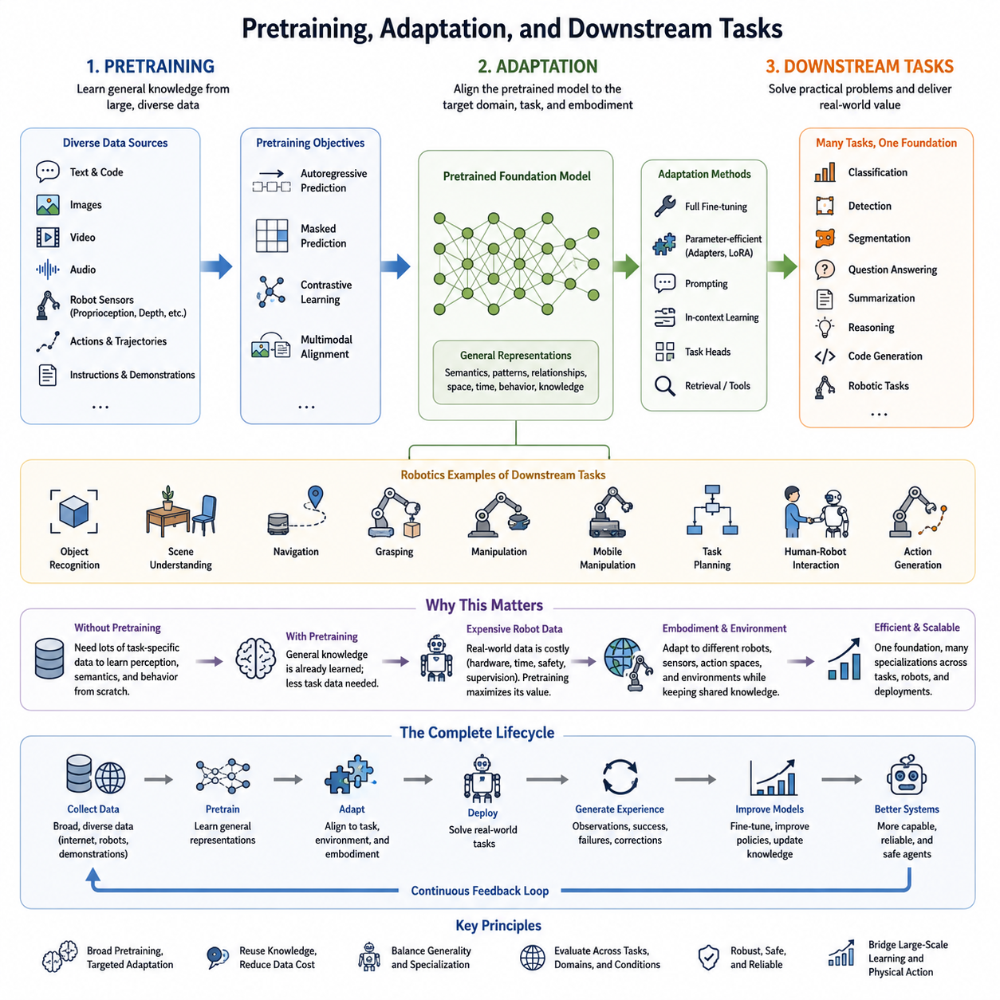{width="7.268055555555556in" height="7.268055555555556in"}

Pretraining is the stage in which a foundation model acquires broadly reusable knowledge before being specialized for a particular application. Instead of optimizing directly for one narrow task, the model learns from large and diverse datasets containing patterns that may later support many objectives. This creates a shared starting point from which specialized models, interfaces, policies, and intelligent agents can be developed with substantially less task-specific training.

The central purpose of pretraining is to construct useful internal representations rather than to solve every future application directly. During training, the model repeatedly predicts, reconstructs, aligns, contrasts, or otherwise learns relationships among elements of its data. Through this process, parameters gradually encode statistical structures, semantic relationships, visual patterns, temporal dependencies, spatial information, and other regularities that can later be reused when the model encounters downstream tasks.

Pretraining data can originate from many sources depending on the intended foundation model. Language models may use text and code, vision models may use images and video, while multimodal models can combine language, images, audio, video, and structured information. Robot foundation models extend this mixture toward camera streams, depth, proprioception, trajectories, actions, demonstrations, task instructions, and interaction histories, allowing representations to become increasingly grounded in physical environments.

The scale and diversity of pretraining data strongly influence what knowledge can be transferred later. A model exposed to many objects, environments, linguistic expressions, behaviors, and situations has more opportunities to discover reusable structure than a model trained on a narrowly constrained dataset. Diversity is therefore important not only for increasing dataset size but also for expanding coverage across concepts, domains, conditions, viewpoints, tasks, and potentially different robot embodiments.

Pretraining objectives determine what relationships the model is encouraged to capture. Autoregressive prediction can train a model to predict subsequent elements from previous context, while masked prediction reconstructs hidden information from surrounding observations. Contrastive learning can align related representations and separate unrelated ones, while multimodal objectives can associate images with text, video with descriptions, or robot observations with actions. Different objectives emphasize different aspects of transferable knowledge.

Once pretraining has produced a broadly capable model, adaptation converts its general representations into capabilities suited to a target problem. Adaptation is necessary because downstream applications have specific objectives, data distributions, interfaces, constraints, and performance requirements that cannot always be represented completely during general pretraining. The model therefore becomes a foundation on which more specialized capabilities are constructed rather than a finished solution for every possible task.

Full fine-tuning is one adaptation strategy in which most or all pretrained parameters are updated using downstream data. This can provide substantial flexibility because the entire model can change to fit the new domain, but it also requires significant memory, computation, and training data. It may additionally alter useful pretrained representations. For very large foundation models, these costs motivate techniques that preserve most of the original model while modifying only limited components.

Parameter-efficient fine-tuning reduces adaptation cost by updating a relatively small number of parameters. Methods such as adapters and low-rank adaptation can introduce trainable components while keeping much of the pretrained backbone fixed. This makes it possible to maintain a common foundation model while creating multiple specialized variants for different tasks, environments, robots, or customers without independently storing and retraining a complete model for every application.

Prompting provides another form of adaptation in which the model\'s behavior is conditioned through instructions or contextual examples without necessarily modifying its parameters. In-context learning extends this idea by presenting examples of the desired behavior within the model\'s input context. These approaches can rapidly change how a general model interprets a problem, although their effectiveness depends on the capabilities already acquired during pretraining and the information available in the context.

Downstream tasks are the practical problems for which pretrained knowledge is ultimately reused. In language systems, these tasks may include classification, summarization, question answering, information extraction, reasoning, and code generation. Vision systems may perform recognition, detection, segmentation, retrieval, and visual reasoning. A single pretrained backbone can therefore support many different outputs by combining shared representations with appropriate prompts, heads, adapters, or task-specific training.

For robotics, downstream tasks become substantially more diverse because intelligence must connect perception to physical behavior. A pretrained robot model might be adapted for object recognition, scene understanding, navigation, grasping, manipulation, mobile manipulation, task planning, human-robot interaction, or action generation. These tasks can share knowledge about objects and environments while requiring different output spaces, control frequencies, safety constraints, and embodiment-specific interfaces.

The relationship between pretraining and downstream learning can be understood as a transfer of prior knowledge. Without pretraining, a robot learning a new task may need enough task-specific examples to learn perception, semantics, spatial relationships, and behavior simultaneously. With a strong pretrained representation, much of this structure is already available. Downstream learning can then concentrate more directly on the information that distinguishes the new task, environment, or embodiment from previously learned situations.

Transfer is especially valuable when downstream data is expensive. Internet-scale text and image data can often be collected relatively cheaply, whereas robot interaction data requires physical hardware, operational time, calibration, supervision, maintenance, and safety management. Real-world demonstrations can therefore be orders of magnitude more difficult to acquire than digital data. Foundation-model development seeks to extract maximum value from broad pretraining so that scarce robot-specific data is used primarily for physical grounding and adaptation.

Robot adaptation must also account for embodiment. Two robots may understand the same instruction and observe similar objects while possessing different manipulators, joint limits, sensor configurations, payload capacities, mobility systems, and action spaces. A shared foundation model may provide common semantic and perceptual knowledge, but embodiment-specific components must translate this knowledge into feasible physical actions. Adaptation therefore acts as an interface between general intelligence and the constraints of a particular machine.

Environment-specific adaptation addresses another source of variation. A model pretrained across broad data may still encounter factories, warehouses, hospitals, homes, outdoor terrain, or other operational environments with unfamiliar visual conditions and interaction rules. Fine-tuning or contextual adaptation can incorporate local objects, maps, procedures, terminology, hazards, and operational policies while preserving general knowledge. This combination supports specialization without discarding the benefits of broad pretraining.

Task-specific adaptation can occur at several levels of an intelligent system. A perception head may be trained for a new object category, a language component may learn domain terminology, a planner may be conditioned on new task rules, or a policy may be adapted to generate different actions. Consequently, adaptation should not always be viewed as modifying one monolithic model. It can involve coordinating reusable pretrained components with specialized modules at different points in the perception-reasoning-action pipeline.

Evaluation connects pretraining, adaptation, and downstream deployment. Strong performance on a pretraining objective does not guarantee that the resulting representation will transfer effectively to real applications. Models must therefore be evaluated across multiple downstream tasks, domains, environments, and conditions. For physical agents, evaluation must additionally consider robustness, latency, uncertainty, recovery behavior, safety, and real-world task completion rather than relying only on offline prediction accuracy.

A major design question is how much capability should be learned during pretraining and how much should be left to adaptation. Broad pretraining favors reuse and generalization, while extensive downstream specialization can improve performance for a particular environment or robot. Excessive specialization, however, may reduce generality or cause catastrophic forgetting of previously learned capabilities. Practical foundation-model systems therefore balance shared knowledge with task-, environment-, and embodiment-specific adaptation.

Continual adaptation extends this lifecycle beyond a single deployment. Once a model operates in real environments, new observations, failures, corrections, demonstrations, and successful interactions can become additional learning signals. These data can support periodic fine-tuning, policy improvement, or future pretraining cycles. Foundation models can therefore participate in a data engine in which deployment generates experience, experience improves models, and improved models return to downstream systems with broader and more reliable capabilities.

The complete lifecycle can be viewed as a progression from broad data to reusable knowledge, from reusable knowledge to adaptation, and from adaptation to operational tasks. Pretraining provides the general representational foundation, adaptation aligns that foundation with specific requirements, and downstream deployment converts learned representations into measurable utility. For robot foundation models and Vision-Language-Action models, this progression becomes the bridge connecting large-scale learning with perception, reasoning, planning, and physical action in the real world.

사전학습(Pretraining)은 파운데이션 모델(Foundation Model)이 특정 애플리케이션(application)에 특화되기 전에 광범위하게 재사용 가능한 지식을 획득하는 단계이다. 하나의 좁은 작업에 직접 최적화하는 대신, 모델은 이후 다양한 목표를 지원할 수 있는 패턴을 포함한 대규모의 다양한 데이터셋(dataset)으로부터 학습한다. 이를 통해 작업별 학습(task-specific training)을 크게 줄이면서 특화 모델(specialized model), 인터페이스(interface), 정책(policy), 지능형 에이전트(intelligent agent)를 개발할 수 있는 공유 출발점을 형성한다.

사전학습(Pretraining)의 핵심 목적은 미래의 모든 애플리케이션을 직접 해결하는 것이 아니라 유용한 내부 표현(internal representation)을 구축하는 것이다. 학습 과정에서 모델은 데이터 요소 사이의 관계를 반복적으로 예측(predict), 복원(reconstruct), 정렬(align), 대조(contrast)하거나 다른 방식으로 학습한다. 이 과정을 통해 파라미터(parameter)는 통계적 구조(statistical structure), 의미적 관계(semantic relationship), 시각적 패턴(visual pattern), 시간적 의존성(temporal dependency), 공간 정보(spatial information)와 이후 다운스트림 작업(downstream task)에서 재사용할 수 있는 다양한 규칙성을 점진적으로 인코딩(encoding)한다.

사전학습 데이터(Pretraining Data)는 목표로 하는 파운데이션 모델(Foundation Model)에 따라 다양한 출처에서 얻을 수 있다. 언어 모델(language model)은 텍스트와 코드를 사용할 수 있고, 비전 모델(vision model)은 이미지와 비디오를 사용할 수 있으며, 멀티모달 모델(multimodal model)은 언어, 이미지, 오디오, 비디오, 구조화된 정보(structured information)를 결합할 수 있다. 로봇 파운데이션 모델(Robot Foundation Model)은 이러한 데이터 혼합을 카메라 스트림(camera stream), 깊이(depth), 고유수용감각(proprioception), 궤적(trajectory), 행동(action), 시연(demonstration), 작업 명령(task instruction), 상호작용 이력(interaction history)까지 확장하여 표현이 물리적 환경(physical environment)에 더욱 강하게 기반하도록 한다.

사전학습 데이터의 규모(scale)와 다양성(diversity)은 이후 어떤 지식을 전이할 수 있는지에 강한 영향을 미친다. 다양한 객체, 환경, 언어 표현, 행동, 상황을 경험한 모델은 제한된 데이터셋으로 학습한 모델보다 재사용 가능한 구조를 발견할 기회가 많다. 따라서 다양성은 단순히 데이터셋 크기를 증가시키는 것뿐만 아니라 개념(concept), 도메인(domain), 조건(condition), 시점(viewpoint), 작업(task), 그리고 잠재적으로 서로 다른 로봇 임바디먼트(robot embodiment)에 대한 범위를 확장한다는 점에서 중요하다.

사전학습 목표(Pretraining Objective)는 모델이 어떤 관계를 포착하도록 유도할 것인지를 결정한다. 자기회귀 예측(autoregressive prediction)은 이전 컨텍스트(context)로부터 이후 요소를 예측하도록 모델을 학습할 수 있으며, 마스킹 예측(masked prediction)은 주변 관측으로부터 숨겨진 정보를 복원한다. 대조학습(contrastive learning)은 관련 표현을 정렬하고 관련 없는 표현을 분리할 수 있으며, 멀티모달 목표(multimodal objective)는 이미지와 텍스트, 비디오와 설명, 또는 로봇 관측(robot observation)과 행동을 연결할 수 있다. 서로 다른 목표는 전이 가능한 지식(transferable knowledge)의 서로 다른 측면을 강조한다.

사전학습을 통해 폭넓은 능력을 갖춘 모델이 만들어지면 적응(Adaptation)은 일반적인 표현을 목표 문제에 적합한 능력으로 변환한다. 다운스트림 애플리케이션(downstream application)은 일반적인 사전학습만으로 완전히 표현하기 어려운 특정 목표, 데이터 분포(data distribution), 인터페이스, 제약조건(constraint), 성능 요구사항을 갖기 때문에 적응이 필요하다. 따라서 모델은 모든 가능한 작업을 위한 완성된 해결책이라기보다 더욱 특화된 능력을 구축할 수 있는 기반으로 기능한다.

전체 파인튜닝(Full Fine-Tuning)은 다운스트림 데이터(downstream data)를 사용하여 사전학습된 파라미터의 대부분 또는 전체를 업데이트하는 적응 전략이다. 전체 모델이 새로운 도메인에 맞게 변화할 수 있기 때문에 높은 유연성을 제공하지만 상당한 메모리(memory), 계산량(computation), 학습 데이터를 요구한다. 또한 기존에 유용했던 사전학습 표현을 변화시킬 수도 있다. 매우 큰 파운데이션 모델에서는 이러한 비용 때문에 원래 모델의 대부분을 유지하면서 제한된 구성요소만 변경하는 기술이 중요해진다.

파라미터 효율적 파인튜닝(Parameter-Efficient Fine-Tuning)은 상대적으로 적은 수의 파라미터만 업데이트하여 적응 비용을 줄인다. 어댑터(adapter)와 저랭크 적응(Low-Rank Adaptation, LoRA) 같은 방법은 사전학습 백본(pretrained backbone)의 대부분을 고정하면서 학습 가능한 구성요소를 추가할 수 있다. 이를 통해 모든 애플리케이션마다 완전한 모델을 독립적으로 저장하고 다시 학습하지 않고도 하나의 공통 파운데이션 모델을 유지하면서 서로 다른 작업, 환경, 로봇 또는 고객을 위한 여러 특화 버전(specialized variant)을 만들 수 있다.

프롬프팅(Prompting)은 반드시 모델의 파라미터를 수정하지 않고 명령(instruction)이나 문맥적 예제(contextual example)를 통해 모델의 행동을 조건화하는 또 다른 적응 방식이다. 인컨텍스트 학습(In-Context Learning)은 모델의 입력 컨텍스트 안에 원하는 행동의 예제를 제시함으로써 이러한 개념을 확장한다. 이러한 접근법은 일반 모델이 문제를 해석하는 방식을 빠르게 변경할 수 있지만, 그 효과는 사전학습에서 이미 획득한 능력과 컨텍스트에서 제공되는 정보에 의존한다.

다운스트림 작업(Downstream Task)은 사전학습된 지식이 궁극적으로 재사용되는 실질적인 문제이다. 언어 시스템(language system)에서는 분류(classification), 요약(summarization), 질의응답(question answering), 정보 추출(information extraction), 추론(reasoning), 코드 생성(code generation) 등이 포함될 수 있다. 비전 시스템(vision system)은 인식(recognition), 탐지(detection), 분할(segmentation), 검색(retrieval), 시각적 추론(visual reasoning)을 수행할 수 있다. 따라서 하나의 사전학습 백본은 적절한 프롬프트(prompt), 헤드(head), 어댑터(adapter), 작업 특화 학습(task-specific training)과 결합하여 다양한 출력을 지원할 수 있다.

로보틱스(Robotics)에서는 지능이 인식(perception)과 물리적 행동(physical behavior)을 연결해야 하기 때문에 다운스트림 작업이 훨씬 다양해진다. 사전학습된 로봇 모델은 객체 인식(object recognition), 장면 이해(scene understanding), 내비게이션(navigation), 파지(grasping), 조작(manipulation), 모바일 매니퓰레이션(mobile manipulation), 작업 계획(task planning), 인간-로봇 상호작용(human-robot interaction), 행동 생성(action generation)에 적응될 수 있다. 이러한 작업들은 객체와 환경에 대한 지식을 공유하면서도 서로 다른 출력 공간(output space), 제어 주기(control frequency), 안전 제약(safety constraint), 임바디먼트 특화 인터페이스(embodiment-specific interface)를 요구할 수 있다.

사전학습(Pretraining)과 다운스트림 학습(downstream learning)의 관계는 사전 지식(prior knowledge)의 전이로 이해할 수 있다. 사전학습이 없다면 새로운 작업을 배우는 로봇은 인식, 의미론(semantics), 공간 관계(spatial relationship), 행동을 동시에 학습하기 위해 충분한 작업 특화 예제가 필요할 수 있다. 강력한 사전학습 표현이 있다면 이러한 구조의 상당 부분이 이미 제공된다. 따라서 다운스트림 학습은 새로운 작업, 환경 또는 임바디먼트를 기존에 학습된 상황과 구별하는 정보에 보다 직접적으로 집중할 수 있다.

전이(Transfer)는 다운스트림 데이터 수집 비용이 높을 때 특히 중요하다. 인터넷 규모의 텍스트와 이미지 데이터는 상대적으로 저렴하게 수집할 수 있지만, 로봇 상호작용 데이터(robot interaction data)는 물리적 하드웨어, 운용 시간, 캘리브레이션(calibration), 감독(supervision), 유지보수(maintenance), 안전 관리(safety management)를 필요로 한다. 따라서 현실 세계의 시연(real-world demonstration)은 디지털 데이터보다 훨씬 획득하기 어려울 수 있다. 파운데이션 모델 개발은 광범위한 사전학습으로부터 최대한의 가치를 추출하여 희소한 로봇 특화 데이터가 주로 물리적 그라운딩(physical grounding)과 적응에 사용되도록 하는 것을 추구한다.

로봇 적응(Robot Adaptation)은 임바디먼트(Embodiment)도 고려해야 한다. 두 로봇이 동일한 명령을 이해하고 유사한 객체를 관측하더라도 서로 다른 매니퓰레이터(manipulator), 관절 제한(joint limit), 센서 구성(sensor configuration), 페이로드 용량(payload capacity), 이동 시스템(mobility system), 행동 공간(action space)을 가질 수 있다. 공유 파운데이션 모델은 공통된 의미 및 지각 지식을 제공할 수 있지만, 임바디먼트 특화 구성요소는 이러한 지식을 실행 가능한 물리적 행동으로 변환해야 한다. 따라서 적응은 일반 지능(general intelligence)과 특정 기계의 제약조건 사이를 연결하는 인터페이스 역할을 한다.

환경 특화 적응(Environment-Specific Adaptation)은 또 다른 변화 요인을 다룬다. 광범위한 데이터로 사전학습된 모델이라도 공장, 창고, 병원, 가정, 야외 지형과 같은 운용 환경에서 익숙하지 않은 시각 조건과 상호작용 규칙을 만날 수 있다. 파인튜닝 또는 문맥적 적응(contextual adaptation)은 일반 지식을 유지하면서 지역 객체(local object), 지도(map), 절차(procedure), 전문 용어(terminology), 위험요소(hazard), 운용 정책(operational policy)을 통합할 수 있다. 이러한 조합은 광범위한 사전학습의 이점을 버리지 않으면서 전문화를 가능하게 한다.

작업 특화 적응(Task-Specific Adaptation)은 지능형 시스템의 여러 수준에서 발생할 수 있다. 새로운 객체 범주를 위해 인식 헤드(perception head)를 학습하거나, 언어 구성요소가 도메인 전문 용어를 학습하거나, 플래너(planner)가 새로운 작업 규칙에 따라 조건화되거나, 정책(policy)이 다른 행동을 생성하도록 적응될 수 있다. 따라서 적응을 항상 하나의 단일 거대 모델(monolithic model)을 수정하는 것으로 볼 필요는 없다. 인식-추론-행동 파이프라인(perception-reasoning-action pipeline)의 서로 다른 지점에서 재사용 가능한 사전학습 구성요소와 특화 모듈을 조정하는 과정이 될 수 있다.

평가(Evaluation)는 사전학습, 적응, 다운스트림 배포(downstream deployment)를 연결한다. 사전학습 목표에서 높은 성능을 보인다고 해서 결과적인 표현이 실제 애플리케이션으로 효과적으로 전이된다는 보장은 없다. 따라서 모델은 여러 다운스트림 작업, 도메인, 환경, 조건에 걸쳐 평가되어야 한다. 물리 에이전트(physical agent)의 경우 오프라인 예측 정확도(offline prediction accuracy)에만 의존하지 않고 강건성(robustness), 지연시간(latency), 불확실성(uncertainty), 복구 행동(recovery behavior), 안전성(safety), 현실 세계 작업 완료(real-world task completion)를 추가로 고려해야 한다.

중요한 설계 문제는 사전학습에서 얼마나 많은 능력을 학습하고 적응 단계에 얼마나 많은 부분을 남겨둘 것인가이다. 광범위한 사전학습은 재사용성과 일반화(generalization)에 유리한 반면, 광범위한 다운스트림 전문화는 특정 환경이나 로봇에서 성능을 향상시킬 수 있다. 그러나 지나친 전문화는 일반성을 감소시키거나 기존에 학습한 능력의 파국적 망각(catastrophic forgetting)을 발생시킬 수 있다. 따라서 실용적인 파운데이션 모델 시스템은 공유 지식(shared knowledge)과 작업, 환경, 임바디먼트 특화 적응 사이의 균형을 유지해야 한다.

지속적 적응(Continual Adaptation)은 이러한 생명주기(lifecycle)를 단일 배포 이후까지 확장한다. 모델이 실제 환경에서 작동하기 시작하면 새로운 관측, 실패, 수정, 시연, 성공적인 상호작용이 추가적인 학습 신호(learning signal)가 될 수 있다. 이러한 데이터는 주기적인 파인튜닝, 정책 개선(policy improvement), 또는 미래의 사전학습 주기를 지원할 수 있다. 따라서 파운데이션 모델은 배포가 경험을 생성하고, 경험이 모델을 개선하며, 개선된 모델이 더욱 폭넓고 신뢰할 수 있는 능력을 갖추어 다시 다운스트림 시스템으로 돌아가는 데이터 엔진(data engine)에 참여할 수 있다.

전체 생명주기(Lifecycle)는 광범위한 데이터에서 재사용 가능한 지식으로, 재사용 가능한 지식에서 적응으로, 그리고 적응에서 실제 운용 작업으로 진행되는 과정으로 이해할 수 있다. 사전학습(Pretraining)은 일반적인 표현 기반을 제공하고, 적응(Adaptation)은 그 기반을 구체적인 요구사항에 맞게 정렬하며, 다운스트림 배포(Downstream Deployment)는 학습된 표현을 측정 가능한 실용적 가치로 변환한다. 로봇 파운데이션 모델(Robot Foundation Model)과 비전-언어-행동 모델(Vision-Language-Action Model, VLA)에서 이러한 과정은 대규모 학습(large-scale learning)을 현실 세계의 인식, 추론, 계획, 물리적 행동과 연결하는 핵심적인 다리가 된다.

## 01.03. Scaling Data Models and Compute

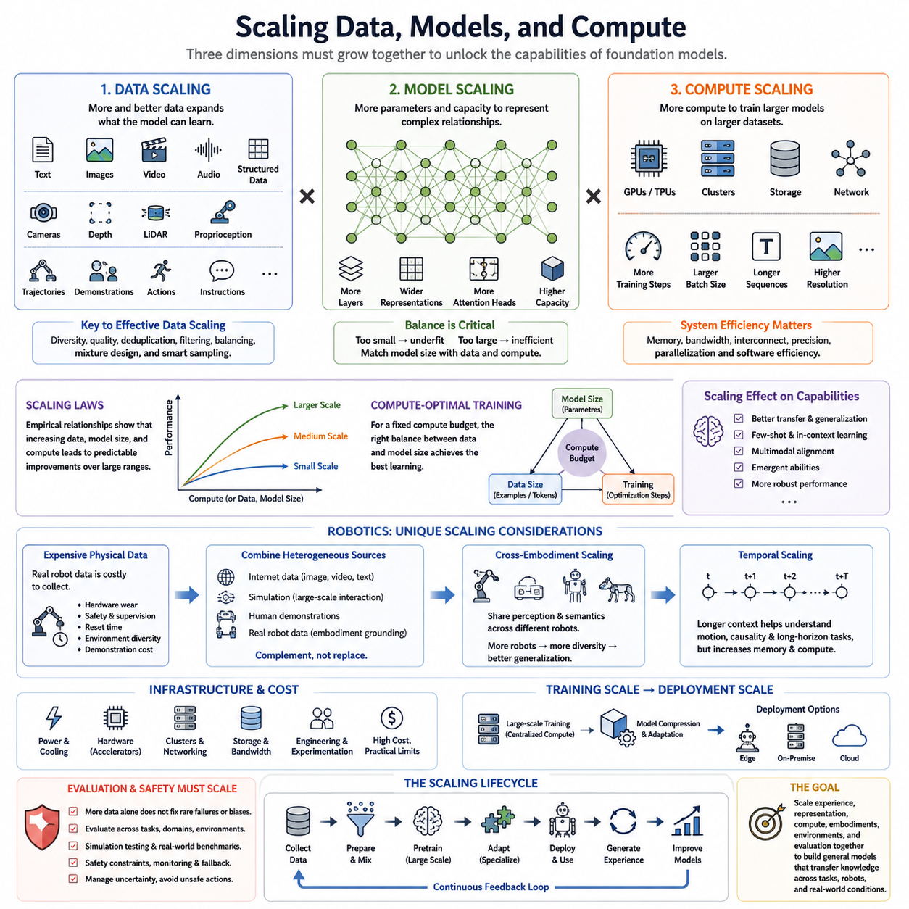{width="7.268055555555556in" height="7.268055555555556in"}

Scaling is one of the central mechanisms behind the development of modern foundation models. Rather than improving capability only through task-specific algorithms, foundation-model development increases the amount and diversity of training data, model capacity, and computational resources available during learning. These three dimensions interact closely, and useful scaling requires them to grow in a coordinated way rather than treating any single dimension as sufficient by itself.

Data scaling expands the experience from which a model can learn reusable representations. Larger datasets expose models to more concepts, objects, linguistic structures, environments, behaviors, and unusual situations. For multimodal foundation models, scale can include text, images, audio, video, structured information, and other modalities. Robot foundation models extend this space further with sensor observations, trajectories, demonstrations, actions, task instructions, and physical interaction data.

Increasing dataset size alone does not guarantee better learning. Data diversity and quality determine whether additional examples introduce useful information or merely repeat existing patterns. Duplicate, corrupted, incorrectly labeled, low-information, or strongly biased samples can consume compute without providing proportional benefits. Effective data scaling therefore includes collection, filtering, deduplication, balancing, quality assessment, mixture design, and sampling strategies alongside simple growth in the number of training examples.

Dataset composition becomes increasingly important as foundation models combine multiple domains and modalities. If one source dominates training, the model may allocate disproportionate capacity to its patterns while underlearning less frequent but important information. Training mixtures must therefore balance common knowledge against specialized data. In robotics, this problem includes balancing internet-scale vision-language knowledge with scarce robot demonstrations, physical trajectories, embodiment-specific observations, and interaction experience.

Model scaling increases the representational and computational capacity available to learn structure from large datasets. Larger neural networks can contain more layers, wider hidden representations, more attention components, or other architectural capacity. This additional capacity allows increasingly complex relationships to be represented, but parameter count alone is not equivalent to intelligence. Architecture, optimization, data coverage, training objectives, and inference constraints determine whether additional parameters are used effectively.

A model that is too small relative to its training data may lack sufficient capacity to absorb the available information. Conversely, an extremely large model trained with insufficient data may use its parameters inefficiently and fail to realize the expected improvement. Scaling therefore requires balancing model size with the amount of useful training information. The objective is not simply to construct the largest possible network but to allocate parameters where they can produce meaningful improvements in representation and transfer.

Compute scaling provides the processing required to train larger models on larger datasets. Training modern foundation models involves enormous numbers of tensor operations distributed across GPUs, accelerators, servers, and sometimes large computing clusters. Increased compute can support more parameters, more training tokens or samples, larger batches, longer sequences, higher-resolution observations, and additional optimization steps. Compute therefore connects the theoretical scale of data and models with what can practically be trained.

Computational scale is constrained by more than the number of available accelerators. Memory capacity, memory bandwidth, communication bandwidth, storage throughput, interconnect topology, numerical precision, parallelization strategy, and software efficiency can determine actual training performance. Large-scale training systems must keep accelerators supplied with data while coordinating parameter updates across devices. Poor infrastructure utilization can make nominally powerful hardware deliver far less effective compute than its specifications suggest.

Scaling laws describe empirical relationships between resources and model performance. Across many model families, increasing data, parameters, and compute has produced relatively predictable improvements over substantial ranges of scale. These observations make it possible to estimate how additional resources may affect training loss or downstream performance. Scaling laws do not guarantee that every capability improves uniformly, but they provide a framework for thinking about resource allocation before committing to expensive training runs.

Compute-optimal training emphasizes that a fixed computational budget should be divided appropriately between model size and training data. Spending most of the budget on an oversized model while providing too little training information can be inefficient. Likewise, repeatedly processing enormous datasets with insufficient model capacity may waste useful information. Practical scaling therefore involves selecting a model-data combination that extracts as much learning value as possible from the available computational budget.

Multimodal scaling introduces additional complexity because different modalities have different information density, dimensionality, sampling rates, and computational requirements. Text can be represented as relatively compact token sequences, while images and video may generate large numbers of visual tokens. Robot sensor streams can include multiple cameras, depth, LiDAR, proprioception, and temporal histories. Scaling multimodal systems therefore requires decisions about encoding, tokenization, compression, fusion, and temporal sampling.

Video and robotics make temporal scaling particularly important. A single image describes one moment, whereas physical behavior unfolds across sequences of states and actions. Increasing temporal context can help models understand motion, causality, task progress, and long-horizon dependencies, but it also increases memory and compute requirements. Efficient representations are therefore needed to preserve important temporal information without forcing every sensor measurement to receive equal computational attention.

Robot data presents a special scaling bottleneck because physical experience is expensive to generate. A language model can learn from vast quantities of existing digital text, while robot trajectories require machines to operate in the physical world or realistic simulation. Hardware wear, human supervision, safety constraints, reset time, environmental diversity, and demonstration cost limit collection rates. Consequently, robot foundation models cannot depend on physical data scaling in exactly the same way as language models depend on text.

One strategy is to combine heterogeneous sources of experience. Internet images and video can provide broad semantic and visual knowledge, simulation can generate large quantities of controlled interaction, human demonstrations can provide behavioral structure, and real robot data can supply embodiment-specific physical grounding. The resulting data mixture allows expensive robot experience to complement rather than replace cheaper sources of knowledge, increasing the effective scale available to a robot foundation model.

Cross-embodiment data can provide another dimension of scaling. Instead of collecting data independently for every robot, training can combine experience from manipulators, mobile robots, mobile manipulators, humanoids, quadrupeds, and other platforms. Shared perceptual and semantic patterns may transfer across these embodiments even when their action spaces differ. This creates the possibility that increasing the diversity of robots contributes to generalization in addition to merely increasing the number of trajectories.

Scaling also affects capabilities observed after training. Larger and more diverse training regimes can improve transfer, few-shot adaptation, contextual learning, multimodal alignment, and performance on tasks that were not explicitly optimized individually. Some capabilities may become more visible only beyond particular levels of model, data, or compute scale. However, such emergence is not guaranteed, and capability growth can be uneven across domains, making systematic evaluation necessary throughout the scaling process.

The cost of scaling creates practical limits. Training requires accelerator hardware, electricity, cooling, networking, storage, engineering effort, and substantial experimentation. Larger models also create downstream costs because inference may require more memory, power, and latency. For Physical AI, these constraints are especially important because models may eventually need to operate on edge computers carried by robots rather than exclusively in large data centers with abundant power and cooling.

Training scale and deployment scale should therefore be considered together. A large model can be pretrained using substantial centralized compute and later compressed or adapted for deployment through quantization, pruning, distillation, efficient attention, or smaller specialized models. Another possibility is to divide computation between edge, on-premise infrastructure, and cloud resources. The foundation model can thus benefit from large-scale training without requiring every deployed physical agent to reproduce the original training infrastructure.

Scaling must also include evaluation and safety rather than focusing exclusively on capability. More data and compute can improve average performance while leaving rare failures, distribution shifts, biases, hallucinations, unsafe actions, or poorly calibrated uncertainty unresolved. In robotics, increasing model capability without corresponding improvements in validation can amplify physical risk. Evaluation datasets, simulation testing, real-world benchmarks, safety constraints, runtime monitoring, and fallback mechanisms therefore need to scale alongside the model.

The broader principle is that foundation-model scaling is a systems problem involving data, model capacity, compute, infrastructure, training objectives, evaluation, and deployment constraints. Successful scaling occurs when these elements reinforce one another: diverse high-quality data supplies information, sufficient model capacity represents it, compute enables learning, and efficient infrastructure makes the process economically feasible. Adaptation and deployment then convert the resulting general representations into useful downstream capabilities.

For robot foundation models and Vision-Language-Action models, scaling ultimately aims to increase the breadth of physical situations in which learned knowledge can be reused. The challenge is not merely to create larger neural networks, but to scale experience, representation, computation, embodiments, environments, and evaluation together. This coordinated approach provides the foundation for moving from narrowly trained robot policies toward increasingly general models capable of transferring knowledge across tasks, robots, and real-world conditions.

스케일링(Scaling)은 현대 파운데이션 모델(Foundation Model)의 발전을 이끄는 핵심 메커니즘 가운데 하나이다. 작업 특화 알고리즘(task-specific algorithm)만을 통해 능력을 향상시키는 대신, 파운데이션 모델 개발에서는 학습에 사용되는 데이터의 양과 다양성, 모델 용량(model capacity), 계산 자원(computational resource)을 함께 증가시킨다. 이 세 가지 차원은 서로 밀접하게 상호작용하며, 효과적인 스케일링을 위해서는 어느 하나만 충분하다고 보는 것이 아니라 서로 조화롭게 확장해야 한다.

데이터 스케일링(Data Scaling)은 모델이 재사용 가능한 표현(reusable representation)을 학습할 수 있는 경험의 범위를 확장한다. 더 큰 데이터셋(dataset)은 모델을 더 많은 개념, 객체, 언어 구조, 환경, 행동, 특이 상황에 노출시킨다. 멀티모달 파운데이션 모델(multimodal foundation model)의 경우 텍스트, 이미지, 오디오, 비디오, 구조화된 정보 등이 포함될 수 있다. 로봇 파운데이션 모델(Robot Foundation Model)은 이를 센서 관측(sensor observation), 궤적(trajectory), 시연(demonstration), 행동(action), 작업 명령(task instruction), 물리적 상호작용 데이터까지 확장한다.

그러나 단순히 데이터셋 크기를 증가시킨다고 더 나은 학습이 보장되는 것은 아니다. 데이터 다양성(data diversity)과 품질(quality)은 추가된 사례가 유용한 정보를 제공하는지 아니면 기존 패턴을 반복할 뿐인지를 결정한다. 중복되거나 손상되고 잘못 라벨링되었거나 정보량이 낮거나 강한 편향을 가진 샘플은 그에 비례하는 이점을 제공하지 않으면서 계산 자원을 소비할 수 있다. 따라서 효과적인 데이터 스케일링에는 단순한 학습 사례의 증가뿐만 아니라 수집, 필터링(filtering), 중복 제거(deduplication), 균형 조정(balancing), 품질 평가(quality assessment), 데이터 혼합 설계(mixture design), 샘플링 전략(sampling strategy)이 포함된다.

파운데이션 모델(Foundation Model)이 여러 도메인(domain)과 모달리티(modality)를 결합할수록 데이터셋 구성(dataset composition)은 더욱 중요해진다. 하나의 데이터 소스가 학습을 지나치게 지배하면 모델은 해당 패턴에 과도한 용량을 할당하면서 빈도는 낮지만 중요한 정보를 충분히 학습하지 못할 수 있다. 따라서 학습 데이터 혼합(training mixture)은 일반적인 지식과 특화 데이터를 적절하게 균형화해야 한다. 로보틱스에서는 인터넷 규모의 비전-언어 지식(vision-language knowledge)과 희소한 로봇 시연, 물리적 궤적, 임바디먼트 특화 관측(embodiment-specific observation), 상호작용 경험을 균형 있게 구성하는 문제가 포함된다.

모델 스케일링(Model Scaling)은 대규모 데이터셋으로부터 구조를 학습할 수 있는 표현 및 계산 용량을 증가시킨다. 더 큰 신경망(neural network)은 더 많은 계층(layer), 더 넓은 은닉 표현(hidden representation), 더 많은 어텐션 구성요소(attention component) 또는 다른 형태의 아키텍처 용량을 포함할 수 있다. 이러한 추가 용량은 더욱 복잡한 관계를 표현할 수 있게 하지만 파라미터 수(parameter count) 자체가 지능과 동일한 것은 아니다. 아키텍처, 최적화(optimization), 데이터 범위, 학습 목표(training objective), 추론 제약(inference constraint)이 추가 파라미터가 얼마나 효과적으로 사용되는지를 결정한다.

학습 데이터에 비해 모델이 지나치게 작으면 사용 가능한 정보를 흡수할 충분한 용량이 부족할 수 있다. 반대로 데이터가 부족한 상태에서 지나치게 큰 모델을 학습하면 파라미터를 비효율적으로 사용하여 기대한 성능 향상을 달성하지 못할 수 있다. 따라서 스케일링은 모델 크기와 유용한 학습 정보의 양 사이에 균형을 요구한다. 목표는 단순히 가능한 가장 큰 네트워크를 구축하는 것이 아니라 표현(representation)과 전이(transfer)를 실질적으로 향상시킬 수 있는 곳에 파라미터를 배치하는 것이다.

컴퓨트 스케일링(Compute Scaling)은 더 큰 모델을 더 큰 데이터셋으로 학습하는 데 필요한 처리 능력을 제공한다. 현대의 파운데이션 모델 학습은 GPU, 가속기(accelerator), 서버(server), 대규모 컴퓨팅 클러스터(computing cluster)에 분산된 방대한 텐서 연산(tensor operation)을 포함한다. 컴퓨트 증가는 더 많은 파라미터, 더 많은 학습 토큰(training token) 또는 샘플, 더 큰 배치(batch), 더 긴 시퀀스(sequence), 더 높은 해상도의 관측, 추가적인 최적화 단계를 지원할 수 있다. 따라서 컴퓨트는 데이터와 모델의 이론적 규모를 실제로 학습 가능한 규모와 연결한다.

계산 규모(computational scale)는 사용 가능한 가속기의 수만으로 결정되지 않는다. 메모리 용량(memory capacity), 메모리 대역폭(memory bandwidth), 통신 대역폭(communication bandwidth), 저장장치 처리량(storage throughput), 인터커넥트 토폴로지(interconnect topology), 수치 정밀도(numerical precision), 병렬화 전략(parallelization strategy), 소프트웨어 효율성(software efficiency)이 실제 학습 성능을 결정할 수 있다. 대규모 학습 시스템은 여러 장치의 파라미터 업데이트를 조정하면서 가속기에 지속적으로 데이터를 공급해야 한다. 인프라 활용률이 낮으면 명목상 강력한 하드웨어도 사양에서 기대되는 것보다 훨씬 적은 유효 컴퓨트(effective compute)를 제공할 수 있다.

스케일링 법칙(Scaling Laws)은 자원과 모델 성능 사이에서 관찰되는 경험적 관계(empirical relationship)를 설명한다. 다양한 모델 계열에서 데이터, 파라미터, 컴퓨트를 증가시키면 상당한 스케일 범위에 걸쳐 비교적 예측 가능한 성능 향상이 관찰되어 왔다. 이러한 관찰을 통해 추가 자원이 학습 손실(training loss)이나 다운스트림 성능(downstream performance)에 어떤 영향을 줄지 추정할 수 있다. 스케일링 법칙이 모든 능력의 균일한 향상을 보장하지는 않지만, 비용이 큰 학습을 수행하기 전에 자원 배분(resource allocation)을 판단할 수 있는 프레임워크를 제공한다.

컴퓨트 최적 학습(Compute-Optimal Training)은 고정된 계산 예산(computational budget)을 모델 크기와 학습 데이터 사이에 적절하게 분배해야 한다는 점을 강조한다. 지나치게 큰 모델에 대부분의 예산을 사용하면서 충분한 학습 정보를 제공하지 않는 것은 비효율적일 수 있다. 마찬가지로 모델 용량이 부족한 상태에서 방대한 데이터셋을 반복 처리하면 유용한 정보가 낭비될 수 있다. 따라서 실용적인 스케일링에서는 사용 가능한 계산 예산으로 최대한의 학습 가치를 얻을 수 있는 모델-데이터 조합(model-data combination)을 선택해야 한다.

멀티모달 스케일링(Multimodal Scaling)은 서로 다른 모달리티가 서로 다른 정보 밀도(information density), 차원(dimensionality), 샘플링 속도(sampling rate), 계산 요구사항을 가지기 때문에 추가적인 복잡성을 발생시킨다. 텍스트는 비교적 압축된 토큰 시퀀스(token sequence)로 표현할 수 있지만 이미지와 비디오는 많은 수의 시각 토큰(visual token)을 생성할 수 있다. 로봇 센서 스트림은 여러 카메라, 깊이, 라이다(LiDAR), 고유수용감각(proprioception), 시간 이력(temporal history)을 포함할 수 있다. 따라서 멀티모달 시스템을 확장하려면 인코딩(encoding), 토큰화(tokenization), 압축(compression), 융합(fusion), 시간적 샘플링(temporal sampling)에 대한 결정이 필요하다.

비디오와 로보틱스에서는 시간적 스케일링(Temporal Scaling)이 특히 중요하다. 하나의 이미지는 특정 순간을 표현하지만 물리적 행동은 상태(state)와 행동(action)의 연속적인 시퀀스를 통해 전개된다. 시간적 컨텍스트(temporal context)를 증가시키면 모델이 움직임, 인과관계(causality), 작업 진행(task progress), 장기 의존성(long-horizon dependency)을 이해하는 데 도움이 될 수 있지만 메모리와 계산 요구량도 증가한다. 따라서 모든 센서 측정값에 동일한 계산 자원을 사용하지 않으면서 중요한 시간 정보를 보존할 수 있는 효율적인 표현이 필요하다.

로봇 데이터(Robot Data)는 물리적 경험을 생성하는 비용이 높기 때문에 특별한 스케일링 병목(scaling bottleneck)을 가진다. 언어 모델은 기존의 방대한 디지털 텍스트로부터 학습할 수 있지만 로봇 궤적은 기계가 현실 세계 또는 현실적인 시뮬레이션(simulation)에서 실제로 동작해야 생성된다. 하드웨어 마모, 인간 감독, 안전 제약, 리셋 시간(reset time), 환경 다양성, 시연 비용은 데이터 수집 속도를 제한한다. 따라서 로봇 파운데이션 모델은 언어 모델이 텍스트에 의존하는 것과 정확히 동일한 방식으로 물리 데이터 스케일링에 의존할 수 없다.

하나의 전략은 이질적인 경험 소스(heterogeneous source of experience)를 결합하는 것이다. 인터넷 이미지와 비디오는 폭넓은 의미 및 시각 지식을 제공하고, 시뮬레이션은 대량의 통제된 상호작용을 생성하며, 인간 시연(human demonstration)은 행동 구조(behavioral structure)를 제공하고, 실제 로봇 데이터는 임바디먼트 특화 물리적 그라운딩(embodiment-specific physical grounding)을 제공할 수 있다. 이러한 데이터 혼합을 통해 비용이 높은 로봇 경험이 상대적으로 저렴한 지식 소스를 대체하는 대신 보완하도록 하여 로봇 파운데이션 모델이 활용할 수 있는 유효 스케일(effective scale)을 증가시킨다.

교차 임바디먼트 데이터(Cross-Embodiment Data)는 또 다른 스케일링 차원을 제공할 수 있다. 모든 로봇에 대해 데이터를 독립적으로 수집하는 대신 매니퓰레이터, 모바일 로봇(mobile robot), 모바일 매니퓰레이터(mobile manipulator), 휴머노이드(humanoid), 4족 로봇(quadruped) 및 다른 플랫폼의 경험을 통합하여 학습할 수 있다. 행동 공간이 서로 다르더라도 공유되는 지각 및 의미 패턴은 임바디먼트 사이에서 전이될 수 있다. 이는 로봇의 다양성을 증가시키는 것이 단순히 궤적의 수만 늘리는 것이 아니라 일반화(generalization)에도 기여할 가능성을 만든다.

스케일링은 학습 이후 관찰되는 능력에도 영향을 미친다. 더 크고 다양한 학습 체계는 전이(transfer), 퓨샷 적응(few-shot adaptation), 문맥 학습(contextual learning), 멀티모달 정렬(multimodal alignment), 개별적으로 명시적 최적화를 수행하지 않은 작업의 성능을 향상시킬 수 있다. 일부 능력은 모델, 데이터 또는 컴퓨트가 특정 규모를 넘어선 이후 더욱 뚜렷하게 나타날 수 있다. 그러나 이러한 창발(emergence)이 보장되는 것은 아니며 능력 향상은 도메인에 따라 불균일할 수 있으므로 스케일링 과정 전체에 걸쳐 체계적인 평가가 필요하다.

스케일링 비용(cost of scaling)은 현실적인 한계를 만든다. 학습에는 가속기 하드웨어, 전력, 냉각(cooling), 네트워크, 저장장치, 엔지니어링 노력, 상당한 실험 비용이 필요하다. 더 큰 모델은 추론 과정에서도 더 많은 메모리, 전력, 지연시간(latency)을 요구할 수 있기 때문에 다운스트림 비용도 증가시킨다. 피지컬 AI(Physical AI)에서는 모델이 풍부한 전력과 냉각을 갖춘 대규모 데이터센터뿐만 아니라 로봇에 탑재된 엣지 컴퓨터(edge computer)에서도 동작해야 할 수 있으므로 이러한 제약이 특히 중요하다.

따라서 학습 스케일(training scale)과 배포 스케일(deployment scale)은 함께 고려해야 한다. 대규모 모델은 상당한 중앙집중형 컴퓨트(centralized compute)를 사용하여 사전학습한 후 양자화(quantization), 가지치기(pruning), 지식 증류(distillation), 효율적 어텐션(efficient attention), 또는 더 작은 특화 모델을 통해 배포용으로 압축하거나 적응시킬 수 있다. 또 다른 방법은 계산을 엣지(edge), 온프레미스(on-premise) 인프라, 클라우드(cloud) 자원으로 분할하는 것이다. 이를 통해 파운데이션 모델은 대규모 학습의 이점을 활용하면서 모든 물리 에이전트가 원래의 학습 인프라를 그대로 재현할 필요가 없게 된다.

스케일링은 능력 향상에만 집중하는 것이 아니라 평가(Evaluation)와 안전성(Safety)까지 포함해야 한다. 더 많은 데이터와 컴퓨트는 평균 성능을 향상시킬 수 있지만 희귀한 실패, 분포 변화(distribution shift), 편향(bias), 환각(hallucination), 안전하지 않은 행동(unsafe action), 부정확하게 보정된 불확실성(uncertainty)을 해결하지 못할 수 있다. 로보틱스에서는 검증 능력이 함께 향상되지 않은 상태에서 모델 능력만 증가하면 물리적 위험을 확대할 수 있다. 따라서 평가 데이터셋, 시뮬레이션 테스트, 현실 세계 벤치마크(real-world benchmark), 안전 제약, 런타임 모니터링(runtime monitoring), 폴백 메커니즘(fallback mechanism) 역시 모델과 함께 확장되어야 한다.

보다 넓은 관점에서 파운데이션 모델 스케일링(Foundation Model Scaling)은 데이터, 모델 용량, 컴퓨트, 인프라, 학습 목표, 평가, 배포 제약을 함께 다루는 시스템 문제(system problem)이다. 성공적인 스케일링은 이러한 요소가 서로를 강화할 때 이루어진다. 다양하고 품질 높은 데이터가 정보를 제공하고, 충분한 모델 용량이 이를 표현하며, 컴퓨트가 학습을 가능하게 하고, 효율적인 인프라가 전체 과정을 경제적으로 실현 가능하게 만든다. 이후 적응(adaptation)과 배포(deployment)를 통해 생성된 일반 표현이 유용한 다운스트림 능력으로 변환된다.

로봇 파운데이션 모델(Robot Foundation Model)과 비전-언어-행동 모델(Vision-Language-Action Model, VLA)에서 스케일링의 궁극적인 목표는 학습된 지식을 재사용할 수 있는 물리적 상황의 범위를 확장하는 것이다. 핵심 과제는 단순히 더 큰 신경망을 만드는 것이 아니라 경험(experience), 표현(representation), 계산(computation), 임바디먼트(embodiment), 환경(environment), 평가(evaluation)를 함께 확장하는 것이다. 이러한 조정된 접근법은 좁게 학습된 로봇 정책(robot policy)에서 벗어나 작업, 로봇, 현실 세계 조건 사이에서 지식을 전이할 수 있는 점점 더 범용적인 모델로 발전하기 위한 기반을 제공한다.

## 01.04. Representation Learning and Transfer

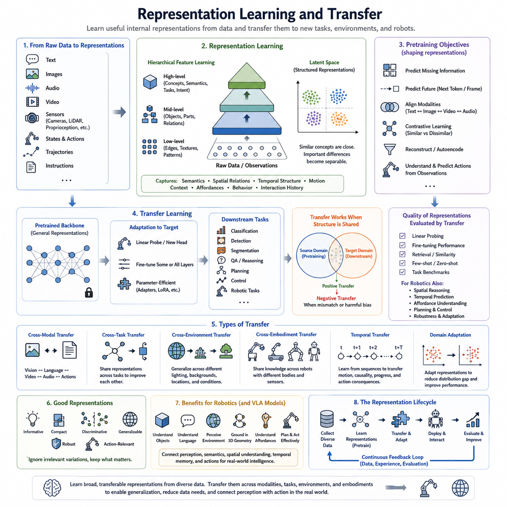{width="7.268055555555556in" height="7.268055555555556in"}

Representation learning is the process through which a model transforms raw data into internal structures that capture information useful for understanding and solving tasks. Instead of relying entirely on manually designed features, modern neural networks learn representations directly from data. Words, pixels, sounds, video frames, sensor measurements, robot states, and actions can therefore be mapped into learned feature spaces where meaningful patterns and relationships become easier to model.

A useful representation does more than reproduce the surface properties of its input. It captures underlying factors that remain relevant across different examples and tasks, such as semantic identity, spatial relationships, temporal structure, object properties, motion, context, and behavior. Foundation models depend heavily on this principle because their pretrained representations must support applications that may not have been explicitly specified when the original model was trained.

Representation learning typically builds information hierarchically. Early neural network layers may encode relatively local or simple patterns, while deeper processing combines them into increasingly abstract structures. In vision, representations may progress from edges and textures toward objects and scenes. In language, token-level patterns can develop into syntactic and semantic relationships. For robotics, representations may connect geometry, objects, motion, affordances, task context, and interaction history.

The latent space is a central concept in representation learning. Raw observations are transformed into vectors or other internal states in which relationships can be represented computationally. Similar concepts may occupy related regions, while important differences can become separable along learned dimensions. A well-structured latent representation can reduce the complexity of downstream learning because tasks operate on informative features instead of repeatedly extracting useful structure directly from raw sensor inputs.

Foundation-model pretraining creates representations from broad datasets so that the resulting latent structure is useful beyond the original training objective. A model trained to predict missing information, predict future elements, align modalities, or distinguish related and unrelated samples can acquire representations with broader utility. The pretraining objective therefore acts as a learning signal that determines which aspects of the data are preserved, compressed, separated, aligned, or emphasized.

Transfer learning uses knowledge acquired in one learning process to improve performance in another. Instead of initializing every downstream model randomly, developers begin with representations learned during pretraining and adapt them to a target task or domain. The underlying assumption is that different problems share useful structure. Knowledge about objects, language, spatial relationships, motion, or interaction learned from broad data can therefore reduce the amount of new learning required for a specific application.

The simplest form of transfer may keep a pretrained encoder fixed and train only a new task-specific head. This approach tests whether the existing representation already contains information suitable for the downstream objective. If greater adaptation is required, some or all pretrained layers can be fine-tuned. Parameter-efficient techniques can modify smaller components while preserving the shared backbone, allowing multiple downstream systems to reuse the same general representation with limited additional training.

Transfer is effective when the source knowledge and target problem share relevant structure. A visual representation learned from diverse images may transfer well to object recognition in a robot camera stream because both domains contain objects, shapes, textures, and spatial patterns. However, transfer becomes more difficult when the target distribution differs substantially from pretraining data. Lighting, sensor characteristics, viewpoints, environments, terminology, dynamics, or physical interaction can create significant domain gaps.

Positive transfer occurs when pretrained knowledge improves downstream learning, while negative transfer occurs when inherited representations or assumptions make adaptation more difficult. A model may emphasize features useful in its source domain but irrelevant or misleading in the target environment. Effective transfer therefore requires evaluating not only how much pretrained knowledge is available but also whether that knowledge matches the downstream task, data distribution, embodiment, and operational constraints.

Multimodal representation learning extends transfer across different forms of information. Images and language can be aligned so that visual concepts and textual descriptions occupy compatible representational structures. Video can add motion and temporal information, while audio can contribute event and environmental cues. For physical agents, robot observations and actions can extend these shared spaces toward interaction, allowing semantic knowledge to become increasingly connected with what a robot can perceive and physically do.

Cross-modal transfer is particularly valuable when one modality contains much more training data than another. Language and internet-scale vision data provide enormous sources of semantic knowledge, whereas robot interaction data is comparatively scarce and expensive. If representations are successfully aligned, concepts learned from abundant digital data can support robot perception, task interpretation, and reasoning. Robot-specific experience can then concentrate on grounding those concepts in geometry, dynamics, contact, and executable actions.

For robotics, representation learning must preserve information relevant to both understanding and control. A representation that is excellent for image classification may identify an object correctly while discarding its exact pose, distance, orientation, or contact geometry. Such information may be essential for manipulation. Robot foundation models therefore require representations that combine semantic abstraction with action-relevant physical details rather than optimizing exclusively for high-level recognition.

Affordances provide an important example of action-relevant representation. A robot should not only recognize that an object is a drawer, handle, container, or tool, but also represent possible interactions with it. Whether an object can be grasped, pushed, opened, traversed, lifted, or avoided depends on geometry, state, context, embodiment, and task goals. Representations that encode these relationships help connect perception with planning and physical action.

Temporal representation is equally important because physical environments evolve continuously. Robots must reason about how objects move, how their own actions change the environment, and how current observations relate to previous states. Representations derived from sequences can encode motion, persistence, causality, progress, and action consequences. This allows transfer to extend beyond static visual concepts toward reusable knowledge about processes, behaviors, and state transitions.

Cross-task transfer enables a model trained across many objectives to reuse common structure rather than learning every capability independently. Object understanding can support manipulation, spatial representations can support navigation and planning, and language grounding can connect human instructions with perceptual observations. When tasks share representations, improvement in one part of the training mixture may benefit other capabilities, although interference between tasks must also be managed through appropriate data and optimization strategies.

Cross-environment transfer addresses changes in operational context. A robot may learn general concepts in one set of environments and later operate in unfamiliar warehouses, factories, homes, hospitals, or outdoor spaces. Robust representations should preserve task-relevant structure despite variations in appearance, lighting, background, sensor noise, and object arrangement. Adaptation can then focus on genuinely new environmental characteristics instead of relearning fundamental concepts from the beginning.

Cross-embodiment transfer extends the idea further by sharing knowledge among robots with different physical forms. A manipulator, mobile robot, humanoid, and quadruped may perceive common objects and understand similar semantic goals while possessing very different action capabilities. Shared representations can encode common perception, language, spatial relationships, and task structure, while embodiment-specific representations describe morphology, kinematics, sensors, and available actions.

The quality of a representation can be evaluated through its usefulness for downstream transfer. Linear probing, fine-tuning, retrieval, few-shot learning, zero-shot evaluation, and task-specific benchmarks can reveal what information the representation contains and how easily it can be reused. For robot systems, evaluation should additionally examine whether representations support spatial reasoning, temporal prediction, affordance understanding, planning, control, robustness, and adaptation under real-world distribution changes.

Representation learning also involves compression and invariance. Models benefit from ignoring variations that do not matter for a task while retaining information that does. A robot should often recognize the same object despite changes in viewpoint or illumination, yet manipulation may require sensitivity to small changes in pose or state. The desired invariance therefore depends on downstream use, making representation design a balance between abstraction and preservation of physically meaningful detail.

The broader objective is to create representations that separate reusable knowledge from application-specific details. General semantic, perceptual, spatial, and behavioral structures can be learned at scale and shared across many systems, while specialized components adapt these representations to particular tasks, environments, and embodiments. This division allows foundation models to serve as reusable backbones rather than requiring each intelligent system to reconstruct its understanding of the world independently.

For Robot Foundation Models and Vision-Language-Action models, representation learning and transfer form the mechanism that connects broad pretraining with physical generalization. Knowledge learned from diverse language, vision, video, simulation, and robot experience can be organized into representations that support new tasks and environments with less additional data. The ultimate goal is a transferable internal model in which perception, semantics, spatial understanding, temporal structure, affordances, and action-relevant knowledge can be reused across increasingly diverse physical agents.

표현 학습(Representation Learning)은 모델이 원시 데이터(raw data)를 이해하고 작업을 해결하는 데 유용한 정보를 포착하는 내부 구조(internal structure)로 변환하는 과정이다. 현대의 신경망(neural network)은 사람이 직접 설계한 특징(feature)에 전적으로 의존하는 대신 데이터에서 표현을 직접 학습한다. 따라서 단어, 픽셀(pixel), 소리, 비디오 프레임(video frame), 센서 측정값(sensor measurement), 로봇 상태(robot state), 행동(action)은 의미 있는 패턴과 관계를 보다 쉽게 모델링할 수 있는 학습된 특징 공간(learned feature space)으로 매핑될 수 있다.

유용한 표현(representation)은 단순히 입력의 표면적 특성을 재현하는 것 이상을 수행한다. 의미적 정체성(semantic identity), 공간 관계(spatial relationship), 시간적 구조(temporal structure), 객체 속성(object property), 움직임(motion), 문맥(context), 행동(behavior)처럼 서로 다른 사례와 작업에서도 중요하게 유지되는 근본적인 요인을 포착한다. 파운데이션 모델(Foundation Model)은 사전학습된 표현이 최초 모델 학습 당시 명시적으로 지정되지 않았던 애플리케이션까지 지원해야 하므로 이러한 원리에 크게 의존한다.

표현 학습(Representation Learning)은 일반적으로 정보를 계층적으로 구축한다. 신경망의 초기 계층(layer)은 비교적 국소적이거나 단순한 패턴을 인코딩할 수 있으며, 더 깊은 처리는 이를 결합하여 점차 추상적인 구조를 형성한다. 비전(vision)에서는 에지(edge)와 텍스처(texture)에서 객체와 장면으로 발전할 수 있고, 언어에서는 토큰 수준의 패턴이 구문적·의미적 관계로 발전할 수 있다. 로보틱스(robotics)에서는 표현이 기하학(geometry), 객체, 움직임, 어포던스(affordance), 작업 문맥(task context), 상호작용 이력(interaction history)을 연결할 수 있다.

잠재 공간(Latent Space)은 표현 학습의 핵심 개념이다. 원시 관측(raw observation)은 관계를 계산적으로 표현할 수 있는 벡터(vector) 또는 다른 내부 상태(internal state)로 변환된다. 유사한 개념은 서로 관련된 영역에 위치할 수 있으며, 중요한 차이는 학습된 차원(dimension)을 따라 분리될 수 있다. 잘 구조화된 잠재 표현(latent representation)은 작업이 원시 센서 입력에서 매번 유용한 구조를 다시 추출하는 대신 정보성이 높은 특징을 활용할 수 있도록 하므로 다운스트림 학습(downstream learning)의 복잡성을 줄일 수 있다.

파운데이션 모델의 사전학습(pretraining)은 광범위한 데이터셋으로부터 표현을 생성하여 결과적인 잠재 구조(latent structure)가 최초 학습 목표를 넘어 유용하게 사용되도록 한다. 누락된 정보의 예측, 미래 요소의 예측, 모달리티 정렬(modality alignment), 관련된 샘플과 관련되지 않은 샘플의 구별 등을 수행하도록 학습된 모델은 보다 폭넓게 활용할 수 있는 표현을 획득할 수 있다. 따라서 사전학습 목표(pretraining objective)는 데이터의 어떤 측면을 보존, 압축(compression), 분리, 정렬 또는 강조할지를 결정하는 학습 신호(learning signal)로 작용한다.

전이 학습(Transfer Learning)은 하나의 학습 과정에서 획득한 지식을 다른 학습 과정의 성능 향상에 사용하는 방법이다. 모든 다운스트림 모델을 무작위로 초기화하는 대신 개발자는 사전학습 과정에서 학습된 표현으로 시작하여 목표 작업이나 도메인(domain)에 맞게 적응시킨다. 기본적인 가정은 서로 다른 문제들이 유용한 구조를 공유한다는 것이다. 따라서 광범위한 데이터에서 학습된 객체, 언어, 공간 관계, 움직임 또는 상호작용에 대한 지식은 특정 애플리케이션에 필요한 새로운 학습량을 감소시킬 수 있다.

가장 단순한 형태의 전이(transfer)는 사전학습된 인코더(pretrained encoder)를 고정하고 새로운 작업 특화 헤드(task-specific head)만 학습하는 방식일 수 있다. 이러한 접근법은 기존 표현이 이미 다운스트림 목표에 적합한 정보를 포함하고 있는지를 확인한다. 더 많은 적응이 필요하다면 사전학습된 계층 일부 또는 전체를 파인튜닝(fine-tuning)할 수 있다. 파라미터 효율적 기법(parameter-efficient technique)은 공유 백본(shared backbone)을 유지하면서 더 작은 구성요소를 수정하여 제한적인 추가 학습만으로 여러 다운스트림 시스템이 동일한 일반 표현을 재사용하도록 할 수 있다.

전이(Transfer)는 소스 지식(source knowledge)과 목표 문제(target problem)가 관련된 구조를 공유할 때 효과적이다. 다양한 이미지에서 학습된 시각 표현(visual representation)은 두 도메인 모두 객체, 형태, 텍스처, 공간 패턴을 포함하기 때문에 로봇 카메라 스트림(robot camera stream)의 객체 인식으로 잘 전이될 수 있다. 그러나 목표 분포(target distribution)가 사전학습 데이터와 크게 다르면 전이는 어려워진다. 조명, 센서 특성, 시점(viewpoint), 환경, 전문 용어, 동역학(dynamics), 물리적 상호작용의 차이가 상당한 도메인 격차(domain gap)를 만들 수 있다.

긍정적 전이(Positive Transfer)는 사전학습된 지식이 다운스트림 학습을 향상시키는 경우이며, 부정적 전이(Negative Transfer)는 기존 표현이나 가정이 오히려 적응을 어렵게 만드는 경우이다. 모델이 소스 도메인에서는 유용하지만 목표 환경에서는 관련이 없거나 오해를 유발하는 특징을 강조할 수 있다. 따라서 효과적인 전이를 위해서는 얼마나 많은 사전학습 지식을 보유하고 있는지만 평가하는 것이 아니라 그 지식이 다운스트림 작업, 데이터 분포, 임바디먼트(embodiment), 운용 제약(operational constraint)에 적합한지도 평가해야 한다.

멀티모달 표현 학습(Multimodal Representation Learning)은 서로 다른 정보 형태 사이로 전이의 범위를 확장한다. 이미지와 언어를 정렬하여 시각적 개념과 텍스트 설명이 호환 가능한 표현 구조를 갖도록 할 수 있다. 비디오는 움직임과 시간 정보를 추가하고 오디오는 사건 및 환경 단서를 제공할 수 있다. 물리 에이전트(physical agent)의 경우 로봇 관측과 행동을 이러한 공유 공간으로 확장하여 의미적 지식이 로봇이 인식하고 실제로 수행할 수 있는 행동과 점차 연결되도록 할 수 있다.

교차 모달 전이(Cross-Modal Transfer)는 한 모달리티가 다른 모달리티보다 훨씬 많은 학습 데이터를 가지고 있을 때 특히 유용하다. 언어와 인터넷 규모의 비전 데이터는 방대한 의미적 지식(semantic knowledge)을 제공하지만 로봇 상호작용 데이터는 상대적으로 희소하고 수집 비용이 높다. 표현이 성공적으로 정렬된다면 풍부한 디지털 데이터에서 학습한 개념을 로봇 인식, 작업 해석(task interpretation), 추론(reasoning)에 활용할 수 있다. 이후 로봇 특화 경험은 이러한 개념을 기하학, 동역학, 접촉(contact), 실행 가능한 행동(executable action)에 그라운딩(grounding)하는 데 집중할 수 있다.

로보틱스에서 표현 학습은 이해(understanding)와 제어(control)에 관련된 정보를 모두 보존해야 한다. 이미지 분류에 매우 뛰어난 표현은 객체를 정확하게 식별하면서도 정확한 자세(pose), 거리(distance), 방향(orientation), 접촉 기하학(contact geometry)을 버릴 수 있다. 그러나 이러한 정보는 조작(manipulation)에 필수적일 수 있다. 따라서 로봇 파운데이션 모델(Robot Foundation Model)은 고수준 인식만을 최적화하는 대신 의미적 추상화(semantic abstraction)와 행동 관련 물리적 세부정보(action-relevant physical detail)를 결합하는 표현을 필요로 한다.

어포던스(Affordance)는 행동 관련 표현(action-relevant representation)의 중요한 사례이다. 로봇은 객체가 서랍(drawer), 손잡이(handle), 용기(container), 도구(tool)라는 사실을 인식하는 것뿐만 아니라 해당 객체와 가능한 상호작용도 표현해야 한다. 객체를 잡거나, 밀거나, 열거나, 통과하거나, 들어 올리거나, 회피할 수 있는지는 기하학, 상태(state), 문맥, 임바디먼트, 작업 목표(task goal)에 따라 달라진다. 이러한 관계를 인코딩하는 표현은 인식과 계획(planning), 물리적 행동을 연결하는 데 도움을 준다.

시간적 표현(Temporal Representation) 역시 물리 환경이 지속적으로 변화하기 때문에 중요하다. 로봇은 객체가 어떻게 움직이는지, 자신의 행동이 환경을 어떻게 변화시키는지, 현재 관측이 이전 상태와 어떻게 연결되는지를 추론해야 한다. 시퀀스(sequence)로부터 생성된 표현은 움직임, 지속성(persistence), 인과관계(causality), 진행 상태(progress), 행동 결과(action consequence)를 인코딩할 수 있다. 이를 통해 전이는 정적인 시각 개념을 넘어 과정(process), 행동 양식(behavior), 상태 전이(state transition)에 대한 재사용 가능한 지식으로 확장될 수 있다.

교차 작업 전이(Cross-Task Transfer)는 여러 목표를 통해 학습된 모델이 각각의 능력을 독립적으로 학습하는 대신 공통 구조를 재사용하도록 한다. 객체 이해(object understanding)는 조작을 지원할 수 있고, 공간 표현(spatial representation)은 내비게이션(navigation)과 계획을 지원할 수 있으며, 언어 그라운딩(language grounding)은 인간의 명령을 지각 관측(perceptual observation)과 연결할 수 있다. 작업들이 표현을 공유하면 학습 데이터 혼합의 한 부분에서 이루어진 개선이 다른 능력에도 이점을 줄 수 있지만, 작업 사이의 간섭(interference)은 적절한 데이터 및 최적화 전략을 통해 관리해야 한다.

교차 환경 전이(Cross-Environment Transfer)는 운용 환경의 변화에 대응한다. 로봇은 특정 환경 집합에서 일반적인 개념을 학습한 후 익숙하지 않은 창고, 공장, 가정, 병원 또는 야외 공간에서 작동할 수 있다. 강건한 표현(robust representation)은 외형, 조명, 배경, 센서 잡음(sensor noise), 객체 배치가 달라져도 작업에 관련된 구조를 유지해야 한다. 그러면 적응(adaptation)은 기본 개념을 처음부터 다시 학습하는 대신 실제로 새로운 환경 특성에 집중할 수 있다.

교차 임바디먼트 전이(Cross-Embodiment Transfer)는 서로 다른 물리적 형태를 가진 로봇 사이에서 지식을 공유함으로써 이 개념을 더욱 확장한다. 매니퓰레이터(manipulator), 모바일 로봇(mobile robot), 휴머노이드(humanoid), 4족 로봇(quadruped)은 공통 객체를 인식하고 유사한 의미적 목표를 이해하면서도 매우 다른 행동 능력을 가질 수 있다. 공유 표현(shared representation)은 공통된 인식, 언어, 공간 관계, 작업 구조를 인코딩할 수 있으며, 임바디먼트 특화 표현(embodiment-specific representation)은 형태(morphology), 운동학(kinematics), 센서, 사용 가능한 행동을 설명한다.

표현의 품질은 다운스트림 전이(downstream transfer)에 얼마나 유용한지를 통해 평가할 수 있다. 선형 프로빙(linear probing), 파인튜닝, 검색(retrieval), 퓨샷 학습(few-shot learning), 제로샷 평가(zero-shot evaluation), 작업 특화 벤치마크(task-specific benchmark)는 표현에 어떤 정보가 포함되어 있으며 얼마나 쉽게 재사용할 수 있는지를 보여준다. 로봇 시스템에서는 표현이 공간 추론(spatial reasoning), 시간적 예측(temporal prediction), 어포던스 이해, 계획, 제어, 강건성(robustness), 현실 세계의 분포 변화에 대한 적응을 지원하는지도 추가로 평가해야 한다.

표현 학습(Representation Learning)은 압축(compression)과 불변성(invariance)도 포함한다. 모델은 작업에 중요하지 않은 변화는 무시하면서 중요한 정보는 유지할 때 이점을 얻는다. 로봇은 시점이나 조명이 달라져도 동일한 객체를 인식해야 하는 경우가 많지만, 조작에서는 자세나 상태의 작은 변화에도 민감해야 할 수 있다. 따라서 필요한 불변성은 다운스트림 용도에 따라 달라지며, 표현 설계는 추상화(abstraction)와 물리적으로 의미 있는 세부정보의 보존 사이에서 균형을 이루어야 한다.

보다 넓은 목표는 재사용 가능한 지식(reusable knowledge)을 애플리케이션 특화 세부정보(application-specific detail)로부터 분리하는 표현을 만드는 것이다. 일반적인 의미, 지각(perception), 공간, 행동 구조는 대규모로 학습되어 여러 시스템에서 공유될 수 있으며, 특화 구성요소는 이러한 표현을 특정 작업, 환경, 임바디먼트에 맞게 적응시킬 수 있다. 이러한 분리를 통해 파운데이션 모델은 각각의 지능형 시스템이 세계에 대한 이해를 독립적으로 처음부터 다시 구축하지 않고 재사용 가능한 백본(reusable backbone)으로 기능할 수 있다.

로봇 파운데이션 모델(Robot Foundation Model)과 비전-언어-행동 모델(Vision-Language-Action Model, VLA)에서 표현 학습과 전이는 광범위한 사전학습(pretraining)을 물리적 일반화(physical generalization)와 연결하는 메커니즘을 형성한다. 다양한 언어, 비전, 비디오, 시뮬레이션(simulation), 로봇 경험에서 학습한 지식을 표현으로 조직하면 더 적은 추가 데이터로 새로운 작업과 환경을 지원할 수 있다. 궁극적인 목표는 인식, 의미론(semantics), 공간 이해(spatial understanding), 시간적 구조, 어포던스, 행동 관련 지식을 점점 더 다양한 물리 에이전트에서 재사용할 수 있는 전이 가능한 내부 모델(transferable internal model)을 구축하는 것이다.

## 01.05. Self Supervised and Weakly Supervised Pretraining

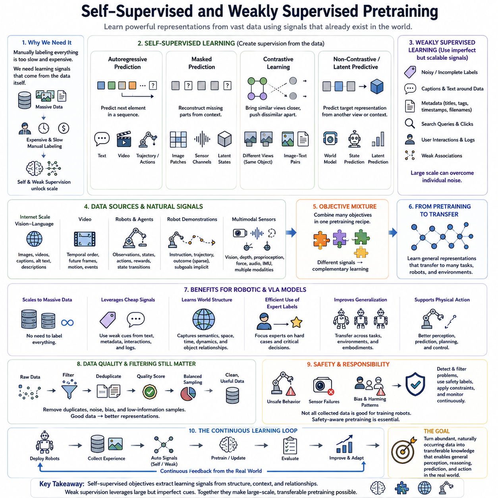{width="7.268055555555556in" height="7.268055555555556in"}

Large-scale foundation models require enormous amounts of training data, making conventional fully supervised learning difficult to scale. Manually labeling every text passage, image, video sequence, sensor observation, or robot trajectory would require excessive time and cost. Self-supervised and weakly supervised pretraining address this limitation by extracting learning signals from the structure, context, metadata, or naturally occurring relationships already present in large datasets.

Self-supervised learning creates supervision directly from the data rather than depending on manually assigned labels. Part of an observation can be hidden, transformed, or treated as a prediction target while another part provides context. The model learns by solving these automatically constructed prediction problems. Because the targets originate from the data itself, enormous unlabeled datasets can become useful training resources without requiring a human annotator to define every example.

Autoregressive prediction is a major form of self-supervised learning. A model receives previous elements of a sequence and predicts what comes next. Large language models commonly learn by predicting subsequent tokens, while related principles can be applied to images, video, trajectories, and action sequences. Successful prediction requires the model to capture regularities within the sequence, encouraging internal representations of semantics, context, temporal structure, and dependencies.

Masked prediction uses a different strategy by removing or hiding part of an input and requiring the model to reconstruct the missing information from the remaining context. Text tokens, image patches, video regions, sensor channels, or latent representations can serve as prediction targets. Rather than simply memorizing individual samples, the model must infer relationships among visible and hidden components, which can produce representations useful for downstream understanding and transfer.

Contrastive learning constructs representations by comparing related and unrelated observations. Different views of the same object, corresponding image-text pairs, nearby video frames, or observations from related contexts can be encouraged to produce similar representations, while unrelated examples are separated. This provides a powerful mechanism for learning invariances and semantic organization without requiring detailed category labels for every sample.

Non-contrastive and latent predictive methods provide additional self-supervised approaches. Instead of explicitly comparing positive and negative examples, models may predict a target representation from another observation or context. Learning in representation space can avoid reconstructing every low-level detail of raw input and concentrate on information that is more predictable and semantically meaningful. This principle is particularly relevant to predictive architectures and world-model-oriented learning.

Weakly supervised learning occupies a broader region between fully labeled and completely self-generated supervision. Training signals may come from noisy labels, incomplete annotations, automatically generated tags, captions, metadata, search queries, timestamps, user interactions, or associations created during normal data collection. These signals are less precise than carefully curated labels, but their scale can compensate for individual imperfections when appropriate filtering and robust learning methods are applied.

Internet-scale vision-language learning illustrates the value of weak supervision. Images and videos are frequently accompanied by captions, surrounding text, filenames, descriptions, or other metadata that provide imperfect semantic information. Large models can learn associations between visual content and language from these naturally occurring pairs. Although individual examples may be noisy or ambiguous, aggregate training across diverse data can produce broadly transferable visual and semantic representations.

Self-supervision becomes especially important for video because temporal structure provides naturally available learning signals. Models can predict future frames, masked regions, motion, temporal ordering, or latent future states using surrounding observations. Video therefore contains supervision about persistence, change, object motion, interactions, and event progression without requiring every frame to be manually annotated. Such temporal knowledge is highly relevant to agents operating in dynamic physical environments.

Robotics provides an even richer source of automatically generated relationships. A robot continuously records observations, internal states, commands, actions, and resulting state transitions. The relationship between an action and what happens afterward can itself become a learning signal. Models can learn to predict future observations, latent states, action consequences, or missing sensor information, transforming ordinary robot operation into a potential source of self-supervised training data.

Robot demonstrations can also provide weak supervision without requiring detailed frame-level labels. A trajectory may contain a task instruction, sequence of observations, actions, and final outcome while lacking explicit annotations describing every object, contact event, or intermediate subgoal. Training across many such trajectories can allow models to infer recurring relationships between language, perception, task progress, and behavior, making demonstrations useful beyond straightforward imitation learning.

Multimodal self-supervision exploits correspondences among different sensing channels. A camera and depth sensor observing the same scene provide related information, while vision, proprioception, force sensing, audio, and robot actions describe different aspects of a shared physical event. Predicting or aligning one modality from another can encourage the model to discover common latent structure, improving representations even when explicit semantic labels are unavailable.

The distinction between self-supervised and weakly supervised learning is not always rigid in practical foundation-model pipelines. A system may use autoregressive prediction for language, masked modeling for images, contrastive alignment for image-text pairs, weak metadata for semantic association, and robot trajectories for action-conditioned prediction. These objectives can be combined within a data mixture so that different sources contribute complementary learning signals to a shared pretrained representation.

Data quality remains important even when labels are not manually created. Self-supervised objectives can learn undesirable correlations from duplicated, corrupted, biased, or low-information data, while weak labels can contain substantial noise. Large-scale pipelines therefore require filtering, deduplication, quality estimation, balancing, and careful sampling. The ability to train without expensive labels does not remove the need for data engineering; instead, it changes where the engineering effort is concentrated.

Pretraining objectives also determine which information is preserved. A model optimized only for semantic similarity may become insensitive to precise geometry, while a model trained for future prediction may emphasize temporal dynamics. For robotics, useful representations must often preserve both semantic abstraction and physically relevant details such as pose, motion, contact, state, and action consequences. Objective design therefore needs to reflect the capabilities expected from later downstream systems.

Self-supervised pretraining can reduce dependence on expensive robot-specific annotation by learning broadly from unlabeled experience before adaptation. Large quantities of video, simulation trajectories, teleoperation logs, and autonomous operation data can provide general representations, while smaller amounts of carefully curated data refine task-specific capabilities. This division allows expensive expert supervision to focus on information that cannot easily be inferred from naturally occurring structure.

Weak supervision can further increase scale by incorporating imperfect but inexpensive sources of task information. Success signals, human corrections, episode-level descriptions, automatically generated labels, controller states, or task completion records can supplement high-quality demonstrations. When combined appropriately, these signals create a continuum of supervision ranging from raw unlabeled experience to carefully verified examples rather than forcing all training data into a single labeling standard.

For Physical AI, an important objective is to turn deployment experience into future training data. Robots operating in factories, warehouses, homes, or outdoor environments continuously generate observations and interactions. Much of this information may never receive manual annotation, yet self-supervised objectives can still extract structure from it. Selected failures, corrections, and important events can receive stronger supervision, producing a scalable learning loop that combines abundant experience with targeted human effort.

Evaluation is necessary because good performance on a self-supervised objective does not automatically imply useful downstream intelligence. A model may become highly effective at reconstruction or prediction while failing to preserve information required for planning or control. Representations should therefore be tested through transfer, fine-tuning, zero-shot or few-shot behavior, temporal prediction, spatial reasoning, affordance understanding, and task execution according to the intended application.

Safety introduces an additional requirement for robot pretraining. Automatically collected data may contain collisions, unstable behavior, unsafe demonstrations, sensor failures, or undesirable human actions. Treating every observed behavior as equally valuable can cause a model to reproduce harmful patterns. Data provenance, filtering, outcome information, safety labels, and post-training constraints are therefore important complements to large-scale self-supervised and weakly supervised learning.

The broader significance of these methods is that they transform naturally available data into scalable supervision. Self-supervised learning derives targets from internal structure and relationships, while weak supervision exploits inexpensive external signals that may be incomplete or noisy. Together they reduce dependence on exhaustive manual annotation and make it possible to learn representations from datasets whose scale and diversity would otherwise be impractical to label.

For Robot Foundation Models and Vision-Language-Action models, this capability is fundamental to scaling beyond individually engineered tasks. Language, images, video, simulation, demonstrations, sensor streams, actions, and deployment experience can all contribute learning signals of different strengths. By combining self-supervised prediction, multimodal alignment, weak supervision, and selective high-quality labels, robot learning can progressively convert large amounts of heterogeneous experience into transferable knowledge for perception, reasoning, prediction, and physical action.

대규모 파운데이션 모델(Foundation Model)은 막대한 양의 학습 데이터를 필요로 하기 때문에 기존의 완전 지도학습(fully supervised learning)만으로 확장하기 어렵다. 모든 텍스트 구절, 이미지, 비디오 시퀀스(video sequence), 센서 관측(sensor observation), 로봇 궤적(robot trajectory)에 사람이 직접 라벨(label)을 부여하려면 지나치게 많은 시간과 비용이 필요하다. 자기지도 사전학습(Self-Supervised Pretraining)과 약지도 사전학습(Weakly Supervised Pretraining)은 대규모 데이터셋에 이미 존재하는 구조, 문맥(context), 메타데이터(metadata), 자연적으로 발생하는 관계로부터 학습 신호를 추출하여 이러한 한계를 해결한다.

자기지도학습(Self-Supervised Learning)은 사람이 직접 부여한 라벨에 의존하는 대신 데이터 자체에서 지도 신호(supervision)를 생성한다. 관측의 일부를 숨기거나 변환하거나 예측 대상(prediction target)으로 설정하고 다른 부분을 문맥으로 제공할 수 있다. 모델은 이렇게 자동으로 구성된 예측 문제를 해결하면서 학습한다. 목표값이 데이터 자체에서 생성되기 때문에 사람이 모든 사례를 직접 정의하지 않아도 방대한 비라벨 데이터셋(unlabeled dataset)을 유용한 학습 자원으로 활용할 수 있다.

자기회귀 예측(Autoregressive Prediction)은 자기지도학습의 주요 형태이다. 모델은 시퀀스의 이전 요소를 입력받아 다음에 나타날 요소를 예측한다. 대규모 언어 모델(Large Language Model)은 일반적으로 다음 토큰(token)을 예측하면서 학습하며, 이와 유사한 원리를 이미지, 비디오, 궤적, 행동 시퀀스(action sequence)에도 적용할 수 있다. 성공적인 예측을 위해 모델은 시퀀스 내부의 규칙성을 포착해야 하므로 의미론(semantics), 문맥, 시간적 구조(temporal structure), 의존관계(dependency)에 대한 내부 표현을 형성하게 된다.

마스킹 예측(Masked Prediction)은 입력의 일부를 제거하거나 숨긴 후 나머지 문맥을 이용하여 누락된 정보를 복원하도록 요구하는 다른 전략이다. 텍스트 토큰, 이미지 패치(image patch), 비디오 영역, 센서 채널(sensor channel), 잠재 표현(latent representation) 등을 예측 대상으로 사용할 수 있다. 모델은 개별 샘플을 단순히 기억하는 대신 보이는 구성요소와 숨겨진 구성요소 사이의 관계를 추론해야 하며, 이를 통해 다운스트림 이해(downstream understanding)와 전이(transfer)에 유용한 표현을 형성할 수 있다.

대조학습(Contrastive Learning)은 서로 관련된 관측과 관련되지 않은 관측을 비교하여 표현을 구성한다. 동일한 객체의 서로 다른 시점(view), 대응하는 이미지-텍스트 쌍(image-text pair), 시간적으로 인접한 비디오 프레임 또는 관련 문맥의 관측은 유사한 표현을 생성하도록 유도하고, 관련되지 않은 사례는 서로 분리한다. 이를 통해 모든 샘플에 상세한 범주 라벨(category label)을 제공하지 않고도 불변성(invariance)과 의미적 구조(semantic organization)를 학습할 수 있다.

비대조학습(Non-Contrastive Learning)과 잠재 예측 방법(latent predictive method)은 추가적인 자기지도 접근법을 제공한다. 양성 및 음성 샘플을 명시적으로 비교하는 대신 한 관측이나 문맥으로부터 목표 표현(target representation)을 예측할 수 있다. 표현 공간(representation space)에서 학습하면 원시 입력의 모든 저수준 세부정보를 복원하지 않고 더욱 예측 가능하고 의미적으로 중요한 정보에 집중할 수 있다. 이러한 원리는 예측 아키텍처(predictive architecture)와 월드 모델(world model) 중심 학습에서 특히 중요하다.

약지도학습(Weakly Supervised Learning)은 완전한 라벨 데이터와 완전히 자체 생성된 지도 신호 사이의 보다 넓은 영역을 차지한다. 학습 신호는 잡음이 포함된 라벨(noisy label), 불완전한 주석(annotation), 자동 생성 태그(tag), 캡션(caption), 메타데이터, 검색어(search query), 타임스탬프(timestamp), 사용자 상호작용 또는 일반적인 데이터 수집 과정에서 만들어지는 연관관계에서 얻을 수 있다. 이러한 신호는 정교하게 구축된 라벨보다 정확성이 낮지만 적절한 필터링과 강건한 학습 방법을 적용하면 개별 데이터의 불완전성을 대규모 데이터의 장점으로 보완할 수 있다.

인터넷 규모의 비전-언어 학습(Vision-Language Learning)은 약지도학습의 가치를 잘 보여준다. 이미지와 비디오에는 캡션, 주변 텍스트, 파일 이름, 설명 또는 불완전한 의미 정보를 제공하는 다른 메타데이터가 함께 존재하는 경우가 많다. 대규모 모델은 자연적으로 형성된 이러한 데이터 쌍에서 시각 콘텐츠와 언어 사이의 연관관계를 학습할 수 있다. 개별 사례에는 잡음이나 모호성이 존재할 수 있지만 다양한 데이터에 대한 대규모 학습을 통해 폭넓게 전이 가능한 시각 및 의미 표현을 형성할 수 있다.

자기지도학습은 비디오(video)에서 특히 중요하다. 시간적 구조가 자연스럽게 이용 가능한 학습 신호를 제공하기 때문이다. 모델은 주변 관측을 이용하여 미래 프레임(future frame), 마스킹된 영역, 움직임(motion), 시간적 순서(temporal ordering), 미래 잠재 상태(latent future state)를 예측할 수 있다. 따라서 모든 프레임을 사람이 직접 주석 처리하지 않아도 비디오로부터 지속성(persistence), 변화, 객체 움직임, 상호작용, 사건 진행(event progression)에 대한 지도 신호를 얻을 수 있다. 이러한 시간적 지식은 동적인 물리 환경에서 작동하는 에이전트(agent)에게 매우 중요하다.

로보틱스(Robotics)는 자동으로 생성되는 관계를 더욱 풍부하게 제공한다. 로봇은 관측, 내부 상태(internal state), 명령(command), 행동, 그리고 그 결과로 발생하는 상태 전이(state transition)를 지속적으로 기록한다. 특정 행동과 그 이후 발생하는 결과 사이의 관계 자체가 학습 신호가 될 수 있다. 모델은 미래 관측, 잠재 상태, 행동 결과(action consequence), 누락된 센서 정보를 예측하도록 학습할 수 있으며, 이를 통해 일상적인 로봇 운용 경험을 자기지도 학습 데이터로 전환할 수 있다.

로봇 시연(Robot Demonstration)은 상세한 프레임 수준 라벨(frame-level label)이 없어도 약지도 신호를 제공할 수 있다. 하나의 궤적에는 작업 명령, 관측 시퀀스, 행동, 최종 결과가 포함될 수 있지만 모든 객체, 접촉 사건(contact event), 중간 하위 목표(intermediate subgoal)에 대한 명시적인 주석은 없을 수 있다. 많은 궤적을 함께 학습하면 모델은 언어, 인식(perception), 작업 진행(task progress), 행동 사이에서 반복적으로 나타나는 관계를 추론할 수 있으므로 시연 데이터를 단순한 모방학습(imitation learning) 이상의 목적으로 활용할 수 있다.

멀티모달 자기지도학습(Multimodal Self-Supervision)은 서로 다른 센싱 채널(sensing channel) 사이의 대응관계를 활용한다. 동일한 장면을 관측하는 카메라와 깊이 센서(depth sensor)는 관련 정보를 제공하며, 비전, 고유수용감각(proprioception), 힘 센싱(force sensing), 오디오, 로봇 행동은 하나의 물리적 사건을 서로 다른 관점에서 표현한다. 한 모달리티(modality)를 다른 모달리티로부터 예측하거나 서로 정렬함으로써 모델은 명시적인 의미 라벨이 없어도 공통 잠재 구조(shared latent structure)를 발견하고 표현을 개선할 수 있다.

실제 파운데이션 모델 학습 파이프라인에서 자기지도학습과 약지도학습의 구분은 항상 엄격하지 않다. 하나의 시스템이 언어에는 자기회귀 예측을, 이미지에는 마스킹 모델링(masked modeling)을, 이미지-텍스트 쌍에는 대조적 정렬(contrastive alignment)을, 의미적 연관관계에는 약한 메타데이터를, 로봇 궤적에는 행동 조건부 예측(action-conditioned prediction)을 사용할 수 있다. 이러한 목표를 하나의 데이터 혼합(data mixture) 안에서 결합하면 서로 다른 데이터 소스가 공유 사전학습 표현(shared pretrained representation)에 상호 보완적인 학습 신호를 제공할 수 있다.

라벨을 사람이 직접 생성하지 않더라도 데이터 품질(data quality)은 여전히 중요하다. 자기지도 목표는 중복되거나 손상되고 편향되거나 정보량이 낮은 데이터에서 바람직하지 않은 상관관계(correlation)를 학습할 수 있으며, 약한 라벨에는 상당한 잡음이 포함될 수 있다. 따라서 대규모 파이프라인에는 필터링(filtering), 중복 제거(deduplication), 품질 추정(quality estimation), 균형 조정(balancing), 신중한 샘플링(sampling)이 필요하다. 값비싼 라벨 없이 학습할 수 있다는 것이 데이터 엔지니어링(data engineering)의 필요성을 제거하는 것은 아니며, 오히려 엔지니어링 작업이 집중되는 지점을 변화시킨다.

사전학습 목표(Pretraining Objective)는 어떤 정보가 표현에 보존되는지도 결정한다. 의미적 유사성(semantic similarity)에만 최적화된 모델은 정밀한 기하학(geometry)에 둔감해질 수 있으며, 미래 예측을 위해 학습된 모델은 시간적 동역학(temporal dynamics)을 더욱 강조할 수 있다. 로보틱스에서 유용한 표현은 의미적 추상화(semantic abstraction)와 함께 자세(pose), 움직임, 접촉(contact), 상태(state), 행동 결과와 같은 물리적으로 중요한 세부정보를 보존해야 한다. 따라서 목표 설계(objective design)는 이후 다운스트림 시스템에 요구되는 능력을 반영해야 한다.

자기지도 사전학습(Self-Supervised Pretraining)은 적응(adaptation) 이전에 비라벨 경험으로부터 폭넓게 학습하여 비용이 높은 로봇 특화 주석(robot-specific annotation)에 대한 의존도를 줄일 수 있다. 대량의 비디오, 시뮬레이션 궤적(simulation trajectory), 원격조작 로그(teleoperation log), 자율 운용 데이터(autonomous operation data)를 이용하여 일반 표현을 학습하고, 상대적으로 적은 양의 정교하게 구축된 데이터로 작업 특화 능력을 개선할 수 있다. 이를 통해 비용이 높은 전문가 지도(expert supervision)를 자연적인 데이터 구조만으로 쉽게 추론할 수 없는 정보에 집중시킬 수 있다.

약지도학습(Weak Supervision)은 불완전하지만 저렴한 작업 정보 소스를 활용하여 학습 규모를 더욱 확대할 수 있다. 성공 신호(success signal), 인간의 수정(human correction), 에피소드 수준 설명(episode-level description), 자동 생성 라벨, 제어기 상태(controller state), 작업 완료 기록(task completion record)은 고품질 시연을 보완할 수 있다. 이러한 신호를 적절하게 결합하면 모든 학습 데이터를 하나의 라벨링 표준으로 강제하지 않고 원시 비라벨 경험부터 세밀하게 검증된 사례까지 이어지는 연속적인 지도 신호의 스펙트럼을 구성할 수 있다.

피지컬 AI(Physical AI)에서 중요한 목표 중 하나는 배포 경험(deployment experience)을 미래의 학습 데이터로 전환하는 것이다. 공장, 창고, 가정 또는 야외 환경에서 작동하는 로봇은 지속적으로 관측과 상호작용 데이터를 생성한다. 이러한 정보의 대부분은 사람이 직접 주석을 부여하지 않을 수 있지만 자기지도 목표를 통해 여전히 구조를 추출할 수 있다. 선택된 실패 사례, 수정 사항, 중요한 사건에는 더 강한 지도 신호를 부여함으로써 풍부한 경험과 선택적인 인간의 노력을 결합하는 확장 가능한 학습 루프(scalable learning loop)를 구축할 수 있다.

자기지도 목표에서 좋은 성능을 보인다고 해서 자동으로 유용한 다운스트림 지능(downstream intelligence)을 갖게 되는 것은 아니므로 평가(Evaluation)가 필요하다. 모델이 복원이나 예측에는 매우 뛰어나면서도 계획(planning)이나 제어에 필요한 정보를 보존하지 못할 수 있다. 따라서 의도된 애플리케이션에 따라 전이, 파인튜닝(fine-tuning), 제로샷(zero-shot) 또는 퓨샷 행동(few-shot behavior), 시간적 예측, 공간 추론(spatial reasoning), 어포던스 이해(affordance understanding), 작업 실행(task execution)을 통해 표현을 평가해야 한다.

안전성(Safety)은 로봇 사전학습에 추가적인 요구사항을 만든다. 자동으로 수집된 데이터에는 충돌(collision), 불안정한 행동, 안전하지 않은 시연, 센서 고장(sensor failure), 바람직하지 않은 인간 행동이 포함될 수 있다. 관측된 모든 행동을 동일하게 가치 있는 것으로 취급하면 모델이 유해한 패턴을 재현할 수 있다. 따라서 데이터 출처 추적(data provenance), 필터링, 결과 정보(outcome information), 안전 라벨(safety label), 사후학습 제약(post-training constraint)은 대규모 자기지도 및 약지도학습을 보완하는 중요한 요소이다.

이러한 방법들의 보다 넓은 의미는 자연적으로 이용 가능한 데이터를 확장 가능한 지도 신호(scalable supervision)로 변환한다는 데 있다. 자기지도학습은 데이터 내부의 구조와 관계에서 목표를 생성하며, 약지도학습은 불완전하거나 잡음이 있더라도 저렴하게 얻을 수 있는 외부 신호를 활용한다. 두 방법을 함께 사용하면 전면적인 수동 주석(manual annotation)에 대한 의존도를 낮추고, 사람이 직접 라벨링하기에는 현실적으로 불가능한 규모와 다양성을 가진 데이터셋으로부터 표현을 학습할 수 있다.

로봇 파운데이션 모델(Robot Foundation Model)과 비전-언어-행동 모델(Vision-Language-Action Model, VLA)에서 이러한 능력은 개별적으로 설계된 작업을 넘어 확장하기 위한 핵심 기반이다. 언어, 이미지, 비디오, 시뮬레이션, 시연, 센서 스트림(sensor stream), 행동, 배포 경험은 서로 다른 강도의 학습 신호를 제공할 수 있다. 자기지도 예측(self-supervised prediction), 멀티모달 정렬(multimodal alignment), 약지도학습, 선택적인 고품질 라벨을 결합하면 로봇 학습은 방대한 이질적 경험(heterogeneous experience)을 인식, 추론, 예측, 물리적 행동에 활용할 수 있는 전이 가능한 지식(transferable knowledge)으로 점진적으로 변환할 수 있다.

## 01.06. Transformer and Attention Foundations

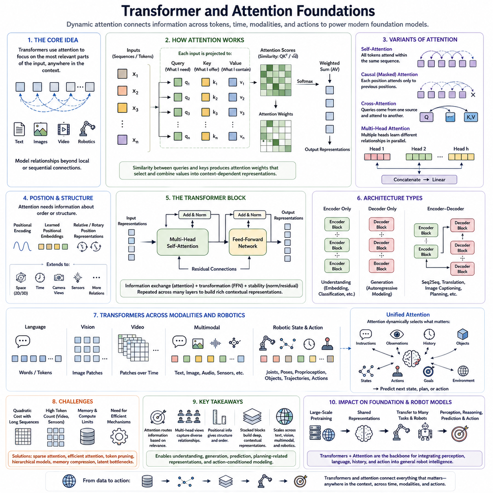{width="7.268055555555556in" height="7.268055555555556in"}

The Transformer is a neural network architecture that has become a central foundation for modern language, vision, multimodal, and increasingly robotic foundation models. Its key innovation is attention, which allows a model to dynamically determine which parts of an input are most relevant to one another. Instead of processing information only through fixed local connections or strictly sequential recurrence, Transformers can directly model relationships among elements distributed across a context.

Attention can be understood as a mechanism for selective information routing. When processing one token or observation, the model assigns different importance to other elements according to their relevance. A word may attend strongly to another word that determines its meaning, while an image region may attend to distant regions belonging to the same object. For robotics, an observation may attend to instructions, previous states, objects, actions, or task context that are important for the current decision.

The basic attention operation is commonly expressed through queries, keys, and values. Each input representation is transformed into a query describing what information it seeks, a key describing what information it can match, and a value containing information that may be retrieved. Similarity between queries and keys produces attention scores, and normalized scores determine how strongly the corresponding values contribute to the output representation.

Scaled dot-product attention computes similarities efficiently using matrix operations. Query vectors are multiplied by key vectors, scaled to maintain stable numerical behavior, and passed through a normalization operation such as softmax. The resulting weights are applied to value vectors to create context-dependent representations. Because many elements can be processed through large matrix operations, attention maps naturally onto the parallel computational capabilities of modern GPUs and AI accelerators.

Self-attention applies this mechanism among elements within the same sequence or collection of tokens. Every token can gather information from other tokens and update its representation according to context. This enables a Transformer to represent long-range relationships without requiring information to propagate through every intermediate recurrent step. Repeated self-attention layers progressively construct representations that combine local evidence with increasingly broad contextual relationships.

Multi-head attention extends the mechanism by performing several attention operations in parallel using different learned projections. Individual heads can specialize in different relationships, such as local structure, semantic association, spatial correspondence, temporal dependency, or task-relevant interactions. Their outputs are combined into a richer representation. Multiple heads therefore allow a single layer to examine the same input from several learned relational perspectives simultaneously.

Attention alone does not identify sequence order, so Transformers require information about position or structure. Positional encodings or learned positional embeddings indicate where tokens occur relative to one another. Modern architectures may also use relative positional information or rotary representations. For video and robotics, positional structure can extend beyond one-dimensional sequences to spatial coordinates, time, camera views, sensor identity, or other relationships needed to organize multimodal observations.

A Transformer block generally combines attention with feed-forward neural networks, normalization, and residual connections. Attention exchanges information among tokens, while the feed-forward component transforms each resulting representation. Residual connections preserve information and improve optimization across deep networks, and normalization helps stabilize training. Repeating these blocks creates deep architectures capable of progressively refining contextual representations over many layers.

The original Transformer architecture distinguished encoder and decoder components. An encoder converts input tokens into contextual representations, while a decoder generates outputs while attending to available context and previously generated elements. Some foundation models use encoder-only architectures, others use decoder-only architectures, and some preserve encoder-decoder structures. The appropriate configuration depends on whether the primary objective involves understanding, generation, prediction, transformation, or combinations of these capabilities.

Causal attention is especially important for autoregressive models. It masks future elements so that each position can attend only to information that would already be available when making its prediction. This prevents the model from accessing future targets during training and enables sequential generation at inference time. Language generation uses this principle for next-token prediction, while related formulations can generate future states, trajectories, or robot actions conditioned on previous observations and actions.

Cross-attention connects information from different sequences or modalities. Queries from one representation can attend to keys and values from another, enabling language to retrieve visual information or a decoder to attend to encoded observations. In multimodal systems, cross-attention can connect text, images, video, sensor features, and actions. It therefore provides an important architectural mechanism for integrating information that originates from different encoders or representational spaces.

Vision Transformers extend attention from language tokens to visual tokens. An image can be divided into patches that are embedded and processed as a sequence, allowing relationships among distant image regions to be modeled directly. Hierarchical or efficient variants can preserve more spatial structure. For robot perception, visual attention can connect objects, surfaces, free space, tools, obstacles, and other scene elements whose relationships matter for reasoning and action.

Video introduces a temporal dimension to Transformer processing. Tokens can represent image patches across multiple frames, allowing attention to capture both spatial and temporal relationships. This enables models to reason about motion, persistence, event progression, and interactions. However, the number of tokens can grow rapidly with resolution and sequence duration, making efficient temporal attention, token compression, memory mechanisms, and hierarchical representations important for practical systems.

Multimodal Transformers generalize this approach by representing different information sources as tokens or compatible embeddings. Text tokens, visual patches, audio features, sensor states, and other observations can be processed through shared attention or connected through cross-attention. This creates a flexible framework in which relationships between modalities are learned rather than completely predetermined, supporting foundation models that combine perception, language, reasoning, and prediction.

Robotics extends token-based processing toward physical state and action. Robot joint states, end-effector poses, proprioceptive measurements, navigation states, object representations, trajectories, and actions can be encoded into representations that interact with visual and language tokens. Attention can then determine which observations, instructions, historical events, or physical states are most relevant when predicting a task representation, future state, plan, or action.

Vision-Language-Action models build directly on this capability. Visual observations describe the environment, language specifies goals or instructions, and action representations describe what the robot can execute. Transformer-based architectures can integrate these streams into a shared context and predict actions conditioned on both perception and instruction. In this sense, attention becomes a mechanism for routing task-relevant information from multimodal observations toward physical action generation.

Temporal history is critical for physical agents because a single observation may not reveal velocity, previous actions, task progress, or hidden state. Transformers can include histories of observations and actions within their context, allowing current predictions to depend on earlier events. This supports temporal reasoning and long-horizon behavior, although increasing context length raises computational and memory costs and may eventually require explicit memory or compressed representations.

A fundamental limitation of standard self-attention is its computational cost as sequence length increases. Comparing many tokens with one another can require memory and computation that grow approximately quadratically with the number of tokens. This becomes particularly challenging for high-resolution video and continuous robot sensor streams. Efficient attention, sparse attention, token pruning, hierarchical processing, latent bottlenecks, and memory compression are therefore important research and engineering directions.

Attention should not be interpreted as complete reasoning or guaranteed understanding. It provides a flexible mechanism for relating and routing information, but useful intelligence also depends on training data, objectives, architecture, model capacity, temporal grounding, and downstream adaptation. Attention patterns may reveal some relationships used by a model, but they do not automatically provide a complete explanation of why a particular prediction or physical action was produced.

For foundation models, the importance of Transformers comes from their scalability and architectural flexibility. Similar computational principles can process language, images, video, multimodal observations, and increasingly action sequences. Combined with large-scale pretraining, this enables shared architectures to learn reusable representations across many tasks. The same underlying attention machinery can therefore support understanding, generation, prediction, planning-related representations, and action-conditioned modeling.

For Robot Foundation Models and Vision-Language-Action models, Transformers provide a computational framework for connecting what a robot sees, what it is told, what has happened previously, and what it should do next. Attention dynamically selects relationships among these information sources, while repeated Transformer layers construct increasingly contextual representations. This architecture forms an important foundation for integrating multimodal perception, temporal context, task reasoning, and physical action within increasingly general robot intelligence.

트랜스포머(Transformer)는 현대의 언어, 비전(vision), 멀티모달(multimodal), 그리고 점차 로봇 파운데이션 모델(Robot Foundation Model)의 핵심 기반이 된 신경망 아키텍처(neural network architecture)이다. 핵심 혁신은 어텐션(Attention)으로, 모델이 입력의 어떤 부분들이 서로 가장 관련성이 높은지를 동적으로 결정할 수 있도록 한다. 정보를 고정된 국소 연결이나 엄격한 순차적 순환 구조만으로 처리하는 대신, 트랜스포머는 하나의 컨텍스트(context) 전체에 분포된 요소 사이의 관계를 직접 모델링할 수 있다.

어텐션(Attention)은 선택적 정보 라우팅(selective information routing)을 위한 메커니즘으로 이해할 수 있다. 하나의 토큰(token)이나 관측(observation)을 처리할 때 모델은 관련성에 따라 다른 요소들에 서로 다른 중요도를 부여한다. 하나의 단어는 자신의 의미를 결정하는 다른 단어에 강하게 주의를 기울일 수 있으며, 이미지의 특정 영역은 동일한 객체에 속한 멀리 떨어진 영역에 주의를 기울일 수 있다. 로보틱스(robotics)에서는 하나의 관측이 현재 의사결정에 중요한 명령, 이전 상태, 객체, 행동 또는 작업 컨텍스트에 주의를 기울일 수 있다.

기본적인 어텐션 연산(attention operation)은 일반적으로 쿼리(Query), 키(Key), 밸류(Value)를 통해 표현된다. 각각의 입력 표현(input representation)은 어떤 정보를 찾고 있는지를 나타내는 쿼리, 어떤 정보와 매칭될 수 있는지를 나타내는 키, 그리고 검색될 수 있는 실제 정보를 포함하는 밸류로 변환된다. 쿼리와 키 사이의 유사도(similarity)를 통해 어텐션 점수(attention score)가 생성되고, 정규화된 점수(normalized score)는 해당 밸류가 출력 표현에 얼마나 강하게 기여할지를 결정한다.

스케일드 닷프로덕트 어텐션(Scaled Dot-Product Attention)은 행렬 연산(matrix operation)을 이용하여 유사도를 효율적으로 계산한다. 쿼리 벡터(query vector)와 키 벡터(key vector)를 곱하고, 수치적 안정성(numerical stability)을 유지하기 위해 스케일링한 다음 소프트맥스(softmax)와 같은 정규화 연산을 적용한다. 생성된 가중치(weight)는 밸류 벡터(value vector)에 적용되어 컨텍스트 의존적 표현(context-dependent representation)을 생성한다. 많은 요소를 대규모 행렬 연산으로 처리할 수 있기 때문에 어텐션은 현대 GPU와 AI 가속기(AI accelerator)의 병렬 계산 능력을 효과적으로 활용할 수 있다.

셀프 어텐션(Self-Attention)은 동일한 시퀀스(sequence) 또는 토큰 집합 내부의 요소 사이에 이러한 메커니즘을 적용한다. 각각의 토큰은 다른 토큰으로부터 정보를 수집하고 컨텍스트에 따라 자신의 표현을 업데이트할 수 있다. 이를 통해 트랜스포머는 정보가 모든 중간 순환 단계(recurrent step)를 거쳐 전달되지 않아도 장거리 관계(long-range relationship)를 표현할 수 있다. 반복되는 셀프 어텐션 계층은 국소적인 증거와 점점 더 광범위한 문맥 관계를 결합하는 표현을 점진적으로 구축한다.

멀티헤드 어텐션(Multi-Head Attention)은 서로 다른 학습된 투영(learned projection)을 사용하여 여러 어텐션 연산을 병렬로 수행함으로써 이 메커니즘을 확장한다. 개별 헤드(head)는 국소 구조(local structure), 의미적 연관성(semantic association), 공간적 대응관계(spatial correspondence), 시간적 의존성(temporal dependency), 작업 관련 상호작용(task-relevant interaction) 등 서로 다른 관계에 특화될 수 있다. 각 헤드의 출력은 더욱 풍부한 하나의 표현으로 결합된다. 따라서 여러 헤드를 통해 하나의 계층이 동일한 입력을 여러 학습된 관계적 관점에서 동시에 분석할 수 있다.

어텐션 자체는 시퀀스의 순서를 식별하지 못하기 때문에 트랜스포머에는 위치 또는 구조에 대한 정보가 필요하다. 위치 인코딩(Positional Encoding) 또는 학습된 위치 임베딩(learned positional embedding)은 토큰들이 서로 상대적으로 어디에 위치하는지를 나타낸다. 현대 아키텍처에서는 상대적 위치 정보(relative positional information)나 로터리 표현(rotary representation)을 사용할 수도 있다. 비디오와 로보틱스에서는 이러한 위치 구조가 1차원 시퀀스를 넘어 공간 좌표, 시간, 카메라 시점(camera view), 센서 식별 정보(sensor identity), 그리고 멀티모달 관측을 구성하는 데 필요한 다른 관계로 확장될 수 있다.

트랜스포머 블록(Transformer Block)은 일반적으로 어텐션과 피드포워드 신경망(Feed-Forward Neural Network), 정규화(normalization), 잔차 연결(residual connection)을 결합한다. 어텐션은 토큰 사이에서 정보를 교환하고, 피드포워드 구성요소는 그 결과로 생성된 각각의 표현을 변환한다. 잔차 연결은 정보를 보존하면서 깊은 네트워크의 최적화(optimization)를 개선하고, 정규화는 학습을 안정화하는 데 도움을 준다. 이러한 블록을 반복하면 여러 계층을 거치면서 문맥적 표현(contextual representation)을 점진적으로 정교화할 수 있는 깊은 아키텍처가 형성된다.

초기의 트랜스포머 아키텍처는 인코더(Encoder)와 디코더(Decoder) 구성요소를 구분하였다. 인코더는 입력 토큰을 문맥적 표현으로 변환하고, 디코더는 사용 가능한 컨텍스트와 이전에 생성된 요소에 주의를 기울이면서 출력을 생성한다. 일부 파운데이션 모델은 인코더 전용(encoder-only) 아키텍처를 사용하고, 다른 모델은 디코더 전용(decoder-only) 구조를 사용하며, 일부는 인코더-디코더(encoder-decoder) 구조를 유지한다. 적합한 구성은 주요 목표가 이해, 생성, 예측, 변환 또는 이러한 능력의 조합인지에 따라 달라진다.

인과 어텐션(Causal Attention)은 자기회귀 모델(autoregressive model)에서 특히 중요하다. 미래 요소를 마스킹(masking)하여 각 위치가 예측 시점에 이미 이용할 수 있는 정보에만 주의를 기울이도록 한다. 이를 통해 모델이 학습 과정에서 미래의 목표값에 접근하는 것을 방지하고 추론(inference) 과정에서 순차적인 생성을 가능하게 한다. 언어 생성에서는 다음 토큰 예측(next-token prediction)에 이 원리를 사용하며, 유사한 형태를 이용하여 이전 관측과 행동을 조건으로 미래 상태, 궤적(trajectory), 로봇 행동을 생성할 수 있다.

크로스 어텐션(Cross-Attention)은 서로 다른 시퀀스나 모달리티(modality)의 정보를 연결한다. 하나의 표현에서 생성된 쿼리가 다른 표현의 키와 밸류에 주의를 기울일 수 있으므로 언어가 시각 정보(visual information)를 검색하거나 디코더가 인코딩된 관측에 주의를 기울일 수 있다. 멀티모달 시스템에서 크로스 어텐션은 텍스트, 이미지, 비디오, 센서 특징(sensor feature), 행동을 연결할 수 있다. 따라서 서로 다른 인코더 또는 표현 공간에서 생성된 정보를 통합하는 중요한 아키텍처 메커니즘을 제공한다.

비전 트랜스포머(Vision Transformer)는 어텐션을 언어 토큰에서 시각 토큰(visual token)으로 확장한다. 이미지를 여러 패치(patch)로 분할한 후 임베딩(embedding)하여 하나의 시퀀스처럼 처리함으로써 멀리 떨어진 이미지 영역 사이의 관계를 직접 모델링할 수 있다. 계층적(hierarchical) 또는 효율적인 변형 구조는 공간적 구조를 더 많이 보존할 수 있다. 로봇 인식(robot perception)에서는 시각 어텐션을 통해 객체, 표면, 자유 공간(free space), 도구, 장애물 및 추론과 행동에 중요한 다른 장면 요소 사이의 관계를 연결할 수 있다.

비디오(Video)는 트랜스포머 처리에 시간적 차원(temporal dimension)을 추가한다. 토큰은 여러 프레임에 걸친 이미지 패치를 나타낼 수 있으며, 어텐션은 공간적 관계와 시간적 관계를 모두 포착할 수 있다. 이를 통해 모델은 움직임, 지속성(persistence), 사건 진행(event progression), 상호작용을 추론할 수 있다. 그러나 해상도와 시퀀스 길이가 증가할수록 토큰 수가 빠르게 증가하므로 실용적인 시스템에서는 효율적인 시간 어텐션(temporal attention), 토큰 압축(token compression), 메모리 메커니즘(memory mechanism), 계층적 표현이 중요해진다.

멀티모달 트랜스포머(Multimodal Transformer)는 서로 다른 정보 소스를 토큰 또는 호환 가능한 임베딩(compatible embedding)으로 표현하여 이러한 접근법을 일반화한다. 텍스트 토큰, 시각 패치, 오디오 특징(audio feature), 센서 상태 및 다른 관측은 공유 어텐션(shared attention)을 통해 처리되거나 크로스 어텐션을 통해 연결될 수 있다. 이를 통해 모달리티 사이의 관계를 완전히 사전에 결정하는 대신 학습할 수 있는 유연한 프레임워크를 형성하며, 인식, 언어, 추론, 예측을 결합하는 파운데이션 모델을 지원한다.

로보틱스는 토큰 기반 처리(token-based processing)를 물리적 상태(physical state)와 행동(action)으로 확장한다. 로봇 관절 상태(joint state), 엔드이펙터 자세(end-effector pose), 고유수용감각 측정값(proprioceptive measurement), 내비게이션 상태(navigation state), 객체 표현, 궤적, 행동을 시각 및 언어 토큰과 상호작용할 수 있는 표현으로 인코딩할 수 있다. 그러면 어텐션은 작업 표현, 미래 상태, 계획(plan), 행동을 예측할 때 어떤 관측, 명령, 과거 사건 또는 물리적 상태가 가장 중요한지를 결정할 수 있다.

비전-언어-행동 모델(Vision-Language-Action Model, VLA)은 이러한 능력을 직접적으로 활용한다. 시각적 관측(visual observation)은 환경을 설명하고, 언어는 목표 또는 명령을 지정하며, 행동 표현(action representation)은 로봇이 실행할 수 있는 것을 나타낸다. 트랜스포머 기반 아키텍처는 이러한 정보 스트림을 공유 컨텍스트(shared context)로 통합하고 인식과 명령을 조건으로 행동을 예측할 수 있다. 이러한 관점에서 어텐션은 멀티모달 관측에서 작업 관련 정보를 물리적 행동 생성(physical action generation)으로 전달하는 정보 라우팅 메커니즘이 된다.

물리 에이전트(Physical Agent)에서는 하나의 관측만으로 속도, 이전 행동, 작업 진행 상황 또는 숨겨진 상태(hidden state)를 파악하지 못할 수 있으므로 시간적 이력(temporal history)이 중요하다. 트랜스포머는 관측과 행동의 이력을 컨텍스트에 포함하여 현재 예측이 이전 사건에 의존하도록 만들 수 있다. 이는 시간적 추론(temporal reasoning)과 장기 행동(long-horizon behavior)을 지원하지만, 컨텍스트 길이가 증가하면 계산 및 메모리 비용도 증가하므로 궁극적으로 명시적인 메모리 또는 압축된 표현이 필요할 수 있다.

표준 셀프 어텐션(Standard Self-Attention)의 근본적인 한계 중 하나는 시퀀스 길이가 증가함에 따라 계산 비용이 커진다는 점이다. 많은 토큰을 서로 비교하려면 토큰 수에 대해 대략 제곱으로 증가하는 메모리와 계산량이 필요할 수 있다. 이는 고해상도 비디오와 연속적인 로봇 센서 스트림에서 특히 어려운 문제가 된다. 따라서 효율적 어텐션(efficient attention), 희소 어텐션(sparse attention), 토큰 가지치기(token pruning), 계층적 처리, 잠재 병목(latent bottleneck), 메모리 압축(memory compression)은 중요한 연구 및 엔지니어링 방향이다.

어텐션(Attention)을 완전한 추론(reasoning)이나 보장된 이해(understanding)로 해석해서는 안 된다. 어텐션은 정보를 서로 연결하고 라우팅하는 유연한 메커니즘을 제공하지만, 유용한 지능은 학습 데이터, 학습 목표, 아키텍처, 모델 용량(model capacity), 시간적 그라운딩(temporal grounding), 다운스트림 적응(downstream adaptation)에도 의존한다. 어텐션 패턴(attention pattern)은 모델이 사용하는 일부 관계를 보여줄 수 있지만 특정 예측이나 물리적 행동이 왜 생성되었는지를 완전하게 설명하는 것은 아니다.

파운데이션 모델(Foundation Model)에서 트랜스포머의 중요성은 확장성(scalability)과 아키텍처의 유연성(architectural flexibility)에 있다. 유사한 계산 원리를 언어, 이미지, 비디오, 멀티모달 관측, 그리고 점차 행동 시퀀스까지 적용할 수 있다. 이를 대규모 사전학습(large-scale pretraining)과 결합하면 공유 아키텍처가 여러 작업에 걸쳐 재사용 가능한 표현을 학습할 수 있다. 따라서 동일한 기본 어텐션 메커니즘이 이해, 생성, 예측, 계획 관련 표현(planning-related representation), 행동 조건부 모델링(action-conditioned modeling)을 지원할 수 있다.

로봇 파운데이션 모델(Robot Foundation Model)과 비전-언어-행동 모델(Vision-Language-Action Model, VLA)에서 트랜스포머는 로봇이 무엇을 보고 있는지, 어떤 명령을 받았는지, 이전에 어떤 일이 발생했는지, 그리고 다음에 무엇을 해야 하는지를 연결하는 계산 프레임워크(computational framework)를 제공한다. 어텐션은 이러한 정보 소스 사이에서 중요한 관계를 동적으로 선택하고, 반복되는 트랜스포머 계층은 점차 풍부한 문맥적 표현을 구축한다. 이러한 아키텍처는 멀티모달 인식(multimodal perception), 시간적 컨텍스트, 작업 추론(task reasoning), 물리적 행동을 점점 더 범용적인 로봇 지능(robot intelligence) 안에서 통합하기 위한 중요한 기반을 형성한다.

## 01.07. Multimodal Foundation Models

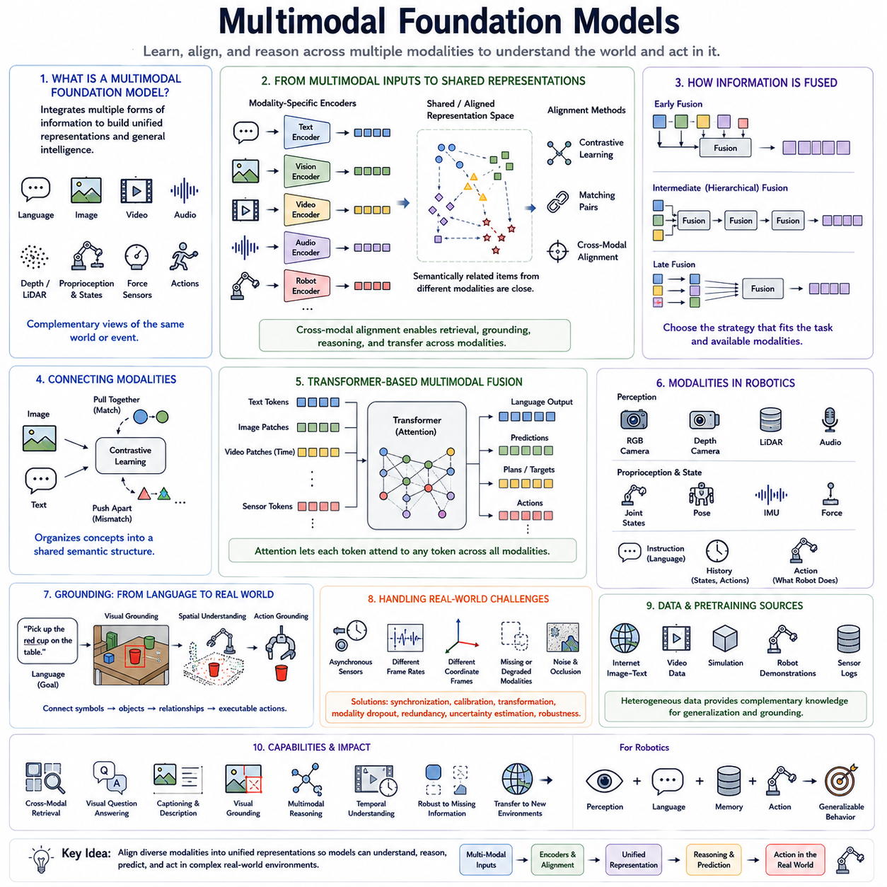{width="7.268055555555556in" height="7.268055555555556in"}

Multimodal foundation models are designed to learn from and reason across multiple forms of information rather than operating within a single modality. Language, images, video, audio, depth, sensor measurements, and actions can provide complementary views of the same environment or event. By connecting these information sources within shared or coordinated representations, multimodal models can develop broader capabilities than systems trained independently for each modality.

A modality is a particular form in which information is observed or represented. Text expresses symbolic and semantic relationships, images provide visual appearance and spatial structure, audio captures acoustic events, and video adds temporal evolution. In robotics, additional modalities include depth, LiDAR, proprioception, force, joint states, poses, trajectories, and actions. Each modality reveals different aspects of the physical world and introduces its own representation requirements.

The central challenge of multimodal learning is to connect information that has different structures, dimensions, sampling rates, and semantic content. A sentence is represented as a sequence of tokens, while an image may contain thousands of spatial features and a video contains visual information distributed over time. Robot sensors can operate at different frequencies and coordinate systems. Multimodal architectures must transform these heterogeneous inputs into representations that can interact meaningfully.

Modality-specific encoders provide one approach to this problem. A language encoder can transform text into semantic embeddings, while a vision encoder converts images into visual representations and an audio encoder processes acoustic signals. Robot-specific encoders can represent proprioception, depth, force, or other sensor measurements. These representations can then be projected into compatible spaces where information from different sources can be compared, aligned, fused, or jointly processed.

Shared representation spaces are particularly important because they allow semantically related information from different modalities to become connected. An image of an object and a textual description of that object can be mapped to compatible representations even though their raw inputs are fundamentally different. This cross-modal alignment allows knowledge learned through one modality to support interpretation of another and creates a basis for retrieval, grounding, reasoning, and multimodal transfer.

Contrastive learning is widely used to establish multimodal alignment. Corresponding examples, such as an image and its caption, are encouraged to produce similar representations, while unrelated pairs are separated. At sufficiently large scale, this approach can organize visual and linguistic concepts into a shared semantic structure. Similar principles can align video with language, audio with visual events, or robot observations with task descriptions and other contextual information.

Fusion determines how information from multiple modalities is combined after or during encoding. Early fusion combines representations relatively close to the input, while late fusion processes modalities more independently before combining their outputs. Intermediate or hierarchical fusion integrates information at multiple stages. The appropriate strategy depends on whether detailed low-level correspondence, high-level semantic integration, computational efficiency, or robustness to missing modalities is most important.

Transformer architectures provide a flexible mechanism for multimodal fusion because different inputs can be represented as tokens or embeddings and connected through attention. Shared self-attention can allow all modalities to interact within a unified sequence, while cross-attention enables one modality to selectively retrieve information from another. These mechanisms make it possible for language instructions to focus on relevant visual regions or for action prediction to attend to specific observations and task context.

Vision-language models represent an important class of multimodal foundation models. They connect visual perception with linguistic representations so that models can associate objects, attributes, scenes, relationships, and events with language. This enables capabilities such as image retrieval, visual question answering, captioning, visual grounding, and multimodal reasoning. For robotics, vision-language representations provide an important bridge between human instructions and observations of the physical environment.

Video-language models extend this relationship into time. Video provides information about motion, object persistence, interactions, procedures, and event progression that cannot be obtained from isolated images alone. Aligning video with language allows models to associate descriptions with temporal processes and actions. This is especially valuable for Physical AI because many robot tasks are defined by sequences of state transitions rather than by static scenes.

Multimodal learning also supports grounding, the process of connecting abstract concepts to observations or interactions. Language may describe a "red container beside the table," but a physical agent must associate those symbols with particular objects and spatial relationships in its current environment. Visual grounding connects words with perceived entities, while action grounding extends this relationship toward what the robot can physically execute under its embodiment and environmental constraints.

Robotics substantially expands the multimodal problem because perception must ultimately support action. Cameras can provide appearance, depth sensors provide geometry, LiDAR can describe spatial structure, proprioception represents the robot\'s internal configuration, and force sensing provides contact information. Language may specify goals while previous actions and trajectories provide temporal context. A robot foundation model must integrate these signals into representations useful for prediction, planning, and control.

Not all modalities need to contribute equally at every moment. A language instruction may be critical when interpreting a task but less important during a low-level stabilization operation. Vision may dominate object selection, while force information becomes essential after physical contact. Attention-based multimodal systems can dynamically emphasize different sources according to the current state, allowing information routing to change as a task progresses.

Temporal synchronization is particularly important when multimodal inputs describe a changing physical environment. Cameras, IMUs, joint encoders, force sensors, and other devices may produce observations at different rates and with different delays. If these signals are incorrectly aligned, the model may associate an action with the wrong physical state. Robot multimodal systems therefore require careful treatment of timestamps, synchronization, temporal windows, and sensor latency.

Spatial alignment creates another challenge. Multiple cameras may observe the same object from different viewpoints, while depth, LiDAR, and robot coordinates may use different reference frames. Multimodal representations must preserve or recover the transformations required to relate these observations. Semantic alignment alone is insufficient for many physical tasks because manipulation and navigation require metrically meaningful information about position, orientation, distance, and geometry.

Missing or degraded modalities must also be considered. Cameras may be obscured, depth sensing can fail on certain surfaces, audio may contain noise, and communication channels may become unavailable. A robust multimodal model should avoid complete failure when one information source becomes unreliable. Training with modality dropout, redundant sensing, uncertainty estimation, and alternative representations can help models exploit complementary information while remaining resilient to partial sensor failure.

Multimodal pretraining benefits from heterogeneous data sources. Internet image-text pairs provide broad semantic knowledge, video contributes temporal information, simulation provides controlled physical interactions, and robot demonstrations connect observations with actions. These sources do not need identical scale or quality. Their value comes from contributing complementary structure that can eventually be integrated into representations supporting increasingly general perception and behavior.

Cross-modal transfer allows knowledge from data-rich modalities to support modalities with limited training data. Language and internet-scale vision can provide semantic concepts that would be expensive to learn exclusively through robot interaction. Robot experience can then ground those concepts in physical constraints, dynamics, contact, and action consequences. This combination is important because scalable digital data and scarce physical experience contribute different but complementary forms of knowledge.

Multimodal foundation models also create opportunities for unified task interfaces. Instead of designing separate systems for every combination of sensor input and output, a model can receive different observations and instructions within a common architecture. Depending on the task, it may generate language, predictions, plans, spatial targets, or actions. This does not eliminate specialized controllers, but it can provide a shared intelligence layer connecting diverse perception and decision modules.

The transition from multimodal understanding to Vision-Language-Action modeling introduces actions as a first-class modality. Visual observations describe the current environment, language expresses goals, and action tokens or continuous action representations describe how the robot changes that environment. Learning relationships among these elements transforms multimodal modeling from passive interpretation toward interactive intelligence in which perception and language directly condition physical behavior.

Evaluation must therefore examine more than performance within individual modalities. A multimodal model should be tested for alignment, grounding, cross-modal retrieval, reasoning, temporal understanding, robustness to missing information, and transfer across environments. Robot systems additionally require evaluation of spatial accuracy, action relevance, latency, uncertainty, safety, and task completion. Strong language or vision benchmarks alone cannot establish competence in physical multimodal intelligence.

Multimodal foundation models ultimately provide the representational bridge needed to combine heterogeneous information into coherent intelligence. For Robot Foundation Models, this means connecting what a robot sees, senses, hears, is told, remembers, and does. By aligning semantic, spatial, temporal, proprioceptive, and action information, multimodal learning establishes the foundation from which Vision-Language Models can evolve toward Vision-Language-Action systems capable of increasingly general interaction with the physical world.

멀티모달 파운데이션 모델(Multimodal Foundation Model)은 하나의 모달리티(modality) 안에서만 작동하는 것이 아니라 여러 형태의 정보로부터 학습하고 이들을 연결하여 추론하도록 설계된다. 언어, 이미지, 비디오, 오디오, 깊이(depth), 센서 측정값(sensor measurement), 행동(action)은 동일한 환경이나 사건을 서로 보완적인 관점에서 제공할 수 있다. 이러한 정보 소스를 공유되거나 상호 조정된 표현(representation) 안에서 연결함으로써 멀티모달 모델은 각각의 모달리티를 독립적으로 학습한 시스템보다 더욱 폭넓은 능력을 개발할 수 있다.

모달리티(Modality)는 정보가 관측되거나 표현되는 특정한 형태를 의미한다. 텍스트는 상징적·의미적 관계를 표현하고, 이미지는 시각적 외형과 공간 구조(spatial structure)를 제공하며, 오디오는 음향 사건(acoustic event)을 포착하고, 비디오는 시간적 변화(temporal evolution)를 추가한다. 로보틱스(Robotics)에서는 깊이, 라이다(LiDAR), 고유수용감각(proprioception), 힘(force), 관절 상태(joint state), 자세(pose), 궤적(trajectory), 행동 등이 추가적인 모달리티에 포함된다. 각각의 모달리티는 물리 세계의 서로 다른 측면을 보여주며 고유한 표현 요구사항을 가진다.

멀티모달 학습(Multimodal Learning)의 핵심 과제는 서로 다른 구조, 차원(dimension), 샘플링 속도(sampling rate), 의미적 내용을 가진 정보를 연결하는 것이다. 문장은 토큰(token)의 시퀀스로 표현되는 반면 이미지는 수천 개의 공간적 특징을 포함할 수 있고, 비디오는 시간에 걸쳐 분포된 시각 정보를 포함한다. 로봇 센서는 서로 다른 주파수와 좌표계(coordinate system)에서 작동할 수 있다. 따라서 멀티모달 아키텍처(multimodal architecture)는 이러한 이질적인 입력을 의미 있게 상호작용할 수 있는 표현으로 변환해야 한다.

모달리티 특화 인코더(Modality-Specific Encoder)는 이러한 문제를 해결하는 하나의 접근법을 제공한다. 언어 인코더(language encoder)는 텍스트를 의미적 임베딩(semantic embedding)으로 변환하고, 비전 인코더(vision encoder)는 이미지를 시각 표현으로 변환하며, 오디오 인코더(audio encoder)는 음향 신호를 처리한다. 로봇 특화 인코더(robot-specific encoder)는 고유수용감각, 깊이, 힘 또는 다른 센서 측정값을 표현할 수 있다. 이후 이러한 표현을 호환 가능한 공간으로 투영하여 서로 다른 정보 소스를 비교, 정렬, 융합(fusion)하거나 공동으로 처리할 수 있다.

공유 표현 공간(Shared Representation Space)은 서로 다른 모달리티의 의미적으로 관련된 정보를 연결할 수 있기 때문에 특히 중요하다. 하나의 객체 이미지와 해당 객체에 대한 텍스트 설명은 원시 입력(raw input)이 근본적으로 다르더라도 서로 호환되는 표현으로 매핑될 수 있다. 이러한 교차 모달 정렬(cross-modal alignment)을 통해 하나의 모달리티에서 학습된 지식이 다른 모달리티의 해석을 지원할 수 있으며, 검색(retrieval), 그라운딩(grounding), 추론(reasoning), 멀티모달 전이(multimodal transfer)를 위한 기반이 형성된다.

대조학습(Contrastive Learning)은 멀티모달 정렬을 구축하기 위해 널리 사용된다. 이미지와 해당 캡션(caption)처럼 서로 대응하는 사례는 유사한 표현을 생성하도록 유도하고, 관련되지 않은 데이터 쌍은 서로 분리한다. 충분히 큰 규모에서 이러한 접근법은 시각적 개념과 언어적 개념을 하나의 공유 의미 구조(shared semantic structure)로 구성할 수 있다. 유사한 원리를 이용하여 비디오와 언어, 오디오와 시각적 사건, 또는 로봇 관측과 작업 설명 및 기타 문맥 정보를 정렬할 수 있다.

융합(Fusion)은 여러 모달리티의 정보가 인코딩 과정 또는 그 이후에 어떻게 결합되는지를 결정한다. 초기 융합(early fusion)은 입력에 비교적 가까운 단계에서 표현을 결합하고, 후기 융합(late fusion)은 각각의 모달리티를 보다 독립적으로 처리한 후 출력을 결합한다. 중간 융합(intermediate fusion) 또는 계층적 융합(hierarchical fusion)은 여러 단계에서 정보를 통합한다. 적절한 전략은 세밀한 저수준 대응관계, 고수준 의미 통합, 계산 효율성(computational efficiency), 또는 누락된 모달리티에 대한 강건성(robustness) 가운데 무엇이 중요한지에 따라 달라진다.

트랜스포머 아키텍처(Transformer Architecture)는 서로 다른 입력을 토큰이나 임베딩(embedding)으로 표현하고 어텐션(Attention)을 통해 연결할 수 있기 때문에 멀티모달 융합을 위한 유연한 메커니즘을 제공한다. 공유 셀프 어텐션(shared self-attention)은 모든 모달리티가 하나의 통합 시퀀스에서 상호작용하도록 할 수 있으며, 크로스 어텐션(cross-attention)은 하나의 모달리티가 다른 모달리티에서 필요한 정보를 선택적으로 검색하도록 한다. 이를 통해 언어 명령이 관련된 시각 영역에 집중하거나 행동 예측이 특정 관측 및 작업 문맥에 주의를 기울일 수 있다.

비전-언어 모델(Vision-Language Model, VLM)은 멀티모달 파운데이션 모델의 중요한 유형이다. 시각적 인식(visual perception)을 언어 표현(language representation)과 연결하여 객체, 속성(attribute), 장면, 관계, 사건을 언어와 연관시킬 수 있다. 이를 통해 이미지 검색(image retrieval), 시각 질의응답(visual question answering), 캡셔닝(captioning), 시각적 그라운딩(visual grounding), 멀티모달 추론(multimodal reasoning)과 같은 능력을 구현할 수 있다. 로보틱스에서는 비전-언어 표현이 인간의 명령과 물리 환경의 관측을 연결하는 중요한 다리를 제공한다.

비디오-언어 모델(Video-Language Model)은 이러한 관계를 시간 영역으로 확장한다. 비디오는 단일 이미지에서 얻을 수 없는 움직임, 객체 지속성(object persistence), 상호작용, 절차(procedure), 사건 진행(event progression)에 대한 정보를 제공한다. 비디오를 언어와 정렬하면 모델은 설명을 시간적 과정 및 행동과 연결할 수 있다. 이는 많은 로봇 작업이 정적인 장면이 아니라 연속적인 상태 전이(state transition)로 정의되기 때문에 피지컬 AI(Physical AI)에서 특히 중요하다.

멀티모달 학습은 추상적인 개념을 관측 또는 상호작용과 연결하는 과정인 그라운딩(Grounding)도 지원한다. 언어가 "테이블 옆의 빨간 용기(red container beside the table)"를 설명할 수 있지만, 물리 에이전트(physical agent)는 이러한 기호를 현재 환경의 특정 객체 및 공간 관계와 연결해야 한다. 시각적 그라운딩은 단어를 인식된 객체와 연결하며, 행동 그라운딩(action grounding)은 이러한 관계를 로봇의 임바디먼트(embodiment)와 환경 제약조건 아래에서 실제로 실행할 수 있는 행동까지 확장한다.

로보틱스는 인식이 궁극적으로 행동을 지원해야 하기 때문에 멀티모달 문제를 크게 확장한다. 카메라는 외형 정보를 제공하고, 깊이 센서는 기하학(geometry)을 제공하며, 라이다는 공간 구조를 표현하고, 고유수용감각은 로봇 내부의 구성 상태(configuration)를 나타내며, 힘 센싱(force sensing)은 접촉 정보를 제공한다. 언어는 목표를 지정할 수 있고 이전 행동과 궤적은 시간적 문맥을 제공한다. 로봇 파운데이션 모델(Robot Foundation Model)은 이러한 신호를 예측(prediction), 계획(planning), 제어(control)에 유용한 표현으로 통합해야 한다.

모든 모달리티가 매 순간 동일하게 기여해야 하는 것은 아니다. 언어 명령은 작업을 해석할 때 중요하지만 저수준 안정화(low-level stabilization) 작업 중에는 상대적으로 중요성이 낮아질 수 있다. 비전은 객체 선택에서 지배적인 역할을 할 수 있지만 물리적 접촉 이후에는 힘 정보가 필수적이 될 수 있다. 어텐션 기반 멀티모달 시스템(attention-based multimodal system)은 현재 상태에 따라 서로 다른 정보 소스의 중요도를 동적으로 조절하여 작업 진행에 따라 정보 라우팅(information routing)을 변화시킬 수 있다.

멀티모달 입력이 변화하는 물리 환경을 설명할 때 시간적 동기화(Temporal Synchronization)는 특히 중요하다. 카메라, 관성측정장치(Inertial Measurement Unit, IMU), 관절 인코더(joint encoder), 힘 센서 및 기타 장치는 서로 다른 속도와 지연시간(latency)으로 관측을 생성할 수 있다. 이러한 신호가 잘못 정렬되면 모델은 행동을 잘못된 물리 상태와 연결할 수 있다. 따라서 로봇 멀티모달 시스템은 타임스탬프(timestamp), 동기화(synchronization), 시간 윈도우(temporal window), 센서 지연(sensor latency)을 신중하게 처리해야 한다.

공간 정렬(Spatial Alignment)은 또 다른 과제를 만든다. 여러 카메라는 동일한 객체를 서로 다른 시점(viewpoint)에서 관측할 수 있으며, 깊이, 라이다, 로봇 좌표는 서로 다른 기준 좌표계(reference frame)를 사용할 수 있다. 멀티모달 표현은 이러한 관측을 연결하기 위해 필요한 변환 관계를 보존하거나 복원해야 한다. 많은 물리적 작업에서 의미적 정렬만으로는 충분하지 않으며, 조작(manipulation)과 내비게이션(navigation)을 위해서는 위치(position), 방향(orientation), 거리(distance), 기하학에 대한 미터 단위의 의미 있는 정보가 필요하다.

누락되거나 성능이 저하된 모달리티(degraded modality)도 고려해야 한다. 카메라가 가려질 수 있고, 특정 표면에서는 깊이 센싱이 실패할 수 있으며, 오디오에는 잡음이 포함될 수 있고, 통신 채널이 사용할 수 없는 상태가 될 수도 있다. 강건한 멀티모달 모델은 하나의 정보 소스가 신뢰할 수 없게 되더라도 전체 시스템이 완전히 실패하지 않아야 한다. 모달리티 드롭아웃(modality dropout), 중복 센싱(redundant sensing), 불확실성 추정(uncertainty estimation), 대체 표현(alternative representation)을 활용한 학습은 상호 보완적인 정보를 이용하면서 부분적인 센서 실패에도 강건성을 유지하도록 도울 수 있다.

멀티모달 사전학습(Multimodal Pretraining)은 이질적인 데이터 소스(heterogeneous data source)를 활용할 수 있다는 장점이 있다. 인터넷의 이미지-텍스트 쌍은 폭넓은 의미적 지식을 제공하고, 비디오는 시간 정보를 추가하며, 시뮬레이션(simulation)은 통제된 물리적 상호작용을 제공하고, 로봇 시연(robot demonstration)은 관측과 행동을 연결한다. 이러한 데이터 소스는 동일한 규모나 품질을 가질 필요가 없다. 각각이 상호 보완적인 구조를 제공하여 점차 일반적인 인식과 행동을 지원하는 표현으로 통합될 수 있다는 점에서 가치가 있다.

교차 모달 전이(Cross-Modal Transfer)는 데이터가 풍부한 모달리티의 지식을 학습 데이터가 제한적인 모달리티에 활용할 수 있도록 한다. 언어와 인터넷 규모의 비전 데이터는 로봇 상호작용만을 통해 학습하려면 높은 비용이 필요한 의미적 개념을 제공할 수 있다. 이후 로봇 경험은 이러한 개념을 물리적 제약조건, 동역학(dynamics), 접촉(contact), 행동 결과(action consequence)에 그라운딩할 수 있다. 확장 가능한 디지털 데이터와 희소한 물리적 경험은 서로 다르지만 상호 보완적인 형태의 지식을 제공하기 때문에 이러한 결합은 중요하다.

멀티모달 파운데이션 모델은 통합 작업 인터페이스(unified task interface)를 구축할 가능성도 제공한다. 센서 입력과 출력의 모든 조합에 대해 별도의 시스템을 설계하는 대신 하나의 공통 아키텍처가 서로 다른 관측과 명령을 입력받을 수 있다. 작업에 따라 언어, 예측, 계획, 공간적 목표(spatial target), 행동을 생성할 수 있다. 이것이 특화된 제어기(specialized controller)를 제거한다는 의미는 아니지만, 다양한 인식 및 의사결정 모듈을 연결하는 공유 지능 계층(shared intelligence layer)을 제공할 수 있다.

멀티모달 이해(multimodal understanding)에서 비전-언어-행동 모델(Vision-Language-Action Model, VLA)로의 전환은 행동(Action)을 핵심 모달리티로 포함시킨다. 시각적 관측은 현재 환경을 설명하고, 언어는 목표를 표현하며, 행동 토큰(action token) 또는 연속 행동 표현(continuous action representation)은 로봇이 환경을 어떻게 변화시키는지를 나타낸다. 이러한 요소 사이의 관계를 학습함으로써 멀티모달 모델링은 수동적인 해석에서 인식과 언어가 직접 물리적 행동을 조건화하는 상호작용 지능(interactive intelligence)으로 발전한다.

따라서 평가(Evaluation)는 개별 모달리티에서의 성능만을 확인해서는 안 된다. 멀티모달 모델은 정렬(alignment), 그라운딩, 교차 모달 검색(cross-modal retrieval), 추론, 시간적 이해(temporal understanding), 정보 누락에 대한 강건성, 환경 간 전이(transfer across environments)를 평가해야 한다. 로봇 시스템에서는 공간 정확도(spatial accuracy), 행동 관련성(action relevance), 지연시간, 불확실성, 안전성(safety), 작업 완료(task completion)도 추가로 평가해야 한다. 언어나 비전 벤치마크에서 높은 성능을 보이는 것만으로 물리적 멀티모달 지능의 역량을 입증할 수는 없다.

멀티모달 파운데이션 모델(Multimodal Foundation Model)은 궁극적으로 이질적인 정보를 하나의 일관된 지능(coherent intelligence)으로 결합하기 위한 표현적 다리(representational bridge)를 제공한다. 로봇 파운데이션 모델에서는 로봇이 보고, 감지하고, 듣고, 명령받고, 기억하고, 행동하는 모든 정보를 연결하는 것을 의미한다. 의미적, 공간적, 시간적, 고유수용적(proprioceptive), 행동 정보를 정렬함으로써 멀티모달 학습은 비전-언어 모델이 물리 세계와 점점 더 범용적으로 상호작용할 수 있는 비전-언어-행동 시스템(Vision-Language-Action System)으로 발전하기 위한 기반을 형성한다.

## 01.08. Generative vs Predictive Foundation Models

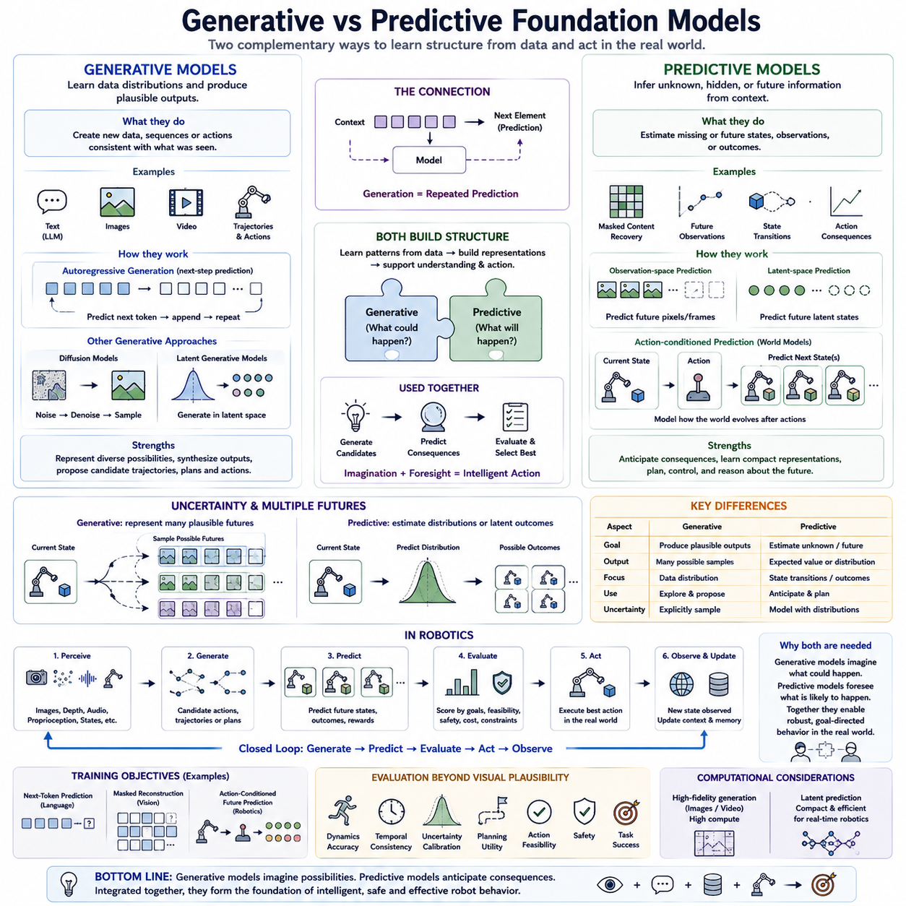{width="7.268055555555556in" height="7.268055555555556in"}

Generative and predictive foundation models represent two closely related ways of learning structure from large and diverse datasets. Generative models emphasize producing plausible data, sequences, or actions, while predictive models emphasize estimating unknown, hidden, or future information from available context. In practice, the distinction is not absolute because generation frequently depends on prediction, and predictive objectives can create representations that later support generation.

A generative foundation model learns enough of the structure of its training distribution to produce new outputs consistent with the patterns it has observed. Large language models generate text, image models synthesize visual content, and video models can create sequences of future frames. In robotics, generative modeling can extend toward trajectories, plans, actions, or possible future interactions conditioned on observations, instructions, goals, and previous behavior.

Autoregressive generation illustrates the close relationship between generation and prediction. A model predicts the next token or element from previous context, appends the prediction to the sequence, and repeats the process. Each individual operation is predictive, but repeated prediction produces a generated sequence. The same principle can be extended from words to image tokens, video representations, robot trajectories, and discretized or continuous action sequences.

Other generative approaches learn data distributions through different mechanisms. Diffusion models gradually transform noise into structured samples by learning a denoising process, while latent generative models operate within compressed representation spaces. These approaches can model multiple plausible outputs rather than committing immediately to one deterministic prediction. This property is valuable when the future is uncertain and several outcomes or action strategies may be physically reasonable.

Predictive foundation models focus more directly on estimating information that is not currently available. A model may predict masked content, future observations, latent states, object motion, state transitions, action consequences, or task progress. Rather than generating every observable detail, a predictive model can learn representations that capture the information required to anticipate how a system or environment is likely to evolve.

Prediction can occur either in raw observation space or in learned latent space. Pixel-level future prediction attempts to reconstruct visual details, but many of those details may be difficult to predict and irrelevant to intelligent behavior. Latent prediction instead estimates future internal representations containing more abstract information. By concentrating on predictable and task-relevant structure, latent predictive models can avoid spending excessive capacity on insignificant low-level variations.

This distinction becomes important for physical environments because the future is inherently uncertain. A person approaching a doorway may turn left, turn right, stop, or continue forward. A generative model can represent several plausible future trajectories, while a deterministic predictor may average them into an unrealistic result. Probabilistic prediction, multimodal distributions, latent variables, and generative sampling therefore provide mechanisms for representing multiple possible futures.

Generative modeling is especially useful when an intelligent system must explore alternatives. A robot planner can generate several candidate trajectories, manipulation strategies, or action sequences and then evaluate them according to goals, feasibility, safety, or expected reward. Generation therefore provides a mechanism for proposing possibilities. A separate predictive model, world model, value function, constraint checker, or evaluator can then estimate the consequences of those possibilities.

Predictive modeling provides a complementary mechanism for anticipating consequences. Given the current state and a candidate action, a model can estimate the next state or a longer sequence of future states. This action-conditioned prediction is fundamental to model-based decision making because it allows an agent to evaluate behavior before executing it physically. Prediction therefore transforms learned environmental structure into a computational capability for planning and control.

A useful distinction is between modeling observations and modeling state transitions. Generative observation models may synthesize realistic images or video, but visually realistic output does not necessarily imply accurate physical dynamics. Predictive models for Physical AI must preserve relationships involving geometry, motion, contact, object permanence, constraints, and action consequences. A visually convincing future that violates physical causality may be unsuitable for robot decision making.

World models illustrate the predictive perspective particularly clearly. A world model attempts to represent how relevant aspects of an environment change over time, often conditioned on the agent\'s actions. It may predict future observations, latent states, rewards, task progress, occupancy, object motion, or other structured variables. The purpose is not merely to create realistic content but to provide an internal mechanism for anticipating the consequences of possible interactions.

Generative world models extend this idea by representing multiple possible futures rather than only a single expected transition. From the same current state, different actions, environmental events, or hidden factors can produce different outcomes. Sampling several plausible futures can help an agent reason about uncertainty and risk. This becomes important in navigation, manipulation, autonomous driving, and human-robot interaction where other agents and environmental conditions are not fully predictable.

Foundation-model pretraining can combine generative and predictive objectives. Language models may learn through next-token prediction, vision models through masked reconstruction, multimodal models through cross-modal prediction, and robot models through action-conditioned future prediction. A single architecture can therefore acquire both generative capabilities and predictive representations depending on the data, objective, conditioning variables, and output formulation used during training.

The difference is also visible in what information a model is encouraged to preserve. Generative reconstruction often rewards retaining enough information to reproduce detailed observations, whereas predictive representation learning may emphasize factors useful for anticipating future states. For robotics, the ideal representation may need both semantic richness and predictive sufficiency, preserving objects, geometry, dynamics, affordances, task context, and action-relevant uncertainty without modeling every irrelevant visual detail.

Temporal prediction is particularly important for robot intelligence because physical action unfolds through time. A robot needs to understand not only what exists now but also what is likely to happen after movement, contact, or manipulation. Predicting state transitions enables reasoning about object motion, collision, stability, reachability, task progression, and recovery. Longer prediction horizons can support planning but also increase uncertainty and accumulated model error.

Generative action models address the complementary problem of deciding what the robot could do next. Instead of predicting only one action, a model can represent a distribution over feasible actions or generate action chunks and trajectories. Conditioning on language instructions, visual observations, robot state, and action history allows generation to become task-directed. This principle is central to many Vision-Language-Action models that map multimodal context toward executable behavior.

Prediction and generation can therefore form a closed decision loop. The agent observes the environment, generates candidate actions, predicts their consequences, evaluates predicted outcomes, selects an action, executes it, and observes the resulting state. New experience then updates the context for the next decision. This generate-predict-evaluate-act cycle connects foundation-model capabilities with planning and provides a natural bridge toward model-based Physical AI.

Computational requirements differ depending on the formulation. High-fidelity image or video generation can require substantial compute because the model must synthesize large amounts of perceptual detail. Latent predictive models may operate more efficiently by forecasting compact internal states. For edge robotics, this distinction matters because useful prediction must often occur under strict latency, memory, power, and thermal constraints while the robot continues sensing and controlling in real time.

Evaluation should also distinguish visual plausibility from predictive usefulness. A generated video may look realistic while producing incorrect trajectories, object interactions, or action consequences. Conversely, a compact latent model may provide excellent information for control without producing human-interpretable images. Physical AI evaluation should therefore measure dynamics accuracy, temporal consistency, uncertainty calibration, planning utility, action feasibility, safety, and task success in addition to perceptual quality.

Neither generative nor predictive modeling should be treated as universally superior. Generative models are valuable for representing diverse possibilities, producing candidate solutions, and synthesizing complex outputs. Predictive models are valuable for anticipating hidden or future states and learning compact structures relevant to decision making. Their relative importance depends on whether the system needs to imagine possibilities, forecast consequences, represent uncertainty, generate actions, or combine all of these functions.

For Robot Foundation Models, the most powerful architecture may therefore integrate both paradigms. Generative components can propose actions, trajectories, plans, or possible futures, while predictive components estimate how the physical world will respond. Combined with multimodal perception, language grounding, memory, evaluation, and control, these capabilities create a foundation for agents that can not only interpret the current world but also imagine alternatives, anticipate consequences, and choose actions that move the world toward desired goals.

생성형 파운데이션 모델(Generative Foundation Model)과 예측형 파운데이션 모델(Predictive Foundation Model)은 대규모의 다양한 데이터셋에서 구조를 학습하는 서로 밀접하게 연관된 두 가지 접근법을 나타낸다. 생성형 모델은 그럴듯한 데이터, 시퀀스(sequence), 행동(action)을 생성하는 데 중점을 두는 반면, 예측형 모델은 이용 가능한 컨텍스트(context)로부터 알려지지 않았거나 숨겨져 있거나 미래의 정보를 추정하는 데 중점을 둔다. 실제로 두 접근법의 구분은 절대적이지 않다. 생성은 흔히 예측에 의존하며, 예측 목표를 통해 학습된 표현(representation)이 이후 생성을 지원할 수도 있기 때문이다.

생성형 파운데이션 모델은 학습 데이터 분포(training distribution)의 구조를 충분히 학습하여 관측된 패턴과 일관되는 새로운 출력을 생성한다. 대규모 언어 모델(Large Language Model, LLM)은 텍스트를 생성하고, 이미지 모델(image model)은 시각적 콘텐츠를 합성하며, 비디오 모델(video model)은 미래 프레임의 시퀀스를 생성할 수 있다. 로보틱스(robotics)에서는 생성 모델링(generative modeling)을 관측, 명령, 목표, 이전 행동을 조건으로 하는 궤적(trajectory), 계획(plan), 행동 또는 가능한 미래 상호작용의 생성으로 확장할 수 있다.

자기회귀 생성(Autoregressive Generation)은 생성과 예측 사이의 밀접한 관계를 잘 보여준다. 모델은 이전 컨텍스트로부터 다음 토큰(token)이나 요소를 예측하고, 그 예측값을 시퀀스에 추가한 다음 이 과정을 반복한다. 각각의 개별 연산은 예측이지만 반복된 예측은 하나의 생성된 시퀀스를 만든다. 동일한 원리를 단어뿐만 아니라 이미지 토큰(image token), 비디오 표현(video representation), 로봇 궤적, 이산 또는 연속 행동 시퀀스(discrete or continuous action sequence)로 확장할 수 있다.

다른 생성 접근법은 서로 다른 메커니즘을 통해 데이터 분포를 학습한다. 확산 모델(Diffusion Model)은 잡음(noise)을 구조화된 샘플로 점진적으로 변환하는 디노이징 과정(denoising process)을 학습하며, 잠재 생성 모델(latent generative model)은 압축된 표현 공간(compressed representation space)에서 작동한다. 이러한 접근법은 하나의 결정론적 예측(deterministic prediction)을 즉시 선택하는 대신 여러 개의 가능한 출력을 모델링할 수 있다. 이러한 특성은 미래가 불확실하고 여러 결과 또는 행동 전략이 물리적으로 가능할 때 유용하다.

예측형 파운데이션 모델(Predictive Foundation Model)은 현재 이용할 수 없는 정보를 추정하는 데 보다 직접적으로 초점을 맞춘다. 모델은 마스킹된 콘텐츠(masked content), 미래 관측(future observation), 잠재 상태(latent state), 객체 움직임(object motion), 상태 전이(state transition), 행동 결과(action consequence), 작업 진행(task progress)을 예측할 수 있다. 모든 관측 가능한 세부정보를 생성하는 대신 예측 모델은 시스템이나 환경이 어떻게 변화할 가능성이 있는지를 예측하는 데 필요한 정보를 포착하는 표현을 학습할 수 있다.

예측은 원시 관측 공간(raw observation space)이나 학습된 잠재 공간(latent space)에서 수행할 수 있다. 픽셀 수준 미래 예측(pixel-level future prediction)은 시각적 세부정보를 복원하려 하지만, 그러한 세부정보 중 상당수는 예측하기 어렵고 지능적 행동과 관련이 없을 수 있다. 반면 잠재 예측(latent prediction)은 보다 추상적인 정보를 포함하는 미래 내부 표현을 추정한다. 예측 가능하고 작업 관련성이 높은 구조에 집중함으로써 잠재 예측 모델은 중요하지 않은 저수준 변화에 과도한 모델 용량을 사용하는 것을 피할 수 있다.

이러한 차이는 물리 환경(physical environment)에서 특히 중요하다. 미래에는 본질적으로 불확실성(uncertainty)이 존재하기 때문이다. 출입구에 접근하는 사람이 왼쪽으로 돌거나, 오른쪽으로 돌거나, 멈추거나, 계속 앞으로 이동할 수 있다. 생성형 모델은 여러 개의 가능한 미래 궤적을 표현할 수 있지만, 결정론적 예측기는 이들을 평균화하여 비현실적인 결과를 생성할 수 있다. 따라서 확률적 예측(probabilistic prediction), 멀티모달 분포(multimodal distribution), 잠재 변수(latent variable), 생성 샘플링(generative sampling)은 여러 가능한 미래를 표현하기 위한 메커니즘을 제공한다.

생성 모델링(Generative Modeling)은 지능형 시스템이 여러 대안을 탐색해야 할 때 특히 유용하다. 로봇 플래너(robot planner)는 여러 후보 궤적(candidate trajectory), 조작 전략(manipulation strategy), 행동 시퀀스를 생성한 다음 목표, 실행 가능성(feasibility), 안전성(safety), 기대 보상(expected reward)을 기준으로 평가할 수 있다. 따라서 생성은 가능한 대안을 제안하는 메커니즘을 제공한다. 이후 별도의 예측 모델, 월드 모델(world model), 가치 함수(value function), 제약 검사기(constraint checker), 평가기(evaluator)가 이러한 가능성의 결과를 추정할 수 있다.

예측 모델링(Predictive Modeling)은 결과를 사전에 예상하는 상호 보완적인 메커니즘을 제공한다. 현재 상태와 후보 행동(candidate action)이 주어지면 모델은 다음 상태 또는 더 긴 미래 상태 시퀀스를 추정할 수 있다. 이러한 행동 조건부 예측(action-conditioned prediction)은 에이전트(agent)가 행동을 실제로 실행하기 전에 그 결과를 평가할 수 있게 하므로 모델 기반 의사결정(model-based decision making)의 핵심이다. 따라서 예측은 학습된 환경 구조를 계획(planning)과 제어(control)에 활용할 수 있는 계산 능력으로 변환한다.

관측을 모델링하는 것과 상태 전이(state transition)를 모델링하는 것을 구분하는 것도 유용하다. 생성형 관측 모델(generative observation model)은 사실적인 이미지나 비디오를 합성할 수 있지만, 시각적으로 사실적인 출력이 반드시 정확한 물리 동역학(physical dynamics)을 의미하지는 않는다. 피지컬 AI(Physical AI)를 위한 예측 모델은 기하학(geometry), 움직임(motion), 접촉(contact), 객체 영속성(object permanence), 제약조건(constraint), 행동 결과와 관련된 관계를 보존해야 한다. 시각적으로 그럴듯하더라도 물리적 인과관계(physical causality)를 위반하는 미래는 로봇의 의사결정에 적합하지 않을 수 있다.

월드 모델(World Model)은 예측적 관점을 특히 명확하게 보여준다. 월드 모델은 환경의 중요한 측면이 시간에 따라 어떻게 변화하는지를 표현하며, 일반적으로 에이전트의 행동을 조건으로 한다. 미래 관측, 잠재 상태, 보상(reward), 작업 진행, 점유 상태(occupancy), 객체 움직임 또는 다른 구조화된 변수(structured variable)를 예측할 수 있다. 목적은 단순히 사실적인 콘텐츠를 만드는 것이 아니라 가능한 상호작용의 결과를 사전에 예측할 수 있는 내부 메커니즘을 제공하는 것이다.

생성형 월드 모델(Generative World Model)은 하나의 기대 상태 전이만을 예측하는 대신 여러 가능한 미래를 표현함으로써 이러한 개념을 확장한다. 동일한 현재 상태에서도 서로 다른 행동, 환경 사건(environmental event), 숨겨진 요인(hidden factor)에 따라 다른 결과가 발생할 수 있다. 여러 개의 가능한 미래를 샘플링하면 에이전트가 불확실성과 위험(risk)을 추론하는 데 도움을 줄 수 있다. 이는 다른 에이전트와 환경 조건을 완전히 예측하기 어려운 내비게이션(navigation), 조작(manipulation), 자율주행(autonomous driving), 인간-로봇 상호작용(human-robot interaction)에서 중요하다.

파운데이션 모델의 사전학습(Foundation Model Pretraining)은 생성 목표와 예측 목표를 결합할 수 있다. 언어 모델은 다음 토큰 예측(next-token prediction), 비전 모델은 마스킹 복원(masked reconstruction), 멀티모달 모델(multimodal model)은 교차 모달 예측(cross-modal prediction), 로봇 모델은 행동 조건부 미래 예측을 통해 학습할 수 있다. 따라서 하나의 아키텍처가 학습에 사용되는 데이터, 목표(objective), 조건 변수(conditioning variable), 출력 형식(output formulation)에 따라 생성 능력과 예측 표현을 모두 획득할 수 있다.

두 접근법의 차이는 모델이 어떤 정보를 보존하도록 학습되는지에서도 나타난다. 생성적 복원(generative reconstruction)은 상세한 관측을 재현할 수 있을 만큼 충분한 정보를 유지하도록 유도하는 반면, 예측적 표현 학습(predictive representation learning)은 미래 상태를 예측하는 데 유용한 요인을 강조할 수 있다. 로보틱스에서는 이상적인 표현이 의미적 풍부함(semantic richness)과 예측 충분성(predictive sufficiency)을 모두 갖추어 객체, 기하학, 동역학, 어포던스(affordance), 작업 컨텍스트, 행동 관련 불확실성을 보존하면서 중요하지 않은 모든 시각적 세부정보까지 모델링할 필요는 없어야 한다.

시간적 예측(Temporal Prediction)은 물리적 행동이 시간의 흐름을 따라 전개되기 때문에 로봇 지능(robot intelligence)에서 특히 중요하다. 로봇은 현재 무엇이 존재하는지를 이해하는 것뿐만 아니라 이동, 접촉 또는 조작 이후 어떤 일이 발생할 가능성이 있는지도 이해해야 한다. 상태 전이를 예측하면 객체 움직임, 충돌(collision), 안정성(stability), 도달 가능성(reachability), 작업 진행, 복구(recovery)를 추론할 수 있다. 더 긴 예측 지평(prediction horizon)은 계획을 지원할 수 있지만 불확실성과 누적 모델 오차(accumulated model error)도 증가시킨다.

생성형 행동 모델(Generative Action Model)은 로봇이 다음에 무엇을 할 수 있는지를 결정하는 상호 보완적인 문제를 다룬다. 하나의 행동만 예측하는 대신 모델은 실행 가능한 행동의 분포(distribution)를 표현하거나 행동 청크(action chunk)와 궤적을 생성할 수 있다. 언어 명령, 시각적 관측, 로봇 상태, 행동 이력을 조건으로 사용하면 생성 과정이 작업 지향적(task-directed)이 될 수 있다. 이러한 원리는 멀티모달 컨텍스트를 실행 가능한 행동으로 매핑하는 많은 비전-언어-행동 모델(Vision-Language-Action Model, VLA)의 핵심이다.

따라서 예측(Prediction)과 생성(Generation)은 하나의 폐쇄형 의사결정 루프(closed decision loop)를 구성할 수 있다. 에이전트는 환경을 관측하고, 후보 행동을 생성하며, 그 결과를 예측하고, 예측된 결과를 평가한 다음 행동을 선택하여 실행하고, 결과 상태를 다시 관측한다. 새롭게 얻어진 경험은 다음 의사결정을 위한 컨텍스트를 갱신한다. 이러한 생성-예측-평가-행동(generate-predict-evaluate-act) 순환은 파운데이션 모델의 능력을 계획과 연결하며 모델 기반 피지컬 AI(model-based Physical AI)로 발전하기 위한 자연스러운 다리를 제공한다.

계산 요구사항(computational requirement)은 모델링 방식에 따라 달라진다. 고품질 이미지 또는 비디오 생성은 대량의 지각적 세부정보(perceptual detail)를 합성해야 하므로 상당한 컴퓨트(compute)를 요구할 수 있다. 잠재 예측 모델은 압축된 내부 상태를 예측함으로써 더 효율적으로 작동할 수 있다. 엣지 로보틱스(edge robotics)에서는 로봇이 실시간으로 센싱과 제어를 지속하면서 엄격한 지연시간(latency), 메모리, 전력, 열적 제약(thermal constraint) 아래에서 유용한 예측을 수행해야 하므로 이러한 차이가 중요하다.

평가(Evaluation)에서도 시각적 그럴듯함(visual plausibility)과 예측적 유용성(predictive usefulness)을 구분해야 한다. 생성된 비디오가 사실적으로 보이더라도 궤적, 객체 상호작용, 행동 결과가 잘못될 수 있다. 반대로 압축된 잠재 모델은 사람이 해석할 수 있는 이미지를 생성하지 않으면서도 제어에 매우 유용한 정보를 제공할 수 있다. 따라서 피지컬 AI 평가는 지각적 품질뿐만 아니라 동역학 정확도(dynamics accuracy), 시간적 일관성(temporal consistency), 불확실성 보정(uncertainty calibration), 계획 유용성(planning utility), 행동 실행 가능성(action feasibility), 안전성, 작업 성공(task success)을 측정해야 한다.

생성 모델링과 예측 모델링 가운데 어느 하나를 보편적으로 우월한 방식으로 간주해서는 안 된다. 생성형 모델은 다양한 가능성을 표현하고, 후보 해결책을 제안하며, 복잡한 출력을 합성하는 데 유용하다. 예측형 모델은 숨겨진 상태나 미래 상태를 예상하고 의사결정에 관련된 압축된 구조를 학습하는 데 유용하다. 두 접근법의 상대적인 중요성은 시스템이 가능성을 상상해야 하는지, 결과를 예측해야 하는지, 불확실성을 표현해야 하는지, 행동을 생성해야 하는지, 또는 이러한 기능을 모두 결합해야 하는지에 따라 달라진다.

따라서 로봇 파운데이션 모델(Robot Foundation Model)에서 가장 강력한 아키텍처는 두 패러다임(paradigm)을 통합하는 형태가 될 수 있다. 생성형 구성요소(generative component)는 행동, 궤적, 계획 또는 가능한 미래를 제안하고, 예측형 구성요소(predictive component)는 물리 세계가 이에 어떻게 반응할지를 추정할 수 있다. 이를 멀티모달 인식(multimodal perception), 언어 그라운딩(language grounding), 메모리(memory), 평가, 제어와 결합하면 현재 세계를 해석하는 것뿐만 아니라 대안을 상상하고, 결과를 예측하며, 원하는 목표를 향해 세계를 변화시키는 행동을 선택할 수 있는 에이전트(agent)의 기반을 형성할 수 있다.

## 01.09. Generalization Emergence and In Context Learning

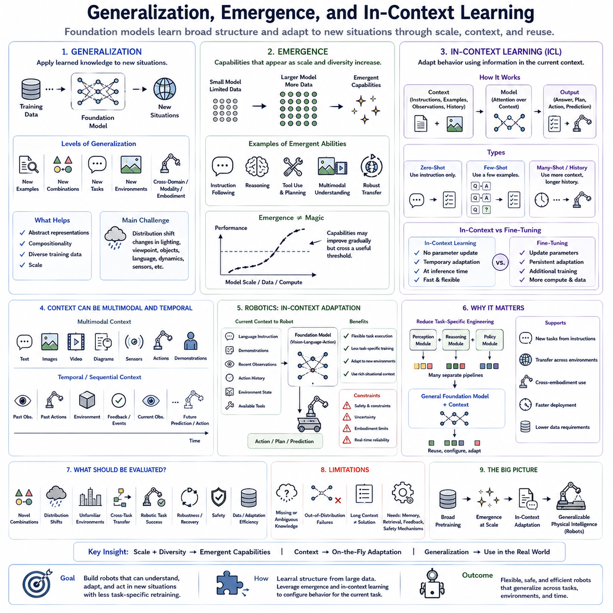{width="7.268055555555556in" height="7.268055555555556in"}

Generalization is the ability of a foundation model to apply knowledge learned during training to examples, tasks, environments, or situations that were not encountered in exactly the same form before. Rather than memorizing individual training samples, a useful model captures reusable regularities and relationships. Strong generalization is therefore central to the value of foundation models because pretraining is intended to support many downstream problems beyond the original training distribution.

Generalization exists at several levels. A model may generalize to new combinations of familiar concepts, unfamiliar examples within a known domain, new tasks expressed through instructions, or environments that differ from those used during training. More demanding forms require transfer across domains, modalities, or embodiments. The difficulty increases as the target situation moves farther from the patterns represented in the pretraining data.

Representation learning provides much of the basis for generalization. If a model learns abstract features such as objects, relationships, semantics, motion, geometry, or task structure, those features can be recombined in new contexts. Representations that capture only superficial correlations may perform well on familiar data but fail when irrelevant conditions change. Generalization therefore depends not only on model size but also on what structure the learned representations preserve.

Compositional generalization refers to using familiar components in unfamiliar combinations. A model may already understand several objects, actions, attributes, and spatial relations separately, yet encounter a new instruction combining them in a way that never appeared during training. If the internal representation separates and recombines these concepts effectively, the model can potentially solve the new task without requiring an independently learned representation for every possible combination.

Distribution shift creates one of the major challenges to generalization. Training and deployment data rarely follow exactly the same distribution, particularly in physical environments. Lighting, viewpoints, backgrounds, objects, language, sensors, dynamics, or user behavior can change. Models that depend heavily on incidental correlations may degrade substantially under these shifts, whereas models that capture more stable underlying structure have a better chance of maintaining useful performance.

Foundation models attempt to improve generalization partly through scale and diversity. Exposure to many domains, tasks, linguistic expressions, visual environments, and behavioral patterns increases the probability that new situations can be interpreted as combinations or variations of previously learned structure. However, large-scale training does not guarantee robust generalization. Rare conditions, systematic distribution shifts, and genuinely novel physical situations can still expose important limitations.

Emergence describes capabilities that become noticeably observable as models, datasets, compute, or training diversity increase. Some abilities may appear weak or absent at smaller scales and become substantially more useful in larger systems. These observations have motivated interest in whether sufficiently scaled foundation models can acquire capabilities that were not individually programmed or explicitly optimized as separate task-specific modules.

Emergent behavior should be interpreted carefully. Apparent sudden capability changes can sometimes result from evaluation thresholds, metric design, prompting, or nonlinear improvements in an underlying continuous capability. A model may gradually improve while a benchmark records success only after performance crosses a particular threshold. Emergence therefore does not necessarily imply that an entirely new internal mechanism appeared instantaneously at a specific model size.

Nevertheless, large pretrained models often demonstrate broad capabilities that arise from shared learning rather than separate training pipelines for every task. Translation, summarization, classification, question answering, retrieval-related reasoning, and instruction following can coexist within one model. Multimodal models extend this phenomenon toward visual understanding and grounding, while robot foundation models seek similar reuse across perception, planning-related representations, and physical behavior.

In-context learning is a particularly important capability associated with modern foundation models. Instead of updating model parameters through additional gradient-based training, the model adapts its behavior using information provided within the current context. Instructions, demonstrations, examples, constraints, observations, or previous interaction history can specify what should be done, allowing the pretrained model to temporarily specialize its behavior for the current problem.

Zero-shot behavior occurs when a model performs a task from an instruction or task description without receiving explicit examples in the current context. Few-shot behavior provides a small number of demonstrations showing the desired input-output relationship. The model uses these examples to infer the task structure and produce corresponding outputs. This makes the context itself a temporary interface for adaptation without requiring a new training process for every task.

In-context learning differs fundamentally from conventional fine-tuning. Fine-tuning changes model parameters using additional optimization, potentially creating persistent adaptation. In-context learning leaves the underlying parameters unchanged and conditions computation on temporary information presented at inference time. The two approaches can complement one another: pretraining supplies broad knowledge, fine-tuning can specialize persistent behavior, and context can dynamically specify immediate goals or constraints.

The Transformer architecture supports in-context learning by allowing current tokens to attend to instructions, demonstrations, and previous elements within the context window. Attention can retrieve relevant relationships from these examples while producing a new prediction. As context length increases, models can potentially use richer demonstrations, histories, documents, or trajectories, although computational cost and the ability to identify the most relevant information become increasingly important.

For multimodal models, context does not need to consist only of text. Images, video frames, diagrams, sensor observations, previous actions, or multimodal demonstrations can provide contextual evidence. A model may infer what object is being referenced from an image and instruction together or use several visual demonstrations to determine the intended task. In-context adaptation can therefore extend from linguistic prompting toward multimodal situational adaptation.

Robotics gives in-context learning a physical interpretation. A robot may receive a language instruction, several demonstrations, recent observations, action history, environmental constraints, and information about available tools. Instead of retraining the entire model, these elements can be placed into the active context so that the robot adapts its prediction or action generation to the current task. This offers a potential mechanism for flexible task execution with limited additional training.

Temporal context is especially important for physical agents. The meaning of the current observation often depends on what happened previously, including previous robot actions, object motion, task progress, failures, and corrections. Maintaining relevant history allows a model to infer hidden state and adjust behavior as an episode develops. In this sense, context functions not only as a task description but also as a short-term representation of ongoing interaction.

In-context robot adaptation also faces stricter limitations than text-only reasoning. A plausible linguistic answer can be revised, but an unsafe physical action may cause immediate consequences. The model must therefore combine contextual flexibility with embodiment constraints, collision avoidance, control limits, uncertainty estimation, and runtime safety mechanisms. Generalization in Physical AI cannot be evaluated only by whether a model understands a new instruction; it must also execute safely and reliably.

Cross-environment generalization is necessary when robots move from training environments into unfamiliar factories, warehouses, homes, roads, or outdoor terrain. Cross-task generalization requires transferring reusable knowledge to new goals, while cross-embodiment generalization asks whether knowledge learned from one robot can benefit another with different sensors, kinematics, or action spaces. These forms of generalization become increasingly important as robot foundation models attempt to support many platforms.

Emergence and in-context learning are therefore closely related to the broader goal of reducing task-specific engineering. Instead of building a separate perception, reasoning, and policy pipeline for every narrowly defined problem, a sufficiently general pretrained model can provide reusable capabilities that are selected and configured through context. The long-term objective is not the elimination of specialization, but making adaptation substantially cheaper and faster than learning each task independently.

Evaluation must carefully separate memorization from genuine generalization. Benchmarks should control for overlap between training and evaluation data and include novel combinations, distribution shifts, unfamiliar environments, and tasks requiring transfer. For robotics, evaluation should additionally measure physical task success, recovery from unexpected events, robustness to sensor variation, uncertainty, safety, and the amount of additional data or adaptation required for new tasks.

Generalization also has boundaries. A foundation model cannot reliably infer every concept, physical law, or task from context when the required knowledge is absent, ambiguous, or outside its learned capabilities. Larger context windows do not automatically solve missing knowledge or poor representations. Successful systems therefore combine broad pretraining with appropriate adaptation, memory, retrieval, specialized components, feedback, and explicit safety mechanisms where necessary.

For Robot Foundation Models and Vision-Language-Action models, generalization, emergence, and in-context learning describe a progression from reusable knowledge toward flexible physical intelligence. Broad pretraining establishes shared representations, scale can reveal increasingly capable combinations of learned skills, and context allows those capabilities to be configured for current situations. Together, they provide a foundation for robots that can approach new tasks and environments with less task-specific retraining while remaining grounded in perception, embodiment, and physical interaction.

일반화(Generalization)는 파운데이션 모델(Foundation Model)이 학습 과정에서 획득한 지식을 이전에 정확히 동일한 형태로 접하지 않았던 사례, 작업, 환경 또는 상황에 적용하는 능력이다. 유용한 모델은 개별 학습 샘플(training sample)을 단순히 암기하는 대신 재사용 가능한 규칙성과 관계를 포착한다. 따라서 강력한 일반화는 사전학습(pretraining)이 원래의 학습 분포(training distribution)를 넘어 다양한 다운스트림 문제(downstream problem)를 지원하도록 설계된 파운데이션 모델의 핵심 가치이다.

일반화(Generalization)는 여러 수준에서 나타난다. 모델은 익숙한 개념들의 새로운 조합, 알려진 도메인(domain) 내부의 새로운 사례, 명령을 통해 표현된 새로운 작업 또는 학습에 사용된 환경과 다른 환경으로 일반화할 수 있다. 더 어려운 형태의 일반화에서는 도메인, 모달리티(modality), 임바디먼트(embodiment) 사이의 전이가 요구된다. 목표 상황이 사전학습 데이터에 포함된 패턴에서 멀어질수록 일반화의 난이도는 증가한다.

표현 학습(Representation Learning)은 일반화의 중요한 기반을 제공한다. 모델이 객체, 관계, 의미론(semantics), 움직임, 기하학(geometry), 작업 구조(task structure)와 같은 추상적인 특징을 학습하면 이러한 특징을 새로운 컨텍스트(context)에서 다시 조합할 수 있다. 표면적인 상관관계만 포착하는 표현은 익숙한 데이터에서는 좋은 성능을 보일 수 있지만 중요하지 않은 조건이 변하면 실패할 수 있다. 따라서 일반화는 모델 크기뿐만 아니라 학습된 표현이 어떤 구조를 보존하는지에도 의존한다.

조합적 일반화(Compositional Generalization)는 익숙한 구성요소를 이전에 경험하지 못한 새로운 조합으로 사용하는 것을 의미한다. 모델이 여러 객체, 행동, 속성(attribute), 공간 관계(spatial relation)를 각각 이해하고 있더라도 학습 과정에서 한 번도 나타나지 않았던 방식으로 이들을 결합한 새로운 명령을 접할 수 있다. 내부 표현이 이러한 개념들을 효과적으로 분리하고 재조합할 수 있다면 가능한 모든 조합에 대해 독립적인 표현을 학습하지 않고도 새로운 작업을 해결할 수 있다.

분포 변화(Distribution Shift)는 일반화에서 가장 중요한 문제 가운데 하나이다. 특히 물리 환경에서는 학습 데이터와 실제 배포 데이터(deployment data)가 정확히 동일한 분포를 따르는 경우가 드물다. 조명, 시점(viewpoint), 배경, 객체, 언어, 센서, 동역학(dynamics), 사용자 행동 등이 달라질 수 있다. 우연적인 상관관계에 크게 의존하는 모델은 이러한 변화에서 성능이 크게 저하될 수 있지만, 보다 안정적인 근본 구조를 포착한 모델은 유용한 성능을 유지할 가능성이 높다.

파운데이션 모델은 부분적으로 규모(scale)와 다양성(diversity)을 통해 일반화를 향상시키려 한다. 다양한 도메인, 작업, 언어 표현, 시각 환경, 행동 패턴에 노출되면 새로운 상황을 이전에 학습한 구조의 조합이나 변형으로 해석할 가능성이 높아진다. 그러나 대규모 학습 자체가 강건한 일반화(robust generalization)를 보장하는 것은 아니다. 희귀한 조건, 체계적인 분포 변화, 실제로 새로운 물리적 상황에서는 여전히 중요한 한계가 드러날 수 있다.

창발(Emergence)은 모델, 데이터셋, 컴퓨트(compute) 또는 학습 다양성이 증가함에 따라 특정 능력이 눈에 띄게 관찰되기 시작하는 현상을 설명한다. 일부 능력은 작은 규모에서는 약하거나 존재하지 않는 것처럼 보이지만 더 큰 시스템에서는 상당히 유용한 수준으로 나타날 수 있다. 이러한 관찰은 충분히 확장된 파운데이션 모델이 각각의 작업 특화 모듈(task-specific module)로 개별적으로 프로그래밍하거나 명시적으로 최적화하지 않은 능력을 획득할 수 있는지에 대한 관심을 불러일으켰다.

창발적 행동(Emergent Behavior)은 신중하게 해석해야 한다. 겉으로 보기에 갑작스러운 능력 변화가 실제로는 평가 임계값(evaluation threshold), 평가 지표(metric) 설계, 프롬프팅(prompting), 또는 연속적으로 향상되던 기반 능력의 비선형적인 결과에서 발생할 수 있다. 모델의 능력이 점진적으로 개선되더라도 벤치마크(benchmark)가 특정 임계점을 넘어선 이후에만 성공으로 기록할 수 있다. 따라서 창발이 반드시 특정 모델 크기에서 완전히 새로운 내부 메커니즘이 순간적으로 나타났음을 의미하지는 않는다.

그럼에도 대규모 사전학습 모델은 모든 작업에 대해 별도의 학습 파이프라인을 구축하지 않고 공유 학습(shared learning)을 통해 폭넓은 능력을 보여주는 경우가 많다. 번역(translation), 요약(summarization), 분류(classification), 질의응답(question answering), 검색 관련 추론(retrieval-related reasoning), 명령 수행(instruction following)이 하나의 모델 안에 공존할 수 있다. 멀티모달 모델은 이러한 현상을 시각적 이해와 그라운딩(grounding)으로 확장하며, 로봇 파운데이션 모델(Robot Foundation Model)은 인식, 계획 관련 표현(planning-related representation), 물리적 행동 사이에서 유사한 재사용을 추구한다.

인컨텍스트 학습(In-Context Learning)은 현대 파운데이션 모델과 관련된 특히 중요한 능력이다. 추가적인 그래디언트 기반 학습(gradient-based training)을 통해 모델 파라미터(parameter)를 변경하는 대신 현재 컨텍스트 안에서 제공되는 정보를 이용하여 모델의 행동을 적응시킨다. 명령, 시연(demonstration), 예제, 제약조건(constraint), 관측, 이전 상호작용 이력 등을 통해 수행해야 할 작업을 지정할 수 있으며, 사전학습된 모델은 새로운 학습 과정 없이 현재 문제에 맞게 일시적으로 행동을 특화할 수 있다.

제로샷 행동(Zero-Shot Behavior)은 현재 컨텍스트에서 명시적인 예제를 제공받지 않고 명령이나 작업 설명만으로 모델이 작업을 수행하는 경우이다. 퓨샷 행동(Few-Shot Behavior)은 원하는 입력-출력 관계를 보여주는 소수의 시연을 제공한다. 모델은 이러한 예제를 이용하여 작업 구조를 추론하고 그에 대응하는 출력을 생성한다. 이를 통해 모든 작업에 대해 새로운 학습 과정을 수행하지 않고도 컨텍스트 자체를 일시적인 적응 인터페이스(adaptation interface)로 사용할 수 있다.

인컨텍스트 학습(In-Context Learning)은 기존의 파인튜닝(Fine-Tuning)과 근본적으로 다르다. 파인튜닝은 추가적인 최적화(optimization)를 통해 모델 파라미터를 변경하여 지속적인 적응을 형성할 수 있다. 반면 인컨텍스트 학습은 기본 파라미터를 변경하지 않고 추론 시점에 제공되는 일시적인 정보를 조건으로 계산을 수행한다. 두 접근법은 서로 보완할 수 있으며, 사전학습은 폭넓은 지식을 제공하고 파인튜닝은 지속적인 행동을 특화하며 컨텍스트는 즉각적인 목표나 제약조건을 동적으로 지정할 수 있다.

트랜스포머 아키텍처(Transformer Architecture)는 현재 토큰(token)이 컨텍스트 윈도우(context window) 안의 명령, 시연, 이전 요소에 어텐션(attention)을 적용할 수 있도록 함으로써 인컨텍스트 학습을 지원한다. 어텐션은 새로운 예측을 생성하면서 이러한 사례에서 관련된 관계를 검색할 수 있다. 컨텍스트 길이가 증가하면 더욱 풍부한 시연, 이력, 문서 또는 궤적(trajectory)을 활용할 수 있지만 계산 비용과 가장 관련성이 높은 정보를 식별하는 능력이 점점 중요해진다.

멀티모달 모델(Multimodal Model)에서 컨텍스트는 텍스트로만 구성될 필요가 없다. 이미지, 비디오 프레임(video frame), 다이어그램(diagram), 센서 관측(sensor observation), 이전 행동 또는 멀티모달 시연(multimodal demonstration)이 문맥적 증거(contextual evidence)를 제공할 수 있다. 모델은 이미지와 명령을 함께 이용하여 어떤 객체를 지칭하는지 추론하거나 여러 시각적 시연을 사용하여 의도된 작업을 파악할 수 있다. 따라서 인컨텍스트 적응(in-context adaptation)은 언어적 프롬프팅에서 멀티모달 상황 적응(multimodal situational adaptation)으로 확장될 수 있다.

로보틱스(Robotics)는 인컨텍스트 학습에 물리적인 의미를 부여한다. 로봇은 언어 명령, 여러 시연, 최근 관측, 행동 이력, 환경 제약조건, 사용 가능한 도구에 대한 정보를 제공받을 수 있다. 전체 모델을 다시 학습하는 대신 이러한 요소를 활성 컨텍스트(active context)에 포함시켜 현재 작업에 맞게 로봇의 예측이나 행동 생성을 적응시킬 수 있다. 이는 제한적인 추가 학습만으로 유연한 작업 실행(flexible task execution)을 구현할 수 있는 잠재적인 메커니즘을 제공한다.

물리 에이전트(Physical Agent)에서는 시간적 컨텍스트(Temporal Context)가 특히 중요하다. 현재 관측의 의미는 이전 로봇 행동, 객체 움직임, 작업 진행 상황, 실패, 수정 등 이전에 발생한 사건에 따라 달라지는 경우가 많다. 관련된 이력을 유지하면 모델이 숨겨진 상태(hidden state)를 추론하고 에피소드(episode)가 진행됨에 따라 행동을 조정할 수 있다. 이러한 의미에서 컨텍스트는 작업 설명뿐만 아니라 진행 중인 상호작용에 대한 단기 표현(short-term representation)의 역할도 수행한다.

로봇의 인컨텍스트 적응(In-Context Robot Adaptation)은 텍스트 기반 추론보다 더욱 엄격한 한계를 가진다. 그럴듯한 언어적 답변은 수정할 수 있지만 안전하지 않은 물리적 행동은 즉각적인 결과를 초래할 수 있다. 따라서 모델은 문맥적 유연성(contextual flexibility)을 임바디먼트 제약조건, 충돌 회피(collision avoidance), 제어 한계(control limit), 불확실성 추정(uncertainty estimation), 런타임 안전 메커니즘(runtime safety mechanism)과 결합해야 한다. 피지컬 AI(Physical AI)의 일반화는 새로운 명령을 이해하는지만으로 평가할 수 없으며 안전하고 신뢰성 있게 실행할 수 있는지도 평가해야 한다.

교차 환경 일반화(Cross-Environment Generalization)는 로봇이 학습 환경에서 익숙하지 않은 공장, 창고, 가정, 도로 또는 야외 지형으로 이동할 때 필요하다. 교차 작업 일반화(Cross-Task Generalization)는 재사용 가능한 지식을 새로운 목표에 전이하는 것을 요구하며, 교차 임바디먼트 일반화(Cross-Embodiment Generalization)는 하나의 로봇에서 학습한 지식이 서로 다른 센서, 운동학(kinematics), 행동 공간(action space)을 가진 다른 로봇에도 도움이 될 수 있는지를 다룬다. 로봇 파운데이션 모델이 다양한 플랫폼을 지원하려 할수록 이러한 형태의 일반화가 더욱 중요해진다.

따라서 창발(Emergence)과 인컨텍스트 학습(In-Context Learning)은 작업 특화 엔지니어링(task-specific engineering)을 줄이려는 보다 광범위한 목표와 밀접하게 연결된다. 좁게 정의된 각각의 문제마다 별도의 인식, 추론, 정책 파이프라인(policy pipeline)을 구축하는 대신 충분히 일반적인 사전학습 모델이 재사용 가능한 능력을 제공하고 컨텍스트를 통해 필요한 능력을 선택하고 구성할 수 있다. 장기적인 목표는 특화를 완전히 제거하는 것이 아니라 각각의 작업을 독립적으로 학습하는 것보다 훨씬 적은 비용과 시간으로 적응할 수 있도록 만드는 것이다.

평가(Evaluation)는 단순한 암기(memorization)와 진정한 일반화를 신중하게 구분해야 한다. 벤치마크는 학습 데이터와 평가 데이터 사이의 중복을 통제하고 새로운 조합, 분포 변화, 익숙하지 않은 환경, 전이가 필요한 작업을 포함해야 한다. 로보틱스에서는 물리적 작업 성공(physical task success), 예상하지 못한 사건으로부터의 복구(recovery), 센서 변화에 대한 강건성(robustness), 불확실성, 안전성(safety), 새로운 작업에 필요한 추가 데이터 또는 적응량도 함께 측정해야 한다.

일반화에도 한계(boundary)가 존재한다. 파운데이션 모델은 필요한 지식이 존재하지 않거나 모호하거나 학습된 능력 범위를 벗어난 경우 모든 개념, 물리 법칙 또는 작업을 컨텍스트만으로 신뢰성 있게 추론할 수는 없다. 더 큰 컨텍스트 윈도우가 부족한 지식이나 잘못된 표현을 자동으로 해결하는 것도 아니다. 따라서 성공적인 시스템은 광범위한 사전학습을 적절한 적응(adaptation), 메모리(memory), 검색(retrieval), 특화 구성요소(specialized component), 피드백(feedback), 그리고 필요한 경우 명시적인 안전 메커니즘과 결합해야 한다.

로봇 파운데이션 모델(Robot Foundation Model)과 비전-언어-행동 모델(Vision-Language-Action Model, VLA)에서 일반화, 창발, 인컨텍스트 학습은 재사용 가능한 지식에서 유연한 물리 지능(flexible physical intelligence)으로 발전하는 과정을 설명한다. 광범위한 사전학습은 공유 표현(shared representation)을 구축하고, 규모의 확장은 학습된 능력의 더욱 강력한 조합을 나타나게 할 수 있으며, 컨텍스트는 이러한 능력을 현재 상황에 맞게 구성하도록 한다. 이들을 결합하면 로봇은 작업별 재학습(task-specific retraining)을 줄이면서 새로운 작업과 환경에 대응하고, 동시에 인식(perception), 임바디먼트, 물리적 상호작용(physical interaction)에 기반을 둔 행동을 수행할 수 있다.

## 01.10. Foundation Models for Physical Agents

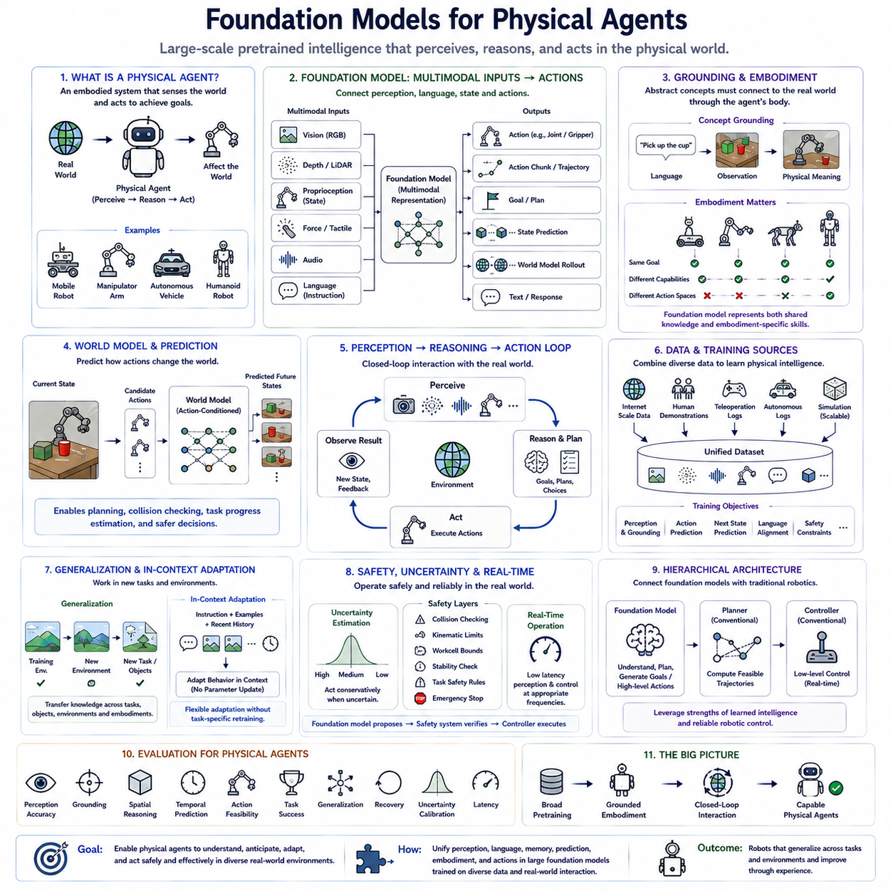{width="7.268055555555556in" height="7.268055555555556in"}

Foundation models for physical agents extend large-scale pretrained intelligence from digital information into systems that perceive, reason about, and act within the physical world. Unlike models that only generate text or analyze images, physical-agent models must connect perception with embodiment, dynamics, goals, and executable actions. Their outputs can therefore change the environment and influence the observations that the model receives next.

A physical agent is an embodied system whose intelligence operates through sensors and actuators. Robots, autonomous vehicles, mobile manipulators, humanoids, and other intelligent machines observe the world through cameras, LiDAR, depth sensors, microphones, force sensors, proprioception, and related devices. They act through wheels, joints, grippers, steering systems, or other mechanisms constrained by physical structure and control limits.

The transition from conventional foundation models to physical agents requires grounding abstract knowledge in real environments. Language concepts such as object, obstacle, container, door, or grasp must correspond to observable entities, geometric relationships, and possible interactions. A model must connect what something means with where it is, how it can move, what actions are possible, and what consequences those actions may produce.

Multimodal perception provides the sensory foundation for this grounding. Cameras contribute appearance and semantic information, while depth and LiDAR provide geometry and spatial structure. Proprioception describes the internal configuration of the agent, and force or tactile sensing reveals physical contact. Combining these modalities allows a physical agent to construct representations that contain both semantic understanding and action-relevant physical information.

Embodiment distinguishes physical-agent foundation models from purely digital models. The same instruction can require different actions depending on the robot\'s morphology, kinematics, sensors, payload, reach, mobility, and available tools. A wheeled robot, manipulator, quadruped, and humanoid may understand the same goal but possess different feasible action spaces. Foundation models must therefore represent both shared task knowledge and embodiment-specific capabilities.

Actions form another essential modality for physical agents. Observations describe the current situation, language can specify goals, and actions determine how the agent attempts to change the environment. Vision-Language-Action models extend multimodal foundation modeling by learning relationships among these elements. The model can condition action generation on visual observations, instructions, robot state, previous actions, and other contextual information.

Physical interaction introduces dynamics that cannot be understood from static semantics alone. Objects move, deform, collide, fall, resist contact, or respond differently depending on their physical properties. The robot\'s own motion also changes what it can observe and reach. Physical-agent models therefore benefit from representations of state transitions, temporal dependencies, action consequences, and other structures describing how the world evolves over time.

World models provide a natural extension of this requirement. Instead of responding only to the current observation, an agent can predict how candidate actions may alter future states. Action-conditioned prediction allows the system to estimate motion, object interactions, task progress, collisions, or other consequences before physical execution. Such predictive capability creates an internal mechanism for connecting learned representations with planning and decision making.

Planning can then be viewed as reasoning over possible future interactions. A model or policy may generate candidate actions, action chunks, trajectories, or intermediate goals. Predictive components can estimate their likely consequences, while evaluators consider task objectives, feasibility, safety, cost, and constraints. The selected behavior is executed, producing a new observation and closing the perception-action loop through interaction with the real environment.

Temporal context is essential because physical tasks unfold as processes rather than isolated decisions. The current sensor frame may not reveal velocity, previous contact, task progress, or the reason an object reached its present state. Maintaining histories of observations, actions, outcomes, and corrections enables models to infer hidden state and understand ongoing activity. Memory mechanisms can extend this capability beyond the immediate context window.

Robot foundation models require data that connects perception with physical experience. Internet-scale language, images, and video provide broad semantic and visual knowledge, but they do not fully describe robot-specific dynamics and control. Demonstrations, teleoperation trajectories, autonomous operation logs, simulation, sensor streams, and interaction outcomes provide additional grounding. Combining these sources allows broad digital knowledge to be connected with embodied experience.

Simulation is particularly useful because physical interaction data is expensive to collect. Virtual environments can generate large numbers of trajectories, variations, failures, and controlled experiments without damaging hardware. Domain randomization and diverse simulated conditions can improve robustness, while real-world data remains necessary to capture effects that simulation does not reproduce accurately. Effective training therefore often requires combining simulated and physical experience.

Cross-embodiment learning offers another route toward scale. Experience collected from different robots can share semantic, perceptual, spatial, and task-level structure even when their action spaces differ. A common representation may capture goals and environmental relationships, while embodiment-specific components translate these concepts into feasible actions. This approach seeks to make knowledge transferable across manipulators, mobile robots, humanoids, quadrupeds, and other platforms.

Generalization is especially important because physical agents cannot be trained separately for every configuration of objects, environments, users, and tasks they may encounter. A useful foundation model should transfer knowledge to unfamiliar situations and adapt using instructions, demonstrations, or recent interaction context. However, physical generalization is more demanding than semantic generalization because successful behavior must remain geometrically feasible, dynamically valid, and safe.

In-context adaptation can help physical agents respond to new tasks without modifying model parameters. Language instructions, visual demonstrations, available tools, environmental constraints, and recent action history can be supplied as context. The model can use this information to configure its behavior for the current situation. Such adaptation can reduce task-specific retraining, although it cannot replace capabilities that were never learned or safely grounded during pretraining.

Uncertainty must be represented explicitly because physical environments are partially observable and inherently unpredictable. Sensors contain noise, objects may be occluded, human behavior can change, and learned dynamics may be inaccurate outside familiar conditions. Physical agents should distinguish confident predictions from uncertain ones and adjust behavior accordingly. Slowing down, gathering additional observations, selecting conservative actions, or requesting assistance can be appropriate responses.

Safety is therefore a system-level requirement rather than simply another prediction target. A foundation model may propose an action, but execution should respect collision constraints, actuator limits, workspace boundaries, stability requirements, and task-specific safety rules. Runtime monitors, conventional controllers, planners, safety filters, emergency stops, and verified constraints can operate alongside learned models to prevent plausible but unsafe model outputs from directly controlling hardware.

Real-time operation creates additional architectural constraints. Large models may require substantial memory and computation, while physical control often demands predictable latency and continuous sensor processing. Practical systems may divide intelligence across edge computers, local servers, and larger centralized infrastructure. High-level reasoning can operate at slower rates, while perception, safety, stabilization, and control loops run at frequencies appropriate to the physical platform.

Hierarchical architectures are therefore useful for connecting foundation models with conventional robotics. A foundation model can interpret instructions, recognize task structure, propose goals, or generate higher-level action representations, while motion planners and controllers convert these decisions into dynamically feasible commands. This separation allows learned intelligence to provide flexibility without requiring a single large model to replace every deterministic component of the robotic stack.

Closed-loop operation is essential because physical actions rarely unfold exactly as predicted. After executing an action, the agent must observe the result, compare it with the intended outcome, update its internal state, and decide what to do next. Failures and unexpected events require recovery rather than continuation of an obsolete plan. Physical intelligence therefore depends on repeated perception, prediction, action, evaluation, and correction.

Evaluation must extend beyond conventional language and vision benchmarks. Physical-agent foundation models should be tested for perception, grounding, spatial reasoning, temporal prediction, action feasibility, task completion, generalization, recovery, uncertainty, latency, and safety. Evaluation should also examine performance under sensor degradation, environmental variation, distribution shift, and unexpected interactions because these conditions strongly influence real-world reliability.

The long-term objective is not merely to place a large multimodal model inside a robot. It is to create an integrated intelligence architecture in which broad pretrained knowledge becomes grounded in embodiment, physical dynamics, temporal interaction, and closed-loop action. Foundation models provide reusable representations and adaptable reasoning capabilities, while robotic systems provide sensing, control, safety, and physical experience required to transform those capabilities into reliable behavior.

Foundation models for physical agents therefore represent a transition from models that primarily understand or generate information toward models that participate in the world. Robot Foundation Models and Vision-Language-Action models combine perception, language, memory, prediction, embodiment, and action within increasingly shared representations. Their ultimate purpose is to enable physical agents to understand situations, anticipate consequences, adapt to new tasks, and act safely and effectively across diverse real-world environments.

물리 에이전트를 위한 파운데이션 모델(Foundation Models for Physical Agents)은 대규모 사전학습 지능(large-scale pretrained intelligence)을 디지털 정보의 영역에서 벗어나 물리 세계를 인식하고, 추론하며, 그 안에서 행동하는 시스템으로 확장한다. 텍스트를 생성하거나 이미지만 분석하는 모델과 달리 물리 에이전트 모델(physical-agent model)은 인식(perception)을 임바디먼트(embodiment), 동역학(dynamics), 목표(goal), 실행 가능한 행동(executable action)과 연결해야 한다. 따라서 모델의 출력은 실제 환경을 변화시키고, 그 변화가 다시 모델이 다음에 받는 관측에 영향을 줄 수 있다.

물리 에이전트(Physical Agent)는 센서(sensor)와 액추에이터(actuator)를 통해 지능이 작동하는 임바디드 시스템(embodied system)이다. 로봇, 자율주행차(autonomous vehicle), 모바일 매니퓰레이터(mobile manipulator), 휴머노이드(humanoid) 및 기타 지능형 기계는 카메라, 라이다(LiDAR), 깊이 센서(depth sensor), 마이크, 힘 센서(force sensor), 고유수용감각(proprioception) 및 관련 장치를 통해 세계를 관측한다. 이들은 바퀴, 관절, 그리퍼(gripper), 조향 시스템(steering system) 또는 물리적 구조와 제어 한계에 의해 제약되는 다른 메커니즘을 통해 행동한다.

기존 파운데이션 모델에서 물리 에이전트로의 전환에는 추상적인 지식(abstract knowledge)을 실제 환경에 그라운딩(grounding)하는 과정이 필요하다. 객체(object), 장애물(obstacle), 용기(container), 문(door), 잡기(grasp)와 같은 언어 개념은 관측 가능한 개체, 기하학적 관계(geometric relationship), 가능한 상호작용과 대응되어야 한다. 모델은 어떤 대상이 무엇을 의미하는지뿐만 아니라 그것이 어디에 있고, 어떻게 움직일 수 있으며, 어떤 행동이 가능하고, 그 행동이 어떤 결과를 만들어낼 수 있는지를 연결해야 한다.

멀티모달 인식(Multimodal Perception)은 이러한 그라운딩을 위한 감각적 기반을 제공한다. 카메라는 외형과 의미 정보를 제공하고, 깊이 센서와 라이다는 기하학(geometry)과 공간 구조(spatial structure)를 제공한다. 고유수용감각은 에이전트 내부의 구성 상태(configuration)를 설명하며, 힘 또는 촉각 센싱(tactile sensing)은 물리적 접촉 정보를 제공한다. 이러한 모달리티(modality)를 결합하면 물리 에이전트는 의미적 이해와 행동 관련 물리 정보를 모두 포함하는 표현(representation)을 구성할 수 있다.

임바디먼트(Embodiment)는 물리 에이전트 파운데이션 모델을 순수한 디지털 모델과 구별하는 핵심 요소이다. 동일한 명령이라도 로봇의 형태(morphology), 운동학(kinematics), 센서, 페이로드(payload), 도달 범위(reach), 이동 능력(mobility), 사용 가능한 도구에 따라 서로 다른 행동이 필요할 수 있다. 바퀴형 로봇, 매니퓰레이터, 4족 로봇(quadruped), 휴머노이드는 동일한 목표를 이해하더라도 서로 다른 실행 가능한 행동 공간(action space)을 가진다. 따라서 파운데이션 모델은 공유 작업 지식과 임바디먼트 특화 능력(embodiment-specific capability)을 모두 표현해야 한다.

행동(Action)은 물리 에이전트에서 또 하나의 핵심 모달리티를 형성한다. 관측은 현재 상황을 설명하고, 언어는 목표를 지정할 수 있으며, 행동은 에이전트가 환경을 어떻게 변화시키려 하는지를 결정한다. 비전-언어-행동 모델(Vision-Language-Action Model, VLA)은 이러한 요소 사이의 관계를 학습함으로써 멀티모달 파운데이션 모델링을 확장한다. 모델은 시각적 관측, 명령, 로봇 상태, 이전 행동 및 기타 문맥 정보를 조건으로 하여 행동을 생성할 수 있다.

물리적 상호작용(Physical Interaction)은 정적인 의미론만으로는 이해할 수 없는 동역학을 도입한다. 객체는 움직이고, 변형되고, 충돌하고, 떨어지며, 접촉에 저항하거나 물리적 특성에 따라 서로 다르게 반응한다. 로봇 자체의 움직임도 무엇을 관측하고 어디에 도달할 수 있는지를 변화시킨다. 따라서 물리 에이전트 모델은 상태 전이(state transition), 시간적 의존성(temporal dependency), 행동 결과(action consequence), 그리고 세계가 시간에 따라 어떻게 변화하는지를 설명하는 기타 구조의 표현을 활용할 필요가 있다.

월드 모델(World Model)은 이러한 요구사항을 자연스럽게 확장한다. 에이전트는 현재 관측에만 반응하는 대신 후보 행동(candidate action)이 미래 상태를 어떻게 변화시킬 수 있는지를 예측할 수 있다. 행동 조건부 예측(action-conditioned prediction)을 통해 시스템은 실제로 행동하기 전에 움직임, 객체 상호작용, 작업 진행(task progress), 충돌 또는 기타 결과를 추정할 수 있다. 이러한 예측 능력은 학습된 표현을 계획(planning)과 의사결정(decision making)에 연결하는 내부 메커니즘을 제공한다.

계획(Planning)은 가능한 미래 상호작용을 대상으로 수행하는 추론으로 볼 수 있다. 모델 또는 정책(policy)은 후보 행동, 행동 청크(action chunk), 궤적(trajectory), 중간 목표(intermediate goal)를 생성할 수 있다. 예측 구성요소는 예상되는 결과를 추정하고, 평가기(evaluator)는 작업 목표, 실행 가능성(feasibility), 안전성(safety), 비용(cost), 제약조건(constraint)을 고려한다. 선택된 행동이 실행되면 새로운 관측이 생성되고, 실제 환경과의 상호작용을 통해 인식-행동 루프(perception-action loop)가 폐쇄형으로 연결된다.

물리적 작업은 독립적인 의사결정이 아니라 시간에 따라 진행되는 과정이므로 시간적 컨텍스트(Temporal Context)가 필수적이다. 현재 센서 프레임만으로는 속도, 이전 접촉, 작업 진행 상황 또는 객체가 현재 상태에 도달한 이유를 알 수 없을 수 있다. 관측, 행동, 결과, 수정의 이력을 유지하면 모델이 숨겨진 상태(hidden state)를 추론하고 진행 중인 활동을 이해할 수 있다. 메모리 메커니즘(memory mechanism)은 이러한 능력을 즉각적인 컨텍스트 윈도우(context window)를 넘어 확장할 수 있다.

로봇 파운데이션 모델(Robot Foundation Model)은 인식과 물리적 경험을 연결하는 데이터를 필요로 한다. 인터넷 규모의 언어, 이미지, 비디오는 폭넓은 의미 및 시각 지식을 제공하지만 로봇 특화 동역학(robot-specific dynamics)과 제어를 완전하게 설명하지는 못한다. 시연(demonstration), 원격조작 궤적(teleoperation trajectory), 자율 운용 로그(autonomous operation log), 시뮬레이션(simulation), 센서 스트림(sensor stream), 상호작용 결과가 추가적인 그라운딩을 제공한다. 이러한 데이터 소스를 결합하면 광범위한 디지털 지식을 임바디드 경험(embodied experience)과 연결할 수 있다.

시뮬레이션(Simulation)은 물리적 상호작용 데이터를 수집하는 비용이 높기 때문에 특히 유용하다. 가상 환경은 하드웨어를 손상시키지 않으면서 많은 궤적, 환경 변화, 실패 사례, 통제된 실험을 생성할 수 있다. 도메인 랜덤화(domain randomization)와 다양한 시뮬레이션 조건은 강건성(robustness)을 향상시킬 수 있지만, 시뮬레이션에서 정확하게 재현하지 못하는 효과를 포착하기 위해서는 실제 데이터(real-world data)가 여전히 필요하다. 따라서 효과적인 학습에는 시뮬레이션 경험과 물리적 경험을 결합하는 방식이 필요하다.

교차 임바디먼트 학습(Cross-Embodiment Learning)은 규모를 확장하기 위한 또 다른 방법을 제공한다. 서로 다른 로봇에서 수집된 경험은 행동 공간이 다르더라도 의미적, 지각적, 공간적, 작업 수준의 구조를 공유할 수 있다. 공통 표현(common representation)은 목표와 환경 관계를 포착하고, 임바디먼트 특화 구성요소는 이러한 개념을 실행 가능한 행동으로 변환할 수 있다. 이러한 접근법은 매니퓰레이터, 모바일 로봇, 휴머노이드, 4족 로봇 및 기타 플랫폼 사이에서 지식을 전이 가능하게 만드는 것을 목표로 한다.

물리 에이전트가 접할 수 있는 모든 객체 구성, 환경, 사용자, 작업에 대해 개별적으로 학습할 수 없기 때문에 일반화(Generalization)는 특히 중요하다. 유용한 파운데이션 모델은 익숙하지 않은 상황으로 지식을 전이하고 명령, 시연 또는 최근의 상호작용 컨텍스트를 사용하여 적응할 수 있어야 한다. 그러나 물리적 일반화(physical generalization)는 성공적인 행동이 기하학적으로 실행 가능하고, 동역학적으로 유효하며, 안전해야 하기 때문에 의미적 일반화보다 더욱 어렵다.

인컨텍스트 적응(In-Context Adaptation)은 모델 파라미터를 변경하지 않고 물리 에이전트가 새로운 작업에 대응하도록 지원할 수 있다. 언어 명령, 시각적 시연, 사용 가능한 도구, 환경 제약조건, 최근 행동 이력을 컨텍스트로 제공할 수 있다. 모델은 이러한 정보를 사용하여 현재 상황에 맞게 행동을 구성할 수 있다. 이러한 적응은 작업 특화 재학습(task-specific retraining)을 줄일 수 있지만, 사전학습 과정에서 학습되거나 안전하게 그라운딩되지 않은 능력을 대체할 수는 없다.

물리 환경은 부분 관측 가능(partially observable)하고 본질적으로 예측 불가능하므로 불확실성(Uncertainty)을 명시적으로 표현해야 한다. 센서에는 잡음이 존재하고, 객체는 가려질 수 있으며, 인간의 행동은 변화할 수 있고, 학습된 동역학은 익숙하지 않은 조건에서 부정확할 수 있다. 물리 에이전트는 신뢰도가 높은 예측과 불확실한 예측을 구분하고 이에 따라 행동을 조정해야 한다. 속도를 낮추거나, 추가 관측을 수집하거나, 보수적인 행동을 선택하거나, 도움을 요청하는 것이 적절한 대응이 될 수 있다.

따라서 안전성(Safety)은 단순한 하나의 예측 목표가 아니라 시스템 수준의 요구사항(system-level requirement)이다. 파운데이션 모델이 행동을 제안할 수 있지만 실제 실행은 충돌 제약(collision constraint), 액추에이터 한계(actuator limit), 작업 공간 경계(workspace boundary), 안정성 요구조건(stability requirement), 작업 특화 안전 규칙을 준수해야 한다. 런타임 모니터(runtime monitor), 기존 제어기(conventional controller), 플래너(planner), 안전 필터(safety filter), 비상 정지(emergency stop), 검증된 제약조건이 학습 모델과 함께 작동하여 그럴듯하지만 안전하지 않은 모델 출력을 하드웨어가 직접 실행하지 않도록 할 수 있다.

실시간 운용(Real-Time Operation)은 추가적인 아키텍처 제약을 만든다. 대규모 모델은 상당한 메모리와 계산 자원을 요구할 수 있지만 물리적 제어는 예측 가능한 지연시간(latency)과 지속적인 센서 처리를 요구하는 경우가 많다. 실제 시스템은 지능 기능을 엣지 컴퓨터(edge computer), 로컬 서버(local server), 대규모 중앙집중형 인프라(centralized infrastructure)에 분산할 수 있다. 고수준 추론은 상대적으로 낮은 주기로 수행하고, 인식, 안전, 안정화(stabilization), 제어 루프는 물리 플랫폼에 적합한 주파수로 실행할 수 있다.

따라서 계층적 아키텍처(Hierarchical Architecture)는 파운데이션 모델과 기존 로보틱스를 연결하는 데 유용하다. 파운데이션 모델은 명령을 해석하고, 작업 구조를 인식하며, 목표를 제안하거나 고수준 행동 표현(high-level action representation)을 생성할 수 있고, 모션 플래너(motion planner)와 제어기(controller)는 이러한 결정을 동역학적으로 실행 가능한 명령으로 변환할 수 있다. 이러한 분리는 하나의 대규모 모델이 로봇 스택(robotic stack)의 모든 결정론적 구성요소를 대체하지 않고도 학습된 지능의 유연성을 활용하도록 한다.

물리적 행동은 예측된 대로 정확히 진행되지 않는 경우가 많으므로 폐쇄 루프 운용(Closed-Loop Operation)이 필수적이다. 행동을 실행한 이후 에이전트는 결과를 관측하고, 의도한 결과와 비교하고, 내부 상태를 갱신한 다음 다음 행동을 결정해야 한다. 실패와 예상하지 못한 사건이 발생하면 이미 유효하지 않은 계획을 계속 실행하는 대신 복구(recovery)가 필요하다. 따라서 물리 지능(physical intelligence)은 반복적인 인식, 예측, 행동, 평가, 수정 과정에 의존한다.

평가(Evaluation)는 기존의 언어 및 비전 벤치마크를 넘어 확장되어야 한다. 물리 에이전트 파운데이션 모델은 인식, 그라운딩, 공간 추론(spatial reasoning), 시간적 예측(temporal prediction), 행동 실행 가능성(action feasibility), 작업 완료(task completion), 일반화, 복구, 불확실성, 지연시간, 안전성을 평가해야 한다. 또한 센서 성능 저하(sensor degradation), 환경 변화, 분포 변화(distribution shift), 예상하지 못한 상호작용에서도 성능을 평가해야 한다. 이러한 조건이 실제 환경의 신뢰성에 큰 영향을 미치기 때문이다.

장기적인 목표는 단순히 대규모 멀티모달 모델(multimodal model)을 로봇 내부에 탑재하는 것이 아니다. 광범위하게 사전학습된 지식이 임바디먼트, 물리 동역학, 시간적 상호작용, 폐쇄 루프 행동에 그라운딩되는 통합 지능 아키텍처(integrated intelligence architecture)를 구축하는 것이다. 파운데이션 모델은 재사용 가능한 표현과 적응 가능한 추론 능력을 제공하고, 로봇 시스템은 이러한 능력을 신뢰할 수 있는 행동으로 변환하는 데 필요한 센싱, 제어, 안전, 물리적 경험을 제공한다.

따라서 물리 에이전트를 위한 파운데이션 모델(Foundation Models for Physical Agents)은 주로 정보를 이해하거나 생성하는 모델에서 실제 세계에 참여하는 모델로의 전환을 의미한다. 로봇 파운데이션 모델(Robot Foundation Model)과 비전-언어-행동 모델(Vision-Language-Action Model, VLA)은 인식, 언어, 메모리, 예측, 임바디먼트, 행동을 점점 더 공유된 표현 안에서 결합한다. 궁극적인 목적은 물리 에이전트가 다양한 실제 환경에서 상황을 이해하고, 결과를 예측하며, 새로운 작업에 적응하고, 안전하고 효과적으로 행동할 수 있도록 하는 것이다.

## 01.11. Minimal Multimodal Foundation Model [w/Code]

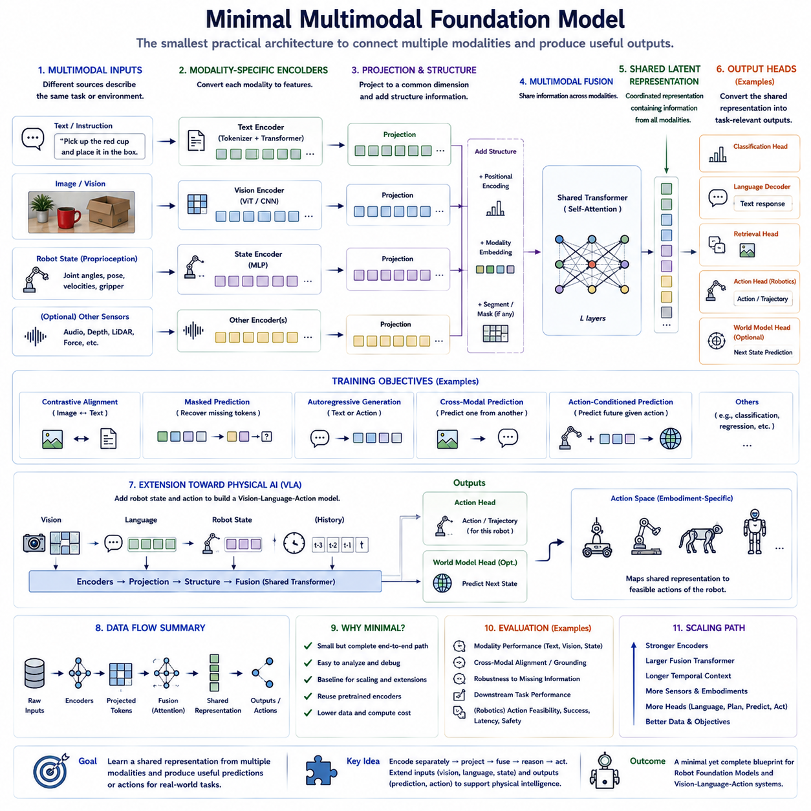{width="7.268055555555556in" height="7.268055555555556in"}

A minimal multimodal foundation model is the smallest practical architecture that demonstrates how different information modalities can be transformed into compatible representations and processed together. Rather than attempting to include every capability of a large production system, it focuses on the essential path from heterogeneous inputs to shared representation and useful outputs. This simplified structure provides a conceptual baseline for understanding more complex multimodal and robotic foundation models.

The architecture begins with multiple input modalities that describe different aspects of the same task or environment. Text may provide instructions or semantic context, images provide visual appearance and spatial information, and additional signals may describe audio, depth, robot state, or other observations. A minimal model does not require every possible modality, but it should contain at least two distinct information sources whose representations must be connected.

Each modality initially exists in a different mathematical form. Language is commonly represented as discrete tokens, images as arrays of pixel values or patches, and robot states as continuous numerical vectors. These inputs cannot be combined directly without transformation. The first architectural requirement is therefore to convert each modality into a sequence or set of feature representations that can eventually interact within a common computational framework.

Modality-specific encoders perform this transformation. A text encoder converts language tokens into embeddings that represent lexical and semantic information, while a vision encoder transforms image patches or visual features into embeddings containing appearance and spatial structure. If robot state is included, a lightweight state encoder can map joint positions, poses, velocities, or proprioceptive measurements into a compatible representation suitable for multimodal processing.

A minimal design does not require all encoders to have the same internal architecture. The vision branch may use a Vision Transformer or another visual backbone, while the language branch may use token embeddings and Transformer layers. What matters is that their outputs can be projected into a compatible embedding dimension. Projection layers therefore act as interfaces that translate modality-specific features into representations that a shared model can process together.

After projection, modality identifiers and structural information can be added to preserve the origin and organization of the tokens. Positional information indicates order within language or spatial arrangement within an image, while modality embeddings can indicate whether a token originated from text, vision, robot state, or another source. Without such information, a shared processor may have difficulty distinguishing structurally different inputs that occupy the same embedding space.

Multimodal fusion is the central operation of the model. In a simple architecture, projected tokens from different modalities can be concatenated into one sequence and processed by shared Transformer layers. Self-attention then allows visual tokens to interact with language tokens and other representations. Alternatively, cross-attention can allow one modality to selectively retrieve information from another while preserving separate modality-specific processing streams.

Attention provides the mechanism through which relevant cross-modal relationships can emerge. When processing an instruction such as identifying or manipulating an object, language tokens can become associated with visual features representing that object. The model does not need a manually specified rule connecting every word with every image region. Instead, repeated training examples allow attention and learned representations to establish useful correspondences between modalities.

A shared latent representation is the main intermediate product of multimodal fusion. It contains information derived from several modalities within a coordinated representation space. The objective is not necessarily to collapse every input into one identical feature, but to make relevant information mutually accessible. Semantic concepts from language can therefore interact with visual structure, while physical state information can provide additional grounding when the model is used for embodied tasks.

The output component depends on the purpose of the minimal model. A classification head may predict a category, a language decoder may generate a textual response, and a retrieval head may estimate correspondence between modalities. For robotics, an action head can predict an action token, action chunk, waypoint, or other control-related representation. The shared backbone can therefore support different downstream heads without requiring the entire multimodal representation system to be redesigned.

Training objectives determine what relationships the model learns. Contrastive objectives can align corresponding image and text representations, while masked prediction can require the model to recover missing information from multimodal context. Autoregressive objectives can generate language or actions, and cross-modal prediction can estimate one modality from another. Even a minimal architecture can combine several objectives when they encourage complementary forms of representation learning.

A simple image-text model provides the clearest example. An image encoder extracts visual tokens, a text encoder creates language tokens, projection layers place both in compatible dimensions, and a fusion module connects them. A task head then produces the desired output. Although this pipeline is much smaller than modern large-scale multimodal systems, it already contains the fundamental operations of encoding, alignment, fusion, contextual processing, and prediction.

Extending the same architecture toward Physical AI requires only a conceptual addition: robot state and action. Proprioceptive observations can be encoded as another input modality, while actions can become an output modality. The resulting model receives visual observations, language instructions, and robot state, creates a fused representation, and predicts an action. This establishes the minimal conceptual transition from a Vision-Language Model to a Vision-Language-Action model.

Temporal information can be introduced by providing a short history rather than a single observation. Several image frames, previous robot states, or recent actions can be represented as tokens with temporal position information. The shared model can then infer relationships across time. Even a limited context window enables the architecture to distinguish static appearance from motion and to use previous actions when estimating what should happen next.

For action prediction, the model must connect semantic intent with embodiment. An instruction may specify a goal, but the output must correspond to actions that the particular robot can represent and execute. A minimal model can handle this through an embodiment-specific action head that maps shared representations into the robot\'s action space. This separates broadly reusable multimodal knowledge from the final interface required by a specific physical platform.

A minimal architecture can also include action-conditioned prediction rather than direct action generation. The model receives the current multimodal state together with a candidate action and predicts a future representation or outcome. This transforms the model into a simple predictive world-model component. Candidate actions can then be compared according to predicted consequences, providing a conceptual connection between multimodal representation learning and model-based decision making.

The simplicity of the architecture makes data flow easier to analyze. Raw inputs enter separate encoders, projected features become compatible tokens, multimodal fusion establishes relationships, shared representations capture task-relevant context, and output heads convert those representations into predictions or actions. This modular organization also makes it easier to identify where errors arise, whether from perception, alignment, fusion, temporal modeling, or the output interface.

Minimal does not mean computationally trivial. Image tokens can still create substantial attention cost, and temporal histories rapidly increase sequence length. Practical implementations may reduce visual resolution, compress tokens, use pretrained encoders, freeze selected modules, or employ lightweight fusion layers. These choices allow experiments with multimodal learning without requiring the computational scale associated with the largest foundation models.

Pretrained encoders are especially useful when constructing a minimal system. Instead of learning visual and linguistic representations entirely from scratch, existing encoders can provide strong initial features. Small projection and fusion modules can then learn how to connect those representations for a new multimodal task. This approach demonstrates one of the central advantages of foundation models: reusable pretrained knowledge can reduce the data and compute required for downstream adaptation.

Evaluation should examine both individual modalities and their integration. A model may recognize visual objects and understand language independently while still failing to connect the correct instruction with the correct visual target. Multimodal evaluation should therefore test alignment, grounding, robustness to missing information, and downstream task performance. For robotic extensions, action feasibility, temporal consistency, latency, safety, and task completion become additional requirements.

The minimal model also exposes an important limitation of unified representations. Combining modalities does not automatically produce physical understanding or reliable reasoning. The quality of the learned representation depends on training data, alignment objectives, temporal information, embodiment grounding, and output supervision. A compact architecture is therefore best understood as a controlled foundation on which additional capabilities such as memory, prediction, planning, uncertainty, and safety can be added.

As the architecture scales, the same basic pattern remains recognizable. More powerful encoders provide richer modality representations, larger fusion Transformers model complex interactions, longer contexts incorporate temporal history, and specialized heads support language, perception, prediction, planning, and action. Additional sensors and embodiments can be connected through adapters or projection layers while retaining a substantial portion of the shared pretrained model.

A minimal multimodal foundation model therefore captures the essential architectural principle behind much larger systems: heterogeneous information is encoded separately, transformed into compatible representations, integrated through shared computation, and converted into task-relevant outputs. By extending the input from vision and language to physical state and extending the output from semantic prediction to action, the same foundation naturally becomes a minimal blueprint for Robot Foundation Models and Vision-Language-Action systems.

최소 멀티모달 파운데이션 모델(Minimal Multimodal Foundation Model)은 서로 다른 정보 모달리티(modality)를 호환 가능한 표현(representation)으로 변환하고 함께 처리하는 방법을 보여주는 가장 작은 실용적 아키텍처이다. 대규모 실제 시스템의 모든 능력을 포함하려 하기보다는 이질적인 입력(heterogeneous input)에서 공유 표현(shared representation)과 유용한 출력으로 이어지는 핵심 경로에 집중한다. 이러한 단순화된 구조는 더욱 복잡한 멀티모달 및 로봇 파운데이션 모델을 이해하기 위한 개념적 기준선(conceptual baseline)을 제공한다.

아키텍처는 동일한 작업이나 환경의 서로 다른 측면을 설명하는 여러 입력 모달리티(input modality)에서 시작한다. 텍스트는 명령이나 의미적 컨텍스트(semantic context)를 제공하고, 이미지는 시각적 외형과 공간 정보를 제공하며, 추가 신호는 오디오, 깊이(depth), 로봇 상태(robot state) 또는 기타 관측을 설명할 수 있다. 최소 모델이 가능한 모든 모달리티를 포함할 필요는 없지만, 표현을 서로 연결해야 하는 최소 두 개 이상의 서로 다른 정보 소스를 포함해야 한다.

각 모달리티는 처음에는 서로 다른 수학적 형태로 존재한다. 언어는 일반적으로 이산 토큰(discrete token), 이미지는 픽셀값 배열이나 패치(patch), 로봇 상태는 연속적인 수치 벡터(continuous numerical vector)로 표현된다. 이러한 입력은 변환 없이 직접 결합할 수 없다. 따라서 첫 번째 아키텍처 요구사항은 각각의 모달리티를 공통 계산 프레임워크(common computational framework)에서 상호작용할 수 있는 특징 표현(feature representation)의 시퀀스 또는 집합으로 변환하는 것이다.

모달리티 특화 인코더(Modality-Specific Encoder)는 이러한 변환을 수행한다. 텍스트 인코더(text encoder)는 언어 토큰을 어휘적·의미적 정보를 나타내는 임베딩(embedding)으로 변환하고, 비전 인코더(vision encoder)는 이미지 패치나 시각적 특징을 외형 및 공간 구조를 포함하는 임베딩으로 변환한다. 로봇 상태가 포함되는 경우 경량 상태 인코더(lightweight state encoder)를 통해 관절 위치, 자세(pose), 속도 또는 고유수용감각 측정값(proprioceptive measurement)을 멀티모달 처리에 적합한 표현으로 매핑할 수 있다.

최소 설계에서는 모든 인코더가 동일한 내부 아키텍처를 가질 필요가 없다. 비전 브랜치(vision branch)는 비전 트랜스포머(Vision Transformer) 또는 다른 시각 백본(visual backbone)을 사용할 수 있으며, 언어 브랜치(language branch)는 토큰 임베딩과 트랜스포머 계층(Transformer layer)을 사용할 수 있다. 중요한 것은 이들의 출력을 호환 가능한 임베딩 차원(embedding dimension)으로 투영할 수 있어야 한다는 점이다. 따라서 투영 계층(projection layer)은 모달리티 특화 특징을 공유 모델이 함께 처리할 수 있는 표현으로 변환하는 인터페이스 역할을 한다.

투영 이후에는 토큰의 출처와 구조를 보존하기 위해 모달리티 식별자(modality identifier)와 구조 정보(structural information)를 추가할 수 있다. 위치 정보(positional information)는 언어 내부의 순서나 이미지 내부의 공간적 배열을 나타내며, 모달리티 임베딩(modality embedding)은 토큰이 텍스트, 비전, 로봇 상태 또는 다른 정보 소스 가운데 어디에서 생성되었는지를 나타낼 수 있다. 이러한 정보가 없으면 공유 프로세서(shared processor)가 동일한 임베딩 공간에 존재하는 구조적으로 서로 다른 입력을 구별하기 어려울 수 있다.

멀티모달 융합(Multimodal Fusion)은 모델의 핵심 연산이다. 단순한 아키텍처에서는 서로 다른 모달리티에서 투영된 토큰을 하나의 시퀀스로 연결하고 공유 트랜스포머 계층(shared Transformer layer)을 통해 처리할 수 있다. 그러면 셀프 어텐션(Self-Attention)을 통해 시각 토큰이 언어 토큰 및 다른 표현과 상호작용할 수 있다. 또는 크로스 어텐션(Cross-Attention)을 사용하여 모달리티별 처리 스트림을 유지하면서 하나의 모달리티가 다른 모달리티에서 필요한 정보를 선택적으로 검색하도록 할 수 있다.

어텐션(Attention)은 관련된 교차 모달 관계(cross-modal relationship)가 형성될 수 있도록 하는 메커니즘을 제공한다. 객체를 식별하거나 조작하라는 명령을 처리할 때 언어 토큰은 해당 객체를 표현하는 시각적 특징과 연관될 수 있다. 모델이 모든 단어와 모든 이미지 영역을 연결하는 규칙을 사람이 직접 지정할 필요는 없다. 대신 반복적인 학습 사례를 통해 어텐션과 학습된 표현이 모달리티 사이에서 유용한 대응관계(correspondence)를 형성할 수 있다.

공유 잠재 표현(Shared Latent Representation)은 멀티모달 융합의 주요 중간 결과물이다. 여기에는 여러 모달리티에서 얻어진 정보가 상호 조정된 표현 공간(coordinated representation space)에 포함된다. 목적은 반드시 모든 입력을 하나의 동일한 특징으로 축소하는 것이 아니라 관련 정보가 서로 접근 가능하도록 만드는 것이다. 따라서 언어의 의미적 개념은 시각적 구조와 상호작용할 수 있으며, 임바디드 작업(embodied task)에서는 물리적 상태 정보가 추가적인 그라운딩(grounding)을 제공할 수 있다.

출력 구성요소(output component)는 최소 모델의 목적에 따라 달라진다. 분류 헤드(classification head)는 범주를 예측할 수 있고, 언어 디코더(language decoder)는 텍스트 응답을 생성할 수 있으며, 검색 헤드(retrieval head)는 모달리티 사이의 대응관계를 추정할 수 있다. 로보틱스에서는 행동 헤드(action head)가 행동 토큰(action token), 행동 청크(action chunk), 웨이포인트(waypoint) 또는 기타 제어 관련 표현을 예측할 수 있다. 따라서 전체 멀티모달 표현 시스템을 다시 설계하지 않고도 공유 백본(shared backbone)에 서로 다른 다운스트림 헤드(downstream head)를 연결할 수 있다.

학습 목표(Training Objective)는 모델이 어떤 관계를 학습하는지를 결정한다. 대조 목적(contrastive objective)은 서로 대응하는 이미지와 텍스트 표현을 정렬할 수 있으며, 마스킹 예측(masked prediction)은 멀티모달 컨텍스트를 이용해 누락된 정보를 복원하도록 요구할 수 있다. 자기회귀 목표(autoregressive objective)는 언어나 행동을 생성할 수 있고, 교차 모달 예측(cross-modal prediction)은 하나의 모달리티로부터 다른 모달리티를 추정할 수 있다. 최소 아키텍처에서도 서로 보완적인 표현 학습을 촉진한다면 여러 학습 목표를 결합할 수 있다.

단순한 이미지-텍스트 모델(image-text model)은 이러한 구조를 가장 명확하게 보여준다. 이미지 인코더는 시각 토큰(visual token)을 추출하고, 텍스트 인코더는 언어 토큰(language token)을 생성하며, 투영 계층은 두 표현을 호환 가능한 차원으로 변환하고, 융합 모듈(fusion module)은 이들을 연결한다. 이후 작업 헤드(task head)가 필요한 출력을 생성한다. 이러한 파이프라인은 현대의 대규모 멀티모달 시스템보다 훨씬 작지만 인코딩(encoding), 정렬(alignment), 융합, 문맥 처리(contextual processing), 예측이라는 핵심 연산을 이미 포함하고 있다.

동일한 아키텍처를 피지컬 AI(Physical AI)로 확장하려면 개념적으로 로봇 상태와 행동을 추가하면 된다. 고유수용감각 관측(proprioceptive observation)을 또 하나의 입력 모달리티로 인코딩하고 행동을 출력 모달리티(output modality)로 구성할 수 있다. 이렇게 구성된 모델은 시각적 관측, 언어 명령, 로봇 상태를 입력받아 융합된 표현(fused representation)을 생성하고 행동을 예측한다. 이는 비전-언어 모델(Vision-Language Model, VLM)에서 비전-언어-행동 모델(Vision-Language-Action Model, VLA)로 전환되는 최소한의 개념적 구조를 형성한다.

시간 정보(Temporal Information)는 단일 관측 대신 짧은 이력(history)을 제공함으로써 추가할 수 있다. 여러 이미지 프레임, 이전 로봇 상태 또는 최근 행동을 시간적 위치 정보(temporal position information)를 가진 토큰으로 표현할 수 있다. 공유 모델은 이를 통해 시간에 걸친 관계를 추론할 수 있다. 제한된 컨텍스트 윈도우만으로도 정적인 외형과 움직임을 구별하고, 이전 행동을 활용하여 다음에 무엇이 일어나야 하는지를 추정할 수 있다.

행동 예측(Action Prediction)을 위해 모델은 의미적 의도(semantic intent)를 임바디먼트와 연결해야 한다. 명령은 목표를 지정할 수 있지만 출력은 특정 로봇이 표현하고 실행할 수 있는 행동에 대응해야 한다. 최소 모델에서는 공유 표현을 로봇의 행동 공간(action space)으로 매핑하는 임바디먼트 특화 행동 헤드(embodiment-specific action head)를 통해 이를 처리할 수 있다. 이를 통해 광범위하게 재사용할 수 있는 멀티모달 지식과 특정 물리 플랫폼이 요구하는 최종 인터페이스를 분리할 수 있다.

최소 아키텍처에는 직접적인 행동 생성 대신 행동 조건부 예측(Action-Conditioned Prediction)을 포함할 수도 있다. 모델은 현재의 멀티모달 상태와 후보 행동(candidate action)을 함께 입력받고 미래 표현(future representation)이나 결과를 예측한다. 이를 통해 모델은 단순한 예측 월드 모델(predictive world model)의 구성요소로 변환된다. 이후 예측된 결과를 기준으로 후보 행동을 비교할 수 있으며, 이는 멀티모달 표현 학습과 모델 기반 의사결정(model-based decision making)을 개념적으로 연결한다.

아키텍처가 단순하기 때문에 데이터 흐름(data flow)을 더욱 쉽게 분석할 수 있다. 원시 입력(raw input)은 각각의 인코더로 들어가고, 투영된 특징은 호환 가능한 토큰으로 변환되며, 멀티모달 융합을 통해 관계가 형성되고, 공유 표현은 작업 관련 컨텍스트(task-relevant context)를 포착하며, 출력 헤드는 이러한 표현을 예측이나 행동으로 변환한다. 이러한 모듈식 구성(modular organization)은 오류가 인식, 정렬, 융합, 시간 모델링(temporal modeling), 출력 인터페이스 가운데 어디에서 발생하는지도 쉽게 식별하도록 한다.

최소(Minimal)라는 것이 계산적으로 단순하다는 의미는 아니다. 이미지 토큰은 여전히 상당한 어텐션 계산 비용(attention cost)을 발생시킬 수 있으며, 시간적 이력이 추가되면 시퀀스 길이가 빠르게 증가한다. 실제 구현에서는 시각 해상도를 낮추거나, 토큰을 압축하거나, 사전학습된 인코더(pretrained encoder)를 사용하거나, 선택된 모듈을 동결(freeze)하거나, 경량 융합 계층(lightweight fusion layer)을 사용할 수 있다. 이러한 선택을 통해 가장 큰 파운데이션 모델 수준의 계산 자원 없이도 멀티모달 학습을 실험할 수 있다.

사전학습된 인코더(Pretrained Encoder)는 최소 시스템을 구성할 때 특히 유용하다. 시각 및 언어 표현을 처음부터 완전히 학습하는 대신 기존 인코더를 이용해 강력한 초기 특징(initial feature)을 제공할 수 있다. 이후 작은 투영 및 융합 모듈이 새로운 멀티모달 작업을 위해 이러한 표현을 연결하는 방법을 학습할 수 있다. 이 접근법은 파운데이션 모델의 핵심 장점 가운데 하나를 보여준다. 즉, 재사용 가능한 사전학습 지식(pretrained knowledge)을 통해 다운스트림 적응에 필요한 데이터와 컴퓨트(compute)를 줄일 수 있다.

평가(Evaluation)는 개별 모달리티와 이들의 통합을 모두 검토해야 한다. 모델이 시각적 객체를 인식하고 언어를 독립적으로 이해하더라도 올바른 명령과 올바른 시각적 목표를 연결하지 못할 수 있다. 따라서 멀티모달 평가에서는 정렬, 그라운딩, 정보 누락에 대한 강건성(robustness), 다운스트림 작업 성능을 평가해야 한다. 로봇으로 확장할 경우 행동 실행 가능성(action feasibility), 시간적 일관성(temporal consistency), 지연시간(latency), 안전성(safety), 작업 완료(task completion)가 추가적인 요구사항이 된다.

최소 모델은 통합 표현(unified representation)의 중요한 한계도 드러낸다. 여러 모달리티를 결합하는 것만으로 물리적 이해(physical understanding)나 신뢰할 수 있는 추론이 자동으로 형성되는 것은 아니다. 학습된 표현의 품질은 학습 데이터, 정렬 목표(alignment objective), 시간 정보, 임바디먼트 그라운딩(embodiment grounding), 출력 지도 신호(output supervision)에 의존한다. 따라서 소형 아키텍처는 메모리, 예측, 계획, 불확실성(uncertainty), 안전성과 같은 추가 능력을 확장할 수 있는 통제된 기반(controlled foundation)으로 이해하는 것이 적절하다.

아키텍처의 규모가 커지더라도 동일한 기본 패턴은 유지된다. 더욱 강력한 인코더는 풍부한 모달리티 표현을 제공하고, 더 큰 융합 트랜스포머(fusion Transformer)는 복잡한 상호작용을 모델링하며, 더 긴 컨텍스트는 시간적 이력을 포함하고, 특화 헤드(specialized head)는 언어, 인식, 예측, 계획, 행동을 지원한다. 추가적인 센서와 임바디먼트는 어댑터(adapter) 또는 투영 계층을 통해 연결하면서 공유 사전학습 모델의 상당 부분을 유지할 수 있다.

따라서 최소 멀티모달 파운데이션 모델(Minimal Multimodal Foundation Model)은 훨씬 더 큰 시스템의 기반이 되는 핵심 아키텍처 원리를 포착한다. 이질적인 정보는 개별적으로 인코딩되고, 호환 가능한 표현으로 변환되며, 공유 계산(shared computation)을 통해 통합된 후 작업 관련 출력으로 변환된다. 입력을 비전과 언어에서 물리적 상태(physical state)까지 확장하고 출력을 의미적 예측에서 행동으로 확장하면 동일한 기반 구조가 자연스럽게 로봇 파운데이션 모델(Robot Foundation Model)과 비전-언어-행동 시스템(Vision-Language-Action System)을 위한 최소 청사진(minimal blueprint)으로 발전한다.
