**Volume 08. Robot Foundation Models and VLA**

# Chapter 02. Robot Foundation Models

## 02.01. Defining Robot Foundation Models

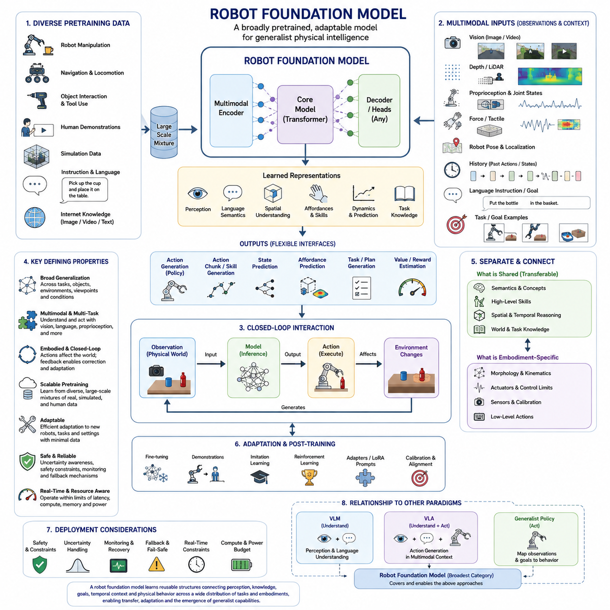{width="7.268055555555556in" height="7.268055555555556in"}

A specialist robot model is designed around a relatively narrow combination of task, embodiment, environment, and operating assumptions. It may be optimized for grasping a known object family, navigating a specific facility, performing an insertion procedure, or controlling one robot platform. By restricting the problem, specialist systems can dedicate their model capacity, training data, representations, and control architecture to the conditions that matter most for a particular application.

Specialization has historically been a practical strength in robotics. Physical systems must satisfy strict requirements for latency, precision, reliability, safety, and repeatability, and these requirements are often easier to achieve when the operational domain is constrained. A model trained specifically for one manipulation process can focus on the relevant sensors, geometry, action space, and failure modes without spending computational capacity representing unrelated tasks or environments.

Specialist models can therefore achieve excellent performance inside their intended operating distribution. Industrial robots provide a clear conceptual example: when objects, fixtures, trajectories, lighting, and workspace geometry are carefully controlled, highly specialized perception and control systems can execute repetitive operations with high accuracy. In such applications, broad semantic understanding or open-ended reasoning may provide little additional value compared with deterministic and optimized task-specific behavior.

The limitation appears when conditions move beyond those assumptions. A model specialized for one object set may fail on unfamiliar objects, while a navigation policy trained in one building may depend on environmental features that do not transfer to another. Adding a new task can require a new dataset, new training, and sometimes a new model architecture. As the number of applications grows, maintaining many independent specialist models can become increasingly expensive and fragmented.

Generalist robot models pursue the opposite direction. Instead of optimizing one model for one narrowly defined behavior, they attempt to support broad families of tasks through shared representations and parameters. A generalist model may receive different observations, language instructions, goals, or demonstrations and generate behavior appropriate to each context. The same learned foundation can therefore contribute to manipulation, navigation, tool use, mobile manipulation, or other related capabilities.

The defining advantage of a generalist model is knowledge sharing. Different robotic tasks contain recurring concepts such as objects, spatial relationships, motion, contact, goals, affordances, and reusable skills. A shared model can learn these concepts once and apply them across multiple behaviors. Experience from placing objects may improve grasp representations, while navigation experience may strengthen spatial reasoning that later supports mobile manipulation.

Generalist models are closely connected to large-scale pretraining. Broad behavior cannot emerge merely by increasing model size; the training distribution must contain sufficient diversity in tasks, objects, environments, instructions, and interaction patterns. Multi-task and multi-environment datasets expose the model to common structures as well as meaningful differences. Foundation-model training attempts to convert this diversity into representations that remain useful beyond individual training episodes.

Task conditioning enables one model to express different behaviors without requiring a completely separate policy for each task. Language instructions, goal states, task tokens, demonstrations, or images can specify the desired objective. The model interprets this conditioning together with current observations and robot state. Generality therefore does not mean producing the same behavior everywhere; it means selecting contextually appropriate behavior from a broadly reusable learned system.

Generalist models can also provide greater adaptation efficiency. When a new task is related to capabilities already encountered during pretraining, the model may require only limited demonstrations, fine-tuning, prompting, adapters, or reinforcement learning. A specialist model trained from scratch must acquire much of the required representation again. The economic value of generalization therefore includes reducing the marginal data and engineering effort needed to introduce additional robot capabilities.

However, generality introduces substantial costs. A model representing many tasks and environments usually requires greater capacity, more heterogeneous data, and significantly more training compute. It must resolve interference between behaviors and determine which information is relevant to the current objective. At deployment time, the larger architecture can also increase memory consumption, inference latency, electrical power, and thermal load, all of which are critical constraints for onboard robotic computing.

Negative transfer is another risk. Sharing parameters between tasks is useful only when the shared structure is genuinely beneficial. A representation optimized simultaneously for navigation, precise insertion, locomotion, and semantic reasoning may encounter conflicting optimization requirements. If task distributions are poorly balanced, common tasks can dominate learning while rare capabilities deteriorate. Generalist training therefore requires careful data mixture design, optimization, routing, and evaluation.

Specialists retain an advantage when extreme precision or deterministic timing is required. High-speed motor control, safety-critical stabilization, force-controlled insertion, or tightly regulated industrial processes may benefit from dedicated models or conventional controllers. These systems operate close to hardware dynamics and often require predictable behavior at frequencies where a large generalist model is unnecessary or impractical. General intelligence does not eliminate the value of specialized control.

This leads to a more useful interpretation than treating generalists and specialists as mutually exclusive alternatives. A robot architecture can contain a generalist foundation model for perception, semantic reasoning, task understanding, planning, and skill selection while specialized modules execute low-level behaviors. The generalist determines what should be accomplished and selects appropriate capabilities, while specialists provide efficient and reliable execution where physical requirements demand specialization.

Hierarchical architectures naturally support this division. A high-level generalist model can interpret instructions, understand scenes, decompose long-horizon objectives, and generate subgoals. Mid-level skill policies can implement behaviors such as navigation, reaching, grasping, opening, or placement. Low-level controllers then translate these objectives into actuator commands while enforcing dynamic and safety constraints. Generality and specialization can therefore coexist at different abstraction levels.

Mixture-of-experts models provide another mechanism for combining these properties within a learned architecture. A shared backbone can represent common knowledge while specialized experts develop competence for particular tasks, modalities, environments, or embodiments. A routing mechanism activates the relevant experts according to context. This approach attempts to preserve broad knowledge sharing while preventing every parameter from processing every behavior and reducing interference among highly different tasks.

Embodiment further complicates the comparison. A specialist model can be tightly matched to one robot\'s sensors, kinematics, dynamics, and action interface. A generalist model intended for multiple embodiments must distinguish transferable concepts from robot-specific execution. Concepts such as approach, grasp, transport, or avoid may be broadly shared, but their motor realization differs substantially between an industrial arm, mobile manipulator, humanoid, and quadruped.

Cross-embodiment generalists therefore require explicit mechanisms for representing morphology and action capabilities. Robot-specific encoders, embodiment tokens, normalized action representations, skill interfaces, or specialized control heads can connect shared knowledge with particular bodies. The objective is not to pretend that all robots are physically equivalent, but to share knowledge at abstraction levels where equivalence is meaningful while preserving differences where physical execution requires them.

The two approaches also differ in their data requirements. Specialists can often be trained using carefully collected datasets focused on one operational distribution. Generalists require broader datasets whose value depends on diversity as well as quantity. They must contain enough variation to reveal which concepts are shared across tasks and which remain specific. Data curation, standardization, balancing, and metadata therefore become substantially more important as the desired scope of generalization increases.

Evaluation criteria must likewise differ. A specialist can be judged primarily by performance, reliability, latency, and safety within its specified operating domain. A generalist must additionally be evaluated on transfer to held-out tasks, unfamiliar objects, new environments, novel task combinations, and potentially new embodiments. Few-shot adaptation and compositional generalization become important because memorizing a large collection of known tasks does not by itself demonstrate genuine generality.

Reliability creates an important practical tradeoff. Specialists benefit from narrower distributions that can often be tested exhaustively or at least systematically. Generalists operate over much broader state and task spaces, making complete validation extremely difficult. Their flexibility can expose unexpected interactions between perception, reasoning, and action. Safety monitors, uncertainty estimation, constraints, fallback policies, and specialized controllers therefore remain important even as foundation models become more capable.

The appropriate choice consequently depends on deployment objectives. A fixed production process with stable geometry and extremely strict cycle-time requirements may favor a specialist solution. A service robot operating among changing objects, people, rooms, and instructions may benefit much more from a generalist model. Many practical systems will occupy positions between these extremes, combining reusable foundation capabilities with application-specific adaptation and dedicated control components.

The evolution of robot foundation models should therefore not be interpreted as a simple replacement of specialist robotics by generalist robotics. Instead, it changes where specialization occurs. Broadly pretrained models can provide common perception, semantic knowledge, task understanding, and reusable behavioral representations, while specialization is concentrated in components that reflect particular embodiments, safety constraints, control requirements, or application objectives.

Ultimately, generalist and specialist robot models represent complementary strategies for allocating intelligence. Specialists concentrate capacity around a narrow operational objective and can provide efficiency, precision, and predictability. Generalists distribute learned knowledge across many tasks and environments, enabling transfer, adaptation, and compositional behavior. Effective robot foundation architectures seek to capture the advantages of both rather than maximizing generality without regard to physical constraints.

This balance provides an important foundation for understanding generalist robot policies and later Vision-Language-Action systems. As robot models become broader, the central engineering problem shifts from choosing between generalization and specialization to deciding which knowledge should be globally shared, which skills should remain modular, and where embodiment-specific control should enter the architecture. The resulting hierarchy can combine broad learned intelligence with the reliability required for real physical deployment.

전문화 로봇 모델(Specialist Robot Model)은 비교적 제한된 작업(Task), 체화(Embodiment), 환경(Environment), 운용 가정(Operating Assumption)의 조합을 중심으로 설계된다. 특정 객체군(Object Family)을 파지하거나, 특정 시설에서 내비게이션(Navigation)을 수행하거나, 삽입 작업(Insertion Procedure)을 실행하거나, 하나의 로봇 플랫폼을 제어하도록 최적화될 수 있다. 문제의 범위를 제한함으로써 전문화 시스템은 특정 응용 분야에 가장 중요한 조건에 모델 용량(Model Capacity), 학습 데이터(Training Data), 표현(Representation), 제어 아키텍처(Control Architecture)를 집중할 수 있다.

전문화(Specialization)는 역사적으로 로보틱스(Robotics)에서 실용적인 강점으로 작용해 왔다. 물리 시스템(Physical System)은 지연시간(Latency), 정밀도(Precision), 신뢰성(Reliability), 안전(Safety), 반복성(Repeatability)에 대한 엄격한 요구사항을 충족해야 하며, 이러한 요구사항은 운용 영역(Operational Domain)이 제한되어 있을 때 달성하기가 더 쉽다. 하나의 조작 과정(Manipulation Process)에 특화된 모델은 관련 센서, 기하 구조(Geometry), 행동 공간(Action Space), 실패 모드(Failure Mode)에 집중할 수 있으며, 관련 없는 작업이나 환경을 표현하는 데 계산 용량을 사용할 필요가 없다.

따라서 전문화 모델은 의도된 운용 분포(Operating Distribution) 내에서 매우 뛰어난 성능을 달성할 수 있다. 산업용 로봇(Industrial Robot)이 대표적인 개념적 사례이다. 객체, 지그(Fixture), 궤적(Trajectory), 조명(Lighting), 작업 공간 기하 구조(Workspace Geometry)가 정밀하게 제어되는 경우 고도로 전문화된 지각 및 제어 시스템(Perception and Control System)은 반복 작업을 높은 정확도로 수행할 수 있다. 이러한 응용에서는 광범위한 의미 이해(Semantic Understanding)나 개방형 추론(Open-Ended Reasoning)보다 결정론적이고 최적화된 작업별 행동(Task-Specific Behavior)이 더 높은 가치를 제공할 수 있다.

문제는 조건이 이러한 가정을 벗어날 때 나타난다. 하나의 객체 집합에 특화된 모델은 익숙하지 않은 객체에서 실패할 수 있으며, 특정 건물에서 학습된 내비게이션 정책은 다른 건물로 전이되지 않는 환경적 특징에 의존할 수 있다. 새로운 작업을 추가하려면 새로운 데이터셋, 새로운 학습, 경우에 따라 새로운 모델 아키텍처가 필요할 수 있다. 응용 분야가 증가할수록 다수의 독립적인 전문화 모델을 유지하는 비용과 시스템의 파편화(Fragmentation)가 증가할 수 있다.

제너럴리스트 로봇 모델(Generalist Robot Model)은 반대 방향을 추구한다. 하나의 좁게 정의된 행동에 하나의 모델을 최적화하는 대신 공유 표현(Shared Representation)과 공유 파라미터(Shared Parameter)를 통해 광범위한 작업 계열(Task Family)을 지원하려 한다. 제너럴리스트 모델은 서로 다른 관측(Observation), 언어 명령(Language Instruction), 목표(Goal), 시연(Demonstration)을 입력받아 각 맥락에 적합한 행동을 생성할 수 있다. 따라서 동일한 학습 기반(Learned Foundation)이 조작, 내비게이션, 도구 사용(Tool Use), 모바일 매니퓰레이션(Mobile Manipulation) 등의 관련 능력에 기여할 수 있다.

제너럴리스트 모델의 핵심적인 장점은 지식 공유(Knowledge Sharing)이다. 서로 다른 로봇 작업에는 객체(Object), 공간 관계(Spatial Relationship), 움직임(Motion), 접촉(Contact), 목표, 어포던스(Affordance), 재사용 가능한 스킬(Reusable Skill)과 같은 반복적인 개념이 존재한다. 공유 모델은 이러한 개념을 한 번 학습한 후 여러 행동에서 활용할 수 있다. 객체 배치에서 얻은 경험은 파지 표현(Grasp Representation)을 향상시킬 수 있으며, 내비게이션 경험은 이후 모바일 매니퓰레이션을 지원하는 공간 추론(Spatial Reasoning)을 강화할 수 있다.

제너럴리스트 모델은 대규모 사전학습(Large-Scale Pretraining)과 밀접하게 연결된다. 단순히 모델 크기를 증가시킨다고 광범위한 행동 능력이 나타나는 것은 아니며, 학습 분포(Training Distribution)가 작업, 객체, 환경, 명령, 상호작용 패턴(Interaction Pattern)의 충분한 다양성을 포함해야 한다. 다중 작업 및 다중 환경 데이터셋(Multi-Task and Multi-Environment Dataset)은 공통 구조와 의미 있는 차이를 모두 모델에 제공한다. 파운데이션 모델 학습(Foundation-Model Training)은 이러한 다양성을 개별 학습 에피소드(Episode)를 넘어 유용하게 유지되는 표현으로 변환하려 한다.

작업 조건화(Task Conditioning)는 각 작업마다 완전히 별도의 정책을 만들지 않고 하나의 모델에서 서로 다른 행동을 표현할 수 있도록 한다. 언어 명령, 목표 상태(Goal State), 작업 토큰(Task Token), 시연 또는 이미지를 이용하여 원하는 목표를 지정할 수 있다. 모델은 이러한 조건 정보와 현재 관측 및 로봇 상태(Robot State)를 함께 해석한다. 따라서 일반성(Generality)은 모든 상황에서 동일한 행동을 생성하는 것을 의미하는 것이 아니라, 광범위하게 재사용 가능한 하나의 학습 시스템에서 현재 맥락에 적절한 행동을 선택하는 능력을 의미한다.

제너럴리스트 모델은 더 높은 적응 효율성(Adaptation Efficiency)을 제공할 수도 있다. 새로운 작업이 사전학습 과정에서 경험한 능력과 관련되어 있다면 제한된 시연, 미세조정(Fine-Tuning), 프롬프팅(Prompting), 어댑터(Adapter), 강화학습(Reinforcement Learning)만으로 적응할 수 있다. 반면 처음부터 학습하는 전문화 모델은 필요한 표현의 상당 부분을 다시 획득해야 한다. 따라서 일반화(Generalization)의 경제적 가치는 새로운 로봇 능력을 추가하는 데 필요한 한계 데이터 비용(Marginal Data Cost)과 엔지니어링 노력을 감소시키는 데에도 있다.

그러나 일반성은 상당한 비용을 수반한다. 많은 작업과 환경을 표현하는 모델은 일반적으로 더 큰 모델 용량, 더욱 이질적인 데이터(Heterogeneous Data), 훨씬 많은 학습 계산량(Training Compute)을 요구한다. 모델은 서로 다른 행동 사이의 간섭(Interference)을 해결하고 현재 목표에 어떤 정보가 중요한지를 결정해야 한다. 실제 배치(Deployment)에서도 더 큰 아키텍처는 메모리 사용량, 추론 지연시간(Inference Latency), 전력(Electrical Power), 열 부하(Thermal Load)를 증가시킬 수 있으며, 이들은 온보드 로봇 컴퓨팅(Onboard Robotic Computing)의 핵심 제약조건이다.

부정적 전이(Negative Transfer) 역시 중요한 위험이다. 작업 사이의 파라미터 공유는 공유 구조가 실제로 유용할 때에만 효과적이다. 내비게이션, 정밀 삽입(Precise Insertion), 이동(Locomotion), 의미 추론(Semantic Reasoning)을 동시에 최적화하는 표현은 서로 충돌하는 최적화 요구조건(Optimization Requirement)을 가질 수 있다. 작업 분포의 균형이 적절하지 않으면 일반적인 작업이 학습을 지배하고 희귀한 능력은 저하될 수 있다. 따라서 제너럴리스트 학습에는 신중한 데이터 혼합 설계(Data Mixture Design), 최적화, 라우팅(Routing), 평가(Evaluation)가 필요하다.

전문화 모델은 극도의 정밀도 또는 결정론적 타이밍(Deterministic Timing)이 필요한 상황에서 여전히 장점을 가진다. 고속 모터 제어(High-Speed Motor Control), 안전 중요 안정화(Safety-Critical Stabilization), 힘 제어 삽입(Force-Controlled Insertion), 엄격하게 규제된 산업 공정은 전용 모델이나 기존 제어기(Conventional Controller)의 이점을 얻을 수 있다. 이러한 시스템은 하드웨어 동역학(Hardware Dynamics)에 가까운 수준에서 동작하며, 대규모 제너럴리스트 모델이 불필요하거나 비실용적인 높은 제어 주파수(Control Frequency)를 요구하는 경우가 많다. 일반 지능(General Intelligence)이 전문화 제어의 가치를 제거하는 것은 아니다.

따라서 제너럴리스트와 전문화 모델을 상호 배타적인 선택지로 보는 것보다 두 방식을 결합하여 이해하는 것이 더욱 유용하다. 로봇 아키텍처는 지각(Perception), 의미 추론, 작업 이해(Task Understanding), 계획(Planning), 스킬 선택(Skill Selection)을 담당하는 제너럴리스트 파운데이션 모델과 저수준 행동을 실행하는 전문화 모듈(Specialized Module)을 함께 포함할 수 있다. 제너럴리스트가 무엇을 달성해야 하는지를 판단하고 적절한 능력을 선택하면, 전문화 모델은 물리적 요구조건이 필요한 영역에서 효율적이고 신뢰성 높은 실행을 담당할 수 있다.

계층적 아키텍처(Hierarchical Architecture)는 이러한 역할 분담을 자연스럽게 지원한다. 고수준 제너럴리스트 모델(High-Level Generalist Model)은 명령을 해석하고, 장면(Scene)을 이해하고, 장기 목표(Long-Horizon Objective)를 분해하여 하위 목표(Subgoal)를 생성할 수 있다. 중간 수준의 스킬 정책(Mid-Level Skill Policy)은 내비게이션, 도달하기(Reaching), 파지하기(Grasping), 열기(Opening), 배치하기(Placement) 등의 행동을 구현한다. 저수준 제어기(Low-Level Controller)는 동역학 및 안전 제약(Safety Constraint)을 적용하면서 이러한 목표를 액추에이터 명령(Actuator Command)으로 변환한다. 따라서 일반성과 전문화는 서로 다른 추상화 수준(Abstraction Level)에서 공존할 수 있다.

전문가 혼합 모델(Mixture-of-Experts Model)은 하나의 학습 아키텍처 안에서 이러한 특성을 결합하는 또 다른 방법을 제공한다. 공유 백본(Shared Backbone)은 공통 지식을 표현하고, 전문화 전문가(Specialized Expert)는 특정 작업, 모달리티(Modality), 환경 또는 체화에 대한 능력을 발전시킬 수 있다. 라우팅 메커니즘(Routing Mechanism)은 맥락에 따라 필요한 전문가를 활성화한다. 이러한 접근법은 광범위한 지식 공유를 유지하면서 모든 파라미터가 모든 행동을 처리할 필요를 줄이고 매우 다른 작업 사이의 간섭을 감소시키는 것을 목표로 한다.

체화(Embodiment)는 이러한 비교를 더욱 복잡하게 만든다. 전문화 모델은 하나의 로봇이 가진 센서, 운동학(Kinematics), 동역학(Dynamics), 행동 인터페이스(Action Interface)에 긴밀하게 맞출 수 있다. 반면 여러 체화를 대상으로 하는 제너럴리스트 모델은 전이 가능한 개념(Transferable Concept)과 로봇별 실행(Robot-Specific Execution)을 구분해야 한다. 접근(Approach), 파지(Grasp), 운반(Transport), 회피(Avoid) 같은 개념은 광범위하게 공유될 수 있지만 산업용 로봇 팔, 모바일 매니퓰레이터, 휴머노이드(Humanoid), 4족 로봇(Quadruped)에서의 모터 실행 방식은 크게 다르다.

따라서 교차 체화 제너럴리스트(Cross-Embodiment Generalist)는 형태(Morphology)와 행동 능력(Action Capability)을 표현하는 명시적인 메커니즘이 필요하다. 로봇별 인코더(Robot-Specific Encoder), 체화 토큰(Embodiment Token), 정규화된 행동 표현(Normalized Action Representation), 스킬 인터페이스(Skill Interface), 전문화 제어 헤드(Specialized Control Head)를 통해 공유 지식을 특정 신체와 연결할 수 있다. 목표는 모든 로봇이 물리적으로 동일하다고 가정하는 것이 아니라, 동등성이 의미 있는 추상화 수준에서는 지식을 공유하고 물리적 실행에 차이가 필요한 수준에서는 이를 유지하는 것이다.

두 접근법은 데이터 요구사항(Data Requirement)에서도 차이를 보인다. 전문화 모델은 하나의 운용 분포에 집중하여 신중하게 수집된 데이터셋으로 학습할 수 있다. 제너럴리스트 모델은 데이터 양뿐 아니라 다양성(Diversity)이 중요한 광범위한 데이터셋을 필요로 한다. 어떤 개념이 작업 전반에서 공유되고 어떤 개념이 특정 작업에 고유한지를 학습할 수 있을 만큼 충분한 변화가 포함되어야 한다. 따라서 원하는 일반화 범위가 증가할수록 데이터 큐레이션(Data Curation), 표준화(Standardization), 균형화(Balancing), 메타데이터(Metadata)의 중요성도 크게 증가한다.

평가 기준(Evaluation Criteria) 역시 달라져야 한다. 전문화 모델은 지정된 운용 영역에서 성능, 신뢰성, 지연시간, 안전성을 중심으로 평가할 수 있다. 제너럴리스트 모델은 여기에 더해 학습에서 제외된 작업(Held-Out Task), 익숙하지 않은 객체, 새로운 환경, 새로운 작업 조합(Task Combination), 잠재적으로 새로운 체화에 대한 전이 능력을 평가해야 한다. 대규모의 알려진 작업을 암기하는 것만으로는 진정한 일반성을 입증할 수 없기 때문에 퓨샷 적응(Few-Shot Adaptation)과 조합적 일반화(Compositional Generalization)도 중요한 평가 요소가 된다.

신뢰성은 중요한 실용적 절충(Practical Tradeoff)을 만든다. 전문화 모델은 더 좁은 분포에서 동작하기 때문에 비교적 체계적이고 광범위한 검증(Validation)이 가능하다. 반면 제너럴리스트 모델은 훨씬 넓은 상태 및 작업 공간(State and Task Space)에서 동작하므로 완전한 검증이 매우 어렵다. 높은 유연성은 지각, 추론, 행동 사이에서 예상하지 못한 상호작용을 발생시킬 수 있다. 따라서 파운데이션 모델의 능력이 향상되더라도 안전 모니터(Safety Monitor), 불확실성 추정(Uncertainty Estimation), 제약조건(Constraint), 폴백 정책(Fallback Policy), 전문화 제어기는 여전히 중요하다.

따라서 적절한 선택은 배치 목표(Deployment Objective)에 따라 달라진다. 안정적인 기하 구조와 매우 엄격한 사이클 타임(Cycle Time)을 가진 고정 생산 공정은 전문화 솔루션(Specialist Solution)에 더 적합할 수 있다. 반면 변화하는 객체, 사람, 공간, 명령 속에서 동작하는 서비스 로봇(Service Robot)은 제너럴리스트 모델로부터 훨씬 큰 이점을 얻을 수 있다. 실제 시스템의 상당수는 이러한 두 극단 사이에 위치하며, 재사용 가능한 파운데이션 능력(Reusable Foundation Capability)에 응용별 적응(Application-Specific Adaptation)과 전용 제어 구성요소를 결합하게 될 것이다.

따라서 로봇 파운데이션 모델(Robot Foundation Model)의 발전을 전문화 로보틱스(Specialist Robotics)가 제너럴리스트 로보틱스(Generalist Robotics)로 단순히 대체되는 과정으로 이해해서는 안 된다. 대신 전문화가 발생하는 위치가 변화한다고 보는 것이 적절하다. 광범위하게 사전학습된 모델(Broadly Pretrained Model)은 공통 지각, 의미 지식(Semantic Knowledge), 작업 이해, 재사용 가능한 행동 표현(Reusable Behavioral Representation)을 제공하고, 전문화는 특정 체화, 안전 제약, 제어 요구사항(Control Requirement), 응용 목표(Application Objective)를 반영해야 하는 구성요소에 집중될 수 있다.

궁극적으로 제너럴리스트 로봇 모델과 전문화 로봇 모델은 지능(Intelligence)을 배분하는 상호 보완적인 전략을 나타낸다. 전문화 모델은 제한된 운용 목표에 모델 용량을 집중하여 효율성(Efficiency), 정밀도, 예측 가능성(Predictability)을 제공할 수 있다. 제너럴리스트 모델은 여러 작업과 환경에 학습된 지식을 분산하여 전이(Transfer), 적응(Adaptation), 조합적 행동(Compositional Behavior)을 가능하게 한다. 효과적인 로봇 파운데이션 아키텍처는 물리적 제약을 무시한 채 일반성만 극대화하는 것이 아니라 두 접근법의 장점을 함께 활용하는 것을 목표로 한다.

이러한 균형은 제너럴리스트 로봇 정책(Generalist Robot Policy)과 이후의 비전-언어-행동 시스템(Vision-Language-Action System)을 이해하는 중요한 기반을 제공한다. 로봇 모델의 적용 범위가 넓어질수록 핵심 공학적 문제는 일반화와 전문화 중 하나를 선택하는 것이 아니라 어떤 지식은 전역적으로 공유(Global Sharing)해야 하고, 어떤 스킬은 모듈형(Modular)으로 유지해야 하며, 어느 지점에서 체화별 제어(Embodiment-Specific Control)가 아키텍처에 결합되어야 하는지를 결정하는 것으로 변화한다. 이러한 계층 구조를 통해 광범위한 학습 지능과 실제 물리적 배치에 필요한 신뢰성을 함께 구현할 수 있다.

## 02.02. From Robot Learning to Robot Foundation Models

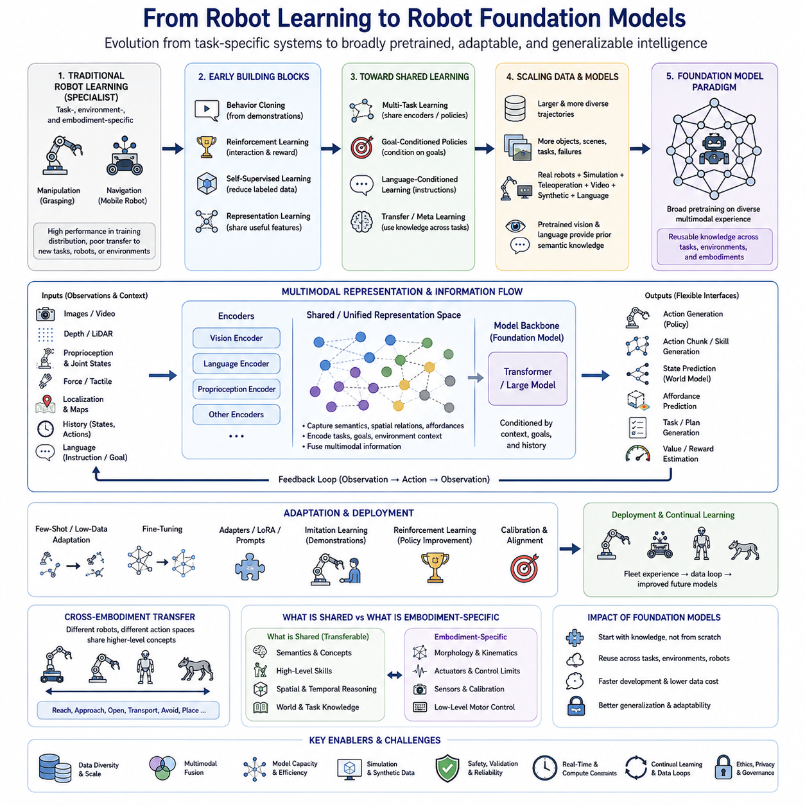{width="7.268055555555556in" height="7.268055555555556in"}

Robot learning traditionally developed around narrowly defined tasks, environments, and embodiments. A manipulation system might learn grasping from demonstrations, while a mobile robot separately learned navigation through reinforcement learning or supervised perception. These systems could achieve impressive performance within their training distribution, but their learned representations and policies were usually difficult to reuse when the task, robot, object set, or environment changed.

This specialist paradigm reflected both practical constraints and the historical structure of robotics. Data collection was expensive, robot hardware differed substantially between laboratories, and learning algorithms were often designed around specific observation and action spaces. Researchers therefore optimized individual components such as grasp detection, locomotion, navigation, trajectory generation, or manipulation instead of training one broadly reusable model across many forms of physical interaction.

Early robot learning nevertheless established the mechanisms that later became essential for robot foundation models. Behavior cloning showed that policies could be learned directly from demonstrations, reinforcement learning demonstrated how interaction and reward could improve behavior, and self-supervised learning reduced dependence on manually labeled data. Representation learning further showed that useful perceptual features could be shared across tasks instead of engineering every feature separately.

The next important transition was from single-task learning toward multi-task learning. Rather than training independent policies for every behavior, researchers began sharing encoders, representations, or policy parameters across related tasks. A common model could learn several manipulation skills, recognize multiple objects, or respond to different goals. Shared training allowed experience from one task to influence another and revealed that sufficiently diverse data could produce representations with broader utility.

Goal-conditioned policies extended this idea by replacing fixed task definitions with variable goals. Instead of encoding one behavior permanently into the policy, the model could condition its decisions on a target state, desired image, object specification, or other representation of intent. Language-conditioned robot learning expanded this interface further, allowing natural-language instructions to describe what should be achieved while a shared policy determined how the robot should act.

These developments gradually changed the central question of robot learning. The objective was no longer only to determine how a robot could master one task efficiently, but how knowledge learned from many experiences could be reused across future tasks. Transfer learning, meta-learning, multitask learning, imitation learning, and large-scale representation learning all contributed pieces of this transition, although they did not individually constitute a complete robot foundation-model paradigm.

Scaling robot data became a decisive factor. Traditional experiments often relied on datasets collected from a small number of robots performing limited behaviors. As larger collections of trajectories became available, models could be exposed to broader combinations of objects, scenes, tasks, failures, and interaction strategies. Training on heterogeneous experience encouraged models to learn recurring structure rather than memorize only the conditions associated with one carefully controlled experimental setup.

However, robotic data is fundamentally harder to scale than text or internet imagery. Robot trajectories require physical hardware, time, maintenance, operators, environments, and safe execution. Different platforms also produce incompatible sensor formats and action spaces. Robot foundation-model development therefore increasingly combines real robot demonstrations with simulation, teleoperation, autonomous fleet data, human video, synthetic data, language annotations, and other multimodal sources.

The incorporation of pretrained vision and language models accelerated this transition. Robots no longer had to learn every semantic concept solely from physical interaction. Large visual and linguistic datasets could provide prior knowledge about objects, categories, spatial relationships, activities, tools, and instructions. Robot learning could then focus on grounding this broad semantic knowledge into physical states, affordances, actions, and consequences relevant to embodied interaction.

This shift introduced a new separation between knowledge acquisition and robot-specific behavior acquisition. Some knowledge can be learned from non-robot data, while other knowledge requires physical experience. Recognizing a hammer and understanding its typical purpose may be acquired from images and language, whereas controlling a particular manipulator to grasp and use it requires knowledge of geometry, contact, kinematics, dynamics, and the robot\'s own action capabilities.

Consequently, modern robot learning increasingly relies on multimodal representations rather than isolated sensor-processing pipelines. Images, language, proprioception, depth, tactile information, robot state, previous actions, and task context can be mapped into shared or interacting representation spaces. These representations provide a common substrate from which models can perform perception, instruction understanding, affordance estimation, planning, prediction, and action generation.

Another transition concerns the scale at which policy learning is organized. Classical robot policies were frequently associated with a particular controller, task, or platform. Robot foundation models instead seek policy backbones that can support many behaviors through conditioning and adaptation. The backbone captures reusable structure, while task-specific, environment-specific, or embodiment-specific components translate that structure into behavior appropriate for the current physical system.

This does not imply that all robotic behavior should be represented by one completely universal policy. Low-level motor control remains strongly dependent on morphology, actuator characteristics, control frequency, and dynamics. The more realistic foundation-model strategy is to identify representations that can be broadly shared while retaining interfaces or modules that accommodate embodiment-specific differences. Generalization therefore emerges through structured sharing rather than complete physical uniformity.

Cross-embodiment datasets push this principle further by combining experience from robots with different morphologies and action spaces. A mobile manipulator, industrial arm, humanoid, and quadruped cannot execute identical motor commands, yet they may share concepts such as reaching, approaching, opening, transporting, avoiding, or placing. Foundation-model training attempts to capture these higher-level regularities while preserving enough embodiment information to produce physically meaningful behavior.

The evolution toward robot foundation models also changes how downstream development is performed. In the specialist paradigm, a new application often required collecting a dedicated dataset and training a model largely from scratch. With a pretrained robot foundation model, developers can begin from existing representations and behaviors, then adapt them using demonstrations, fine-tuning, adapters, prompts, reinforcement learning, calibration, or other forms of post-training.

Few-shot and low-data adaptation therefore become increasingly important measures of model quality. A system that performs hundreds of pretrained tasks but requires complete retraining whenever conditions change remains limited as a foundation. More capable models should exploit prior knowledge to learn new objects, instructions, environments, or behaviors from relatively small amounts of additional experience. The value of scale lies partly in reducing the marginal cost of acquiring new capabilities.

Continual learning introduces an even more ambitious objective. Robots operating for long periods continuously encounter new environments, failures, objects, and interaction patterns. Rather than treating deployment as the final stage after training, future foundation-model systems can potentially turn deployment experience into additional learning data. Fleet-scale operation can create a feedback loop in which deployed robots generate experience that improves later model versions.

This data loop resembles the scaling mechanisms that transformed other areas of machine learning, but robotics adds physical constraints. Failures cannot always be explored freely, dangerous behaviors cannot simply be sampled, and distribution shifts may have safety consequences. Data collection, policy improvement, evaluation, and deployment therefore need stronger validation mechanisms than many purely digital learning systems, especially when learned actions directly affect humans or equipment.

The transition also changes the meaning of generalization. Traditional robot learning often evaluated whether a policy could handle variations near its training conditions. Foundation-model research seeks broader transfer across objects, scenes, tasks, instructions, environments, and potentially embodiments. This creates a hierarchy of increasingly difficult generalization problems, ranging from variations of familiar situations to genuinely new combinations requiring previously learned concepts to be recomposed.

Robot foundation models therefore represent an accumulation and integration of earlier robot-learning ideas rather than a complete rejection of them. Imitation learning, reinforcement learning, representation learning, self-supervision, multitask learning, transfer learning, and goal conditioning remain essential. What changes is the scale and organization of learning: these techniques become components of a larger strategy centered on broadly pretrained models and reusable knowledge.

The resulting development pattern can be understood as a progression from isolated skills toward shared representations, from shared representations toward multi-task policies, and from multi-task policies toward broadly pretrained physical intelligence. At each stage, more knowledge is transferred between tasks instead of being relearned independently. Data diversity, model capacity, multimodal grounding, and adaptation mechanisms collectively determine how far this transfer can extend.

Robot foundation models ultimately aim to change robotics from a collection of separately engineered learning problems into an ecosystem of reusable pretrained intelligence. A robot should increasingly begin with knowledge about perception, language, objects, tasks, interaction, and behavior rather than beginning as an empty learner for every application. New robotic systems can then specialize a common foundation according to their embodiment, environment, safety requirements, and operational objectives.

This transition provides the conceptual bridge to the remaining topics of robot foundation modeling in the volume. Once learning is organized around reusable pretrained models, the central engineering questions become how robot observations, actions, and tasks should be represented; how multimodal representations should be constructed; how large-scale robot pretraining should be performed; and how diverse datasets can support transfer, generalization, and adaptation across physical systems.

전통적인 로봇 학습(Robot Learning)은 대체로 좁게 정의된 작업(Task), 환경(Environment), 체화(Embodiment)를 중심으로 발전해 왔다. 조작 시스템(Manipulation System)은 시연(Demonstration)을 통해 파지(Grasping)를 학습하고, 모바일 로봇(Mobile Robot)은 강화학습(Reinforcement Learning)이나 지도학습 기반 지각(Supervised Perception)을 통해 내비게이션(Navigation)을 별도로 학습했다. 이러한 시스템은 학습 분포(Training Distribution) 안에서는 뛰어난 성능을 보일 수 있었지만, 작업이나 로봇, 객체 집합, 환경이 바뀌면 학습된 표현(Representation)과 정책(Policy)을 재사용하기 어려운 경우가 많았다.

이러한 전문화 패러다임(Specialist Paradigm)은 로보틱스(Robotics)의 역사적 발전 과정과 현실적인 제약을 반영한다. 데이터 수집(Data Collection)은 많은 비용이 필요했고, 연구실마다 로봇 하드웨어(Robot Hardware)가 크게 달랐으며, 학습 알고리즘(Learning Algorithm)은 특정 관측 공간(Observation Space)과 행동 공간(Action Space)을 중심으로 설계되는 경우가 많았다. 따라서 연구자들은 하나의 광범위한 재사용 모델을 학습하기보다 파지 검출(Grasp Detection), 이동(Locomotion), 내비게이션, 궤적 생성(Trajectory Generation), 조작(Manipulation) 등의 개별 구성요소를 최적화했다.

초기의 로봇 학습은 이후 로봇 파운데이션 모델(Robot Foundation Model)에 필수적인 메커니즘을 확립했다. 행동 복제(Behavior Cloning)는 시연으로부터 직접 정책을 학습할 수 있음을 보여주었고, 강화학습은 상호작용(Interaction)과 보상(Reward)을 통해 행동을 개선할 수 있음을 입증했다. 자기지도학습(Self-Supervised Learning)은 수작업 레이블 데이터에 대한 의존도를 줄였으며, 표현 학습(Representation Learning)은 모든 특징을 별도로 설계하는 대신 유용한 지각 특징(Perceptual Feature)을 여러 작업에서 공유할 수 있음을 보여주었다.

다음으로 중요한 전환은 단일 작업 학습(Single-Task Learning)에서 다중 작업 학습(Multi-Task Learning)으로의 발전이었다. 모든 행동마다 독립적인 정책을 학습하는 대신, 관련된 여러 작업에서 인코더(Encoder), 표현 또는 정책 파라미터(Policy Parameter)를 공유하기 시작했다. 하나의 공통 모델(Common Model)이 여러 조작 스킬(Manipulation Skill)을 학습하고, 다양한 객체를 인식하며, 서로 다른 목표에 대응할 수 있게 되었다. 공유 학습(Shared Training)을 통해 한 작업의 경험이 다른 작업에 영향을 줄 수 있었으며, 충분히 다양한 데이터가 보다 광범위하게 활용 가능한 표현을 생성할 수 있음이 확인되었다.

목표 조건부 정책(Goal-Conditioned Policy)은 고정된 작업 정의를 가변적인 목표(Variable Goal)로 대체함으로써 이러한 개념을 확장했다. 하나의 행동을 정책에 영구적으로 고정하는 대신, 목표 상태(Target State), 목표 이미지(Desired Image), 객체 명세(Object Specification) 또는 다른 형태의 의도 표현(Intent Representation)을 조건으로 의사결정을 수행할 수 있게 되었다. 언어 조건부 로봇 학습(Language-Conditioned Robot Learning)은 이를 더욱 확장하여 자연어 명령(Natural-Language Instruction)으로 수행할 목표를 설명하고 공유 정책이 실제 행동 방법을 결정하도록 했다.

이러한 발전은 점차 로봇 학습의 핵심 질문을 변화시켰다. 이제 목표는 단순히 하나의 작업을 얼마나 효율적으로 숙달할 수 있는지를 알아내는 것에서 벗어나, 다양한 경험으로부터 학습한 지식을 미래의 작업에서 어떻게 재사용할 수 있는지를 알아내는 방향으로 이동했다. 전이학습(Transfer Learning), 메타학습(Meta-Learning), 다중 작업 학습, 모방학습(Imitation Learning), 대규모 표현 학습(Large-Scale Representation Learning)은 이러한 전환의 중요한 구성요소를 제공했지만, 각각의 방법만으로 완전한 로봇 파운데이션 모델 패러다임을 형성하는 것은 아니었다.

로봇 데이터(Robot Data)의 규모 확장(Scaling)은 결정적인 요인이 되었다. 전통적인 실험에서는 소수의 로봇이 제한된 행동을 수행하여 수집한 데이터셋(Dataset)을 사용하는 경우가 많았다. 더 큰 규모의 궤적(Trajectory) 데이터가 이용 가능해지면서 모델은 보다 다양한 객체, 장면(Scene), 작업, 실패(Failure), 상호작용 전략(Interaction Strategy)의 조합을 경험할 수 있게 되었다. 이질적인 경험(Heterogeneous Experience)을 이용한 학습은 특정 실험 환경의 조건을 단순히 기억하는 대신 반복적으로 나타나는 공통 구조(Recurring Structure)를 학습하도록 촉진했다.

그러나 로봇 데이터는 텍스트(Text)나 인터넷 이미지(Internet Imagery)보다 본질적으로 확장하기 어렵다. 로봇 궤적을 수집하려면 실제 하드웨어, 시간, 유지보수(Maintenance), 운영자(Operator), 환경, 안전한 실행이 필요하다. 또한 서로 다른 플랫폼은 호환되지 않는 센서 형식(Sensor Format)과 행동 공간을 생성한다. 따라서 로봇 파운데이션 모델 개발에서는 실제 로봇 시연(Real Robot Demonstration)과 함께 시뮬레이션(Simulation), 원격조작(Teleoperation), 자율 플릿 데이터(Autonomous Fleet Data), 인간 비디오(Human Video), 합성 데이터(Synthetic Data), 언어 주석(Language Annotation) 등의 다양한 멀티모달 데이터(Multimodal Data)를 결합하는 방향으로 발전하고 있다.

사전학습된 비전 모델(Pretrained Vision Model)과 언어 모델(Language Model)의 도입은 이러한 전환을 더욱 가속했다. 로봇은 더 이상 모든 의미 개념(Semantic Concept)을 물리적 상호작용만으로 학습할 필요가 없게 되었다. 대규모 시각·언어 데이터는 객체, 범주(Category), 공간 관계(Spatial Relationship), 활동(Activity), 도구(Tool), 명령(Instruction)에 관한 사전 지식(Prior Knowledge)을 제공할 수 있다. 이후 로봇 학습은 이러한 광범위한 의미 지식을 체화 상호작용에 필요한 물리 상태(Physical State), 어포던스(Affordance), 행동(Action), 결과(Consequence)에 그라운딩(Grounding)하는 데 집중할 수 있다.

이러한 변화는 지식 획득(Knowledge Acquisition)과 로봇 고유 행동 획득(Robot-Specific Behavior Acquisition)을 구분하는 새로운 관점을 만들었다. 일부 지식은 비로봇 데이터(Non-Robot Data)에서 학습할 수 있지만, 다른 지식은 물리적 경험(Physical Experience)을 필요로 한다. 망치(Hammer)를 인식하고 일반적인 용도를 이해하는 것은 이미지와 언어를 통해 습득할 수 있지만, 특정 매니퓰레이터(Manipulator)를 제어하여 망치를 잡고 사용하는 것은 기하학(Geometry), 접촉(Contact), 운동학(Kinematics), 동역학(Dynamics), 그리고 로봇 자체의 행동 능력(Action Capability)에 관한 지식을 필요로 한다.

결과적으로 현대의 로봇 학습은 서로 분리된 센서 처리 파이프라인(Isolated Sensor-Processing Pipeline)보다 멀티모달 표현(Multimodal Representation)에 점점 더 의존하고 있다. 이미지, 언어, 고유수용감각(Proprioception), 깊이(Depth), 촉각 정보(Tactile Information), 로봇 상태(Robot State), 이전 행동(Previous Action), 작업 맥락(Task Context)을 공유되거나 상호작용하는 표현 공간(Representation Space)에 매핑할 수 있다. 이러한 표현은 지각(Perception), 명령 이해(Instruction Understanding), 어포던스 추정(Affordance Estimation), 계획(Planning), 예측(Prediction), 행동 생성(Action Generation)을 수행하는 공통 기반(Common Substrate)을 제공한다.

또 다른 전환은 정책 학습(Policy Learning)이 구성되는 규모와 관련된다. 전통적인 로봇 정책은 특정 제어기(Controller), 작업 또는 플랫폼과 연결되는 경우가 많았다. 반면 로봇 파운데이션 모델은 조건화(Conditioning)와 적응(Adaptation)을 통해 다양한 행동을 지원할 수 있는 정책 백본(Policy Backbone)을 지향한다. 백본은 재사용 가능한 구조(Reusable Structure)를 학습하고, 작업별(Task-Specific), 환경별(Environment-Specific), 체화별(Embodiment-Specific) 구성요소가 이러한 구조를 현재의 물리 시스템에 적합한 행동으로 변환한다.

이것이 모든 로봇 행동을 하나의 완전히 범용적인 정책(Universal Policy)으로 표현해야 한다는 의미는 아니다. 저수준 모터 제어(Low-Level Motor Control)는 형태(Morphology), 액추에이터 특성(Actuator Characteristics), 제어 주파수(Control Frequency), 동역학에 강하게 의존한다. 보다 현실적인 파운데이션 모델 전략은 광범위하게 공유할 수 있는 표현을 식별하면서 체화별 차이를 수용할 수 있는 인터페이스(Interface)나 모듈(Module)을 유지하는 것이다. 따라서 일반화(Generalization)는 완전한 물리적 통일성이 아니라 구조화된 공유(Structured Sharing)를 통해 형성된다.

교차 체화 데이터셋(Cross-Embodiment Dataset)은 서로 다른 형태와 행동 공간을 가진 로봇의 경험을 결합함으로써 이러한 원리를 더욱 확장한다. 모바일 매니퓰레이터(Mobile Manipulator), 산업용 로봇 팔(Industrial Arm), 휴머노이드(Humanoid), 4족 로봇(Quadruped)은 동일한 모터 명령을 실행할 수 없지만 도달하기(Reaching), 접근하기(Approaching), 열기(Opening), 운반하기(Transporting), 회피하기(Avoiding), 배치하기(Placing)와 같은 개념을 공유할 수 있다. 파운데이션 모델 학습은 이러한 고수준 규칙성을 포착하면서 물리적으로 의미 있는 행동을 생성할 수 있도록 충분한 체화 정보를 유지하려 한다.

로봇 파운데이션 모델로의 진화는 다운스트림 개발(Downstream Development)의 방식도 변화시킨다. 전문화 패러다임에서는 새로운 응용 분야가 등장할 때 전용 데이터셋을 수집하고 모델을 거의 처음부터 학습해야 하는 경우가 많았다. 사전학습된 로봇 파운데이션 모델을 사용하면 기존의 표현과 행동을 출발점으로 활용하고, 이후 시연, 미세조정(Fine-Tuning), 어댑터(Adapter), 프롬프트(Prompt), 강화학습, 보정(Calibration) 또는 기타 사후학습(Post-Training)을 통해 새로운 목적에 적응시킬 수 있다.

따라서 퓨샷 적응(Few-Shot Adaptation)과 저데이터 적응(Low-Data Adaptation)은 점점 중요한 모델 품질 지표가 된다. 수백 개의 사전학습 작업을 수행하더라도 조건이 바뀔 때마다 완전한 재학습(Complete Retraining)이 필요하다면 파운데이션으로서의 능력은 제한적이다. 더 강력한 모델은 사전 지식(Prior Knowledge)을 활용하여 비교적 적은 추가 경험만으로 새로운 객체, 명령, 환경 또는 행동을 학습해야 한다. 규모 확장의 중요한 가치는 새로운 능력을 획득하는 한계 비용(Marginal Cost)을 줄이는 데 있다.

지속학습(Continual Learning)은 더욱 야심찬 목표를 제시한다. 장기간 운용되는 로봇은 새로운 환경, 실패, 객체, 상호작용 패턴(Interaction Pattern)을 지속적으로 경험한다. 미래의 파운데이션 모델 시스템에서는 배치(Deployment)를 학습 이후의 최종 단계로만 취급하지 않고, 실제 운용 경험을 추가 학습 데이터로 전환할 수 있다. 플릿 규모 운용(Fleet-Scale Operation)은 배치된 로봇이 새로운 경험을 생성하고 이것이 이후 모델 버전을 개선하는 피드백 루프(Feedback Loop)를 형성할 수 있다.

이러한 데이터 루프(Data Loop)는 다른 머신러닝 분야를 변화시킨 규모 확장 메커니즘과 유사하지만, 로보틱스에는 물리적 제약(Physical Constraint)이 추가된다. 실패를 항상 자유롭게 탐색할 수 없으며, 위험한 행동을 단순히 샘플링(Sampling)할 수도 없고, 분포 변화(Distribution Shift)는 안전 문제로 이어질 수 있다. 따라서 데이터 수집, 정책 개선(Policy Improvement), 평가(Evaluation), 배치는 순수한 디지털 학습 시스템보다 더욱 강력한 검증 메커니즘(Validation Mechanism)을 필요로 하며, 특히 학습된 행동이 사람이나 장비에 직접 영향을 미치는 경우 더욱 중요하다.

이러한 전환은 일반화(Generalization)의 의미도 변화시킨다. 전통적인 로봇 학습에서는 정책이 학습 조건 주변의 변화에 대응할 수 있는지를 평가하는 경우가 많았다. 파운데이션 모델 연구에서는 객체, 장면, 작업, 명령, 환경, 그리고 잠재적으로 체화까지 포함하는 더 광범위한 전이를 추구한다. 이에 따라 익숙한 상황의 변형부터 기존에 학습한 개념을 새롭게 조합해야 하는 진정으로 새로운 상황까지 점점 어려워지는 일반화 문제의 계층(Hierarchy)이 형성된다.

따라서 로봇 파운데이션 모델은 기존 로봇 학습 아이디어를 완전히 폐기하는 것이 아니라 이를 축적하고 통합(Integration)한 결과로 이해해야 한다. 모방학습, 강화학습, 표현 학습, 자기지도학습, 다중 작업 학습, 전이학습, 목표 조건화(Goal Conditioning)는 여전히 핵심적인 기술이다. 달라진 것은 학습의 규모와 구성 방식이며, 이러한 기술들이 광범위하게 사전학습된 모델(Broadly Pretrained Model)과 재사용 가능한 지식(Reusable Knowledge)을 중심으로 하는 더 큰 전략의 구성요소가 된다는 점이다.

결과적인 발전 과정은 고립된 스킬(Isolated Skill)에서 공유 표현(Shared Representation)으로, 공유 표현에서 다중 작업 정책(Multi-Task Policy)으로, 그리고 다중 작업 정책에서 광범위하게 사전학습된 물리 지능(Broadly Pretrained Physical Intelligence)으로 진행되는 과정으로 이해할 수 있다. 각 단계에서는 더 많은 지식이 작업마다 독립적으로 다시 학습되는 대신 작업 사이에서 전이된다. 데이터 다양성(Data Diversity), 모델 용량(Model Capacity), 멀티모달 그라운딩(Multimodal Grounding), 적응 메커니즘(Adaptation Mechanism)이 이러한 전이의 범위를 결정한다.

궁극적으로 로봇 파운데이션 모델은 로보틱스를 서로 독립적으로 설계된 학습 문제의 집합에서 재사용 가능한 사전학습 지능(Reusable Pretrained Intelligence)의 생태계(Ecosystem)로 변화시키는 것을 목표로 한다. 로봇은 새로운 응용 분야마다 빈 학습기(Empty Learner)로 시작하는 대신 지각, 언어, 객체, 작업, 상호작용, 행동에 관한 지식을 이미 보유한 상태에서 시작할 수 있어야 한다. 이후 새로운 로봇 시스템은 자신의 체화, 환경, 안전 요구사항(Safety Requirement), 운용 목표(Operational Objective)에 맞추어 공통 파운데이션(Common Foundation)을 전문화할 수 있다.

이러한 전환은 이 장의 나머지 로봇 파운데이션 모델링 주제로 이어지는 개념적 연결고리(Conceptual Bridge)를 제공한다. 학습이 재사용 가능한 사전학습 모델을 중심으로 구성되면 핵심 공학적 질문은 로봇의 관측(Observation), 행동(Action), 작업(Task)을 어떻게 표현할 것인지, 멀티모달 표현을 어떻게 구성할 것인지, 대규모 로봇 사전학습(Large-Scale Robot Pretraining)을 어떻게 수행할 것인지, 그리고 다양한 데이터셋이 물리 시스템 전반의 전이(Transfer), 일반화, 적응을 어떻게 지원할 것인지로 확장된다.

## 02.03. Robot Observations Actions and Tasks

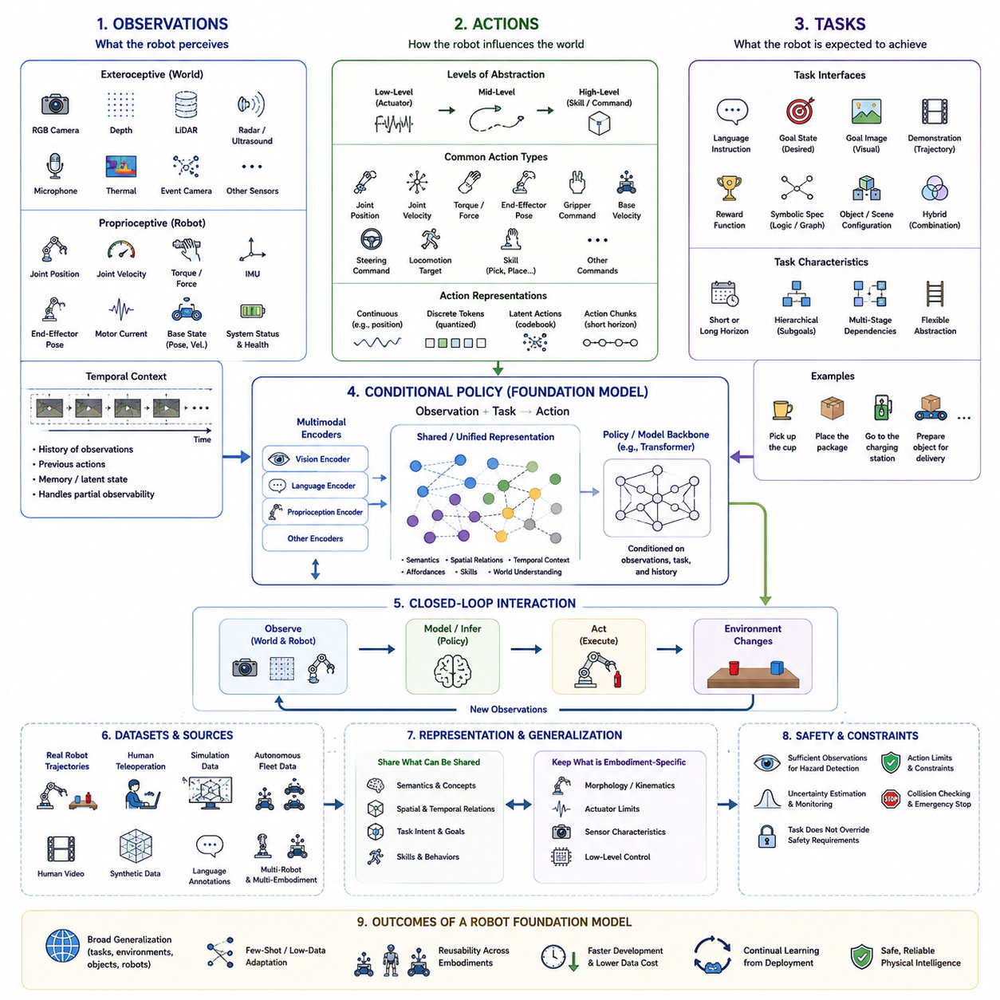{width="7.268055555555556in" height="7.268055555555556in"}

Robot foundation models operate through a continuous relationship among observations, actions, and tasks. Observations describe what the robot currently perceives about itself and the surrounding world, actions describe how it can physically influence that world, and tasks specify the objectives that organize behavior over time. Designing representations for these three elements is fundamental because they define the interface between learned intelligence and physical embodiment.

An observation is not simply an image captured by a camera. A physical robot may simultaneously receive RGB images, depth maps, LiDAR measurements, tactile signals, force and torque readings, joint positions, joint velocities, inertial measurements, localization estimates, and system status information. These heterogeneous signals provide complementary evidence about objects, geometry, motion, contact, robot configuration, and environmental conditions.

Exteroceptive observations describe information obtained about the external environment. Cameras reveal appearance, objects, people, landmarks, and semantic context, while depth sensors and LiDAR provide geometric structure and distance. Radar, ultrasound, microphones, and other sensors may contribute information that remains useful when vision is ambiguous or degraded. A foundation model must learn how these signals relate rather than treating every sensing modality as an isolated channel.

Proprioceptive observations describe the robot\'s own physical state. Joint angles, actuator velocities, wheel speeds, base orientation, end-effector pose, motor currents, and inertial measurements reveal how the embodiment is configured and moving. Such information is essential because identical visual scenes can require different actions depending on the robot\'s current posture, velocity, available workspace, or contact state.

Observations also have temporal structure. A single image may show where an object is but cannot completely describe how it is moving, how the robot arrived at its current configuration, or what action was previously attempted. Observation histories provide information about motion, causality, progress, and failure. Robot foundation models therefore often require sequences of states, images, sensor measurements, and previous actions rather than independent snapshots.

Partial observability makes this temporal context especially important. Robots rarely have direct access to the complete physical state of their environment. Objects can be occluded, sensor measurements can be noisy, and relevant information may disappear from the current field of view. Memory or latent state representations can preserve information from previous observations, allowing the model to estimate aspects of the world that are not immediately visible.

Actions form the complementary side of physical interaction. An action specifies how the robot changes its configuration or influences its environment. Depending on the embodiment, actions may represent joint positions, velocities, torques, end-effector poses, gripper commands, mobile-base velocities, steering commands, locomotion targets, or higher-level skills. Consequently, there is no single natural action representation shared directly by every robot.

The level of abstraction used for actions strongly affects learning. Low-level torque or velocity commands provide precise control but require the model to reason at high frequency about embodiment-specific dynamics. Higher-level commands such as target poses, trajectories, waypoints, or skills reduce this burden by delegating detailed execution to lower-level controllers. Robot foundation models can therefore operate at different levels within a hierarchical control architecture.

Continuous action spaces are common because physical quantities such as position, velocity, and torque naturally take continuous values. However, foundation-model architectures may also transform actions into discrete tokens, learned codebook entries, latent actions, or temporally extended action chunks. These representations can make action prediction more compatible with Transformer-based sequence modeling while introducing tradeoffs between precision, compression, temporal resolution, and generality.

Action chunks provide a useful intermediate representation between individual control commands and complete task plans. Instead of predicting one motor command at every inference step, a model can generate a short sequence representing coordinated motion over a limited horizon. This can improve temporal consistency and computational efficiency, although closed-loop feedback remains necessary because the physical world may evolve differently from the model\'s prediction.

The meaning of an action is inseparable from embodiment. A command such as moving forward has different physical realizations for a differential-drive mobile robot, quadruped, humanoid, or aerial vehicle. Similarly, reaching toward an object depends on arm geometry, joint limits, workspace, and end-effector design. Foundation models therefore need representations that preserve shared behavioral intent while accommodating embodiment-specific execution.

Tasks provide the third organizing element. A task defines what the robot is expected to accomplish rather than specifying every control command required to accomplish it. Tasks may be expressed as language instructions, desired goal states, target images, object configurations, demonstrations, reward functions, symbolic specifications, or combinations of these representations. This flexibility allows a common model to support substantially different forms of robot interaction.

Language is particularly useful for task specification because it can describe goals at many levels of abstraction. Instructions such as "pick up the cup," "place the package on the shelf," or "go to the charging station" express desired outcomes without explicitly prescribing trajectories. The robot must connect linguistic concepts with perceived entities, infer relevant constraints, and generate physical behavior that satisfies the instruction in the current environment.

Goal-state representations provide another task interface. Instead of describing the objective linguistically, a system can specify a desired robot state, object pose, destination, scene configuration, or visual target. Goal-conditioned policies then learn behavior as a function of both the current observation and the desired outcome. This formulation supports reuse because the same policy can potentially solve many goals without requiring a separately trained network for each one.

Demonstrations can simultaneously communicate tasks and illustrate how they should be executed. A human teleoperator or another robot can provide sequences of observations and actions that implicitly encode task structure. Imitation learning uses these trajectories to learn behavior, while foundation-model training can combine demonstrations from many tasks so that recurring patterns such as reaching, grasping, transporting, opening, and placing become reusable behavioral knowledge.

Tasks frequently contain long-horizon structure. A command such as preparing an object for delivery may require locating it, navigating toward it, grasping it, avoiding obstacles, transporting it, identifying the destination, and placing it correctly. Each stage depends on previous outcomes. Foundation models must therefore connect high-level objectives with intermediate subgoals and lower-level actions while monitoring whether execution remains consistent with the original task.

The relationship among observations, actions, and tasks can be expressed conceptually as a conditional policy. The robot receives current and historical observations together with a task or goal, then predicts an action or action sequence appropriate for that context. After execution, the environment changes and produces new observations. This creates the observation--task--action--observation loop that forms the operational core of learned embodied intelligence.

For foundation models, the challenge is to make this interface scalable across heterogeneous datasets. One dataset may contain camera images and joint commands, another may include language instructions and end-effector trajectories, and another may contain mobile navigation observations with velocity actions. Combining such datasets requires normalization, modality encoders, metadata, temporal alignment, and representations that distinguish what can be shared from what remains dataset- or embodiment-specific.

Task diversity creates similar difficulties. Different datasets may describe conceptually related behaviors using inconsistent labels, instructions, reward definitions, or demonstrations. A foundation model benefits when these heterogeneous task descriptions can be mapped into representations that expose common intent. Semantic alignment can allow experiences collected under different task formulations to contribute to shared concepts instead of remaining disconnected training problems.

Observation and action representations also determine what kinds of generalization become possible. Models tied directly to one fixed sensor arrangement and one actuator interface may transfer poorly to new robots. More abstract representations can increase transferability, but excessive abstraction may discard information required for precise physical control. Effective foundation-model design therefore balances invariance and specificity rather than attempting to eliminate embodiment information entirely.

This balance motivates architectures with shared and specialized components. Shared representations can encode semantics, spatial relationships, task intent, temporal context, and reusable skills, while embodiment-specific modules process particular sensors or translate general behavioral representations into executable commands. Such organization allows the model to exploit common physical knowledge without assuming that every robot has identical sensing, kinematics, or actuation.

Safety further constrains the observation--action--task interface. Observations must contain enough information to detect hazards, actions must respect physical and operational limits, and tasks must not override fundamental safety requirements. Runtime systems may therefore combine learned policies with collision checking, constraint enforcement, uncertainty estimation, emergency stopping, or conventional controllers. The commanded task is only one condition on behavior, not an unrestricted authorization to act.

Ultimately, observations, actions, and tasks define the language through which a robot foundation model interacts with the physical world. Observations provide evidence about the world and embodiment, tasks describe desired outcomes, and actions transform predictions into physical consequences. Their representations determine what information the model can learn, what behaviors it can generate, and how effectively knowledge can transfer across tasks, environments, datasets, and robot platforms.

Understanding these interfaces establishes the basis for multimodal robot representations, large-scale pretraining, multi-task learning, and cross-embodiment transfer addressed throughout the remaining robot foundation-model topics. The central objective is not merely to combine more sensors or actions, but to construct representations through which diverse robotic experiences can become compatible training signals for a broadly reusable model.

로봇 파운데이션 모델(Robot Foundation Model)은 관측(Observation), 행동(Action), 작업(Task) 사이의 지속적인 관계를 통해 동작한다. 관측은 로봇이 자신과 주변 세계에 대해 현재 무엇을 인지하고 있는지를 나타내고, 행동은 로봇이 물리적 세계에 어떻게 영향을 줄 수 있는지를 나타내며, 작업은 시간에 따라 행동을 조직하는 목표(Objective)를 정의한다. 이 세 요소의 표현(Representation)을 설계하는 것은 학습된 지능(Learned Intelligence)과 물리적 체화(Physical Embodiment) 사이의 인터페이스를 결정하기 때문에 매우 중요하다.

관측(Observation)은 단순히 카메라(Camera)가 촬영한 이미지(Image)를 의미하지 않는다. 물리적 로봇(Physical Robot)은 RGB 이미지(RGB Image), 깊이 맵(Depth Map), 라이다 측정값(LiDAR Measurement), 촉각 신호(Tactile Signal), 힘과 토크 측정값(Force and Torque Reading), 관절 위치(Joint Position), 관절 속도(Joint Velocity), 관성 측정값(Inertial Measurement), 위치 추정값(Localization Estimate), 시스템 상태 정보(System Status Information)를 동시에 입력받을 수 있다. 이러한 이질적인 신호는 객체, 기하 구조, 움직임, 접촉, 로봇 구성 상태, 환경 조건에 관한 상호 보완적인 정보를 제공한다.

외수용성 관측(Exteroceptive Observation)은 외부 환경(External Environment)에 대해 획득한 정보를 의미한다. 카메라는 외형, 객체, 사람, 랜드마크(Landmark), 의미적 맥락(Semantic Context)을 제공하고, 깊이 센서(Depth Sensor)와 라이다는 기하 구조와 거리를 제공한다. 레이더(Radar), 초음파(Ultrasound), 마이크(Microphone) 등의 센서는 비전 정보가 모호하거나 성능이 저하되는 상황에서 유용한 정보를 제공할 수 있다. 파운데이션 모델은 각 센싱 모달리티(Sensing Modality)를 독립적으로 처리하는 것을 넘어 이들 사이의 관계를 학습해야 한다.

고유수용성 관측(Proprioceptive Observation)은 로봇 자체의 물리적 상태(Physical State)를 나타낸다. 관절 각도(Joint Angle), 액추에이터 속도(Actuator Velocity), 휠 속도(Wheel Speed), 베이스 방향(Base Orientation), 엔드 이펙터 자세(End-Effector Pose), 모터 전류(Motor Current), 관성 측정값은 로봇의 체화가 현재 어떻게 구성되고 움직이고 있는지를 보여준다. 동일한 시각 장면이라도 로봇의 현재 자세(Posture), 속도, 사용 가능한 작업 공간(Workspace), 접촉 상태(Contact State)에 따라 필요한 행동이 달라질 수 있기 때문에 이러한 정보는 필수적이다.

관측에는 시간적 구조(Temporal Structure)도 존재한다. 하나의 이미지는 객체가 어디에 있는지를 보여줄 수 있지만, 객체가 어떻게 움직이고 있는지, 로봇이 현재 상태에 어떻게 도달했는지, 이전에 어떤 행동을 시도했는지를 완전하게 설명할 수 없다. 관측 이력(Observation History)은 움직임, 인과관계(Causality), 진행 상태(Progress), 실패(Failure)에 관한 정보를 제공한다. 따라서 로봇 파운데이션 모델은 독립적인 스냅샷(Snapshot)보다 상태, 이미지, 센서 측정값, 이전 행동의 시퀀스(Sequence)를 필요로 하는 경우가 많다.

부분 관측 가능성(Partial Observability)은 이러한 시간적 맥락(Temporal Context)을 더욱 중요하게 만든다. 로봇은 환경의 완전한 물리 상태에 직접 접근할 수 있는 경우가 거의 없다. 객체는 가려질 수 있고, 센서 측정값에는 잡음(Noise)이 포함될 수 있으며, 중요한 정보가 현재 시야(Field of View)에서 사라질 수도 있다. 메모리(Memory) 또는 잠재 상태 표현(Latent State Representation)은 이전 관측에서 얻은 정보를 유지하여 현재 직접 보이지 않는 세계의 상태를 모델이 추정할 수 있도록 한다.

행동(Action)은 물리적 상호작용(Physical Interaction)의 또 다른 핵심 요소이다. 행동은 로봇이 자신의 구성 상태를 변경하거나 환경에 영향을 미치는 방법을 지정한다. 체화 형태에 따라 행동은 관절 위치, 속도, 토크(Torque), 엔드 이펙터 자세, 그리퍼 명령(Gripper Command), 모바일 베이스 속도(Mobile-Base Velocity), 조향 명령(Steering Command), 보행 목표(Locomotion Target), 또는 고수준 스킬(High-Level Skill)로 표현될 수 있다. 따라서 모든 로봇이 직접 공유할 수 있는 하나의 자연스러운 행동 표현은 존재하지 않는다.

행동에 사용되는 추상화 수준(Level of Abstraction)은 학습에 큰 영향을 미친다. 저수준 토크 또는 속도 명령(Low-Level Torque or Velocity Command)은 정밀한 제어를 제공하지만, 모델이 높은 주파수에서 체화별 동역학(Embodiment-Specific Dynamics)을 고려해야 한다. 반면 목표 자세(Target Pose), 궤적(Trajectory), 웨이포인트(Waypoint), 스킬(Skill)과 같은 고수준 명령은 세부 실행을 저수준 제어기(Low-Level Controller)에 위임하여 이러한 부담을 줄인다. 따라서 로봇 파운데이션 모델은 계층적 제어 아키텍처(Hierarchical Control Architecture)의 서로 다른 수준에서 동작할 수 있다.

연속 행동 공간(Continuous Action Space)은 위치, 속도, 토크와 같은 물리량이 자연스럽게 연속값을 가지기 때문에 로봇에서 일반적으로 사용된다. 그러나 파운데이션 모델 아키텍처는 행동을 이산 토큰(Discrete Token), 학습된 코드북 항목(Learned Codebook Entry), 잠재 행동(Latent Action), 또는 시간적으로 확장된 행동 청크(Action Chunk)로 변환할 수도 있다. 이러한 표현은 행동 예측을 트랜스포머 기반 시퀀스 모델링(Transformer-Based Sequence Modeling)에 적합하게 만들지만 정밀도, 압축, 시간 해상도(Temporal Resolution), 범용성(Generality) 사이의 절충이 필요하다.

행동 청크(Action Chunk)는 개별 제어 명령과 전체 작업 계획(Task Plan) 사이에서 유용한 중간 표현(Intermediate Representation)을 제공한다. 모델이 매 추론 단계마다 하나의 모터 명령을 예측하는 대신 제한된 시간 범위(Horizon)에 걸쳐 조정된 움직임을 나타내는 짧은 시퀀스를 생성할 수 있다. 이는 시간적 일관성(Temporal Consistency)과 계산 효율성(Computational Efficiency)을 향상시킬 수 있지만, 실제 물리 세계는 모델의 예측과 다르게 변화할 수 있기 때문에 폐루프 피드백(Closed-Loop Feedback)은 여전히 필요하다.

행동의 의미는 체화(Embodiment)와 분리될 수 없다. 예를 들어 전진(Moving Forward)이라는 명령은 차동구동 모바일 로봇(Differential-Drive Mobile Robot), 4족 로봇(Quadruped), 휴머노이드(Humanoid), 무인비행체(Aerial Vehicle)에서 서로 다른 물리적 실행 방식으로 구현된다. 마찬가지로 객체에 손을 뻗는 행동(Reaching)은 로봇 팔의 기하 구조, 관절 한계(Joint Limit), 작업 공간, 엔드 이펙터 설계에 따라 달라진다. 따라서 파운데이션 모델은 공유 가능한 행동 의도(Behavioral Intent)를 유지하면서 체화별 실행을 수용할 수 있는 표현이 필요하다.

작업(Task)은 세 번째 핵심 구성요소이다. 작업은 목표를 달성하기 위해 필요한 모든 제어 명령을 직접 지정하는 대신 로봇이 무엇을 달성해야 하는지를 정의한다. 작업은 언어 명령(Language Instruction), 원하는 목표 상태(Desired Goal State), 목표 이미지(Target Image), 객체 구성(Object Configuration), 시연(Demonstration), 보상 함수(Reward Function), 기호적 명세(Symbolic Specification), 또는 이들의 조합으로 표현될 수 있다. 이러한 유연성은 하나의 공통 모델이 매우 다양한 형태의 로봇 상호작용을 지원할 수 있도록 한다.

언어(Language)는 다양한 추상화 수준에서 목표를 설명할 수 있기 때문에 작업 명세(Task Specification)에 특히 유용하다. "컵을 집어라(pick up the cup)", "상자 위에 패키지를 놓아라(place the package on the shelf)", "충전소로 이동하라(go to the charging station)"와 같은 명령은 구체적인 궤적을 직접 지정하지 않고 원하는 결과를 표현한다. 로봇은 언어 개념(Linguistic Concept)을 지각된 객체와 연결하고 관련 제약조건을 추론하며 현재 환경에서 명령을 만족시키는 물리적 행동을 생성해야 한다.

목표 상태 표현(Goal-State Representation)은 또 다른 작업 인터페이스(Task Interface)를 제공한다. 목표를 언어적으로 설명하는 대신 원하는 로봇 상태, 객체 자세(Object Pose), 목적지(Destination), 장면 구성(Scene Configuration), 또는 시각적 목표(Visual Target)를 지정할 수 있다. 목표 조건부 정책(Goal-Conditioned Policy)은 현재 관측과 원하는 결과를 함께 사용하여 행동을 학습한다. 이러한 구성은 작업마다 별도의 네트워크를 학습하지 않고 하나의 정책으로 여러 목표를 해결할 가능성을 제공한다.

시연(Demonstration)은 작업이 무엇인지 전달하면서 동시에 그것을 어떻게 수행해야 하는지도 보여줄 수 있다. 인간 원격조작자(Human Teleoperator) 또는 다른 로봇이 작업 구조를 암묵적으로 포함하는 관측과 행동의 시퀀스를 제공할 수 있다. 모방학습(Imitation Learning)은 이러한 궤적을 이용해 행동을 학습하고, 파운데이션 모델 학습은 여러 작업의 시연을 결합하여 도달하기(Reaching), 파지하기(Grasping), 운반하기(Transporting), 열기(Opening), 배치하기(Placing)와 같은 반복적인 패턴을 재사용 가능한 행동 지식(Reusable Behavioral Knowledge)으로 만들 수 있다.

작업에는 장기 시간 범위 구조(Long-Horizon Structure)가 포함되는 경우가 많다. 객체를 배송할 준비를 하라는 명령은 객체 탐색, 객체로의 이동, 파지, 장애물 회피, 운반, 목적지 식별, 올바른 위치에 배치하는 여러 단계를 필요로 할 수 있다. 각 단계는 이전 단계의 결과에 의존한다. 따라서 파운데이션 모델은 실행이 원래 작업과 일치하는지를 지속적으로 모니터링하면서 고수준 목표(High-Level Objective)를 중간 하위 목표(Intermediate Subgoal) 및 저수준 행동과 연결해야 한다.

관측, 행동, 작업의 관계는 개념적으로 조건부 정책(Conditional Policy)으로 표현할 수 있다. 로봇은 현재 및 과거 관측(Current and Historical Observations)을 작업 또는 목표와 함께 입력받고, 해당 맥락에 적합한 행동이나 행동 시퀀스를 예측한다. 행동이 실행되면 환경이 변화하고 새로운 관측이 생성된다. 이것이 관측--작업--행동--관측(Observation--Task--Action--Observation) 루프를 형성하며, 학습 기반 체화 지능(Learned Embodied Intelligence)의 핵심적인 운용 구조가 된다.

파운데이션 모델에서 중요한 과제는 이러한 인터페이스를 이질적인 데이터셋(Heterogeneous Dataset) 전반으로 확장 가능하게 만드는 것이다. 어떤 데이터셋에는 카메라 이미지와 관절 명령이 포함되고, 다른 데이터셋에는 언어 명령과 엔드 이펙터 궤적이 포함되며, 또 다른 데이터셋에는 속도 행동을 포함하는 모바일 내비게이션 관측이 존재할 수 있다. 이러한 데이터를 결합하려면 정규화(Normalization), 모달리티 인코더(Modality Encoder), 메타데이터(Metadata), 시간 정렬(Temporal Alignment), 그리고 공유 가능한 정보와 데이터셋 또는 체화에 특화된 정보를 구분하는 표현이 필요하다.

작업 다양성(Task Diversity)도 유사한 어려움을 만든다. 서로 다른 데이터셋은 개념적으로 유사한 행동을 일관되지 않은 레이블(Label), 명령, 보상 정의(Reward Definition), 시연으로 표현할 수 있다. 이러한 이질적인 작업 설명을 공통 의도(Common Intent)를 드러내는 표현으로 매핑할 수 있다면 파운데이션 모델에 도움이 된다. 의미적 정렬(Semantic Alignment)을 통해 서로 다른 작업 정의 아래에서 수집된 경험이 분리된 학습 문제로 남지 않고 공유 개념(Shared Concept)의 학습에 기여할 수 있다.

관측과 행동의 표현은 어떤 종류의 일반화(Generalization)가 가능한지도 결정한다. 하나의 고정된 센서 구성(Sensor Configuration)과 하나의 액추에이터 인터페이스(Actuator Interface)에 직접 종속된 모델은 새로운 로봇으로의 전이가 어려울 수 있다. 더 추상적인 표현은 전이 가능성(Transferability)을 높일 수 있지만 지나친 추상화는 정밀한 물리 제어에 필요한 정보를 제거할 수 있다. 따라서 효과적인 파운데이션 모델 설계는 체화 정보를 완전히 제거하기보다 불변성(Invariance)과 특수성(Specificity) 사이의 균형을 유지해야 한다.

이러한 균형은 공유 구성요소(Shared Component)와 특화 구성요소(Specialized Component)를 함께 사용하는 아키텍처의 필요성을 만든다. 공유 표현은 의미(Semantics), 공간 관계, 작업 의도, 시간적 맥락, 재사용 가능한 스킬을 인코딩할 수 있으며, 체화별 모듈(Embodiment-Specific Module)은 특정 센서를 처리하거나 일반적인 행동 표현을 실행 가능한 명령으로 변환할 수 있다. 이러한 구조를 통해 모든 로봇이 동일한 센싱, 운동학, 구동 방식을 가진다고 가정하지 않고도 공통 물리 지식(Common Physical Knowledge)을 활용할 수 있다.

안전(Safety)은 관측--행동--작업 인터페이스에 추가적인 제약을 부여한다. 관측에는 위험(Hazard)을 탐지하기 위한 충분한 정보가 포함되어야 하고, 행동은 물리적·운용적 한계(Operational Limit)를 준수해야 하며, 작업은 기본적인 안전 요구사항을 무시해서는 안 된다. 따라서 런타임 시스템(Runtime System)은 학습된 정책과 충돌 검사(Collision Checking), 제약조건 적용(Constraint Enforcement), 불확실성 추정(Uncertainty Estimation), 비상 정지(Emergency Stopping), 기존 제어기(Conventional Controller)를 결합할 수 있다. 주어진 작업은 행동을 결정하는 하나의 조건이지 무제한적인 행동 권한이 아니다.

궁극적으로 관측(Observation), 행동(Action), 작업(Task)은 로봇 파운데이션 모델이 물리 세계와 상호작용하는 언어(Language)를 정의한다. 관측은 세계와 체화에 대한 증거를 제공하고, 작업은 원하는 결과를 설명하며, 행동은 모델의 예측을 물리적 결과(Physical Consequence)로 변환한다. 이들의 표현 방식은 모델이 어떤 정보를 학습할 수 있는지, 어떤 행동을 생성할 수 있는지, 그리고 작업, 환경, 데이터셋, 로봇 플랫폼 사이에서 지식을 얼마나 효과적으로 전이할 수 있는지를 결정한다.

이러한 인터페이스를 이해하는 것은 이후 다루어지는 멀티모달 로봇 표현(Multimodal Robot Representation), 대규모 사전학습(Large-Scale Pretraining), 다중 작업 학습(Multi-Task Learning), 교차 체화 전이(Cross-Embodiment Transfer)의 기반이 된다. 핵심 목표는 단순히 더 많은 센서나 행동을 결합하는 것이 아니라, 서로 다른 로봇 경험(Diverse Robotic Experience)을 광범위하게 재사용 가능한 모델(Broadly Reusable Model)을 위한 호환 가능한 학습 신호(Compatible Training Signal)로 변환할 수 있는 표현을 구축하는 것이다.

## 02.04. Multimodal Robot Representations

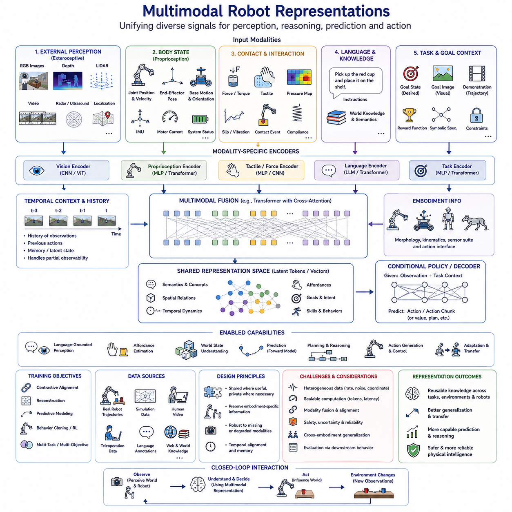{width="7.268055555555556in" height="7.268055555555556in"}

Multimodal robot representations provide a unified way to encode the heterogeneous information required for physical intelligence. A robot rarely operates from vision, language, or proprioception alone; it must combine external perception, internal body state, task instructions, temporal history, and interaction feedback. The purpose of multimodal representation learning is to transform these different signals into compatible structures that support perception, reasoning, prediction, planning, and action.

Visual information forms one of the richest modalities available to robots. RGB images provide appearance, texture, object identity, human activity, and semantic context, while depth images and geometric sensing provide information about distance, shape, free space, and spatial relationships. Video adds temporal evidence about motion and interaction. Effective representations should preserve information relevant to physical behavior rather than treating vision only as an image-classification problem.

Language provides a complementary semantic modality. Instructions can describe goals, objects, relationships, constraints, and desired outcomes at multiple levels of abstraction. Text can also introduce knowledge acquired outside direct robot experience. When language representations are aligned with perceptual representations, concepts such as "red container," "charging station," or "object behind the box" can become grounded in entities and relationships detected within the robot\'s current environment.

Proprioception contributes information that vision and language cannot reliably provide. Joint positions, velocities, end-effector poses, base motion, actuator states, and inertial measurements describe the robot\'s current physical configuration. A model may visually understand where an object is located yet still require proprioceptive information to determine whether the object is reachable, whether the manipulator is already moving, or which physically valid action should be executed next.

Force, torque, and tactile sensing become particularly important during contact-rich interaction. Visual observations may indicate that a gripper has reached an object, but they may not reveal whether sufficient contact has been established or whether the object is slipping. Tactile and force representations can encode contact events, pressure distributions, resistance, and interaction dynamics, providing information needed for grasping, insertion, tool use, and other physically constrained tasks.

Spatial sensing modalities such as depth, LiDAR, radar, and localization measurements contribute geometric structure that complements semantic perception. These signals can represent obstacles, traversable regions, surfaces, distances, robot pose, and surrounding motion. For mobile robots and embodied agents operating over larger environments, combining geometric and semantic representations allows the system to reason not only about what exists but also where it exists and how it can be reached.

A multimodal representation must therefore solve more than simple data concatenation. Each modality has different dimensionality, sampling frequency, noise characteristics, coordinate systems, and semantic meaning. Camera images may arrive at tens of frames per second, joint states at much higher rates, and language instructions only occasionally. Before information can be fused effectively, modality-specific encoders and temporal alignment mechanisms must transform these signals into representations that can interact meaningfully.

Modality-specific encoders provide an important architectural interface. Vision encoders can transform images into visual tokens or feature maps, language encoders can produce semantic token representations, and proprioceptive encoders can map continuous robot states into latent vectors. Other encoders may process depth, tactile measurements, audio, or structured state information. Their outputs can then enter a shared model while preserving information about the origin and meaning of each modality.

Fusion determines how these encoded signals influence one another. Early fusion combines modalities near the input level, allowing the model to learn tightly coupled features from the beginning. Late fusion processes modalities more independently before combining higher-level representations. Intermediate fusion provides interactions at selected layers. Transformer architectures make flexible fusion possible through attention mechanisms that allow tokens from one modality to selectively reference information from another.

Cross-attention is particularly useful when one modality provides context for interpreting another. Language tokens describing "the blue cup on the left" can attend to visual regions representing candidate objects, while action-related representations can attend to both the instruction and the robot state. This creates conditional relationships among perception, goals, and embodiment rather than forcing all information into a single undifferentiated vector.

Shared representation spaces seek to align semantically related information across modalities. A language description of an object, its visual appearance, and its role within a demonstrated task may be mapped to nearby or interacting latent structures. Such alignment supports language-grounded perception, retrieval, task understanding, and transfer. However, useful multimodal representations do not require every modality to become identical; modality-specific information must remain available when it matters for physical execution.

This distinction between shared and private information is essential in robotics. Object semantics and task intent may be shared across vision and language, while motor currents or tactile pressure contain information with no direct linguistic equivalent. A strong representation should expose common structure where alignment is beneficial while preserving specialized features required for control. Multimodal learning is therefore a problem of selective integration rather than complete representational collapse.

Temporal information introduces another dimension to multimodal representation. Robot behavior unfolds through sequences in which images, states, actions, and contact events evolve together. A representation of the present should often incorporate recent history to estimate velocity, progress, interaction state, and causal relationships. Temporal tokens, recurrent memory, attention over previous observations, or latent state models can provide this context and reduce ambiguity caused by partial observability.

Action history is especially important because observations alone may not explain why the environment has changed. Knowing that the robot recently commanded the gripper to close helps interpret a subsequent tactile signal or object displacement. By representing observations and previous actions together, a model can learn relationships between behavior and consequences. This provides a foundation for action-conditioned prediction, closed-loop policies, and eventually richer world-model reasoning.

Multimodal representations also support affordance understanding. Recognizing an object category does not by itself specify how the robot can interact with that object. Visual geometry, semantic knowledge, robot configuration, task intent, and sometimes tactile information must be combined to estimate whether an object can be grasped, pushed, opened, traversed, or otherwise manipulated. Affordances therefore emerge naturally as relationships among multiple modalities and embodiment.

For robot foundation models, representations should generalize beyond a single task. If the latent space captures reusable concepts such as objects, spatial relations, motion, contact, goals, and skills, the same underlying knowledge can contribute to manipulation, navigation, mobile manipulation, or human-robot interaction. This reuse is one reason multimodal representation learning becomes a central component of broadly pretrained robot intelligence rather than merely a sensor-fusion technique.

Cross-embodiment learning further increases the importance of abstraction. Different robots may have different cameras, joint structures, sensor suites, and action spaces while encountering similar objects and tasks. Shared semantic and spatial representations can provide a transferable layer across these embodiments, whereas robot-specific encoders and action interfaces preserve morphology-dependent information. This separation enables common knowledge without requiring identical hardware.

Missing or degraded modalities must also be considered. Cameras may be obscured, depth sensing may fail on reflective surfaces, localization may become uncertain, or tactile sensing may not exist on a particular robot. Models trained with diverse modality combinations can potentially learn redundancy and complementary evidence. Robust representations should avoid becoming unnecessarily dependent on one signal when equivalent information can be inferred from other available modalities.

The training objective strongly shapes what multimodal representations contain. Contrastive objectives can align related observations and language, reconstruction objectives can encourage retention of detailed information, predictive objectives can capture temporal dynamics, and behavior-cloning objectives can emphasize features relevant to action. Robot foundation models may combine several objectives because no single training signal necessarily captures semantics, geometry, temporal prediction, and physical control equally well.

Large-scale pretraining makes these representations increasingly reusable. Visual and linguistic knowledge can be initialized from large non-robot datasets, while robot trajectories introduce embodiment, action, contact, and physical consequences. Simulation and human video can further expand coverage. The central challenge is to combine these sources so that semantic knowledge learned at scale becomes grounded in representations useful for real physical interaction rather than remaining purely descriptive.

Representation quality should ultimately be evaluated through downstream behavior rather than only latent-space similarity. A representation is useful when it enables the robot to identify relevant objects, understand instructions, estimate spatial relationships, predict consequences, select appropriate actions, and adapt to unfamiliar conditions. High-quality multimodal embeddings that fail to preserve information necessary for physical control may perform well on semantic benchmarks while remaining inadequate for robotics.

Computational efficiency is also important because multimodal models can generate large numbers of tokens. Multiple camera streams, temporal histories, language tokens, depth information, and robot-state sequences can quickly exceed practical memory and latency budgets. Token compression, feature selection, efficient attention, hierarchical representations, and adaptive processing may therefore be required to retain behaviorally important information while meeting real-time deployment constraints.

Safety-related information must remain visible within the representation as well. A model should not allow semantic task information to dominate observations indicating collision risk, unstable contact, actuator limits, or human proximity. Multimodal fusion should support uncertainty and reliability awareness so that conflicting or degraded signals can influence decision confidence. Physical intelligence requires not only integrating information but also understanding when that information is insufficient for safe action.

Ultimately, multimodal robot representations form the internal language through which heterogeneous physical experience becomes reusable knowledge. Vision describes appearance and scene structure, language expresses semantics and goals, proprioception represents embodiment, tactile and force sensing characterize contact, and temporal context connects actions with consequences. Their integration enables robot foundation models to reason across perception, task understanding, physical state, and behavior within a common computational framework.

This multimodal foundation prepares the transition toward large-scale robot pretraining. Once diverse observations, task descriptions, embodiment states, and actions can be represented within compatible structures, trajectories from different tasks and environments can contribute to a shared learning process. The next challenge is therefore not simply how to represent individual robot experiences, but how to scale those representations across sufficiently large and diverse datasets to produce broadly transferable robot intelligence.

멀티모달 로봇 표현(Multimodal Robot Representation)은 물리 지능(Physical Intelligence)에 필요한 이질적인 정보를 통합하여 인코딩(Encoding)하는 방법을 제공한다. 로봇은 비전(Vision), 언어(Language), 고유수용감각(Proprioception) 중 하나만으로 동작하는 경우가 거의 없으며, 외부 환경에 대한 지각(External Perception), 내부 신체 상태(Internal Body State), 작업 명령(Task Instruction), 시간적 이력(Temporal History), 상호작용 피드백(Interaction Feedback)을 결합해야 한다. 멀티모달 표현 학습(Multimodal Representation Learning)의 목적은 이러한 서로 다른 신호를 지각, 추론, 예측, 계획, 행동을 지원하는 호환 가능한 구조로 변환하는 것이다.

시각 정보(Visual Information)는 로봇이 사용할 수 있는 가장 풍부한 모달리티(Modality) 중 하나이다. RGB 이미지(RGB Image)는 외형, 질감(Texture), 객체 정체성(Object Identity), 인간 활동(Human Activity), 의미적 맥락(Semantic Context)을 제공하며, 깊이 이미지(Depth Image)와 기하학적 센싱(Geometric Sensing)은 거리, 형상(Shape), 자유 공간(Free Space), 공간 관계(Spatial Relationship)에 관한 정보를 제공한다. 비디오(Video)는 움직임과 상호작용에 대한 시간적 정보를 추가하며, 효과적인 표현은 비전을 단순한 이미지 분류 문제로 다루는 것이 아니라 물리적 행동에 필요한 정보를 보존해야 한다.

언어(Language)는 이를 보완하는 의미적 모달리티(Semantic Modality)를 제공한다. 명령(Instruction)은 다양한 추상화 수준에서 목표(Goal), 객체(Object), 관계(Relationship), 제약조건(Constraint), 원하는 결과(Desired Outcome)를 설명할 수 있다. 텍스트(Text)는 직접적인 로봇 경험 외부에서 획득한 지식을 도입할 수도 있다. 언어 표현(Language Representation)이 지각 표현(Perceptual Representation)과 정렬되면 "빨간색 용기(red container)", "충전소(charging station)", "상자 뒤의 객체(object behind the box)"와 같은 개념을 현재 로봇 환경에서 탐지된 객체와 관계에 그라운딩(Grounding)할 수 있다.

고유수용감각(Proprioception)은 비전과 언어만으로는 안정적으로 얻을 수 없는 정보를 제공한다. 관절 위치(Joint Position), 속도(Velocity), 엔드 이펙터 자세(End-Effector Pose), 베이스 움직임(Base Motion), 액추에이터 상태(Actuator State), 관성 측정값(Inertial Measurement)은 로봇의 현재 물리적 구성(Physical Configuration)을 나타낸다. 모델이 객체의 위치를 시각적으로 이해하더라도 해당 객체에 도달할 수 있는지, 매니퓰레이터가 이미 움직이고 있는지, 다음에 어떤 물리적으로 유효한 행동을 실행해야 하는지를 판단하려면 고유수용감각 정보가 필요하다.

힘(Force), 토크(Torque), 촉각 센싱(Tactile Sensing)은 접촉이 중요한 상호작용(Contact-Rich Interaction)에서 특히 중요하다. 시각적 관측은 그리퍼(Gripper)가 객체에 도달했음을 보여줄 수 있지만, 충분한 접촉이 형성되었는지 또는 객체가 미끄러지고 있는지를 보여주지 못할 수 있다. 촉각과 힘 표현은 접촉 이벤트(Contact Event), 압력 분포(Pressure Distribution), 저항(Resistance), 상호작용 동역학(Interaction Dynamics)을 인코딩하여 파지(Grasping), 삽입(Insertion), 도구 사용(Tool Use) 등 물리적 제약이 있는 작업에 필요한 정보를 제공할 수 있다.

깊이(Depth), 라이다(LiDAR), 레이더(Radar), 위치 측정값(Localization Measurement)과 같은 공간 센싱 모달리티(Spatial Sensing Modality)는 의미적 지각을 보완하는 기하학적 구조(Geometric Structure)를 제공한다. 이러한 신호는 장애물(Obstacle), 주행 가능 영역(Traversable Region), 표면(Surface), 거리, 로봇 자세(Robot Pose), 주변 움직임을 표현할 수 있다. 넓은 환경에서 동작하는 모바일 로봇(Mobile Robot)과 체화 에이전트(Embodied Agent)는 기하학적 표현과 의미적 표현을 결합하여 무엇이 존재하는지뿐만 아니라 어디에 존재하며 어떻게 도달할 수 있는지를 추론할 수 있다.

따라서 멀티모달 표현은 단순한 데이터 연결(Data Concatenation) 이상의 문제를 해결해야 한다. 각 모달리티는 서로 다른 차원(Dimensionality), 샘플링 주파수(Sampling Frequency), 잡음 특성(Noise Characteristics), 좌표계(Coordinate System), 의미(Semantic Meaning)를 가진다. 카메라 이미지는 초당 수십 프레임으로 입력되고 관절 상태는 훨씬 높은 주파수로 입력될 수 있지만, 언어 명령은 간헐적으로 주어질 수 있다. 정보를 효과적으로 융합하기 위해서는 모달리티별 인코더(Modality-Specific Encoder)와 시간 정렬 메커니즘(Temporal Alignment Mechanism)이 이러한 신호를 서로 의미 있게 상호작용할 수 있는 표현으로 변환해야 한다.

모달리티별 인코더(Modality-Specific Encoder)는 중요한 아키텍처 인터페이스(Architectural Interface)를 제공한다. 비전 인코더(Vision Encoder)는 이미지를 시각 토큰(Visual Token)이나 특징 맵(Feature Map)으로 변환하고, 언어 인코더(Language Encoder)는 의미 토큰 표현(Semantic Token Representation)을 생성하며, 고유수용감각 인코더(Proprioceptive Encoder)는 연속적인 로봇 상태를 잠재 벡터(Latent Vector)로 매핑할 수 있다. 다른 인코더는 깊이, 촉각 측정값, 오디오(Audio), 구조화된 상태 정보(Structured State Information)를 처리할 수 있으며, 그 출력은 각 모달리티의 출처와 의미를 유지하면서 공유 모델(Shared Model)로 전달된다.

융합(Fusion)은 이러한 인코딩된 신호들이 서로에게 어떻게 영향을 미치는지를 결정한다. 초기 융합(Early Fusion)은 입력에 가까운 단계에서 모달리티를 결합하여 처음부터 긴밀하게 연결된 특징을 학습한다. 후기 융합(Late Fusion)은 각 모달리티를 상대적으로 독립적으로 처리한 후 고수준 표현을 결합한다. 중간 융합(Intermediate Fusion)은 선택된 계층에서 상호작용을 제공한다. 트랜스포머(Transformer) 아키텍처에서는 어텐션 메커니즘(Attention Mechanism)을 통해 한 모달리티의 토큰이 다른 모달리티의 정보를 선택적으로 참조할 수 있어 유연한 융합이 가능하다.

교차 어텐션(Cross-Attention)은 하나의 모달리티가 다른 모달리티를 해석하기 위한 맥락(Context)을 제공할 때 특히 유용하다. "왼쪽에 있는 파란색 컵(the blue cup on the left)"을 나타내는 언어 토큰은 후보 객체를 나타내는 시각 영역(Visual Region)에 어텐션할 수 있으며, 행동 관련 표현(Action-Related Representation)은 명령과 로봇 상태 모두를 참조할 수 있다. 이를 통해 모든 정보를 하나의 구분되지 않는 벡터에 강제로 통합하는 대신 지각, 목표, 체화 사이의 조건부 관계(Conditional Relationship)를 형성할 수 있다.

공유 표현 공간(Shared Representation Space)은 모달리티 사이에서 의미적으로 관련된 정보를 정렬하는 것을 목표로 한다. 객체에 대한 언어 설명, 시각적 외형, 그리고 시연 작업(Demonstrated Task)에서의 역할이 서로 가깝거나 상호작용하는 잠재 구조(Latent Structure)로 매핑될 수 있다. 이러한 정렬(Alignment)은 언어 기반 지각(Language-Grounded Perception), 검색(Retrieval), 작업 이해(Task Understanding), 전이(Transfer)를 지원한다. 그러나 유용한 멀티모달 표현을 위해 모든 모달리티가 동일해질 필요는 없으며, 물리적 실행에 중요한 모달리티별 정보는 유지되어야 한다.

공유 정보(Shared Information)와 고유 정보(Private Information)의 구분은 로보틱스(Robotics)에서 특히 중요하다. 객체 의미(Object Semantics)와 작업 의도(Task Intent)는 비전과 언어에서 공유될 수 있지만, 모터 전류(Motor Current)나 촉각 압력(Tactile Pressure)은 직접적으로 대응되는 언어 표현이 없을 수 있다. 강력한 표현은 정렬이 유용한 영역에서는 공통 구조를 드러내면서 제어에 필요한 전문화된 특징(Specialized Feature)을 보존해야 한다. 따라서 멀티모달 학습은 모든 표현을 완전히 동일하게 만드는 문제가 아니라 선택적 통합(Selective Integration)의 문제이다.

시간 정보(Temporal Information)는 멀티모달 표현에 또 다른 차원을 추가한다. 로봇 행동은 이미지, 상태, 행동, 접촉 이벤트가 함께 변화하는 시퀀스(Sequence)로 진행된다. 현재 상태의 표현에는 속도, 진행 상황, 상호작용 상태(Interaction State), 인과관계(Causal Relationship)를 추정하기 위해 최근 이력(Recent History)이 포함되어야 하는 경우가 많다. 시간 토큰(Temporal Token), 순환 메모리(Recurrent Memory), 이전 관측에 대한 어텐션, 잠재 상태 모델(Latent State Model)은 이러한 맥락을 제공하고 부분 관측 가능성(Partial Observability)으로 인한 모호성을 줄일 수 있다.

행동 이력(Action History)은 관측만으로 환경이 왜 변화했는지를 설명하기 어려울 수 있기 때문에 특히 중요하다. 로봇이 직전에 그리퍼를 닫도록 명령했다는 사실을 알고 있으면 이후 발생한 촉각 신호나 객체 이동을 보다 정확하게 해석할 수 있다. 관측과 이전 행동을 함께 표현함으로써 모델은 행동과 결과(Consequence) 사이의 관계를 학습할 수 있다. 이는 행동 조건부 예측(Action-Conditioned Prediction), 폐루프 정책(Closed-Loop Policy), 그리고 더욱 발전된 월드 모델 추론(World-Model Reasoning)의 기반이 된다.

멀티모달 표현은 어포던스 이해(Affordance Understanding)도 지원한다. 객체의 범주를 인식하는 것만으로는 로봇이 해당 객체와 어떻게 상호작용할 수 있는지를 결정할 수 없다. 객체를 파지하거나 밀거나 열거나 그 위를 이동하거나 다른 방식으로 조작할 수 있는지를 추정하려면 시각적 기하 구조(Visual Geometry), 의미 지식(Semantic Knowledge), 로봇 구성 상태(Robot Configuration), 작업 의도, 그리고 경우에 따라 촉각 정보를 결합해야 한다. 따라서 어포던스는 여러 모달리티와 체화 사이의 관계에서 자연스럽게 형성된다.

로봇 파운데이션 모델(Robot Foundation Model)의 표현은 하나의 작업을 넘어 일반화(Generalization)될 수 있어야 한다. 잠재 공간(Latent Space)이 객체, 공간 관계, 움직임, 접촉, 목표, 스킬과 같은 재사용 가능한 개념을 포착한다면 동일한 기반 지식을 조작(Manipulation), 내비게이션(Navigation), 모바일 매니퓰레이션(Mobile Manipulation), 인간-로봇 상호작용(Human-Robot Interaction)에 활용할 수 있다. 이러한 재사용성은 멀티모달 표현 학습이 단순한 센서 융합(Sensor Fusion)을 넘어 광범위하게 사전학습된 로봇 지능의 핵심 구성요소가 되는 중요한 이유이다.

교차 체화 학습(Cross-Embodiment Learning)은 추상화(Abstraction)의 중요성을 더욱 높인다. 서로 다른 로봇은 카메라, 관절 구조(Joint Structure), 센서 구성(Sensor Suite), 행동 공간(Action Space)이 서로 다르면서도 유사한 객체와 작업을 경험할 수 있다. 공유 의미 표현(Shared Semantic Representation)과 공간 표현(Spatial Representation)은 이러한 체화 사이에서 전이 가능한 계층을 제공할 수 있으며, 로봇별 인코더(Robot-Specific Encoder)와 행동 인터페이스(Action Interface)는 형태 의존적 정보(Morphology-Dependent Information)를 보존한다. 이러한 분리를 통해 동일한 하드웨어를 요구하지 않으면서도 공통 지식을 활용할 수 있다.

누락되거나 성능이 저하된 모달리티(Missing or Degraded Modality)도 고려해야 한다. 카메라가 가려질 수 있고, 반사 표면에서 깊이 센싱이 실패할 수 있으며, 위치 추정(Localization)이 불확실해지거나 특정 로봇에 촉각 센서가 존재하지 않을 수도 있다. 다양한 모달리티 조합으로 학습된 모델은 중복성(Redundancy)과 상호 보완적 증거(Complementary Evidence)를 학습할 가능성이 있다. 강건한 표현(Robust Representation)은 다른 가용 모달리티에서 동등한 정보를 추론할 수 있을 때 하나의 신호에 불필요하게 의존하지 않아야 한다.

학습 목적함수(Training Objective)는 멀티모달 표현에 어떤 정보가 포함되는지를 크게 결정한다. 대조 학습 목적함수(Contrastive Objective)는 관련된 관측과 언어를 정렬할 수 있고, 재구성 목적함수(Reconstruction Objective)는 세부 정보의 보존을 촉진하며, 예측 목적함수(Predictive Objective)는 시간적 동역학(Temporal Dynamics)을 학습할 수 있다. 행동 복제 목적함수(Behavior-Cloning Objective)는 행동에 필요한 특징을 강조할 수 있다. 로봇 파운데이션 모델은 의미, 기하 구조, 시간적 예측, 물리 제어를 하나의 학습 신호만으로 충분히 포착하기 어렵기 때문에 여러 목적함수를 결합할 수 있다.

대규모 사전학습(Large-Scale Pretraining)은 이러한 표현의 재사용성을 더욱 높인다. 시각 및 언어 지식은 대규모 비로봇 데이터셋(Non-Robot Dataset)으로부터 초기화할 수 있으며, 로봇 궤적(Robot Trajectory)은 체화, 행동, 접촉, 물리적 결과를 추가한다. 시뮬레이션(Simulation)과 인간 비디오(Human Video)는 데이터 범위를 더욱 확장할 수 있다. 핵심 과제는 대규모로 학습된 의미 지식이 단순한 설명적 지식에 머무르지 않고 실제 물리적 상호작용에 유용한 표현으로 그라운딩되도록 이러한 데이터 소스를 결합하는 것이다.

표현 품질(Representation Quality)은 궁극적으로 잠재 공간의 유사성(Latent-Space Similarity)만이 아니라 다운스트림 행동(Downstream Behavior)을 통해 평가되어야 한다. 로봇이 관련 객체를 식별하고, 명령을 이해하며, 공간 관계를 추정하고, 결과를 예측하며, 적절한 행동을 선택하고, 익숙하지 않은 조건에 적응할 수 있도록 하는 표현이 실제로 유용한 표현이다. 의미적 벤치마크(Semantic Benchmark)에서는 뛰어난 성능을 보이더라도 물리 제어에 필요한 정보를 보존하지 못하는 멀티모달 임베딩(Multimodal Embedding)은 로보틱스에는 충분하지 않을 수 있다.

멀티모달 모델은 매우 많은 수의 토큰(Token)을 생성할 수 있기 때문에 계산 효율성(Computational Efficiency)도 중요하다. 다중 카메라 스트림(Multiple Camera Stream), 시간 이력, 언어 토큰, 깊이 정보, 로봇 상태 시퀀스가 결합되면 실용적인 메모리와 지연시간 예산(Latency Budget)을 빠르게 초과할 수 있다. 따라서 실시간 배치(Real-Time Deployment) 제약을 충족하면서 행동에 중요한 정보를 유지하기 위해 토큰 압축(Token Compression), 특징 선택(Feature Selection), 효율적 어텐션(Efficient Attention), 계층적 표현(Hierarchical Representation), 적응형 처리(Adaptive Processing)가 필요할 수 있다.

안전 관련 정보(Safety-Related Information) 역시 표현 내부에서 명확하게 유지되어야 한다. 모델은 의미적 작업 정보가 충돌 위험(Collision Risk), 불안정한 접촉(Unstable Contact), 액추에이터 한계(Actuator Limit), 사람과의 근접성(Human Proximity)을 나타내는 관측보다 우선하도록 만들어서는 안 된다. 멀티모달 융합은 불확실성(Uncertainty)과 신뢰도(Reliability)를 인식할 수 있어야 하며, 서로 충돌하거나 성능이 저하된 신호가 의사결정 신뢰도(Decision Confidence)에 영향을 줄 수 있어야 한다. 물리 지능은 정보를 통합하는 것뿐만 아니라 그 정보가 안전한 행동을 결정하기에 충분하지 않은 상황을 이해하는 능력도 필요로 한다.

궁극적으로 멀티모달 로봇 표현(Multimodal Robot Representation)은 이질적인 물리 경험(Heterogeneous Physical Experience)을 재사용 가능한 지식(Reusable Knowledge)으로 변환하는 내부 언어(Internal Language)를 형성한다. 비전은 외형과 장면 구조(Scene Structure)를 설명하고, 언어는 의미와 목표를 표현하며, 고유수용감각은 체화를 나타내고, 촉각과 힘 센싱은 접촉을 표현하며, 시간적 맥락은 행동과 결과를 연결한다. 이들의 통합을 통해 로봇 파운데이션 모델은 공통 계산 프레임워크(Common Computational Framework) 안에서 지각, 작업 이해, 물리 상태, 행동을 연결하여 추론할 수 있다.

이러한 멀티모달 기반(Multimodal Foundation)은 대규모 로봇 사전학습(Large-Scale Robot Pretraining)으로의 전환을 준비한다. 다양한 관측, 작업 설명(Task Description), 체화 상태(Embodiment State), 행동을 서로 호환 가능한 구조로 표현할 수 있게 되면 서로 다른 작업과 환경에서 수집된 궤적이 하나의 공유 학습 과정(Shared Learning Process)에 기여할 수 있다. 따라서 다음 핵심 과제는 개별 로봇 경험을 어떻게 표현할 것인가를 넘어, 충분히 크고 다양한 데이터셋에서 이러한 표현을 어떻게 확장하여 광범위하게 전이 가능한 로봇 지능(Broadly Transferable Robot Intelligence)을 만들어낼 것인가에 있다.

## 02.05. Large Scale Robot Pretraining

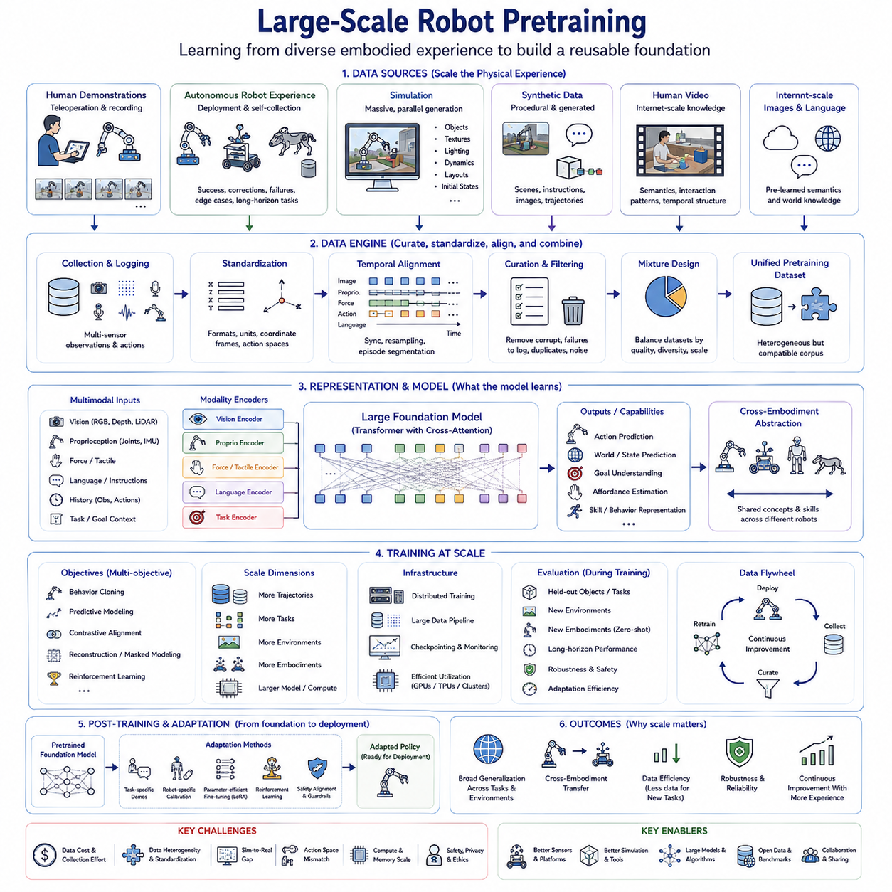{width="7.268055555555556in" height="7.268055555555556in"}

Large-scale robot pretraining extends the foundation-model principle from digital data into embodied experience. Instead of training a policy from a small dataset collected for one robot and one task, the model is exposed to large mixtures of trajectories spanning objects, behaviors, environments, instructions, and embodiments. The objective is to learn reusable representations and behavioral structures that can later support many downstream robotic tasks with substantially less additional training.

Scale in robot pretraining has several dimensions. More trajectories increase behavioral coverage, more tasks expose reusable skills, more environments reduce dependence on specific backgrounds or layouts, and more embodiments encourage transferable abstractions. Model capacity and computational resources must grow appropriately with this diversity. Large-scale pretraining is therefore not simply the accumulation of more episodes but the coordinated scaling of data, model capacity, task coverage, and training infrastructure.

Robot data differs fundamentally from internet-scale text and images because physical experience is expensive to produce. Every real trajectory consumes robot time and may require hardware, operators, calibration, maintenance, workspace access, and safety supervision. Mechanical failures and environmental resets further increase cost. Consequently, scalable robot learning requires a data engine that continuously converts expensive physical interactions into reusable training assets rather than treating each experiment as disposable data.

Demonstration data forms an important component of this engine. Human operators can teleoperate robots to perform manipulation, navigation, tool use, or other behaviors while observations and actions are recorded. Demonstrations provide examples of successful behavior and can efficiently communicate complex strategies that would be difficult to discover through random exploration. Large collections across many operators and conditions also introduce useful variations in execution style and task solution.

Autonomously collected robot experience provides another source of scale. Once sufficiently capable policies are deployed, robots can generate trajectories during normal operation, including successful executions, corrections, unusual situations, and failures. Fleet operation can multiply this effect across many machines. Such experience creates the possibility of a data flywheel in which deployed policies generate new evidence that is curated, incorporated into training, and used to produce improved future models.

Simulation provides a complementary scaling mechanism because interactions can be generated without consuming physical robot time. Large numbers of simulated environments can vary object geometry, textures, lighting, dynamics, layouts, and initial states. Parallel simulation can produce trajectories much faster than real-world collection. However, simulated experience must be selected and designed carefully because inaccurate physics, sensing, or environmental statistics can produce behaviors that transfer poorly to real robots.

Synthetic data extends beyond physics simulation. Procedurally generated scenes, automatically produced language instructions, synthetic images, generated task variations, and model-produced trajectories can expand training coverage. These sources are particularly useful for rare situations or systematic variations that are difficult to collect physically. Their value depends on whether they introduce useful diversity without overwhelming training with unrealistic or low-quality examples.

Human video represents another potentially enormous source of physical knowledge. Videos contain demonstrations of object interaction, tool use, navigation, assembly, and everyday activities at a scale far beyond robot-collected datasets. Yet human bodies and robot embodiments have different kinematics and action interfaces. Pretraining can therefore use video to learn semantics, temporal structure, object relationships, and high-level interaction patterns while requiring additional grounding to translate those patterns into executable robot actions.

Internet-scale image and language data can provide semantic knowledge before extensive robot interaction begins. Models pretrained on these sources may already recognize objects, understand instructions, and represent relationships among concepts. Robot pretraining can build upon this knowledge rather than relearning visual and linguistic semantics from expensive trajectories. The central challenge is to connect broad digital knowledge with embodiment, affordances, contact, action, and physical consequences.

Combining these sources creates a heterogeneous robot data mixture. One dataset may contain manipulation trajectories from an industrial arm, another mobile navigation episodes, another human video, and another simulated demonstrations with language annotations. Sampling these datasets uniformly is rarely optimal because their sizes, quality, task diversity, and information content differ. Data mixture design therefore becomes an important component of large-scale pretraining rather than a simple preprocessing decision.

Data quality can matter as much as raw quantity. Repeated trajectories from a narrow behavior distribution may contribute little additional information, while unusual failures, difficult recovery cases, or novel object interactions can be highly valuable. Curation can remove corrupted episodes, sensor failures, synchronization errors, accidental resets, and uninformative repetitions. Filtering and reweighting help allocate limited training compute toward experiences that improve generalization rather than merely increasing dataset size.

Standardization is difficult because robot datasets use different observation and action formats. Camera resolutions, sensor configurations, coordinate frames, control frequencies, action units, gripper conventions, and episode structures can vary substantially. A scalable training pipeline must normalize metadata and provide consistent interfaces while preserving important embodiment-specific information. Without this layer, heterogeneous datasets remain separate collections rather than a coherent pretraining corpus.

Temporal alignment is equally important. Images, proprioceptive measurements, force signals, commands, and language annotations may arrive at different frequencies or with different delays. Incorrect synchronization can teach misleading relationships between observations and actions. Pretraining pipelines therefore require timestamps, resampling strategies, action alignment, history windows, and careful episode segmentation so that multimodal sequences preserve the causal and temporal structure of physical interaction.

Action representation presents a special challenge when data comes from multiple robots. A seven-degree-of-freedom arm, differential-drive base, humanoid, and quadruped do not share identical control spaces. Directly mixing raw motor commands may therefore be meaningless. Large-scale pretraining can use normalized actions, end-effector representations, action tokens, latent actions, skills, or embodiment-conditioned interfaces to expose transferable behavioral structure while retaining the information needed for robot-specific execution.

Task representation must also be scalable. Some datasets use natural-language instructions, others task identifiers, goal images, demonstrations, reward functions, or desired states. Mapping these descriptions into compatible task representations allows conceptually related experiences to reinforce one another. Language can provide a useful semantic bridge, but successful alignment still requires understanding how abstract instructions correspond to specific observations, constraints, and physical outcomes.

The training objectives determine which structures are extracted from this data mixture. Behavior cloning can train the model to reproduce demonstrated actions, predictive objectives can teach future-state dynamics, and contrastive objectives can align language with observations or trajectories. Reconstruction and masked modeling can support representation learning, while reinforcement-learning objectives can improve behavior beyond demonstrations. Large-scale systems may combine several objectives during pretraining and post-training.

Multi-task pretraining encourages parameter sharing across behaviors. Reaching learned in one manipulation task may contribute to another, while spatial reasoning learned during navigation may support mobile manipulation. The benefit becomes larger when shared representations capture underlying regularities instead of memorizing task identifiers. At sufficient diversity, the model can begin to compose previously learned concepts and skills in combinations that were not explicitly represented by a single training trajectory.

Cross-environment pretraining similarly reduces dependence on one workspace. Variations in lighting, object placement, backgrounds, floor geometry, clutter, and human activity force the model to distinguish task-relevant structure from incidental environmental details. This diversity is particularly important for physical deployment because real environments rarely reproduce laboratory conditions exactly. Generalization emerges partly from encountering enough variation during pretraining that irrelevant correlations become unreliable.

Cross-embodiment pretraining introduces an even stronger form of diversity. Experiences from different robots can teach shared concepts such as approach, reach, grasp, transport, avoid, and place, while embodiment information specifies how those concepts are physically realized. Successful sharing could allow data collected by one robot family to improve another. However, inappropriate mixing can create negative transfer when differences in morphology, sensing, or dynamics are not represented explicitly.

Scaling the model alongside the dataset is necessary because increasingly diverse experience requires sufficient capacity to represent many concepts, tasks, and interactions. Transformer-based architectures are attractive because they can process multimodal token sequences and condition predictions on long contexts. Yet larger models increase memory, compute, and communication requirements. Pretraining infrastructure must therefore support distributed optimization, large data pipelines, checkpointing, evaluation, and efficient utilization of accelerators.

Evaluation must accompany scaling rather than occur only after training. Improvements in pretraining loss do not necessarily imply better physical behavior. Models should be tested on held-out objects, environments, tasks, and potentially embodiments to determine whether scale produces genuine transfer. Evaluation should also examine robustness, recovery, long-horizon performance, safety, and adaptation efficiency because a foundation model is valuable primarily when its pretrained knowledge improves downstream physical capability.

Post-training converts broad pretrained knowledge into operational competence. A foundation model can be adapted using task-specific demonstrations, robot-specific calibration, parameter-efficient fine-tuning, reinforcement learning, or safety-oriented alignment. The goal is not to replace large-scale pretraining but to exploit it as a strong initialization. Broad pretraining provides reusable knowledge, while smaller amounts of targeted post-training connect that knowledge to the requirements of a particular robot and deployment.

Ultimately, large-scale robot pretraining transforms robot learning from isolated dataset-to-policy training into an infrastructure-centered process for accumulating physical knowledge. Diverse data sources, standardized representations, multimodal alignment, scalable architectures, distributed computation, evaluation, and continuous data collection become parts of one learning system. The resulting model acts as a reusable foundation whose capabilities can improve as the underlying corpus of embodied experience grows.

This perspective naturally leads to multi-task and multi-environment learning, where the benefits of scale must be converted into measurable behavioral generalization. Large datasets alone do not guarantee a generalist robot. The essential question is whether shared pretraining enables one model to exploit common structure across tasks and environments while retaining the flexibility needed to adapt to their differences, which becomes the next stage in the development of robot foundation models.

대규모 로봇 사전학습(Large-Scale Robot Pretraining)은 파운데이션 모델(Foundation Model)의 원리를 디지털 데이터(Digital Data)에서 체화 경험(Embodied Experience)으로 확장한다. 하나의 로봇과 하나의 작업을 위해 수집된 소규모 데이터셋으로 정책(Policy)을 학습하는 대신, 모델은 객체(Object), 행동(Behavior), 환경(Environment), 명령(Instruction), 체화(Embodiment)를 포괄하는 대규모 궤적 혼합(Trajectory Mixture)을 경험한다. 목적은 이후 훨씬 적은 추가 학습으로 다양한 다운스트림 로봇 작업(Downstream Robotic Task)을 지원할 수 있는 재사용 가능한 표현(Reusable Representation)과 행동 구조(Behavioral Structure)를 학습하는 것이다.

로봇 사전학습에서 규모(Scale)는 여러 차원을 가진다. 더 많은 궤적(Trajectory)은 행동 범위(Behavioral Coverage)를 확대하고, 더 많은 작업은 재사용 가능한 스킬(Reusable Skill)을 제공하며, 더 많은 환경은 특정 배경이나 레이아웃(Layout)에 대한 의존성을 감소시킨다. 또한 더 다양한 체화는 전이 가능한 추상화(Transferable Abstraction)를 촉진한다. 모델 용량(Model Capacity)과 계산 자원(Computational Resource) 역시 이러한 다양성과 함께 적절하게 증가해야 한다. 따라서 대규모 사전학습은 단순한 에피소드(Episode)의 증가가 아니라 데이터, 모델 용량, 작업 범위, 학습 인프라(Training Infrastructure)를 함께 확장하는 과정이다.

로봇 데이터(Robot Data)는 물리적 경험을 생성하는 데 높은 비용이 필요하기 때문에 인터넷 규모의 텍스트나 이미지와 근본적으로 다르다. 모든 실제 궤적에는 로봇 운용 시간, 하드웨어, 운영자(Operator), 보정(Calibration), 유지보수(Maintenance), 작업 공간, 안전 감독(Safety Supervision)이 필요할 수 있다. 기계적 고장과 환경 초기화(Environment Reset)는 비용을 더욱 증가시킨다. 따라서 확장 가능한 로봇 학습은 각각의 실험 데이터를 일회성으로 사용하는 대신 값비싼 물리적 상호작용을 지속적으로 재사용 가능한 학습 자산(Training Asset)으로 변환하는 데이터 엔진(Data Engine)을 필요로 한다.

시연 데이터(Demonstration Data)는 이러한 데이터 엔진의 중요한 구성요소이다. 인간 운영자는 로봇을 원격조작(Teleoperation)하여 조작(Manipulation), 내비게이션(Navigation), 도구 사용(Tool Use) 등의 행동을 수행하고 그 과정에서 관측과 행동을 기록할 수 있다. 시연은 성공적인 행동의 사례를 제공하며 무작위 탐색(Random Exploration)으로 발견하기 어려운 복잡한 전략을 효율적으로 전달할 수 있다. 여러 운영자와 다양한 조건에서 수집된 대규모 시연은 실행 방식과 작업 해결 전략의 유용한 다양성도 제공한다.

자율적으로 수집된 로봇 경험(Autonomously Collected Robot Experience)은 또 다른 규모 확장 방법을 제공한다. 충분한 능력을 갖춘 정책이 배치(Deployment)되면 로봇은 정상적인 운용 과정에서 성공적인 실행, 수정(Correction), 비정상적인 상황(Unusual Situation), 실패(Failure)를 포함한 궤적을 생성할 수 있다. 플릿 운용(Fleet Operation)은 여러 로봇을 통해 이러한 효과를 확대한다. 이렇게 수집된 경험을 선별하고 학습에 다시 통합하여 향상된 모델을 생성하는 데이터 플라이휠(Data Flywheel)을 구축할 수 있다.

시뮬레이션(Simulation)은 실제 로봇의 운용 시간을 소비하지 않고 상호작용을 생성할 수 있기 때문에 상호 보완적인 확장 메커니즘(Scaling Mechanism)을 제공한다. 대규모 시뮬레이션 환경은 객체의 기하 구조, 질감(Texture), 조명(Lighting), 동역학(Dynamics), 레이아웃, 초기 상태(Initial State)를 다양하게 변화시킬 수 있다. 병렬 시뮬레이션(Parallel Simulation)은 실제 환경보다 훨씬 빠르게 궤적을 생성할 수 있다. 그러나 부정확한 물리, 센싱, 환경 통계는 실제 로봇으로 제대로 전이되지 않는 행동을 만들 수 있으므로 시뮬레이션 경험을 신중하게 설계하고 선택해야 한다.

합성 데이터(Synthetic Data)는 물리 시뮬레이션을 넘어 더욱 다양한 형태로 확장될 수 있다. 절차적으로 생성된 장면(Procedurally Generated Scene), 자동 생성 언어 명령(Automatically Generated Language Instruction), 합성 이미지(Synthetic Image), 생성된 작업 변형(Task Variation), 모델이 생성한 궤적(Model-Generated Trajectory)은 학습 범위를 확대할 수 있다. 이러한 데이터는 물리적으로 수집하기 어려운 희귀 상황이나 체계적인 변형을 생성하는 데 특히 유용하지만, 비현실적이거나 품질이 낮은 사례가 학습을 지배하지 않도록 관리해야 한다.

인간 비디오(Human Video)는 잠재적으로 방대한 물리 지식(Physical Knowledge)의 원천이다. 비디오에는 로봇으로 수집할 수 있는 데이터보다 훨씬 큰 규모로 객체 상호작용, 도구 사용, 이동, 조립(Assembly), 일상 활동이 포함되어 있다. 그러나 인간의 신체와 로봇 체화는 운동학(Kinematics)과 행동 인터페이스(Action Interface)가 서로 다르다. 따라서 사전학습은 비디오에서 의미(Semantics), 시간적 구조(Temporal Structure), 객체 관계(Object Relationship), 고수준 상호작용 패턴을 학습하고, 이를 실행 가능한 로봇 행동으로 변환하기 위한 추가적인 물리적 그라운딩(Physical Grounding)을 수행할 수 있다.

인터넷 규모의 이미지 및 언어 데이터(Internet-Scale Image and Language Data)는 광범위한 로봇 상호작용이 시작되기 전에 의미 지식(Semantic Knowledge)을 제공할 수 있다. 이러한 데이터로 사전학습된 모델은 이미 객체를 인식하고 명령을 이해하며 개념 사이의 관계를 표현할 수 있다. 로봇 사전학습은 값비싼 궤적을 통해 시각 및 언어 의미를 처음부터 다시 학습하는 대신 이러한 지식을 활용할 수 있다. 핵심 과제는 광범위한 디지털 지식(Digital Knowledge)을 체화, 어포던스(Affordance), 접촉(Contact), 행동(Action), 물리적 결과(Physical Consequence)와 연결하는 것이다.

이러한 데이터 소스를 결합하면 이질적인 로봇 데이터 혼합(Heterogeneous Robot Data Mixture)이 형성된다. 하나의 데이터셋은 산업용 로봇 팔(Industrial Arm)의 조작 궤적을 포함하고, 다른 데이터셋은 모바일 내비게이션 에피소드(Mobile Navigation Episode)를 포함하며, 또 다른 데이터셋은 인간 비디오나 언어 주석(Language Annotation)이 포함된 시뮬레이션 시연을 제공할 수 있다. 각 데이터셋은 크기, 품질, 작업 다양성, 정보량이 서로 다르기 때문에 균등 샘플링(Uniform Sampling)이 항상 최적은 아니다. 따라서 데이터 혼합 설계(Data Mixture Design)는 단순한 전처리(Preprocessing)가 아니라 대규모 사전학습의 핵심 구성요소가 된다.

데이터 품질(Data Quality)은 단순한 데이터 양만큼 중요할 수 있다. 좁은 행동 분포에서 반복적으로 수집된 궤적은 추가적인 정보를 거의 제공하지 않을 수 있지만, 드문 실패, 어려운 복구 상황(Recovery Case), 새로운 객체 상호작용은 매우 높은 가치를 가질 수 있다. 데이터 큐레이션(Data Curation)을 통해 손상된 에피소드, 센서 오류, 동기화 오류(Synchronization Error), 비정상적인 초기화, 정보 가치가 낮은 반복 데이터를 제거할 수 있다. 필터링(Filtering)과 재가중치(Reweighting)는 제한된 학습 계산 자원을 단순한 데이터 증가보다 일반화(Generalization)에 기여하는 경험에 집중하도록 한다.

로봇 데이터셋마다 서로 다른 관측 및 행동 형식(Observation and Action Format)을 사용하기 때문에 표준화(Standardization)는 어려운 문제이다. 카메라 해상도, 센서 구성, 좌표계(Coordinate Frame), 제어 주파수(Control Frequency), 행동 단위(Action Unit), 그리퍼 규칙(Gripper Convention), 에피소드 구조가 크게 다를 수 있다. 확장 가능한 학습 파이프라인(Training Pipeline)은 중요한 체화별 정보를 보존하면서 메타데이터(Metadata)를 정규화하고 일관된 인터페이스를 제공해야 한다. 이러한 계층이 없으면 이질적인 데이터셋은 하나의 일관된 사전학습 코퍼스(Pretraining Corpus)가 아니라 분리된 데이터 집합으로 남게 된다.

시간 정렬(Temporal Alignment)도 매우 중요하다. 이미지, 고유수용감각 측정값(Proprioceptive Measurement), 힘 신호(Force Signal), 명령(Command), 언어 주석은 서로 다른 주파수와 지연시간으로 입력될 수 있다. 잘못된 동기화는 관측과 행동 사이의 잘못된 관계를 모델에 학습시킬 수 있다. 따라서 사전학습 파이프라인은 타임스탬프(Timestamp), 리샘플링 전략(Resampling Strategy), 행동 정렬(Action Alignment), 이력 윈도우(History Window), 세밀한 에피소드 분할(Episode Segmentation)을 사용하여 멀티모달 시퀀스의 인과적·시간적 구조를 유지해야 한다.

여러 로봇에서 데이터를 수집할 경우 행동 표현(Action Representation)은 특별한 문제가 된다. 7자유도 로봇 팔(Seven-DoF Arm), 차동구동 베이스(Differential-Drive Base), 휴머노이드(Humanoid), 4족 로봇(Quadruped)은 동일한 제어 공간(Control Space)을 공유하지 않는다. 따라서 원시 모터 명령(Raw Motor Command)을 직접 혼합하는 것은 의미가 없을 수 있다. 대규모 사전학습에서는 정규화된 행동(Normalized Action), 엔드 이펙터 표현(End-Effector Representation), 행동 토큰(Action Token), 잠재 행동(Latent Action), 스킬(Skill), 체화 조건부 인터페이스(Embodiment-Conditioned Interface)를 사용하여 로봇별 실행에 필요한 정보를 유지하면서 전이 가능한 행동 구조를 드러낼 수 있다.

작업 표현(Task Representation) 역시 확장 가능해야 한다. 일부 데이터셋은 자연어 명령(Natural-Language Instruction)을 사용하고, 다른 데이터셋은 작업 식별자(Task Identifier), 목표 이미지(Goal Image), 시연, 보상 함수(Reward Function), 원하는 상태(Desired State)를 사용할 수 있다. 이러한 설명을 호환 가능한 작업 표현으로 매핑하면 개념적으로 관련된 경험들이 서로를 강화할 수 있다. 언어는 유용한 의미적 연결고리(Semantic Bridge)를 제공할 수 있지만, 성공적인 정렬(Alignment)을 위해서는 추상적인 명령이 특정 관측, 제약조건, 물리적 결과와 어떻게 연결되는지를 이해해야 한다.

학습 목적함수(Training Objective)는 이러한 데이터 혼합에서 어떤 구조가 추출되는지를 결정한다. 행동 복제(Behavior Cloning)는 모델이 시연된 행동을 재현하도록 학습할 수 있고, 예측 목적함수(Predictive Objective)는 미래 상태 동역학(Future-State Dynamics)을 학습할 수 있으며, 대조 목적함수(Contrastive Objective)는 언어와 관측 또는 궤적을 정렬할 수 있다. 재구성(Reconstruction)과 마스킹 모델링(Masked Modeling)은 표현 학습을 지원하고, 강화학습 목적함수(Reinforcement-Learning Objective)는 시연을 넘어 행동을 개선할 수 있다. 대규모 시스템은 사전학습과 사후학습(Post-Training)에서 여러 목적함수를 결합할 수 있다.

다중 작업 사전학습(Multi-Task Pretraining)은 서로 다른 행동 사이에서 파라미터 공유(Parameter Sharing)를 촉진한다. 하나의 조작 작업에서 학습한 도달하기(Reaching)는 다른 작업에 활용될 수 있으며, 내비게이션에서 학습한 공간 추론(Spatial Reasoning)은 모바일 매니퓰레이션(Mobile Manipulation)을 지원할 수 있다. 공유 표현이 단순한 작업 식별자를 기억하는 대신 근본적인 규칙성을 포착할 때 이러한 이점은 더욱 커진다. 충분한 다양성이 확보되면 하나의 학습 궤적에 명시적으로 존재하지 않았던 개념과 스킬의 새로운 조합도 생성할 수 있다.

교차 환경 사전학습(Cross-Environment Pretraining)은 하나의 작업 공간에 대한 의존성을 줄인다. 조명, 객체 배치(Object Placement), 배경, 바닥 구조(Floor Geometry), 복잡도(Clutter), 인간 활동의 변화는 모델이 작업에 필요한 구조와 우연히 나타나는 환경적 세부 요소를 구분하도록 한다. 실제 환경은 실험실 조건을 정확히 재현하지 않기 때문에 이러한 다양성은 물리적 배치에 특히 중요하다. 사전학습에서 충분한 변화를 경험하면 중요하지 않은 상관관계(Incidental Correlation)의 신뢰성이 낮아지고 일반화 능력이 향상될 수 있다.

교차 체화 사전학습(Cross-Embodiment Pretraining)은 더욱 강력한 형태의 다양성을 도입한다. 서로 다른 로봇의 경험은 접근(Approach), 도달(Reach), 파지(Grasp), 운반(Transport), 회피(Avoid), 배치(Place)와 같은 공유 개념을 학습할 수 있으며, 체화 정보는 이러한 개념이 물리적으로 어떻게 구현되는지를 지정한다. 성공적인 공유는 한 로봇 계열에서 수집된 데이터가 다른 로봇의 성능 향상에도 기여하도록 만들 수 있다. 그러나 형태, 센싱, 동역학의 차이를 명시적으로 표현하지 않으면 부정적 전이(Negative Transfer)가 발생할 수 있다.

데이터셋의 규모와 다양성이 증가하면 이를 표현할 충분한 모델 용량(Model Capacity)도 함께 확장해야 한다. 트랜스포머 기반 아키텍처(Transformer-Based Architecture)는 멀티모달 토큰 시퀀스(Multimodal Token Sequence)를 처리하고 긴 맥락(Long Context)을 이용해 예측을 조건화할 수 있기 때문에 유용하다. 그러나 모델이 커질수록 메모리, 계산량, 통신 요구량도 증가한다. 따라서 사전학습 인프라는 분산 최적화(Distributed Optimization), 대규모 데이터 파이프라인, 체크포인트(Checkpoint), 평가(Evaluation), 가속기(Accelerator)의 효율적인 활용을 지원해야 한다.

평가(Evaluation)는 학습이 완료된 이후에만 수행하는 것이 아니라 규모 확장 과정과 함께 이루어져야 한다. 사전학습 손실(Pretraining Loss)이 감소한다고 해서 실제 물리적 행동이 반드시 개선되는 것은 아니다. 규모 확장이 실제 전이를 생성하는지 확인하려면 학습에 포함되지 않은 객체(Held-Out Object), 환경, 작업, 잠재적으로 체화를 대상으로 모델을 평가해야 한다. 파운데이션 모델의 가치는 사전학습된 지식이 실제 다운스트림 물리 능력을 얼마나 향상시키는지에 있으므로 강건성(Robustness), 복구(Recovery), 장기 작업(Long-Horizon Performance), 안전, 적응 효율성(Adaptation Efficiency)도 함께 평가해야 한다.

사후학습(Post-Training)은 광범위하게 사전학습된 지식을 실제 운용 능력(Operational Competence)으로 변환한다. 파운데이션 모델은 작업별 시연(Task-Specific Demonstration), 로봇별 보정(Robot-Specific Calibration), 파라미터 효율적 미세조정(Parameter-Efficient Fine-Tuning), 강화학습, 안전 중심 정렬(Safety-Oriented Alignment)을 통해 적응될 수 있다. 목표는 대규모 사전학습을 대체하는 것이 아니라 이를 강력한 초기화(Strong Initialization)로 활용하는 것이다. 광범위한 사전학습이 재사용 가능한 지식을 제공하면 상대적으로 적은 양의 표적 사후학습(Targeted Post-Training)이 특정 로봇과 배치 환경의 요구사항에 그 지식을 연결한다.

궁극적으로 대규모 로봇 사전학습(Large-Scale Robot Pretraining)은 로봇 학습을 개별적인 데이터셋-정책 학습(Dataset-to-Policy Training)에서 물리 지식(Physical Knowledge)을 지속적으로 축적하는 인프라 중심 프로세스(Infrastructure-Centered Process)로 전환한다. 다양한 데이터 소스, 표준화된 표현(Standardized Representation), 멀티모달 정렬(Multimodal Alignment), 확장 가능한 아키텍처(Scalable Architecture), 분산 계산(Distributed Computation), 평가, 지속적인 데이터 수집(Continuous Data Collection)이 하나의 학습 시스템을 구성한다. 그 결과 체화 경험의 코퍼스가 증가할수록 능력이 향상될 수 있는 재사용 가능한 파운데이션 모델이 형성된다.

이러한 관점은 자연스럽게 다중 작업 및 다중 환경 학습(Multi-Task and Multi-Environment Learning)으로 이어지며, 여기에서는 규모 확장의 이점을 측정 가능한 행동 일반화(Behavioral Generalization)로 전환해야 한다. 대규모 데이터셋만으로 제너럴리스트 로봇(Generalist Robot)이 보장되는 것은 아니다. 핵심 질문은 공유 사전학습(Shared Pretraining)을 통해 하나의 모델이 작업과 환경에 존재하는 공통 구조를 활용하면서 각각의 차이에 적응할 수 있는 유연성을 유지할 수 있는가이며, 이것이 로봇 파운데이션 모델 발전의 다음 단계가 된다.

## 02.06. Multi Task and Multi Environment Learning

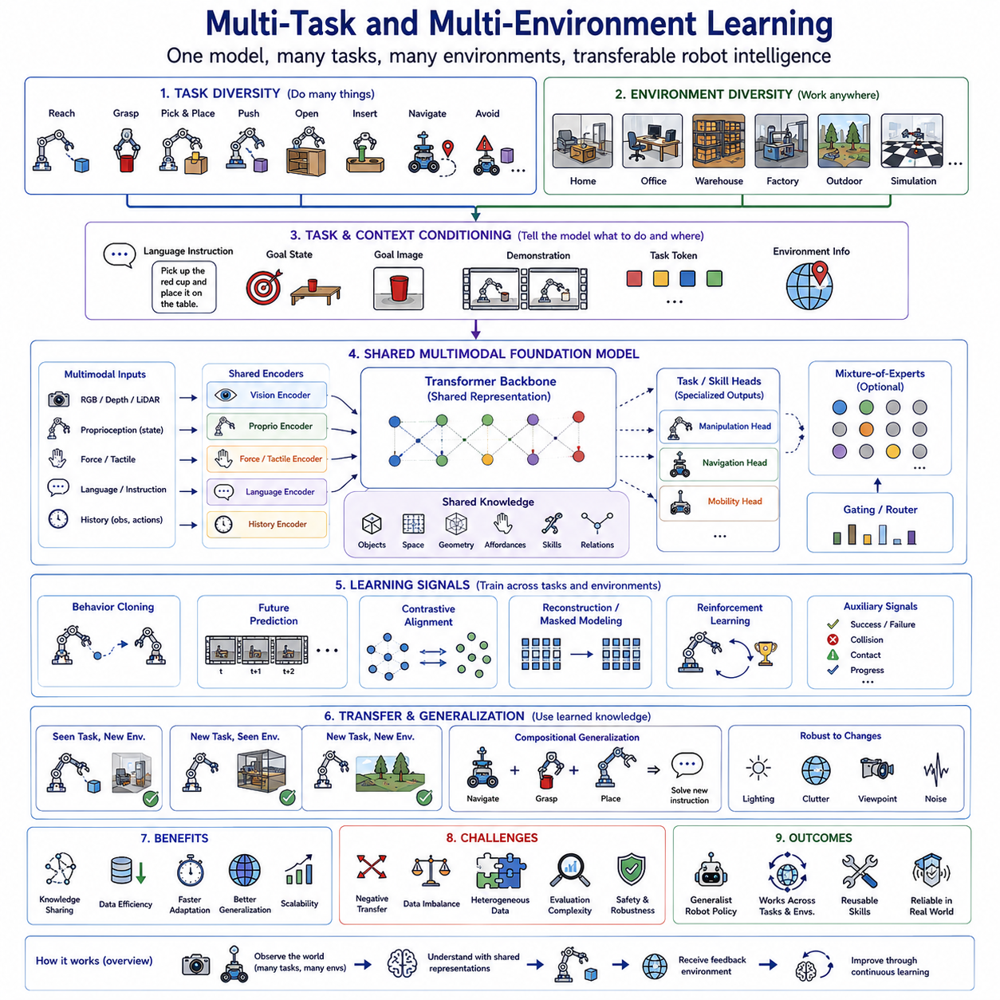{width="7.268055555555556in" height="7.268055555555556in"}

Multi-task and multi-environment learning extends robot foundation models beyond isolated behaviors by training a shared model across many objectives and operating conditions. Instead of assigning one policy to grasping, another to navigation, and another to object placement, a common model learns reusable structures that contribute to several behaviors. The goal is to make knowledge acquired in one task or environment useful when solving others.

Multi-task learning begins from the observation that robotic tasks frequently share underlying capabilities. Reaching, grasping, localization, spatial reasoning, obstacle avoidance, and object recognition may appear repeatedly within otherwise different applications. Training these tasks together allows common representations and parameters to capture recurring structure, reducing the need to relearn the same physical concepts independently for every new behavior.

A task-conditioned policy provides a natural architecture for this setting. The model receives observations together with a representation of the desired task and generates actions appropriate to that context. Task information may be encoded through language instructions, goal states, demonstrations, task tokens, images, or other conditioning signals. The same model can therefore produce different behaviors from similar observations depending on what the robot is currently expected to accomplish.

Language conditioning is particularly useful because it provides a scalable interface for expressing many tasks without assigning a unique manually engineered identifier to every behavior. Instructions can specify objects, goals, relationships, constraints, and sequences of operations. A shared model can associate these linguistic descriptions with perceptual states and actions, enabling semantically related tasks to reuse knowledge even when their exact instructions differ.

Multi-environment learning introduces variation in where and under what conditions these tasks are performed. The same manipulation behavior may occur in different rooms, factories, warehouses, homes, laboratories, or simulated scenes. Navigation may involve different maps, floor structures, obstacles, lighting conditions, and human activity. Training across such variations encourages the model to distinguish stable task-relevant information from incidental properties of one environment.

Environmental diversity is essential because a policy can otherwise exploit shortcuts that appear reliable within a narrow training distribution. A robot may associate an object with a particular background, location, lighting condition, or camera viewpoint rather than learning the underlying concept. Exposure to varied environments weakens these accidental correlations and encourages representations based on object identity, geometry, spatial relationships, and task intent.

Task diversity and environmental diversity interact with each other. Training many tasks in only one environment may still produce environment-specific representations, while training one task across many environments may produce robust but narrow behavior. Robot foundation models seek both dimensions simultaneously: diverse tasks provide behavioral breadth, and diverse environments provide contextual robustness. Their combination creates a richer distribution from which reusable physical knowledge can emerge.

Shared representation learning is one mechanism through which this transfer occurs. A common visual encoder may support object recognition for manipulation and landmark understanding for navigation, while shared spatial representations may support both obstacle avoidance and reaching. Language and goal representations can encode common intent across tasks. These shared components allow gradients from multiple behaviors to shape a common internal representation of the physical world.

However, complete parameter sharing is not always beneficial. Some tasks require specialized information, control frequencies, sensors, or output structures. A navigation policy and a contact-rich insertion task may share semantic and spatial knowledge while requiring substantially different low-level control. Architectures can therefore combine shared backbones with task-specific heads, adapters, experts, or control modules that preserve specialization where it is operationally necessary.

Mixture-of-experts architectures provide one approach to balancing sharing and specialization. Different experts can develop competence for particular task families, environments, modalities, or behavioral patterns, while a routing mechanism selects or combines relevant experts for the current context. This can increase model capacity without requiring every parameter to participate in every decision and may reduce interference between tasks that demand substantially different representations.

Negative transfer remains an important challenge. Joint training does not guarantee that every task benefits from every other task. Gradients from incompatible objectives can interfere, high-frequency datasets can dominate optimization, and easy tasks can overwhelm rarer but more important behaviors. Dataset balancing, task sampling, loss weighting, gradient management, modular architectures, and curriculum strategies can therefore become necessary for effective multi-task learning.

Curriculum learning can organize training from simpler behaviors toward increasingly complex combinations. A model might first acquire basic perception and reaching, then grasping and placement, and eventually long-horizon manipulation involving several objects and intermediate goals. This progression is not mandatory, but structured exposure can help when difficult tasks depend on skills that should already be represented before more complex behavior can be learned efficiently.

Skill representations provide another bridge across tasks. Instead of treating every trajectory as an unrelated sequence of motor commands, the model can identify reusable behavioral units such as approach, grasp, lift, transport, align, place, open, or avoid. Complex tasks can then be understood as compositions of these recurring structures. Skill reuse reduces the effective complexity of learning and supports generalization to new combinations of familiar behaviors.

Compositional generalization is therefore a major objective of multi-task learning. A robot may have learned how to grasp several objects, navigate between locations, and place items into containers without observing every possible combination of these capabilities. A stronger model should recombine previously learned concepts and skills to solve a new instruction rather than requiring a dedicated demonstration for every combination of object, destination, and behavior.

Multi-environment learning similarly aims for invariance without discarding useful context. The robot should ignore irrelevant changes such as wall color or lighting when they do not affect the task, but it must remain sensitive to changes in obstacle geometry, surface properties, human location, or available workspace. Effective representations therefore learn which environmental variables should be invariant and which must influence action selection.

Domain randomization can increase environmental diversity by varying visual appearance, geometry, physics, sensor noise, object placement, and other properties during simulation. This exposes the model to a broad range of conditions before real deployment. Randomization is most useful when the generated variation covers factors that actually change in the real world; unrealistic variation can consume training capacity without improving practical generalization.

Real-world data remains necessary because environments contain complexities that simulation may not capture accurately. Sensor artifacts, wear, clutter, unpredictable human behavior, unusual object arrangements, and changing illumination can produce conditions outside synthetic distributions. Combining simulation with heterogeneous real-world experience allows scalable variation while preserving contact with the physical statistics that ultimately determine deployment performance.

Environment identifiers can sometimes help models distinguish operating domains, but excessive dependence on explicit identifiers can limit transfer. More general systems should infer relevant environmental context from observations while using metadata when necessary. This enables adaptation when the robot encounters a previously unseen environment for which no predefined identifier exists, shifting the model from memorizing domains toward interpreting their physical characteristics.

Multi-task training also provides opportunities for implicit data augmentation. An experience collected for one purpose may contain information useful for another. A navigation trajectory provides visual and geometric observations, a manipulation episode contains object and spatial information, and a failed grasp may reveal affordance boundaries. Foundation-model training can extract multiple learning signals from the same trajectory instead of assigning each episode exclusively to its original task.

Long-horizon tasks make this sharing particularly valuable. Complex behavior often requires navigation, perception, manipulation, monitoring, and recovery within a single objective. A model trained on these capabilities separately and jointly can potentially coordinate them through hierarchical planning. High-level task representations determine subgoals, reusable skills execute intermediate stages, and feedback from the environment determines whether the plan should continue, recover, or change.

Evaluation must separate memorization from genuine multi-task generalization. Strong performance on task-environment combinations seen during training does not demonstrate foundation-level capability. More informative tests hold out particular objects, tasks, environments, or combinations and examine whether the model can transfer its learned structure. Especially valuable are evaluations where familiar skills must be recombined under unfamiliar contextual conditions.

Adaptation efficiency provides another important metric. A pretrained multi-task model should require less data and fewer optimization steps when entering a new environment or acquiring a related task than a model trained from scratch. Few-shot demonstrations, parameter-efficient adaptation, prompting, or limited reinforcement learning can reveal how much reusable knowledge has actually been captured during pretraining rather than merely stored as separate behaviors.

Robustness must also be evaluated across environmental changes. Performance can degrade because of lighting shifts, sensor noise, clutter, moving people, unfamiliar layouts, object variations, or partial sensor failure. Multi-environment training should reduce sensitivity to irrelevant variation while preserving responsiveness to safety-critical changes. The objective is not identical behavior everywhere, but appropriate behavior across a wider range of physical conditions.

At larger scales, multi-task and multi-environment learning becomes a data-distribution design problem as much as a modeling problem. Training corpora must balance common and rare tasks, simple and difficult environments, successful and failed behaviors, and different sources of experience. The distribution determines what the model considers typical, which skills receive sufficient optimization, and where generalization boundaries are likely to appear.

Ultimately, multi-task and multi-environment learning transforms diversity into transferable robot competence. Tasks teach the model different ways of interacting with the world, while environments expose the conditions under which those interactions must remain reliable. Shared representations capture common structure, specialized components preserve necessary differences, and large-scale training connects both into a model capable of adapting its behavior according to goals and context.

This capability forms a foundation for generalist robot policies, where a single learned system is expected to perform broad families of behaviors rather than merely sharing representations among separate downstream models. The transition depends on whether multi-task and multi-environment pretraining can convert diverse experience into coherent action generation, allowing one policy to interpret different goals, select reusable skills, and execute them reliably across changing physical situations.

다중 작업 및 다중 환경 학습(Multi-Task and Multi-Environment Learning)은 여러 목표(Objective)와 운용 조건(Operating Condition)에 걸쳐 하나의 공유 모델(Shared Model)을 학습함으로써 로봇 파운데이션 모델(Robot Foundation Model)을 개별 행동(Isolated Behavior)의 범위를 넘어 확장한다. 파지(Grasping), 내비게이션(Navigation), 객체 배치(Object Placement)에 각각 별도의 정책(Policy)을 할당하는 대신, 하나의 공통 모델이 여러 행동에 기여할 수 있는 재사용 가능한 구조(Reusable Structure)를 학습한다. 목표는 하나의 작업이나 환경에서 획득한 지식을 다른 작업과 환경을 해결하는 데 활용하는 것이다.

다중 작업 학습(Multi-Task Learning)은 서로 다른 로봇 작업들이 기본적인 능력(Underlying Capability)을 공유한다는 관찰에서 출발한다. 도달하기(Reaching), 파지(Grasping), 위치추정(Localization), 공간 추론(Spatial Reasoning), 장애물 회피(Obstacle Avoidance), 객체 인식(Object Recognition)은 서로 다른 응용 분야에서도 반복적으로 나타날 수 있다. 이러한 작업을 함께 학습하면 공통 표현(Common Representation)과 파라미터(Parameter)가 반복적으로 나타나는 구조를 포착하여 새로운 행동마다 동일한 물리 개념을 독립적으로 다시 학습할 필요성을 줄일 수 있다.

작업 조건부 정책(Task-Conditioned Policy)은 이러한 환경을 위한 자연스러운 아키텍처(Architecture)를 제공한다. 모델은 관측(Observation)과 함께 원하는 작업의 표현(Task Representation)을 입력받고 해당 맥락(Context)에 적합한 행동(Action)을 생성한다. 작업 정보는 언어 명령(Language Instruction), 목표 상태(Goal State), 시연(Demonstration), 작업 토큰(Task Token), 이미지(Image) 또는 다른 조건화 신호(Conditioning Signal)를 통해 인코딩될 수 있다. 따라서 동일한 모델이라도 현재 로봇이 달성해야 하는 목표에 따라 유사한 관측에서 서로 다른 행동을 생성할 수 있다.

언어 조건화(Language Conditioning)는 모든 행동에 고유한 수작업 식별자(Manually Engineered Identifier)를 할당하지 않고 많은 작업을 표현할 수 있는 확장 가능한 인터페이스(Scalable Interface)를 제공하기 때문에 특히 유용하다. 명령은 객체(Object), 목표(Goal), 관계(Relationship), 제약조건(Constraint), 연속적인 작업 순서(Sequence of Operations)를 지정할 수 있다. 공유 모델은 이러한 언어적 설명을 지각 상태(Perceptual State)와 행동에 연결함으로써 정확한 명령 표현이 서로 다르더라도 의미적으로 관련된 작업 사이에서 지식을 재사용할 수 있다.

다중 환경 학습(Multi-Environment Learning)은 이러한 작업이 어디에서 어떤 조건으로 수행되는지에 대한 변화를 도입한다. 동일한 조작 행동(Manipulation Behavior)이 서로 다른 방, 공장, 창고, 가정, 연구실 또는 시뮬레이션 장면(Simulated Scene)에서 수행될 수 있다. 내비게이션 역시 서로 다른 지도(Map), 바닥 구조(Floor Structure), 장애물, 조명 조건(Lighting Condition), 인간 활동(Human Activity)을 포함할 수 있다. 이러한 변화에 걸쳐 학습하면 모델이 하나의 환경에 우연히 존재하는 특성과 안정적인 작업 관련 정보(Task-Relevant Information)를 구분하도록 촉진할 수 있다.

환경 다양성(Environmental Diversity)은 정책이 좁은 학습 분포(Training Distribution)에서만 신뢰할 수 있는 지름길(Shortcut)을 이용하는 것을 방지하기 위해 중요하다. 로봇은 객체의 본질적인 개념을 학습하는 대신 특정 배경, 위치, 조명 조건, 카메라 시점(Camera Viewpoint)과 객체를 연관시킬 수 있다. 다양한 환경에 노출되면 이러한 우연한 상관관계(Accidental Correlation)가 약화되고 객체 정체성(Object Identity), 기하 구조(Geometry), 공간 관계(Spatial Relationship), 작업 의도(Task Intent)에 기반한 표현을 학습하도록 촉진할 수 있다.

작업 다양성(Task Diversity)과 환경 다양성은 서로 상호작용한다. 하나의 환경에서 많은 작업을 학습하더라도 여전히 환경에 특화된 표현(Environment-Specific Representation)이 형성될 수 있으며, 여러 환경에서 하나의 작업만 학습하면 강건하지만 제한적인 행동을 생성할 수 있다. 로봇 파운데이션 모델은 두 차원을 동시에 추구한다. 다양한 작업은 행동의 폭(Behavioral Breadth)을 제공하고 다양한 환경은 맥락적 강건성(Contextual Robustness)을 제공하며, 이들의 결합은 재사용 가능한 물리 지식(Reusable Physical Knowledge)이 형성될 수 있는 더욱 풍부한 학습 분포를 만든다.

공유 표현 학습(Shared Representation Learning)은 이러한 전이가 이루어지는 핵심 메커니즘 중 하나이다. 공통 비전 인코더(Common Vision Encoder)는 조작을 위한 객체 인식과 내비게이션을 위한 랜드마크 이해(Landmark Understanding)를 동시에 지원할 수 있으며, 공유 공간 표현(Shared Spatial Representation)은 장애물 회피와 도달하기 모두를 지원할 수 있다. 언어와 목표 표현은 여러 작업에서 공통된 의도를 인코딩할 수 있다. 이러한 공유 구성요소는 다양한 행동으로부터 발생하는 그래디언트(Gradient)가 물리 세계에 대한 공통 내부 표현(Common Internal Representation)을 함께 형성하도록 한다.

그러나 모든 파라미터를 완전히 공유하는 것이 항상 유리한 것은 아니다. 일부 작업에는 특화된 정보(Specialized Information), 제어 주파수(Control Frequency), 센서(Sensor), 출력 구조(Output Structure)가 필요하다. 내비게이션 정책과 접촉 중심 삽입 작업(Contact-Rich Insertion Task)은 의미적·공간적 지식을 공유할 수 있지만 매우 다른 저수준 제어(Low-Level Control)를 필요로 할 수 있다. 따라서 아키텍처는 공유 백본(Shared Backbone)과 함께 작업별 헤드(Task-Specific Head), 어댑터(Adapter), 전문가 모델(Expert), 제어 모듈(Control Module)을 결합하여 필요한 영역에서는 전문화를 유지할 수 있다.

전문가 혼합 아키텍처(Mixture-of-Experts Architecture)는 공유와 전문화 사이의 균형을 맞추는 하나의 접근법이다. 서로 다른 전문가(Expert)는 특정 작업 계열(Task Family), 환경, 모달리티(Modality), 행동 패턴(Behavioral Pattern)에 대한 능력을 발전시키고, 라우팅 메커니즘(Routing Mechanism)은 현재 맥락에 적합한 전문가를 선택하거나 결합할 수 있다. 이를 통해 모든 파라미터가 모든 의사결정에 참여하지 않으면서 모델 용량(Model Capacity)을 증가시킬 수 있으며, 서로 크게 다른 표현을 요구하는 작업 사이의 간섭(Interference)을 감소시킬 가능성이 있다.

부정적 전이(Negative Transfer)는 여전히 중요한 과제이다. 공동 학습(Joint Training)을 수행한다고 해서 모든 작업이 다른 모든 작업으로부터 이점을 얻는 것은 아니다. 서로 호환되지 않는 목적함수(Objective)의 그래디언트가 충돌할 수 있고, 데이터가 많은 작업이 최적화(Optimization)를 지배하거나 쉬운 작업이 드물지만 중요한 행동의 학습을 압도할 수 있다. 따라서 효과적인 다중 작업 학습을 위해 데이터셋 균형화(Dataset Balancing), 작업 샘플링(Task Sampling), 손실 가중치(Loss Weighting), 그래디언트 관리(Gradient Management), 모듈형 아키텍처(Modular Architecture), 커리큘럼 전략(Curriculum Strategy)이 필요할 수 있다.

커리큘럼 학습(Curriculum Learning)은 단순한 행동에서 점차 복잡한 행동 조합으로 학습 과정을 구성할 수 있다. 모델은 먼저 기본적인 지각(Perception)과 도달하기를 학습한 다음 파지와 배치(Placement)를 학습하고, 이후 여러 객체와 중간 목표(Intermediate Goal)가 포함된 장기 조작(Long-Horizon Manipulation)을 학습할 수 있다. 이러한 단계적 진행이 필수적인 것은 아니지만, 복잡한 행동을 효율적으로 학습하기 전에 필요한 스킬이 먼저 표현되어야 하는 어려운 작업에서는 구조화된 학습 과정(Structured Exposure)이 도움이 될 수 있다.

스킬 표현(Skill Representation)은 서로 다른 작업을 연결하는 또 다른 중요한 수단이다. 모든 궤적(Trajectory)을 서로 관련 없는 모터 명령의 시퀀스로 취급하는 대신 모델은 접근(Approach), 파지(Grasp), 들어올리기(Lift), 운반(Transport), 정렬(Align), 배치(Place), 열기(Open), 회피(Avoid)와 같은 재사용 가능한 행동 단위(Reusable Behavioral Unit)를 식별할 수 있다. 복잡한 작업은 이러한 반복적인 구조의 조합으로 이해할 수 있으며, 스킬 재사용(Skill Reuse)은 학습의 실질적인 복잡성을 감소시키고 익숙한 행동을 새롭게 조합하는 일반화를 지원한다.

따라서 조합적 일반화(Compositional Generalization)는 다중 작업 학습의 주요 목표가 된다. 로봇은 여러 객체를 파지하는 방법, 위치 사이를 이동하는 방법, 물체를 용기에 배치하는 방법을 학습했지만 이러한 능력의 모든 가능한 조합을 경험하지 않았을 수 있다. 더 강력한 모델은 객체, 목적지, 행동의 모든 조합에 대해 전용 시연을 요구하는 대신 이전에 학습한 개념과 스킬을 새롭게 조합하여 새로운 명령(New Instruction)을 해결할 수 있어야 한다.

다중 환경 학습도 유용한 맥락을 제거하지 않으면서 불변성(Invariance)을 학습하는 것을 목표로 한다. 로봇은 작업에 영향을 주지 않는 벽의 색상이나 조명 변화와 같은 요소는 무시해야 하지만, 장애물의 기하 구조, 표면 특성(Surface Property), 사람의 위치, 사용 가능한 작업 공간의 변화에는 민감하게 반응해야 한다. 따라서 효과적인 표현은 어떤 환경 변수가 불변이어야 하고 어떤 변수가 행동 선택(Action Selection)에 영향을 미쳐야 하는지를 학습해야 한다.

도메인 랜덤화(Domain Randomization)는 시뮬레이션에서 시각적 외형, 기하 구조, 물리 특성(Physics), 센서 잡음(Sensor Noise), 객체 배치 등의 속성을 변화시켜 환경 다양성을 증가시킬 수 있다. 이를 통해 모델은 실제 배치 전에 폭넓은 조건을 경험할 수 있다. 랜덤화는 생성된 변화가 실제 세계에서 변화하는 요인을 충분히 포함할 때 가장 유용하며, 비현실적인 변화는 실제 일반화를 개선하지 못하면서 학습 용량만 소비할 수 있다.

실제 환경 데이터(Real-World Data)는 시뮬레이션이 정확하게 재현하기 어려운 복잡성이 존재하기 때문에 여전히 필요하다. 센서 아티팩트(Sensor Artifact), 마모(Wear), 복잡한 환경(Clutter), 예측하기 어려운 인간 행동, 비정상적인 객체 배치, 변화하는 조명은 합성 분포(Synthetic Distribution)를 벗어나는 조건을 만들 수 있다. 시뮬레이션과 이질적인 실제 경험(Heterogeneous Real-World Experience)을 결합하면 확장 가능한 다양성을 확보하면서 실제 배치 성능을 결정하는 물리적 통계(Physical Statistics)를 유지할 수 있다.

환경 식별자(Environment Identifier)는 모델이 서로 다른 운용 도메인(Operating Domain)을 구분하는 데 도움이 될 수 있지만, 명시적인 식별자에 지나치게 의존하면 전이 능력이 제한될 수 있다. 보다 일반적인 시스템은 필요한 경우 메타데이터(Metadata)를 활용하면서도 관측으로부터 관련 환경 맥락(Environmental Context)을 추론해야 한다. 이를 통해 사전 정의된 식별자가 존재하지 않는 새로운 환경에서도 물리적 특성을 해석하고 적응할 수 있으며, 단순한 도메인 암기(Domain Memorization)에서 환경 이해(Environment Interpretation)로 발전할 수 있다.

다중 작업 학습은 암묵적인 데이터 증강(Implicit Data Augmentation)의 기회도 제공한다. 하나의 목적으로 수집된 경험이 다른 작업에 유용한 정보를 포함할 수 있다. 내비게이션 궤적은 시각적·기하학적 관측을 제공하고, 조작 에피소드(Manipulation Episode)는 객체 및 공간 정보를 포함하며, 실패한 파지는 어포던스 경계(Affordance Boundary)를 보여줄 수 있다. 파운데이션 모델 학습은 각 에피소드를 원래 작업에만 독점적으로 할당하는 대신 하나의 궤적에서 여러 학습 신호(Learning Signal)를 추출할 수 있다.

장기 작업(Long-Horizon Task)은 이러한 공유의 가치를 더욱 높인다. 복잡한 행동은 하나의 목표 안에서 내비게이션, 지각, 조작, 모니터링(Monitoring), 복구(Recovery)를 필요로 하는 경우가 많다. 이러한 능력을 개별적으로 그리고 공동으로 학습한 모델은 계층적 계획(Hierarchical Planning)을 통해 이들을 조정할 수 있다. 고수준 작업 표현(High-Level Task Representation)이 하위 목표(Subgoal)를 결정하고, 재사용 가능한 스킬이 중간 단계를 실행하며, 환경의 피드백(Feedback)에 따라 계획을 계속 수행하거나 복구하거나 변경할지를 결정할 수 있다.

평가(Evaluation)는 암기(Memorization)와 실제 다중 작업 일반화(Multi-Task Generalization)를 구분해야 한다. 학습 중 경험한 작업-환경 조합(Task-Environment Combination)에서 높은 성능을 보이는 것만으로는 파운데이션 수준의 능력을 입증할 수 없다. 더 유용한 평가는 특정 객체, 작업, 환경 또는 이들의 조합을 학습에서 제외한 후 모델이 학습된 구조를 얼마나 전이할 수 있는지를 확인한다. 특히 익숙한 스킬을 낯선 맥락 조건(Unfamiliar Contextual Condition)에서 새롭게 조합해야 하는 평가가 중요하다.

적응 효율성(Adaptation Efficiency)도 중요한 평가 지표이다. 사전학습된 다중 작업 모델은 새로운 환경에 진입하거나 관련된 새로운 작업을 획득할 때 처음부터 학습한 모델보다 적은 데이터와 최적화 단계(Optimization Step)를 필요로 해야 한다. 퓨샷 시연(Few-Shot Demonstration), 파라미터 효율적 적응(Parameter-Efficient Adaptation), 프롬프팅(Prompting), 제한적인 강화학습(Limited Reinforcement Learning)을 통해 사전학습 과정에서 실제로 얼마나 많은 재사용 가능한 지식이 획득되었는지를 평가할 수 있다.

강건성(Robustness) 역시 환경 변화에 걸쳐 평가되어야 한다. 조명 변화, 센서 잡음, 복잡한 장애물, 이동하는 사람, 익숙하지 않은 레이아웃, 객체 변화, 부분적인 센서 고장(Partial Sensor Failure)으로 인해 성능이 저하될 수 있다. 다중 환경 학습은 중요하지 않은 변화에 대한 민감도를 감소시키면서 안전에 중요한 변화(Safety-Critical Change)에 대한 반응성을 유지해야 한다. 목표는 모든 환경에서 동일한 행동을 생성하는 것이 아니라 더 넓은 물리적 조건에서 적절한 행동을 생성하는 것이다.

규모가 커질수록 다중 작업 및 다중 환경 학습은 모델링 문제인 동시에 데이터 분포 설계(Data-Distribution Design)의 문제가 된다. 학습 코퍼스(Training Corpus)는 일반적인 작업과 희귀한 작업, 단순한 환경과 어려운 환경, 성공 행동과 실패 행동, 서로 다른 경험 소스 사이의 균형을 유지해야 한다. 이러한 데이터 분포는 모델이 무엇을 일반적인 상황으로 간주하는지, 어떤 스킬이 충분한 최적화를 받는지, 그리고 일반화의 경계(Generalization Boundary)가 어디에 형성되는지를 결정한다.

궁극적으로 다중 작업 및 다중 환경 학습(Multi-Task and Multi-Environment Learning)은 다양성(Diversity)을 전이 가능한 로봇 능력(Transferable Robot Competence)으로 변환한다. 다양한 작업은 모델에 세계와 상호작용하는 여러 방법을 학습시키고, 다양한 환경은 이러한 상호작용이 어떤 조건에서도 신뢰성을 유지해야 하는지를 경험하게 한다. 공유 표현은 공통 구조를 포착하고, 특화된 구성요소(Specialized Component)는 필요한 차이를 유지하며, 대규모 학습은 이들을 목표와 맥락에 따라 행동을 적응시킬 수 있는 하나의 모델로 연결한다.

이러한 능력은 하나의 학습 시스템이 단순히 여러 다운스트림 모델 사이에서 표현을 공유하는 것을 넘어 광범위한 행동 계열(Behavior Family)을 직접 수행하는 제너럴리스트 로봇 정책(Generalist Robot Policy)의 기반을 형성한다. 이러한 전환은 다중 작업 및 다중 환경 사전학습이 다양한 경험을 일관된 행동 생성(Coherent Action Generation)으로 변환할 수 있는지에 달려 있다. 즉, 하나의 정책이 서로 다른 목표를 해석하고, 재사용 가능한 스킬을 선택하며, 변화하는 물리적 상황에서 이를 안정적으로 실행할 수 있어야 한다.

## 02.07. Generalist vs Specialist Robot Models

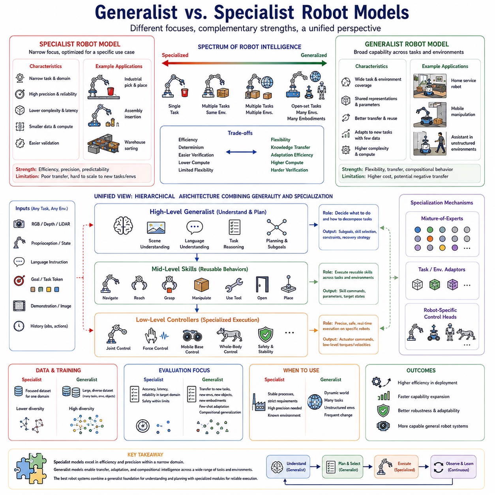{width="7.268055555555556in" height="7.268055555555556in"}

A specialist robot model is designed around a relatively narrow combination of task, embodiment, environment, and operating assumptions. It may be optimized for grasping a known object family, navigating a specific facility, performing an insertion procedure, or controlling one robot platform. By restricting the problem, specialist systems can dedicate their model capacity, training data, representations, and control architecture to the conditions that matter most for a particular application.

Specialization has historically been a practical strength in robotics. Physical systems must satisfy strict requirements for latency, precision, reliability, safety, and repeatability, and these requirements are often easier to achieve when the operational domain is constrained. A model trained specifically for one manipulation process can focus on the relevant sensors, geometry, action space, and failure modes without spending computational capacity representing unrelated tasks or environments.

Specialist models can therefore achieve excellent performance inside their intended operating distribution. Industrial robots provide a clear conceptual example: when objects, fixtures, trajectories, lighting, and workspace geometry are carefully controlled, highly specialized perception and control systems can execute repetitive operations with high accuracy. In such applications, broad semantic understanding or open-ended reasoning may provide little additional value compared with deterministic and optimized task-specific behavior.

The limitation appears when conditions move beyond those assumptions. A model specialized for one object set may fail on unfamiliar objects, while a navigation policy trained in one building may depend on environmental features that do not transfer to another. Adding a new task can require a new dataset, new training, and sometimes a new model architecture. As the number of applications grows, maintaining many independent specialist models can become increasingly expensive and fragmented.

Generalist robot models pursue the opposite direction. Instead of optimizing one model for one narrowly defined behavior, they attempt to support broad families of tasks through shared representations and parameters. A generalist model may receive different observations, language instructions, goals, or demonstrations and generate behavior appropriate to each context. The same learned foundation can therefore contribute to manipulation, navigation, tool use, mobile manipulation, or other related capabilities.

The defining advantage of a generalist model is knowledge sharing. Different robotic tasks contain recurring concepts such as objects, spatial relationships, motion, contact, goals, affordances, and reusable skills. A shared model can learn these concepts once and apply them across multiple behaviors. Experience from placing objects may improve grasp representations, while navigation experience may strengthen spatial reasoning that later supports mobile manipulation.

Generalist models are closely connected to large-scale pretraining. Broad behavior cannot emerge merely by increasing model size; the training distribution must contain sufficient diversity in tasks, objects, environments, instructions, and interaction patterns. Multi-task and multi-environment datasets expose the model to common structures as well as meaningful differences. Foundation-model training attempts to convert this diversity into representations that remain useful beyond individual training episodes.

Task conditioning enables one model to express different behaviors without requiring a completely separate policy for each task. Language instructions, goal states, task tokens, demonstrations, or images can specify the desired objective. The model interprets this conditioning together with current observations and robot state. Generality therefore does not mean producing the same behavior everywhere; it means selecting contextually appropriate behavior from a broadly reusable learned system.

Generalist models can also provide greater adaptation efficiency. When a new task is related to capabilities already encountered during pretraining, the model may require only limited demonstrations, fine-tuning, prompting, adapters, or reinforcement learning. A specialist model trained from scratch must acquire much of the required representation again. The economic value of generalization therefore includes reducing the marginal data and engineering effort needed to introduce additional robot capabilities.

However, generality introduces substantial costs. A model representing many tasks and environments usually requires greater capacity, more heterogeneous data, and significantly more training compute. It must resolve interference between behaviors and determine which information is relevant to the current objective. At deployment time, the larger architecture can also increase memory consumption, inference latency, electrical power, and thermal load, all of which are critical constraints for onboard robotic computing.

Negative transfer is another risk. Sharing parameters between tasks is useful only when the shared structure is genuinely beneficial. A representation optimized simultaneously for navigation, precise insertion, locomotion, and semantic reasoning may encounter conflicting optimization requirements. If task distributions are poorly balanced, common tasks can dominate learning while rare capabilities deteriorate. Generalist training therefore requires careful data mixture design, optimization, routing, and evaluation.

Specialists retain an advantage when extreme precision or deterministic timing is required. High-speed motor control, safety-critical stabilization, force-controlled insertion, or tightly regulated industrial processes may benefit from dedicated models or conventional controllers. These systems operate close to hardware dynamics and often require predictable behavior at frequencies where a large generalist model is unnecessary or impractical. General intelligence does not eliminate the value of specialized control.

This leads to a more useful interpretation than treating generalists and specialists as mutually exclusive alternatives. A robot architecture can contain a generalist foundation model for perception, semantic reasoning, task understanding, planning, and skill selection while specialized modules execute low-level behaviors. The generalist determines what should be accomplished and selects appropriate capabilities, while specialists provide efficient and reliable execution where physical requirements demand specialization.

Hierarchical architectures naturally support this division. A high-level generalist model can interpret instructions, understand scenes, decompose long-horizon objectives, and generate subgoals. Mid-level skill policies can implement behaviors such as navigation, reaching, grasping, opening, or placement. Low-level controllers then translate these objectives into actuator commands while enforcing dynamic and safety constraints. Generality and specialization can therefore coexist at different abstraction levels.

Mixture-of-experts models provide another mechanism for combining these properties within a learned architecture. A shared backbone can represent common knowledge while specialized experts develop competence for particular tasks, modalities, environments, or embodiments. A routing mechanism activates the relevant experts according to context. This approach attempts to preserve broad knowledge sharing while preventing every parameter from processing every behavior and reducing interference among highly different tasks.

Embodiment further complicates the comparison. A specialist model can be tightly matched to one robot\'s sensors, kinematics, dynamics, and action interface. A generalist model intended for multiple embodiments must distinguish transferable concepts from robot-specific execution. Concepts such as approach, grasp, transport, or avoid may be broadly shared, but their motor realization differs substantially between an industrial arm, mobile manipulator, humanoid, and quadruped.

Cross-embodiment generalists therefore require explicit mechanisms for representing morphology and action capabilities. Robot-specific encoders, embodiment tokens, normalized action representations, skill interfaces, or specialized control heads can connect shared knowledge with particular bodies. The objective is not to pretend that all robots are physically equivalent, but to share knowledge at abstraction levels where equivalence is meaningful while preserving differences where physical execution requires them.

The two approaches also differ in their data requirements. Specialists can often be trained using carefully collected datasets focused on one operational distribution. Generalists require broader datasets whose value depends on diversity as well as quantity. They must contain enough variation to reveal which concepts are shared across tasks and which remain specific. Data curation, standardization, balancing, and metadata therefore become substantially more important as the desired scope of generalization increases.

Evaluation criteria must likewise differ. A specialist can be judged primarily by performance, reliability, latency, and safety within its specified operating domain. A generalist must additionally be evaluated on transfer to held-out tasks, unfamiliar objects, new environments, novel task combinations, and potentially new embodiments. Few-shot adaptation and compositional generalization become important because memorizing a large collection of known tasks does not by itself demonstrate genuine generality.

Reliability creates an important practical tradeoff. Specialists benefit from narrower distributions that can often be tested exhaustively or at least systematically. Generalists operate over much broader state and task spaces, making complete validation extremely difficult. Their flexibility can expose unexpected interactions between perception, reasoning, and action. Safety monitors, uncertainty estimation, constraints, fallback policies, and specialized controllers therefore remain important even as foundation models become more capable.

The appropriate choice consequently depends on deployment objectives. A fixed production process with stable geometry and extremely strict cycle-time requirements may favor a specialist solution. A service robot operating among changing objects, people, rooms, and instructions may benefit much more from a generalist model. Many practical systems will occupy positions between these extremes, combining reusable foundation capabilities with application-specific adaptation and dedicated control components.

The evolution of robot foundation models should therefore not be interpreted as a simple replacement of specialist robotics by generalist robotics. Instead, it changes where specialization occurs. Broadly pretrained models can provide common perception, semantic knowledge, task understanding, and reusable behavioral representations, while specialization is concentrated in components that reflect particular embodiments, safety constraints, control requirements, or application objectives.

Ultimately, generalist and specialist robot models represent complementary strategies for allocating intelligence. Specialists concentrate capacity around a narrow operational objective and can provide efficiency, precision, and predictability. Generalists distribute learned knowledge across many tasks and environments, enabling transfer, adaptation, and compositional behavior. Effective robot foundation architectures seek to capture the advantages of both rather than maximizing generality without regard to physical constraints.

This balance provides an important foundation for understanding generalist robot policies and later Vision-Language-Action systems. As robot models become broader, the central engineering problem shifts from choosing between generalization and specialization to deciding which knowledge should be globally shared, which skills should remain modular, and where embodiment-specific control should enter the architecture. The resulting hierarchy can combine broad learned intelligence with the reliability required for real physical deployment.

전문화 로봇 모델(Specialist Robot Model)은 비교적 제한된 작업(Task), 체화(Embodiment), 환경(Environment), 운용 가정(Operating Assumption)의 조합을 중심으로 설계된다. 특정 객체군(Object Family)을 파지하거나, 특정 시설에서 내비게이션(Navigation)을 수행하거나, 삽입 작업(Insertion Procedure)을 실행하거나, 하나의 로봇 플랫폼을 제어하도록 최적화될 수 있다. 문제의 범위를 제한함으로써 전문화 시스템은 특정 응용 분야에 가장 중요한 조건에 모델 용량(Model Capacity), 학습 데이터(Training Data), 표현(Representation), 제어 아키텍처(Control Architecture)를 집중할 수 있다.

전문화(Specialization)는 역사적으로 로보틱스(Robotics)에서 실용적인 강점으로 작용해 왔다. 물리 시스템(Physical System)은 지연시간(Latency), 정밀도(Precision), 신뢰성(Reliability), 안전(Safety), 반복성(Repeatability)에 대한 엄격한 요구사항을 충족해야 하며, 이러한 요구사항은 운용 영역(Operational Domain)이 제한되어 있을 때 달성하기가 더 쉽다. 하나의 조작 과정(Manipulation Process)에 특화된 모델은 관련 센서, 기하 구조(Geometry), 행동 공간(Action Space), 실패 모드(Failure Mode)에 집중할 수 있으며, 관련 없는 작업이나 환경을 표현하는 데 계산 용량을 사용할 필요가 없다.

따라서 전문화 모델은 의도된 운용 분포(Operating Distribution) 내에서 매우 뛰어난 성능을 달성할 수 있다. 산업용 로봇(Industrial Robot)이 대표적인 개념적 사례이다. 객체, 지그(Fixture), 궤적(Trajectory), 조명(Lighting), 작업 공간 기하 구조(Workspace Geometry)가 정밀하게 제어되는 경우 고도로 전문화된 지각 및 제어 시스템(Perception and Control System)은 반복 작업을 높은 정확도로 수행할 수 있다. 이러한 응용에서는 광범위한 의미 이해(Semantic Understanding)나 개방형 추론(Open-Ended Reasoning)보다 결정론적이고 최적화된 작업별 행동(Task-Specific Behavior)이 더 높은 가치를 제공할 수 있다.

문제는 조건이 이러한 가정을 벗어날 때 나타난다. 하나의 객체 집합에 특화된 모델은 익숙하지 않은 객체에서 실패할 수 있으며, 특정 건물에서 학습된 내비게이션 정책은 다른 건물로 전이되지 않는 환경적 특징에 의존할 수 있다. 새로운 작업을 추가하려면 새로운 데이터셋, 새로운 학습, 경우에 따라 새로운 모델 아키텍처가 필요할 수 있다. 응용 분야가 증가할수록 다수의 독립적인 전문화 모델을 유지하는 비용과 시스템의 파편화(Fragmentation)가 증가할 수 있다.

제너럴리스트 로봇 모델(Generalist Robot Model)은 반대 방향을 추구한다. 하나의 좁게 정의된 행동에 하나의 모델을 최적화하는 대신 공유 표현(Shared Representation)과 공유 파라미터(Shared Parameter)를 통해 광범위한 작업 계열(Task Family)을 지원하려 한다. 제너럴리스트 모델은 서로 다른 관측(Observation), 언어 명령(Language Instruction), 목표(Goal), 시연(Demonstration)을 입력받아 각 맥락에 적합한 행동을 생성할 수 있다. 따라서 동일한 학습 기반(Learned Foundation)이 조작, 내비게이션, 도구 사용(Tool Use), 모바일 매니퓰레이션(Mobile Manipulation) 등의 관련 능력에 기여할 수 있다.

제너럴리스트 모델의 핵심적인 장점은 지식 공유(Knowledge Sharing)이다. 서로 다른 로봇 작업에는 객체(Object), 공간 관계(Spatial Relationship), 움직임(Motion), 접촉(Contact), 목표, 어포던스(Affordance), 재사용 가능한 스킬(Reusable Skill)과 같은 반복적인 개념이 존재한다. 공유 모델은 이러한 개념을 한 번 학습한 후 여러 행동에서 활용할 수 있다. 객체 배치에서 얻은 경험은 파지 표현(Grasp Representation)을 향상시킬 수 있으며, 내비게이션 경험은 이후 모바일 매니퓰레이션을 지원하는 공간 추론(Spatial Reasoning)을 강화할 수 있다.

제너럴리스트 모델은 대규모 사전학습(Large-Scale Pretraining)과 밀접하게 연결된다. 단순히 모델 크기를 증가시킨다고 광범위한 행동 능력이 나타나는 것은 아니며, 학습 분포(Training Distribution)가 작업, 객체, 환경, 명령, 상호작용 패턴(Interaction Pattern)의 충분한 다양성을 포함해야 한다. 다중 작업 및 다중 환경 데이터셋(Multi-Task and Multi-Environment Dataset)은 공통 구조와 의미 있는 차이를 모두 모델에 제공한다. 파운데이션 모델 학습(Foundation-Model Training)은 이러한 다양성을 개별 학습 에피소드(Episode)를 넘어 유용하게 유지되는 표현으로 변환하려 한다.

작업 조건화(Task Conditioning)는 각 작업마다 완전히 별도의 정책을 만들지 않고 하나의 모델에서 서로 다른 행동을 표현할 수 있도록 한다. 언어 명령, 목표 상태(Goal State), 작업 토큰(Task Token), 시연 또는 이미지를 이용하여 원하는 목표를 지정할 수 있다. 모델은 이러한 조건 정보와 현재 관측 및 로봇 상태(Robot State)를 함께 해석한다. 따라서 일반성(Generality)은 모든 상황에서 동일한 행동을 생성하는 것을 의미하는 것이 아니라, 광범위하게 재사용 가능한 하나의 학습 시스템에서 현재 맥락에 적절한 행동을 선택하는 능력을 의미한다.

제너럴리스트 모델은 더 높은 적응 효율성(Adaptation Efficiency)을 제공할 수도 있다. 새로운 작업이 사전학습 과정에서 경험한 능력과 관련되어 있다면 제한된 시연, 미세조정(Fine-Tuning), 프롬프팅(Prompting), 어댑터(Adapter), 강화학습(Reinforcement Learning)만으로 적응할 수 있다. 반면 처음부터 학습하는 전문화 모델은 필요한 표현의 상당 부분을 다시 획득해야 한다. 따라서 일반화(Generalization)의 경제적 가치는 새로운 로봇 능력을 추가하는 데 필요한 한계 데이터 비용(Marginal Data Cost)과 엔지니어링 노력을 감소시키는 데에도 있다.

그러나 일반성은 상당한 비용을 수반한다. 많은 작업과 환경을 표현하는 모델은 일반적으로 더 큰 모델 용량, 더욱 이질적인 데이터(Heterogeneous Data), 훨씬 많은 학습 계산량(Training Compute)을 요구한다. 모델은 서로 다른 행동 사이의 간섭(Interference)을 해결하고 현재 목표에 어떤 정보가 중요한지를 결정해야 한다. 실제 배치(Deployment)에서도 더 큰 아키텍처는 메모리 사용량, 추론 지연시간(Inference Latency), 전력(Electrical Power), 열 부하(Thermal Load)를 증가시킬 수 있으며, 이들은 온보드 로봇 컴퓨팅(Onboard Robotic Computing)의 핵심 제약조건이다.

부정적 전이(Negative Transfer) 역시 중요한 위험이다. 작업 사이의 파라미터 공유는 공유 구조가 실제로 유용할 때에만 효과적이다. 내비게이션, 정밀 삽입(Precise Insertion), 이동(Locomotion), 의미 추론(Semantic Reasoning)을 동시에 최적화하는 표현은 서로 충돌하는 최적화 요구조건(Optimization Requirement)을 가질 수 있다. 작업 분포의 균형이 적절하지 않으면 일반적인 작업이 학습을 지배하고 희귀한 능력은 저하될 수 있다. 따라서 제너럴리스트 학습에는 신중한 데이터 혼합 설계(Data Mixture Design), 최적화, 라우팅(Routing), 평가(Evaluation)가 필요하다.

전문화 모델은 극도의 정밀도 또는 결정론적 타이밍(Deterministic Timing)이 필요한 상황에서 여전히 장점을 가진다. 고속 모터 제어(High-Speed Motor Control), 안전 중요 안정화(Safety-Critical Stabilization), 힘 제어 삽입(Force-Controlled Insertion), 엄격하게 규제된 산업 공정은 전용 모델이나 기존 제어기(Conventional Controller)의 이점을 얻을 수 있다. 이러한 시스템은 하드웨어 동역학(Hardware Dynamics)에 가까운 수준에서 동작하며, 대규모 제너럴리스트 모델이 불필요하거나 비실용적인 높은 제어 주파수(Control Frequency)를 요구하는 경우가 많다. 일반 지능(General Intelligence)이 전문화 제어의 가치를 제거하는 것은 아니다.

따라서 제너럴리스트와 전문화 모델을 상호 배타적인 선택지로 보는 것보다 두 방식을 결합하여 이해하는 것이 더욱 유용하다. 로봇 아키텍처는 지각(Perception), 의미 추론, 작업 이해(Task Understanding), 계획(Planning), 스킬 선택(Skill Selection)을 담당하는 제너럴리스트 파운데이션 모델과 저수준 행동을 실행하는 전문화 모듈(Specialized Module)을 함께 포함할 수 있다. 제너럴리스트가 무엇을 달성해야 하는지를 판단하고 적절한 능력을 선택하면, 전문화 모델은 물리적 요구조건이 필요한 영역에서 효율적이고 신뢰성 높은 실행을 담당할 수 있다.

계층적 아키텍처(Hierarchical Architecture)는 이러한 역할 분담을 자연스럽게 지원한다. 고수준 제너럴리스트 모델(High-Level Generalist Model)은 명령을 해석하고, 장면(Scene)을 이해하고, 장기 목표(Long-Horizon Objective)를 분해하여 하위 목표(Subgoal)를 생성할 수 있다. 중간 수준의 스킬 정책(Mid-Level Skill Policy)은 내비게이션, 도달하기(Reaching), 파지하기(Grasping), 열기(Opening), 배치하기(Placement) 등의 행동을 구현한다. 저수준 제어기(Low-Level Controller)는 동역학 및 안전 제약(Safety Constraint)을 적용하면서 이러한 목표를 액추에이터 명령(Actuator Command)으로 변환한다. 따라서 일반성과 전문화는 서로 다른 추상화 수준(Abstraction Level)에서 공존할 수 있다.

전문가 혼합 모델(Mixture-of-Experts Model)은 하나의 학습 아키텍처 안에서 이러한 특성을 결합하는 또 다른 방법을 제공한다. 공유 백본(Shared Backbone)은 공통 지식을 표현하고, 전문화 전문가(Specialized Expert)는 특정 작업, 모달리티(Modality), 환경 또는 체화에 대한 능력을 발전시킬 수 있다. 라우팅 메커니즘(Routing Mechanism)은 맥락에 따라 필요한 전문가를 활성화한다. 이러한 접근법은 광범위한 지식 공유를 유지하면서 모든 파라미터가 모든 행동을 처리할 필요를 줄이고 매우 다른 작업 사이의 간섭을 감소시키는 것을 목표로 한다.

체화(Embodiment)는 이러한 비교를 더욱 복잡하게 만든다. 전문화 모델은 하나의 로봇이 가진 센서, 운동학(Kinematics), 동역학(Dynamics), 행동 인터페이스(Action Interface)에 긴밀하게 맞출 수 있다. 반면 여러 체화를 대상으로 하는 제너럴리스트 모델은 전이 가능한 개념(Transferable Concept)과 로봇별 실행(Robot-Specific Execution)을 구분해야 한다. 접근(Approach), 파지(Grasp), 운반(Transport), 회피(Avoid) 같은 개념은 광범위하게 공유될 수 있지만 산업용 로봇 팔, 모바일 매니퓰레이터, 휴머노이드(Humanoid), 4족 로봇(Quadruped)에서의 모터 실행 방식은 크게 다르다.

따라서 교차 체화 제너럴리스트(Cross-Embodiment Generalist)는 형태(Morphology)와 행동 능력(Action Capability)을 표현하는 명시적인 메커니즘이 필요하다. 로봇별 인코더(Robot-Specific Encoder), 체화 토큰(Embodiment Token), 정규화된 행동 표현(Normalized Action Representation), 스킬 인터페이스(Skill Interface), 전문화 제어 헤드(Specialized Control Head)를 통해 공유 지식을 특정 신체와 연결할 수 있다. 목표는 모든 로봇이 물리적으로 동일하다고 가정하는 것이 아니라, 동등성이 의미 있는 추상화 수준에서는 지식을 공유하고 물리적 실행에 차이가 필요한 수준에서는 이를 유지하는 것이다.

두 접근법은 데이터 요구사항(Data Requirement)에서도 차이를 보인다. 전문화 모델은 하나의 운용 분포에 집중하여 신중하게 수집된 데이터셋으로 학습할 수 있다. 제너럴리스트 모델은 데이터 양뿐 아니라 다양성(Diversity)이 중요한 광범위한 데이터셋을 필요로 한다. 어떤 개념이 작업 전반에서 공유되고 어떤 개념이 특정 작업에 고유한지를 학습할 수 있을 만큼 충분한 변화가 포함되어야 한다. 따라서 원하는 일반화 범위가 증가할수록 데이터 큐레이션(Data Curation), 표준화(Standardization), 균형화(Balancing), 메타데이터(Metadata)의 중요성도 크게 증가한다.

평가 기준(Evaluation Criteria) 역시 달라져야 한다. 전문화 모델은 지정된 운용 영역에서 성능, 신뢰성, 지연시간, 안전성을 중심으로 평가할 수 있다. 제너럴리스트 모델은 여기에 더해 학습에서 제외된 작업(Held-Out Task), 익숙하지 않은 객체, 새로운 환경, 새로운 작업 조합(Task Combination), 잠재적으로 새로운 체화에 대한 전이 능력을 평가해야 한다. 대규모의 알려진 작업을 암기하는 것만으로는 진정한 일반성을 입증할 수 없기 때문에 퓨샷 적응(Few-Shot Adaptation)과 조합적 일반화(Compositional Generalization)도 중요한 평가 요소가 된다.

신뢰성은 중요한 실용적 절충(Practical Tradeoff)을 만든다. 전문화 모델은 더 좁은 분포에서 동작하기 때문에 비교적 체계적이고 광범위한 검증(Validation)이 가능하다. 반면 제너럴리스트 모델은 훨씬 넓은 상태 및 작업 공간(State and Task Space)에서 동작하므로 완전한 검증이 매우 어렵다. 높은 유연성은 지각, 추론, 행동 사이에서 예상하지 못한 상호작용을 발생시킬 수 있다. 따라서 파운데이션 모델의 능력이 향상되더라도 안전 모니터(Safety Monitor), 불확실성 추정(Uncertainty Estimation), 제약조건(Constraint), 폴백 정책(Fallback Policy), 전문화 제어기는 여전히 중요하다.

따라서 적절한 선택은 배치 목표(Deployment Objective)에 따라 달라진다. 안정적인 기하 구조와 매우 엄격한 사이클 타임(Cycle Time)을 가진 고정 생산 공정은 전문화 솔루션(Specialist Solution)에 더 적합할 수 있다. 반면 변화하는 객체, 사람, 공간, 명령 속에서 동작하는 서비스 로봇(Service Robot)은 제너럴리스트 모델로부터 훨씬 큰 이점을 얻을 수 있다. 실제 시스템의 상당수는 이러한 두 극단 사이에 위치하며, 재사용 가능한 파운데이션 능력(Reusable Foundation Capability)에 응용별 적응(Application-Specific Adaptation)과 전용 제어 구성요소를 결합하게 될 것이다.

따라서 로봇 파운데이션 모델(Robot Foundation Model)의 발전을 전문화 로보틱스(Specialist Robotics)가 제너럴리스트 로보틱스(Generalist Robotics)로 단순히 대체되는 과정으로 이해해서는 안 된다. 대신 전문화가 발생하는 위치가 변화한다고 보는 것이 적절하다. 광범위하게 사전학습된 모델(Broadly Pretrained Model)은 공통 지각, 의미 지식(Semantic Knowledge), 작업 이해, 재사용 가능한 행동 표현(Reusable Behavioral Representation)을 제공하고, 전문화는 특정 체화, 안전 제약, 제어 요구사항(Control Requirement), 응용 목표(Application Objective)를 반영해야 하는 구성요소에 집중될 수 있다.

궁극적으로 제너럴리스트 로봇 모델과 전문화 로봇 모델은 지능(Intelligence)을 배분하는 상호 보완적인 전략을 나타낸다. 전문화 모델은 제한된 운용 목표에 모델 용량을 집중하여 효율성(Efficiency), 정밀도, 예측 가능성(Predictability)을 제공할 수 있다. 제너럴리스트 모델은 여러 작업과 환경에 학습된 지식을 분산하여 전이(Transfer), 적응(Adaptation), 조합적 행동(Compositional Behavior)을 가능하게 한다. 효과적인 로봇 파운데이션 아키텍처는 물리적 제약을 무시한 채 일반성만 극대화하는 것이 아니라 두 접근법의 장점을 함께 활용하는 것을 목표로 한다.

이러한 균형은 제너럴리스트 로봇 정책(Generalist Robot Policy)과 이후의 비전-언어-행동 시스템(Vision-Language-Action System)을 이해하는 중요한 기반을 제공한다. 로봇 모델의 적용 범위가 넓어질수록 핵심 공학적 문제는 일반화와 전문화 중 하나를 선택하는 것이 아니라 어떤 지식은 전역적으로 공유(Global Sharing)해야 하고, 어떤 스킬은 모듈형(Modular)으로 유지해야 하며, 어느 지점에서 체화별 제어(Embodiment-Specific Control)가 아키텍처에 결합되어야 하는지를 결정하는 것으로 변화한다. 이러한 계층 구조를 통해 광범위한 학습 지능과 실제 물리적 배치에 필요한 신뢰성을 함께 구현할 수 있다.

## 02.08. Robot Data Mixture and Dataset Diversity

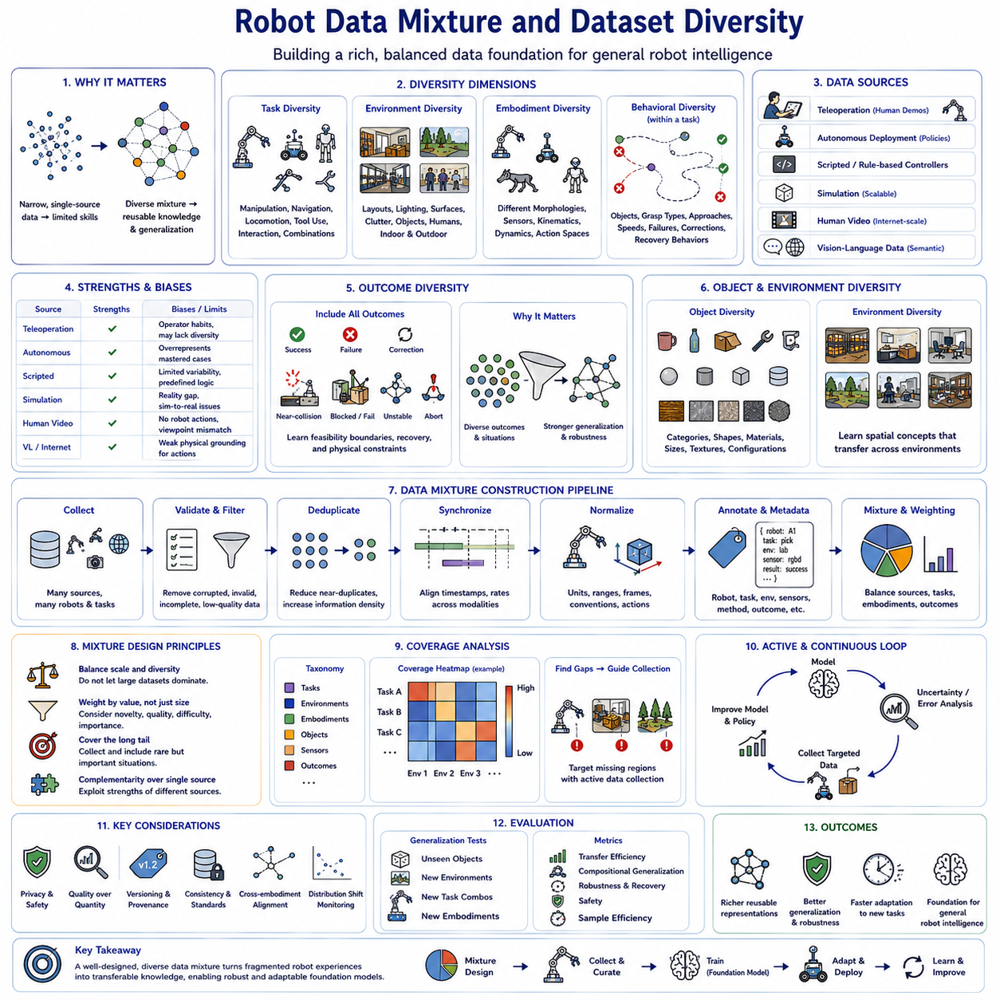{width="7.268055555555556in" height="7.268055555555556in"}

Robot foundation models depend not only on the amount of training data but also on how different forms of robot experience are combined. A robot data mixture is a deliberately constructed training distribution containing trajectories from multiple tasks, environments, robots, sensors, operators, and data sources. Its purpose is to expose the model to sufficiently varied physical experience that reusable representations can emerge instead of narrow behaviors tied to one dataset.

Dataset diversity has several dimensions that should be considered separately. Task diversity covers manipulation, navigation, locomotion, tool use, interaction, and combinations of these behaviors. Environmental diversity includes different layouts, lighting conditions, surfaces, clutter levels, objects, and human activity. Embodiment diversity introduces robots with different morphologies, sensors, kinematics, dynamics, and action spaces.

Within a single task category, behavioral diversity is also important. A grasping dataset can contain different objects, grasp types, approach directions, speeds, failures, corrections, and recovery behaviors. If millions of trajectories repeat nearly identical interactions, their effective diversity may remain low. Data scale should therefore be understood in terms of coverage and information content rather than episode count alone.

Robot datasets can originate from many collection mechanisms. Teleoperation provides demonstrations generated by human operators, autonomous deployment produces experience from learned policies, and scripted controllers can generate structured behaviors. Simulation offers scalable interaction data, while human video and internet-scale vision-language datasets provide semantic and temporal knowledge that can supplement expensive robot trajectories.

Each source contributes different strengths and biases. Teleoperated demonstrations often provide purposeful successful behavior but reflect the habits of operators. Autonomous data represents actual policy behavior but may overrepresent already mastered situations. Simulation provides extensive controlled variation but introduces a reality gap. Human video offers broad activity coverage while lacking direct robot actions. A balanced mixture attempts to exploit complementary information rather than assuming that one source is universally superior.

Successful trajectories alone are not sufficient for broad robot intelligence. Failures can reveal boundaries between feasible and infeasible actions, while corrections show how behavior can recover when execution deviates from expectations. Near-collisions, failed grasps, blocked paths, unstable contacts, and aborted actions may contain valuable information about physical constraints. Dataset diversity should therefore include meaningful variation in outcomes as well as successful demonstrations.

Object diversity strongly influences manipulation generalization. Training with many categories, shapes, materials, sizes, textures, and configurations helps models separate reusable manipulation principles from object-specific correlations. Variation within categories is particularly important because recognizing a category does not guarantee understanding every instance. Diverse object interaction allows the model to learn relationships among geometry, semantics, affordances, and action.

Environmental diversity plays a similar role for navigation and mobile manipulation. A model trained only in clean laboratory scenes may rely on regular geometry, stable illumination, or predictable obstacle placement. Warehouses, homes, offices, outdoor spaces, and crowded environments introduce different structural statistics. Mixing these environments encourages the model to learn spatial concepts that remain useful despite changes in appearance and layout.

Embodiment diversity is more difficult because different robots do not share identical observation and action interfaces. Robot arms can have different degrees of freedom and grippers, mobile robots can use different drive mechanisms, and legged robots have fundamentally different locomotion dynamics. A heterogeneous mixture therefore requires metadata and representations that identify embodiment while exposing higher-level behavioral relationships that can potentially transfer.

Sensor diversity introduces another layer of variation. Some datasets contain RGB cameras, others RGB-D, LiDAR, tactile sensing, force-torque measurements, proprioception, or combinations of these modalities. Camera viewpoints and calibration parameters can also differ substantially. A foundation-model pipeline must preserve modality identity while learning correspondences that allow common concepts to be recognized across different sensing configurations.

Task descriptions themselves can be heterogeneous. One dataset may use natural-language instructions, another symbolic task labels, another goal images, and another demonstrations without explicit semantic annotations. These formats should not automatically be treated as equivalent. Data processing and representation learning must identify relationships among them so that experiences corresponding to similar intentions can reinforce shared task concepts.

Raw dataset sizes can be misleading when constructing a mixture. A very large dataset from one robot or repetitive task can dominate optimization simply because it contains more samples. This may cause the model to allocate excessive capacity to common behaviors while underlearning rare but strategically important skills. Sampling probabilities therefore become a design variable rather than merely following the original frequency of every dataset.

Dataset weighting can compensate for these imbalances. Smaller datasets may be oversampled when they contain unique tasks or embodiments, while highly repetitive datasets may be downweighted. Weighting can also reflect data quality, difficulty, novelty, or strategic importance. The optimal mixture is not necessarily proportional to dataset size; it should allocate training exposure according to the knowledge that different sources contribute.

Quality filtering becomes increasingly important as datasets grow. Robot logs may contain corrupted images, missing sensor packets, incorrect timestamps, calibration failures, accidental operator movements, incomplete episodes, or invalid actions. Large quantities of such data can introduce misleading correlations. Automated validation, statistical checks, trajectory scoring, and selective human review can prevent low-quality samples from consuming training capacity.

Deduplication can further improve the effective information density of the training corpus. Repeated demonstrations may be useful for representing natural variation, but excessive duplication provides diminishing returns. Similarity analysis can identify nearly identical trajectories, visual scenes, or instruction patterns. Removing or reducing redundant examples allows compute to be redirected toward less represented behaviors, objects, environments, and failure conditions.

Temporal consistency must also be verified before heterogeneous datasets are combined. Camera streams, proprioception, actions, tactile measurements, and language annotations may use different clocks and frequencies. Even small synchronization errors can associate an action with the wrong observation. Standardized timestamps, interpolation, resampling, latency compensation, and episode segmentation are therefore fundamental parts of dataset preparation.

Normalization addresses differences in numerical conventions. Joint angles, velocities, forces, positions, and actions can use different units, ranges, coordinate frames, or sign conventions across datasets. Gripper commands may encode open and closed states differently. Without explicit normalization and metadata, the model may interpret technically equivalent actions as unrelated or incorrectly combine physically different commands.

Metadata is therefore an essential component of robot data mixtures. Useful metadata can describe robot identity, embodiment, sensor configuration, control frequency, coordinate systems, task definition, environment, collection method, and success status. Metadata provides the context required to interpret heterogeneous trajectories correctly and can also be supplied to the model as conditioning information when differences should influence predictions.

Dataset taxonomies help reveal gaps that raw dataset counts cannot show. A corpus may contain millions of manipulation episodes but almost no contact-rich insertion, recovery, outdoor navigation, or human interaction. Organizing data by task, environment, embodiment, object, modality, and outcome exposes these imbalances. Coverage analysis can then guide future collection toward missing regions instead of simply increasing already abundant categories.

Long-tail coverage is especially important for deployment. Everyday operation may consist mostly of routine behavior, but rare situations can determine reliability and safety. Unusual obstacles, sensor degradation, difficult objects, unexpected contacts, and recovery events occur infrequently and may therefore be underrepresented in naturally collected datasets. Targeted collection and simulation can deliberately increase exposure to these low-frequency but consequential conditions.

Active data collection can make this process more efficient. Instead of collecting trajectories uniformly, the current model can identify states where uncertainty, prediction error, or failure probability is high. Operators or autonomous systems can then gather additional examples around these weaknesses. The resulting dataset becomes dynamically coupled to model performance, creating a feedback loop between evaluation, data acquisition, and retraining.

Fleet learning can accelerate this feedback loop by distributing data collection across many deployed robots. Different robots encounter different objects, environments, users, and edge cases. Centralized aggregation can transform these experiences into a continually expanding training corpus. However, fleet data requires consistent logging, versioning, privacy management, quality control, and mechanisms for identifying which experiences provide genuinely new information.

Data mixture design is closely connected to curriculum design. Training may begin with cleaner demonstrations and common skills before increasing exposure to difficult environments, failures, longer horizons, or heterogeneous embodiments. Alternatively, broad mixing can occur from the beginning if optimization remains stable. The appropriate strategy depends on model capacity, task relationships, data quality, and the degree of interference among distributions.

Evaluation should measure whether the mixture actually improves generalization rather than merely reducing average training loss. Held-out tasks, objects, environments, embodiments, and combinations can reveal whether diversity produces transferable knowledge. Performance should also be compared across subgroups because improvements on dominant datasets can hide regressions in rare categories. Dataset-level and capability-level evaluation are therefore both necessary.

The relationship between diversity and model capacity must also be considered. Increasing dataset diversity without sufficient model capacity can cause interference because the model cannot represent all required behaviors effectively. Increasing model capacity without sufficient diversity may instead produce a larger model that memorizes narrow distributions. Useful scaling requires coordinated growth of dataset breadth, information quality, model capacity, and computational resources.

Ultimately, robot data mixture design determines the experiential world from which a foundation model learns. The model cannot acquire robust concepts about tasks, environments, objects, embodiments, and failures that are systematically absent from its training distribution. Dataset engineering is therefore not merely preparation for model training; it is part of the architecture of robot intelligence because it defines which physical regularities the model has the opportunity to discover.

A strong robot foundation dataset is consequently not simply the largest available collection. It is a curated, balanced, heterogeneous, and continuously evolving mixture that preserves meaningful differences while exposing transferable common structure. As robot learning scales, the ability to measure diversity, identify coverage gaps, reweight experience, and collect targeted new data becomes central to transforming fragmented robot datasets into a coherent foundation for general-purpose physical intelligence.

로봇 파운데이션 모델(Foundation Model)은 학습 데이터의 양뿐만 아니라 서로 다른 형태의 로봇 경험이 어떻게 결합되는지에도 의존합니다. 로봇 데이터 혼합(Robot Data Mixture)이란 여러 작업, 환경, 로봇, 센서, 운영자, 데이터 출처로부터 나온 궤적(Trajectory)들을 포함하는, 의도적으로 구성된 학습 분포를 말합니다. 그 목적은 하나의 데이터셋(Dataset)에 묶인 좁은 행동이 아니라 재사용 가능한 표현(Representation)이 나타날 수 있을 만큼 충분히 다양한 물리적 경험에 모델을 노출시키는 것입니다.

데이터셋 다양성(Diversity)에는 별도로 고려되어야 할 여러 차원이 있습니다. 작업 다양성은 조작(Manipulation), 내비게이션, 이동(Locomotion), 도구 사용, 상호작용, 그리고 이러한 행동들의 조합을 포괄합니다. 환경 다양성은 서로 다른 배치, 조명 조건, 표면, 혼잡도, 사물, 인간 활동을 포함합니다. 신체화(Embodiment) 다양성은 서로 다른 형태(Morphology), 센서, 운동학(Kinematics), 동역학, 행동 공간을 가진 로봇들을 도입합니다.

하나의 작업 범주 내에서도 행동적 다양성이 중요합니다. 파지(Grasping) 데이터셋은 서로 다른 사물, 파지 유형, 접근 방향, 속도, 실패, 수정, 복구 행동을 포함할 수 있습니다. 만약 수백만 개의 궤적이 거의 동일한 상호작용을 반복한다면, 그 실질적인 다양성은 낮게 유지될 수 있습니다. 따라서 데이터 규모는 단순한 에피소드(Episode) 수가 아니라 커버리지(Coverage)와 정보 함량의 관점에서 이해되어야 합니다.

로봇 데이터셋은 여러 수집 메커니즘으로부터 나올 수 있습니다. 원격 조작(Teleoperation)은 인간 운영자가 생성한 시연을 제공하고, 자율 배포는 학습된 정책으로부터 나온 경험을 만들어내며, 스크립트화된(Scripted) 제어기는 구조화된 행동을 생성할 수 있습니다. 시뮬레이션(Simulation)은 확장 가능한 상호작용 데이터를 제공하는 반면, 인간 영상과 인터넷 규모의 시각-언어 데이터셋은 값비싼 로봇 궤적을 보완할 수 있는 의미론적, 시간적 지식을 제공합니다.

각각의 출처는 서로 다른 강점과 편향을 기여합니다. 원격 조작 시연은 흔히 목적성 있는 성공적인 행동을 제공하지만 운영자의 습관을 반영합니다. 자율 데이터는 실제 정책 행동을 나타내지만 이미 숙달된 상황을 과대표현할 수 있습니다. 시뮬레이션은 광범위한 통제된 변형을 제공하지만 현실 격차(Reality Gap)를 도입합니다. 인간 영상은 직접적인 로봇 행동이 부족한 반면 폭넓은 활동 커버리지를 제공합니다. 균형 잡힌 혼합은 하나의 출처가 보편적으로 우월하다고 가정하기보다 상호 보완적인 정보를 활용하고자 합니다.

성공적인 궤적만으로는 폭넓은 로봇 지능에 충분하지 않습니다. 실패는 실현 가능한 행동과 실현 불가능한 행동 사이의 경계를 드러낼 수 있는 반면, 수정(Correction)은 실행이 기대에서 벗어났을 때 행동이 어떻게 복구될 수 있는지를 보여줍니다. 아차충돌(Near-collision), 실패한 파지, 막힌 경로, 불안정한 접촉, 중단된 행동은 물리적 제약에 대한 귀중한 정보를 담고 있을 수 있습니다. 따라서 데이터셋 다양성은 성공적인 시연뿐만 아니라 결과에서의 의미 있는 변형도 포함해야 합니다.

사물 다양성은 조작의 일반화에 강한 영향을 미칩니다. 많은 범주, 형태, 재질, 크기, 질감, 배치로 학습하는 것은 모델이 재사용 가능한 조작 원리를 사물 특정적인 상관관계로부터 분리하는 데 도움이 됩니다. 범주를 인식하는 것이 모든 사례를 이해한다는 것을 보장하지는 않기 때문에 범주 내의 변형이 특히 중요합니다. 다양한 사물 상호작용은 모델이 기하학적 구조, 의미론, 행위유발성(Affordance), 행동 간의 관계를 학습할 수 있게 합니다.

환경 다양성은 내비게이션과 이동식 조작(Mobile Manipulation)에서도 유사한 역할을 합니다. 깨끗한 실험실 장면에서만 학습된 모델은 규칙적인 기하학적 구조, 안정적인 조명, 또는 예측 가능한 장애물 배치에 의존할 수 있습니다. 창고, 가정, 사무실, 실외 공간, 붐비는 환경은 서로 다른 구조적 통계를 도입합니다. 이러한 환경들을 혼합하는 것은 모델이 외관과 배치의 변화에도 불구하고 계속 유용한 공간적 개념을 학습하도록 격려합니다.

신체화 다양성은 서로 다른 로봇들이 동일한 관찰 및 행동 인터페이스를 공유하지 않기 때문에 더 어렵습니다. 로봇 팔은 서로 다른 자유도(Degree of Freedom)와 그리퍼(Gripper)를 가질 수 있고, 이동 로봇은 서로 다른 구동 메커니즘을 사용할 수 있으며, 다리형 로봇은 근본적으로 다른 이동 동역학을 가집니다. 따라서 이질적인 혼합은 신체화를 식별하는 메타데이터(Metadata)와 표현을 필요로 하는 동시에, 잠재적으로 전이될 수 있는 더 높은 수준의 행동적 관계를 드러내야 합니다.

센서 다양성은 또 다른 층위의 변형을 도입합니다. 일부 데이터셋은 RGB 카메라를 포함하고, 다른 데이터셋은 RGB-D, 라이다(LiDAR), 촉각 감지, 힘-토크(Force-torque) 측정, 고유수용감각(Proprioception), 또는 이러한 모달리티(Modality)들의 조합을 포함합니다. 카메라 시점과 보정(Calibration) 매개변수 또한 상당히 다를 수 있습니다. 파운데이션 모델 파이프라인(Pipeline)은 서로 다른 감지 구성 전반에서 공통된 개념이 인식될 수 있게 하는 대응관계를 학습하는 동시에 모달리티 정체성을 보존해야 합니다.

작업 기술(Description) 자체도 이질적일 수 있습니다. 어떤 데이터셋은 자연어 지시를 사용하고, 다른 데이터셋은 기호적 작업 레이블(Label)을, 또 다른 데이터셋은 목표 이미지를, 또 다른 데이터셋은 명시적인 의미론적 주석 없는 시연을 사용할 수 있습니다. 이러한 형식들은 자동으로 동등하게 취급되어서는 안 됩니다. 데이터 처리와 표현 학습은 유사한 의도에 해당하는 경험들이 공유된 작업 개념을 강화할 수 있도록 그들 간의 관계를 식별해야 합니다.

혼합을 구성할 때 원시 데이터셋 크기는 오해를 일으킬 수 있습니다. 하나의 로봇이나 반복적인 작업으로부터 나온 매우 큰 데이터셋은 단순히 더 많은 샘플을 포함한다는 이유만으로 최적화를 지배할 수 있습니다. 이는 모델이 드물지만 전략적으로 중요한 기술을 충분히 학습하지 못하면서 흔한 행동에 과도한 용량을 할당하게 만들 수 있습니다. 따라서 샘플링 확률(Sampling Probability)은 단순히 모든 데이터셋의 원래 빈도를 따르기보다 설계 변수가 됩니다.

데이터셋 가중치 부여(Weighting)는 이러한 불균형을 보완할 수 있습니다. 더 작은 데이터셋이라도 고유한 작업이나 신체화를 포함한다면 과대표집될 수 있는 반면, 매우 반복적인 데이터셋은 가중치가 낮아질 수 있습니다. 가중치 부여는 또한 데이터 품질, 난이도, 새로움, 전략적 중요성을 반영할 수도 있습니다. 최적의 혼합이 반드시 데이터셋 크기에 비례하는 것은 아니며, 서로 다른 출처가 기여하는 지식에 따라 학습 노출을 배분해야 합니다.

데이터셋이 커짐에 따라 품질 필터링(Filtering)은 점점 더 중요해집니다. 로봇 로그(Log)에는 손상된 이미지, 누락된 센서 패킷(Packet), 잘못된 타임스탬프(Timestamp), 보정 실패, 우발적인 운영자 움직임, 불완전한 에피소드, 또는 유효하지 않은 행동이 포함될 수 있습니다. 이러한 데이터가 대량으로 존재하면 오해의 소지가 있는 상관관계를 도입할 수 있습니다. 자동화된 검증, 통계적 점검, 궤적 채점, 선택적인 인간 검토는 저품질 샘플이 학습 용량을 소모하는 것을 방지할 수 있습니다.

중복 제거(Deduplication)는 학습 말뭉치(Corpus)의 실질적인 정보 밀도를 더욱 개선할 수 있습니다. 반복된 시연은 자연스러운 변형을 나타내는 데 유용할 수 있지만, 과도한 중복은 체감 수익을 감소시킵니다. 유사도 분석(Similarity Analysis)은 거의 동일한 궤적, 시각적 장면, 또는 지시 패턴을 식별할 수 있습니다. 중복되는 예시를 제거하거나 줄이는 것은 덜 대표된 행동, 사물, 환경, 실패 조건 쪽으로 계산을 재배치할 수 있게 합니다.

이질적인 데이터셋을 결합하기 전에 시간적 일관성 또한 검증되어야 합니다. 카메라 스트림, 고유수용감각, 행동, 촉각 측정, 언어 주석은 서로 다른 시계와 빈도를 사용할 수 있습니다. 작은 동기화 오류라도 행동을 잘못된 관찰과 연관시킬 수 있습니다. 따라서 표준화된 타임스탬프, 보간(Interpolation), 재샘플링(Resampling), 지연 시간 보상, 에피소드 분할은 데이터셋 준비의 근본적인 부분입니다.

정규화(Normalization)는 수치적 관례의 차이를 다룹니다. 관절 각도, 속도, 힘, 위치, 행동은 데이터셋 전반에 걸쳐 서로 다른 단위, 범위, 좌표계, 또는 부호 관례를 사용할 수 있습니다. 그리퍼 명령은 열림 및 닫힘 상태를 다르게 부호화할 수 있습니다. 명시적인 정규화와 메타데이터가 없다면, 모델은 기술적으로 동등한 행동을 무관한 것으로 해석하거나 물리적으로 다른 명령을 잘못 결합할 수 있습니다.

따라서 메타데이터는 로봇 데이터 혼합의 필수적인 구성요소입니다. 유용한 메타데이터는 로봇 정체성, 신체화, 센서 구성, 제어 빈도, 좌표계, 작업 정의, 환경, 수집 방법, 성공 여부를 기술할 수 있습니다. 메타데이터는 이질적인 궤적을 올바르게 해석하는 데 필요한 맥락을 제공하며, 차이가 예측에 영향을 미쳐야 할 때 조건화(Conditioning) 정보로서 모델에 제공될 수도 있습니다.

데이터셋 분류체계(Taxonomy)는 원시적인 데이터셋 수로는 드러낼 수 없는 격차를 밝혀내는 데 도움이 됩니다. 어떤 말뭉치는 수백만 개의 조작 에피소드를 포함하면서도 접촉이 풍부한 삽입(Insertion), 복구, 실외 내비게이션, 또는 인간 상호작용은 거의 포함하지 않을 수 있습니다. 작업, 환경, 신체화, 사물, 모달리티, 결과별로 데이터를 조직화하는 것은 이러한 불균형을 드러냅니다. 그러면 커버리지 분석은 이미 풍부한 범주를 단순히 늘리는 대신 향후 수집을 누락된 영역으로 이끌 수 있습니다.

롱테일(Long-tail) 커버리지는 배포에 있어 특히 중요합니다. 일상적인 운영은 대부분 일상적인 행동으로 구성될 수 있지만, 드문 상황이 신뢰성과 안전성을 결정할 수 있습니다. 특이한 장애물, 센서 성능 저하, 어려운 사물, 예상치 못한 접촉, 복구 사건은 드물게 발생하기 때문에 자연스럽게 수집된 데이터셋에서 과소표현될 수 있습니다. 표적화된 수집과 시뮬레이션은 이러한 저빈도이지만 결과에 중대한 영향을 미치는 조건에 대한 노출을 의도적으로 늘릴 수 있습니다.

능동적 데이터 수집(Active Data Collection)은 이 과정을 더 효율적으로 만들 수 있습니다. 궤적을 균일하게 수집하는 대신, 현재 모델은 불확실성, 예측 오차, 또는 실패 확률이 높은 상태를 식별할 수 있습니다. 그런 다음 운영자나 자율 시스템은 이러한 약점들 주변에서 추가적인 예시를 수집할 수 있습니다. 그 결과로 나오는 데이터셋은 모델 성능과 동적으로 결합되어, 평가, 데이터 수집, 재학습 사이의 피드백(Feedback) 루프(Loop)를 만들어냅니다.

군단 학습(Fleet Learning)은 데이터 수집을 여러 배포된 로봇 전반에 분산시킴으로써 이러한 피드백 루프를 가속화할 수 있습니다. 서로 다른 로봇은 서로 다른 사물, 환경, 사용자, 경계 사례(Edge Case)를 마주합니다. 중앙집중식 집계(Aggregation)는 이러한 경험들을 지속적으로 확장되는 학습 말뭉치로 전환할 수 있습니다. 그러나 군단 데이터는 일관된 로깅(Logging), 버전 관리(Versioning), 프라이버시 관리, 품질 관리, 그리고 어떤 경험이 진정으로 새로운 정보를 제공하는지를 식별하는 메커니즘을 필요로 합니다.

데이터 혼합 설계는 커리큘럼(Curriculum) 설계와 밀접하게 연결되어 있습니다. 학습은 어려운 환경, 실패, 더 긴 시야(Horizon), 또는 이질적인 신체화에 대한 노출을 늘리기 전에 더 깨끗한 시연과 일반적인 기술로 시작할 수 있습니다. 또는, 최적화가 안정적으로 유지된다면 처음부터 폭넓은 혼합이 이루어질 수도 있습니다. 적절한 전략은 모델 용량, 작업 간의 관계, 데이터 품질, 분포들 간의 간섭 정도에 달려 있습니다.

평가는 혼합이 단순히 평균 학습 손실(Loss)을 줄이는지가 아니라 실제로 일반화를 개선하는지를 측정해야 합니다. 유보된(Held-out) 작업, 사물, 환경, 신체화, 그리고 그 조합들은 다양성이 전이 가능한 지식을 만들어내는지를 드러낼 수 있습니다. 주요 데이터셋에서의 개선이 드문 범주에서의 퇴보를 감출 수 있기 때문에, 성능은 하위 집단(Subgroup) 전반에 걸쳐서도 비교되어야 합니다. 따라서 데이터셋 수준과 역량 수준의 평가가 모두 필요합니다.

다양성과 모델 용량 간의 관계 또한 고려되어야 합니다. 충분한 모델 용량 없이 데이터셋 다양성을 늘리는 것은 모델이 필요한 모든 행동을 효과적으로 표현할 수 없기 때문에 간섭을 초래할 수 있습니다. 충분한 다양성 없이 모델 용량을 늘리는 것은 대신 좁은 분포를 암기하는 더 큰 모델을 만들어낼 수 있습니다. 유용한 스케일링(Scaling)은 데이터셋의 폭, 정보 품질, 모델 용량, 계산 자원의 조율된 성장을 필요로 합니다.

궁극적으로, 로봇 데이터 혼합 설계는 파운데이션 모델이 학습하는 경험적 세계를 결정합니다. 모델은 그 학습 분포에서 체계적으로 결여된 작업, 환경, 사물, 신체화, 실패에 대한 견고한 개념을 습득할 수 없습니다. 따라서 데이터셋 엔지니어링은 단순히 모델 학습을 위한 준비가 아니라, 모델이 어떤 물리적 규칙성을 발견할 기회를 갖는지를 정의하기 때문에 로봇 지능의 아키텍처의 일부입니다.

결과적으로, 강력한 로봇 파운데이션 데이터셋은 단순히 이용 가능한 가장 큰 모음이 아닙니다. 이는 의미 있는 차이를 보존하면서도 전이 가능한 공통 구조를 드러내는, 정제되고 균형 잡히고 이질적이며 지속적으로 발전하는 혼합입니다. 로봇 학습이 확장됨에 따라, 다양성을 측정하고, 커버리지 격차를 식별하고, 경험에 재가중치를 부여하고, 표적화된 새로운 데이터를 수집하는 능력은 파편화된 로봇 데이터셋을 범용 물리적 지능을 위한 일관된 기반으로 전환하는 데 핵심적이 됩니다.

## 02.09. Transfer Generalization and Adaptation

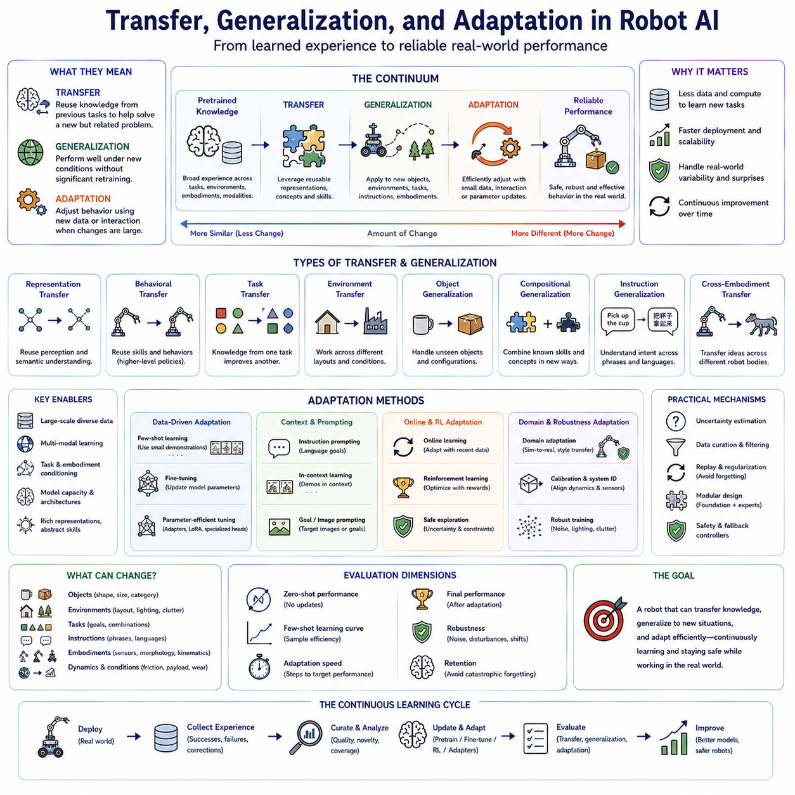{width="7.268055555555556in" height="7.268055555555556in"}

Transfer is the ability of a robot model to reuse knowledge acquired from previous experience when solving a related but different problem. Instead of learning every new task from the beginning, the model carries forward representations of objects, geometry, motion, language, affordances, and reusable skills. Effective transfer is one of the central motivations for robot foundation models because physical robot data is expensive to collect.

Generalization describes the ability to perform correctly when deployment conditions differ from the training distribution without requiring substantial retraining. These differences may involve unseen objects, new object configurations, unfamiliar environments, alternative instructions, different users, or novel combinations of known skills. A model that performs well only on previously observed situations may have memorized its training distribution rather than learned reusable physical structure.

Adaptation complements generalization by allowing the model to modify its behavior when the new situation cannot be handled directly by pretrained knowledge. Adaptation may use additional demonstrations, interaction data, reinforcement learning, prompting, parameter-efficient tuning, or updates to specialized modules. The objective is to acquire competence in the new domain with much less data and computation than would be required for training a new model from scratch.

Transfer, generalization, and adaptation therefore describe related but distinct capabilities. Transfer asks whether previously learned knowledge helps another problem, generalization asks whether the model succeeds under distribution change without significant modification, and adaptation asks how efficiently it can adjust when modification is necessary. Together they determine whether pretraining produces reusable intelligence rather than merely high performance on a large collection of memorized tasks.

Representation transfer is one of the simplest forms of reuse. A visual encoder pretrained across diverse robot and non-robot data may already represent object categories, shapes, surfaces, spatial relationships, and semantic concepts. These features can then support a new manipulation or navigation task. The downstream system does not need to rediscover basic perceptual structure and can concentrate its limited task-specific data on the behavior that remains to be learned.

Behavioral transfer extends reuse from perception to action. Skills such as reaching, grasping, approaching, avoiding, transporting, opening, and placing recur across many tasks. If a foundation model captures these patterns at an appropriate abstraction level, they can be reused or recombined for new objectives. This is more difficult than feature transfer because successful actions depend on embodiment, dynamics, contact conditions, and the current physical context.

Task transfer occurs when knowledge learned from one objective improves performance on another. A robot trained to place objects into containers may already understand reaching, grasp stability, object transport, and spatial relationships that help with shelf stocking. Transfer is strongest when the model identifies common substructure between tasks instead of treating every task identifier as an unrelated mapping from observations to actions.

Environment transfer requires behavior to remain useful when physical surroundings change. Differences in layout, lighting, clutter, surfaces, object locations, sensor conditions, or human activity can create distribution shifts. Diverse pretraining encourages the model to separate stable physical relationships from accidental environmental correlations. The robot should ignore irrelevant changes while remaining sensitive to changes that affect collision risk, reachability, traction, visibility, or task feasibility.

Object generalization is particularly important for manipulation. A model may encounter a cup, box, tool, package, or container whose exact geometry and appearance were never present during training. Useful representations connect semantic category information with geometry and affordances rather than relying on memorized visual templates. Generalization then becomes the ability to infer how a new object can be manipulated from its relationship to previously learned concepts.

Compositional generalization goes beyond recognizing unfamiliar instances. A model may already know several objects, locations, and skills but encounter a new combination such as transporting a familiar object to an unfamiliar destination using a previously learned sequence of behaviors. Instead of requiring demonstrations for every possible combination, the model should compose known concepts and skills according to the current instruction and physical constraints.

Instruction generalization similarly requires understanding intent beyond exact training phrases. Different linguistic expressions can describe equivalent goals, while familiar words can be combined into novel instructions. Language-pretrained representations provide semantic structure, but successful robot behavior additionally requires grounding those instructions in current perception and action. The model must determine which objects and relationships the instruction refers to and translate that interpretation into executable behavior.

Cross-embodiment transfer represents a more difficult form of generalization because the receiving robot may have different sensors, morphology, kinematics, dynamics, or action spaces. Raw motor commands from one embodiment may be useless to another, while higher-level concepts such as approach, grasp, transport, or avoid can remain transferable. Foundation models therefore benefit from separating shared behavioral knowledge from embodiment-specific execution interfaces.

Embodiment conditioning can support this separation. Robot identity, morphology, sensor configuration, kinematic parameters, or capability descriptions can be represented explicitly so that the model knows which physical system is executing the task. Shared layers can encode general semantics and skills, while robot-specific encoders, adapters, action heads, or controllers translate these representations into commands appropriate for a particular platform.

Zero-shot generalization is the strongest case in which a model performs a new task or handles a new condition without additional examples or parameter updates. This capability depends heavily on the coverage and structure learned during pretraining. In robotics, true zero-shot performance is difficult because small physical differences can have significant consequences. Nevertheless, broad semantic and behavioral pretraining can reduce the amount of adaptation required even when perfect zero-shot execution is unrealistic.

Few-shot adaptation addresses cases where a small number of demonstrations can bridge the remaining gap. A pretrained model may already understand the relevant objects, task semantics, and basic skills, requiring only a few examples to learn a new arrangement or execution detail. The value of foundation-model pretraining can therefore be measured partly by how rapidly performance improves as small amounts of task-specific data become available.

Fine-tuning provides a direct adaptation mechanism by updating pretrained parameters using data from the target task or environment. Full fine-tuning can offer substantial flexibility but may require significant computation and can overwrite useful pretrained knowledge. Selective fine-tuning can update only specific layers or modules, preserving more of the original model while concentrating adaptation on representations most relevant to the deployment shift.

Parameter-efficient adaptation reduces the number of parameters that must change. Adapters, low-rank updates, specialized heads, or other compact modules can modify model behavior while keeping most foundation parameters fixed. This can be valuable when multiple robots or customers require different adaptations because a common foundation can be maintained while relatively small deployment-specific components store local specialization.

Prompt-based adaptation offers another possibility when the model architecture supports contextual conditioning. Language instructions, demonstrations, goal examples, images, trajectories, or state-action histories can provide information about a new task without permanently changing model parameters. In-context adaptation is attractive because behavior can change rapidly, although its effectiveness depends on whether pretraining has taught the model how to interpret contextual examples.

Online adaptation extends learning into deployment. A robot can use recent observations, outcomes, corrections, or failures to adjust its behavior as environmental conditions evolve. This may be useful for changing payloads, surfaces, object distributions, sensor characteristics, or interaction patterns. However, unrestricted online learning introduces safety and stability risks, so adaptation often requires bounded updates, validation, uncertainty monitoring, or separation from safety-critical controllers.

Reinforcement learning can adapt pretrained behavior using direct interaction with the target environment. Instead of relying only on demonstrations, the robot can optimize performance according to task rewards or preferences. Starting from a pretrained policy can dramatically reduce exploration compared with learning from scratch. Nevertheless, physical exploration remains costly, making simulation, offline data, constrained exploration, and safety mechanisms important components of practical adaptation.

Domain adaptation specifically addresses systematic differences between source and target distributions. Simulation-to-real transfer is a common example in which visual appearance, sensor noise, dynamics, contact behavior, and latency may differ between simulated and physical systems. Domain randomization, representation alignment, calibration, real-world fine-tuning, and mixed simulation-real training can reduce these gaps while preserving the scalability advantages of simulation.

Robustness determines how much distribution shift can be tolerated before adaptation becomes necessary. A robust model should maintain useful behavior under moderate sensor noise, lighting changes, object variation, clutter, viewpoint changes, and partial uncertainty. However, robustness should not be confused with blindly ignoring change. The model must detect when a change affects physical feasibility or safety and modify behavior accordingly.

Uncertainty estimation can help determine when pretrained knowledge is insufficient. High uncertainty may indicate an unfamiliar object, ambiguous instruction, unusual environment, or state outside the training distribution. Instead of executing an unreliable prediction confidently, the system can request clarification, choose a conservative behavior, activate a fallback controller, collect additional observations, or trigger targeted adaptation.

Catastrophic forgetting becomes a concern when adaptation modifies model parameters. Learning a new task can degrade capabilities acquired during pretraining or previous adaptations. Replay data, regularization, modular updates, frozen foundation components, and continual-learning strategies can reduce this effect. A scalable robot foundation system should accumulate competence over time rather than repeatedly exchanging old capabilities for new ones.

Evaluation should explicitly separate these capabilities. Generalization can be tested using held-out objects, environments, task combinations, and instructions without updating the model. Transfer can be measured by comparing learning efficiency with and without pretraining. Adaptation can be evaluated through the number of demonstrations, interactions, optimization steps, or parameter updates required to reach a target level of performance.

The most valuable foundation models should improve the entire adaptation curve rather than only initial zero-shot accuracy. A model may not immediately solve a substantially different task, yet still be highly useful if it reaches reliable performance after ten demonstrations instead of thousands. Sample efficiency, adaptation speed, final performance, robustness, retained capabilities, and safety should therefore be considered together when evaluating transferable robot intelligence.

Ultimately, transfer, generalization, and adaptation form a continuous pathway from pretrained knowledge to real-world competence. Transfer provides reusable representations and skills, generalization applies them directly when the new situation is sufficiently related, and adaptation modifies them when the remaining difference is significant. The better the foundation model captures common physical structure, the smaller the adaptation burden becomes.

This capability is essential for moving from individually engineered robot applications toward scalable physical intelligence. Real environments will always contain objects, tasks, users, and conditions that were not exhaustively represented during training. A practical robot foundation model must therefore do more than remember a broad dataset: it must reuse prior knowledge, recognize meaningful novelty, adapt efficiently, preserve existing competence, and continue operating safely as its physical world changes.

전이(Transfer)는 로봇 모델이 이전 경험에서 획득한 지식을 관련되어 있지만 서로 다른 문제를 해결하는 데 재사용하는 능력이다. 모델은 새로운 작업을 처음부터 다시 학습하는 대신 객체(Object), 기하 구조(Geometry), 움직임(Motion), 언어(Language), 어포던스(Affordance), 재사용 가능한 스킬(Reusable Skill)에 대한 표현을 이전 경험에서 가져와 활용한다. 효과적인 전이는 물리적 로봇 데이터의 수집 비용이 높기 때문에 로봇 파운데이션 모델(Robot Foundation Model)을 개발하는 핵심적인 동기 중 하나이다.

일반화(Generalization)는 배치 조건(Deployment Condition)이 학습 분포(Training Distribution)와 달라지더라도 상당한 재학습 없이 올바르게 동작하는 능력을 의미한다. 이러한 차이에는 학습하지 않은 객체(Unseen Object), 새로운 객체 구성(Object Configuration), 익숙하지 않은 환경, 다른 형태의 명령, 새로운 사용자 또는 기존 스킬의 새로운 조합이 포함될 수 있다. 이전에 관측한 상황에서만 높은 성능을 보이는 모델은 재사용 가능한 물리 구조를 학습한 것이 아니라 학습 분포를 암기했을 가능성이 있다.

적응(Adaptation)은 새로운 상황을 사전학습된 지식(Pretrained Knowledge)만으로 직접 처리할 수 없을 때 모델이 자신의 행동을 수정할 수 있도록 함으로써 일반화를 보완한다. 적응에는 추가 시연(Demonstration), 상호작용 데이터(Interaction Data), 강화학습(Reinforcement Learning), 프롬프팅(Prompting), 파라미터 효율적 튜닝(Parameter-Efficient Tuning), 특화 모듈(Specialized Module)의 업데이트가 사용될 수 있다. 목표는 새로운 모델을 처음부터 학습하는 것보다 훨씬 적은 데이터와 계산량으로 새로운 도메인(Domain)의 능력을 획득하는 것이다.

따라서 전이, 일반화, 적응은 서로 관련되어 있지만 구별되는 능력을 나타낸다. 전이는 이전에 학습한 지식이 다른 문제를 해결하는 데 도움이 되는지를 다루고, 일반화는 모델을 크게 수정하지 않고 분포 변화(Distribution Shift)에서도 성공할 수 있는지를 다루며, 적응은 수정이 필요한 경우 얼마나 효율적으로 변화할 수 있는지를 다룬다. 이들은 함께 사전학습이 단순히 많은 작업을 암기하는 것이 아니라 재사용 가능한 지능(Reusable Intelligence)을 생성했는지를 결정한다.

표현 전이(Representation Transfer)는 가장 기본적인 지식 재사용 형태 중 하나이다. 다양한 로봇 및 비로봇 데이터(Non-Robot Data)에서 사전학습된 비전 인코더(Vision Encoder)는 이미 객체 범주(Object Category), 형상(Shape), 표면(Surface), 공간 관계(Spatial Relationship), 의미 개념(Semantic Concept)을 표현할 수 있다. 이러한 특징은 새로운 조작 또는 내비게이션 작업을 지원할 수 있으며, 다운스트림 시스템(Downstream System)은 기본적인 지각 구조를 다시 학습할 필요 없이 제한된 작업별 데이터를 아직 학습되지 않은 행동에 집중할 수 있다.

행동 전이(Behavioral Transfer)는 지각에서 행동으로 지식 재사용의 범위를 확장한다. 도달하기(Reaching), 파지하기(Grasping), 접근하기(Approaching), 회피하기(Avoiding), 운반하기(Transporting), 열기(Opening), 배치하기(Placing)와 같은 스킬은 다양한 작업에서 반복된다. 파운데이션 모델이 이러한 패턴을 적절한 추상화 수준(Abstraction Level)에서 포착한다면 새로운 목표를 위해 재사용하거나 새롭게 조합할 수 있다. 그러나 성공적인 행동은 체화(Embodiment), 동역학(Dynamics), 접촉 조건(Contact Condition), 현재의 물리적 맥락에 의존하기 때문에 행동 전이는 특징 전이(Feature Transfer)보다 어렵다.

작업 전이(Task Transfer)는 하나의 목표에서 학습한 지식이 다른 목표의 성능을 향상시키는 경우를 의미한다. 객체를 용기에 배치하도록 학습된 로봇은 이미 도달, 파지 안정성(Grasp Stability), 객체 운반(Object Transport), 공간 관계를 이해하고 있을 수 있으며, 이러한 지식은 선반에 물건을 배치하는 작업에도 활용될 수 있다. 모델이 모든 작업 식별자(Task Identifier)를 서로 관련 없는 관측-행동 매핑으로 처리하는 대신 작업 사이의 공통 하위 구조(Common Substructure)를 식별할 때 전이 효과가 가장 크게 나타난다.

환경 전이(Environment Transfer)는 물리적 주변 환경이 변화해도 기존 행동이 유용하게 유지되는 것을 요구한다. 레이아웃(Layout), 조명, 복잡도(Clutter), 표면, 객체 위치, 센서 조건, 인간 활동의 변화는 분포 이동을 발생시킬 수 있다. 다양한 사전학습은 모델이 안정적인 물리 관계와 우연한 환경적 상관관계(Accidental Environmental Correlation)를 구분하도록 한다. 로봇은 중요하지 않은 변화는 무시하면서 충돌 위험(Collision Risk), 도달 가능성(Reachability), 접지력(Traction), 가시성(Visibility), 작업 실행 가능성(Task Feasibility)에 영향을 미치는 변화에는 민감하게 반응해야 한다.

객체 일반화(Object Generalization)는 조작 작업에서 특히 중요하다. 모델은 학습 과정에서 정확히 경험하지 못한 기하 구조와 외형을 가진 컵, 상자, 도구, 패키지, 용기 등을 만날 수 있다. 유용한 표현은 암기된 시각 템플릿(Visual Template)에 의존하는 대신 의미 범주(Semantic Category)를 기하 구조 및 어포던스와 연결한다. 일반화는 새로운 객체와 이전에 학습한 개념 사이의 관계를 이용하여 해당 객체를 어떻게 조작할 수 있는지를 추론하는 능력이 된다.

조합적 일반화(Compositional Generalization)는 익숙하지 않은 객체 인스턴스(Unfamiliar Instance)를 인식하는 것을 넘어선다. 모델이 여러 객체, 위치, 스킬을 이미 알고 있더라도 익숙한 객체를 새로운 목적지로 운반하면서 이전에 학습한 행동 시퀀스를 사용하는 새로운 조합을 경험할 수 있다. 모든 가능한 조합마다 시연을 요구하는 대신 모델은 현재 명령과 물리적 제약조건에 따라 기존 개념과 스킬을 조합할 수 있어야 한다.

명령 일반화(Instruction Generalization)는 학습 과정에서 사용된 정확한 표현을 넘어 의도(Intent)를 이해할 것을 요구한다. 서로 다른 언어 표현이 동일한 목표를 설명할 수 있으며 익숙한 단어가 새로운 명령으로 결합될 수도 있다. 언어 사전학습 표현(Language-Pretrained Representation)은 의미 구조를 제공하지만, 성공적인 로봇 행동을 위해서는 이러한 명령을 현재의 지각과 행동에 추가로 그라운딩(Grounding)해야 한다. 모델은 명령이 어떤 객체와 관계를 지칭하는지 판단하고 그 해석을 실행 가능한 행동으로 변환해야 한다.

교차 체화 전이(Cross-Embodiment Transfer)는 대상 로봇이 서로 다른 센서, 형태(Morphology), 운동학(Kinematics), 동역학 또는 행동 공간(Action Space)을 가질 수 있기 때문에 더욱 어려운 형태의 일반화이다. 한 체화의 원시 모터 명령(Raw Motor Command)은 다른 체화에서 사용할 수 없을 수 있지만 접근, 파지, 운반, 회피와 같은 고수준 개념은 전이될 수 있다. 따라서 파운데이션 모델은 공유 가능한 행동 지식(Shared Behavioral Knowledge)과 체화별 실행 인터페이스(Embodiment-Specific Execution Interface)를 분리하는 것이 유리하다.

체화 조건화(Embodiment Conditioning)는 이러한 분리를 지원할 수 있다. 로봇 식별 정보, 형태, 센서 구성(Sensor Configuration), 운동학 파라미터(Kinematic Parameter), 능력 설명(Capability Description)을 명시적으로 표현하여 모델이 어떤 물리 시스템에서 작업을 실행하고 있는지 이해하도록 할 수 있다. 공유 계층(Shared Layer)은 일반적인 의미와 스킬을 인코딩하고, 로봇별 인코더(Robot-Specific Encoder), 어댑터(Adapter), 행동 헤드(Action Head), 제어기(Controller)는 이러한 표현을 특정 플랫폼에 적합한 명령으로 변환할 수 있다.

제로샷 일반화(Zero-Shot Generalization)는 추가적인 예제나 파라미터 업데이트 없이 새로운 작업이나 새로운 조건을 처리하는 가장 강력한 형태이다. 이러한 능력은 사전학습 과정에서 확보한 데이터 범위(Coverage)와 학습된 구조에 크게 의존한다. 로보틱스에서는 작은 물리적 차이도 상당한 결과 차이를 만들 수 있기 때문에 진정한 제로샷 성능을 달성하기 어렵다. 그러나 광범위한 의미 및 행동 사전학습은 완전한 제로샷 실행이 불가능한 경우에도 필요한 적응량을 감소시킬 수 있다.

퓨샷 적응(Few-Shot Adaptation)은 소수의 시연을 이용하여 남아 있는 차이를 보완하는 경우를 다룬다. 사전학습된 모델은 관련 객체, 작업 의미(Task Semantics), 기본 스킬을 이미 이해하고 있을 수 있으므로 새로운 배치 방식이나 실행 세부사항을 학습하기 위해 몇 개의 예제만 필요할 수 있다. 따라서 파운데이션 모델 사전학습의 가치는 소량의 작업별 데이터가 추가되었을 때 성능이 얼마나 빠르게 향상되는지를 통해 평가할 수 있다.

미세조정(Fine-Tuning)은 목표 작업이나 환경에서 얻은 데이터를 이용하여 사전학습 파라미터를 업데이트하는 직접적인 적응 방법이다. 전체 미세조정(Full Fine-Tuning)은 높은 유연성을 제공하지만 상당한 계산량이 필요하고 유용한 사전학습 지식을 덮어쓸 수 있다. 선택적 미세조정(Selective Fine-Tuning)은 특정 계층이나 모듈만 업데이트하여 기존 모델의 지식을 더 많이 보존하면서 배치 환경 변화에 중요한 표현에 적응을 집중할 수 있다.

파라미터 효율적 적응(Parameter-Efficient Adaptation)은 변경해야 하는 파라미터의 수를 줄인다. 어댑터, 저랭크 업데이트(Low-Rank Update), 특화 헤드(Specialized Head) 등의 소형 모듈을 이용하면 대부분의 파운데이션 파라미터를 고정한 상태에서 모델 행동을 변경할 수 있다. 여러 로봇이나 고객 환경마다 서로 다른 적응이 필요한 경우 공통 파운데이션 모델을 유지하면서 상대적으로 작은 배치별 구성요소(Deployment-Specific Component)에 로컬 전문화(Local Specialization)를 저장할 수 있다는 장점이 있다.

프롬프트 기반 적응(Prompt-Based Adaptation)은 모델 아키텍처가 맥락 조건화(Contextual Conditioning)를 지원하는 경우 또 다른 가능성을 제공한다. 언어 명령, 시연, 목표 예제(Goal Example), 이미지, 궤적, 상태-행동 이력(State-Action History)을 통해 모델 파라미터를 영구적으로 변경하지 않고 새로운 작업에 대한 정보를 제공할 수 있다. 문맥 내 적응(In-Context Adaptation)은 행동을 빠르게 변경할 수 있다는 장점이 있지만, 사전학습 과정에서 모델이 맥락적 예제를 해석하는 방법을 충분히 학습했는지에 따라 효과가 달라진다.

온라인 적응(Online Adaptation)은 학습을 실제 배치 단계까지 확장한다. 로봇은 최근의 관측, 결과, 수정(Correction), 실패를 이용하여 환경 조건이 변화함에 따라 행동을 조정할 수 있다. 이는 변화하는 페이로드(Payload), 표면, 객체 분포, 센서 특성, 상호작용 패턴에 유용할 수 있다. 그러나 제한 없는 온라인 학습은 안전성과 안정성(Stability)에 위험을 초래할 수 있으므로 적응에는 제한된 업데이트(Bounded Update), 검증(Validation), 불확실성 모니터링(Uncertainty Monitoring), 안전 중요 제어기와의 분리 등이 필요할 수 있다.

강화학습(Reinforcement Learning)은 목표 환경과 직접 상호작용하여 사전학습된 행동을 적응시킬 수 있다. 시연에만 의존하지 않고 작업 보상(Task Reward)이나 선호도(Preference)를 기반으로 성능을 최적화할 수 있다. 사전학습된 정책에서 시작하면 처음부터 학습하는 것보다 탐색(Exploration)을 크게 줄일 수 있다. 그러나 물리적 탐색은 여전히 비용이 높기 때문에 시뮬레이션, 오프라인 데이터(Offline Data), 제한된 탐색(Constrained Exploration), 안전 메커니즘이 실제 적응 과정에서 중요하다.

도메인 적응(Domain Adaptation)은 소스 분포(Source Distribution)와 목표 분포(Target Distribution) 사이의 체계적인 차이를 해결한다. 시뮬레이션-실세계 전이(Simulation-to-Real Transfer)는 대표적인 사례로, 시각적 외형, 센서 잡음, 동역학, 접촉 행동(Contact Behavior), 지연시간이 시뮬레이션과 실제 시스템 사이에서 다를 수 있다. 도메인 랜덤화(Domain Randomization), 표현 정렬(Representation Alignment), 보정(Calibration), 실세계 미세조정, 시뮬레이션-실세계 혼합 학습을 통해 이러한 차이를 줄이면서 시뮬레이션의 확장성 이점을 유지할 수 있다.

강건성(Robustness)은 적응이 필요해지기 전에 어느 정도의 분포 변화를 견딜 수 있는지를 결정한다. 강건한 모델은 적당한 수준의 센서 잡음, 조명 변화, 객체 변화, 복잡한 환경, 시점 변화(Viewpoint Change), 부분적인 불확실성에서도 유용한 행동을 유지해야 한다. 그러나 강건성을 단순히 모든 변화를 무시하는 능력으로 이해해서는 안 된다. 모델은 물리적 실행 가능성이나 안전에 영향을 미치는 변화를 탐지하고 그에 맞게 행동을 수정해야 한다.

불확실성 추정(Uncertainty Estimation)은 사전학습된 지식이 충분하지 않은 상황을 판단하는 데 도움이 된다. 높은 불확실성은 익숙하지 않은 객체, 모호한 명령, 비정상적인 환경 또는 학습 분포 외 상태(Out-of-Distribution State)를 나타낼 수 있다. 시스템은 신뢰하기 어려운 예측을 자신 있게 실행하는 대신 추가 설명을 요청하거나, 보수적인 행동(Conservative Behavior)을 선택하거나, 폴백 제어기(Fallback Controller)를 활성화하거나, 추가 관측을 수집하거나, 표적 적응(Targeted Adaptation)을 수행할 수 있다.

파국적 망각(Catastrophic Forgetting)은 적응 과정에서 모델 파라미터가 변경될 때 중요한 문제가 된다. 새로운 작업을 학습하면서 사전학습 또는 이전 적응에서 획득한 능력이 저하될 수 있다. 리플레이 데이터(Replay Data), 정규화(Regularization), 모듈형 업데이트(Modular Update), 고정된 파운데이션 구성요소(Frozen Foundation Component), 지속학습 전략(Continual-Learning Strategy)을 통해 이러한 영향을 감소시킬 수 있다. 확장 가능한 로봇 파운데이션 시스템은 새로운 능력을 획득할 때 기존 능력을 반복적으로 희생하는 것이 아니라 시간이 지남에 따라 능력을 축적해야 한다.

평가(Evaluation)는 이러한 능력을 명확하게 구분하여 측정해야 한다. 일반화는 모델 업데이트 없이 학습에서 제외된 객체, 환경, 작업 조합, 명령을 이용해 평가할 수 있다. 전이는 사전학습을 사용한 경우와 사용하지 않은 경우의 학습 효율성(Learning Efficiency)을 비교하여 측정할 수 있다. 적응은 목표 성능 수준에 도달하는 데 필요한 시연 수, 상호작용 횟수, 최적화 단계(Optimization Step), 파라미터 업데이트 수를 통해 평가할 수 있다.

가장 가치 있는 파운데이션 모델은 초기 제로샷 정확도(Zero-Shot Accuracy)만 향상시키는 것이 아니라 전체 적응 곡선(Adaptation Curve)을 개선해야 한다. 모델이 크게 다른 작업을 즉시 해결하지 못하더라도 수천 개가 아닌 열 개의 시연만으로 신뢰할 수 있는 성능에 도달한다면 매우 높은 가치를 가질 수 있다. 따라서 샘플 효율성(Sample Efficiency), 적응 속도(Adaptation Speed), 최종 성능, 강건성, 기존 능력의 유지(Retained Capability), 안전성을 함께 고려하여 전이 가능한 로봇 지능(Transferable Robot Intelligence)을 평가해야 한다.

궁극적으로 전이(Transfer), 일반화(Generalization), 적응(Adaptation)은 사전학습된 지식에서 실제 세계의 운용 능력(Real-World Competence)으로 이어지는 연속적인 경로를 형성한다. 전이는 재사용 가능한 표현과 스킬을 제공하고, 새로운 상황이 충분히 관련되어 있다면 일반화가 이를 직접 적용하며, 남아 있는 차이가 클 경우 적응이 이를 수정한다. 파운데이션 모델이 공통적인 물리 구조(Common Physical Structure)를 더 잘 포착할수록 새로운 상황에서 요구되는 적응 부담(Adaptation Burden)은 감소한다.

이러한 능력은 개별적으로 설계된 로봇 응용에서 확장 가능한 물리 지능(Scalable Physical Intelligence)으로 발전하기 위해 필수적이다. 실제 환경에는 학습 과정에서 완전하게 포함할 수 없었던 객체, 작업, 사용자, 조건이 항상 존재한다. 따라서 실용적인 로봇 파운데이션 모델은 단순히 광범위한 데이터셋을 기억하는 것을 넘어 이전 지식을 재사용하고, 의미 있는 새로운 상황(Novelty)을 인식하며, 효율적으로 적응하고, 기존 능력을 보존하면서 물리 세계가 변화하더라도 안전하게 계속 동작할 수 있어야 한다.

## 02.10. Foundation Models as Robot Policy Backbones

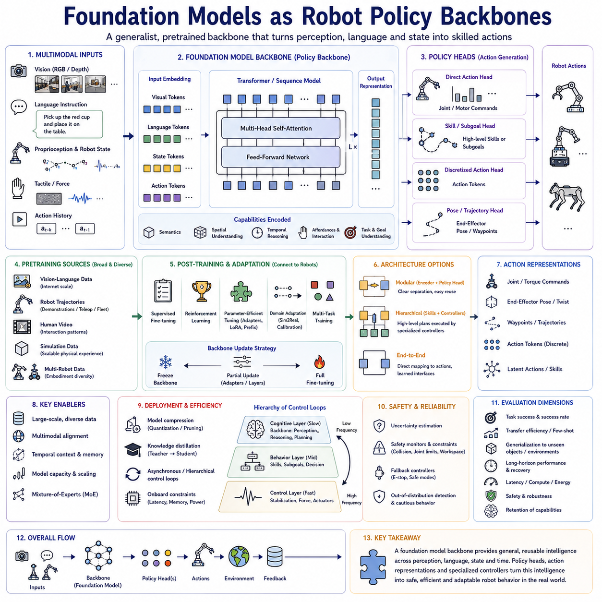{width="7.268055555555556in" height="7.268055555555556in"}

A foundation model can serve as the backbone of a robot policy by providing a broadly pretrained representation and reasoning system between raw observations and task-specific action generation. Rather than constructing every robotic policy from an independently trained perception stack, the robot can reuse a common model that already captures objects, language, spatial relationships, temporal patterns, and interaction concepts. Policy learning then builds on this shared computational foundation.

The term backbone refers to the central model that transforms heterogeneous inputs into representations useful for downstream decision making. In conventional robotics, separate networks may process vision, language, state estimation, and individual tasks. A foundation-model backbone instead provides a shared representational core. Task-specific policy components can condition, adapt, or decode this core representation into actions appropriate for the robot and its current objective.

Visual foundation models are natural candidates for robot policy backbones because perception dominates many robotic observations. A pretrained visual encoder can identify objects, surfaces, semantic regions, spatial structures, and contextual relationships before task-specific robot training begins. Robot trajectories can then refine these representations so that visual features encode not only what objects are, but also how they can be approached, manipulated, avoided, or used.

Language models add another important dimension by representing instructions, concepts, relationships, and high-level task structure. When language representations are connected to perception and action, instructions such as moving an object, opening a container, or navigating to a location can influence policy behavior. Language becomes more than an interface for commands; it provides a semantic space in which goals, objects, constraints, and potential subgoals can be organized.

Multimodal foundation models combine these capabilities by jointly processing several forms of information. Images, language, depth, proprioception, tactile measurements, robot state, and action history can be projected into compatible representations or token sequences. Attention mechanisms can then relate an instruction to visible objects, associate physical state with semantic goals, and preserve temporal context needed to select actions over extended interactions.

A robot policy requires more than a static representation of the current scene. Actions change the world, and the consequences of previous actions affect future decisions. A useful policy backbone therefore needs temporal context that represents how observations, actions, and goals evolve. Sequence models can integrate histories of visual states, proprioception, instructions, and actions so that decisions depend on trajectories rather than isolated sensor frames.

Transformers are particularly suitable for this role because they provide a general mechanism for processing heterogeneous token sequences. Visual patches, language tokens, robot states, actions, and other sensor features can be represented within a shared sequence. Attention allows the model to dynamically select relevant information according to the current task. This creates a flexible architecture in which different modalities and temporal contexts can contribute to action prediction.

The backbone does not necessarily generate actuator commands directly. One architecture may use the foundation model only as an encoder and attach a policy head that predicts actions. Another may generate high-level skills or subgoals that are executed by specialized controllers. More integrated architectures can directly predict discretized or continuous actions. These alternatives represent different points along a spectrum between foundation-model representation and end-to-end robot control.

Using an action head provides a clear separation between reusable knowledge and embodiment-specific execution. The backbone can encode task semantics, scene structure, and behavioral context, while the action head maps these representations into commands for a particular robot. Different manipulators or mobile platforms can potentially share the same foundation backbone while using different heads that reflect their kinematics, control spaces, and actuator conventions.

Action representations strongly influence how effectively this architecture transfers across robots. Joint commands provide direct control but are tightly coupled to embodiment. End-effector poses, velocity commands, waypoints, action tokens, latent actions, or skill representations can provide more transferable interfaces. The appropriate abstraction depends on whether the foundation model is intended to support one platform, a robot family, or heterogeneous embodiments.

A hierarchical policy can exploit foundation models at higher abstraction levels while retaining specialized control below. The backbone can interpret a task, identify relevant objects, reason about spatial relationships, and choose a sequence of skills. Skill policies can implement reaching, grasping, navigation, placement, or tool use, while low-level controllers enforce dynamic constraints. This organization reduces the need for a large model to solve every control problem at actuator frequency.

End-to-end policies take a more integrated approach by training the model to map multimodal observations and task conditions directly toward actions. Such models can reduce hand-designed interfaces between perception, planning, and control, allowing useful intermediate representations to emerge through training. However, end-to-end integration also makes behavior harder to inspect and can increase data requirements, validation difficulty, and sensitivity to distribution shifts.

Pretraining provides the backbone with reusable knowledge before it is adapted into a particular robot policy. Vision-language data can supply semantic understanding, while robot trajectories provide physical grounding. Human video can contribute temporal interaction patterns, simulation can provide scalable physical experience, and multi-robot datasets can introduce embodiment diversity. The final policy backbone can therefore inherit knowledge from data sources far broader than one deployment dataset.

Robot-specific post-training connects this broad knowledge to physical execution. Demonstrations can teach appropriate actions, reinforcement learning can improve task performance, and fine-tuning can adapt representations to particular sensors or environments. Parameter-efficient methods can modify smaller modules while keeping most pretrained parameters fixed. The foundation model thus becomes an initialization and reusable knowledge base rather than a completely immutable component.

Freezing the backbone can be attractive when training data is limited. A pretrained model remains fixed while a relatively small policy head learns how to interpret its representations. This reduces computational cost and can preserve broad pretrained knowledge. However, representations learned primarily from images or language may not encode the physical details required for control, so some degree of robot-specific adaptation may be necessary for high-performance policies.

Full fine-tuning offers greater flexibility because the entire backbone can adapt to robot data. Visual features can become sensitive to contact-relevant geometry, language representations can become grounded in executable behavior, and temporal features can reflect robot dynamics. The disadvantage is greater computational cost and the risk of catastrophic forgetting, where narrow robot training degrades useful capabilities acquired during broad pretraining.

Intermediate approaches update selected layers, adapters, low-rank parameters, or modality-specific components. These methods attempt to preserve general knowledge while allowing physical grounding to develop where necessary. They are especially attractive when one foundation backbone supports many robots or applications, because each deployment can maintain a compact set of specialized parameters instead of storing and retraining a complete independent model.

Mixture-of-experts architectures can further separate broadly shared knowledge from specialized computation. Common experts may represent semantics or spatial reasoning, while other experts specialize in manipulation, navigation, particular embodiments, or sensor modalities. A routing mechanism activates relevant components according to the current context. This increases effective model capacity while avoiding the computational cost of activating the entire network for every policy decision.

Inference efficiency becomes critical when a foundation model moves from a data center to a physical robot. Large models consume memory, electrical power, and computation while producing heat and latency. Policy decisions may need to operate at frequencies much higher than language generation. Practical architectures can therefore use compressed models, reduced precision, cached representations, asynchronous inference, hierarchical control, or smaller student policies derived from a larger pretrained backbone.

Knowledge distillation offers one way to separate expensive learning from efficient deployment. A large foundation policy can serve as a teacher that provides representations, action targets, or behavioral guidance to a smaller student model. The student may lose some generality but gain lower latency and power consumption. This teacher-student relationship allows large-scale models to contribute knowledge even when the final onboard hardware cannot execute the complete foundation architecture efficiently.

Different control loops can also operate at different frequencies. Semantic interpretation and long-horizon planning may run relatively slowly, while obstacle avoidance, stabilization, force control, and actuator regulation require faster updates. A foundation-model backbone can therefore occupy the slower cognitive layer while conventional or learned specialist controllers operate below it. This temporal hierarchy aligns computational complexity with the frequency requirements of each decision.

Safety is another reason to avoid treating a foundation model as the only component of a robot policy. Learned predictions can be uncertain or incorrect, particularly under distribution shift. Safety monitors, collision checking, workspace constraints, motion limits, emergency stopping, and fallback controllers can constrain generated actions. The foundation model provides flexible intelligence, while independent mechanisms enforce properties that should not depend solely on learned behavior.

Uncertainty estimation can determine when the backbone\'s representations or policy outputs should not be trusted. An unfamiliar scene, ambiguous instruction, sensor failure, or unusual physical interaction may place the robot outside its learned distribution. The system can then gather additional observations, ask for clarification, reduce speed, invoke a specialist policy, or stop safely rather than executing an uncertain high-level prediction without verification.

Evaluation must examine both the quality of the foundation representation and the resulting physical policy. Representation benchmarks alone cannot establish whether a backbone is useful for robotics. The model should be tested on task success, transfer efficiency, unseen objects, environmental changes, instruction variation, long-horizon behavior, recovery, latency, computational cost, and safety. These dimensions reveal whether broad pretrained knowledge actually improves embodied decision making.

The strongest backbone is therefore not necessarily the largest model or the model with the highest generic vision-language benchmark score. A useful robot policy backbone must provide representations that are semantically rich, physically grounded, temporally meaningful, adaptable, and computationally compatible with deployment. Its value comes from reducing the amount of new learning required while still allowing specialization where embodiment and control constraints demand it.

Foundation models ultimately change robot policy design from constructing isolated perception-to-action systems toward building policies around reusable pretrained intelligence. The backbone provides common representations and behavioral knowledge, task conditioning specifies intent, policy modules convert this knowledge into actions, and specialized controllers enforce physical execution. The boundaries among perception, reasoning, planning, and control become increasingly learnable while remaining architecturally manageable.

This perspective establishes a bridge from robot foundation models to generalist policies and Vision-Language-Action systems. Once a foundation backbone can jointly represent observations, instructions, robot state, temporal context, and behavioral knowledge, action generation becomes a natural downstream extension. The central challenge is to connect broad pretrained intelligence to precise physical execution without sacrificing efficiency, adaptability, robustness, or safety in the real world.

파운데이션 모델(Foundation Model)은 원시 관측(Raw Observation)과 작업별 행동 생성(Task-Specific Action Generation) 사이에서 광범위하게 사전학습된 표현 및 추론 시스템(Representation and Reasoning System)을 제공함으로써 로봇 정책(Robot Policy)의 백본(Backbone) 역할을 수행할 수 있다. 모든 로봇 정책마다 독립적인 지각 스택(Perception Stack)을 구축하는 대신, 객체, 언어, 공간 관계, 시간적 패턴(Temporal Pattern), 상호작용 개념(Interaction Concept)을 이미 학습한 공통 모델을 재사용할 수 있다. 이후 정책 학습은 이러한 공유 계산 기반(Shared Computational Foundation) 위에서 이루어진다.

백본(Backbone)은 이질적인 입력(Heterogeneous Input)을 다운스트림 의사결정(Downstream Decision Making)에 유용한 표현으로 변환하는 중심 모델을 의미한다. 기존 로보틱스에서는 비전, 언어, 상태 추정(State Estimation), 개별 작업을 서로 다른 네트워크가 처리할 수 있다. 반면 파운데이션 모델 백본(Foundation-Model Backbone)은 공유 표현 코어(Shared Representational Core)를 제공한다. 작업별 정책 구성요소는 이 핵심 표현을 조건화(Conditioning), 적응(Adaptation), 디코딩(Decoding)하여 현재 목표와 로봇에 적합한 행동으로 변환할 수 있다.

비전 파운데이션 모델(Visual Foundation Model)은 지각이 많은 로봇 관측에서 핵심적인 역할을 하기 때문에 로봇 정책 백본의 자연스러운 후보가 된다. 사전학습된 비전 인코더(Visual Encoder)는 작업별 로봇 학습이 시작되기 전에 객체, 표면, 의미 영역(Semantic Region), 공간 구조, 맥락적 관계(Contextual Relationship)를 식별할 수 있다. 이후 로봇 궤적(Robot Trajectory)을 통해 이러한 표현을 개선하여 시각 특징이 객체가 무엇인지뿐 아니라 어떻게 접근하고, 조작하고, 회피하고, 사용할 수 있는지도 표현하도록 만들 수 있다.

언어 모델(Language Model)은 명령, 개념, 관계, 고수준 작업 구조(High-Level Task Structure)를 표현함으로써 또 다른 중요한 차원을 제공한다. 언어 표현(Language Representation)이 지각 및 행동과 연결되면 객체 이동, 용기 열기, 특정 위치로 이동하기와 같은 명령이 정책 행동에 영향을 줄 수 있다. 언어는 단순한 명령 인터페이스를 넘어 목표, 객체, 제약조건, 잠재적 하위 목표(Potential Subgoal)를 체계화할 수 있는 의미 공간(Semantic Space)을 제공한다.

멀티모달 파운데이션 모델(Multimodal Foundation Model)은 여러 형태의 정보를 공동으로 처리함으로써 이러한 능력을 결합한다. 이미지, 언어, 깊이(Depth), 고유수용감각(Proprioception), 촉각 측정(Tactile Measurement), 로봇 상태, 행동 이력(Action History)을 호환 가능한 표현이나 토큰 시퀀스(Token Sequence)로 투영할 수 있다. 어텐션 메커니즘(Attention Mechanism)은 명령과 가시 객체를 연결하고, 물리적 상태를 의미적 목표와 연관시키며, 장기간의 상호작용에서 행동 선택에 필요한 시간적 맥락을 유지할 수 있다.

로봇 정책에는 현재 장면에 대한 정적인 표현만으로는 충분하지 않다. 행동은 세계를 변화시키며 이전 행동의 결과는 미래의 의사결정에 영향을 준다. 따라서 유용한 정책 백본은 관측, 행동, 목표가 시간에 따라 어떻게 변화하는지를 표현하는 시간적 맥락(Temporal Context)을 필요로 한다. 시퀀스 모델(Sequence Model)은 시각 상태, 고유수용감각, 명령, 행동의 이력을 통합하여 개별 센서 프레임이 아니라 전체 궤적에 기반한 의사결정을 가능하게 한다.

트랜스포머(Transformer)는 이질적인 토큰 시퀀스를 처리하는 일반적인 메커니즘을 제공하기 때문에 이러한 역할에 특히 적합하다. 시각 패치(Visual Patch), 언어 토큰(Language Token), 로봇 상태, 행동 및 기타 센서 특징을 하나의 공유 시퀀스 안에서 표현할 수 있다. 어텐션은 현재 작업에 따라 관련 정보를 동적으로 선택할 수 있도록 한다. 이를 통해 서로 다른 모달리티와 시간적 맥락이 행동 예측(Action Prediction)에 기여할 수 있는 유연한 아키텍처를 구성할 수 있다.

백본이 반드시 액추에이터 명령(Actuator Command)을 직접 생성해야 하는 것은 아니다. 하나의 아키텍처에서는 파운데이션 모델을 인코더(Encoder)로만 사용하고 행동을 예측하는 정책 헤드(Policy Head)를 연결할 수 있다. 다른 구조에서는 고수준 스킬(High-Level Skill)이나 하위 목표를 생성하고 전문화된 제어기(Specialized Controller)가 이를 실행할 수 있다. 더욱 통합된 아키텍처는 이산 행동(Discretized Action)이나 연속 행동(Continuous Action)을 직접 예측할 수 있다. 이러한 방식은 파운데이션 모델 표현에서 엔드투엔드 로봇 제어(End-to-End Robot Control)에 이르는 서로 다른 통합 수준을 나타낸다.

행동 헤드(Action Head)를 사용하면 재사용 가능한 지식과 체화별 실행(Embodiment-Specific Execution)을 명확하게 분리할 수 있다. 백본은 작업 의미(Task Semantics), 장면 구조(Scene Structure), 행동 맥락(Behavioral Context)을 인코딩하고, 행동 헤드는 이러한 표현을 특정 로봇의 명령으로 매핑한다. 서로 다른 매니퓰레이터(Manipulator)나 모바일 플랫폼은 동일한 파운데이션 백본을 공유하면서 각각의 운동학(Kinematics), 제어 공간(Control Space), 액추에이터 규칙(Actuator Convention)을 반영하는 서로 다른 헤드를 사용할 수 있다.

행동 표현(Action Representation)은 이러한 아키텍처가 여러 로봇 사이에서 얼마나 효과적으로 전이되는지를 크게 좌우한다. 관절 명령(Joint Command)은 직접적인 제어를 제공하지만 체화에 강하게 결합되어 있다. 엔드 이펙터 자세(End-Effector Pose), 속도 명령(Velocity Command), 웨이포인트(Waypoint), 행동 토큰(Action Token), 잠재 행동(Latent Action), 스킬 표현(Skill Representation)은 더욱 전이 가능한 인터페이스를 제공할 수 있다. 적절한 추상화 수준은 파운데이션 모델이 하나의 플랫폼, 하나의 로봇 계열, 또는 이질적인 체화를 지원하도록 설계되는지에 따라 달라진다.

계층적 정책(Hierarchical Policy)은 파운데이션 모델을 높은 추상화 수준에서 활용하면서 하위 계층에는 전문화된 제어를 유지할 수 있다. 백본은 작업을 해석하고 관련 객체를 식별하며 공간 관계를 추론하고 스킬 시퀀스를 선택할 수 있다. 스킬 정책(Skill Policy)은 도달하기, 파지하기, 내비게이션, 배치하기, 도구 사용을 구현하고, 저수준 제어기(Low-Level Controller)는 동역학 제약(Dynamic Constraint)을 적용한다. 이러한 구조는 대규모 모델이 액추에이터 주파수에서 모든 제어 문제를 직접 해결해야 할 필요성을 줄여준다.

엔드투엔드 정책(End-to-End Policy)은 멀티모달 관측과 작업 조건을 행동으로 직접 매핑하도록 모델을 학습하는 더욱 통합적인 접근법이다. 이러한 모델은 지각, 계획, 제어 사이의 수작업 인터페이스(Hand-Designed Interface)를 줄이고 학습을 통해 유용한 중간 표현(Intermediate Representation)이 형성되도록 할 수 있다. 그러나 엔드투엔드 통합은 행동을 분석하기 어렵게 만들고 데이터 요구량, 검증 난이도(Validation Difficulty), 분포 변화에 대한 민감성을 증가시킬 수도 있다.

사전학습(Pretraining)은 특정 로봇 정책에 적응하기 전에 백본에 재사용 가능한 지식을 제공한다. 비전-언어 데이터(Vision-Language Data)는 의미 이해를 제공하고, 로봇 궤적은 물리적 그라운딩(Physical Grounding)을 제공할 수 있다. 인간 비디오(Human Video)는 시간적 상호작용 패턴을 제공하고, 시뮬레이션은 확장 가능한 물리 경험을 제공하며, 다중 로봇 데이터셋(Multi-Robot Dataset)은 체화 다양성(Embodiment Diversity)을 제공할 수 있다. 따라서 최종 정책 백본은 하나의 배치 데이터셋보다 훨씬 광범위한 데이터 소스로부터 지식을 상속받을 수 있다.

로봇별 사후학습(Robot-Specific Post-Training)은 이러한 광범위한 지식을 물리적 실행과 연결한다. 시연(Demonstration)은 적절한 행동을 학습시키고, 강화학습(Reinforcement Learning)은 작업 성능을 향상시키며, 미세조정(Fine-Tuning)은 특정 센서나 환경에 표현을 적응시킬 수 있다. 파라미터 효율적 방법(Parameter-Efficient Method)은 대부분의 사전학습 파라미터를 고정한 채 작은 모듈만 변경할 수 있다. 따라서 파운데이션 모델은 완전히 변경할 수 없는 구성요소가 아니라 강력한 초기화(Initialization)이자 재사용 가능한 지식 기반(Knowledge Base)이 된다.

학습 데이터가 제한적인 경우 백본 고정(Backbone Freezing)은 매력적인 방법이 될 수 있다. 사전학습된 모델은 그대로 유지하고 상대적으로 작은 정책 헤드만 해당 표현을 해석하도록 학습한다. 이는 계산 비용을 줄이고 광범위한 사전학습 지식을 보존할 수 있다. 그러나 이미지나 언어를 중심으로 학습된 표현에는 물리적 제어에 필요한 세부 정보가 충분히 포함되지 않을 수 있으므로 높은 성능의 정책을 위해서는 어느 정도의 로봇별 적응이 필요할 수 있다.

전체 미세조정(Full Fine-Tuning)은 전체 백본을 로봇 데이터에 적응시킬 수 있기 때문에 더 높은 유연성을 제공한다. 시각 특징은 접촉과 관련된 기하 구조(Contact-Relevant Geometry)에 민감해질 수 있고, 언어 표현은 실행 가능한 행동에 그라운딩될 수 있으며, 시간적 특징은 로봇 동역학을 반영할 수 있다. 그러나 더 많은 계산 비용이 필요하며 좁은 로봇 데이터에 대한 학습으로 광범위한 사전학습 능력이 손상되는 파국적 망각(Catastrophic Forgetting)의 위험도 존재한다.

중간 접근법은 선택된 계층, 어댑터(Adapter), 저랭크 파라미터(Low-Rank Parameter), 모달리티별 구성요소(Modality-Specific Component)만 업데이트한다. 이러한 방법은 일반적인 지식을 보존하면서 필요한 부분에 물리적 그라운딩을 형성하려 한다. 하나의 파운데이션 백본이 여러 로봇이나 응용 분야를 지원하는 경우 특히 유용하며, 각각의 배치는 완전히 독립된 모델을 저장하고 재학습하는 대신 작은 규모의 전문화 파라미터(Specialized Parameter)를 유지할 수 있다.

전문가 혼합 아키텍처(Mixture-of-Experts Architecture)는 광범위하게 공유되는 지식과 전문화된 계산을 더욱 세분화할 수 있다. 공통 전문가(Common Expert)는 의미 또는 공간 추론을 표현하고, 다른 전문가는 조작, 내비게이션, 특정 체화 또는 센서 모달리티에 특화될 수 있다. 라우팅 메커니즘(Routing Mechanism)은 현재 맥락에 따라 관련 구성요소를 활성화한다. 이를 통해 모든 정책 결정에서 전체 네트워크를 활성화하지 않고도 실질적인 모델 용량을 증가시킬 수 있다.

파운데이션 모델이 데이터센터(Data Center)에서 실제 로봇으로 이동하면 추론 효율성(Inference Efficiency)이 매우 중요해진다. 대규모 모델은 메모리, 전력, 계산 자원을 소비하고 열과 지연시간을 발생시킨다. 로봇 정책의 의사결정은 언어 생성보다 훨씬 높은 주파수에서 이루어져야 할 수 있다. 따라서 실제 아키텍처에서는 압축 모델(Compressed Model), 저정밀도 연산(Reduced Precision), 캐시된 표현(Cached Representation), 비동기 추론(Asynchronous Inference), 계층적 제어 또는 대규모 사전학습 백본으로부터 파생된 소형 학생 정책(Student Policy)을 사용할 수 있다.

지식 증류(Knowledge Distillation)는 비용이 높은 학습과 효율적인 배치를 분리하는 방법을 제공한다. 대규모 파운데이션 정책은 교사 모델(Teacher Model)이 되어 더 작은 학생 모델(Student Model)에 표현, 행동 목표(Action Target), 행동 지침(Behavioral Guidance)을 제공할 수 있다. 학생 모델은 일부 일반성을 잃을 수 있지만 더 낮은 지연시간과 전력 소비를 얻을 수 있다. 이를 통해 온보드 하드웨어가 전체 파운데이션 아키텍처를 효율적으로 실행할 수 없는 경우에도 대규모 모델의 지식을 활용할 수 있다.

서로 다른 제어 루프(Control Loop)는 서로 다른 주파수에서 동작할 수도 있다. 의미 해석(Semantic Interpretation)과 장기 계획(Long-Horizon Planning)은 비교적 느리게 실행할 수 있지만 장애물 회피, 안정화(Stabilization), 힘 제어(Force Control), 액추에이터 조절(Actuator Regulation)은 더 빠른 업데이트를 요구한다. 따라서 파운데이션 모델 백본은 상대적으로 느린 인지 계층(Cognitive Layer)에 위치하고, 기존 또는 학습 기반 전문화 제어기가 하위 계층에서 동작할 수 있다. 이러한 시간적 계층 구조(Temporal Hierarchy)는 각 의사결정의 주파수 요구조건에 계산 복잡성을 맞춘다.

안전(Safety)은 파운데이션 모델을 로봇 정책의 유일한 구성요소로 사용하지 않아야 하는 또 다른 이유이다. 학습된 예측은 특히 분포 변화 상황에서 불확실하거나 잘못될 수 있다. 안전 모니터(Safety Monitor), 충돌 검사(Collision Checking), 작업 공간 제약(Workspace Constraint), 움직임 제한(Motion Limit), 비상 정지(Emergency Stop), 폴백 제어기(Fallback Controller)를 통해 생성된 행동을 제한할 수 있다. 파운데이션 모델이 유연한 지능을 제공하는 동안 독립적인 메커니즘은 학습된 행동에만 의존해서는 안 되는 안전 속성을 보장한다.

불확실성 추정(Uncertainty Estimation)은 백본의 표현이나 정책 출력(Policy Output)을 신뢰해서는 안 되는 상황을 판단하는 데 활용할 수 있다. 익숙하지 않은 장면, 모호한 명령, 센서 고장, 비정상적인 물리적 상호작용은 로봇이 학습 분포 밖에 있음을 나타낼 수 있다. 이 경우 시스템은 검증되지 않은 고수준 예측을 그대로 실행하는 대신 추가 관측을 수집하거나, 설명을 요청하거나, 속도를 낮추거나, 전문화 정책을 호출하거나, 안전하게 정지할 수 있다.

평가(Evaluation)는 파운데이션 표현의 품질과 그 결과로 생성되는 물리적 정책을 모두 검토해야 한다. 표현 벤치마크(Representation Benchmark)만으로는 백본이 로보틱스에 유용한지를 판단할 수 없다. 모델은 작업 성공률(Task Success), 전이 효율성(Transfer Efficiency), 학습하지 않은 객체, 환경 변화, 명령 변화, 장기 행동(Long-Horizon Behavior), 복구(Recovery), 지연시간, 계산 비용, 안전성을 기준으로 평가해야 한다. 이러한 요소는 광범위한 사전학습 지식이 실제 체화 의사결정(Embodied Decision Making)을 향상시키는지를 보여준다.

따라서 가장 강력한 백본이 반드시 가장 큰 모델이나 일반적인 비전-언어 벤치마크(Vision-Language Benchmark)에서 가장 높은 점수를 기록한 모델을 의미하지는 않는다. 유용한 로봇 정책 백본은 의미적으로 풍부하고(Semantically Rich), 물리적으로 그라운딩되며(Physically Grounded), 시간적으로 의미 있고(Temporally Meaningful), 적응 가능하며(Adaptable), 실제 배치의 계산 환경과 호환되어야 한다. 그 가치는 새로운 학습의 필요량을 줄이는 동시에 체화와 제어 제약이 요구하는 영역에서 전문화를 허용하는 데 있다.

궁극적으로 파운데이션 모델은 로봇 정책 설계를 독립적인 지각-행동 시스템(Perception-to-Action System)을 각각 구축하는 방식에서 재사용 가능한 사전학습 지능(Reusable Pretrained Intelligence)을 중심으로 정책을 구성하는 방식으로 변화시킨다. 백본은 공통 표현과 행동 지식을 제공하고, 작업 조건화는 의도를 지정하며, 정책 모듈(Policy Module)은 이러한 지식을 행동으로 변환하고, 전문화 제어기는 물리적 실행을 담당한다. 지각, 추론, 계획, 제어 사이의 경계는 점차 학습 가능해지면서도 아키텍처 수준에서 관리 가능한 형태로 유지된다.

이러한 관점은 로봇 파운데이션 모델에서 제너럴리스트 정책(Generalist Policy)과 비전-언어-행동 시스템(Vision-Language-Action System)으로 이어지는 연결고리를 형성한다. 파운데이션 백본이 관측, 명령, 로봇 상태, 시간적 맥락, 행동 지식을 공동으로 표현할 수 있게 되면 행동 생성은 자연스러운 다운스트림 확장(Downstream Extension)이 된다. 핵심 과제는 광범위하게 사전학습된 지능을 정밀한 물리적 실행과 연결하면서 실제 환경에서 요구되는 효율성, 적응성, 강건성(Robustness), 안전성을 유지하는 것이다.

## 02.11. World Knowledge and Physical Knowledge

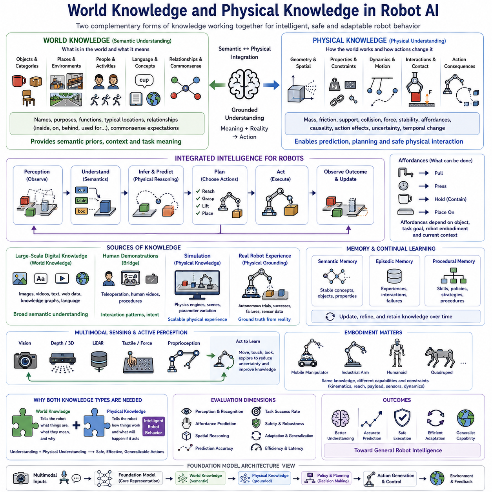{width="7.268055555555556in" height="7.268055555555556in"}

World knowledge refers to the broad semantic and conceptual understanding that allows a robot to interpret what exists in its environment and what those entities generally mean. It includes knowledge about objects, places, people, tools, activities, categories, relationships, language, and common situations. Large vision-language and foundation models can acquire much of this knowledge from images, video, text, and other large-scale digital data before interacting with a physical robot.

A robot with world knowledge can recognize that a cup is a container, a door connects spaces, a chair supports sitting, and a warehouse shelf stores objects. It can associate words with visual entities and understand relationships such as inside, above, behind, near, owned by, or used for. This semantic structure allows instructions to be interpreted beyond simple labels and provides prior knowledge that can guide perception, reasoning, planning, and interaction.

World knowledge also includes commonsense expectations about typical environments and activities. Kitchens contain appliances and utensils, warehouses contain racks and packages, roads contain vehicles and pedestrians, and factories contain machines and work areas. These expectations are not guaranteed physical truths, but they provide useful priors. A robot can use them to interpret incomplete observations, search for relevant objects, and generate plausible hypotheses about what may occur next.

Language is a powerful carrier of world knowledge because human descriptions encode concepts, categories, relationships, procedures, and accumulated experience. Language-pretrained models can therefore provide robots with information that would be impractical to acquire exclusively through physical interaction. A robot does not need to manipulate every known object to understand its name, purpose, typical location, or relationship to other objects. Semantic pretraining can provide this knowledge before embodiment-specific learning begins.

However, world knowledge alone does not establish physical competence. Knowing that a bottle contains liquid does not reveal its current mass, friction, exact center of gravity, or whether a particular gripper can hold it securely. Knowing that a box can be lifted does not determine whether the current robot has sufficient reach or payload capacity. Physical action requires knowledge grounded in the measurable properties and consequences of interaction with the real world.

Physical knowledge describes how entities behave under physical constraints and how actions change their states. It includes geometry, motion, mass, friction, contact, support, collision, deformation, force, stability, dynamics, and action consequences. For robotics, this knowledge must connect observations to possible interventions: what can move, what will resist motion, what can be grasped, where contact will occur, and what may happen after an action is executed.

Some physical knowledge reflects relatively universal regularities. Unsupported objects tend to fall, solid objects generally cannot occupy the same space, contact can transfer force, and obstacles constrain motion. Other knowledge depends strongly on local conditions, such as whether a floor is slippery, a container is fragile, a door is locked, or an object is heavier than expected. Effective robot intelligence must combine general physical priors with continuously observed local evidence.

Affordances provide an important connection between semantic and physical knowledge. An affordance represents what actions an entity permits under particular conditions. A handle may afford pulling, a button pressing, a container holding, and an open surface placement. Yet affordances are relational rather than purely object properties. Whether something is graspable depends on object geometry, gripper design, robot reachability, orientation, surrounding obstacles, and the intended manipulation.

Embodiment therefore determines how physical knowledge becomes actionable. Two robots may share the semantic understanding that an object should be transported while differing substantially in how they accomplish it. A mobile manipulator, industrial arm, humanoid, and quadruped have different reachable spaces, sensors, kinematics, dynamics, and actuator limits. Shared knowledge must consequently be conditioned on the capabilities and constraints of the body executing the action.

This distinction suggests that robot foundation models should separate transferable physical structure from embodiment-specific execution. Scene geometry, object properties, support relations, contact concepts, and many causal relationships can potentially be shared across robots. Reachable workspace, joint limits, balance constraints, actuator dynamics, sensing characteristics, and low-level motor commands remain more specific to individual embodiments.

Geometry forms one of the most important bridges between world and physical knowledge. Semantic perception may identify an object as a chair, but physical interaction requires estimates of its shape, pose, dimensions, free space, surfaces, and relationship to nearby structures. Depth sensing, stereo vision, LiDAR, point clouds, occupancy representations, and learned 3D features can complement visual semantics by representing the spatial structure needed for navigation and manipulation.

Temporal knowledge adds another essential dimension. A static scene describes what exists now, while physical intelligence must also represent how states change over time. Objects move, people walk, doors open, robots accelerate, and contacts alter trajectories. Sequences of observations and actions allow models to learn temporal continuity and state transitions, connecting current physical configurations with plausible future configurations.

Action-conditioned knowledge goes further by representing how the robot itself influences those transitions. The relevant question is not only what will happen next, but what will happen if the robot performs a particular action. Moving forward changes viewpoint and collision risk, grasping changes object attachment, pushing changes object position, and opening changes accessibility. Such action-consequence relationships form a fundamental basis for planning and control.

Causal knowledge is valuable because correlation alone may fail when conditions change. A robot can observe that an object moves after contact, but useful physical reasoning requires understanding that applied force contributed to the motion. Causal structure supports counterfactual questions such as what would happen if the robot pushed from another direction, reduced its speed, selected a different grasp, or avoided contact altogether. This connects learned physical knowledge with deliberate decision making.

World models can provide an explicit computational mechanism for organizing such predictive physical knowledge. Given a current state and possible action, a world model estimates future states or latent representations of them. Candidate actions can therefore be evaluated before execution according to expected success, collision risk, safety, cost, or other objectives. Foundation models provide broad knowledge, while predictive world models can test how candidate behavior may unfold physically.

Physical knowledge must also represent uncertainty because robots rarely observe the world perfectly. Occlusion may hide an object\'s shape, vision may not reveal its mass, tactile information may become available only after contact, and dynamic agents may behave unpredictably. Rather than representing every property as certain, a robot should maintain beliefs about unknown quantities and update them as new sensory evidence or interaction outcomes become available.

Active perception follows naturally from this uncertainty. When existing observations are insufficient, the robot can act specifically to obtain information. It may change viewpoint to inspect an occluded object, touch a surface to estimate compliance, slightly lift an object to estimate weight, or move closer to improve perception. Action is therefore not only a mechanism for accomplishing external goals but also a means of acquiring physical knowledge.

Multimodal sensing is crucial because different physical properties become observable through different channels. Vision provides appearance and geometry, depth provides spatial structure, proprioception provides internal robot state, force and tactile sensing reveal contact, and audio can indicate events such as impact or mechanical operation. Combining these modalities allows a foundation model to connect semantic identity with physical state and interaction evidence.

Robot experience provides grounding that digital knowledge lacks. Teleoperation demonstrations reveal how humans accomplish tasks through a robot embodiment, autonomous trajectories expose action consequences, and failures reveal physical limits. Simulation can provide large numbers of controlled interactions, while real-world data captures friction, compliance, sensor artifacts, latency, wear, and other complexities that are difficult to reproduce accurately. Both scalable simulation and real interaction are therefore valuable.

Human video can contribute intermediate knowledge between semantic understanding and robot action. It contains rich examples of objects being grasped, opened, moved, assembled, and used over time. These observations reveal interaction structure and temporal relationships even though human actions cannot be directly copied to robots. Models can learn high-level physical patterns from video and subsequently ground them in robot-specific action spaces through embodied experience.

The integration of world and physical knowledge enables stronger task reasoning. Consider an instruction to place a fragile glass on a table. World knowledge identifies the glass, table, and meaning of fragile, while physical knowledge constrains grasp force, trajectory, collision avoidance, support, and placement stability. Neither knowledge source is sufficient alone. Reliable execution requires semantic understanding to determine what should happen and physical understanding to determine how it can happen safely.

The same integration supports generalization. When encountering an unfamiliar object, semantic similarity may suggest its purpose while geometry and physical interaction reveal how it can actually be manipulated. A new container may resemble known containers but differ in size, mass, material, or opening mechanism. Foundation models can combine broad priors with local sensory evidence instead of requiring a complete training dataset for every possible object instance.

Memory can preserve physical knowledge acquired during deployment. Semantic memory can store stable concepts and object properties, episodic memory can retain specific interactions and failures, and procedural representations can preserve successful skills. A robot that discovers a slippery region, unexpectedly heavy object, or changed workspace can use this experience in later decisions rather than repeatedly rediscovering the same physical fact.

Continual learning extends this principle across longer periods. Real environments change, objects are replaced, mechanisms wear, and operating conditions shift. A robot foundation model should therefore update local physical knowledge while preserving broadly useful world knowledge. New experience can refine uncertain properties, correct incorrect priors, improve predictive models, and expand the range of situations in which existing concepts and skills remain useful.

Evaluation should distinguish semantic knowledge from physically grounded competence. Recognizing an object or answering a question about it does not demonstrate the ability to interact with it successfully. Robot evaluation should therefore test perception together with affordance prediction, spatial reasoning, action consequences, contact behavior, planning, recovery, and adaptation. Success in physical tasks provides evidence that knowledge has been connected to executable behavior.

The distinction is especially important for Vision-Language-Action models. Vision and language can provide extensive knowledge about what is present and what a human intends, but the action component must respect geometry, embodiment, dynamics, temporal context, and safety. A strong VLA system therefore requires more than adding action tokens to a vision-language model; its internal representations must become grounded in the consequences of physical interaction.

Ultimately, world knowledge and physical knowledge form complementary layers of robot intelligence. World knowledge provides semantics, concepts, relationships, commonsense priors, and task meaning, while physical knowledge provides geometry, affordances, dynamics, constraints, causality, and action consequences. Robot foundation models become more capable when these forms of knowledge are represented jointly rather than treated as independent perception and control problems.

The central objective is to connect knowing about the world with knowing how to act within it. Large-scale digital pretraining can supply broad conceptual knowledge, while robot data, simulation, temporal experience, and interaction provide physical grounding. Their integration creates representations that support understanding, prediction, planning, action, and adaptation, establishing the knowledge layer needed for a general robot foundation model architecture.

세계 지식(World Knowledge)은 로봇이 자신의 환경에 무엇이 존재하며 그러한 대상들이 일반적으로 무엇을 의미하는지를 해석할 수 있도록 하는 광범위한 의미적·개념적 이해(Semantic and Conceptual Understanding)를 의미한다. 여기에는 객체(Object), 장소(Place), 사람(People), 도구(Tool), 활동(Activity), 범주(Category), 관계(Relationship), 언어(Language), 일반적인 상황(Common Situation)에 대한 지식이 포함된다. 대규모 비전-언어 모델(Vision-Language Model)과 파운데이션 모델(Foundation Model)은 실제 로봇과 상호작용하기 전에도 이미지, 비디오, 텍스트 및 기타 대규모 디지털 데이터로부터 이러한 지식의 상당 부분을 획득할 수 있다.

세계 지식을 가진 로봇은 컵이 용기(Container)이고, 문이 공간을 연결하며, 의자가 앉는 행위를 지지하고, 창고 선반이 물체를 보관한다는 사실을 이해할 수 있다. 또한 단어를 시각적 객체와 연결하고 내부(Inside), 위(Above), 뒤(Behind), 가까이(Near), 소유됨(Owned By), 용도(Used For)와 같은 관계를 이해할 수 있다. 이러한 의미 구조(Semantic Structure)는 단순한 레이블을 넘어 명령을 해석하도록 하며 지각(Perception), 추론(Reasoning), 계획(Planning), 상호작용(Interaction)을 안내하는 사전 지식(Prior Knowledge)을 제공한다.

세계 지식은 일반적인 환경과 활동에 대한 상식적 기대(Common-Sense Expectation)도 포함한다. 주방에는 가전제품과 조리도구가 있고, 창고에는 랙과 패키지가 있으며, 도로에는 차량과 보행자가 있고, 공장에는 기계와 작업 영역이 존재한다. 이러한 기대는 반드시 성립하는 물리적 진리(Physical Truth)는 아니지만 유용한 사전정보(Prior)를 제공한다. 로봇은 이를 이용하여 불완전한 관측을 해석하고, 관련 객체를 탐색하며, 다음에 발생할 수 있는 상황에 대한 타당한 가설을 생성할 수 있다.

언어(Language)는 인간의 설명 속에 개념, 범주, 관계, 절차(Procedure), 축적된 경험이 포함되어 있기 때문에 세계 지식을 전달하는 강력한 수단이다. 따라서 언어 사전학습 모델(Language-Pretrained Model)은 물리적 상호작용만으로 획득하기에는 비현실적으로 많은 정보를 로봇에 제공할 수 있다. 로봇은 알려진 모든 객체를 직접 조작하지 않고도 객체의 이름, 목적, 일반적인 위치, 다른 객체와의 관계를 이해할 수 있다. 의미적 사전학습(Semantic Pretraining)은 체화별 학습(Embodiment-Specific Learning)이 시작되기 전에 이러한 지식을 제공할 수 있다.

그러나 세계 지식만으로 물리적 능력(Physical Competence)이 형성되는 것은 아니다. 병(Bottle)에 액체가 들어 있다는 사실을 아는 것만으로 현재 질량(Mass), 마찰(Friction), 정확한 무게중심(Center of Gravity), 특정 그리퍼(Gripper)가 병을 안정적으로 잡을 수 있는지를 알 수는 없다. 상자를 들어 올릴 수 있다는 지식 역시 현재 로봇이 충분한 도달 거리(Reach)나 페이로드 용량(Payload Capacity)을 가지고 있는지를 결정하지 않는다. 물리적 행동에는 실제 세계와의 상호작용에서 측정되는 특성과 그 결과에 그라운딩된 지식(Grounded Knowledge)이 필요하다.

물리 지식(Physical Knowledge)은 물리적 제약조건(Physical Constraint) 아래에서 대상이 어떻게 행동하고, 행동이 대상의 상태를 어떻게 변화시키는지를 설명한다. 여기에는 기하 구조(Geometry), 움직임(Motion), 질량, 마찰, 접촉(Contact), 지지(Support), 충돌(Collision), 변형(Deformation), 힘(Force), 안정성(Stability), 동역학(Dynamics), 행동 결과(Action Consequence)가 포함된다. 로보틱스에서 이러한 지식은 관측을 가능한 개입(Intervention)과 연결해야 한다. 즉, 무엇이 움직일 수 있는지, 무엇이 움직임에 저항하는지, 무엇을 파지할 수 있는지, 어디에서 접촉이 발생하는지, 행동을 실행한 후 어떤 일이 일어날 수 있는지를 이해해야 한다.

일부 물리 지식은 비교적 보편적인 규칙(Universal Regularity)을 반영한다. 지지되지 않는 물체는 떨어지는 경향이 있고, 고체 객체는 일반적으로 동일한 공간을 동시에 점유할 수 없으며, 접촉은 힘을 전달할 수 있고, 장애물은 움직임을 제한한다. 반면 바닥이 미끄러운지, 용기가 깨지기 쉬운지, 문이 잠겨 있는지, 객체가 예상보다 무거운지와 같은 지식은 지역적 조건(Local Condition)에 크게 의존한다. 효과적인 로봇 지능은 일반적인 물리적 사전정보와 지속적으로 관측되는 지역적 증거(Local Evidence)를 결합해야 한다.

어포던스(Affordance)는 의미 지식과 물리 지식을 연결하는 중요한 개념이다. 어포던스는 특정 조건에서 어떤 대상이 허용하는 행동을 나타낸다. 손잡이는 당기기(Pulling), 버튼은 누르기(Pressing), 용기는 담기(Holding), 열린 표면은 물체 배치(Placement)를 가능하게 할 수 있다. 그러나 어포던스는 순수한 객체 속성이 아니라 관계적 특성(Relational Property)이다. 어떤 객체를 파지할 수 있는지는 객체의 기하 구조, 그리퍼 설계, 로봇의 도달 가능성(Reachability), 방향(Orientation), 주변 장애물, 의도된 조작 방식에 따라 달라진다.

따라서 체화(Embodiment)는 물리 지식이 어떻게 실행 가능한 지식(Actionable Knowledge)으로 변환되는지를 결정한다. 두 로봇이 어떤 객체를 운반해야 한다는 동일한 의미적 이해를 공유하더라도 이를 수행하는 방법은 크게 다를 수 있다. 모바일 매니퓰레이터(Mobile Manipulator), 산업용 로봇 팔(Industrial Arm), 휴머노이드(Humanoid), 4족 로봇(Quadruped)은 서로 다른 도달 공간(Reachable Space), 센서, 운동학(Kinematics), 동역학, 액추에이터 한계(Actuator Limit)를 가진다. 따라서 공유 지식은 행동을 수행하는 신체의 능력과 제약조건에 따라 조건화되어야 한다.

이러한 구분은 로봇 파운데이션 모델(Robot Foundation Model)이 전이 가능한 물리 구조(Transferable Physical Structure)와 체화별 실행(Embodiment-Specific Execution)을 분리해야 함을 시사한다. 장면 기하 구조(Scene Geometry), 객체 속성(Object Property), 지지 관계(Support Relation), 접촉 개념(Contact Concept), 다양한 인과 관계(Causal Relationship)는 여러 로봇에서 공유될 수 있다. 반면 도달 가능한 작업 공간, 관절 한계(Joint Limit), 균형 제약(Balance Constraint), 액추에이터 동역학, 센싱 특성(Sensing Characteristic), 저수준 모터 명령(Low-Level Motor Command)은 개별 체화에 더욱 특화된다.

기하 구조(Geometry)는 세계 지식과 물리 지식을 연결하는 가장 중요한 다리 중 하나이다. 의미 지각(Semantic Perception)은 어떤 객체를 의자로 식별할 수 있지만, 물리적 상호작용에는 객체의 형상(Shape), 자세(Pose), 크기(Dimension), 자유 공간(Free Space), 표면(Surface), 주변 구조와의 관계에 대한 추정이 필요하다. 깊이 센싱(Depth Sensing), 스테레오 비전(Stereo Vision), 라이다(LiDAR), 포인트 클라우드(Point Cloud), 점유 표현(Occupancy Representation), 학습된 3차원 특징(Learned 3D Feature)은 내비게이션과 조작에 필요한 공간 구조를 표현함으로써 시각적 의미 정보를 보완할 수 있다.

시간적 지식(Temporal Knowledge)은 또 하나의 필수적인 차원을 추가한다. 정적인 장면은 현재 무엇이 존재하는지를 설명하지만, 물리 지능(Physical Intelligence)은 상태가 시간에 따라 어떻게 변화하는지도 표현해야 한다. 객체는 움직이고, 사람은 걷고, 문은 열리며, 로봇은 가속하고, 접촉은 궤적을 변화시킨다. 관측과 행동의 시퀀스(Sequence)를 통해 모델은 시간적 연속성(Temporal Continuity)과 상태 전이(State Transition)를 학습하고 현재의 물리적 구성과 가능한 미래의 구성을 연결할 수 있다.

행동 조건부 지식(Action-Conditioned Knowledge)은 로봇 자신의 행동이 이러한 상태 전이에 어떻게 영향을 미치는지를 표현함으로써 한 단계 더 발전한다. 중요한 질문은 단순히 다음에 무엇이 일어날 것인가가 아니라 로봇이 특정 행동을 수행하면 무엇이 일어날 것인가이다. 전진하면 시점(Viewpoint)과 충돌 위험이 변화하고, 파지하면 객체의 결합 상태(Attachment)가 변하며, 밀기(Pushing)는 객체 위치를 변경하고, 열기(Opening)는 접근 가능성(Accessibility)을 변화시킨다. 이러한 행동-결과 관계(Action-Consequence Relationship)는 계획과 제어의 근본적인 기반을 형성한다.

인과 지식(Causal Knowledge)은 조건이 변화할 때 단순한 상관관계(Correlation)가 실패할 수 있기 때문에 중요하다. 로봇은 접촉 이후 객체가 움직이는 것을 관찰할 수 있지만, 유용한 물리 추론(Physical Reasoning)을 위해서는 가해진 힘이 움직임의 원인에 기여했다는 것을 이해해야 한다. 인과 구조(Causal Structure)는 다른 방향에서 밀거나, 속도를 낮추거나, 다른 파지를 선택하거나, 접촉 자체를 피했다면 어떤 일이 발생할지를 묻는 반사실적 질문(Counterfactual Question)을 지원한다. 이를 통해 학습된 물리 지식이 의도적인 의사결정과 연결된다.

월드 모델(World Model)은 이러한 예측적 물리 지식(Predictive Physical Knowledge)을 구성하는 명시적인 계산 메커니즘을 제공할 수 있다. 현재 상태와 가능한 행동이 주어지면 월드 모델은 미래 상태 또는 그 잠재 표현(Latent Representation)을 추정한다. 따라서 실행하기 전에 후보 행동(Candidate Action)을 예상 성공률, 충돌 위험, 안전성, 비용 또는 다른 목표에 따라 평가할 수 있다. 파운데이션 모델이 광범위한 지식을 제공한다면 예측적 월드 모델은 후보 행동이 물리적으로 어떻게 전개될 수 있는지를 시험할 수 있다.

로봇은 세계를 완벽하게 관측하는 경우가 거의 없기 때문에 물리 지식은 불확실성(Uncertainty)도 표현해야 한다. 가림(Occlusion)은 객체의 형상을 숨길 수 있고, 비전만으로 질량을 알 수 없으며, 촉각 정보는 접촉한 이후에야 획득될 수 있고, 동적 객체(Dynamic Agent)는 예측하기 어려운 행동을 보일 수 있다. 따라서 로봇은 모든 속성을 확정된 값으로 표현하기보다 알려지지 않은 양에 대한 믿음(Belief)을 유지하고 새로운 센서 증거나 상호작용 결과가 제공될 때 이를 업데이트해야 한다.

능동 지각(Active Perception)은 이러한 불확실성으로부터 자연스럽게 도출된다. 기존 관측만으로 충분하지 않을 경우 로봇은 정보를 얻기 위한 목적으로 행동할 수 있다. 가려진 객체를 확인하기 위해 시점을 변경하거나, 표면을 접촉하여 순응성(Compliance)을 추정하거나, 객체를 조금 들어 올려 무게를 추정하거나, 지각 성능을 높이기 위해 가까이 이동할 수 있다. 따라서 행동은 외부 목표를 달성하기 위한 수단일 뿐 아니라 물리 지식을 획득하는 수단이기도 하다.

멀티모달 센싱(Multimodal Sensing)은 서로 다른 물리적 속성이 서로 다른 감각 채널을 통해 관측되기 때문에 매우 중요하다. 비전은 외형과 기하 구조를 제공하고, 깊이 정보는 공간 구조를 제공하며, 고유수용감각(Proprioception)은 로봇 내부 상태를 제공한다. 힘 및 촉각 센싱(Force and Tactile Sensing)은 접촉을 나타내고, 오디오(Audio)는 충격이나 기계 작동과 같은 사건을 알려줄 수 있다. 이러한 모달리티를 결합하면 파운데이션 모델은 의미적 정체성(Semantic Identity)을 물리 상태 및 상호작용 증거와 연결할 수 있다.

로봇 경험(Robot Experience)은 디지털 지식에 부족한 물리적 그라운딩을 제공한다. 원격조작 시연(Teleoperation Demonstration)은 인간이 특정 로봇 체화를 통해 작업을 수행하는 방법을 보여주고, 자율 궤적(Autonomous Trajectory)은 행동의 결과를 드러내며, 실패 사례는 물리적 한계를 보여준다. 시뮬레이션은 대규모의 제어된 상호작용을 제공할 수 있고, 실세계 데이터(Real-World Data)는 정확하게 재현하기 어려운 마찰, 순응성, 센서 아티팩트(Sensor Artifact), 지연시간, 마모(Wear) 등의 복잡성을 포함한다. 따라서 확장 가능한 시뮬레이션과 실제 상호작용 모두 중요하다.

인간 비디오(Human Video)는 의미적 이해와 로봇 행동 사이의 중간 지식을 제공할 수 있다. 인간이 객체를 파지하고, 열고, 이동시키고, 조립하고, 사용하는 다양한 사례가 시간의 흐름에 따라 포함되어 있다. 인간 행동을 로봇이 직접 복사할 수는 없지만 이러한 관측은 상호작용 구조(Interaction Structure)와 시간적 관계에 대한 풍부한 정보를 제공한다. 모델은 비디오에서 고수준 물리 패턴(High-Level Physical Pattern)을 학습한 후 체화된 경험을 통해 이를 로봇별 행동 공간에 그라운딩할 수 있다.

세계 지식과 물리 지식의 통합은 더욱 강력한 작업 추론(Task Reasoning)을 가능하게 한다. 예를 들어 깨지기 쉬운 유리잔을 테이블 위에 놓으라는 명령을 생각할 수 있다. 세계 지식은 유리잔과 테이블을 식별하고 깨지기 쉬움(Fragile)의 의미를 이해하며, 물리 지식은 파지 힘(Grasp Force), 궤적, 충돌 회피, 지지, 배치 안정성(Placement Stability)을 제한한다. 어느 하나만으로는 충분하지 않으며, 무엇을 해야 하는지를 결정하는 의미적 이해와 어떻게 안전하게 수행할지를 결정하는 물리적 이해가 함께 필요하다.

동일한 통합은 일반화(Generalization)도 지원한다. 익숙하지 않은 객체를 만났을 때 의미적 유사성(Semantic Similarity)은 객체의 용도를 추론하는 데 도움을 주고, 기하 구조와 물리적 상호작용은 실제로 어떻게 조작해야 하는지를 알려준다. 새로운 용기가 기존 용기와 비슷해 보이더라도 크기, 질량, 재질(Material), 개방 메커니즘(Opening Mechanism)은 다를 수 있다. 파운데이션 모델은 모든 가능한 객체 인스턴스마다 완전한 학습 데이터셋을 요구하는 대신 광범위한 사전정보와 지역적 센서 증거를 결합할 수 있다.

메모리(Memory)는 실제 배치 중 획득한 물리 지식을 보존할 수 있다. 의미 기억(Semantic Memory)은 안정적인 개념과 객체 속성을 저장하고, 일화 기억(Episodic Memory)은 특정 상호작용과 실패를 유지하며, 절차적 표현(Procedural Representation)은 성공적인 스킬을 보존할 수 있다. 로봇이 미끄러운 영역, 예상보다 무거운 객체, 변경된 작업 공간을 발견한다면 이후 의사결정에서 이러한 경험을 활용하여 동일한 물리적 사실을 반복적으로 다시 발견하는 것을 피할 수 있다.

지속학습(Continual Learning)은 이러한 원리를 더욱 긴 시간 범위로 확장한다. 실제 환경은 변화하고, 객체는 교체되며, 기계적 구조는 마모되고, 운용 조건도 변화한다. 따라서 로봇 파운데이션 모델은 광범위하게 유용한 세계 지식을 유지하면서 지역적인 물리 지식을 업데이트할 수 있어야 한다. 새로운 경험은 불확실한 속성을 정교화하고, 잘못된 사전정보를 수정하며, 예측 모델(Predictive Model)을 개선하고, 기존 개념과 스킬이 활용될 수 있는 상황의 범위를 확장할 수 있다.

평가(Evaluation)는 의미 지식(Semantic Knowledge)과 물리적으로 그라운딩된 능력(Physically Grounded Competence)을 구분해야 한다. 객체를 인식하거나 객체에 관한 질문에 답할 수 있다는 것만으로 실제 상호작용 능력이 입증되는 것은 아니다. 따라서 로봇 평가는 지각과 함께 어포던스 예측(Affordance Prediction), 공간 추론, 행동 결과, 접촉 행동(Contact Behavior), 계획, 복구(Recovery), 적응(Adaptation)을 평가해야 한다. 실제 물리 작업의 성공은 지식이 실행 가능한 행동과 연결되었음을 보여주는 증거가 된다.

이러한 구분은 비전-언어-행동 모델(Vision-Language-Action Model)에서 특히 중요하다. 비전과 언어는 현재 무엇이 존재하며 인간이 무엇을 의도하는지에 대한 광범위한 지식을 제공할 수 있지만, 행동 구성요소(Action Component)는 기하 구조, 체화, 동역학, 시간적 맥락, 안전을 준수해야 한다. 따라서 강력한 VLA 시스템은 단순히 비전-언어 모델에 행동 토큰(Action Token)을 추가하는 것 이상을 필요로 하며, 내부 표현이 물리적 상호작용의 결과에 그라운딩되어야 한다.

궁극적으로 세계 지식(World Knowledge)과 물리 지식(Physical Knowledge)은 로봇 지능의 상호 보완적인 계층을 형성한다. 세계 지식은 의미, 개념, 관계, 상식적 사전정보, 작업 의미를 제공하고, 물리 지식은 기하 구조, 어포던스, 동역학, 제약조건, 인과성(Causality), 행동 결과를 제공한다. 로봇 파운데이션 모델은 이러한 지식 형태를 서로 독립적인 지각 및 제어 문제로 취급하는 대신 공동으로 표현할 때 더욱 높은 능력을 발휘할 수 있다.

핵심 목표는 세계에 대해 아는 것(Knowing About the World)을 그 세계 안에서 어떻게 행동해야 하는지를 아는 것(Knowing How to Act Within It)과 연결하는 것이다. 대규모 디지털 사전학습(Digital Pretraining)은 광범위한 개념 지식을 제공하고, 로봇 데이터, 시뮬레이션, 시간적 경험, 상호작용은 물리적 그라운딩을 제공한다. 이들을 통합하면 이해(Understanding), 예측(Prediction), 계획, 행동(Action), 적응을 지원하는 표현이 형성되며, 이는 범용 로봇 파운데이션 모델 아키텍처(General Robot Foundation Model Architecture)에 필요한 핵심 지식 계층을 구축한다.

## 02.12. Robot Foundation Model Architecture [w/Code]

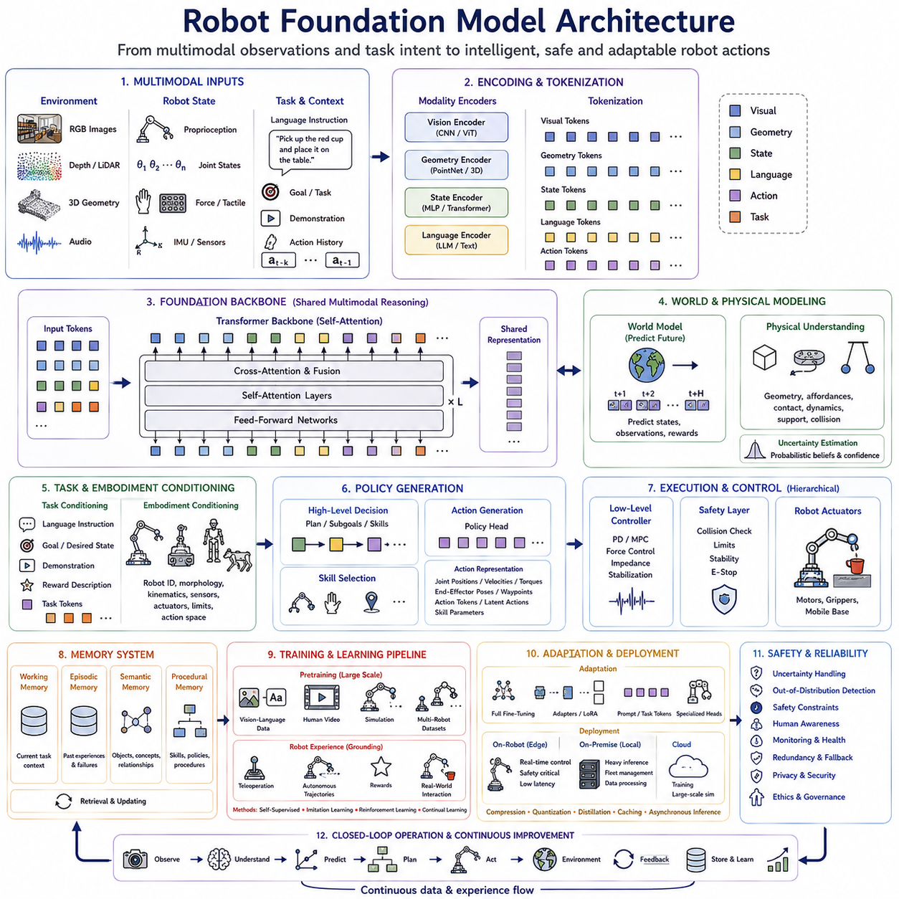{width="7.268055555555556in" height="7.268055555555556in"}

A robot foundation model architecture organizes perception, semantic understanding, physical reasoning, temporal memory, task conditioning, and action generation within a reusable learning system. Unlike a conventional robot stack built from independently optimized modules, the architecture attempts to share representations across tasks and environments while preserving specialized components where embodiment, control frequency, precision, or safety requires dedicated processing.

At the input layer, the model receives heterogeneous observations describing both the external environment and the robot itself. RGB images provide appearance and semantic cues, depth and LiDAR provide geometric structure, proprioception describes joint and body state, and force or tactile sensors reveal contact. Language instructions, goals, demonstrations, and previous actions provide additional context about what the robot should accomplish and how the current situation developed.

Because these modalities have fundamentally different structures, modality-specific encoders commonly transform them before deeper fusion occurs. Vision encoders convert images into visual tokens or feature maps, geometric encoders represent depth and point clouds, state encoders transform proprioceptive variables, and language encoders represent instructions. These front-end components preserve modality-specific information while mapping heterogeneous signals into representations that can participate in a shared model.

Tokenization provides a common interface between these encoders and the foundation backbone. Image patches, object features, 3D regions, language tokens, robot states, action histories, and task descriptors can be represented as sequences of embeddings. Position, time, modality, embodiment, and sensor identifiers can be added so that the model knows where information originated and how observations relate across space and time.

Multimodal fusion connects these separate streams into a coherent representation of the current situation. Early fusion combines modalities before substantial reasoning, while late fusion allows independent processing before representations interact. Hybrid architectures can preserve specialized encoders while using cross-attention or shared transformer layers to exchange information. The objective is not merely to concatenate sensor features but to learn relationships among language, perception, robot state, and action.

The foundation backbone forms the central reusable component of the architecture. Transformer-based models are particularly attractive because attention can integrate heterogeneous tokens and dynamically select information relevant to the current task. The backbone can represent objects, spatial relationships, task semantics, robot state, temporal dependencies, and behavioral context within a common latent space from which multiple downstream capabilities can be derived.

Semantic knowledge within the backbone provides information about what objects and situations mean. Broad vision-language pretraining can contribute object categories, functional relationships, commonsense expectations, and instruction understanding. Robot experience then grounds these semantic representations in physical interaction. The resulting model must connect concepts such as container, handle, obstacle, fragile, or destination with the actions and constraints associated with them.

Physical representations complement semantic knowledge by encoding geometry, affordances, reachability, contact, motion, support, collision, and other properties relevant to interaction. Some of these quantities may be explicitly estimated by dedicated modules, while others can remain latent within the shared representation. A useful architecture allows semantic reasoning and physical evidence to interact rather than forcing planning to rely on either symbolic meaning or geometry alone.

Temporal modeling is necessary because robotic behavior unfolds through sequences rather than isolated observations. The architecture can maintain histories of observations, actions, goals, and outcomes so that current decisions reflect previous events. Temporal attention, recurrent memory, latent state models, or explicit world-state representations can preserve information about moving objects, completed subgoals, previous failures, and changes caused by robot actions.

A world-model component can extend temporal representation into prediction. Given the current latent state and a candidate action, the model estimates possible future states, observations, rewards, or task outcomes. This allows actions to be evaluated before execution and supports planning over multiple steps. The world model may predict pixels, 3D structure, semantic states, occupancy, or compact latent representations depending on the computational requirements of the system.

Task conditioning determines which behavior should be produced from the shared representation. Natural-language instructions, goal images, desired states, demonstrations, reward descriptions, or task tokens can specify intent. Conditioning mechanisms allow the same backbone to generate different behavior from similar observations. A robot seeing a cup may approach it, grasp it, avoid it, or place another object beside it depending on the current task.

Embodiment conditioning provides complementary information about which robot must execute the behavior. Robot identity, morphology, kinematic structure, sensor configuration, actuator capabilities, payload limits, and action-space definitions can be encoded explicitly. This allows higher-level knowledge to be shared across platforms while preserving the differences that determine how a mobile manipulator, industrial arm, humanoid, or legged robot physically performs an action.

The policy layer converts the shared internal representation into decisions. In a direct policy architecture, the model predicts actions from observations and task conditions. In a hierarchical architecture, it may first generate plans, subgoals, waypoints, or skill selections. These intermediate decisions are then converted into executable behavior by specialized policy heads or controllers. The appropriate level depends on task horizon, model capacity, and control requirements.

Action representations can range from low-level joint commands to higher-level behavioral abstractions. Joint positions, velocities, torques, end-effector poses, navigation waypoints, skill identifiers, action tokens, or latent actions may serve as outputs. Low-level actions offer direct control but are tightly coupled to embodiment, whereas higher-level representations can improve transfer and allow specialized controllers to handle robot-specific dynamics.

Action chunking can reduce the mismatch between expensive foundation-model inference and high-frequency physical control. Instead of predicting a single action at every control cycle, the model can generate a short sequence of future actions or trajectory segments. A faster execution layer then follows or adjusts this sequence using current feedback. This allows high-level learned reasoning to operate at a lower frequency than motor stabilization and reactive safety control.

Hierarchical control is therefore a natural architectural pattern for robot foundation models. A foundation model can operate at the cognitive level, interpreting instructions, understanding scenes, predicting outcomes, and selecting skills. Mid-level policies generate trajectories or coordinated behaviors, while low-level controllers enforce dynamics, stability, force, and actuator constraints. Different layers can operate at frequencies appropriate to their computational and physical responsibilities.

Specialist modules remain valuable within this general architecture. Precision localization, collision checking, inverse kinematics, force control, balance stabilization, emergency braking, or other well-defined functions may be implemented using dedicated learned or classical algorithms. Foundation models need not replace components that already provide reliable performance. Instead, they can coordinate and contextualize these modules within broader task-level intelligence.

Mixture-of-experts architectures provide another method for balancing shared intelligence and specialization. A common backbone or router can activate experts associated with manipulation, navigation, locomotion, particular modalities, or specific embodiments. Only a subset of experts may be active for each input, increasing effective capacity without requiring every parameter to participate in every decision. Routing itself becomes an important learned component of the architecture.

Memory extends the architecture beyond the immediate context window. Working memory can maintain information relevant to the current task, episodic memory can store previous interactions and failures, semantic memory can preserve stable knowledge, and procedural memory can retain reusable skills. Retrieval mechanisms allow earlier experience to influence current decisions without requiring all historical information to remain continuously inside the active model context.

Uncertainty should propagate through the architecture rather than being discarded after perception. Ambiguous objects, incomplete geometry, unfamiliar instructions, uncertain predictions, and unreliable action estimates can all affect decision quality. Confidence estimates or probabilistic representations can help the policy decide whether to proceed, gather more observations, request clarification, choose a conservative plan, activate a specialist, or stop safely.

Safety mechanisms form a parallel layer around learned decision making. Workspace boundaries, collision constraints, velocity limits, stability conditions, force thresholds, human proximity rules, and emergency-stop logic can restrict candidate actions before execution. Independent safety supervision is especially important because foundation models operate over broad distributions that cannot be exhaustively validated through training data alone.

The training architecture is as important as the inference architecture. Large-scale pretraining can combine vision-language data, human video, simulation, teleoperation, autonomous robot trajectories, and multi-robot datasets. Self-supervised objectives can learn representations, imitation learning can ground behavior in demonstrations, and reinforcement learning can optimize interaction. These objectives can be applied sequentially or jointly depending on data availability and model design.

Post-training adapts the shared foundation to particular robots and applications. Full fine-tuning can modify the entire network, while adapters, low-rank updates, specialized heads, or prompt-based conditioning can provide more efficient specialization. Robot-specific calibration and policy learning connect broad pretrained knowledge with local sensing and dynamics. This allows one foundation architecture to support multiple deployments without requiring completely independent models.

Deployment constraints strongly influence the final architecture. Onboard compute has limited memory, power, thermal capacity, and latency budgets, while some reasoning may benefit from larger external compute. Compression, quantization, distillation, caching, asynchronous execution, and hierarchical inference can reduce computational cost. The architecture should assign each capability to an execution layer that satisfies both intelligence requirements and real-time constraints.

A distributed architecture can separate edge and external computation when communication conditions permit. Safety-critical perception and control should remain locally available, while expensive semantic reasoning, fleet-level learning, or long-horizon analysis may use larger compute resources. Communication loss must not remove essential safety functions. The robot should therefore maintain a locally executable minimum capability even when higher-level services become unavailable.

Evaluation must examine the architecture as an integrated closed-loop system. Individual encoder accuracy or language understanding scores are insufficient if generated actions fail physically. Testing should include task success, unseen objects, new environments, long-horizon execution, recovery, latency, power consumption, uncertainty handling, safety, transfer, and adaptation. Component-level diagnostics remain useful, but system-level behavior determines whether the architecture functions as physical intelligence.

A scalable robot foundation architecture should also support continuous improvement. Deployment produces new successes, failures, edge cases, and environmental variations that can return to the data pipeline. Evaluation identifies weaknesses, targeted collection expands missing coverage, retraining updates the foundation, and improved models are redeployed. Architecture, dataset, training, evaluation, and deployment therefore form a connected learning system rather than independent engineering stages.

Ultimately, the architecture can be understood as a flow from multimodal observation and task intent into shared representations, grounded physical understanding, temporal prediction, policy decisions, and controlled action. Feedback from the environment closes the loop, while memory and learning preserve useful experience across time. Specialized modules and safety mechanisms constrain this flexible intelligence wherever deterministic physical guarantees are required.

The defining characteristic of a robot foundation model architecture is therefore not one particular neural network structure but the organization of reusable knowledge around embodied action. Multimodal encoders provide access to the world, the foundation backbone integrates knowledge, world and physical models support prediction, task and embodiment conditioning provide context, policies generate behavior, and control and safety layers convert broad intelligence into reliable physical execution.

로봇 파운데이션 모델 아키텍처(Robot Foundation Model Architecture)는 지각(Perception), 의미 이해(Semantic Understanding), 물리 추론(Physical Reasoning), 시간적 메모리(Temporal Memory), 작업 조건화(Task Conditioning), 행동 생성(Action Generation)을 재사용 가능한 하나의 학습 시스템 안에서 구성한다. 독립적으로 최적화된 모듈을 조합하는 기존 로봇 스택과 달리, 이 아키텍처는 작업과 환경 전반에서 표현을 공유하면서 체화(Embodiment), 제어 주파수(Control Frequency), 정밀도(Precision), 안전(Safety)에 전용 처리가 필요한 영역에서는 전문화된 구성요소를 유지한다.

입력 계층(Input Layer)에서 모델은 외부 환경과 로봇 자체의 상태를 설명하는 이질적인 관측(Heterogeneous Observation)을 입력받는다. RGB 이미지는 외형과 의미적 단서를 제공하고, 깊이(Depth)와 라이다(LiDAR)는 기하 구조를 제공하며, 고유수용감각(Proprioception)은 관절과 신체 상태를 나타내고, 힘 또는 촉각 센서(Force or Tactile Sensor)는 접촉 정보를 제공한다. 언어 명령(Language Instruction), 목표(Goal), 시연(Demonstration), 이전 행동(Previous Action)은 로봇이 무엇을 수행해야 하며 현재 상황이 어떻게 형성되었는지에 대한 추가적인 맥락을 제공한다.

이러한 모달리티(Modality)는 근본적으로 서로 다른 구조를 가지므로 일반적으로 모달리티별 인코더(Modality-Specific Encoder)를 사용하여 심층 융합(Deep Fusion) 이전에 변환한다. 비전 인코더(Vision Encoder)는 이미지를 시각 토큰(Visual Token)이나 특징 맵(Feature Map)으로 변환하고, 기하 인코더(Geometric Encoder)는 깊이와 포인트 클라우드(Point Cloud)를 표현하며, 상태 인코더(State Encoder)는 고유수용 변수를 변환하고, 언어 인코더(Language Encoder)는 명령을 표현한다. 이러한 프런트엔드 구성요소는 모달리티별 정보를 보존하면서 이질적인 신호를 공유 모델에서 사용할 수 있는 표현으로 매핑한다.

토큰화(Tokenization)는 이러한 인코더와 파운데이션 백본(Foundation Backbone) 사이에 공통 인터페이스를 제공한다. 이미지 패치(Image Patch), 객체 특징(Object Feature), 3차원 영역(3D Region), 언어 토큰(Language Token), 로봇 상태, 행동 이력(Action History), 작업 설명자(Task Descriptor)를 임베딩 시퀀스(Embedding Sequence)로 표현할 수 있다. 위치(Position), 시간(Time), 모달리티, 체화, 센서 식별자(Sensor Identifier)를 추가하여 모델이 정보의 출처와 관측 사이의 공간적·시간적 관계를 이해하도록 할 수 있다.

멀티모달 융합(Multimodal Fusion)은 서로 분리된 정보 스트림을 현재 상황에 대한 일관된 표현으로 연결한다. 조기 융합(Early Fusion)은 본격적인 추론 이전에 모달리티를 결합하고, 후기 융합(Late Fusion)은 각각을 독립적으로 처리한 후 표현을 상호작용시킨다. 하이브리드 아키텍처(Hybrid Architecture)는 전문화된 인코더를 유지하면서 교차 어텐션(Cross-Attention)이나 공유 트랜스포머 계층(Shared Transformer Layer)을 통해 정보를 교환할 수 있다. 목적은 단순한 센서 특징 결합이 아니라 언어, 지각, 로봇 상태, 행동 사이의 관계를 학습하는 것이다.

파운데이션 백본은 아키텍처의 중심적인 재사용 구성요소를 형성한다. 트랜스포머 기반 모델(Transformer-Based Model)은 어텐션을 통해 이질적인 토큰을 통합하고 현재 작업에 중요한 정보를 동적으로 선택할 수 있기 때문에 특히 적합하다. 백본은 객체, 공간 관계(Spatial Relationship), 작업 의미(Task Semantics), 로봇 상태, 시간적 의존성(Temporal Dependency), 행동 맥락(Behavioral Context)을 공통 잠재 공간(Common Latent Space)에 표현하며, 이 표현으로부터 여러 다운스트림 능력을 도출할 수 있다.

백본 내부의 의미 지식(Semantic Knowledge)은 객체와 상황이 무엇을 의미하는지에 대한 정보를 제공한다. 광범위한 비전-언어 사전학습(Vision-Language Pretraining)은 객체 범주(Object Category), 기능적 관계(Functional Relationship), 상식적 기대(Common-Sense Expectation), 명령 이해(Instruction Understanding)를 제공할 수 있다. 이후 로봇 경험은 이러한 의미 표현을 물리적 상호작용에 그라운딩(Grounding)한다. 결과적으로 모델은 용기(Container), 손잡이(Handle), 장애물(Obstacle), 깨지기 쉬움(Fragile), 목적지(Destination)와 같은 개념을 관련 행동 및 제약조건과 연결해야 한다.

물리 표현(Physical Representation)은 상호작용에 필요한 기하 구조(Geometry), 어포던스(Affordance), 도달 가능성(Reachability), 접촉(Contact), 움직임(Motion), 지지(Support), 충돌(Collision) 등의 속성을 인코딩함으로써 의미 지식을 보완한다. 일부 값은 전용 모듈을 통해 명시적으로 추정할 수 있으며, 다른 정보는 공유 표현 내부에 잠재적으로 유지될 수 있다. 유용한 아키텍처에서는 의미 추론과 물리적 증거가 상호작용해야 하며, 계획이 상징적 의미(Symbolic Meaning)나 기하 정보 중 어느 한쪽에만 의존하지 않도록 해야 한다.

로봇 행동은 개별 관측이 아니라 연속적인 시퀀스를 통해 이루어지기 때문에 시간적 모델링(Temporal Modeling)이 필요하다. 아키텍처는 관측, 행동, 목표, 결과의 이력을 유지하여 현재 의사결정이 이전 사건을 반영하도록 할 수 있다. 시간적 어텐션(Temporal Attention), 순환 메모리(Recurrent Memory), 잠재 상태 모델(Latent State Model), 명시적인 월드 상태 표현(World-State Representation)을 통해 움직이는 객체, 완료된 하위 목표(Subgoal), 이전 실패, 로봇 행동으로 발생한 변화를 유지할 수 있다.

월드 모델(World Model) 구성요소는 시간적 표현을 예측(Prediction)로 확장할 수 있다. 현재 잠재 상태(Latent State)와 후보 행동(Candidate Action)이 주어지면 모델은 가능한 미래 상태, 관측, 보상(Reward), 작업 결과(Task Outcome)를 추정한다. 이를 통해 실제 실행 전에 행동을 평가하고 여러 단계에 걸친 계획을 수행할 수 있다. 시스템의 계산 요구조건에 따라 월드 모델은 픽셀(Pixel), 3차원 구조, 의미 상태(Semantic State), 점유(Occupancy), 또는 압축된 잠재 표현을 예측할 수 있다.

작업 조건화(Task Conditioning)는 공유 표현으로부터 어떤 행동이 생성되어야 하는지를 결정한다. 자연어 명령(Natural-Language Instruction), 목표 이미지(Goal Image), 원하는 상태(Desired State), 시연, 보상 설명(Reward Description), 작업 토큰(Task Token)을 통해 의도(Intent)를 지정할 수 있다. 조건화 메커니즘을 이용하면 동일한 백본이 유사한 관측에서도 서로 다른 행동을 생성할 수 있다. 예를 들어 컵을 관측한 로봇은 현재 작업에 따라 컵에 접근하거나, 파지하거나, 회피하거나, 다른 객체를 컵 옆에 배치할 수 있다.

체화 조건화(Embodiment Conditioning)는 어떤 로봇이 행동을 실행해야 하는지에 대한 보완 정보를 제공한다. 로봇 식별자(Robot Identity), 형태(Morphology), 운동학 구조(Kinematic Structure), 센서 구성(Sensor Configuration), 액추에이터 능력(Actuator Capability), 페이로드 한계(Payload Limit), 행동 공간 정의(Action-Space Definition)를 명시적으로 인코딩할 수 있다. 이를 통해 고수준 지식을 여러 플랫폼에서 공유하면서 모바일 매니퓰레이터, 산업용 로봇 팔, 휴머노이드(Humanoid), 다족 로봇(Legged Robot)이 행동을 수행하는 물리적 차이는 유지할 수 있다.

정책 계층(Policy Layer)은 공유 내부 표현을 의사결정으로 변환한다. 직접 정책 아키텍처(Direct Policy Architecture)에서는 모델이 관측과 작업 조건으로부터 행동을 직접 예측한다. 계층적 아키텍처(Hierarchical Architecture)에서는 먼저 계획(Plan), 하위 목표, 웨이포인트(Waypoint), 스킬 선택(Skill Selection)을 생성할 수 있다. 이후 이러한 중간 의사결정을 전문화된 정책 헤드(Policy Head)나 제어기(Controller)가 실행 가능한 행동으로 변환한다. 적절한 수준은 작업의 시간 범위(Task Horizon), 모델 용량(Model Capacity), 제어 요구조건에 따라 달라진다.

행동 표현(Action Representation)은 저수준 관절 명령(Low-Level Joint Command)부터 고수준 행동 추상화(Behavioral Abstraction)까지 다양할 수 있다. 관절 위치(Joint Position), 속도(Velocity), 토크(Torque), 엔드 이펙터 자세(End-Effector Pose), 내비게이션 웨이포인트(Navigation Waypoint), 스킬 식별자(Skill Identifier), 행동 토큰(Action Token), 잠재 행동(Latent Action)을 출력으로 사용할 수 있다. 저수준 행동은 직접적인 제어가 가능하지만 체화에 강하게 결합되고, 고수준 표현은 전이(Transfer)를 향상시키면서 전문화된 제어기가 로봇별 동역학을 처리하도록 할 수 있다.

행동 청킹(Action Chunking)은 계산 비용이 높은 파운데이션 모델 추론과 고주파 물리 제어 사이의 불일치를 줄일 수 있다. 모델이 매 제어 주기마다 하나의 행동만 예측하는 대신 짧은 미래 행동 시퀀스나 궤적 구간(Trajectory Segment)을 생성할 수 있다. 이후 더 빠른 실행 계층이 현재 피드백을 이용하여 해당 시퀀스를 추종하거나 수정한다. 이를 통해 고수준 학습 기반 추론은 모터 안정화(Motor Stabilization)와 반응형 안전 제어(Reactive Safety Control)보다 낮은 주파수에서 동작할 수 있다.

따라서 계층적 제어(Hierarchical Control)는 로봇 파운데이션 모델의 자연스러운 아키텍처 패턴이다. 파운데이션 모델은 인지 계층(Cognitive Level)에서 명령을 해석하고, 장면을 이해하고, 결과를 예측하고, 스킬을 선택할 수 있다. 중간 수준 정책(Mid-Level Policy)은 궤적이나 조정된 행동을 생성하고, 저수준 제어기는 동역학, 안정성(Stability), 힘, 액추에이터 제약을 적용한다. 서로 다른 계층은 각각의 계산적·물리적 책임에 적합한 주파수로 동작할 수 있다.

전문화 모듈(Specialist Module)은 이러한 범용 아키텍처에서도 여전히 중요하다. 정밀 위치추정(Precision Localization), 충돌 검사(Collision Checking), 역운동학(Inverse Kinematics), 힘 제어(Force Control), 균형 안정화(Balance Stabilization), 비상 제동(Emergency Braking)과 같이 명확하게 정의된 기능은 전용 학습 알고리즘이나 기존 알고리즘으로 구현할 수 있다. 파운데이션 모델이 이미 신뢰성 높은 성능을 제공하는 구성요소를 반드시 대체할 필요는 없다. 대신 더 광범위한 작업 수준의 지능 안에서 이러한 모듈을 조정하고 맥락화할 수 있다.

전문가 혼합 아키텍처(Mixture-of-Experts Architecture)는 공유 지능과 전문화를 균형 있게 결합하는 또 다른 방법을 제공한다. 공통 백본 또는 라우터(Router)는 조작, 내비게이션, 이동(Locomotion), 특정 모달리티 또는 특정 체화와 관련된 전문가(Expert)를 활성화할 수 있다. 각 입력에 대해 일부 전문가만 활성화하면 모든 의사결정에서 모든 파라미터를 사용할 필요 없이 실질적인 모델 용량을 증가시킬 수 있다. 이때 라우팅 자체도 아키텍처의 중요한 학습 구성요소가 된다.

메모리(Memory)는 아키텍처를 즉각적인 컨텍스트 윈도(Context Window) 너머로 확장한다. 작업 기억(Working Memory)은 현재 작업과 관련된 정보를 유지하고, 일화 기억(Episodic Memory)은 이전의 상호작용과 실패를 저장하며, 의미 기억(Semantic Memory)은 안정적인 지식을 보존하고, 절차 기억(Procedural Memory)은 재사용 가능한 스킬을 유지할 수 있다. 검색 메커니즘(Retrieval Mechanism)을 이용하면 모든 과거 정보를 활성 모델 컨텍스트에 계속 유지하지 않고도 이전 경험이 현재 의사결정에 영향을 미치도록 할 수 있다.

불확실성(Uncertainty)은 지각 단계 이후 제거되는 것이 아니라 아키텍처 전체에 전달되어야 한다. 모호한 객체, 불완전한 기하 구조, 익숙하지 않은 명령, 불확실한 예측, 신뢰하기 어려운 행동 추정은 모두 의사결정 품질에 영향을 줄 수 있다. 신뢰도 추정(Confidence Estimation)이나 확률적 표현(Probabilistic Representation)은 정책이 그대로 진행할지, 추가 관측을 수집할지, 설명을 요청할지, 보수적인 계획(Conservative Plan)을 선택할지, 전문화 모듈을 활성화할지, 안전하게 정지할지를 판단하는 데 도움을 줄 수 있다.

안전 메커니즘(Safety Mechanism)은 학습 기반 의사결정을 둘러싸는 병렬 계층(Parallel Layer)을 형성한다. 작업 공간 경계(Workspace Boundary), 충돌 제약(Collision Constraint), 속도 제한(Velocity Limit), 안정성 조건(Stability Condition), 힘 임계값(Force Threshold), 인간 근접 규칙(Human Proximity Rule), 비상 정지 로직(Emergency-Stop Logic)을 통해 실행 전에 후보 행동을 제한할 수 있다. 파운데이션 모델은 학습 데이터만으로 완전하게 검증할 수 없는 광범위한 분포에서 동작하기 때문에 독립적인 안전 감독(Independent Safety Supervision)이 특히 중요하다.

학습 아키텍처(Training Architecture)는 추론 아키텍처(Inference Architecture)만큼 중요하다. 대규모 사전학습(Large-Scale Pretraining)은 비전-언어 데이터, 인간 비디오(Human Video), 시뮬레이션, 원격조작(Teleoperation), 자율 로봇 궤적(Autonomous Robot Trajectory), 다중 로봇 데이터셋(Multi-Robot Dataset)을 결합할 수 있다. 자기지도 학습(Self-Supervised Learning)은 표현을 학습하고, 모방학습(Imitation Learning)은 시연을 통해 행동을 그라운딩하며, 강화학습(Reinforcement Learning)은 상호작용을 최적화할 수 있다. 이러한 목적함수(Objective)는 데이터와 모델 설계에 따라 순차적으로 또는 공동으로 적용할 수 있다.

사후학습(Post-Training)은 공유 파운데이션을 특정 로봇과 응용 분야에 적응시킨다. 전체 미세조정(Full Fine-Tuning)은 전체 네트워크를 변경할 수 있고, 어댑터(Adapter), 저랭크 업데이트(Low-Rank Update), 전문화 헤드(Specialized Head), 프롬프트 기반 조건화(Prompt-Based Conditioning)는 보다 효율적인 전문화를 제공할 수 있다. 로봇별 보정(Robot-Specific Calibration)과 정책 학습은 광범위한 사전학습 지식을 지역적인 센싱 및 동역학과 연결한다. 이를 통해 하나의 파운데이션 아키텍처가 완전히 독립적인 모델을 요구하지 않고 여러 배치를 지원할 수 있다.

배치 제약(Deployment Constraint)은 최종 아키텍처에 큰 영향을 미친다. 온보드 컴퓨팅(Onboard Computing)은 제한된 메모리, 전력, 열 용량(Thermal Capacity), 지연시간 예산(Latency Budget)을 가지지만 일부 추론은 더 큰 외부 컴퓨팅(External Compute)을 활용할 수 있다. 압축(Compression), 양자화(Quantization), 지식 증류(Knowledge Distillation), 캐싱(Caching), 비동기 실행(Asynchronous Execution), 계층적 추론(Hierarchical Inference)을 통해 계산 비용을 줄일 수 있다. 아키텍처는 지능 요구조건과 실시간 제약을 모두 만족하는 실행 계층에 각 능력을 배치해야 한다.

통신 조건이 허용되는 경우 분산 아키텍처(Distributed Architecture)는 엣지(Edge)와 외부 컴퓨팅을 분리할 수 있다. 안전 중요 지각(Safety-Critical Perception)과 제어는 로컬에서 항상 사용할 수 있어야 하며, 계산 비용이 높은 의미 추론, 플릿 수준 학습(Fleet-Level Learning), 장기 분석(Long-Horizon Analysis)은 더 큰 계산 자원을 활용할 수 있다. 통신이 끊어지더라도 필수 안전 기능이 제거되어서는 안 된다. 따라서 상위 수준 서비스가 사용할 수 없는 경우에도 로봇은 로컬에서 실행 가능한 최소 능력(Minimum Capability)을 유지해야 한다.

평가(Evaluation)는 아키텍처를 통합된 폐루프 시스템(Closed-Loop System)으로 검토해야 한다. 개별 인코더 정확도나 언어 이해 점수가 높더라도 생성된 행동이 물리적으로 실패한다면 충분하지 않다. 평가는 작업 성공률(Task Success), 학습하지 않은 객체, 새로운 환경, 장기 실행(Long-Horizon Execution), 복구(Recovery), 지연시간, 전력 소비(Power Consumption), 불확실성 처리, 안전, 전이, 적응을 포함해야 한다. 구성요소별 진단(Component-Level Diagnostic)도 유용하지만 아키텍처가 물리 지능으로 기능하는지는 전체 시스템 수준의 행동을 통해 결정된다.

확장 가능한 로봇 파운데이션 아키텍처는 지속적인 개선(Continuous Improvement)도 지원해야 한다. 실제 배치는 새로운 성공 사례, 실패, 엣지 케이스(Edge Case), 환경 변화를 생성하며 이러한 경험은 다시 데이터 파이프라인(Data Pipeline)으로 전달될 수 있다. 평가는 취약점을 식별하고, 표적 데이터 수집(Targeted Data Collection)은 부족한 영역을 확장하며, 재학습(Retraining)은 파운데이션을 업데이트하고, 개선된 모델은 다시 배치된다. 따라서 아키텍처, 데이터셋, 학습, 평가, 배치는 서로 독립된 공학 단계가 아니라 하나의 연결된 학습 시스템(Connected Learning System)을 형성한다.

궁극적으로 이 아키텍처는 멀티모달 관측(Multimodal Observation)과 작업 의도(Task Intent)에서 시작하여 공유 표현(Shared Representation), 그라운딩된 물리 이해(Grounded Physical Understanding), 시간적 예측(Temporal Prediction), 정책 의사결정(Policy Decision), 제어된 행동(Controlled Action)으로 이어지는 흐름으로 이해할 수 있다. 환경으로부터의 피드백(Feedback)은 폐루프를 완성하며, 메모리와 학습은 유용한 경험을 시간에 걸쳐 보존한다. 전문화 모듈과 안전 메커니즘은 결정론적인 물리적 보장(Deterministic Physical Guarantee)이 필요한 영역에서 이러한 유연한 지능을 제한하고 보완한다.

따라서 로봇 파운데이션 모델 아키텍처의 핵심적인 특징은 특정한 하나의 신경망 구조가 아니라 체화된 행동(Embodied Action)을 중심으로 재사용 가능한 지식(Reusable Knowledge)을 조직하는 방식에 있다. 멀티모달 인코더(Multimodal Encoder)는 세계에 접근하는 입력을 제공하고, 파운데이션 백본은 지식을 통합하며, 월드 모델과 물리 모델(Physical Model)은 예측을 지원하고, 작업 및 체화 조건화는 맥락을 제공한다. 정책은 행동을 생성하고, 제어 및 안전 계층(Control and Safety Layer)은 이러한 광범위한 지능을 신뢰할 수 있는 실제 물리적 실행으로 변환한다.
