**Volume 08. Robot Foundation Models and VLA**

# Chapter 03. Vision Language Models for Robotics

## 03.01. VLM Fundamentals for Robotics

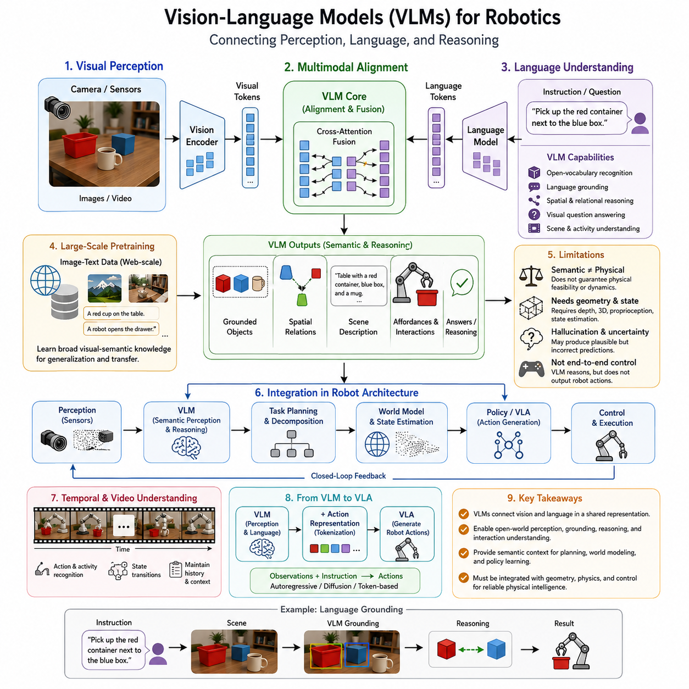{width="7.268055555555556in" height="7.268055555555556in"}

Vision-language models connect visual perception with linguistic representations so that a robot can interpret what it sees in terms of concepts, objects, relationships, and instructions. Instead of treating an image only as pixels or geometric measurements, a VLM maps visual observations into semantic representations that can be related to words and sentences. This capability provides an important bridge between perception-oriented robot systems and foundation models that reason through language.

For robotics, the central value of a VLM is its ability to associate open-ended visual observations with flexible language descriptions. A conventional perception system may contain separately trained detectors for predefined objects, while a VLM can use concepts learned from large-scale image-text data to recognize and describe a much broader range of scenes. This changes robot perception from a fixed classification problem toward a more general semantic interpretation problem.

A typical VLM contains a visual encoder, a language model or language-oriented representation module, and a mechanism that aligns or fuses information between them. The visual encoder transforms camera images into feature representations, while the language component represents instructions, questions, object names, goals, and semantic knowledge. Cross-modal projection, attention, or token-based interfaces then allow visual and linguistic information to interact within a shared computational representation.

Visual observations are commonly converted into sequences of visual features or tokens before being processed together with language tokens. This token-oriented formulation is particularly compatible with Transformer architectures because attention mechanisms can establish relationships between different regions of an image and different elements of an instruction. A phrase such as "the red container beside the table" can therefore become associated with relevant visual regions rather than remaining an isolated textual command.

Multimodal alignment is fundamental because visual and linguistic representations originate from very different information spaces. Training attempts to make corresponding images and descriptions semantically compatible so that related visual and textual concepts occupy useful regions of a shared or connected representation space. Once this alignment is learned at sufficient scale, a robot can exploit language as an interface for querying, organizing, and interpreting visual information encountered in its environment.

Large-scale pretraining gives VLMs broad semantic knowledge that would be difficult to obtain exclusively from robot demonstrations. Internet-scale image-text datasets expose models to objects, activities, environments, materials, attributes, and relationships far beyond a single robot deployment. Robotics can therefore reuse general visual-semantic knowledge and subsequently adapt it with robot-specific data, rather than learning every object category and linguistic concept from physical interaction alone.

The distinction between semantic understanding and physical understanding is especially important in robotics. A VLM may correctly identify a cup, table, drawer, tool, or person and describe their apparent relationships, but recognition alone does not guarantee accurate knowledge of depth, force, friction, mass, stability, collision constraints, or reachability. Consequently, VLM representations usually complement rather than replace geometric perception, state estimation, proprioception, and physical world modeling.

Language grounding turns abstract instructions into references to observable entities and relationships. If a user asks a robot to "pick up the bottle next to the blue box," the system must connect the linguistic concepts of bottle, blue box, and spatial relation with specific elements in the current scene. VLMs provide a foundation for this process by jointly representing visual evidence and language, enabling instructions to become conditioned on the robot\'s actual perceptual context.

Spatial reasoning extends grounding beyond object identification. Robots must understand relationships such as left and right, inside and outside, near and far, above and below, as well as more operational concepts such as reachable, blocked, supported, or contained. VLMs can contribute semantic and relational hypotheses, but reliable robotic operation often requires these hypotheses to be combined with depth sensing, 3D reconstruction, localization, occupancy information, or other explicitly geometric representations.

Affordance understanding provides another connection between visual semantics and physical interaction. Objects are not important only because of what they are called, but also because of what actions they permit. A handle may be grasped, a button pressed, a drawer pulled, and an open region traversed. VLM knowledge can help infer such possibilities from appearance and language, while robot-specific perception and control must determine whether the predicted interaction is physically feasible for the current embodiment.

VLMs also enable visual question answering and scene-oriented reasoning that can support higher-level robot cognition. A robot may query whether a target object is visible, which container is likely to hold an item, whether a workspace appears organized, or what objects are relevant to a requested task. Such reasoning can transform raw perception into structured semantic context that later modules use for task decomposition, planning, monitoring, or human-robot interaction.

Temporal robotics introduces requirements beyond single-image understanding. Mobile robots and manipulators operate through sequences of observations in which objects move, actions change the environment, and previously visible information may disappear. Video-language representations can incorporate temporal context to identify activities, state transitions, and evolving relationships. Maintaining this history is essential when understanding what happened earlier affects interpretation of the robot\'s present situation and future task decisions.

In a practical robot architecture, a VLM can therefore operate as a semantic perception and reasoning layer between sensory processing and action-oriented intelligence. Camera observations and language instructions enter the multimodal model, which produces grounded objects, semantic relationships, scene descriptions, task-relevant concepts, or reasoning features. These outputs may then condition planners, world models, navigation systems, manipulation policies, or other robot foundation-model components rather than directly commanding actuators.

This separation highlights the boundary between a vision-language model and a vision-language-action model. A VLM primarily connects perception with linguistic and semantic reasoning, whereas a VLA extends multimodal modeling toward generation of robot actions. The transition requires explicit treatment of observations, embodiment, action representations, temporal context, control constraints, and interaction feedback, which is why VLMs form a conceptual foundation for the later VLA architectures in the overall structure.

For robot foundation models, VLMs ultimately provide a reusable interface between broad world knowledge and situated visual perception. Their strength lies in open-vocabulary recognition, semantic generalization, language grounding, multimodal reasoning, and transfer from large-scale pretraining. Their limitations arise when semantic plausibility is mistaken for physical correctness, making integration with geometry, dynamics, uncertainty estimation, world models, and closed-loop control essential for dependable physical intelligence.

비전-언어 모델(Vision-Language Model, VLM)은 시각적 지각(visual perception)을 언어적 표현(linguistic representation)과 연결하여 로봇이 자신이 보는 것을 개념(concept), 객체(object), 관계(relationship), 명령(instruction)의 관점에서 해석할 수 있도록 한다. 이미지를 단순히 픽셀(pixel)이나 기하학적 측정값(geometric measurement)으로 처리하는 대신, VLM은 시각적 관측(visual observation)을 단어나 문장과 연결할 수 있는 의미 표현(semantic representation)으로 변환한다. 이러한 능력은 지각 중심 로봇 시스템(perception-oriented robot system)과 언어를 통해 추론하는 파운데이션 모델(foundation model)을 연결하는 중요한 가교 역할을 한다.

로보틱스(robotics)에서 VLM의 핵심 가치는 개방형 시각적 관측(open-ended visual observation)을 유연한 언어 설명(language description)과 연결할 수 있다는 점이다. 기존 지각 시스템(conventional perception system)은 사전에 정의된 객체를 위해 별도로 학습된 검출기(detector)를 사용할 수 있지만, VLM은 대규모 이미지-텍스트 데이터(image-text data)에서 학습한 개념을 활용하여 훨씬 광범위한 장면을 인식하고 설명할 수 있다. 이는 로봇 지각(robot perception)을 고정된 분류 문제(classification problem)에서 보다 일반적인 의미 해석 문제(semantic interpretation problem)로 확장한다.

일반적인 VLM은 비전 인코더(visual encoder), 언어 모델(language model) 또는 언어 중심 표현 모듈(language-oriented representation module), 그리고 두 정보 사이를 정렬하거나 융합하는 메커니즘(alignment or fusion mechanism)으로 구성된다. 비전 인코더는 카메라 이미지(camera image)를 특징 표현(feature representation)으로 변환하고, 언어 구성 요소(language component)는 명령, 질문, 객체 이름, 목표, 의미 지식(semantic knowledge)을 표현한다. 이후 교차 모달 투영(cross-modal projection), 어텐션(attention), 토큰 기반 인터페이스(token-based interface)를 통해 시각 정보와 언어 정보가 공유된 계산 표현(computational representation) 안에서 상호작용한다.

시각적 관측(visual observation)은 일반적으로 언어 토큰(language token)과 함께 처리되기 전에 일련의 시각 특징(visual feature) 또는 시각 토큰(visual token)으로 변환된다. 이러한 토큰 중심 구성(token-oriented formulation)은 어텐션 메커니즘(attention mechanism)이 이미지의 서로 다른 영역과 명령의 서로 다른 요소 사이의 관계를 설정할 수 있기 때문에 트랜스포머(Transformer) 아키텍처와 특히 잘 호환된다. 따라서 "테이블 옆의 빨간색 컨테이너(the red container beside the table)"와 같은 문구를 단순한 텍스트 명령이 아니라 관련된 시각 영역(visual region)과 연결할 수 있다.

멀티모달 정렬(multimodal alignment)은 시각 표현(visual representation)과 언어 표현(language representation)이 매우 다른 정보 공간에서 생성되기 때문에 핵심적인 요소이다. 학습 과정은 서로 대응하는 이미지와 설명을 의미적으로 호환되도록 만들어 관련 시각 및 텍스트 개념이 공유되거나 연결된 표현 공간(representation space)의 유용한 영역에 위치하도록 한다. 이러한 정렬이 충분한 규모로 학습되면 로봇은 언어를 이용하여 환경에서 관측한 시각 정보를 질의하고, 조직화하고, 해석할 수 있다.

대규모 사전학습(large-scale pretraining)은 VLM에 로봇 시연(robot demonstration)만으로는 획득하기 어려운 광범위한 의미 지식(semantic knowledge)을 제공한다. 인터넷 규모의 이미지-텍스트 데이터셋(image-text dataset)은 모델을 특정 로봇 배치 환경보다 훨씬 다양한 객체, 활동, 환경, 재료, 속성, 관계에 노출시킨다. 따라서 로보틱스는 모든 객체 범주와 언어 개념을 물리적 상호작용(physical interaction)만으로 학습하는 대신 일반적인 시각-의미 지식(visual-semantic knowledge)을 재사용한 후 로봇 특화 데이터(robot-specific data)를 통해 적응시킬 수 있다.

의미적 이해(semantic understanding)와 물리적 이해(physical understanding)의 차이는 로보틱스에서 특히 중요하다. VLM은 컵, 테이블, 서랍, 도구 또는 사람을 정확히 식별하고 이들 사이의 외관상 관계를 설명할 수 있지만, 이러한 인식만으로 깊이(depth), 힘(force), 마찰(friction), 질량(mass), 안정성(stability), 충돌 제약(collision constraint), 도달 가능성(reachability)을 정확하게 이해한다고 보장할 수는 없다. 따라서 VLM 표현은 일반적으로 기하학적 지각(geometric perception), 상태 추정(state estimation), 고유수용감각(proprioception), 물리적 월드 모델링(physical world modeling)을 대체하기보다 보완한다.

언어 그라운딩(language grounding)은 추상적인 명령을 관측 가능한 객체와 관계에 연결한다. 사용자가 로봇에게 "파란 상자 옆에 있는 병을 집어라(pick up the bottle next to the blue box)"라고 요청하면 시스템은 병, 파란 상자, 공간 관계(spatial relation)라는 언어 개념을 현재 장면의 특정 요소와 연결해야 한다. VLM은 시각적 증거(visual evidence)와 언어를 공동으로 표현함으로써 이러한 과정의 기반을 제공하며, 명령을 로봇의 실제 지각적 맥락(perceptual context)에 조건화할 수 있게 한다.

공간 추론(spatial reasoning)은 객체 식별을 넘어 그라운딩(grounding)을 확장한다. 로봇은 왼쪽과 오른쪽, 내부와 외부, 가까움과 멂, 위와 아래 같은 관계뿐 아니라 도달 가능(reachable), 차단됨(blocked), 지지됨(supported), 포함됨(contained)과 같은 보다 작업 중심적인 개념도 이해해야 한다. VLM은 의미적·관계적 가설(semantic and relational hypothesis)을 제공할 수 있지만, 신뢰할 수 있는 로봇 동작을 위해서는 이러한 가설을 깊이 센싱(depth sensing), 3차원 재구성(3D reconstruction), 위치 추정(localization), 점유 정보(occupancy information) 또는 명시적인 기하학 표현(geometric representation)과 결합해야 하는 경우가 많다.

어포던스 이해(affordance understanding)는 시각적 의미(visual semantics)와 물리적 상호작용(physical interaction)을 연결하는 또 다른 요소이다. 객체는 단순히 무엇이라고 불리는가뿐 아니라 어떤 행동을 허용하는가도 중요하다. 손잡이는 잡을 수 있고, 버튼은 누를 수 있으며, 서랍은 당길 수 있고, 열린 공간은 통과할 수 있다. VLM 지식은 외관과 언어를 바탕으로 이러한 가능성을 추론하는 데 도움을 줄 수 있으며, 로봇 특화 지각(robot-specific perception)과 제어(control)는 예측된 상호작용이 현재 로봇의 신체 구조(embodiment)에서 실제로 실행 가능한지를 판단해야 한다.

VLM은 또한 상위 수준의 로봇 인지(robot cognition)를 지원할 수 있는 시각 질의응답(Visual Question Answering, VQA)과 장면 중심 추론(scene-oriented reasoning)을 가능하게 한다. 로봇은 목표 객체가 보이는지, 어떤 컨테이너에 특정 물체가 있을 가능성이 높은지, 작업 공간이 정돈되어 있는지, 요청된 작업에 어떤 객체가 관련되는지를 질의할 수 있다. 이러한 추론은 원시 지각(raw perception)을 구조화된 의미적 맥락(semantic context)으로 변환하여 이후의 작업 분해(task decomposition), 계획(planning), 모니터링(monitoring), 인간-로봇 상호작용(human-robot interaction)에 활용할 수 있게 한다.

시간적 로보틱스(temporal robotics)는 단일 이미지 이해(single-image understanding)를 넘어서는 요구사항을 가진다. 이동 로봇(mobile robot)과 매니퓰레이터(manipulator)는 객체가 이동하고, 행동이 환경을 변화시키며, 이전에 보였던 정보가 사라질 수 있는 연속적인 관측(sequence of observations) 속에서 동작한다. 비디오-언어 표현(video-language representation)은 시간적 맥락(temporal context)을 통합하여 활동, 상태 전이(state transition), 변화하는 관계를 식별할 수 있다. 이전에 발생한 사건이 현재 상황의 해석과 미래 작업 결정에 영향을 주기 때문에 이러한 이력(history)을 유지하는 것이 중요하다.

실제 로봇 아키텍처(robot architecture)에서 VLM은 센서 처리(sensory processing)와 행동 중심 지능(action-oriented intelligence) 사이의 의미 지각 및 추론 계층(semantic perception and reasoning layer)으로 동작할 수 있다. 카메라 관측(camera observation)과 언어 명령(language instruction)이 멀티모달 모델(multimodal model)에 입력되면, 모델은 그라운딩된 객체(grounded object), 의미 관계(semantic relationship), 장면 설명(scene description), 작업 관련 개념(task-relevant concept), 추론 특징(reasoning feature)을 생성한다. 이러한 출력은 액추에이터(actuator)를 직접 명령하기보다 플래너(planner), 월드 모델(world model), 내비게이션 시스템(navigation system), 조작 정책(manipulation policy) 또는 다른 로봇 파운데이션 모델 구성 요소를 조건화하는 데 사용될 수 있다.

이러한 구분은 비전-언어 모델(Vision-Language Model, VLM)과 비전-언어-행동 모델(Vision-Language-Action Model, VLA)의 경계를 명확하게 보여준다. VLM이 주로 지각(perception)을 언어적·의미적 추론(linguistic and semantic reasoning)과 연결한다면, VLA는 멀티모달 모델링(multimodal modeling)을 로봇 행동 생성(robot action generation)까지 확장한다. 이러한 전환에는 관측(observation), 신체 구조(embodiment), 행동 표현(action representation), 시간적 맥락(temporal context), 제어 제약(control constraint), 상호작용 피드백(interaction feedback)을 명시적으로 다루는 과정이 필요하며, 이것이 VLM이 이후의 VLA 아키텍처를 위한 개념적 기반을 형성하는 이유이다.

로봇 파운데이션 모델(robot foundation model)의 관점에서 VLM은 궁극적으로 광범위한 세계 지식(world knowledge)과 상황에 기반한 시각적 지각(situated visual perception)을 연결하는 재사용 가능한 인터페이스(reusable interface)를 제공한다. VLM의 강점은 개방 어휘 인식(open-vocabulary recognition), 의미 일반화(semantic generalization), 언어 그라운딩(language grounding), 멀티모달 추론(multimodal reasoning), 대규모 사전학습으로부터의 전이(transfer)에 있다. 반면 의미적 개연성(semantic plausibility)을 물리적 정확성(physical correctness)으로 오인할 수 있다는 한계가 있으므로, 신뢰할 수 있는 물리 지능(physical intelligence)을 구현하기 위해서는 기하학(geometry), 동역학(dynamics), 불확실성 추정(uncertainty estimation), 월드 모델(world model), 폐루프 제어(closed-loop control)와의 통합이 필수적이다.

## 03.02. Vision Encoders and Language Models

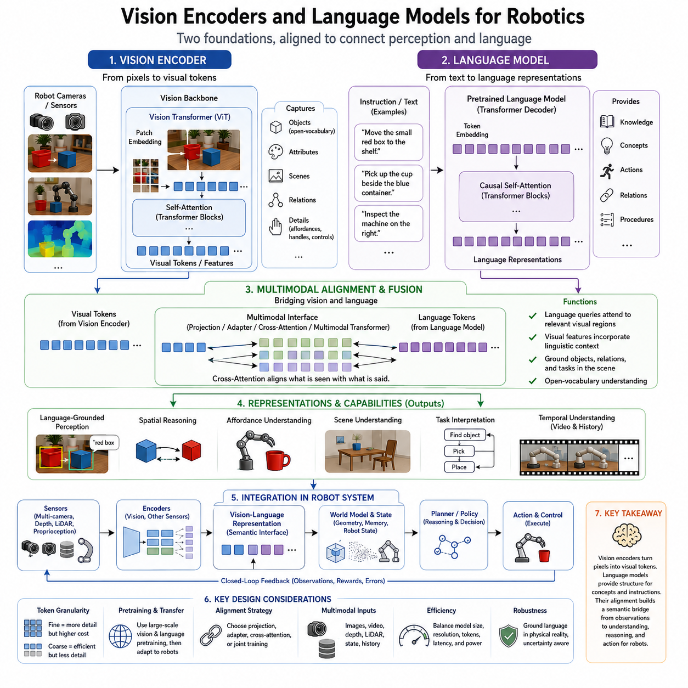{width="7.268055555555556in" height="7.268055555555556in"}

Vision encoders and language models form the two primary computational foundations of a vision-language system for robotics. The vision encoder converts high-dimensional camera observations into compact visual representations, while the language model represents instructions, concepts, relationships, and task context. Their integration allows a robot to connect what is visually observed with what is linguistically described or requested.

A vision encoder transforms an image or video frame into features that preserve information useful for recognition and reasoning. Earlier robotic vision systems often relied on convolutional neural networks, while modern multimodal foundation models increasingly employ Vision Transformers. Instead of producing only predefined class labels, these encoders generate rich feature representations that can support open-vocabulary objects, attributes, scenes, and relationships.

In a Vision Transformer, an image is typically divided into patches that are projected into embedding vectors and processed as visual tokens. Self-attention enables each token to incorporate information from other image regions, allowing representations to capture both local appearance and broader scene context. This token-based organization also creates a convenient architectural interface with Transformer language models, which already process linguistic information as token sequences.

The resolution and granularity of visual tokens strongly influence robotic perception. Fine visual tokens can preserve small objects, boundaries, handles, controls, and interaction-relevant details, but they increase sequence length and computational cost. Coarser representations reduce memory and inference requirements but may discard details needed for manipulation or precise grounding. Robot VLM design therefore requires balancing semantic coverage, spatial precision, latency, and available compute.

Language models process textual instructions by converting words or subword units into token embeddings and repeatedly transforming them through attention-based layers. Through large-scale pretraining, these models acquire representations of objects, actions, relationships, procedures, and broad contextual knowledge. In robotics, this linguistic knowledge provides a flexible mechanism for expressing goals such as finding an object, navigating toward a location, inspecting equipment, or describing a manipulation task.

The language model can also provide compositional reasoning that extends beyond fixed robot command vocabularies. An instruction may contain an object, attribute, spatial relation, action, and constraint simultaneously, as in "move the small red box from the table to the shelf." Rather than creating a separate command representation for every possible combination, a language model can represent these elements compositionally and relate them to the current visual context.

Vision and language components initially produce representations in different feature spaces, so an interface is required between them. A projection layer, multimodal adapter, cross-attention module, or multimodal Transformer can transform visual features into representations compatible with language processing. Visual tokens can then appear within the model context alongside language tokens, allowing linguistic queries to attend to relevant portions of the robot\'s visual observations.

Cross-attention provides one important mechanism for establishing these relationships. Language representations can selectively attend to visual tokens associated with relevant objects or regions, while multimodal architectures may also permit visual representations to incorporate linguistic context. When instructed to identify "the cup beside the blue container," the model must associate the words describing the cup, container, and spatial relation with the appropriate visual evidence in the scene.

Different architectural strategies determine how tightly the vision encoder and language model are coupled. Some systems keep a pretrained vision backbone and language model largely frozen and train only lightweight projection or adapter layers between them. Others fine-tune portions of both networks or train multimodal layers jointly. These choices influence training cost, preservation of pretrained knowledge, domain adaptation, representation alignment, and the computational requirements of deployment.

Pretrained vision encoders are valuable because robotic datasets are usually much smaller than general image collections. Features learned from large and diverse visual datasets can provide strong representations of everyday objects, materials, environments, and activities before robot-specific training begins. Robot data can then adapt these representations toward unusual viewpoints, manipulation scenes, industrial environments, navigation imagery, and embodiment-dependent interaction requirements.

Similarly, pretrained language models allow robot systems to inherit broad linguistic and conceptual knowledge instead of learning language exclusively from robot trajectories. However, linguistic knowledge should not automatically be interpreted as reliable physical knowledge. A language model may describe a plausible action without understanding exact geometry, collision risk, actuator limits, object mass, or dynamic stability, requiring its representations to be grounded in robot observations and physical state.

Robotic perception also differs from ordinary image understanding because observations are continuous and embodied. Cameras move with the robot, viewpoints change during navigation or manipulation, and actions alter subsequent observations. A useful vision-language architecture may therefore incorporate multiple images, video frames, temporal embeddings, robot state, or observation history rather than treating every camera frame as an independent image-language problem.

Multiple cameras and additional sensors create further representation challenges. A robot may observe the same object from several viewpoints while also receiving depth, LiDAR, proprioceptive, or state information. The vision-language backbone must preserve enough spatial and semantic structure for these observations to be associated correctly. Depending on the architecture, sensor-specific encoders can generate features that are subsequently aligned, fused, or supplied as additional multimodal tokens.

For real-time robots, encoder and language-model size must also be considered as part of the physical system architecture. Large visual backbones and language models improve representation capacity but consume GPU memory, energy, and inference time. Token count, image resolution, attention complexity, model precision, and context length directly affect latency. Practical systems may therefore combine compressed encoders, smaller language models, cached representations, or hierarchical processing.

The resulting vision-language representation should be viewed as an intermediate semantic interface rather than the complete robot intelligence stack. Vision encoders answer how sensory observations can be represented, while language models provide a structure for concepts, instructions, and reasoning. Their aligned representations can subsequently support language-grounded perception, spatial reasoning, affordance understanding, task interpretation, planning, and eventually action-oriented models such as Vision-Language-Action models.

Within the broader robot foundation model architecture, vision encoders and language models therefore establish the pathway from pixels to semantic context. The vision encoder compresses observations into meaningful visual tokens, the language model supplies linguistic and conceptual structure, and multimodal alignment connects the two. Reliable physical intelligence emerges when this semantic backbone is further integrated with temporal perception, geometry, robot state, world models, action representations, and closed-loop control.

비전 인코더(Vision Encoder)와 언어 모델(Language Model)은 로보틱스(robotics)를 위한 비전-언어 시스템(Vision-Language System)의 두 가지 핵심 계산 기반을 구성한다. 비전 인코더는 고차원의 카메라 관측(camera observation)을 압축된 시각 표현(visual representation)으로 변환하고, 언어 모델은 명령(instruction), 개념(concept), 관계(relationship), 작업 맥락(task context)을 표현한다. 이 두 요소의 통합을 통해 로봇은 시각적으로 관측한 내용과 언어로 설명되거나 요청된 내용을 서로 연결할 수 있다.

비전 인코더(Vision Encoder)는 이미지 또는 비디오 프레임(video frame)을 인식과 추론에 유용한 정보를 보존하는 특징(feature)으로 변환한다. 초기 로봇 비전 시스템(robotic vision system)은 주로 합성곱 신경망(Convolutional Neural Network, CNN)을 사용했지만, 현대의 멀티모달 파운데이션 모델(multimodal foundation model)은 비전 트랜스포머(Vision Transformer, ViT)를 점차 폭넓게 사용하고 있다. 이러한 인코더는 사전에 정의된 클래스 레이블만 생성하는 것이 아니라 개방 어휘 객체(open-vocabulary object), 속성(attribute), 장면(scene), 관계(relationship)를 지원할 수 있는 풍부한 특징 표현을 생성한다.

비전 트랜스포머(Vision Transformer)에서는 일반적으로 이미지를 패치(patch)로 분할한 다음 임베딩 벡터(embedding vector)로 투영하여 시각 토큰(visual token)으로 처리한다. 셀프 어텐션(self-attention)은 각각의 토큰이 다른 이미지 영역의 정보를 통합할 수 있도록 하여 국소적인 외관(local appearance)과 전체적인 장면 맥락(scene context)을 함께 포착한다. 이러한 토큰 기반 구성은 언어 정보를 이미 토큰 시퀀스(token sequence)로 처리하는 트랜스포머 언어 모델(Transformer Language Model)과 연결하기에도 편리한 아키텍처 인터페이스(architectural interface)를 제공한다.

시각 토큰(visual token)의 해상도(resolution)와 세분성(granularity)은 로봇 지각(robot perception)의 성능에 큰 영향을 미친다. 세밀한 시각 토큰은 작은 객체, 경계(boundary), 손잡이(handle), 제어 장치(control), 상호작용 관련 세부 정보(interaction-relevant detail)를 보존할 수 있지만 시퀀스 길이와 계산 비용을 증가시킨다. 반대로 거친 표현(coarse representation)은 메모리와 추론 요구량을 줄이지만 조작(manipulation)이나 정밀 그라운딩(precise grounding)에 필요한 정보를 손실할 수 있다. 따라서 로봇 VLM 설계에서는 의미적 범위(semantic coverage), 공간 정밀도(spatial precision), 지연시간(latency), 가용 연산 자원(available compute)의 균형이 필요하다.

언어 모델(Language Model)은 단어나 서브워드 단위(subword unit)를 토큰 임베딩(token embedding)으로 변환하고 이를 어텐션 기반 계층(attention-based layer)을 통해 반복적으로 처리하여 텍스트 명령을 해석한다. 대규모 사전학습(large-scale pretraining)을 통해 이러한 모델은 객체, 행동(action), 관계, 절차(procedure), 광범위한 맥락 지식(contextual knowledge)의 표현을 획득한다. 로보틱스에서는 이러한 언어 지식이 객체 탐색, 특정 위치로의 이동, 장비 검사, 조작 작업 설명과 같은 목표를 유연하게 표현할 수 있는 메커니즘을 제공한다.

언어 모델은 고정된 로봇 명령 어휘(command vocabulary)를 넘어서는 조합적 추론(compositional reasoning)도 제공할 수 있다. 예를 들어 "작은 빨간 상자를 테이블에서 선반으로 옮겨라(move the small red box from the table to the shelf)"라는 명령에는 객체, 속성, 공간 관계(spatial relation), 행동, 제약 조건(constraint)이 동시에 포함된다. 가능한 모든 조합마다 별도의 명령 표현을 만드는 대신 언어 모델은 이러한 요소들을 조합적으로 표현하고 현재의 시각적 맥락(visual context)과 연결할 수 있다.

비전 구성 요소(vision component)와 언어 구성 요소(language component)는 처음에는 서로 다른 특징 공간(feature space)의 표현을 생성하므로 두 요소 사이를 연결하는 인터페이스(interface)가 필요하다. 투영 계층(projection layer), 멀티모달 어댑터(multimodal adapter), 교차 어텐션 모듈(cross-attention module), 멀티모달 트랜스포머(multimodal Transformer)를 사용하여 시각 특징을 언어 처리와 호환되는 표현으로 변환할 수 있다. 이후 시각 토큰은 언어 토큰과 함께 모델의 맥락(context)에 배치되어 언어 질의가 로봇의 시각적 관측 중 관련 부분에 주의를 기울일 수 있게 된다.

교차 어텐션(cross-attention)은 이러한 관계를 형성하는 중요한 메커니즘 가운데 하나이다. 언어 표현(language representation)은 관련 객체나 영역에 대응하는 시각 토큰을 선택적으로 참조할 수 있으며, 멀티모달 아키텍처는 시각 표현이 언어적 맥락을 통합하도록 구성할 수도 있다. 예를 들어 "파란색 컨테이너 옆의 컵(the cup beside the blue container)"을 식별하라는 명령이 주어지면 모델은 컵, 컨테이너, 공간 관계를 나타내는 단어들을 장면에서 적절한 시각적 증거(visual evidence)와 연결해야 한다.

서로 다른 아키텍처 전략(architectural strategy)은 비전 인코더와 언어 모델이 얼마나 긴밀하게 결합되는지를 결정한다. 일부 시스템은 사전학습된 비전 백본(vision backbone)과 언어 모델을 대부분 동결(freeze)하고 두 모델 사이의 경량 투영 계층 또는 어댑터(adapter)만 학습한다. 다른 시스템은 두 네트워크의 일부를 미세조정(fine-tuning)하거나 멀티모달 계층을 공동으로 학습한다. 이러한 선택은 학습 비용(training cost), 사전학습 지식의 보존, 도메인 적응(domain adaptation), 표현 정렬(representation alignment), 배포 시 계산 요구사항에 영향을 미친다.

사전학습된 비전 인코더(pretrained vision encoder)는 로봇 데이터셋(robotic dataset)이 일반적인 이미지 데이터셋보다 훨씬 작은 경우가 많기 때문에 특히 유용하다. 대규모의 다양한 시각 데이터에서 학습된 특징은 로봇 특화 학습이 시작되기 전에 일상적인 객체, 재료(material), 환경, 활동에 대한 강력한 표현을 제공할 수 있다. 이후 로봇 데이터를 이용하여 특수한 시점(viewpoint), 조작 장면, 산업 환경, 내비게이션 영상, 신체 구조 의존적 상호작용 요구사항(embodiment-dependent interaction requirement)에 맞게 이러한 표현을 적응시킬 수 있다.

마찬가지로 사전학습된 언어 모델(pretrained language model)을 활용하면 로봇 시스템은 언어를 로봇 궤적(robot trajectory)만으로 학습하는 대신 광범위한 언어적·개념적 지식을 활용할 수 있다. 그러나 언어 지식(linguistic knowledge)을 자동으로 신뢰할 수 있는 물리적 지식(physical knowledge)으로 해석해서는 안 된다. 언어 모델은 정확한 기하학(geometry), 충돌 위험(collision risk), 액추에이터 한계(actuator limit), 객체 질량(object mass), 동적 안정성(dynamic stability)을 이해하지 못한 상태에서도 그럴듯한 행동을 설명할 수 있으므로, 그 표현은 로봇 관측 및 물리적 상태(physical state)에 그라운딩되어야 한다.

로봇 지각(robotic perception)은 관측이 연속적이고 신체화(embodied)되어 있다는 점에서도 일반적인 이미지 이해(image understanding)와 다르다. 로봇이 이동하면 카메라도 함께 움직이고, 내비게이션이나 조작 과정에서 시점이 변화하며, 로봇의 행동은 이후 관측 자체를 변화시킨다. 따라서 유용한 비전-언어 아키텍처는 각각의 카메라 프레임을 독립적인 이미지-언어 문제로 처리하기보다 다중 이미지(multiple images), 비디오 프레임, 시간 임베딩(temporal embedding), 로봇 상태(robot state), 관측 이력(observation history)을 통합할 수 있다.

다중 카메라(multiple cameras)와 추가 센서(additional sensor)는 표현 과정에 또 다른 과제를 만든다. 로봇은 여러 시점에서 동일한 객체를 관측하면서 동시에 깊이(depth), 라이다(LiDAR), 고유수용감각(proprioceptive information), 상태 정보(state information)를 수신할 수 있다. 비전-언어 백본(vision-language backbone)은 이러한 관측이 올바르게 연결될 수 있도록 충분한 공간적·의미적 구조를 보존해야 한다. 아키텍처에 따라 센서별 인코더(sensor-specific encoder)가 특징을 생성한 뒤 이를 정렬(alignment), 융합(fusion)하거나 추가적인 멀티모달 토큰(multimodal token)으로 제공할 수 있다.

실시간 로봇(real-time robot)에서는 인코더와 언어 모델의 크기도 물리 시스템 아키텍처(physical system architecture)의 일부로 고려해야 한다. 대형 비전 백본과 언어 모델은 표현 능력(representation capacity)을 향상시키지만 GPU 메모리, 에너지, 추론 시간을 더 많이 소비한다. 토큰 수(token count), 이미지 해상도, 어텐션 복잡도(attention complexity), 모델 정밀도(model precision), 컨텍스트 길이(context length)는 지연시간에 직접적인 영향을 준다. 따라서 실제 시스템에서는 압축된 인코더(compressed encoder), 소형 언어 모델, 캐시된 표현(cached representation), 계층적 처리(hierarchical processing)를 조합할 수 있다.

결과적으로 생성되는 비전-언어 표현(vision-language representation)은 완전한 로봇 지능 스택(robot intelligence stack)이라기보다 중간 의미 인터페이스(intermediate semantic interface)로 이해해야 한다. 비전 인코더는 센서 관측을 어떻게 표현할 것인가를 담당하고, 언어 모델은 개념, 명령, 추론을 위한 구조를 제공한다. 이렇게 정렬된 표현은 이후 언어 기반 지각(language-grounded perception), 공간 추론(spatial reasoning), 어포던스 이해(affordance understanding), 작업 해석(task interpretation), 계획(planning), 그리고 궁극적으로 비전-언어-행동 모델(Vision-Language-Action Model, VLA)과 같은 행동 중심 모델을 지원할 수 있다.

더 넓은 로봇 파운데이션 모델(robot foundation model) 아키텍처에서 비전 인코더와 언어 모델은 픽셀(pixel)에서 의미적 맥락(semantic context)으로 이어지는 경로를 구축한다. 비전 인코더는 관측을 의미 있는 시각 토큰으로 압축하고, 언어 모델은 언어적·개념적 구조를 제공하며, 멀티모달 정렬(multimodal alignment)은 이 두 표현을 연결한다. 신뢰할 수 있는 물리 지능(physical intelligence)은 이러한 의미적 백본(semantic backbone)이 시간적 지각(temporal perception), 기하학, 로봇 상태, 월드 모델(world model), 행동 표현(action representation), 폐루프 제어(closed-loop control)와 추가적으로 통합될 때 구현될 수 있다.

## 03.03. Multimodal Alignment and Fusion

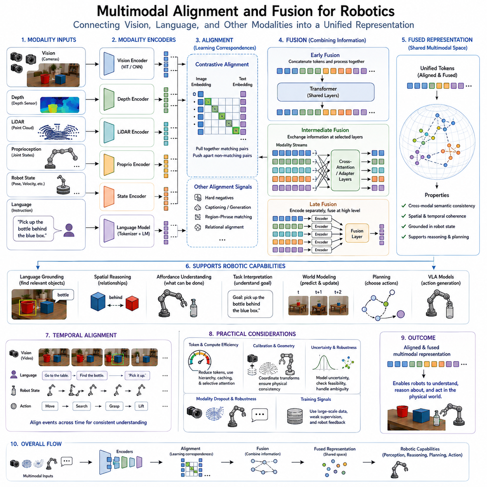{width="7.268055555555556in" height="7.268055555555556in"}

Multimodal alignment and fusion enable a robot to connect information expressed through different modalities, particularly vision and language, within a coherent representation. Images describe appearance and spatial structure, while language expresses concepts, instructions, relationships, and goals. Because these signals originate in different representational spaces, a robot VLM requires mechanisms that make corresponding information mutually interpretable before meaningful multimodal reasoning can occur.

Alignment refers to learning correspondences between representations from different modalities. A visual feature representing a red cup should become associated with linguistic representations such as "red cup," while visual relationships such as an object being inside a container should correspond to appropriate relational language. Effective alignment allows semantic similarity to be preserved across modalities even though the underlying sensory and symbolic inputs have very different structures.

Large-scale image-text pretraining provides a common foundation for learning these correspondences. Models observe many paired or weakly associated images and textual descriptions and learn which visual patterns tend to correspond with particular words, phrases, objects, attributes, activities, and scenes. This process creates transferable visual-semantic knowledge that robot systems can reuse before adaptation to robot-specific observations, environments, viewpoints, and tasks.

Contrastive learning is one widely used alignment strategy. Visual and textual encoders generate embeddings, and training encourages representations from matching image-text pairs to become more similar while separating unrelated pairs. The resulting embedding space supports semantic retrieval and open-vocabulary recognition. For robotics, such representations can help associate unfamiliar observations with language concepts without requiring a dedicated classifier for every possible object or scene.

Alignment alone, however, does not provide complete multimodal interaction. Fusion determines how information from multiple modalities is combined during representation and reasoning. A robot may need to determine not merely whether an image and sentence are related, but exactly which visual object corresponds to a phrase, which spatial relation satisfies an instruction, or which scene element is relevant to the current task. Fusion mechanisms provide the computational interactions needed for these finer correspondences.

Early fusion combines modalities relatively close to their input representations. Visual tokens and language tokens can be projected into compatible dimensions and processed together by shared Transformer layers. This approach permits extensive interaction between modalities throughout multimodal processing. However, the combined sequence may become computationally expensive, particularly when high-resolution images, multiple camera views, video frames, and long language contexts generate large numbers of tokens.

Late fusion keeps modality-specific processing more independent and combines representations after substantial visual and linguistic encoding has already occurred. This design can preserve strong pretrained vision and language backbones and reduce the cost of joint processing. Its disadvantage is that detailed cross-modal interactions may occur relatively late, potentially limiting fine-grained grounding when a task requires precise relationships between words and specific visual regions.

Intermediate fusion provides a compromise by allowing each modality to develop useful representations independently before selected layers exchange information. Projection modules, multimodal adapters, cross-attention blocks, or specialized fusion tokens can connect the streams. Such architectures are attractive for robot foundation models because they allow pretrained components to be reused while introducing trainable interfaces that adapt general vision-language knowledge to embodied tasks.

Cross-attention is particularly useful for language-grounded robotic perception. A textual query can attend selectively to visual tokens that contain relevant evidence, rather than treating every visual region as equally important. For an instruction such as "pick up the bottle behind the blue box," attention must connect object words and relational terms with the corresponding regions of the observed scene. This converts language from a general description into a context-dependent perceptual query.

Token projection is necessary when visual and linguistic encoders produce representations with different dimensions or statistical properties. A learned projection layer can transform visual features into the embedding space expected by a multimodal or language model. More expressive adapters may compress many visual tokens into fewer multimodal tokens, reducing computational load while retaining task-relevant information. The quality of this transformation directly affects what visual evidence remains available for later reasoning.

Robotic multimodal fusion extends beyond ordinary image and text inputs. A physical agent may simultaneously receive multiple camera views, depth, LiDAR, proprioception, joint states, localization estimates, task instructions, and observation history. These signals need not all be converted identically, but their representations must ultimately support a consistent interpretation of the robot, environment, task, and relevant physical relationships.

Spatial alignment becomes especially important when several sensors observe the same environment. Camera features may encode appearance, depth sensors provide distance, LiDAR describes geometric structure, and robot state specifies the configuration of the embodiment. Calibration, coordinate transformations, positional representations, and geometric fusion can complement learned semantic alignment. Without this physical consistency, semantically correct multimodal features may still refer to incompatible locations or frames.

Temporal alignment is similarly necessary for embodied systems because observations arrive continuously rather than as isolated samples. Visual frames, language instructions, robot states, and actions may correspond to different moments in time. A useful multimodal representation must preserve which events occurred before or after others and how actions changed observations. Temporal embeddings, history tokens, memory mechanisms, or video representations can provide context for interpreting these evolving relationships.

The desired fusion strategy also depends on the downstream task. Semantic scene description may tolerate compressed visual representations, whereas precise manipulation may require fine spatial features and detailed grounding. Navigation may benefit from persistent scene and geometric representations, while task planning may rely more heavily on high-level concepts and language context. Consequently, there is no single optimal fusion architecture for every robotic capability.

Efficiency becomes a major constraint when multimodal fusion is deployed on physical robots. Combining high-resolution vision, multiple sensors, long temporal histories, and large language models can produce excessive token counts and attention costs. Practical systems may reduce visual tokens, cache stable features, process modalities at different rates, use hierarchical fusion, or activate expensive reasoning only when required. Fusion design therefore affects both model capability and real-time feasibility.

Reliable alignment must also distinguish semantic compatibility from physical validity. A model may correctly associate the phrase "lift the box" with the appropriate object while lacking information about its weight, grasp stability, collision geometry, or actuator capacity. Robot foundation models therefore need multimodal representations that connect semantic alignment with geometry, state estimation, uncertainty, dynamics, and embodiment-specific constraints before high-level understanding can safely influence physical action.

Within the broader VLM architecture, multimodal alignment and fusion form the bridge between modality-specific encoders and integrated robot reasoning. Vision contributes perceptual evidence, language contributes semantic and task structure, and additional sensors contribute geometric and physical state. By aligning these representations and selectively fusing relevant information, the system can support grounding, spatial reasoning, affordance understanding, task interpretation, world modeling, planning, and later Vision-Language-Action models.

멀티모달 정렬(multimodal alignment)과 융합(fusion)은 로봇이 서로 다른 모달리티(modality), 특히 비전(vision)과 언어(language)를 통해 표현되는 정보를 일관된 표현(coherent representation) 안에서 연결할 수 있도록 한다. 이미지는 외형과 공간 구조(spatial structure)를 나타내는 반면, 언어는 개념(concept), 명령(instruction), 관계(relationship), 목표(goal)를 표현한다. 이러한 신호는 서로 다른 표현 공간(representational space)에서 생성되므로, 로봇 VLM은 의미 있는 멀티모달 추론(multimodal reasoning)을 수행하기 전에 서로 대응하는 정보를 상호 해석 가능하게 만드는 메커니즘을 필요로 한다.

정렬(alignment)은 서로 다른 모달리티에서 생성된 표현 사이의 대응 관계(correspondence)를 학습하는 것을 의미한다. 빨간 컵(red cup)을 나타내는 시각 특징(visual feature)은 "red cup"과 같은 언어 표현과 연결되어야 하며, 객체가 컨테이너 내부에 존재하는 것과 같은 시각적 관계는 적절한 관계 언어(relational language)와 대응해야 한다. 효과적인 정렬은 기본적인 감각 및 기호 입력(sensory and symbolic input)의 구조가 매우 다르더라도 모달리티 사이에서 의미적 유사성(semantic similarity)이 유지되도록 한다.

대규모 이미지-텍스트 사전학습(large-scale image-text pretraining)은 이러한 대응 관계를 학습하기 위한 공통 기반을 제공한다. 모델은 수많은 이미지와 텍스트 설명의 쌍 또는 약하게 연결된 데이터를 관찰하면서 특정 시각 패턴이 어떤 단어, 문구, 객체, 속성(attribute), 활동(activity), 장면(scene)과 대응하는지를 학습한다. 이 과정은 로봇 시스템이 로봇 특화 관측(robot-specific observation), 환경, 시점(viewpoint), 작업(task)에 적응하기 전에 재사용할 수 있는 전이 가능한 시각-의미 지식(transferable visual-semantic knowledge)을 형성한다.

대조 학습(contrastive learning)은 널리 사용되는 정렬 전략 가운데 하나이다. 시각 인코더(visual encoder)와 텍스트 인코더(textual encoder)가 임베딩(embedding)을 생성하면, 학습 과정은 서로 일치하는 이미지-텍스트 쌍의 표현을 더욱 유사하게 만들고 관련 없는 쌍은 서로 분리하도록 한다. 이렇게 형성된 임베딩 공간(embedding space)은 의미 검색(semantic retrieval)과 개방 어휘 인식(open-vocabulary recognition)을 지원한다. 로보틱스에서는 이러한 표현을 통해 가능한 모든 객체나 장면마다 전용 분류기(classifier)를 만들지 않고도 익숙하지 않은 관측을 언어 개념과 연결할 수 있다.

그러나 정렬(alignment)만으로는 완전한 멀티모달 상호작용(multimodal interaction)을 제공할 수 없다. 융합(fusion)은 표현과 추론 과정에서 여러 모달리티의 정보가 어떻게 결합되는지를 결정한다. 로봇은 단순히 이미지와 문장이 서로 관련되어 있는지를 판단하는 것을 넘어 어떤 시각 객체가 특정 문구와 대응하는지, 어떤 공간 관계가 명령을 만족하는지, 현재 작업과 관련된 장면 요소가 무엇인지 판단해야 할 수 있다. 융합 메커니즘은 이러한 세밀한 대응 관계를 형성하는 데 필요한 계산적 상호작용(computational interaction)을 제공한다.

초기 융합(early fusion)은 입력 표현과 비교적 가까운 단계에서 모달리티를 결합한다. 시각 토큰(visual token)과 언어 토큰(language token)을 호환 가능한 차원으로 투영한 다음 공유 트랜스포머 계층(shared Transformer layer)을 통해 함께 처리할 수 있다. 이러한 접근 방식은 멀티모달 처리 전반에 걸쳐 모달리티 사이의 광범위한 상호작용을 가능하게 한다. 그러나 고해상도 이미지, 다중 카메라 시점, 비디오 프레임, 긴 언어 컨텍스트가 많은 토큰을 생성하면 결합된 시퀀스(sequence)의 계산 비용이 크게 증가할 수 있다.

후기 융합(late fusion)은 모달리티별 처리를 보다 독립적으로 유지하고 상당한 수준의 시각 및 언어 인코딩이 수행된 이후에 표현을 결합한다. 이러한 설계는 강력한 사전학습 비전 및 언어 백본(pretrained vision and language backbone)을 유지하면서 공동 처리 비용을 줄일 수 있다. 그러나 세부적인 교차 모달 상호작용(cross-modal interaction)이 상대적으로 늦게 발생하기 때문에 단어와 특정 시각 영역 사이의 정밀한 관계가 필요한 작업에서는 세밀한 그라운딩(fine-grained grounding)이 제한될 가능성이 있다.

중간 융합(intermediate fusion)은 각 모달리티가 먼저 독립적으로 유용한 표현을 형성한 뒤 선택된 계층에서 정보를 교환하도록 하여 절충점을 제공한다. 투영 모듈(projection module), 멀티모달 어댑터(multimodal adapter), 교차 어텐션 블록(cross-attention block), 특수 융합 토큰(specialized fusion token)을 이용하여 각 정보 흐름을 연결할 수 있다. 이러한 아키텍처는 사전학습된 구성 요소를 재사용하면서 일반적인 비전-언어 지식을 신체화된 작업(embodied task)에 적응시키는 학습 가능한 인터페이스(trainable interface)를 도입할 수 있어 로봇 파운데이션 모델(robot foundation model)에 유용하다.

교차 어텐션(cross-attention)은 언어 그라운딩 기반 로봇 지각(language-grounded robotic perception)에 특히 유용하다. 텍스트 질의(textual query)는 모든 시각 영역을 동일하게 처리하는 대신 관련 증거를 포함한 시각 토큰에 선택적으로 주의를 기울일 수 있다. "파란 상자 뒤에 있는 병을 집어라(pick up the bottle behind the blue box)"와 같은 명령에서는 어텐션이 객체를 나타내는 단어와 관계 표현을 관측 장면의 해당 영역과 연결해야 한다. 이를 통해 언어는 일반적인 설명에서 상황 의존적인 지각 질의(context-dependent perceptual query)로 변환된다.

토큰 투영(token projection)은 시각 인코더와 언어 인코더가 서로 다른 차원이나 통계적 특성(statistical property)의 표현을 생성할 때 필요하다. 학습된 투영 계층(learned projection layer)은 시각 특징을 멀티모달 모델이나 언어 모델이 요구하는 임베딩 공간으로 변환할 수 있다. 보다 표현력이 높은 어댑터(adapter)는 다수의 시각 토큰을 더 적은 수의 멀티모달 토큰으로 압축하여 작업 관련 정보를 유지하면서 계산 부하를 줄일 수 있다. 이러한 변환의 품질은 이후 추론 과정에서 사용할 수 있는 시각적 증거가 얼마나 보존되는지에 직접적인 영향을 준다.

로봇의 멀티모달 융합(multimodal fusion)은 일반적인 이미지와 텍스트 입력을 넘어선다. 물리 에이전트(physical agent)는 여러 카메라 시점, 깊이(depth), 라이다(LiDAR), 고유수용감각(proprioception), 관절 상태(joint state), 위치 추정값(localization estimate), 작업 명령, 관측 이력(observation history)을 동시에 수신할 수 있다. 이러한 신호를 모두 동일한 방식으로 변환할 필요는 없지만, 최종적인 표현은 로봇, 환경, 작업 및 관련 물리적 관계를 일관되게 해석할 수 있도록 지원해야 한다.

여러 센서가 동일한 환경을 관측하는 경우에는 공간 정렬(spatial alignment)이 특히 중요하다. 카메라 특징은 외형을 인코딩하고, 깊이 센서는 거리 정보를 제공하며, 라이다는 기하학적 구조(geometric structure)를 표현하고, 로봇 상태는 신체 구조(embodiment)의 구성을 나타낸다. 캘리브레이션(calibration), 좌표 변환(coordinate transformation), 위치 표현(positional representation), 기하학적 융합(geometric fusion)은 학습된 의미 정렬(semantic alignment)을 보완할 수 있다. 이러한 물리적 일관성이 없으면 의미적으로 올바른 멀티모달 특징이라도 서로 호환되지 않는 위치나 좌표계(frame)를 참조할 수 있다.

신체화 시스템(embodied system)에서는 관측이 독립적인 샘플이 아니라 연속적으로 입력되므로 시간 정렬(temporal alignment)도 필요하다. 시각 프레임, 언어 명령, 로봇 상태, 행동(action)은 서로 다른 시점에 대응할 수 있다. 유용한 멀티모달 표현은 어떤 사건이 다른 사건보다 먼저 또는 나중에 발생했는지와 행동이 관측을 어떻게 변화시켰는지를 보존해야 한다. 시간 임베딩(temporal embedding), 이력 토큰(history token), 메모리 메커니즘(memory mechanism), 비디오 표현(video representation)은 이러한 변화하는 관계를 해석하기 위한 맥락을 제공할 수 있다.

필요한 융합 전략(fusion strategy)은 다운스트림 작업(downstream task)에 따라서도 달라진다. 의미적 장면 설명(semantic scene description)은 압축된 시각 표현으로도 충분할 수 있지만 정밀 조작(precise manipulation)은 세밀한 공간 특징과 정교한 그라운딩을 필요로 할 수 있다. 내비게이션(navigation)은 지속적인 장면 및 기하학적 표현의 이점을 얻을 수 있는 반면, 작업 계획(task planning)은 상위 수준의 개념과 언어 맥락에 더 크게 의존할 수 있다. 따라서 모든 로봇 기능에 최적인 하나의 융합 아키텍처가 존재한다고 볼 수는 없다.

멀티모달 융합을 물리적 로봇에 배포할 때 효율성(efficiency)은 주요 제약 조건이 된다. 고해상도 비전, 다중 센서, 긴 시간 이력, 대형 언어 모델을 결합하면 토큰 수와 어텐션 계산 비용이 지나치게 증가할 수 있다. 실제 시스템에서는 시각 토큰을 줄이거나, 안정적인 특징을 캐싱(caching)하거나, 모달리티별로 서로 다른 주기로 처리하거나, 계층적 융합(hierarchical fusion)을 사용하거나, 필요한 경우에만 고비용 추론을 활성화할 수 있다. 따라서 융합 설계는 모델의 능력뿐 아니라 실시간 실행 가능성(real-time feasibility)에도 직접적인 영향을 미친다.

신뢰할 수 있는 정렬(reliable alignment)은 의미적 호환성(semantic compatibility)과 물리적 유효성(physical validity)을 구분해야 한다. 모델은 "상자를 들어 올려라(lift the box)"라는 문구를 적절한 객체와 정확하게 연결하면서도 그 객체의 무게, 파지 안정성(grasp stability), 충돌 기하학(collision geometry), 액추에이터 용량(actuator capacity)에 대한 정보를 갖지 못할 수 있다. 따라서 로봇 파운데이션 모델은 상위 수준의 이해가 물리적 행동에 안전하게 영향을 미치기 전에 의미 정렬을 기하학, 상태 추정(state estimation), 불확실성(uncertainty), 동역학(dynamics), 신체 구조 특화 제약(embodiment-specific constraint)과 연결하는 멀티모달 표현을 필요로 한다.

더 넓은 VLM 아키텍처에서 멀티모달 정렬(multimodal alignment)과 융합(fusion)은 모달리티별 인코더(modality-specific encoder)와 통합된 로봇 추론(integrated robot reasoning)을 연결하는 가교를 형성한다. 비전은 지각적 증거(perceptual evidence)를 제공하고, 언어는 의미 및 작업 구조(semantic and task structure)를 제공하며, 추가 센서는 기하학 및 물리적 상태(physical state)를 제공한다. 이러한 표현을 정렬하고 관련 정보를 선택적으로 융합함으로써 시스템은 그라운딩(grounding), 공간 추론(spatial reasoning), 어포던스 이해(affordance understanding), 작업 해석(task interpretation), 월드 모델링(world modeling), 계획(planning), 그리고 이후의 비전-언어-행동 모델(Vision-Language-Action Model, VLA)을 지원할 수 있다.

## 03.04. Image and Video Understanding for Robots

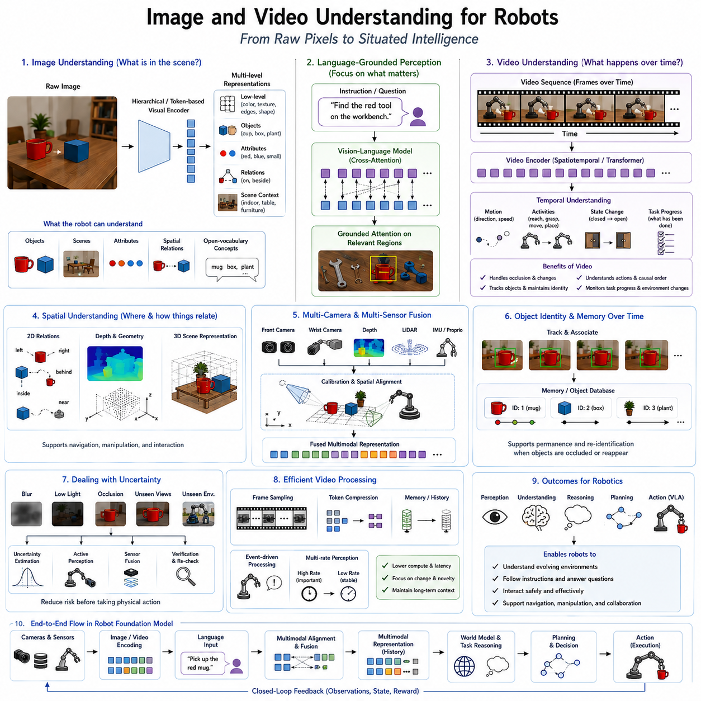{width="7.268055555555556in" height="7.268055555555556in"}

Image and video understanding allows robots to transform raw camera observations into structured information about objects, scenes, activities, and changes in the physical environment. Image understanding focuses primarily on the content of individual visual observations, whereas video understanding adds temporal relationships across multiple frames. For embodied systems, both are essential because robots must interpret not only what exists around them but also how the environment evolves over time.

An individual image contains multiple levels of information relevant to robotic intelligence. Low-level visual patterns describe color, texture, edges, and shape, while higher-level representations encode objects, attributes, semantic categories, spatial relationships, and scene context. Modern vision encoders learn hierarchical or token-based representations that allow robot foundation models to move from raw pixels toward semantic descriptions that can subsequently interact with language and task information.

Object understanding is a fundamental component of robotic vision because physical tasks usually refer to entities in the environment. A robot may need to identify tools, containers, furniture, people, obstacles, landmarks, or manipulation targets. Foundation-model-based perception extends conventional closed-set recognition toward open-vocabulary understanding, allowing visual observations to be related to flexible language concepts rather than only categories explicitly defined during task-specific training.

Scene understanding provides context beyond individual objects. The same object can imply different actions depending on whether it appears in a kitchen, warehouse, laboratory, road, or industrial workspace. Visual representations can capture global scene characteristics together with local entities, helping a robot infer where it is, what types of activities are likely, and which objects or regions may be relevant to the current instruction. Such context supports more coherent task interpretation and planning.

Robots also require spatial understanding because semantic recognition alone does not determine where objects are located or how they relate physically. Visual models can estimate relationships such as left, right, above, behind, inside, near, or overlapping, while depth and geometric sensors can provide stronger metric constraints. Combining semantic image understanding with geometry helps transform descriptions of a scene into representations useful for navigation, manipulation, and interaction.

Image understanding becomes especially valuable when conditioned by language. Instead of analyzing every visible element with equal importance, a robot can use an instruction or question to determine which regions and concepts deserve attention. If asked to "find the red tool on the workbench," a vision-language model can associate the linguistic description with candidate visual regions. This language-grounded perception converts general visual understanding into task-directed observation.

However, robotic environments cannot be understood reliably from isolated images alone. Objects may move, become occluded, enter or leave the field of view, and change state after interaction. The robot itself also moves, continuously altering camera viewpoint and image appearance. Video understanding addresses these issues by representing sequences of frames and learning temporal relationships that reveal motion, persistence, activities, and transitions that cannot be inferred confidently from a single snapshot.

Temporal representations allow a model to distinguish visually similar states by considering what happened before and after them. A closed drawer followed by an open drawer indicates a state transition, while a hand approaching and then lifting an object provides evidence of an interaction. Such temporal context is important for recognizing actions, determining causal sequences, monitoring task progress, and understanding whether an intended physical operation has actually changed the environment.

Video models can represent time using frame sequences, spatiotemporal tokens, temporal attention, recurrent memory, or compressed video features. Transformer-based approaches often extend attention across both spatial and temporal dimensions, enabling information from one frame to influence interpretation of another. Because long videos create extremely large token sequences, practical robotic systems frequently need temporal sampling, token compression, memory mechanisms, or hierarchical representations to maintain useful history efficiently.

Motion provides another source of information unavailable from static images. Tracking objects across frames can reveal direction, velocity, persistence, and interaction patterns. For mobile robots, visual motion is also influenced by ego-motion produced by the robot itself. Distinguishing object motion from camera motion is therefore important for understanding dynamic scenes, predicting collision risks, maintaining object identity, and constructing stable representations of the surrounding world.

Video understanding can also support activity recognition and procedural interpretation. A robot observing a person or another robot may identify sequences such as reaching, grasping, moving, placing, opening, or assembling. When combined with language, these visual sequences can be associated with higher-level task concepts and instructions. This capability creates a pathway for learning from human demonstrations, instructional videos, teleoperation records, and large-scale visual data beyond conventional robot trajectories.

Maintaining object identity through time is critical for persistent robot understanding. An object temporarily hidden behind another object should not automatically be treated as nonexistent, and an object viewed from a different angle should ideally retain the same semantic identity. Tracking, temporal memory, and multimodal representations help establish object permanence, allowing robots to reason about entities that are currently visible, previously observed, or expected to reappear during task execution.

Multiple cameras further expand image and video understanding by providing complementary viewpoints of the environment. A mobile manipulator may simultaneously use forward-facing navigation cameras, arm-mounted cameras, and depth sensors. Representations from these views must be associated across space and time so that the robot does not interpret the same physical entity as unrelated observations. Calibration, geometric relationships, temporal synchronization, and learned multimodal fusion all contribute to consistent interpretation.

Image and video models also face uncertainty caused by blur, lighting variation, reflections, occlusion, unusual viewpoints, and previously unseen environments. A visually plausible interpretation may still be incorrect, particularly when fine physical details determine whether an action is safe. Reliable robotic systems therefore need mechanisms for uncertainty estimation, repeated observation, active perception, sensor fusion, or verification before uncertain semantic predictions are converted into consequential physical actions.

Computational efficiency is particularly important for continuous video processing. High-resolution images arriving from several cameras can generate enormous quantities of visual tokens every second, while only a small fraction may contain meaningful changes. Practical robot foundation models can exploit frame sampling, feature caching, adaptive token selection, event-driven processing, or multi-rate perception so that stable observations receive less computation while novel, uncertain, or safety-critical events receive greater attention.

Within a robot foundation model, image and video understanding ultimately provide the visual-semantic history needed for situated intelligence. Images establish objects, attributes, scenes, and spatial context, while video adds motion, persistence, activities, and state transitions. Combined with language, robot state, geometry, memory, and world models, these representations enable robots to understand evolving environments and provide the perceptual foundation for reasoning, planning, and later Vision-Language-Action models.

이미지 및 비디오 이해(image and video understanding)는 로봇이 원시 카메라 관측(raw camera observation)을 객체(object), 장면(scene), 활동(activity), 물리적 환경의 변화에 대한 구조화된 정보(structured information)로 변환할 수 있도록 한다. 이미지 이해(image understanding)는 주로 개별 시각 관측의 내용에 초점을 맞추는 반면, 비디오 이해(video understanding)는 여러 프레임 사이의 시간적 관계(temporal relationship)를 추가한다. 신체화 시스템(embodied system)에서는 주변에 무엇이 존재하는지뿐 아니라 환경이 시간에 따라 어떻게 변화하는지도 해석해야 하므로 두 가지 모두 필수적이다.

개별 이미지에는 로봇 지능(robotic intelligence)에 필요한 여러 수준의 정보가 포함되어 있다. 저수준 시각 패턴(low-level visual pattern)은 색상, 질감(texture), 경계(edge), 형상(shape)을 나타내고, 상위 수준 표현(higher-level representation)은 객체, 속성(attribute), 의미 범주(semantic category), 공간 관계(spatial relationship), 장면 맥락(scene context)을 인코딩한다. 현대의 비전 인코더(vision encoder)는 계층적 또는 토큰 기반 표현(token-based representation)을 학습하여 로봇 파운데이션 모델(robot foundation model)이 원시 픽셀에서 언어 및 작업 정보와 상호작용할 수 있는 의미적 설명(semantic description)으로 이동할 수 있도록 한다.

객체 이해(object understanding)는 물리적 작업이 일반적으로 환경의 특정 개체(entity)를 대상으로 하기 때문에 로봇 비전(robotic vision)의 기본적인 구성 요소이다. 로봇은 도구, 컨테이너, 가구, 사람, 장애물, 랜드마크(landmark), 조작 대상(manipulation target)을 식별해야 할 수 있다. 파운데이션 모델 기반 지각(foundation-model-based perception)은 기존의 폐쇄 집합 인식(closed-set recognition)을 개방 어휘 이해(open-vocabulary understanding)로 확장하여 시각적 관측을 작업별 학습 과정에서 명시적으로 정의된 범주에만 한정하지 않고 유연한 언어 개념과 연결할 수 있도록 한다.

장면 이해(scene understanding)는 개별 객체를 넘어서는 맥락을 제공한다. 동일한 객체라도 주방, 창고, 실험실, 도로, 산업 작업 공간 중 어디에 존재하는지에 따라 서로 다른 행동을 의미할 수 있다. 시각 표현(visual representation)은 전체적인 장면 특성과 국소적인 개체 정보를 함께 포착하여 로봇이 자신이 어디에 있는지, 어떤 활동이 발생할 가능성이 있는지, 현재 명령과 관련된 객체나 영역이 무엇인지 추론하도록 지원한다. 이러한 맥락은 보다 일관된 작업 해석(task interpretation)과 계획(planning)을 가능하게 한다.

로봇은 의미적 인식(semantic recognition)만으로 객체가 어디에 위치하는지 또는 물리적으로 어떤 관계를 가지는지 결정할 수 없기 때문에 공간 이해(spatial understanding)도 필요하다. 시각 모델은 왼쪽, 오른쪽, 위, 뒤, 내부, 근처, 겹침과 같은 관계를 추정할 수 있으며, 깊이 및 기하학 센서(depth and geometric sensor)는 보다 강력한 계량적 제약(metric constraint)을 제공할 수 있다. 의미적 이미지 이해를 기하학(geometry)과 결합하면 장면에 대한 설명을 내비게이션(navigation), 조작(manipulation), 상호작용(interaction)에 활용할 수 있는 표현으로 변환할 수 있다.

이미지 이해는 언어(language)에 의해 조건화될 때 특히 유용해진다. 로봇은 보이는 모든 요소를 동일한 중요도로 분석하는 대신 명령이나 질문을 이용하여 어떤 영역과 개념에 집중해야 하는지 결정할 수 있다. 예를 들어 "작업대 위의 빨간 도구를 찾아라(find the red tool on the workbench)"라는 요청을 받으면 비전-언어 모델(Vision-Language Model, VLM)은 언어적 설명을 후보 시각 영역(candidate visual region)과 연결할 수 있다. 이러한 언어 그라운딩 지각(language-grounded perception)은 일반적인 시각 이해를 작업 지향적 관측(task-directed observation)으로 변환한다.

그러나 로봇 환경은 고립된 이미지(isolated image)만으로 신뢰성 있게 이해할 수 없다. 객체는 이동하거나 가려질 수 있고, 시야(field of view)에 들어오거나 사라질 수 있으며, 상호작용 이후 상태가 변화할 수도 있다. 또한 로봇 자체가 움직이기 때문에 카메라 시점과 이미지 외관이 지속적으로 변화한다. 비디오 이해(video understanding)는 프레임 시퀀스(frame sequence)를 표현하고 시간적 관계를 학습함으로써 이러한 문제를 다루며, 단일 스냅샷(single snapshot)만으로는 확실하게 추론하기 어려운 움직임, 지속성(persistence), 활동, 상태 전이(transition)를 파악할 수 있게 한다.

시간적 표현(temporal representation)은 모델이 이전과 이후에 발생한 사건을 고려하여 시각적으로 유사한 상태를 구분하도록 한다. 닫힌 서랍 다음에 열린 서랍이 관측되면 상태 전이(state transition)가 발생했음을 나타내며, 손이 객체에 접근한 뒤 들어 올리는 장면은 상호작용이 발생했다는 증거를 제공한다. 이러한 시간적 맥락(temporal context)은 행동 인식(action recognition), 인과적 순서(causal sequence) 판단, 작업 진행 모니터링(task progress monitoring), 의도한 물리적 작업이 실제로 환경을 변화시켰는지 확인하는 데 중요하다.

비디오 모델(video model)은 프레임 시퀀스, 시공간 토큰(spatiotemporal token), 시간 어텐션(temporal attention), 순환 메모리(recurrent memory), 압축된 비디오 특징(compressed video feature)을 사용하여 시간을 표현할 수 있다. 트랜스포머 기반 접근법(Transformer-based approach)은 공간 및 시간 차원 모두에 걸쳐 어텐션을 확장하여 한 프레임의 정보가 다른 프레임의 해석에 영향을 줄 수 있도록 한다. 긴 비디오는 매우 큰 토큰 시퀀스를 생성하기 때문에 실제 로봇 시스템에서는 유용한 이력을 효율적으로 유지하기 위해 시간 샘플링(temporal sampling), 토큰 압축(token compression), 메모리 메커니즘(memory mechanism), 계층적 표현(hierarchical representation)이 필요한 경우가 많다.

움직임(motion)은 정적 이미지(static image)에서는 얻을 수 없는 또 다른 정보원을 제공한다. 여러 프레임에서 객체를 추적하면 방향(direction), 속도(velocity), 지속성, 상호작용 패턴(interaction pattern)을 파악할 수 있다. 이동 로봇(mobile robot)의 경우 시각적 움직임에는 로봇 자체의 움직임으로 발생하는 자기 운동(ego-motion)도 포함된다. 따라서 객체의 움직임과 카메라 움직임을 구분하는 것은 동적 장면(dynamic scene)을 이해하고, 충돌 위험을 예측하고, 객체 정체성(object identity)을 유지하며, 주변 세계에 대한 안정적인 표현을 구축하는 데 중요하다.

비디오 이해는 활동 인식(activity recognition)과 절차적 해석(procedural interpretation)도 지원할 수 있다. 사람이나 다른 로봇을 관찰하는 로봇은 접근(reaching), 파지(grasping), 이동(moving), 배치(placing), 열기(opening), 조립(assembling)과 같은 연속적인 행동을 식별할 수 있다. 이러한 시각 시퀀스를 언어와 결합하면 상위 수준의 작업 개념 및 명령과 연결할 수 있다. 이는 인간 시연(human demonstration), 교육용 비디오(instructional video), 원격조작 기록(teleoperation record), 기존 로봇 궤적을 넘어서는 대규모 시각 데이터로부터 학습할 수 있는 경로를 제공한다.

시간에 따라 객체의 정체성을 유지하는 것은 지속적인 로봇 이해(persistent robot understanding)에 매우 중요하다. 다른 객체 뒤에 일시적으로 가려진 물체를 즉시 존재하지 않는 것으로 처리해서는 안 되며, 다른 각도에서 관측된 객체도 가능하면 동일한 의미적 정체성(semantic identity)을 유지해야 한다. 추적(tracking), 시간 메모리(temporal memory), 멀티모달 표현(multimodal representation)은 객체 영속성(object permanence)을 형성하는 데 도움을 주며, 로봇이 현재 보이는 객체뿐 아니라 이전에 관측했거나 작업 수행 중 다시 나타날 것으로 예상되는 객체에 대해서도 추론할 수 있도록 한다.

다중 카메라(multiple cameras)는 환경에 대한 상호 보완적인 시점(complementary viewpoint)을 제공함으로써 이미지 및 비디오 이해를 더욱 확장한다. 모바일 매니퓰레이터(mobile manipulator)는 전방 내비게이션 카메라, 로봇 팔 장착 카메라, 깊이 센서를 동시에 사용할 수 있다. 로봇이 동일한 물리적 개체를 서로 관련 없는 관측으로 해석하지 않도록 이러한 시점의 표현을 공간과 시간에 걸쳐 연결해야 한다. 캘리브레이션(calibration), 기하학적 관계(geometric relationship), 시간 동기화(temporal synchronization), 학습 기반 멀티모달 융합(learned multimodal fusion)이 일관된 해석에 기여한다.

이미지 및 비디오 모델은 흐림(blur), 조명 변화(lighting variation), 반사(reflection), 가림(occlusion), 비정상적인 시점(unusual viewpoint), 이전에 보지 못한 환경으로 인해 발생하는 불확실성(uncertainty)에도 직면한다. 시각적으로 그럴듯한 해석이라도 잘못될 수 있으며, 특히 작은 물리적 세부사항이 행동의 안전성을 결정하는 경우에는 더욱 그렇다. 따라서 신뢰할 수 있는 로봇 시스템은 불확실한 의미 예측을 중요한 물리적 행동으로 변환하기 전에 불확실성 추정(uncertainty estimation), 반복 관측(repeated observation), 능동 지각(active perception), 센서 융합(sensor fusion), 검증(verification)을 수행할 수 있는 메커니즘을 필요로 한다.

연속적인 비디오 처리(continuous video processing)에서는 계산 효율성(computational efficiency)이 특히 중요하다. 여러 카메라에서 입력되는 고해상도 이미지는 매초 막대한 양의 시각 토큰(visual token)을 생성할 수 있지만, 그중 실제로 의미 있는 변화가 포함된 부분은 매우 적을 수 있다. 실제 로봇 파운데이션 모델은 프레임 샘플링(frame sampling), 특징 캐싱(feature caching), 적응형 토큰 선택(adaptive token selection), 이벤트 기반 처리(event-driven processing), 다중 주기 지각(multi-rate perception)을 활용하여 안정적인 관측에는 적은 계산을 사용하고 새롭거나 불확실하거나 안전에 중요한 사건에는 더 많은 계산을 할당할 수 있다.

로봇 파운데이션 모델(robot foundation model)에서 이미지 및 비디오 이해는 궁극적으로 상황 기반 지능(situated intelligence)에 필요한 시각-의미 이력(visual-semantic history)을 제공한다. 이미지는 객체, 속성, 장면, 공간적 맥락을 형성하고, 비디오는 움직임, 지속성, 활동, 상태 전이를 추가한다. 이러한 표현을 언어, 로봇 상태(robot state), 기하학, 메모리(memory), 월드 모델(world model)과 결합하면 로봇은 변화하는 환경을 이해할 수 있으며, 이는 추론(reasoning), 계획(planning), 그리고 이후의 비전-언어-행동 모델(Vision-Language-Action Model, VLA)을 위한 지각적 기반(perceptual foundation)을 제공한다.

## 03.05. Object Scene and Spatial Reasoning

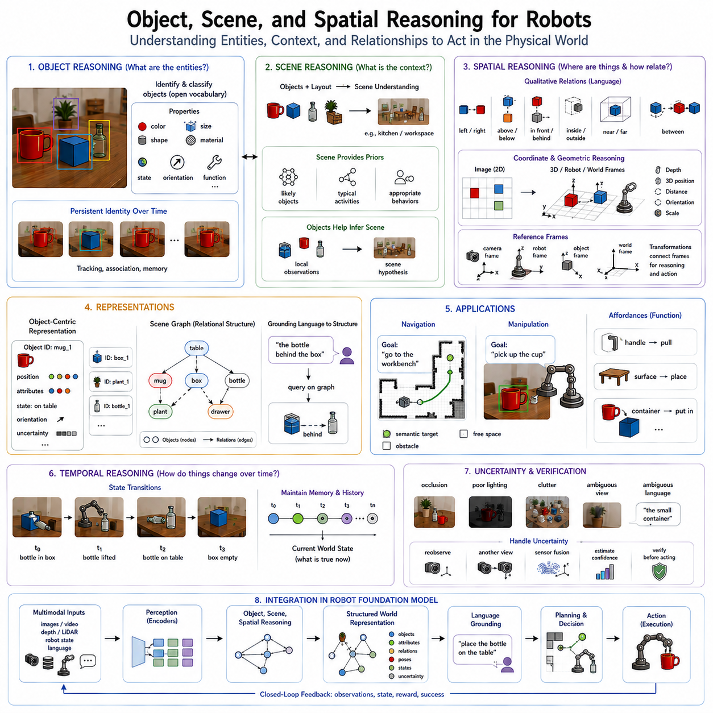{width="7.268055555555556in" height="7.268055555555556in"}

Object, scene, and spatial reasoning enables a robot to move beyond recognizing isolated visual patterns and toward understanding how physical entities are organized within an environment. Object reasoning identifies entities and their properties, scene reasoning interprets the broader environmental context, and spatial reasoning determines relationships among objects, regions, and the robot itself. Together, these capabilities provide a structured basis for perception, language grounding, planning, and interaction.

Object reasoning begins by determining which meaningful entities are present in an observation. These entities may include tools, containers, furniture, machines, people, obstacles, landmarks, or parts of larger objects. Modern vision-language models extend traditional object classification by representing objects through flexible semantic concepts, allowing robots to recognize or query categories that were not explicitly included in a fixed task-specific label set during training.

Recognition alone is insufficient because robots must also reason about object properties. Color, size, shape, material, orientation, state, and functional characteristics may determine which object satisfies an instruction. When asked to select "the small red container," the robot must combine category and attribute information rather than simply detecting all containers. Such compositional representations allow language to specify targets with substantially greater flexibility and precision.

Object identity must also remain consistent across changing observations. A robot may view the same object from different angles, lose sight of it behind an obstacle, or encounter it again after moving through the environment. Tracking, visual association, semantic memory, and object-centric representations can maintain persistent identities over time. This persistence supports reasoning about previously observed objects rather than treating every camera frame as an independent world.

Scene reasoning operates at a broader level by interpreting collections of objects and their environmental context. A table, chair, cup, and cabinet may collectively suggest a kitchen or dining area, while racks, pallets, and mobile platforms may indicate a warehouse. Scene context provides useful priors about what objects are likely to exist, what activities may occur, and which behaviors are appropriate, helping robots interpret ambiguous observations more coherently.

Object and scene reasoning are therefore mutually supportive. Individual objects contribute evidence about the type of environment, while the inferred scene provides context for interpreting uncertain objects. A visually ambiguous item may be more likely to be a tool when observed on an industrial workbench than on a dining table. Vision-language models can exploit broad semantic knowledge to connect these local observations with larger contextual patterns.

Spatial reasoning adds an explicit understanding of where entities are located relative to one another. Qualitative relationships include left and right, above and below, in front of and behind, inside and outside, near and far, touching, overlapping, or between. These relations are particularly important for language grounding because human instructions frequently describe targets relationally, such as "the bottle behind the box" or "the tool inside the drawer."

Spatial relationships may be represented in image coordinates, three-dimensional coordinates, robot-centered frames, or environment-centered maps. Two-dimensional visual reasoning can identify relative image positions, but physical interaction generally requires stronger geometric information. Depth cameras, stereo vision, LiDAR, calibration, localization, and 3D reconstruction can complement VLM semantics by providing metric distance, orientation, scale, and physically consistent coordinate relationships.

Reference frames are crucial because spatial language depends on perspective. "Left of the robot" may differ from "left of the person," and an object\'s image position does not directly determine its position in a global map. Robot systems therefore need to associate semantic spatial relations with camera, robot, object, or world coordinate frames. Explicit transformations between these frames help convert language-grounded visual understanding into navigation and manipulation targets.

Object-centric representations can organize perception around persistent entities rather than raw pixels alone. Each object may maintain semantic identity, visual features, estimated position, attributes, state, uncertainty, and relationships with other objects. A collection of such representations can form an object-level world state that is easier for planning and reasoning modules to query than an unstructured stream of images.

Scene graphs provide one structured method for representing these relationships. Objects can be represented as nodes, while spatial, semantic, or functional relationships become edges connecting them. A scene graph might encode that a cup is on a table, a box is beside the cup, and the table is inside a room. Language instructions can then be grounded against this relational structure, enabling queries that combine object categories, attributes, and spatial constraints.

Spatial reasoning also supports navigation by relating semantic destinations to traversable physical space. A robot may need to move toward a workstation, approach a particular side of a table, or stop near an object without colliding with surrounding structures. Semantic relationships from a VLM can identify relevant targets, while occupancy maps, depth information, traversability estimates, and localization provide the geometric constraints required to reach them safely.

Manipulation imposes even finer spatial requirements. Recognizing a container and identifying that an object lies inside it does not specify an executable grasp. The robot must additionally estimate object pose, reachable regions, collision-free approach directions, grasp geometry, and manipulator configuration. Consequently, VLM-based spatial reasoning is most useful when semantic relations are connected to precise geometric perception and embodiment-specific kinematic constraints.

Affordances introduce functional relationships into object and spatial reasoning. A handle may belong to a drawer and provide a location where pulling can occur, while a free surface may support placement. Understanding these relationships links object semantics with possible interactions. The robot can use VLM knowledge to propose meaningful interaction regions, but physical feasibility must still be verified using geometry, robot state, sensing, and control constraints.

Temporal context further improves object and spatial reasoning because relationships can change after actions. An object initially inside a box may later be on a table, or a door that previously blocked a path may become open. Maintaining state transitions allows the robot to distinguish outdated spatial information from the current world state. Persistent memory and repeated perception are therefore necessary for long-horizon tasks in dynamic environments.

Uncertainty must remain explicit because visual relationships are not always reliable. Occlusion, perspective, poor illumination, clutter, and ambiguous language can produce incorrect object identities or spatial relations. A robot should be able to reobserve a region, use another camera, request additional sensory evidence, or avoid committing to a risky interpretation. Combining semantic confidence with geometric and sensor-based verification reduces the chance that plausible reasoning produces unsafe physical behavior.

Within a robot foundation model, object, scene, and spatial reasoning transform visual-semantic features into a more structured representation of the physical environment. Objects provide persistent entities, scenes provide contextual organization, and spatial relationships connect those entities geometrically and semantically. Integrated with language, temporal memory, robot state, world models, and physical constraints, this structured understanding supports grounding, navigation, manipulation, planning, and later Vision-Language-Action models.

객체, 장면 및 공간 추론(object, scene, and spatial reasoning)은 로봇이 개별적인 시각 패턴(visual pattern)을 인식하는 수준을 넘어 물리적 개체(physical entity)가 환경 안에서 어떻게 구성되어 있는지를 이해할 수 있도록 한다. 객체 추론(object reasoning)은 개체와 그 속성을 식별하고, 장면 추론(scene reasoning)은 더 넓은 환경적 맥락(environmental context)을 해석하며, 공간 추론(spatial reasoning)은 객체, 영역, 로봇 자체 사이의 관계를 판단한다. 이러한 능력은 함께 지각(perception), 언어 그라운딩(language grounding), 계획(planning), 상호작용(interaction)을 위한 구조화된 기반을 제공한다.

객체 추론(object reasoning)은 관측에서 어떤 의미 있는 개체(entity)가 존재하는지를 판단하는 것에서 시작한다. 이러한 개체에는 도구, 컨테이너, 가구, 기계, 사람, 장애물, 랜드마크(landmark), 더 큰 객체의 일부 등이 포함될 수 있다. 현대의 비전-언어 모델(Vision-Language Model, VLM)은 객체를 유연한 의미 개념(semantic concept)으로 표현함으로써 기존의 객체 분류(object classification)를 확장하며, 로봇이 학습 과정의 고정된 작업별 레이블 집합에 명시적으로 포함되지 않았던 범주까지 인식하거나 질의할 수 있도록 한다.

로봇은 객체의 속성(object property)에 대해서도 추론해야 하므로 인식만으로는 충분하지 않다. 색상, 크기, 형상(shape), 재질(material), 방향(orientation), 상태(state), 기능적 특성(functional characteristic)은 어떤 객체가 명령을 만족하는지를 결정할 수 있다. "작은 빨간 컨테이너(the small red container)"를 선택하라는 요청에서는 단순히 모든 컨테이너를 검출하는 것이 아니라 범주와 속성 정보를 결합해야 한다. 이러한 조합적 표현(compositional representation)은 언어가 훨씬 유연하고 정밀하게 목표를 지정할 수 있도록 한다.

객체 정체성(object identity)은 변화하는 관측에서도 일관되게 유지되어야 한다. 로봇은 동일한 객체를 서로 다른 각도에서 보거나, 장애물 뒤에서 일시적으로 놓치거나, 환경을 이동한 후 다시 마주칠 수 있다. 추적(tracking), 시각적 연관(visual association), 의미 메모리(semantic memory), 객체 중심 표현(object-centric representation)은 시간에 따라 지속적인 정체성을 유지할 수 있다. 이러한 지속성(persistence)은 로봇이 모든 카메라 프레임을 독립적인 세계로 처리하는 대신 이전에 관측했던 객체에 대해 추론할 수 있도록 한다.

장면 추론(scene reasoning)은 객체의 집합과 그 환경적 맥락을 해석함으로써 더 넓은 수준에서 작동한다. 테이블, 의자, 컵, 캐비닛은 함께 주방이나 식사 공간을 나타낼 수 있으며, 랙(rack), 팔레트(pallet), 이동 플랫폼(mobile platform)은 창고를 나타낼 수 있다. 장면 맥락(scene context)은 어떤 객체가 존재할 가능성이 있는지, 어떤 활동이 발생할 수 있는지, 어떤 행동이 적절한지에 대한 유용한 사전 정보(prior)를 제공하여 로봇이 모호한 관측을 보다 일관되게 해석하도록 지원한다.

따라서 객체 추론과 장면 추론은 서로를 보완한다. 개별 객체는 환경의 유형을 판단하는 증거를 제공하고, 추론된 장면은 불확실한 객체를 해석하기 위한 맥락을 제공한다. 시각적으로 모호한 물체라도 식탁 위에서 관측될 때보다 산업용 작업대(industrial workbench) 위에서 관측될 때 도구일 가능성이 더 높을 수 있다. 비전-언어 모델은 광범위한 의미 지식(semantic knowledge)을 활용하여 이러한 국소적 관측(local observation)을 더 큰 맥락적 패턴(contextual pattern)과 연결할 수 있다.

공간 추론(spatial reasoning)은 개체들이 서로 상대적으로 어디에 위치하는지에 대한 명시적인 이해를 추가한다. 정성적 관계(qualitative relationship)에는 왼쪽과 오른쪽, 위와 아래, 앞과 뒤, 내부와 외부, 가까움과 멂, 접촉(touching), 겹침(overlapping), 사이(between) 등이 포함된다. 이러한 관계는 인간의 명령이 "상자 뒤의 병(the bottle behind the box)" 또는 "서랍 안의 도구(the tool inside the drawer)"와 같이 관계적으로 목표를 설명하는 경우가 많기 때문에 언어 그라운딩에서 특히 중요하다.

공간 관계(spatial relationship)는 이미지 좌표(image coordinate), 3차원 좌표(three-dimensional coordinate), 로봇 중심 좌표계(robot-centered frame), 환경 중심 지도(environment-centered map) 등으로 표현될 수 있다. 2차원 시각 추론(2D visual reasoning)은 이미지상의 상대적 위치를 파악할 수 있지만 물리적 상호작용에는 일반적으로 더욱 강력한 기하학적 정보가 필요하다. 깊이 카메라(depth camera), 스테레오 비전(stereo vision), 라이다(LiDAR), 캘리브레이션(calibration), 위치 추정(localization), 3차원 재구성(3D reconstruction)은 계량적 거리, 방향, 크기, 물리적으로 일관된 좌표 관계를 제공함으로써 VLM의 의미 정보를 보완할 수 있다.

공간 언어(spatial language)는 관점에 따라 달라지기 때문에 기준 좌표계(reference frame)는 매우 중요하다. "로봇의 왼쪽(left of the robot)"은 "사람의 왼쪽(left of the person)"과 다를 수 있으며, 이미지에서 객체가 보이는 위치가 전역 지도(global map)에서의 위치를 직접 결정하는 것도 아니다. 따라서 로봇 시스템은 의미적 공간 관계를 카메라, 로봇, 객체 또는 세계 좌표계(world coordinate frame)와 연결해야 한다. 이러한 좌표계 사이의 명시적인 변환(explicit transformation)은 언어에 그라운딩된 시각적 이해를 내비게이션 및 조작 목표로 변환하는 데 도움을 준다.

객체 중심 표현(object-centric representation)은 원시 픽셀만을 중심으로 지각을 구성하는 대신 지속적인 개체를 중심으로 정보를 구조화할 수 있다. 각 객체는 의미적 정체성, 시각 특징(visual feature), 추정 위치, 속성, 상태, 불확실성(uncertainty), 다른 객체와의 관계를 유지할 수 있다. 이러한 표현의 집합은 구조화되지 않은 이미지 스트림(unstructured image stream)보다 계획 및 추론 모듈이 쉽게 질의할 수 있는 객체 수준 월드 상태(object-level world state)를 형성할 수 있다.

장면 그래프(scene graph)는 이러한 관계를 구조적으로 표현하는 하나의 방법이다. 객체를 노드(node)로 표현하고 공간적, 의미적, 기능적 관계를 객체를 연결하는 에지(edge)로 표현할 수 있다. 예를 들어 장면 그래프는 컵이 테이블 위에 있고, 상자가 컵 옆에 있으며, 테이블이 방 안에 있다는 관계를 인코딩할 수 있다. 이후 언어 명령을 이러한 관계 구조와 그라운딩함으로써 객체 범주, 속성, 공간적 제약을 결합한 질의를 수행할 수 있다.

공간 추론은 의미적 목적지(semantic destination)를 이동 가능한 물리적 공간(traversable physical space)과 연결함으로써 내비게이션(navigation)도 지원한다. 로봇은 작업대로 이동하거나, 테이블의 특정 측면으로 접근하거나, 주변 구조물과 충돌하지 않으면서 객체 근처에 정지해야 할 수 있다. VLM의 의미 관계는 관련 목표를 식별할 수 있으며, 점유 지도(occupancy map), 깊이 정보(depth information), 주행 가능성 추정(traversability estimation), 위치 추정은 목표에 안전하게 도달하기 위해 필요한 기하학적 제약(geometric constraint)을 제공한다.

조작(manipulation)은 더욱 정밀한 공간적 요구사항을 가진다. 컨테이너를 인식하고 객체가 그 안에 있다는 사실을 파악하는 것만으로는 실행 가능한 파지(grasp)를 결정할 수 없다. 로봇은 추가적으로 객체 자세(object pose), 도달 가능한 영역(reachable region), 충돌 없는 접근 방향(collision-free approach direction), 파지 기하학(grasp geometry), 매니퓰레이터 구성(manipulator configuration)을 추정해야 한다. 따라서 VLM 기반 공간 추론은 의미적 관계를 정밀한 기하학적 지각 및 신체 구조 특화 운동학 제약(embodiment-specific kinematic constraint)과 연결할 때 가장 유용하다.

어포던스(affordance)는 객체 및 공간 추론에 기능적 관계(functional relationship)를 추가한다. 손잡이는 서랍의 일부이며 당기기 동작을 수행할 수 있는 위치를 제공하고, 비어 있는 표면은 객체를 놓을 수 있는 공간을 제공할 수 있다. 이러한 관계를 이해하면 객체의 의미를 가능한 상호작용(possible interaction)과 연결할 수 있다. 로봇은 VLM 지식을 이용하여 의미 있는 상호작용 영역(interaction region)을 제안할 수 있지만, 물리적 실행 가능성(physical feasibility)은 기하학, 로봇 상태, 센싱(sensing), 제어 제약(control constraint)을 이용하여 검증해야 한다.

행동 이후 관계가 변화할 수 있기 때문에 시간적 맥락(temporal context)은 객체 및 공간 추론을 더욱 향상시킨다. 처음에는 상자 내부에 있던 객체가 이후 테이블 위에 놓일 수 있으며, 이전에 경로를 차단했던 문이 열린 상태로 바뀔 수도 있다. 상태 전이(state transition)를 유지하면 로봇은 오래된 공간 정보와 현재 월드 상태(current world state)를 구분할 수 있다. 따라서 동적 환경에서 장기 작업(long-horizon task)을 수행하기 위해서는 지속적인 메모리(persistent memory)와 반복적인 지각(repeated perception)이 필요하다.

시각적 관계가 항상 신뢰할 수 있는 것은 아니므로 불확실성(uncertainty)을 명시적으로 유지해야 한다. 가림(occlusion), 원근(perspective), 불충분한 조명, 복잡한 환경(clutter), 모호한 언어는 잘못된 객체 정체성이나 공간 관계를 만들어낼 수 있다. 로봇은 특정 영역을 다시 관측하거나, 다른 카메라를 사용하거나, 추가적인 센서 증거를 요청하거나, 위험한 해석을 확정하지 않을 수 있어야 한다. 의미적 신뢰도(semantic confidence)를 기하학적 및 센서 기반 검증(sensor-based verification)과 결합하면 그럴듯하지만 잘못된 추론이 위험한 물리적 행동으로 이어질 가능성을 줄일 수 있다.

로봇 파운데이션 모델(robot foundation model)에서 객체, 장면 및 공간 추론은 시각-의미 특징(visual-semantic feature)을 물리적 환경에 대한 보다 구조화된 표현(structured representation)으로 변환한다. 객체는 지속적인 개체를 제공하고, 장면은 맥락적 구조(contextual organization)를 제공하며, 공간 관계는 이러한 개체를 기하학적·의미적으로 연결한다. 이를 언어, 시간 메모리(temporal memory), 로봇 상태(robot state), 월드 모델(world model), 물리적 제약과 통합하면 그라운딩(grounding), 내비게이션, 조작, 계획, 그리고 이후의 비전-언어-행동 모델(Vision-Language-Action Model, VLA)을 지원할 수 있다.

## 03.06. Affordance and Interaction Understanding

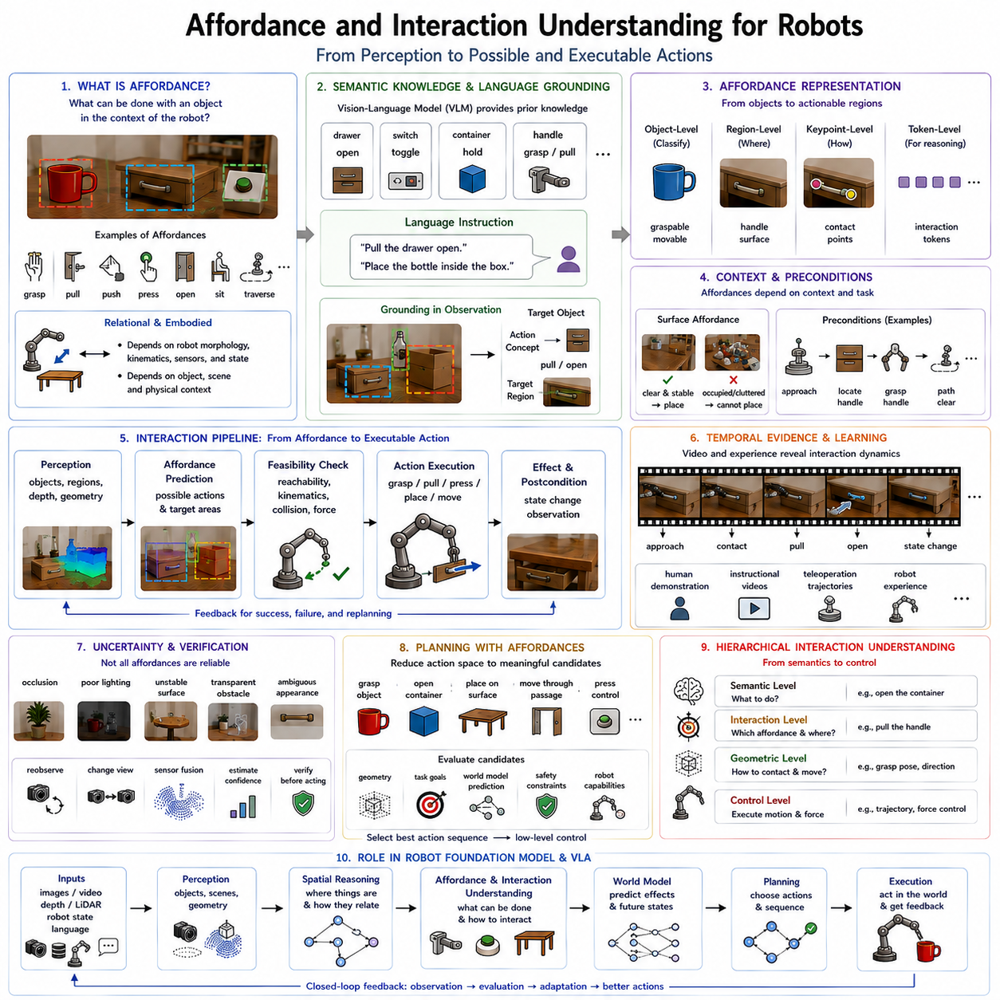{width="7.268055555555556in" height="7.268055555555556in"}

Affordance and interaction understanding extends robot perception from identifying what an object is toward understanding what can be done with it. An affordance represents a potential action or functional relationship between an agent and an element of the environment. A cup may afford grasping, a button pressing, a handle pulling, a chair sitting, and an open region traversing. For robotics, these possibilities connect semantic perception with physically meaningful behavior.

Affordances are relational rather than purely intrinsic object properties. A handle may be graspable for one robot but unreachable or too small for another, while a step may be traversable for a legged robot but not for a wheeled platform. Consequently, affordance understanding must consider both environmental properties and embodiment, including robot morphology, kinematics, actuator capabilities, sensor configuration, and the current physical state.

Vision-language models provide useful prior knowledge about common object functions and interactions because large-scale visual and textual data contain descriptions of how people use objects. A VLM may associate drawers with opening, switches with toggling, containers with holding objects, and handles with grasping. This semantic knowledge enables robots to propose plausible interactions even for objects or environments that were not explicitly represented in task-specific robot training data.

Object-level recognition is often insufficient for interaction because actions usually target specific object regions. Opening a drawer requires interacting with its handle or accessible surface rather than with an arbitrary image location. Affordance grounding therefore connects action concepts such as grasp, push, pull, press, place, or open with visually relevant regions. This produces an interaction-oriented representation that is more useful for downstream manipulation than object identity alone.

Language provides a flexible interface for specifying these interaction relationships. Instructions such as "pull the drawer open," "place the bottle inside the box," or "press the green button" combine objects, actions, attributes, and spatial constraints. A VLM can decompose these expressions semantically and ground them in visual observations, allowing the robot to identify which entity should be manipulated and which interaction concept is associated with the requested task.

Affordance prediction can be represented at several levels of abstraction. A model may classify an entire object as graspable or movable, identify image regions where an interaction can occur, predict keypoints such as handles or contact locations, or generate semantic interaction tokens for later reasoning. More detailed representations can improve manipulation precision, but they also require stronger spatial grounding and closer integration with geometric perception.

Scene context strongly influences affordance interpretation. A flat surface may afford placement when it is clear and stable, but not when it is occupied, tilted, fragile, or inaccessible. Similarly, an open doorway may afford navigation only if its dimensions and surrounding geometry are compatible with the robot. Affordance reasoning therefore benefits from object properties, scene relationships, free-space information, and knowledge of the current task rather than relying on isolated object categories.

Interaction understanding also requires reasoning about preconditions. Before opening a drawer, the robot may need to approach it, locate the handle, establish a stable grasp, and ensure that the opening trajectory is unobstructed. Before placing an object, the robot must possess or grasp the object and identify a suitable destination. Representing such preconditions helps transform a high-level affordance into a sequence of physically meaningful operations.

Effects and postconditions are equally important because interactions change the world. Pulling a drawer should change its state from closed toward open, moving an object should alter its pose, and pressing a switch may change the state of another device. A robot that understands these expected effects can compare predicted outcomes with subsequent observations, allowing it to determine whether an interaction succeeded or whether recovery or replanning is required.

This relationship between action and state change makes affordance understanding closely connected to world models. An affordance describes which actions appear possible, while a world model can predict how the environment may evolve if one of those actions is executed. Combining the two enables a robot to reason not only that a drawer can be pulled but also about the likely future configuration produced by pulling it under the current physical conditions.

Temporal observations provide valuable evidence for learning interactions. Video sequences can show a hand approaching a handle, establishing contact, pulling, and causing a drawer to open. Such sequences reveal relationships among objects, actions, contact events, and state transitions that are difficult to infer from static images alone. Human demonstrations, instructional videos, teleoperation trajectories, and robot experience can therefore contribute complementary supervision for interaction learning.

Interaction understanding must distinguish semantic plausibility from executable action. A VLM may correctly infer that a bottle can be grasped without knowing its exact six-degree-of-freedom pose, surface geometry, mass, friction, or collision constraints. Before execution, semantic affordances must therefore be connected with depth, 3D geometry, grasp estimation, inverse kinematics, reachability, collision checking, force limits, and other embodiment-specific constraints.

Uncertainty is particularly important because incorrect affordance predictions can directly produce unsafe actions. A visually identified handle may be fixed, a surface may be unstable, or an apparently free path may contain transparent obstacles. Robots should combine semantic confidence with sensor evidence and physical verification, and they may need to reobserve an object, change viewpoint, probe cautiously, or reject an interaction when feasibility remains uncertain.

Affordances can also support planning by reducing an enormous action space to a smaller set of meaningful candidates. Instead of considering arbitrary motions, a robot can reason over possibilities such as grasp object, open container, place on surface, move through passage, or press control. These candidates can then be evaluated using geometry, task goals, world-model predictions, safety constraints, and robot capabilities before being translated into lower-level actions.

Interaction understanding naturally supports hierarchical robot intelligence. At a semantic level, the system may reason that a container should be opened; at an interaction level, it identifies the handle and pulling affordance; at a geometric level, it determines contact pose and motion direction; and at a control level, it executes forces and trajectories. Connecting these levels allows foundation-model knowledge to influence behavior without requiring semantic models to directly control actuators.

Within a robot foundation model, affordance and interaction understanding therefore forms a bridge from visual-language semantics toward physical action. Objects and scenes establish what exists, spatial reasoning determines where entities are located, affordances identify what interactions may be possible, and physical models determine what is actually executable. Integrated with memory, world models, planning, robot state, and feedback, this capability provides an essential foundation for Vision-Language-Action models and generalist robot policies.

어포던스 및 상호작용 이해(affordance and interaction understanding)는 로봇 지각(robot perception)을 객체가 무엇인지를 식별하는 수준에서 해당 객체를 이용하여 무엇을 할 수 있는지를 이해하는 수준으로 확장한다. 어포던스(affordance)는 에이전트(agent)와 환경 요소 사이에서 가능한 행동 또는 기능적 관계(functional relationship)를 의미한다. 컵은 잡기(grasping), 버튼은 누르기(pressing), 손잡이는 당기기(pulling), 의자는 앉기(sitting), 열린 공간은 통과하기(traversing)를 가능하게 할 수 있다. 로보틱스에서 이러한 가능성은 의미적 지각(semantic perception)을 물리적으로 의미 있는 행동과 연결한다.

어포던스는 객체 자체에만 내재된 속성이라기보다 관계적 특성(relational property)을 가진다. 하나의 손잡이가 어떤 로봇에게는 잡을 수 있는 대상이지만 다른 로봇에게는 도달할 수 없거나 너무 작을 수 있으며, 계단은 보행 로봇(legged robot)에게는 이동 가능한 공간이지만 바퀴형 플랫폼(wheeled platform)에는 그렇지 않을 수 있다. 따라서 어포던스 이해는 환경의 특성과 함께 로봇 형태(morphology), 운동학(kinematics), 액추에이터 성능(actuator capability), 센서 구성(sensor configuration), 현재 물리적 상태를 포함하는 신체 구조(embodiment)를 고려해야 한다.

비전-언어 모델(Vision-Language Model, VLM)은 대규모 시각 및 텍스트 데이터에 사람들이 객체를 사용하는 방식에 관한 설명이 포함되어 있기 때문에 일반적인 객체 기능과 상호작용에 대한 유용한 사전 지식(prior knowledge)을 제공한다. VLM은 서랍을 열기(opening), 스위치를 전환하기(toggling), 컨테이너에 물체를 담기(holding objects), 손잡이를 잡기(grasping)와 연결할 수 있다. 이러한 의미 지식(semantic knowledge)은 작업 특화 로봇 학습 데이터에 명시적으로 포함되지 않은 객체나 환경에서도 로봇이 그럴듯한 상호작용을 제안할 수 있도록 한다.

행동은 일반적으로 객체의 특정 영역을 대상으로 하기 때문에 객체 수준 인식(object-level recognition)만으로는 상호작용에 충분하지 않은 경우가 많다. 서랍을 열기 위해서는 이미지의 임의 위치가 아니라 손잡이 또는 접근 가능한 표면과 상호작용해야 한다. 따라서 어포던스 그라운딩(affordance grounding)은 잡기(grasp), 밀기(push), 당기기(pull), 누르기(press), 놓기(place), 열기(open)와 같은 행동 개념을 시각적으로 관련된 영역과 연결한다. 이를 통해 객체 정체성만으로 구성된 표현보다 후속 조작(manipulation)에 더욱 유용한 상호작용 중심 표현(interaction-oriented representation)을 생성할 수 있다.

언어(language)는 이러한 상호작용 관계를 지정하기 위한 유연한 인터페이스를 제공한다. "서랍을 당겨 열어라(pull the drawer open)", "병을 상자 안에 놓아라(place the bottle inside the box)", "초록색 버튼을 눌러라(press the green button)"와 같은 명령은 객체, 행동, 속성, 공간적 제약(spatial constraint)을 결합한다. VLM은 이러한 표현을 의미적으로 분해하고 시각적 관측에 그라운딩하여 로봇이 어떤 개체를 조작해야 하는지와 요청된 작업에 어떤 상호작용 개념이 연결되는지를 식별할 수 있도록 한다.

어포던스 예측(affordance prediction)은 여러 추상화 수준(level of abstraction)으로 표현할 수 있다. 모델은 전체 객체를 잡을 수 있거나 이동 가능한 것으로 분류하거나, 상호작용이 가능한 이미지 영역을 식별하거나, 손잡이나 접촉 위치(contact location)와 같은 키포인트(keypoint)를 예측하거나, 이후의 추론을 위한 의미적 상호작용 토큰(semantic interaction token)을 생성할 수 있다. 보다 상세한 표현은 조작 정밀도를 향상시킬 수 있지만 더욱 강력한 공간 그라운딩(spatial grounding)과 기하학적 지각(geometric perception)과의 긴밀한 통합이 필요하다.

장면 맥락(scene context)은 어포던스 해석에 큰 영향을 미친다. 평평한 표면은 비어 있고 안정적일 경우 객체를 놓을 수 있지만, 이미 다른 물체가 있거나 기울어져 있거나 불안정하거나 접근할 수 없는 경우에는 그렇지 않을 수 있다. 마찬가지로 열린 출입구도 크기와 주변 기하학적 구조가 로봇과 호환되는 경우에만 이동을 허용한다. 따라서 어포던스 추론은 독립적인 객체 범주만 사용하는 것보다 객체 속성, 장면 관계, 자유 공간 정보(free-space information), 현재 작업에 대한 지식을 함께 활용할 때 더욱 효과적이다.

상호작용 이해(interaction understanding)에는 전제조건(precondition)에 대한 추론도 필요하다. 서랍을 열기 전에 로봇은 서랍에 접근하고, 손잡이를 찾고, 안정적인 파지를 형성하며, 서랍이 열리는 궤적에 장애물이 없는지 확인해야 할 수 있다. 객체를 놓기 전에는 해당 객체를 보유하거나 파지한 상태여야 하며 적절한 목적지를 식별해야 한다. 이러한 전제조건을 표현하면 상위 수준의 어포던스를 물리적으로 의미 있는 연속 작업으로 변환하는 데 도움이 된다.

상호작용은 세계를 변화시키기 때문에 효과(effect)와 사후조건(postcondition)도 동일하게 중요하다. 서랍을 당기면 닫힌 상태에서 열린 상태로 변화해야 하고, 객체를 이동하면 자세(pose)가 달라져야 하며, 스위치를 누르면 다른 장치의 상태가 변화할 수 있다. 이러한 예상 효과를 이해하는 로봇은 예측된 결과와 이후의 관측을 비교하여 상호작용이 성공했는지 또는 복구(recovery)나 재계획(replanning)이 필요한지를 판단할 수 있다.

행동(action)과 상태 변화(state change)의 이러한 관계는 어포던스 이해를 월드 모델(world model)과 긴밀하게 연결한다. 어포던스는 어떤 행동이 가능해 보이는지를 나타내는 반면, 월드 모델은 해당 행동을 실행했을 때 환경이 어떻게 변화할 수 있는지를 예측할 수 있다. 두 요소를 결합하면 로봇은 단순히 서랍을 당길 수 있다는 사실뿐 아니라 현재의 물리적 조건에서 서랍을 당겼을 때 생성될 가능성이 있는 미래 상태(future configuration)에 대해서도 추론할 수 있다.

시간적 관측(temporal observation)은 상호작용 학습을 위한 유용한 증거를 제공한다. 비디오 시퀀스(video sequence)는 손이 손잡이에 접근하고, 접촉을 형성하고, 당긴 후 서랍이 열리는 과정을 보여줄 수 있다. 이러한 시퀀스는 정적 이미지(static image)만으로 추론하기 어려운 객체, 행동, 접촉 이벤트(contact event), 상태 전이(state transition) 사이의 관계를 보여준다. 따라서 인간 시연(human demonstration), 교육용 비디오(instructional video), 원격조작 궤적(teleoperation trajectory), 로봇 경험(robot experience)은 상호작용 학습을 위한 상호 보완적인 지도 정보(supervision)를 제공할 수 있다.

상호작용 이해는 의미적 개연성(semantic plausibility)과 실행 가능한 행동(executable action)을 구분해야 한다. VLM은 병의 정확한 6자유도 자세(six-degree-of-freedom pose), 표면 기하학(surface geometry), 질량(mass), 마찰(friction), 충돌 제약(collision constraint)을 알지 못하면서도 해당 병을 잡을 수 있다고 올바르게 추론할 수 있다. 따라서 실행 전에 의미적 어포던스를 깊이(depth), 3차원 기하학(3D geometry), 파지 추정(grasp estimation), 역기구학(inverse kinematics), 도달 가능성(reachability), 충돌 검사(collision checking), 힘 제한(force limit) 및 기타 신체 구조 특화 제약(embodiment-specific constraint)과 연결해야 한다.

잘못된 어포던스 예측은 직접적으로 위험한 행동을 발생시킬 수 있기 때문에 불확실성(uncertainty)은 특히 중요하다. 시각적으로 손잡이처럼 보이는 부분이 실제로는 고정되어 있을 수 있고, 표면이 불안정하거나, 비어 있는 것처럼 보이는 경로에 투명한 장애물이 존재할 수도 있다. 로봇은 의미적 신뢰도(semantic confidence)를 센서 증거와 물리적 검증(physical verification)에 결합해야 하며, 실행 가능성이 불확실할 경우 객체를 다시 관측하거나 시점을 변경하거나 조심스럽게 탐색하거나 상호작용 자체를 거부할 수 있어야 한다.

어포던스는 방대한 행동 공간(action space)을 의미 있는 소수의 후보로 축소함으로써 계획(planning)을 지원할 수도 있다. 로봇은 임의의 움직임을 모두 고려하는 대신 객체 잡기, 컨테이너 열기, 표면에 놓기, 통로 통과하기, 제어 장치 누르기와 같은 가능성을 중심으로 추론할 수 있다. 이후 이러한 후보는 저수준 행동으로 변환되기 전에 기하학, 작업 목표(task goal), 월드 모델 예측(world-model prediction), 안전 제약(safety constraint), 로봇의 능력을 이용하여 평가할 수 있다.

상호작용 이해는 자연스럽게 계층적 로봇 지능(hierarchical robot intelligence)을 지원한다. 의미 수준(semantic level)에서는 컨테이너를 열어야 한다고 추론하고, 상호작용 수준(interaction level)에서는 손잡이와 당기기 어포던스를 식별하며, 기하학적 수준(geometric level)에서는 접촉 자세(contact pose)와 운동 방향을 결정하고, 제어 수준(control level)에서는 힘과 궤적을 실행한다. 이러한 수준을 연결하면 의미 모델이 액추에이터를 직접 제어하지 않으면서도 파운데이션 모델 지식이 물리적 행동에 영향을 미칠 수 있다.

따라서 로봇 파운데이션 모델(robot foundation model)에서 어포던스 및 상호작용 이해는 시각-언어 의미(visual-language semantics)에서 물리적 행동(physical action)으로 이어지는 가교를 형성한다. 객체와 장면은 무엇이 존재하는지를 설정하고, 공간 추론(spatial reasoning)은 개체가 어디에 위치하는지를 판단하며, 어포던스는 어떤 상호작용이 가능할 수 있는지를 식별하고, 물리 모델(physical model)은 실제로 무엇을 실행할 수 있는지를 결정한다. 이를 메모리(memory), 월드 모델, 계획, 로봇 상태(robot state), 피드백(feedback)과 통합하면 비전-언어-행동 모델(Vision-Language-Action Model, VLA)과 범용 로봇 정책(generalist robot policy)을 위한 핵심 기반을 제공할 수 있다.

## 03.07. Language Grounded Perception

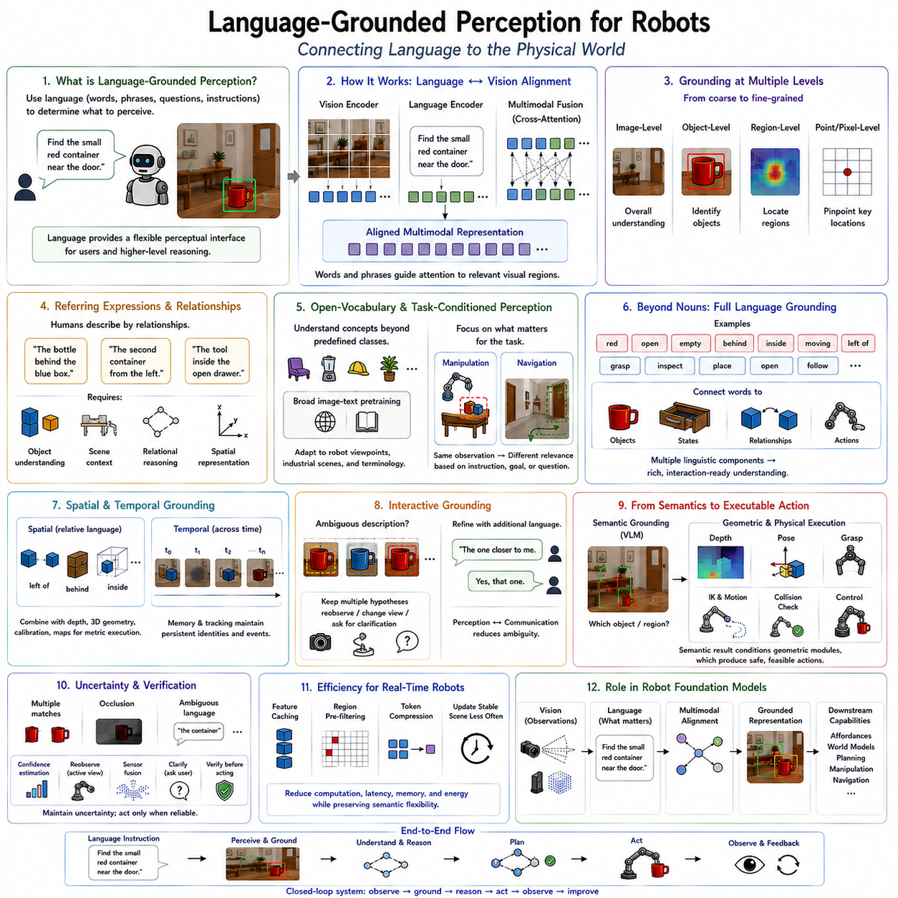{width="7.268055555555556in" height="7.268055555555556in"}

Language-grounded perception connects linguistic expressions directly to observations of the physical environment. Instead of recognizing objects only through fixed category labels, a robot can use words, phrases, questions, or instructions to determine what should be perceived. This capability transforms language into a flexible perceptual interface through which users and higher-level reasoning systems can specify relevant objects, attributes, regions, relationships, and events.

Traditional robotic perception often begins with predefined categories such as person, box, vehicle, or obstacle. Language grounding removes part of this restriction by allowing perception to be conditioned on open-ended descriptions. A request such as "find the small red container near the door" combines category, attribute, size, and spatial information. The robot must interpret these linguistic constraints jointly and associate them with the appropriate visual evidence.

The grounding process requires representations from vision and language to become mutually comparable or interact through multimodal fusion. A vision encoder converts images into visual tokens or region features, while a language model converts the instruction into linguistic representations. Projection layers, cross-attention, or multimodal Transformer blocks then connect the two streams, enabling particular words and phrases to influence which visual regions receive attention.

Grounding may occur at several levels of granularity. An entire image can be associated with a textual description, an object can be linked to a noun phrase, a region can correspond to an attribute or action, and individual points or pixels can identify interaction-relevant locations. Robotics often benefits from fine-grained grounding because physical actions require knowing not merely that an object exists but where the referenced entity or functional region is located.

Referring expressions are particularly important because humans frequently identify objects through relationships rather than unique names. Instructions such as "the bottle behind the blue box," "the second container from the left," or "the tool inside the open drawer" require the model to resolve several candidate objects using attributes and spatial relations. Successful grounding therefore depends on object understanding, scene context, relational reasoning, and spatial representation working together.

Open-vocabulary perception is one of the major advantages of language grounding. A robot foundation model can potentially query concepts that were not represented as dedicated classes in a task-specific detector. Broad image-text pretraining provides semantic associations for many objects, materials, environments, and activities. Robot-specific adaptation can then connect this general knowledge to unusual viewpoints, industrial equipment, manipulation scenes, and deployment-specific terminology.

Language can also direct attention toward task-relevant information and reduce the need to process every visible entity equally. During a manipulation task, the system may focus on the requested object and nearby obstacles, while navigation may emphasize landmarks, passages, signs, or destinations. This task-conditioned perception allows the same visual observation to produce different relevant representations depending on the robot\'s current instruction, goal, or question.

Grounding extends beyond nouns because adjectives, verbs, and relational expressions carry information necessary for physical tasks. Words such as red, open, empty, damaged, moving, reachable, behind, inside, or beside modify how an entity should be interpreted. Verbs such as grasp, inspect, follow, place, or open indicate expected interactions. A useful grounded representation therefore connects multiple linguistic components with objects, states, relationships, and possible actions.

Spatial grounding requires special care because language often describes relative rather than metric geometry. Terms such as near, left, behind, or in front of depend on reference frames and context. Visual-language reasoning can identify qualitative relationships, but reliable robot execution may require depth, camera calibration, localization, 3D reconstruction, or map coordinates. Semantic grounding must therefore be connected to physically consistent spatial representations.

Language-grounded perception also operates across time. An instruction may refer to "the box you saw earlier," "the person who entered the room," or "the object that was moved from the table." Resolving such expressions requires temporal memory and persistent object identity rather than only the current camera image. Video representations, tracking, object memory, and observation history allow linguistic references to connect with entities and events distributed across time.

For interactive robots, grounding can become a bidirectional process rather than a one-time mapping from language to perception. If several objects satisfy an instruction, the robot can preserve multiple hypotheses, gather another viewpoint, or request clarification. Additional language can then reduce ambiguity. This interaction between perception and communication is especially valuable when environments contain visually similar objects or when the user\'s description is incomplete.

Grounded perception provides an important interface to affordance reasoning. Once language identifies "the handle of the drawer" rather than merely the drawer itself, the robot can associate that region with grasping or pulling. Similarly, grounding "the empty area on the table" can define a potential placement region. Language therefore helps select not only semantic entities but also functional regions that downstream interaction modules can evaluate for physical feasibility.

The distinction between semantic grounding and geometric execution remains essential. A VLM may correctly identify which cup the user means while still estimating its position too inaccurately for grasping. The semantic result should therefore condition specialized geometric modules rather than automatically generate actuator commands. Depth estimation, pose estimation, grasp generation, inverse kinematics, collision checking, and control can refine a grounded semantic target into an executable physical action.

Uncertainty and ambiguity are unavoidable in language-grounded perception. Multiple objects may satisfy the same description, an object may be partially occluded, or spatial terminology may have several interpretations. A reliable robot should retain confidence estimates and alternative hypotheses rather than forcing an immediate decision. Reobservation, sensor fusion, active perception, clarification, and verification provide mechanisms for resolving uncertain grounding before consequential actions are performed.

Efficient grounding is also important for real-time physical systems. High-resolution images, multiple cameras, long language contexts, and repeated multimodal attention can produce substantial computational cost. Practical architectures may cache visual features, restrict language-conditioned processing to candidate regions, compress visual tokens, or update stable scene representations less frequently. These strategies preserve semantic flexibility while reducing latency, memory use, and energy consumption.

Within a robot foundation model, language-grounded perception forms the operational bridge between human-level semantic descriptions and situated sensory evidence. Vision provides observations, language specifies what matters, multimodal alignment connects the two, and spatial and temporal reasoning maintain physical context. The resulting grounded representation can support affordance understanding, world modeling, planning, manipulation, navigation, and ultimately Vision-Language-Action models that convert interpreted instructions into closed-loop robot behavior.

언어 그라운딩 지각(language-grounded perception)은 언어 표현(linguistic expression)을 물리적 환경의 관측과 직접 연결한다. 로봇은 고정된 범주 레이블(category label)만을 통해 객체를 인식하는 대신 단어, 문구, 질문 또는 명령을 이용하여 무엇을 지각해야 하는지를 결정할 수 있다. 이러한 능력은 언어를 유연한 지각 인터페이스(perceptual interface)로 변환하여 사용자와 상위 수준 추론 시스템이 관련 객체, 속성(attribute), 영역(region), 관계(relationship), 사건(event)을 지정할 수 있도록 한다.

전통적인 로봇 지각(robotic perception)은 사람, 상자, 차량, 장애물과 같이 사전에 정의된 범주에서 시작하는 경우가 많다. 언어 그라운딩(language grounding)은 지각을 개방형 설명(open-ended description)에 따라 조건화함으로써 이러한 제약의 일부를 제거한다. "문 근처의 작은 빨간 컨테이너를 찾아라(find the small red container near the door)"라는 요청은 범주, 속성, 크기, 공간 정보를 결합한다. 로봇은 이러한 언어적 제약을 함께 해석하고 적절한 시각적 증거(visual evidence)와 연결해야 한다.

그라운딩 과정에서는 비전(vision)과 언어(language)의 표현이 서로 비교 가능해지거나 멀티모달 융합(multimodal fusion)을 통해 상호작용할 수 있어야 한다. 비전 인코더(vision encoder)는 이미지를 시각 토큰(visual token) 또는 영역 특징(region feature)으로 변환하고, 언어 모델(language model)은 명령을 언어 표현으로 변환한다. 이후 투영 계층(projection layer), 교차 어텐션(cross-attention), 멀티모달 트랜스포머 블록(multimodal Transformer block)이 두 정보 흐름을 연결하여 특정 단어나 문구가 어떤 시각 영역에 주의를 기울일지를 결정할 수 있도록 한다.

그라운딩은 여러 세분성 수준(granularity level)에서 수행될 수 있다. 전체 이미지를 텍스트 설명과 연결하거나, 객체를 명사구(noun phrase)와 연결하거나, 특정 영역을 속성이나 행동과 대응시키거나, 개별 점이나 픽셀을 상호작용에 중요한 위치와 연결할 수 있다. 로보틱스에서는 물리적 행동을 위해 객체가 존재한다는 사실뿐 아니라 참조된 개체 또는 기능적 영역(functional region)이 어디에 위치하는지도 알아야 하므로 세밀한 그라운딩(fine-grained grounding)이 특히 유용하다.

지시 표현(referring expression)은 사람이 고유한 이름보다 관계를 이용하여 객체를 지정하는 경우가 많기 때문에 특히 중요하다. "파란 상자 뒤에 있는 병(the bottle behind the blue box)", "왼쪽에서 두 번째 컨테이너(the second container from the left)", "열린 서랍 안의 도구(the tool inside the open drawer)"와 같은 명령은 모델이 속성과 공간 관계를 이용하여 여러 후보 객체를 구분하도록 요구한다. 따라서 성공적인 그라운딩은 객체 이해(object understanding), 장면 맥락(scene context), 관계 추론(relational reasoning), 공간 표현(spatial representation)이 함께 작동하는 것에 의존한다.

개방 어휘 지각(open-vocabulary perception)은 언어 그라운딩의 주요 장점 가운데 하나이다. 로봇 파운데이션 모델(robot foundation model)은 작업별 검출기(task-specific detector)에 전용 클래스로 표현되지 않은 개념까지 질의할 수 있다. 광범위한 이미지-텍스트 사전학습(image-text pretraining)은 다양한 객체, 재질(material), 환경, 활동에 대한 의미적 연관 관계를 제공한다. 이후 로봇 특화 적응(robot-specific adaptation)을 통해 이러한 일반 지식을 특수한 시점, 산업 장비, 조작 장면, 배포 환경 특화 용어와 연결할 수 있다.

언어는 작업 관련 정보(task-relevant information)에 주의를 집중하도록 지각을 유도하여 보이는 모든 개체를 동일한 중요도로 처리할 필요를 줄일 수도 있다. 조작 작업에서는 요청된 객체와 주변 장애물에 집중할 수 있으며, 내비게이션(navigation)에서는 랜드마크, 통로, 표지판, 목적지를 강조할 수 있다. 이러한 작업 조건부 지각(task-conditioned perception)을 통해 동일한 시각 관측이라도 로봇의 현재 명령, 목표 또는 질문에 따라 서로 다른 관련 표현을 생성할 수 있다.

형용사, 동사, 관계 표현도 물리적 작업에 필요한 정보를 전달하므로 그라운딩은 명사에만 한정되지 않는다. 빨간색(red), 열린(open), 비어 있는(empty), 손상된(damaged), 움직이는(moving), 도달 가능한(reachable), 뒤에(behind), 내부에(inside), 옆에(beside)와 같은 표현은 개체를 어떻게 해석해야 하는지를 수정한다. 잡기(grasp), 검사하기(inspect), 따라가기(follow), 놓기(place), 열기(open)와 같은 동사는 예상되는 상호작용을 나타낸다. 따라서 유용한 그라운딩 표현은 여러 언어 요소를 객체, 상태, 관계, 가능한 행동과 연결한다.

언어는 절대적인 계량 기하학(metric geometry)보다 상대적 관계를 표현하는 경우가 많기 때문에 공간 그라운딩(spatial grounding)은 특별한 주의가 필요하다. 가까이(near), 왼쪽(left), 뒤(behind), 앞(in front of)과 같은 용어는 기준 좌표계(reference frame)와 맥락에 따라 의미가 달라진다. 비전-언어 추론은 정성적인 관계(qualitative relationship)를 식별할 수 있지만, 신뢰할 수 있는 로봇 실행에는 깊이(depth), 카메라 캘리브레이션(camera calibration), 위치 추정(localization), 3차원 재구성(3D reconstruction), 지도 좌표(map coordinate)가 필요할 수 있다. 따라서 의미적 그라운딩은 물리적으로 일관된 공간 표현과 연결되어야 한다.

언어 그라운딩 지각은 시간에 걸쳐서도 작동한다. 명령은 "아까 보았던 상자(the box you saw earlier)", "방에 들어왔던 사람(the person who entered the room)", "테이블에서 옮겨진 객체(the object that was moved from the table)"를 참조할 수 있다. 이러한 표현을 해결하려면 현재 카메라 이미지만이 아니라 시간 메모리(temporal memory)와 지속적인 객체 정체성(persistent object identity)이 필요하다. 비디오 표현(video representation), 추적(tracking), 객체 메모리(object memory), 관측 이력(observation history)을 통해 언어적 참조를 시간에 걸쳐 분산된 개체 및 사건과 연결할 수 있다.

상호작용형 로봇(interactive robot)에서 그라운딩은 언어에서 지각으로 한 번만 매핑되는 과정이 아니라 양방향 과정(bidirectional process)이 될 수 있다. 여러 객체가 하나의 명령을 만족하면 로봇은 여러 가설(hypothesis)을 유지하거나, 다른 시점에서 추가 정보를 수집하거나, 명확한 설명을 요청할 수 있다. 이후 추가적인 언어 정보를 통해 모호성(ambiguity)을 줄일 수 있다. 이러한 지각과 의사소통의 상호작용은 환경에 시각적으로 유사한 객체가 존재하거나 사용자의 설명이 불완전한 경우 특히 유용하다.

그라운딩된 지각(grounded perception)은 어포던스 추론(affordance reasoning)으로 연결되는 중요한 인터페이스를 제공한다. 언어가 단순히 서랍 전체가 아니라 "서랍의 손잡이(the handle of the drawer)"를 식별하면 로봇은 해당 영역을 잡기 또는 당기기와 연결할 수 있다. 마찬가지로 "테이블 위의 빈 공간(the empty area on the table)"을 그라운딩하면 잠재적인 배치 영역(placement region)을 정의할 수 있다. 따라서 언어는 의미적 개체뿐 아니라 후속 상호작용 모듈이 물리적 실행 가능성(physical feasibility)을 평가할 수 있는 기능적 영역을 선택하는 데도 도움을 준다.

의미적 그라운딩(semantic grounding)과 기하학적 실행(geometric execution)의 차이는 여전히 중요하다. VLM은 사용자가 어떤 컵을 의미하는지를 정확하게 식별하면서도 파지(grasping)에 필요한 위치를 충분히 정확하게 추정하지 못할 수 있다. 따라서 의미적 결과가 자동으로 액추에이터 명령을 생성하기보다는 전문화된 기하학 모듈(geometric module)을 조건화하는 방식으로 사용되어야 한다. 깊이 추정(depth estimation), 자세 추정(pose estimation), 파지 생성(grasp generation), 역기구학(inverse kinematics), 충돌 검사(collision checking), 제어(control)를 통해 그라운딩된 의미적 목표를 실행 가능한 물리적 행동으로 구체화할 수 있다.

언어 그라운딩 지각에서는 불확실성(uncertainty)과 모호성을 피할 수 없다. 여러 객체가 동일한 설명을 만족하거나, 객체가 부분적으로 가려져 있거나, 공간적 표현에 여러 해석이 존재할 수 있다. 신뢰할 수 있는 로봇은 즉시 하나의 결정을 강제하기보다 신뢰도 추정(confidence estimate)과 대안 가설(alternative hypothesis)을 유지할 수 있어야 한다. 재관측(reobservation), 센서 융합(sensor fusion), 능동 지각(active perception), 명확화(clarification), 검증(verification)은 중요한 행동을 수행하기 전에 불확실한 그라운딩을 해결하기 위한 메커니즘을 제공한다.

실시간 물리 시스템(real-time physical system)에서는 효율적인 그라운딩(efficient grounding)도 중요하다. 고해상도 이미지, 다중 카메라, 긴 언어 컨텍스트(language context), 반복적인 멀티모달 어텐션(multimodal attention)은 상당한 계산 비용을 발생시킬 수 있다. 실제 아키텍처에서는 시각 특징을 캐싱(cache)하거나, 언어 조건부 처리를 후보 영역으로 제한하거나, 시각 토큰을 압축하거나, 안정적인 장면 표현을 낮은 빈도로 갱신할 수 있다. 이러한 전략은 의미적 유연성을 유지하면서 지연시간(latency), 메모리 사용량, 에너지 소비를 줄일 수 있다.

로봇 파운데이션 모델(robot foundation model)에서 언어 그라운딩 지각은 인간 수준의 의미적 설명(human-level semantic description)과 상황에 기반한 센서 증거(situated sensory evidence)를 연결하는 실질적인 가교를 형성한다. 비전은 관측을 제공하고, 언어는 무엇이 중요한지를 지정하며, 멀티모달 정렬(multimodal alignment)은 두 요소를 연결하고, 공간 및 시간 추론은 물리적 맥락을 유지한다. 이렇게 생성된 그라운딩 표현(grounded representation)은 어포던스 이해, 월드 모델링(world modeling), 계획(planning), 조작(manipulation), 내비게이션, 그리고 궁극적으로 해석된 명령을 폐루프 로봇 행동(closed-loop robot behavior)으로 변환하는 비전-언어-행동 모델(Vision-Language-Action Model, VLA)을 지원할 수 있다.

## 03.08. Visual Question Answering for Robots

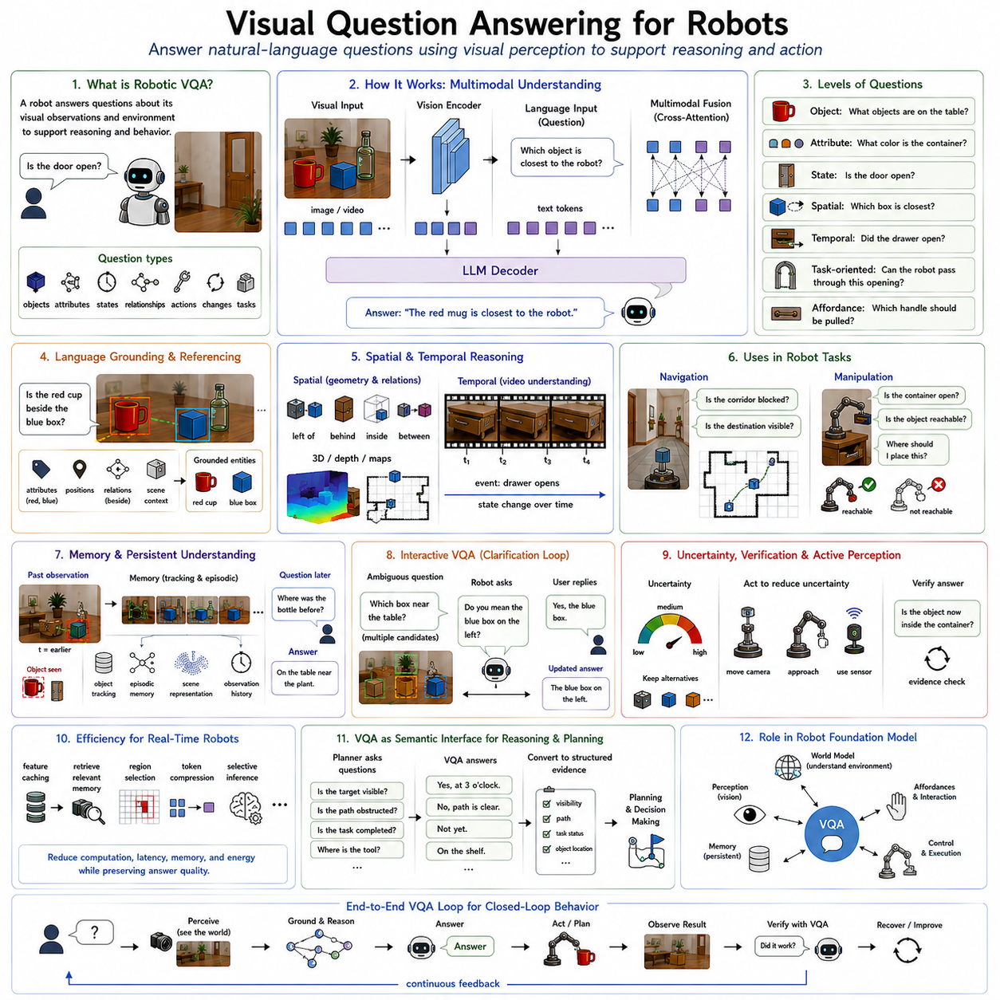{width="7.268055555555556in" height="7.268055555555556in"}

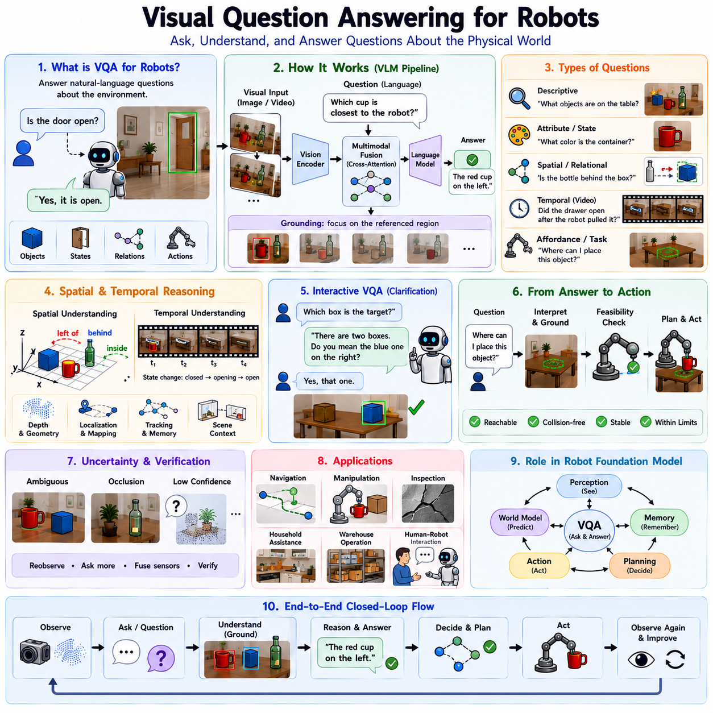{width="7.268055555555556in" height="7.268055555555556in"}

Visual Question Answering for robots enables a physical agent to answer natural-language questions by interpreting its visual observations and relating them to the surrounding environment. Unlike conventional VQA, which often operates on a static image, robotic VQA is situated within an embodied system. Questions may concern objects, locations, states, relationships, actions, changes, or task conditions that influence subsequent reasoning and behavior.

A robotic VQA system typically combines a vision encoder with a language model through multimodal alignment and fusion. Camera images or video frames are transformed into visual tokens, while the question is represented as language tokens. Cross-attention or multimodal Transformer layers connect these representations so that the meaning of the question determines which parts of the visual observation become relevant to the reasoning process.

Questions can target several levels of visual understanding. A robot may answer "What objects are on the table?", "What color is the container?", "Is the door open?", or "Which box is closest to the robot?" These examples require object recognition, attribute understanding, state estimation, and spatial reasoning respectively. More complex questions can combine several of these capabilities and require reasoning over relationships among multiple entities.

Language grounding is fundamental because the system must determine exactly which visual entity a question refers to. A question such as "Is the red cup beside the blue box?" requires grounding both objects and then evaluating their spatial relationship. When several visually similar objects are present, attributes, positions, scene context, and relational descriptions help resolve the intended referent before an answer can be generated.

Robotic VQA extends naturally from descriptive questions toward task-oriented questions. A mobile robot may ask or answer whether a corridor is blocked, whether a destination is visible, or which doorway provides access to another area. A manipulation robot may reason about whether a target object is reachable, whether a container is open, or where an object should be placed. The answer therefore becomes useful internal information for planning rather than only conversational output.

Spatial questions are especially important for physical agents because many robot decisions depend on relative and metric relationships. Questions may involve left, right, behind, inside, near, far, or between, but these linguistic relationships can depend on perspective and reference frames. Reliable robotic VQA may therefore combine VLM-based semantic reasoning with depth sensing, calibration, localization, 3D geometry, and environment-centered representations.

Video Question Answering extends the problem across time by allowing questions about events, motion, and state transitions. A robot may need to answer "Who moved the box?", "Where was the tool before it disappeared?", or "Did the drawer open after the robot pulled it?" Such questions cannot be solved reliably from the current frame alone and require temporal representations that connect observations distributed across an interaction sequence.

Temporal VQA also provides a mechanism for monitoring task execution. After performing an action, a robot can evaluate questions such as "Is the object now inside the container?" or "Did the door actually open?" Comparing expected and observed states transforms question answering into a form of semantic verification. This capability can support closed-loop behavior by detecting failed actions and triggering additional observation, recovery, or replanning.

Persistent memory becomes important when questions refer to information that is no longer visible. A robot may be asked where an object was previously observed or which person interacted with an item several minutes earlier. Object tracking, episodic memory, scene representations, and observation history can preserve relevant evidence. VQA can then act as a natural-language interface for querying the robot\'s accumulated perceptual memory rather than only its current visual input.

Robotic questions may also concern affordances and interactions. A user could ask "Which handle should be pulled?", "Where can I place this object?", or "Can the robot pass through this opening?" A VLM can provide semantic candidates by combining object, scene, and language knowledge. However, answers involving physical feasibility must be verified against geometry, reachability, robot morphology, collision constraints, and other embodiment-specific information.

Question answering can therefore serve as an intermediate reasoning mechanism inside a larger robot architecture. Higher-level planners do not necessarily need to inspect raw visual features directly; they can formulate semantic queries about the environment. Questions such as whether a target is visible, whether a path is obstructed, or whether a task condition has been satisfied can convert complex perceptual information into structured evidence that supports planning and decision making.

Interactive VQA is particularly valuable when perception or instructions are ambiguous. A robot may receive a command referring to "the box near the table" while several candidates satisfy that description. Rather than selecting one arbitrarily, the system can identify the ambiguity and exchange additional questions and answers with the user. This interaction creates a feedback loop between language, perception, and clarification that can reduce errors before physical execution.

Reliable VQA requires explicit treatment of uncertainty because multimodal models can generate linguistically plausible answers that are not supported by visual evidence. A robot should distinguish between what it observes, what it infers, and what remains unknown. Confidence estimation, evidence grounding, repeated observation, sensor fusion, and answer verification can reduce hallucination and prevent unsupported semantic conclusions from influencing consequential physical actions.

Active perception can extend VQA beyond passively answering from the current viewpoint. If the visual evidence is insufficient, the robot may move its camera, approach an object, inspect another side, or use an additional sensor before answering. The question itself can therefore define an information objective that guides perception. This creates a perception-action loop in which the robot gathers the evidence required to resolve uncertainty rather than guessing from incomplete observations.

Efficiency is another practical consideration because continuous visual question answering may involve high-resolution images, video histories, and large multimodal models. Robot systems can reuse cached visual features, retrieve only task-relevant memories, select candidate regions, compress visual tokens, or invoke expensive reasoning selectively. These mechanisms allow VQA to operate as part of a real-time architecture without repeatedly processing the complete sensory history for every question.

Within a robot foundation model, Visual Question Answering provides a language-based interface for interrogating visual perception, spatial understanding, temporal memory, and interaction state. It connects the question "What does the robot need to know?" with grounded evidence from the environment. Integrated with world models, affordances, planning, memory, and control, robotic VQA becomes not merely an answering capability but a mechanism for observation, verification, clarification, reasoning, and closed-loop decision making.

로봇을 위한 시각 질의응답(Visual Question Answering, VQA)은 물리적 에이전트(physical agent)가 자신의 시각적 관측(visual observation)을 해석하고 이를 주변 환경과 연결하여 자연어 질문에 답할 수 있도록 한다. 일반적인 VQA가 정적 이미지(static image)를 대상으로 하는 경우가 많은 것과 달리, 로봇 VQA는 신체화 시스템(embodied system) 안에서 상황에 기반하여 작동한다. 질문은 이후의 추론과 행동에 영향을 미치는 객체, 위치, 상태, 관계, 행동, 변화 또는 작업 조건(task condition)에 관한 것일 수 있다.

일반적인 로봇 VQA 시스템은 비전 인코더(vision encoder)와 언어 모델(language model)을 멀티모달 정렬 및 융합(multimodal alignment and fusion)을 통해 결합한다. 카메라 이미지나 비디오 프레임(video frame)은 시각 토큰(visual token)으로 변환되고, 질문은 언어 토큰(language token)으로 표현된다. 교차 어텐션(cross-attention) 또는 멀티모달 트랜스포머 계층(multimodal Transformer layer)은 이러한 표현을 연결하여 질문의 의미가 시각적 관측 가운데 어떤 부분이 추론 과정에서 중요한지를 결정하도록 한다.

질문은 여러 수준의 시각적 이해(visual understanding)를 대상으로 할 수 있다. 로봇은 "테이블 위에 어떤 객체들이 있는가?(What objects are on the table?)", "컨테이너는 무슨 색인가?(What color is the container?)", "문이 열려 있는가?(Is the door open?)", "어떤 상자가 로봇에 가장 가까운가?(Which box is closest to the robot?)"와 같은 질문에 답할 수 있다. 이러한 질문에는 각각 객체 인식(object recognition), 속성 이해(attribute understanding), 상태 추정(state estimation), 공간 추론(spatial reasoning)이 필요하다. 더 복잡한 질문은 이러한 능력을 여러 개 결합하고 다수의 개체 사이 관계를 추론하도록 요구할 수 있다.

언어 그라운딩(language grounding)은 시스템이 질문에서 정확히 어떤 시각적 개체를 참조하는지를 판단해야 하므로 핵심적이다. "빨간 컵이 파란 상자 옆에 있는가?(Is the red cup beside the blue box?)"라는 질문에서는 두 객체를 모두 그라운딩한 다음 두 객체 사이의 공간 관계를 평가해야 한다. 시각적으로 유사한 객체가 여러 개 존재하는 경우 속성, 위치, 장면 맥락(scene context), 관계적 설명(relational description)을 이용하여 의도된 참조 대상(referent)을 먼저 결정한 후 답변을 생성할 수 있다.

로봇 VQA는 설명적 질문(descriptive question)에서 작업 지향적 질문(task-oriented question)으로 자연스럽게 확장된다. 이동 로봇(mobile robot)은 복도가 막혀 있는지, 목적지가 보이는지, 어떤 출입구를 통해 다른 영역으로 이동할 수 있는지를 질문하거나 답할 수 있다. 조작 로봇(manipulation robot)은 목표 객체에 도달할 수 있는지, 컨테이너가 열려 있는지, 객체를 어디에 놓아야 하는지를 추론할 수 있다. 따라서 답변은 단순한 대화 출력이 아니라 계획(planning)을 위한 유용한 내부 정보가 된다.

많은 로봇의 의사결정이 상대적 및 계량적 관계(relative and metric relationship)에 의존하기 때문에 공간 질문(spatial question)은 물리적 에이전트에서 특히 중요하다. 질문에는 왼쪽(left), 오른쪽(right), 뒤(behind), 내부(inside), 가까움(near), 멂(far), 사이(between)와 같은 관계가 포함될 수 있지만, 이러한 언어적 관계는 관점과 기준 좌표계(reference frame)에 따라 달라질 수 있다. 따라서 신뢰할 수 있는 로봇 VQA는 VLM 기반 의미 추론(semantic reasoning)을 깊이 센싱(depth sensing), 캘리브레이션(calibration), 위치 추정(localization), 3차원 기하학(3D geometry), 환경 중심 표현(environment-centered representation)과 결합할 수 있다.

비디오 질의응답(Video Question Answering)은 시간에 걸쳐 발생하는 사건, 움직임, 상태 전이(state transition)에 대한 질문을 가능하게 함으로써 문제를 확장한다. 로봇은 "누가 상자를 옮겼는가?(Who moved the box?)", "도구가 사라지기 전에 어디에 있었는가?(Where was the tool before it disappeared?)", "로봇이 당긴 후 서랍이 열렸는가?(Did the drawer open after the robot pulled it?)"와 같은 질문에 답해야 할 수 있다. 이러한 질문은 현재 프레임만으로 신뢰성 있게 해결할 수 없으며, 상호작용 시퀀스(interaction sequence)에 걸쳐 분산된 관측을 연결하는 시간적 표현(temporal representation)이 필요하다.

시간적 VQA(temporal VQA)는 작업 실행을 모니터링하는 메커니즘도 제공한다. 행동을 수행한 후 로봇은 "객체가 이제 컨테이너 안에 있는가?(Is the object now inside the container?)" 또는 "문이 실제로 열렸는가?(Did the door actually open?)"와 같은 질문을 평가할 수 있다. 예상된 상태와 관측된 상태를 비교하면 질의응답을 의미적 검증(semantic verification)의 한 형태로 변환할 수 있다. 이러한 능력은 실패한 행동을 감지하고 추가 관측, 복구(recovery), 재계획(replanning)을 실행함으로써 폐루프 행동(closed-loop behavior)을 지원할 수 있다.

질문이 더 이상 보이지 않는 정보와 관련될 때 지속적 메모리(persistent memory)가 중요해진다. 로봇은 객체가 이전에 어디에서 관측되었는지 또는 몇 분 전에 어떤 사람이 특정 물체와 상호작용했는지를 질문받을 수 있다. 객체 추적(object tracking), 에피소드 메모리(episodic memory), 장면 표현(scene representation), 관측 이력(observation history)은 관련 증거를 보존할 수 있다. 따라서 VQA는 현재의 시각 입력뿐 아니라 로봇이 축적한 지각 메모리(perceptual memory)를 질의하는 자연어 인터페이스로 기능할 수 있다.

로봇의 질문은 어포던스(affordance)와 상호작용(interaction)에 관한 것일 수도 있다. 사용자는 "어떤 손잡이를 당겨야 하는가?(Which handle should be pulled?)", "이 객체를 어디에 놓을 수 있는가?(Where can I place this object?)", "로봇이 이 통로를 지나갈 수 있는가?(Can the robot pass through this opening?)"라고 질문할 수 있다. VLM은 객체, 장면, 언어 지식을 결합하여 의미적 후보(semantic candidate)를 제공할 수 있다. 그러나 물리적 실행 가능성(physical feasibility)이 포함된 답변은 기하학, 도달 가능성(reachability), 로봇 형태(robot morphology), 충돌 제약(collision constraint), 기타 신체 구조 특화 정보(embodiment-specific information)를 이용하여 검증해야 한다.

따라서 질의응답은 더 큰 로봇 아키텍처(robot architecture) 내부에서 중간 추론 메커니즘(intermediate reasoning mechanism)으로 사용될 수 있다. 상위 수준 플래너(high-level planner)가 반드시 원시 시각 특징(raw visual feature)을 직접 검사할 필요는 없으며, 환경에 대한 의미적 질의(semantic query)를 구성할 수 있다. 목표가 보이는지, 경로가 막혀 있는지, 작업 조건이 충족되었는지와 같은 질문은 복잡한 지각 정보를 계획과 의사결정(decision making)을 지원하는 구조화된 증거(structured evidence)로 변환할 수 있다.

상호작용형 VQA(interactive VQA)는 지각이나 명령이 모호한 경우 특히 유용하다. 로봇이 "테이블 근처의 상자(the box near the table)"를 참조하는 명령을 받았지만 여러 후보가 해당 설명을 만족할 수 있다. 이때 임의로 하나를 선택하는 대신 시스템은 모호성을 식별하고 사용자와 추가적인 질문과 답변을 교환할 수 있다. 이러한 상호작용은 언어, 지각, 명확화(clarification) 사이에 피드백 루프(feedback loop)를 형성하여 물리적 실행 전에 오류를 줄일 수 있다.

신뢰할 수 있는 VQA를 위해서는 멀티모달 모델(multimodal model)이 시각적 증거에 의해 뒷받침되지 않는 언어적으로 그럴듯한 답변을 생성할 수 있으므로 불확실성(uncertainty)을 명시적으로 처리해야 한다. 로봇은 자신이 관측한 것, 추론한 것, 아직 알 수 없는 것을 구분해야 한다. 신뢰도 추정(confidence estimation), 증거 그라운딩(evidence grounding), 반복 관측(repeated observation), 센서 융합(sensor fusion), 답변 검증(answer verification)은 환각(hallucination)을 줄이고 근거 없는 의미적 결론이 중요한 물리적 행동에 영향을 미치는 것을 방지할 수 있다.

능동 지각(active perception)은 현재 시점의 정보만으로 수동적으로 답하는 수준을 넘어 VQA를 확장할 수 있다. 시각적 증거가 충분하지 않으면 로봇은 답변하기 전에 카메라를 움직이거나, 객체에 접근하거나, 다른 측면을 관찰하거나, 추가 센서를 사용할 수 있다. 따라서 질문 자체가 지각을 유도하는 정보 목표(information objective)를 정의할 수 있다. 이는 로봇이 불완전한 관측을 기반으로 추측하는 대신 불확실성을 해결하는 데 필요한 증거를 능동적으로 수집하는 지각-행동 루프(perception-action loop)를 형성한다.

연속적인 시각 질의응답에는 고해상도 이미지, 비디오 이력(video history), 대규모 멀티모달 모델이 포함될 수 있기 때문에 효율성(efficiency)도 실제 시스템에서 중요한 고려사항이다. 로봇 시스템은 캐시된 시각 특징(cached visual feature)을 재사용하고, 작업과 관련된 메모리만 검색하고, 후보 영역(candidate region)을 선택하고, 시각 토큰을 압축하거나, 고비용 추론을 선택적으로 실행할 수 있다. 이러한 메커니즘을 통해 모든 질문마다 전체 센서 이력을 반복적으로 처리하지 않고도 VQA를 실시간 아키텍처(real-time architecture)의 일부로 운용할 수 있다.

로봇 파운데이션 모델(robot foundation model)에서 시각 질의응답(Visual Question Answering, VQA)은 시각적 지각, 공간 이해(spatial understanding), 시간 메모리(temporal memory), 상호작용 상태(interaction state)를 질의하기 위한 언어 기반 인터페이스(language-based interface)를 제공한다. 이는 "로봇이 무엇을 알아야 하는가?(What does the robot need to know?)"라는 질문을 환경에서 획득한 그라운딩된 증거(grounded evidence)와 연결한다. 월드 모델(world model), 어포던스, 계획, 메모리, 제어(control)와 통합될 때 로봇 VQA는 단순한 답변 기능을 넘어 관측(observation), 검증(verification), 명확화, 추론(reasoning), 폐루프 의사결정(closed-loop decision making)을 위한 메커니즘으로 발전할 수 있다.

## 03.09. Video Language and Temporal Understanding

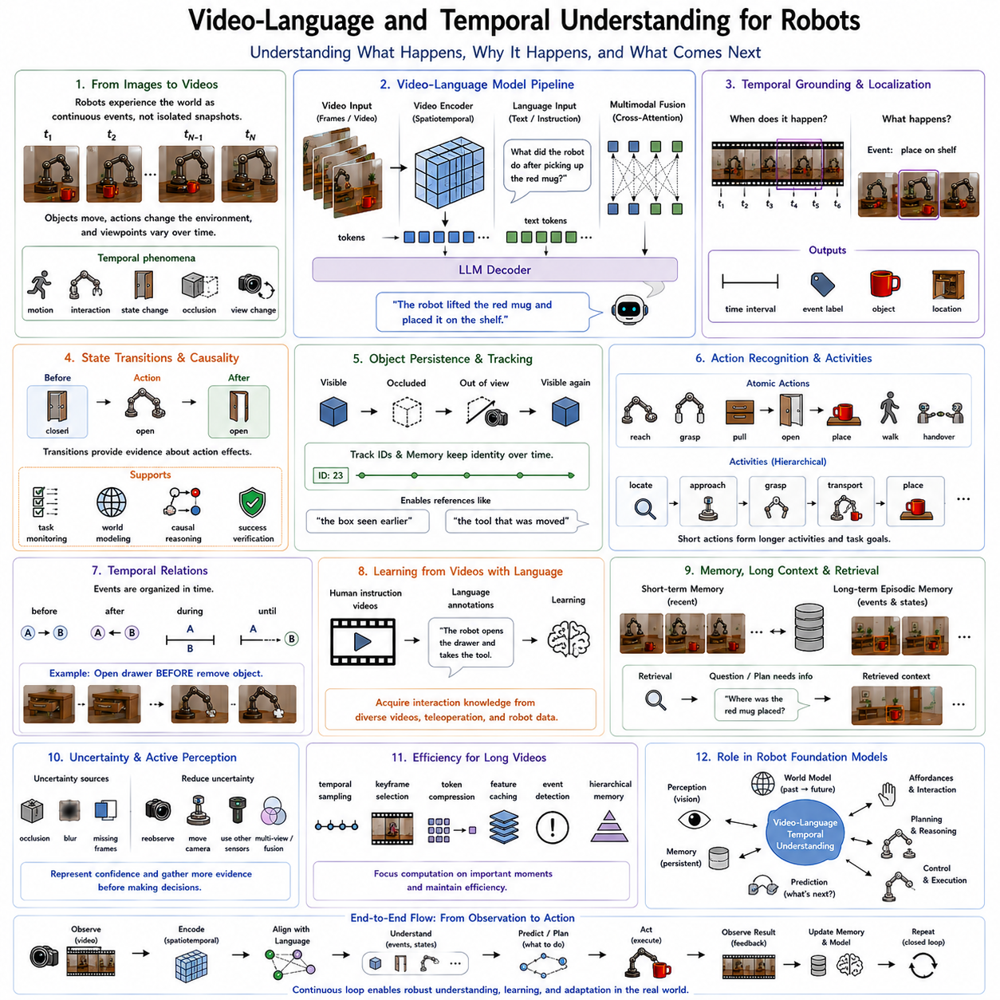{width="7.268055555555556in" height="7.268055555555556in"}

Video-language and temporal understanding extends vision-language modeling from isolated images toward continuous streams of events. A robot does not experience the world as independent snapshots: objects move, people act, the robot changes viewpoint, and actions modify the environment. Video-language models connect these evolving visual observations with linguistic concepts, allowing robots to interpret not only what is present but also what happened, what is changing, and what may happen next.

Temporal understanding begins with representing ordered visual observations. Individual frames contain objects, attributes, and spatial relationships, while sequences reveal motion, persistence, interaction, and state transitions. A useful robotic representation must preserve both spatial information within each frame and temporal dependencies across frames. This allows the system to distinguish a static configuration from an evolving process and to associate changes with meaningful events.

Video encoders typically transform sequences of frames into spatiotemporal features or tokens. Spatial processing captures appearance and scene structure, while temporal processing connects information across successive observations. Transformer-based models can apply attention across both dimensions, allowing a feature at one moment to reference evidence from earlier or later frames. This creates representations capable of describing activities and changes rather than merely recognizing individual objects.

Language provides semantic structure for interpreting temporal observations. Expressions such as "the person picked up the box," "the robot entered the corridor," or "the drawer was opened" describe entities together with actions and changes over time. Video-language alignment associates these descriptions with corresponding visual sequences. The resulting representation connects words not only to visible regions but also to intervals, transitions, trajectories, and events distributed across multiple frames.

Temporal grounding determines when a linguistically described event occurs within a video sequence. A command or question may refer to the moment when an object was grasped, the interval during which a person crossed a doorway, or the state immediately after a container was opened. The model must locate relevant temporal segments while maintaining their connection to objects and spatial regions. This combines language grounding with event localization and temporal segmentation.

State-transition understanding is especially important for robotics because physical actions intentionally change the world. A cup may move from a table to a shelf, a drawer may transition from closed to open, or a mobile robot may move from one room to another. Representing states before and after an event provides evidence about action effects. These transitions can later support task monitoring, world modeling, causal reasoning, and verification of whether an intended operation succeeded.

Object persistence connects visual understanding across time. An object may temporarily disappear because of occlusion, leave the camera field of view, or appear different after the robot changes perspective. Temporal association, tracking, and memory help preserve object identity despite these changes. Persistent representations allow language to refer to "the box seen earlier" or "the tool that was moved," even when the referenced entity is not clearly visible in the current frame.

Motion understanding must also separate environmental dynamics from robot ego-motion. When a mobile robot turns, nearly every image region may move even though surrounding objects remain stationary. Conversely, a moving person or vehicle may change position independently of the robot. Combining video features with localization, inertial measurements, depth, or geometric estimates helps distinguish these sources of motion and supports more stable interpretation of dynamic scenes.

Action recognition adds semantic meaning to observed motion. A sequence of movements may correspond to reaching, grasping, pushing, pulling, opening, placing, walking, or handing over an object. Recognizing these actions requires more than detecting motion because similar trajectories can have different meanings depending on objects, contact, and context. Language supervision helps organize visual dynamics into concepts that can be reused for task understanding and robot learning.

Long-horizon activities introduce hierarchical temporal structure. A task such as preparing an object for delivery may contain multiple stages, including locating it, approaching it, grasping it, transporting it, and placing it at a destination. Video-language models can represent short atomic actions together with higher-level activities and goals. Such hierarchical representations are valuable for connecting low-level observations with task decomposition, progress monitoring, and planning.

Temporal ordering also supports reasoning about prerequisites and consequences. If a robot observes that a drawer was opened before an object was removed, it can represent the ordering between these events. Similarly, placing an object requires that it first be grasped or otherwise controlled. Temporal relations such as before, after, during, and until provide a linguistic and computational structure for organizing events into coherent sequences rather than treating them as unrelated observations.

Video-language understanding provides an important source of supervision for learning from demonstrations. Human instructional videos, teleoperation recordings, and robot trajectories contain examples of objects being manipulated and environments changing in response to actions. Language annotations or narrations can connect these observations to semantic task descriptions. This enables foundation models to acquire interaction knowledge from broader sources than robot-specific datasets alone.

Long video sequences create substantial computational challenges because processing every frame at full resolution produces enormous numbers of visual tokens. Robotic systems therefore require mechanisms such as temporal sampling, keyframe selection, feature caching, token compression, event detection, and hierarchical memory. Stable or repetitive periods can receive less computation, while rapid changes, uncertainty, interactions, or safety-critical events can trigger more detailed processing.

Memory becomes essential when relevant information extends beyond the active model context. Short-term memory can preserve recent movements and interactions, while longer-term episodic memory can store important events, object locations, and task states. Retrieval mechanisms can selectively restore relevant information when required by a question or plan. This prevents the robot from repeatedly processing its complete visual history while still supporting reasoning over extended periods.

Temporal uncertainty must also be represented explicitly. Video observations may contain missing frames, motion blur, occlusion, synchronization errors, or ambiguous event boundaries. A robot may be uncertain whether contact occurred or whether an observed state change resulted from its own action. Reobservation, multi-camera evidence, sensor synchronization, multimodal fusion, and confidence estimation can improve reliability before temporal interpretations influence consequential decisions.

Within a robot foundation model, video-language and temporal understanding provide the bridge from static semantic perception to persistent understanding of an evolving physical world. Video supplies motion, events, and state transitions; language gives these changes semantic structure; memory preserves relevant history; and world models connect past observations with possible futures. Together, these capabilities support task monitoring, learning from demonstrations, causal reasoning, prediction, planning, and closed-loop Vision-Language-Action behavior.

비디오-언어 및 시간적 이해(video-language and temporal understanding)는 비전-언어 모델링(vision-language modeling)을 개별 이미지에서 연속적인 사건의 흐름으로 확장한다. 로봇은 세계를 서로 독립된 스냅샷(snapshot)으로 경험하지 않는다. 객체가 움직이고, 사람이 행동하며, 로봇의 시점이 변화하고, 행동은 환경을 변화시킨다. 비디오-언어 모델(video-language model)은 이렇게 변화하는 시각적 관측을 언어적 개념과 연결하여 로봇이 현재 무엇이 존재하는지뿐 아니라 무엇이 발생했고, 무엇이 변화하고 있으며, 다음에 무엇이 발생할 수 있는지를 해석하도록 한다.

시간적 이해(temporal understanding)는 순서가 있는 시각적 관측(ordered visual observation)을 표현하는 것에서 시작한다. 개별 프레임은 객체, 속성, 공간 관계를 포함하는 반면, 연속된 시퀀스(sequence)는 움직임, 지속성(persistence), 상호작용, 상태 전이(state transition)를 보여준다. 유용한 로봇 표현은 각 프레임 내부의 공간 정보와 프레임 사이의 시간적 의존성(temporal dependency)을 모두 보존해야 한다. 이를 통해 시스템은 정적인 구성과 변화하는 과정을 구분하고 변화 자체를 의미 있는 사건과 연결할 수 있다.

비디오 인코더(video encoder)는 일반적으로 프레임 시퀀스를 시공간 특징(spatiotemporal feature) 또는 토큰(token)으로 변환한다. 공간 처리(spatial processing)는 외관과 장면 구조를 포착하고, 시간 처리(temporal processing)는 연속적인 관측 사이의 정보를 연결한다. 트랜스포머 기반 모델(Transformer-based model)은 공간 및 시간 차원 모두에 어텐션(attention)을 적용하여 특정 시점의 특징이 이전 또는 이후 프레임의 증거를 참조하도록 할 수 있다. 이를 통해 개별 객체를 인식하는 것을 넘어 활동과 변화를 설명할 수 있는 표현을 생성한다.

언어(language)는 시간적 관측을 해석하기 위한 의미 구조(semantic structure)를 제공한다. "사람이 상자를 집어 들었다(the person picked up the box)", "로봇이 복도에 들어갔다(the robot entered the corridor)", "서랍이 열렸다(the drawer was opened)"와 같은 표현은 개체와 함께 시간에 따른 행동 및 변화를 설명한다. 비디오-언어 정렬(video-language alignment)은 이러한 설명을 해당 시각 시퀀스와 연결한다. 그 결과 단어가 보이는 영역뿐 아니라 여러 프레임에 걸쳐 분포된 시간 구간(interval), 전이(transition), 궤적(trajectory), 사건(event)과도 연결된다.

시간 그라운딩(temporal grounding)은 언어로 설명된 사건이 비디오 시퀀스의 어느 시점에 발생하는지를 결정한다. 명령이나 질문은 객체가 파지된 순간, 사람이 출입구를 통과한 시간 구간, 또는 컨테이너가 열린 직후의 상태를 참조할 수 있다. 모델은 관련 시간 구간을 찾아내는 동시에 해당 사건과 객체 및 공간 영역 사이의 연결을 유지해야 한다. 이는 언어 그라운딩(language grounding)을 사건 위치 추정(event localization) 및 시간 분할(temporal segmentation)과 결합하는 과정이다.

물리적 행동은 의도적으로 세계를 변화시키기 때문에 상태 전이 이해(state-transition understanding)는 로보틱스에서 특히 중요하다. 컵이 테이블에서 선반으로 이동하거나, 서랍이 닫힌 상태에서 열린 상태로 변화하거나, 이동 로봇이 한 방에서 다른 방으로 이동할 수 있다. 사건 전후의 상태를 표현하면 행동의 효과(action effect)에 대한 증거를 얻을 수 있다. 이러한 상태 전이는 이후 작업 모니터링(task monitoring), 월드 모델링(world modeling), 인과 추론(causal reasoning), 의도한 작업의 성공 여부 검증에 활용될 수 있다.

객체 지속성(object persistence)은 시간에 걸친 시각적 이해를 연결한다. 객체는 가림(occlusion) 때문에 일시적으로 사라지거나, 카메라 시야(field of view)를 벗어나거나, 로봇의 시점 변화에 따라 다른 모습으로 나타날 수 있다. 시간적 연관(temporal association), 추적(tracking), 메모리(memory)는 이러한 변화에도 객체 정체성(object identity)을 유지하도록 지원한다. 지속적인 표현을 통해 언어는 참조 대상이 현재 프레임에서 명확하게 보이지 않더라도 "이전에 보았던 상자(the box seen earlier)" 또는 "옮겨졌던 도구(the tool that was moved)"를 참조할 수 있다.

움직임 이해(motion understanding)는 환경의 동적 변화(environmental dynamics)와 로봇의 자기 운동(ego-motion)을 구분해야 한다. 이동 로봇이 회전하면 주변 객체가 정지해 있더라도 거의 모든 이미지 영역이 움직이는 것처럼 보일 수 있다. 반대로 움직이는 사람이나 차량은 로봇과 독립적으로 위치가 변화할 수 있다. 비디오 특징을 위치 추정(localization), 관성 측정(inertial measurement), 깊이(depth), 기하학적 추정(geometric estimate)과 결합하면 이러한 움직임의 원인을 구분하고 동적 장면(dynamic scene)을 보다 안정적으로 해석할 수 있다.

행동 인식(action recognition)은 관측된 움직임에 의미적 의미를 부여한다. 일련의 움직임은 접근하기(reaching), 파지하기(grasping), 밀기(pushing), 당기기(pulling), 열기(opening), 놓기(placing), 걷기(walking), 객체 전달하기(handing over) 등에 해당할 수 있다. 비슷한 궤적도 객체, 접촉(contact), 맥락에 따라 다른 의미를 가질 수 있기 때문에 행동 인식에는 단순한 움직임 검출 이상의 능력이 필요하다. 언어 지도(language supervision)는 시각적 동역학을 작업 이해 및 로봇 학습에서 재사용할 수 있는 개념으로 구조화하는 데 도움을 준다.

장기 활동(long-horizon activity)은 계층적 시간 구조(hierarchical temporal structure)를 가진다. 객체를 배송할 준비를 하는 작업에는 객체 찾기, 접근하기, 파지하기, 운반하기, 목적지에 놓기와 같은 여러 단계가 포함될 수 있다. 비디오-언어 모델은 짧은 원자적 행동(atomic action)을 상위 수준의 활동 및 목표와 함께 표현할 수 있다. 이러한 계층적 표현(hierarchical representation)은 저수준 관측을 작업 분해(task decomposition), 진행 상황 모니터링(progress monitoring), 계획(planning)과 연결하는 데 유용하다.

시간적 순서(temporal ordering)는 전제조건(prerequisite)과 결과(consequence)에 대한 추론도 지원한다. 로봇이 객체를 꺼내기 전에 서랍이 먼저 열리는 것을 관측하면 이러한 사건 사이의 순서를 표현할 수 있다. 마찬가지로 객체를 놓으려면 먼저 객체를 파지하거나 다른 방법으로 제어하고 있어야 한다. 이전(before), 이후(after), 동안(during), \~할 때까지(until)와 같은 시간 관계는 사건을 서로 독립적인 관측으로 처리하는 대신 일관된 시퀀스로 구성하기 위한 언어적·계산적 구조를 제공한다.

비디오-언어 이해는 시연 학습(learning from demonstrations)을 위한 중요한 지도 정보(supervision)를 제공한다. 인간 교육용 비디오(human instructional video), 원격조작 기록(teleoperation recording), 로봇 궤적(robot trajectory)은 객체가 조작되고 행동에 따라 환경이 변화하는 사례를 포함한다. 언어 주석(language annotation)이나 내레이션(narration)은 이러한 관측을 의미적 작업 설명과 연결할 수 있다. 이를 통해 파운데이션 모델(foundation model)은 로봇 특화 데이터셋만이 아니라 보다 광범위한 데이터 소스로부터 상호작용 지식을 획득할 수 있다.

긴 비디오 시퀀스(long video sequence)는 모든 프레임을 전체 해상도로 처리할 경우 막대한 수의 시각 토큰(visual token)을 생성하기 때문에 상당한 계산 문제를 발생시킨다. 따라서 로봇 시스템에는 시간 샘플링(temporal sampling), 키프레임 선택(keyframe selection), 특징 캐싱(feature caching), 토큰 압축(token compression), 이벤트 검출(event detection), 계층적 메모리(hierarchical memory)와 같은 메커니즘이 필요하다. 안정적이거나 반복적인 구간에는 적은 계산을 사용하고, 급격한 변화, 불확실성, 상호작용 또는 안전에 중요한 사건에는 보다 세밀한 처리를 수행할 수 있다.

관련 정보가 활성 모델 컨텍스트(active model context)의 범위를 넘어설 때 메모리(memory)가 필수적이 된다. 단기 메모리(short-term memory)는 최근의 움직임과 상호작용을 보존할 수 있으며, 장기 에피소드 메모리(long-term episodic memory)는 중요한 사건, 객체 위치, 작업 상태를 저장할 수 있다. 검색 메커니즘(retrieval mechanism)은 질문이나 계획에 필요한 정보를 선택적으로 복원할 수 있다. 이를 통해 로봇은 전체 시각 이력을 반복적으로 처리하지 않고도 장시간에 걸친 추론을 수행할 수 있다.

시간적 불확실성(temporal uncertainty)도 명시적으로 표현되어야 한다. 비디오 관측에는 누락된 프레임, 모션 블러(motion blur), 가림, 동기화 오류(synchronization error), 모호한 사건 경계(event boundary)가 포함될 수 있다. 로봇은 실제로 접촉이 발생했는지 또는 관측된 상태 변화가 자신의 행동으로 발생했는지 확신하지 못할 수 있다. 재관측(reobservation), 다중 카메라 증거(multi-camera evidence), 센서 동기화(sensor synchronization), 멀티모달 융합(multimodal fusion), 신뢰도 추정(confidence estimation)은 시간적 해석이 중요한 의사결정에 영향을 미치기 전에 신뢰성을 향상시킬 수 있다.

로봇 파운데이션 모델(robot foundation model)에서 비디오-언어 및 시간적 이해는 정적인 의미 지각(static semantic perception)에서 지속적으로 변화하는 물리 세계에 대한 연속적 이해로 이어지는 가교를 제공한다. 비디오는 움직임, 사건, 상태 전이를 제공하고, 언어는 이러한 변화에 의미적 구조를 부여하며, 메모리는 관련 이력을 보존하고, 월드 모델(world model)은 과거 관측을 가능한 미래 상태와 연결한다. 이러한 능력은 함께 작업 모니터링, 시연 학습, 인과 추론, 예측(prediction), 계획, 폐루프 비전-언어-행동(closed-loop Vision-Language-Action) 행동을 지원한다.

## 03.10. VLM Based Task and Scene Reasoning

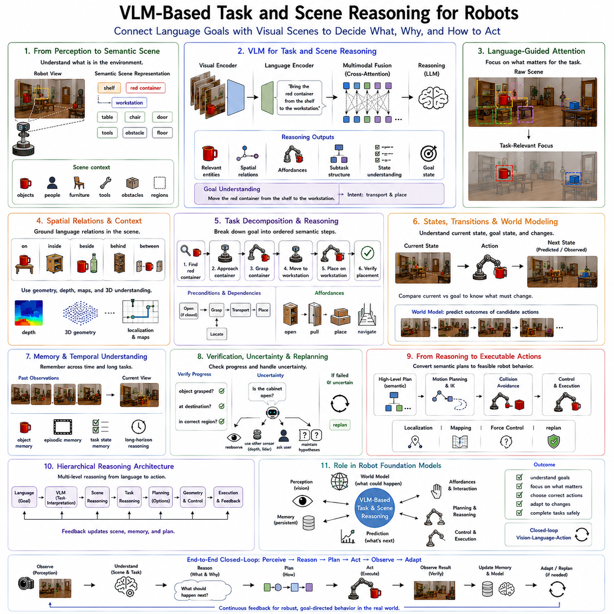{width="7.268055555555556in" height="7.268055555555556in"}

VLM-based task and scene reasoning enables robots to interpret visual environments in relation to goals expressed through language. Rather than treating perception as an independent recognition process, a Vision-Language Model connects observed objects, scene context, spatial relationships, and instructions within a shared reasoning framework. This allows the robot to determine not only what is present in the environment but also which information matters for the current task.

Scene reasoning begins by constructing a semantic interpretation of the robot's surroundings. Visual observations may contain objects, people, furniture, tools, obstacles, containers, pathways, and functional regions. A VLM associates these elements with concepts learned from large-scale image-text data. The resulting scene representation provides contextual knowledge about where the robot is operating and what kinds of interactions are likely to be meaningful.

Task reasoning introduces goals into this scene representation. An instruction such as "bring the red container from the shelf to the workstation" defines relevant entities, relationships, and an intended change in the environment. The robot must identify the container, understand the shelf and workstation as spatially distinct locations, and infer that the object must transition from its current state and position toward a desired goal state.

Language therefore acts as a mechanism for selecting task-relevant information from a potentially complex scene. A camera may observe dozens of objects, but only a few may matter for a particular instruction. Language-conditioned attention and multimodal reasoning can emphasize the target object, destination, obstacles, tools, or interaction regions while reducing attention to unrelated visual content. This creates a task-centered representation rather than a complete but inefficient description of everything visible.

Scene context can also resolve ambiguous task descriptions. If a robot is told to "pick up the tool," several objects may visually resemble tools, but their locations, neighboring objects, and functional context can help identify the intended target. A wrench lying beside mechanical components on a workbench is more consistent with the instruction than a visually similar object elsewhere. VLM reasoning combines local appearance with broader semantic context to reduce ambiguity.

Spatial relationships provide the geometric-semantic structure needed to connect tasks with scenes. Instructions commonly contain expressions such as on, inside, beside, behind, near, or between. The robot must ground these relationships in observed entities and determine how they constrain the task. Semantic spatial reasoning can identify candidate relationships, while depth, localization, maps, and 3D geometry provide the metric information required for physical execution.

Complex tasks often require decomposition into smaller semantic steps. "Put the bottle into the cabinet" may imply locating the bottle, identifying the cabinet, approaching the bottle, grasping it, reaching the cabinet, opening the cabinet if necessary, placing the bottle inside, and verifying the final state. A VLM can contribute commonsense task structure, while robot-specific planning modules determine which steps are physically necessary and executable in the current environment.

Task decomposition naturally introduces preconditions and dependencies. An object cannot normally be placed before it has been grasped, and an item cannot be retrieved from a closed container without first gaining access to the interior. VLM-based reasoning can propose these semantic relationships and organize subtasks into a plausible sequence. Such reasoning provides an interface between natural-language goals and hierarchical robot planning.

Affordance understanding further connects task semantics with possible interactions. A drawer may afford opening, a handle may afford pulling, a free surface may afford placement, and an unobstructed passage may afford navigation. The VLM can identify plausible action opportunities from visual and linguistic context. These candidate affordances can then be filtered according to geometry, reachability, robot morphology, actuator capability, and safety constraints.

Task reasoning must distinguish between desired states and currently observed states. If the goal is to place an object on a table, the system needs representations of both the present scene and the intended future configuration. Comparing current and goal states helps identify what must change. This state-difference perspective connects VLM reasoning with planning and world models by transforming language instructions into structured objectives involving objects, relationships, and state transitions.

World models can extend VLM task reasoning by predicting the consequences of candidate actions. A VLM may infer that opening a drawer is required, while a world model estimates how the drawer and surrounding scene may change when the action is performed. Candidate action sequences can therefore be evaluated according to expected future states rather than semantic plausibility alone. This provides a pathway from descriptive understanding toward predictive embodied reasoning.

Temporal memory is important because task-relevant information may not remain visible throughout execution. A robot may remember where a tool was previously observed, whether a door was already opened, or which subtasks have been completed. Persistent object representations, episodic memory, and task-state memory allow reasoning to span multiple observations and actions. Without such memory, long-horizon tasks could repeatedly lose information acquired earlier in the interaction.

Task progress can be evaluated by comparing observations with expected intermediate and final conditions. After grasping an object, the robot can verify whether the object moved with the gripper. After placement, it can check whether the object is actually at the requested destination. VLM-based semantic verification can interpret these observations, while geometric and sensor-level checks provide additional evidence. Failure can trigger reobservation, recovery, or replanning.

Uncertainty should remain part of the reasoning process when scenes or instructions are ambiguous. The robot may be uncertain which object was referenced, whether a container is open, or whether a region is reachable. Rather than committing immediately to a potentially incorrect interpretation, the system can maintain alternative hypotheses, gather another viewpoint, query additional sensors, or request clarification. This converts uncertainty into an information-gathering problem before physical execution.

VLM reasoning is most effective when separated from low-level physical control. A multimodal model can identify semantic goals, relevant entities, relationships, affordances, and plausible subtask sequences, but it may not provide sufficiently accurate geometry or dynamics for direct actuator commands. Specialized modules for localization, motion planning, inverse kinematics, collision avoidance, force control, and safety can convert high-level reasoning results into executable robot behavior.

This separation supports hierarchical reasoning architectures. At the highest level, language specifies the goal and the VLM interprets the task. Scene reasoning identifies relevant entities and relationships, task reasoning generates semantic subgoals, and planning evaluates possible actions. Geometric modules then produce feasible trajectories, while controllers execute them and perception monitors the results. Feedback continuously updates the scene and task representation as the physical world changes.

Within a robot foundation model, VLM-based task and scene reasoning therefore provides a semantic decision layer between perception and action. It combines visual evidence with language, spatial relationships, affordances, temporal memory, and task goals to construct a structured interpretation of what should happen next. Integrated with world models, planning, geometric reasoning, control, and feedback, this capability forms an important foundation for general-purpose Vision-Language-Action systems operating through closed-loop interaction.

VLM 기반 작업 및 장면 추론(VLM-based task and scene reasoning)은 로봇이 언어(language)로 표현된 목표와 연계하여 시각적 환경을 해석할 수 있도록 한다. 비전-언어 모델(Vision-Language Model, VLM)은 지각(perception)을 독립적인 인식 과정으로 처리하는 대신 관측된 객체, 장면 맥락(scene context), 공간 관계(spatial relationship), 명령(instruction)을 공유된 추론 프레임워크(shared reasoning framework) 안에서 연결한다. 이를 통해 로봇은 환경에 무엇이 존재하는지뿐 아니라 현재 작업에서 어떤 정보가 중요한지도 판단할 수 있다.

장면 추론(scene reasoning)은 로봇 주변 환경에 대한 의미적 해석(semantic interpretation)을 구성하는 것에서 시작한다. 시각적 관측에는 객체, 사람, 가구, 도구, 장애물, 컨테이너, 이동 경로(pathway), 기능적 영역(functional region)이 포함될 수 있다. VLM은 이러한 요소를 대규모 이미지-텍스트 데이터에서 학습한 개념과 연결한다. 이렇게 형성된 장면 표현(scene representation)은 로봇이 어떤 환경에서 작동하고 있으며 어떤 종류의 상호작용이 의미 있을 가능성이 높은지에 대한 맥락적 지식을 제공한다.

작업 추론(task reasoning)은 이러한 장면 표현에 목표(goal)를 도입한다. "선반에 있는 빨간 컨테이너를 작업대로 가져와라(bring the red container from the shelf to the workstation)"라는 명령은 관련 개체, 관계, 그리고 환경에서 의도된 변화를 정의한다. 로봇은 컨테이너를 식별하고, 선반과 작업대를 공간적으로 서로 다른 위치로 이해하며, 객체가 현재 상태와 위치에서 원하는 목표 상태(goal state)로 전이되어야 한다는 것을 추론해야 한다.

따라서 언어는 잠재적으로 복잡한 장면에서 작업 관련 정보(task-relevant information)를 선택하는 메커니즘으로 작동한다. 카메라에는 수십 개의 객체가 관측될 수 있지만 특정 명령에 중요한 객체는 그중 일부에 불과할 수 있다. 언어 조건부 어텐션(language-conditioned attention)과 멀티모달 추론(multimodal reasoning)은 목표 객체, 목적지, 장애물, 도구, 상호작용 영역을 강조하고 관련 없는 시각적 정보에 대한 주의를 줄일 수 있다. 이를 통해 보이는 모든 것을 완전하지만 비효율적으로 설명하는 대신 작업 중심 표현(task-centered representation)을 생성한다.

장면 맥락은 모호한 작업 설명(ambiguous task description)을 해결하는 데에도 활용될 수 있다. 로봇이 "도구를 집어라(pick up the tool)"라는 명령을 받았을 때 여러 객체가 시각적으로 도구와 유사할 수 있지만, 해당 객체의 위치, 주변 객체, 기능적 맥락(functional context)을 이용하여 의도된 목표를 식별할 수 있다. 기계 부품 옆 작업대에 놓인 렌치(wrench)는 다른 장소의 시각적으로 유사한 객체보다 명령과 더 일관될 수 있다. VLM 추론은 국소적 외형(local appearance)과 광범위한 의미적 맥락을 결합하여 모호성을 줄인다.

공간 관계는 작업과 장면을 연결하는 데 필요한 기하학적-의미적 구조(geometric-semantic structure)를 제공한다. 명령에는 위에(on), 내부에(inside), 옆에(beside), 뒤에(behind), 근처에(near), 사이에(between)와 같은 표현이 흔히 포함된다. 로봇은 이러한 관계를 관측된 개체에 그라운딩(grounding)하고 그것이 작업에 어떤 제약을 부여하는지 판단해야 한다. 의미적 공간 추론(semantic spatial reasoning)은 후보 관계를 식별할 수 있으며, 깊이(depth), 위치 추정(localization), 지도(map), 3차원 기하학(3D geometry)은 물리적 실행에 필요한 계량적 정보를 제공한다.

복잡한 작업은 일반적으로 더 작은 의미적 단계(semantic step)로 분해해야 한다. "병을 캐비닛 안에 넣어라(put the bottle into the cabinet)"라는 명령은 병 찾기, 캐비닛 식별하기, 병에 접근하기, 병 파지하기, 캐비닛으로 이동하기, 필요할 경우 캐비닛 열기, 병을 내부에 놓기, 최종 상태 확인하기 등의 단계를 포함할 수 있다. VLM은 상식적인 작업 구조(commonsense task structure)를 제공할 수 있으며, 로봇 특화 계획 모듈(robot-specific planning module)은 현재 환경에서 어떤 단계가 물리적으로 필요하고 실행 가능한지를 결정한다.

작업 분해(task decomposition)는 자연스럽게 전제조건(precondition)과 의존 관계(dependency)를 도입한다. 일반적으로 객체를 파지하기 전에 놓을 수 없으며, 닫힌 컨테이너 내부의 물체를 꺼내려면 먼저 내부에 접근할 수 있어야 한다. VLM 기반 추론은 이러한 의미적 관계를 제안하고 하위 작업(subtask)을 그럴듯한 순서로 구성할 수 있다. 이러한 추론은 자연어 목표(natural-language goal)와 계층적 로봇 계획(hierarchical robot planning)을 연결하는 인터페이스를 제공한다.

어포던스 이해(affordance understanding)는 작업 의미(task semantics)를 가능한 상호작용과 더욱 긴밀하게 연결한다. 서랍은 열기(opening), 손잡이는 당기기(pulling), 비어 있는 표면은 객체 놓기(placement), 장애물이 없는 통로는 이동(navigation)을 가능하게 할 수 있다. VLM은 시각 및 언어 맥락을 이용하여 가능한 행동 기회(action opportunity)를 식별할 수 있다. 이후 이러한 후보 어포던스는 기하학, 도달 가능성(reachability), 로봇 형태(robot morphology), 액추에이터 성능(actuator capability), 안전 제약(safety constraint)에 따라 필터링될 수 있다.

작업 추론은 원하는 상태(desired state)와 현재 관측된 상태(current observed state)를 구분해야 한다. 목표가 객체를 테이블 위에 놓는 것이라면 시스템에는 현재 장면과 의도된 미래 구성(future configuration)에 대한 표현이 모두 필요하다. 현재 상태와 목표 상태를 비교하면 무엇이 변화해야 하는지를 식별할 수 있다. 이러한 상태 차이(state difference)의 관점은 언어 명령을 객체, 관계, 상태 전이(state transition)가 포함된 구조화된 목표로 변환함으로써 VLM 추론을 계획 및 월드 모델(world model)과 연결한다.

월드 모델은 후보 행동(candidate action)의 결과를 예측함으로써 VLM 작업 추론을 확장할 수 있다. VLM이 서랍을 여는 것이 필요하다고 추론하면 월드 모델은 해당 행동을 수행했을 때 서랍과 주변 장면이 어떻게 변화할지를 추정할 수 있다. 따라서 후보 행동 시퀀스(action sequence)는 의미적 개연성(semantic plausibility)뿐 아니라 예상되는 미래 상태(expected future state)에 따라서도 평가할 수 있다. 이는 설명적 이해(descriptive understanding)에서 예측 기반 신체화 추론(predictive embodied reasoning)으로 발전하는 경로를 제공한다.

작업 관련 정보가 실행 과정 내내 시야에 남아 있지 않을 수 있기 때문에 시간 메모리(temporal memory)가 중요하다. 로봇은 이전에 도구가 어디에서 관측되었는지, 문이 이미 열렸는지, 어떤 하위 작업이 완료되었는지를 기억해야 할 수 있다. 지속적인 객체 표현(persistent object representation), 에피소드 메모리(episodic memory), 작업 상태 메모리(task-state memory)는 여러 관측과 행동에 걸쳐 추론을 유지하도록 한다. 이러한 메모리가 없다면 장기 작업(long-horizon task)은 이전 상호작용에서 획득한 정보를 반복적으로 잃을 수 있다.

작업 진행 상태(task progress)는 관측 결과를 예상된 중간 및 최종 조건과 비교하여 평가할 수 있다. 객체를 파지한 후 로봇은 객체가 그리퍼(gripper)와 함께 실제로 움직였는지를 확인할 수 있다. 객체를 놓은 후에는 요청된 목적지에 실제로 위치하는지를 확인할 수 있다. VLM 기반 의미적 검증(semantic verification)은 이러한 관측을 해석할 수 있으며, 기하학적 및 센서 수준 검사(sensor-level check)는 추가적인 증거를 제공한다. 실패가 감지되면 재관측(reobservation), 복구(recovery), 재계획(replanning)을 실행할 수 있다.

장면이나 명령이 모호한 경우 불확실성(uncertainty)은 추론 과정의 일부로 유지되어야 한다. 로봇은 어떤 객체가 참조되었는지, 컨테이너가 열려 있는지, 특정 영역에 도달할 수 있는지를 확신하지 못할 수 있다. 잠재적으로 잘못된 해석을 즉시 확정하는 대신 시스템은 여러 대안 가설(alternative hypothesis)을 유지하거나, 다른 시점에서 정보를 수집하거나, 추가 센서를 질의하거나, 사용자에게 명확화(clarification)를 요청할 수 있다. 이는 물리적 실행 전에 불확실성을 정보 수집 문제(information-gathering problem)로 변환한다.

VLM 추론은 저수준 물리 제어(low-level physical control)와 분리할 때 가장 효과적이다. 멀티모달 모델(multimodal model)은 의미적 목표, 관련 개체, 관계, 어포던스, 가능한 하위 작업 시퀀스를 식별할 수 있지만 직접적인 액추에이터 명령에 필요한 충분한 수준의 기하학이나 동역학(dynamics)을 제공하지 못할 수 있다. 위치 추정, 모션 계획(motion planning), 역기구학(inverse kinematics), 충돌 회피(collision avoidance), 힘 제어(force control), 안전(safety)을 위한 전문 모듈이 상위 수준 추론 결과를 실행 가능한 로봇 행동으로 변환할 수 있다.

이러한 분리는 계층적 추론 아키텍처(hierarchical reasoning architecture)를 지원한다. 최상위 수준에서는 언어가 목표를 지정하고 VLM이 작업을 해석한다. 장면 추론은 관련 개체와 관계를 식별하고, 작업 추론은 의미적 하위 목표(semantic subgoal)를 생성하며, 계획 모듈은 가능한 행동을 평가한다. 이후 기하학 모듈(geometric module)이 실행 가능한 궤적(feasible trajectory)을 생성하고, 제어기(controller)가 이를 실행하며, 지각 시스템이 결과를 모니터링한다. 물리적 세계가 변화함에 따라 피드백(feedback)은 장면 및 작업 표현을 지속적으로 갱신한다.

따라서 로봇 파운데이션 모델(robot foundation model)에서 VLM 기반 작업 및 장면 추론은 지각과 행동 사이에 위치하는 의미적 의사결정 계층(semantic decision layer)을 제공한다. 이는 시각적 증거를 언어, 공간 관계, 어포던스, 시간 메모리, 작업 목표와 결합하여 다음에 무엇이 일어나야 하는지에 대한 구조화된 해석을 구성한다. 월드 모델, 계획, 기하학적 추론(geometric reasoning), 제어, 피드백과 통합될 때 이러한 능력은 폐루프 상호작용(closed-loop interaction)을 통해 작동하는 범용 비전-언어-행동 시스템(general-purpose Vision-Language-Action system)을 위한 중요한 기반을 형성한다.

## 03.11. Limitations of VLMs for Physical Action

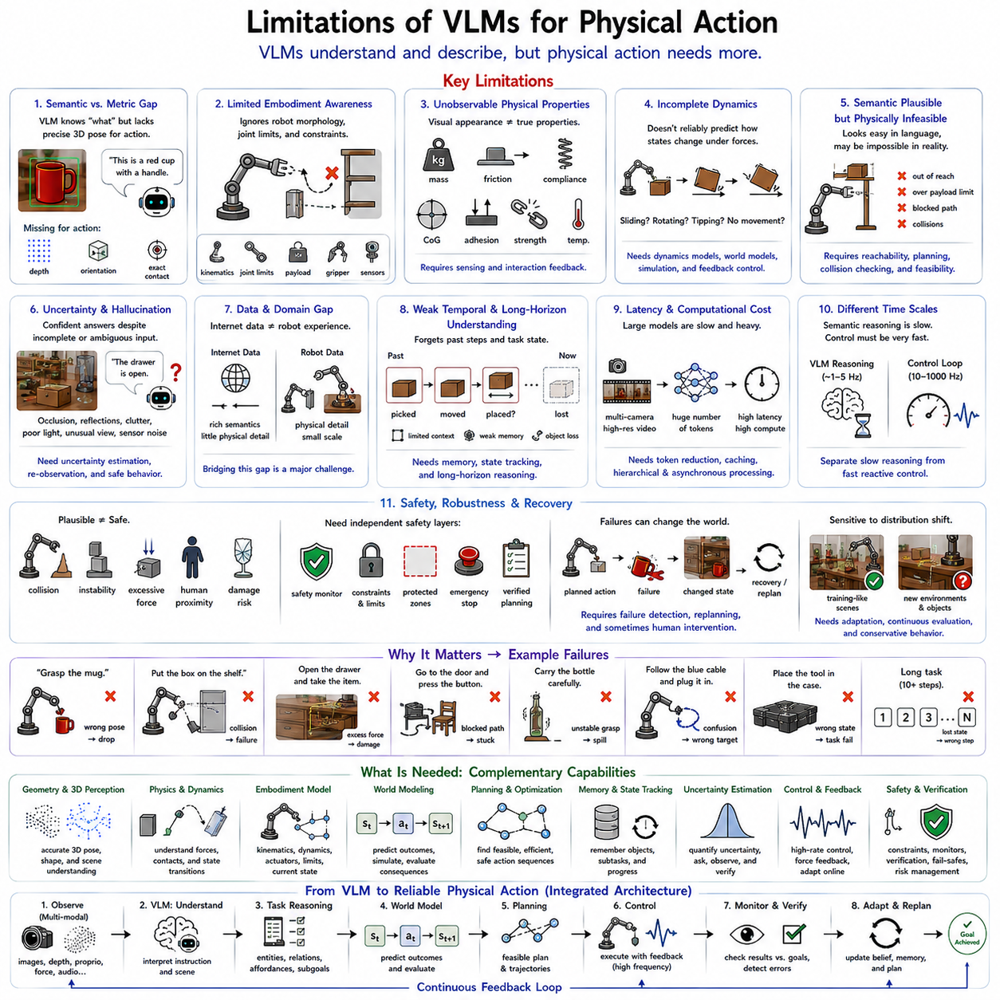{width="7.268055555555556in" height="7.268055555555556in"}

Vision-Language Models can provide powerful semantic understanding for robotics, but their strengths do not automatically translate into reliable physical action. Most VLMs are trained primarily to associate visual observations with language rather than to control embodied systems. They can describe objects, relationships, and plausible actions while still lacking the geometric precision, dynamic understanding, physical feedback, and execution guarantees required for safe interaction with the real world.

A major limitation is the difference between semantic understanding and metric accuracy. A VLM may correctly identify a cup, recognize its handle, and explain that the cup can be grasped, yet fail to determine the precise three-dimensional pose needed by a robot gripper. Small errors in depth, orientation, scale, or contact position that are irrelevant for image description can cause failed grasps, collisions, or unstable manipulation during physical execution.

VLMs also have limited knowledge of embodiment. The same instruction can require very different actions depending on robot morphology, joint configuration, payload capacity, gripper design, mobility, and sensor placement. A model may infer that an object is reachable without considering joint limits or obstacles. Physical action therefore requires representations of the robot itself, including kinematics, dynamics, actuator constraints, current configuration, and operational limits.

Physical interaction depends on properties that are often difficult or impossible to infer reliably from visual appearance alone. Mass, friction, compliance, center of gravity, surface adhesion, structural strength, temperature, and internal mechanisms may strongly influence how an object should be manipulated. A VLM can use semantic priors to estimate likely properties, but these assumptions may fail for unfamiliar objects or unusual conditions. Direct sensing and interaction feedback remain essential.

Another limitation is the incomplete representation of dynamics. Images and language can describe what an action normally does, but robot control requires understanding how states evolve under specific forces and motions. Pushing an object may cause sliding, rotation, tipping, deformation, or no movement depending on contact and friction. Reliable execution therefore requires dynamic models, learned world models, simulation, or feedback control that can predict and correct physical consequences.

VLM reasoning may also generate actions that are semantically plausible but physically infeasible. An instruction such as "place the box on the upper shelf" appears straightforward at the language level, yet the shelf may be outside the manipulator workspace, the box may exceed payload limits, or the approach path may be blocked. Semantic task plans must therefore pass through reachability analysis, motion planning, collision checking, and feasibility validation before execution.

Uncertainty presents another fundamental challenge. VLMs can produce confident linguistic outputs even when visual evidence is incomplete, ambiguous, or outside their training distribution. Occlusion, reflections, transparent objects, poor illumination, clutter, unusual viewpoints, and sensor degradation can all produce incorrect interpretations. In physical systems, an apparently reasonable hallucination can become a dangerous command if uncertainty is not explicitly detected and handled before action.

Training data create additional limitations because internet-scale image-text datasets differ substantially from robot experience. They contain rich semantic knowledge but relatively little information about precise contact, force, joint state, action timing, recovery behavior, or embodiment-specific constraints. Robot datasets provide these physical signals but remain much smaller and less diverse. Bridging this data gap is one of the central challenges in adapting general-purpose VLMs to embodied intelligence.

Temporal understanding is also weaker than required for many long-horizon robot tasks. Physical execution unfolds continuously, and the meaning of an observation depends on previous states and actions. A robot must remember which objects were moved, which subtasks were completed, and whether previous actions succeeded. Limited context windows, imperfect object persistence, and weak long-term memory can cause VLM-based systems to lose task state or reason from outdated information.

Latency and computational cost further constrain physical deployment. Large VLMs may require substantial GPU memory and processing time, while robot perception and control operate under strict real-time requirements. High-resolution multi-camera video can generate enormous token streams that cannot be processed uniformly at maximum model complexity. Practical systems need token reduction, feature caching, hierarchical processing, asynchronous reasoning, and different update rates for perception, planning, and control.

The operating frequency of semantic reasoning is fundamentally different from that of low-level control. A VLM may reason effectively at relatively slow intervals, whereas balance, collision avoidance, force regulation, and motor control may require updates from tens to thousands of times per second. Attempting to place a large multimodal model directly inside every control cycle is usually unnecessary and inefficient. Hierarchical architectures separate slow semantic reasoning from fast reactive control.

Safety is particularly challenging because language-model plausibility is not equivalent to physical safety. A proposed action may satisfy the instruction while creating collision, instability, excessive force, human proximity, or equipment damage risks. Safety-critical constraints should therefore not depend solely on VLM reasoning. Independent safety monitors, motion constraints, protected zones, force limits, emergency stops, deterministic controllers, and verified planning components can provide additional protective layers.

Distribution shift can further reduce reliability when robots operate outside the environments represented in training data. Industrial facilities, outdoor terrain, warehouses, hospitals, construction sites, and homes can contain unusual objects, lighting, layouts, and interaction patterns. A VLM that performs well on familiar scenes may fail unexpectedly under these conditions. Continuous evaluation, domain adaptation, multimodal sensing, and conservative behavior are required when uncertainty increases.

Error recovery remains another difference between visual reasoning and physical intelligence. A generated textual answer can simply be revised, but a failed physical action may already have changed the environment. An object may fall, a path may become blocked, or the robot may end in an unexpected configuration. Embodied systems therefore need failure detection, state reassessment, recovery policies, replanning, and sometimes human intervention rather than assuming that each predicted action succeeds.

These limitations suggest that VLMs should usually function as semantic reasoning components rather than complete robot controllers. They are well suited to interpreting instructions, identifying relevant entities, understanding scenes, proposing affordances, decomposing tasks, and generating candidate plans. Specialized perception, geometry, world modeling, motion planning, control, and safety modules can then convert these semantic outputs into physically grounded and executable behavior.

A robust architecture can therefore organize intelligence hierarchically. The VLM interprets language and visual context, a task planner generates semantic subgoals, geometric modules determine poses and feasible trajectories, a world model predicts relevant consequences, and low-level controllers execute actions using high-rate sensor feedback. Safety systems constrain every stage, while observations continuously update the task state and trigger replanning when predicted and actual outcomes diverge.

The transition from VLMs to Vision-Language-Action models does not eliminate these challenges; instead, it moves action more deeply into the learning architecture. VLA models can learn direct relationships among observations, instructions, and robot actions, but they still face embodiment differences, limited data, distribution shift, uncertainty, dynamics, latency, and safety requirements. Physical grounding and closed-loop feedback therefore remain essential even as models become increasingly end-to-end.

The central limitation of VLMs for physical action is thus not their ability to describe what should happen, but the gap between semantic plausibility and physical executability. Bridging this gap requires geometry, dynamics, embodiment, memory, uncertainty estimation, world modeling, planning, feedback control, and safety mechanisms. VLMs provide a powerful semantic foundation, while reliable robot intelligence emerges when that foundation is integrated with systems that continuously sense, predict, act, verify, and adapt.

비전-언어 모델(Vision-Language Model, VLM)은 로보틱스에 강력한 의미적 이해(semantic understanding)를 제공할 수 있지만, 이러한 강점이 자동으로 신뢰할 수 있는 물리적 행동(physical action)으로 이어지는 것은 아니다. 대부분의 VLM은 신체화 시스템(embodied system)을 제어하기보다는 시각적 관측과 언어를 연결하도록 주로 학습된다. 따라서 객체, 관계, 가능한 행동을 설명할 수 있으면서도 현실 세계와 안전하게 상호작용하는 데 필요한 기하학적 정밀도(geometric precision), 동역학적 이해(dynamic understanding), 물리적 피드백(physical feedback), 실행 보장(execution guarantee)이 부족할 수 있다.

주요 한계 중 하나는 의미적 이해(semantic understanding)와 계량적 정확도(metric accuracy) 사이의 차이이다. VLM은 컵을 정확히 식별하고 손잡이를 인식하며 컵을 파지할 수 있다고 설명하면서도 로봇 그리퍼(robot gripper)에 필요한 정밀한 3차원 자세(3D pose)를 결정하지 못할 수 있다. 이미지 설명에서는 중요하지 않은 깊이, 방향, 크기, 접촉 위치의 작은 오차도 실제 물리적 실행에서는 파지 실패, 충돌 또는 불안정한 조작을 발생시킬 수 있다.

VLM은 신체 구조(embodiment)에 대한 지식도 제한적이다. 동일한 명령이라도 로봇 형태(robot morphology), 관절 구성(joint configuration), 페이로드 용량(payload capacity), 그리퍼 설계(gripper design), 이동 능력(mobility), 센서 배치에 따라 매우 다른 행동이 필요할 수 있다. 모델은 관절 한계나 장애물을 고려하지 않고 객체에 도달할 수 있다고 추론할 수 있다. 따라서 물리적 행동에는 운동학(kinematics), 동역학(dynamics), 액추에이터 제약(actuator constraint), 현재 구성, 운용 한계를 포함하는 로봇 자체의 표현이 필요하다.

물리적 상호작용은 시각적 외형만으로 신뢰성 있게 추론하기 어렵거나 불가능한 속성에 의존한다. 질량(mass), 마찰(friction), 순응성(compliance), 무게중심(center of gravity), 표면 접착성(surface adhesion), 구조적 강도(structural strength), 온도, 내부 메커니즘은 객체를 어떻게 조작해야 하는지에 큰 영향을 미칠 수 있다. VLM은 의미적 사전 지식(semantic prior)을 이용해 이러한 속성을 추정할 수 있지만, 익숙하지 않은 객체나 비정상적인 조건에서는 이러한 가정이 실패할 수 있다. 따라서 직접 센싱(direct sensing)과 상호작용 피드백(interaction feedback)이 여전히 필수적이다.

또 다른 한계는 동역학(dynamics)에 대한 불완전한 표현이다. 이미지와 언어는 어떤 행동이 일반적으로 무엇을 발생시키는지를 설명할 수 있지만, 로봇 제어에는 특정 힘과 움직임에 따라 상태가 어떻게 변화하는지를 이해하는 것이 필요하다. 객체를 밀면 접촉과 마찰 조건에 따라 미끄러짐, 회전, 전도(tipping), 변형(deformation)이 발생하거나 전혀 움직이지 않을 수도 있다. 따라서 신뢰할 수 있는 실행에는 물리적 결과를 예측하고 수정할 수 있는 동역학 모델(dynamic model), 학습된 월드 모델(learned world model), 시뮬레이션(simulation), 피드백 제어(feedback control)가 필요하다.

VLM 추론은 의미적으로는 그럴듯하지만 물리적으로 실행 불가능한 행동을 생성할 수도 있다. "상자를 위쪽 선반에 놓아라(place the box on the upper shelf)"라는 명령은 언어 수준에서는 간단해 보이지만, 선반이 매니퓰레이터 작업 공간(manipulator workspace) 밖에 있거나 상자가 페이로드 한계를 초과하거나 접근 경로가 차단되어 있을 수 있다. 따라서 의미적 작업 계획(semantic task plan)은 실행 전에 도달 가능성 분석(reachability analysis), 모션 계획(motion planning), 충돌 검사(collision checking), 실행 가능성 검증(feasibility validation)을 거쳐야 한다.

불확실성(uncertainty)은 또 다른 근본적인 문제를 제기한다. VLM은 시각적 증거가 불완전하거나 모호하거나 학습 분포(training distribution)를 벗어난 경우에도 자신감 있는 언어 출력을 생성할 수 있다. 가림(occlusion), 반사(reflection), 투명 객체, 불충분한 조명, 복잡한 환경(clutter), 비정상적인 시점, 센서 성능 저하(sensor degradation)는 모두 잘못된 해석을 발생시킬 수 있다. 물리 시스템에서는 불확실성을 행동 전에 명시적으로 탐지하고 처리하지 않으면 그럴듯한 환각(hallucination)이 위험한 명령으로 이어질 수 있다.

학습 데이터(training data) 역시 추가적인 한계를 만든다. 인터넷 규모의 이미지-텍스트 데이터셋은 로봇의 실제 경험과 상당히 다르다. 이러한 데이터에는 풍부한 의미 지식이 포함되어 있지만 정밀한 접촉(contact), 힘(force), 관절 상태(joint state), 행동 타이밍(action timing), 복구 행동(recovery behavior), 신체 구조 특화 제약(embodiment-specific constraint)에 대한 정보는 상대적으로 부족하다. 로봇 데이터셋은 이러한 물리적 신호를 제공하지만 규모와 다양성이 훨씬 제한적이다. 이러한 데이터 격차(data gap)를 해소하는 것은 범용 VLM을 신체화 지능(embodied intelligence)에 적용하는 핵심 과제 중 하나이다.

시간적 이해(temporal understanding) 역시 많은 장기 로봇 작업(long-horizon robot task)에 필요한 수준보다 약할 수 있다. 물리적 실행은 연속적으로 진행되며 관측의 의미는 이전 상태와 행동에 따라 달라진다. 로봇은 어떤 객체가 이동되었는지, 어떤 하위 작업(subtask)이 완료되었는지, 이전 행동이 성공했는지를 기억해야 한다. 제한된 컨텍스트 윈도(context window), 불완전한 객체 지속성(object persistence), 취약한 장기 메모리(long-term memory)는 VLM 기반 시스템이 작업 상태를 잃거나 오래된 정보를 기반으로 추론하게 만들 수 있다.

지연시간(latency)과 계산 비용(computational cost)도 물리적 배포를 제약한다. 대형 VLM은 상당한 GPU 메모리와 처리 시간을 필요로 할 수 있지만 로봇 지각과 제어는 엄격한 실시간 요구사항(real-time requirement) 아래에서 작동한다. 고해상도 다중 카메라 비디오(high-resolution multi-camera video)는 최대 모델 복잡도로 균일하게 처리하기 어려운 막대한 토큰 스트림(token stream)을 생성할 수 있다. 실제 시스템에는 토큰 축소(token reduction), 특징 캐싱(feature caching), 계층적 처리(hierarchical processing), 비동기 추론(asynchronous reasoning), 지각·계획·제어를 위한 서로 다른 갱신 주기가 필요하다.

의미적 추론(semantic reasoning)의 동작 주기는 저수준 제어(low-level control)의 동작 주기와 근본적으로 다르다. VLM은 비교적 느린 주기에서도 효과적으로 추론할 수 있지만 균형 유지(balance), 충돌 회피(collision avoidance), 힘 조절(force regulation), 모터 제어(motor control)는 초당 수십 회에서 수천 회 수준의 갱신이 필요할 수 있다. 모든 제어 주기에 대형 멀티모달 모델(multimodal model)을 직접 배치하는 것은 일반적으로 불필요하고 비효율적이다. 계층적 아키텍처(hierarchical architecture)는 느린 의미적 추론과 빠른 반응형 제어(reactive control)를 분리한다.

언어 모델의 개연성(plausibility)이 물리적 안전성을 의미하지 않기 때문에 안전(safety)은 특히 어려운 문제이다. 제안된 행동은 명령 자체는 만족하면서도 충돌, 불안정성, 과도한 힘, 사람과의 위험한 근접, 장비 손상 위험을 발생시킬 수 있다. 따라서 안전 중요 제약(safety-critical constraint)을 VLM 추론에만 의존해서는 안 된다. 독립적인 안전 모니터(safety monitor), 모션 제약(motion constraint), 보호 영역(protected zone), 힘 제한(force limit), 비상 정지(emergency stop), 결정론적 제어기(deterministic controller), 검증된 계획 구성 요소가 추가적인 보호 계층을 제공할 수 있다.

로봇이 학습 데이터에 포함된 환경과 다른 조건에서 작동하면 분포 변화(distribution shift)가 신뢰성을 더욱 감소시킬 수 있다. 산업 시설, 실외 지형, 창고, 병원, 건설 현장, 가정에는 특수한 객체, 조명, 배치, 상호작용 패턴이 존재할 수 있다. 익숙한 장면에서 잘 작동하는 VLM도 이러한 조건에서는 예상하지 못한 방식으로 실패할 수 있다. 불확실성이 증가하는 상황에서는 지속적인 평가(continuous evaluation), 도메인 적응(domain adaptation), 멀티모달 센싱(multimodal sensing), 보수적 행동(conservative behavior)이 필요하다.

오류 복구(error recovery)는 시각적 추론과 물리적 지능(physical intelligence)을 구분하는 또 다른 중요한 요소이다. 생성된 텍스트 답변은 단순히 수정할 수 있지만 실패한 물리적 행동은 이미 환경을 변화시켰을 수 있다. 객체가 떨어지거나, 경로가 막히거나, 로봇이 예상하지 못한 구성 상태에 놓일 수 있다. 따라서 신체화 시스템에는 모든 예측 행동이 성공한다고 가정하는 대신 실패 감지(failure detection), 상태 재평가(state reassessment), 복구 정책(recovery policy), 재계획(replanning), 경우에 따라 인간 개입(human intervention)이 필요하다.

이러한 한계는 VLM이 완전한 로봇 제어기(complete robot controller)보다는 의미적 추론 구성 요소(semantic reasoning component)로 기능하는 것이 일반적으로 적절하다는 것을 보여준다. VLM은 명령 해석, 관련 개체 식별, 장면 이해, 어포던스(affordance) 제안, 작업 분해(task decomposition), 후보 계획(candidate plan) 생성에 적합하다. 이후 전문화된 지각, 기하학, 월드 모델링(world modeling), 모션 계획, 제어, 안전 모듈이 이러한 의미적 출력을 물리적으로 그라운딩되고 실행 가능한 행동으로 변환할 수 있다.

따라서 견고한 아키텍처(robust architecture)는 지능을 계층적으로 구성할 수 있다. VLM은 언어와 시각적 맥락을 해석하고, 작업 플래너(task planner)는 의미적 하위 목표(semantic subgoal)를 생성하며, 기하학 모듈(geometric module)은 자세와 실행 가능한 궤적(feasible trajectory)을 결정하고, 월드 모델은 관련 결과를 예측하며, 저수준 제어기(low-level controller)는 고주기 센서 피드백(high-rate sensor feedback)을 이용해 행동을 실행한다. 안전 시스템은 모든 단계를 제한하며, 관측 결과는 작업 상태를 지속적으로 갱신하고 예측 결과와 실제 결과가 달라질 경우 재계획을 유도한다.

VLM에서 비전-언어-행동 모델(Vision-Language-Action Model, VLA)로의 전환이 이러한 문제를 제거하는 것은 아니다. 오히려 행동(action)을 학습 아키텍처 내부로 더욱 깊게 통합한다. VLA 모델은 관측, 명령, 로봇 행동 사이의 직접적인 관계를 학습할 수 있지만 여전히 신체 구조 차이(embodiment difference), 제한된 데이터, 분포 변화, 불확실성, 동역학, 지연시간, 안전 요구사항에 직면한다. 따라서 모델이 점점 더 종단간(end-to-end) 구조로 발전하더라도 물리적 그라운딩(physical grounding)과 폐루프 피드백(closed-loop feedback)은 필수적이다.

따라서 물리적 행동을 위한 VLM의 핵심 한계는 무엇이 일어나야 하는지를 설명하는 능력 자체가 아니라 의미적 개연성(semantic plausibility)과 물리적 실행 가능성(physical executability) 사이의 간극에 있다. 이러한 간극을 연결하려면 기하학, 동역학, 신체 구조, 메모리, 불확실성 추정(uncertainty estimation), 월드 모델링, 계획, 피드백 제어, 안전 메커니즘이 필요하다. VLM은 강력한 의미적 기반(semantic foundation)을 제공하며, 신뢰할 수 있는 로봇 지능은 이러한 기반이 지속적으로 감지하고(sense), 예측하고(predict), 행동하고(act), 검증하고(verify), 적응하는(adapt) 시스템과 통합될 때 형성된다.

## 03.12. Robot VLM Example [w/Code]

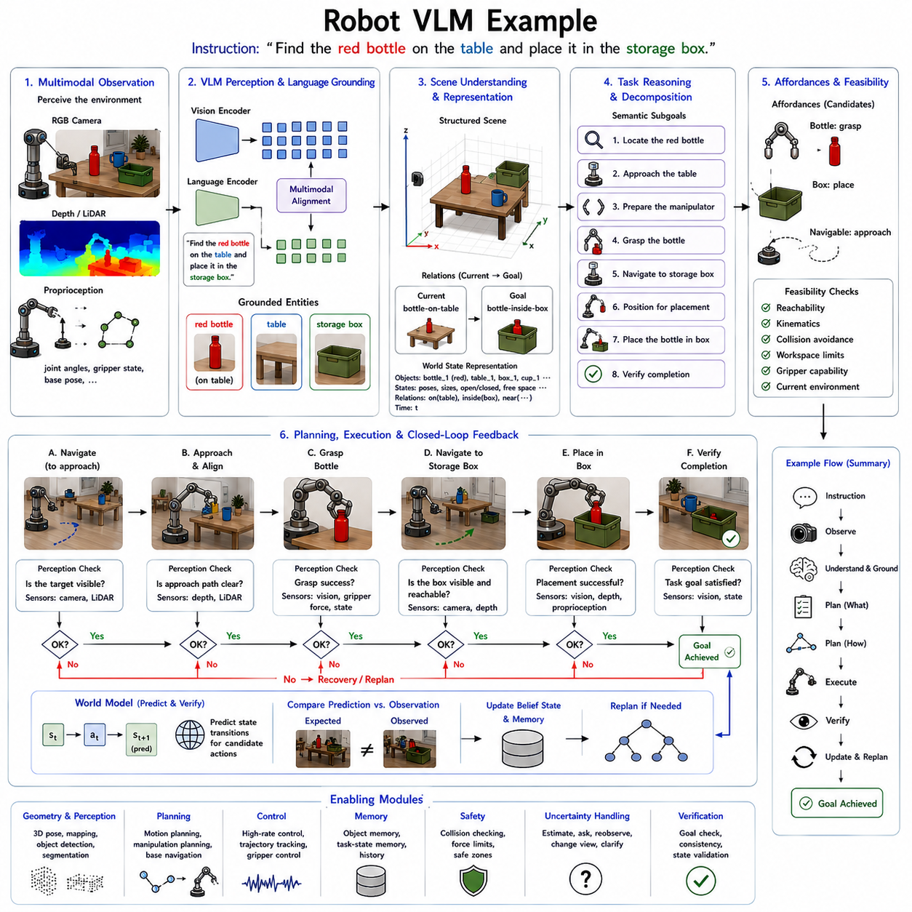{width="7.268055555555556in" height="7.268055555555556in"}

A robot Vision-Language Model provides a practical example of how visual perception and language reasoning can be combined inside an embodied system. Consider a mobile manipulator receiving the instruction, "Find the red bottle on the table and place it in the storage box." The robot must transform this simple linguistic request into grounded visual understanding, spatial reasoning, task decomposition, physical planning, execution, and verification.

The process begins with multimodal observation of the environment. RGB cameras provide appearance and semantic information, while depth cameras or LiDAR can supply geometric structure. Robot proprioception describes joint positions, manipulator configuration, and platform state. These observations establish the physical context in which the VLM must interpret the instruction rather than treating the visual input as an isolated image.

A vision encoder transforms camera observations into visual features or tokens representing objects, regions, attributes, and scene context. The language component encodes the instruction and identifies concepts such as "red bottle," "table," "storage box," and "place." Multimodal alignment connects these linguistic concepts with corresponding visual evidence, creating a shared representation in which language can selectively guide perception toward task-relevant elements.

Language grounding then identifies candidate entities in the observed scene. The system searches for an object satisfying both the category "bottle" and the attribute "red," while separately grounding the table and storage box. If multiple red bottles are visible, spatial relationships and scene context may be required to determine which one is "on the table." The output is therefore not merely object recognition but a task-conditioned interpretation of the scene.

The robot can organize this interpretation into a structured scene representation. The red bottle becomes a target object with an estimated location and state, the table becomes its current support surface, and the storage box becomes the intended destination. Relationships such as bottle-on-table and target-inside-box can represent the current and desired configurations. This structure makes the task understandable as a transformation between world states.

Task reasoning converts the grounded instruction into semantic subgoals. A plausible sequence may involve locating the bottle, approaching the table, preparing the manipulator, grasping the bottle, navigating toward the storage box, positioning the arm, placing the bottle inside, and confirming completion. The VLM can propose this high-level structure using semantic and commonsense knowledge, while specialized robot modules determine the details required for execution.

Affordance reasoning helps identify how the relevant objects can participate in these subtasks. The bottle may afford grasping around its body, the free space inside the box may afford placement, and navigable regions may afford approach motions. These affordances remain semantic candidates rather than guaranteed actions. Their physical feasibility must be evaluated using geometry, robot embodiment, reachability, collision constraints, and current environmental conditions.

The grounded target must therefore be converted from a semantic object into a geometrically actionable representation. Depth information can estimate the bottle's three-dimensional position, while pose estimation determines orientation and candidate grasp configurations. Robot kinematics evaluates whether these configurations are reachable. Collision checking then eliminates motions that intersect the table, nearby objects, the robot itself, or other obstacles in the workspace.

Navigation and manipulation planning can operate beneath the VLM reasoning layer. If the bottle cannot be reached from the current platform pose, a navigation planner generates an appropriate approach position. A motion planner then computes a feasible manipulator trajectory toward the selected grasp. The VLM defines what should be achieved, while geometric planning determines how the robot can physically achieve it under embodiment-specific constraints.

Once execution begins, high-rate control operates at a much faster frequency than semantic VLM reasoning. Joint controllers, mobile-base controllers, and gripper control continuously use sensor feedback to follow planned trajectories and maintain stable interaction. This hierarchical separation prevents a computationally expensive VLM from being responsible for every motor update while preserving its role in semantic interpretation and task-level decision making.

Closed-loop perception becomes essential after each meaningful action. After commanding the gripper to close, the robot should verify that the bottle was actually grasped rather than assuming success. Visual observations, gripper state, force information, or other sensor signals can provide evidence. If the bottle remains on the table or slips during lifting, the observed world state differs from the predicted state and the system can trigger recovery.

The same principle applies during placement. The robot approaches the storage box, identifies a suitable free region, checks geometric accessibility, and generates a placement trajectory. After releasing the bottle, perception evaluates whether the object is actually inside the box and whether it remains stable. Semantic verification can determine whether the linguistic goal has been satisfied, while geometric checks confirm that the physical outcome is consistent with the intended state.

A world model can strengthen this architecture by predicting state transitions associated with candidate actions. Before grasping, it can represent the expected transition from bottle-on-table to bottle-held-by-robot. Before placement, it can predict the transition from bottle-held-by-robot to bottle-inside-box. Comparing these predictions with observations provides a structured mechanism for detecting unexpected outcomes and updating subsequent plans.

Memory maintains continuity throughout the task. The robot must remember which bottle was selected, where the storage box was observed, which subtasks have been completed, and whether previous interactions succeeded. Object memory, task-state memory, and recent observation history prevent the VLM from reconstructing the entire problem independently at every step. They also support recovery when relevant objects temporarily disappear from the camera view.

Uncertainty can modify the execution strategy at any stage. If the system cannot confidently distinguish between two bottles, it may change viewpoint or request clarification. If depth estimates are unreliable, it may approach for a closer observation. If the grasp appears unstable, it may stop and replan rather than continue carrying the object. The robot therefore treats uncertainty as a reason to gather additional evidence instead of forcing an unsupported decision.

This example illustrates why a robot VLM is most effective as part of an integrated architecture rather than as an isolated model. The VLM contributes language interpretation, open-vocabulary perception, scene understanding, grounding, affordance reasoning, and semantic task decomposition. Geometry, world modeling, planning, memory, control, safety, and feedback contribute the physical capabilities required to transform those semantic conclusions into reliable embodied behavior.

The complete robot VLM pipeline can therefore be understood as a continuous perception-reasoning-action loop. Multimodal sensors observe the world, the VLM grounds the instruction and constructs task-relevant meaning, planning converts semantic goals into feasible actions, controllers execute them, and perception verifies the resulting state. When observation differs from expectation, memory and world state are updated and the system replans, forming the foundation for closed-loop Vision-Language-Action behavior.

로봇 비전-언어 모델(robot Vision-Language Model)은 시각적 지각(visual perception)과 언어 추론(language reasoning)이 신체화 시스템(embodied system) 내부에서 어떻게 결합될 수 있는지를 보여주는 실질적인 사례를 제공한다. 이동형 매니퓰레이터(mobile manipulator)가 "테이블 위의 빨간 병을 찾아 보관 상자 안에 넣어라(Find the red bottle on the table and place it in the storage box)"라는 명령을 받았다고 가정해 보자. 로봇은 이 간단한 언어 요청을 그라운딩된 시각적 이해(grounded visual understanding), 공간 추론(spatial reasoning), 작업 분해(task decomposition), 물리적 계획(physical planning), 실행(execution), 검증(verification)으로 변환해야 한다.

이 과정은 환경에 대한 멀티모달 관측(multimodal observation)에서 시작된다. RGB 카메라는 외형과 의미 정보를 제공하며, 깊이 카메라(depth camera) 또는 라이다(LiDAR)는 기하학적 구조(geometric structure)를 제공할 수 있다. 로봇 고유수용감각(proprioception)은 관절 위치, 매니퓰레이터 구성(manipulator configuration), 플랫폼 상태를 나타낸다. 이러한 관측은 VLM이 시각 입력을 독립적인 이미지로 처리하는 대신 명령을 해석해야 하는 물리적 맥락(physical context)을 형성한다.

비전 인코더(vision encoder)는 카메라 관측을 객체, 영역, 속성, 장면 맥락(scene context)을 나타내는 시각 특징(visual feature) 또는 토큰(token)으로 변환한다. 언어 구성 요소(language component)는 명령을 인코딩하고 "빨간 병(red bottle)", "테이블(table)", "보관 상자(storage box)", "놓기(place)"와 같은 개념을 식별한다. 멀티모달 정렬(multimodal alignment)은 이러한 언어 개념을 대응되는 시각적 증거와 연결하여 언어가 작업 관련 요소에 선택적으로 지각을 집중시킬 수 있는 공유 표현(shared representation)을 생성한다.

언어 그라운딩(language grounding)은 관측된 장면에서 후보 개체(candidate entity)를 식별한다. 시스템은 "병(bottle)"이라는 범주와 "빨간색(red)"이라는 속성을 모두 만족하는 객체를 검색하면서 테이블과 보관 상자를 별도로 그라운딩한다. 여러 개의 빨간 병이 보인다면 어떤 병이 "테이블 위에(on the table)" 있는지를 판단하기 위해 공간 관계와 장면 맥락이 필요할 수 있다. 따라서 출력은 단순한 객체 인식(object recognition)이 아니라 작업 조건부 장면 해석(task-conditioned scene interpretation)이 된다.

로봇은 이러한 해석을 구조화된 장면 표현(structured scene representation)으로 구성할 수 있다. 빨간 병은 추정 위치와 상태를 가진 목표 객체(target object)가 되고, 테이블은 현재의 지지 표면(support surface)이 되며, 보관 상자는 의도된 목적지(destination)가 된다. 병-테이블 위(bottle-on-table)와 목표-상자 내부(target-inside-box)와 같은 관계는 현재 구성과 원하는 구성을 표현할 수 있다. 이러한 구조를 통해 작업은 월드 상태(world state) 사이의 변환으로 이해될 수 있다.

작업 추론(task reasoning)은 그라운딩된 명령을 의미적 하위 목표(semantic subgoal)로 변환한다. 가능한 시퀀스(sequence)는 병 찾기, 테이블에 접근하기, 매니퓰레이터 준비하기, 병 파지하기, 보관 상자로 이동하기, 로봇 팔 위치 조정하기, 병을 상자 안에 놓기, 완료 여부 확인하기 등으로 구성될 수 있다. VLM은 의미 및 상식 지식(commonsense knowledge)을 이용하여 이러한 상위 수준 구조를 제안할 수 있으며, 전문화된 로봇 모듈은 실행에 필요한 세부 사항을 결정한다.

어포던스 추론(affordance reasoning)은 관련 객체가 이러한 하위 작업에 어떻게 참여할 수 있는지를 식별하는 데 도움을 준다. 병의 몸체는 파지(grasping)를 가능하게 하고, 상자 내부의 빈 공간은 배치(placement)를 가능하게 하며, 이동 가능한 영역(navigable region)은 접근 동작을 가능하게 할 수 있다. 이러한 어포던스는 보장된 행동이 아니라 의미적 후보(semantic candidate)이다. 실제 실행 가능성은 기하학, 로봇 신체 구조(embodiment), 도달 가능성(reachability), 충돌 제약(collision constraint), 현재 환경 조건을 이용하여 평가해야 한다.

따라서 그라운딩된 목표는 의미적 객체(semantic object)에서 기하학적으로 행동 가능한 표현(geometrically actionable representation)으로 변환되어야 한다. 깊이 정보는 병의 3차원 위치를 추정할 수 있으며, 자세 추정(pose estimation)은 방향과 후보 파지 구성(candidate grasp configuration)을 결정한다. 로봇 운동학(robot kinematics)은 이러한 구성이 도달 가능한지를 평가한다. 이후 충돌 검사(collision checking)는 테이블, 주변 객체, 로봇 자체 또는 작업 공간의 다른 장애물과 충돌하는 움직임을 제거한다.

내비게이션 및 조작 계획(navigation and manipulation planning)은 VLM 추론 계층 아래에서 작동할 수 있다. 현재 플랫폼 자세(platform pose)에서 병에 도달할 수 없다면 내비게이션 플래너(navigation planner)가 적절한 접근 위치를 생성한다. 이후 모션 플래너(motion planner)는 선택된 파지 위치까지 실행 가능한 매니퓰레이터 궤적(feasible manipulator trajectory)을 계산한다. VLM은 무엇을 달성해야 하는지를 정의하고, 기하학적 계획(geometric planning)은 신체 구조 특화 제약(embodiment-specific constraint) 아래에서 로봇이 이를 물리적으로 어떻게 달성할지를 결정한다.

실행이 시작되면 고주기 제어(high-rate control)는 의미적 VLM 추론보다 훨씬 빠른 주기로 작동한다. 관절 제어기(joint controller), 이동 베이스 제어기(mobile-base controller), 그리퍼 제어(gripper control)는 센서 피드백(sensor feedback)을 지속적으로 이용하여 계획된 궤적을 추종하고 안정적인 상호작용을 유지한다. 이러한 계층적 분리(hierarchical separation)는 계산 비용이 높은 VLM이 모든 모터 업데이트를 담당하지 않도록 하면서 의미 해석과 작업 수준 의사결정(task-level decision making)에서의 역할을 유지하도록 한다.

각각의 의미 있는 행동 이후에는 폐루프 지각(closed-loop perception)이 필수적이다. 그리퍼를 닫도록 명령한 후 로봇은 성공을 가정하는 대신 병이 실제로 파지되었는지를 검증해야 한다. 시각적 관측, 그리퍼 상태, 힘 정보(force information) 또는 다른 센서 신호가 이에 대한 증거를 제공할 수 있다. 병이 테이블에 그대로 남아 있거나 들어 올리는 과정에서 미끄러진다면 관측된 월드 상태가 예측된 상태와 달라지므로 시스템은 복구(recovery)를 시작할 수 있다.

동일한 원리는 배치(placement) 과정에도 적용된다. 로봇은 보관 상자에 접근하고, 적절한 빈 영역을 식별하고, 기하학적 접근 가능성(geometric accessibility)을 확인한 후 배치 궤적(placement trajectory)을 생성한다. 병을 놓은 후에는 객체가 실제로 상자 내부에 있으며 안정적인 상태를 유지하는지를 지각 시스템이 평가한다. 의미적 검증(semantic verification)은 언어로 표현된 목표가 충족되었는지를 판단하고, 기하학적 검사는 물리적 결과가 의도한 상태와 일치하는지를 확인한다.

월드 모델(world model)은 후보 행동과 관련된 상태 전이(state transition)를 예측하여 이러한 아키텍처를 강화할 수 있다. 파지하기 전에 병-테이블 위(bottle-on-table) 상태에서 병-로봇이 보유(bottle-held-by-robot) 상태로의 예상 전이를 표현할 수 있다. 배치하기 전에는 병-로봇이 보유 상태에서 병-상자 내부(bottle-inside-box) 상태로의 전이를 예측할 수 있다. 이러한 예측을 실제 관측과 비교하면 예상하지 못한 결과를 감지하고 이후 계획을 갱신하기 위한 구조화된 메커니즘을 제공한다.

메모리(memory)는 전체 작업에서 연속성(continuity)을 유지한다. 로봇은 어떤 병이 선택되었는지, 보관 상자가 어디에서 관측되었는지, 어떤 하위 작업이 완료되었는지, 이전 상호작용이 성공했는지를 기억해야 한다. 객체 메모리(object memory), 작업 상태 메모리(task-state memory), 최근 관측 이력(recent observation history)은 VLM이 매 단계마다 전체 문제를 처음부터 다시 구성할 필요가 없도록 한다. 또한 관련 객체가 일시적으로 카메라 시야에서 사라지는 경우에도 복구를 지원한다.

불확실성(uncertainty)은 어느 단계에서든 실행 전략을 변경할 수 있다. 시스템이 두 개의 병을 확실하게 구분할 수 없다면 시점을 변경하거나 사용자에게 명확화(clarification)를 요청할 수 있다. 깊이 추정이 신뢰할 수 없다면 더 가까이 접근하여 다시 관측할 수 있다. 파지가 불안정해 보인다면 객체 운반을 계속하기보다 정지하고 재계획(replanning)할 수 있다. 따라서 로봇은 불확실성을 근거 없는 결정을 강제하는 대신 추가적인 증거를 수집해야 하는 이유로 처리한다.

이 사례는 로봇 VLM이 독립적인 모델보다는 통합 아키텍처(integrated architecture)의 일부로 사용될 때 가장 효과적인 이유를 보여준다. VLM은 언어 해석(language interpretation), 개방 어휘 지각(open-vocabulary perception), 장면 이해(scene understanding), 그라운딩, 어포던스 추론, 의미적 작업 분해를 담당한다. 기하학, 월드 모델링(world modeling), 계획, 메모리, 제어, 안전(safety), 피드백은 이러한 의미적 결론을 신뢰할 수 있는 신체화 행동(embodied behavior)으로 변환하는 데 필요한 물리적 능력을 제공한다.

따라서 전체 로봇 VLM 파이프라인(robot VLM pipeline)은 연속적인 지각-추론-행동 루프(perception-reasoning-action loop)로 이해할 수 있다. 멀티모달 센서(multimodal sensor)가 세계를 관측하고, VLM이 명령을 그라운딩하여 작업 관련 의미를 구성하며, 계획 모듈이 의미적 목표를 실행 가능한 행동으로 변환하고, 제어기가 이를 실행하며, 지각 시스템이 결과 상태를 검증한다. 관측 결과가 예상과 다르면 메모리와 월드 상태를 갱신하고 시스템이 재계획함으로써 폐루프 비전-언어-행동(closed-loop Vision-Language-Action) 행동을 위한 기반을 형성한다.
