**Volume 08. Robot Foundation Models and VLA**

# Chapter 04. Vision Language Action Models

## 04.01. From VLM to VLA

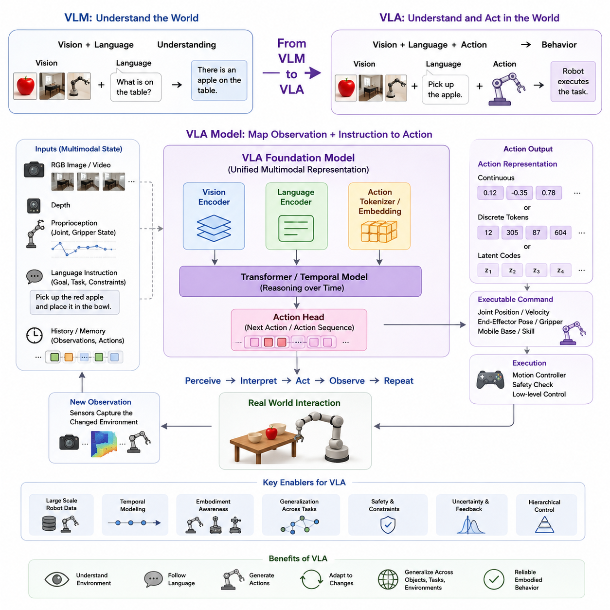{width="7.268055555555556in" height="7.268055555555556in"}

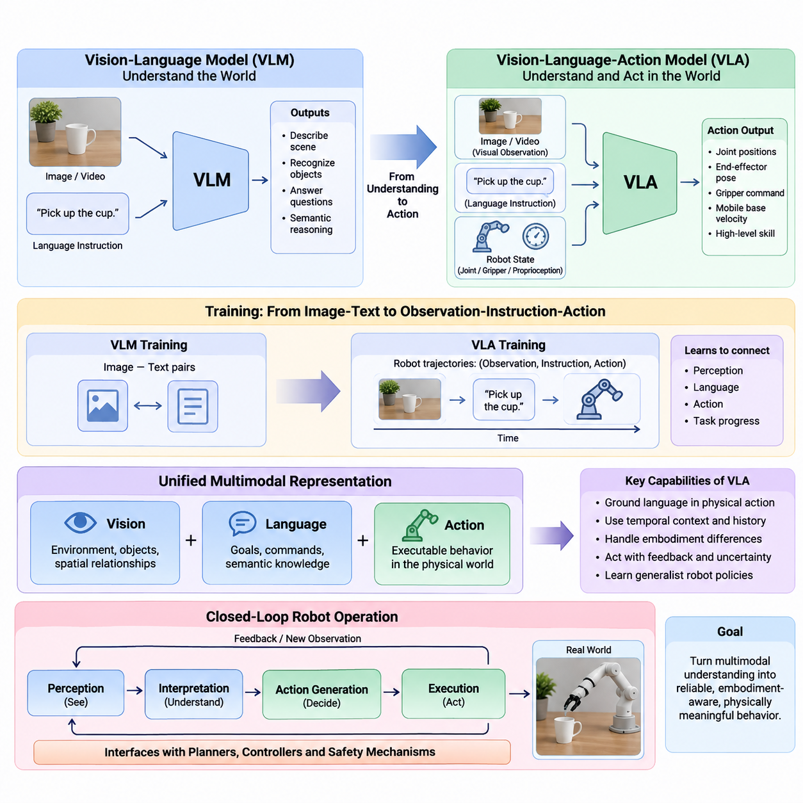{width="7.268055555555556in" height="7.268055555555556in"}

Vision-Language Models (VLMs) give robots a powerful interface between visual perception and linguistic knowledge. A VLM can interpret images, recognize objects, describe scenes, answer questions, and connect visual observations with semantic concepts expressed through language. In robotics, these capabilities allow a system to understand what exists in its environment and reason about relationships among objects, locations, people, and possible interactions.

However, understanding a physical environment is fundamentally different from acting within it. A VLM may correctly identify a cup on a table and understand an instruction such as "pick up the cup," yet this semantic understanding does not directly specify how a robot should move its arm, orient its gripper, approach the object, establish contact, or regulate force. Physical action therefore requires an additional mapping from multimodal understanding to executable robot behavior.

This limitation creates the conceptual transition from Vision-Language Models to Vision-Language-Action (VLA) models. Instead of treating perception and language understanding as the final outputs of the model, a VLA system treats them as contextual inputs for action generation. The model must learn a relationship that can be expressed conceptually as observation plus instruction leading to action, transforming semantic representations into decisions that influence the physical world.

The observation supplied to a VLA model may contain RGB images, video frames, depth information, robot joint states, gripper states, proprioceptive measurements, or other sensor signals. Language provides another conditioning channel describing goals, commands, constraints, or task context. Together, these signals establish the multimodal state from which the model predicts what the robot should do next rather than merely describing what the robot currently observes.

This change transforms the role of the multimodal model. In a conventional VLM, visual information is aligned with language so that the model can generate text, retrieve concepts, or perform semantic reasoning. In a VLA model, the learned representation must additionally preserve information relevant to physical control. Spatial relationships, object geometry, affordances, temporal state, embodiment constraints, and task progress become important because they directly influence which actions are feasible.

Action therefore becomes a third modality alongside vision and language. Robot actions may represent joint positions, joint velocities, end-effector poses, gripper commands, mobile-base velocities, navigation goals, or higher-level skills. Depending on the architecture, these actions can remain continuous numerical values or can be transformed into discrete tokens or learned latent representations. This makes action representation a central interface between foundation-model reasoning and robot control.

The transition from VLM to VLA also changes the learning objective. VLM training commonly emphasizes relationships between images and text, such as predicting language conditioned on visual inputs or aligning visual and linguistic representations. VLA training introduces robot trajectories containing observations, instructions, and corresponding actions. The model learns statistical relationships between what the robot perceives, what it is asked to accomplish, and the behavior demonstrated during successful interaction.

A useful training example can therefore be viewed as a temporally organized sequence rather than an isolated image-text pair. At time t, the robot receives an observation and maintains information about its current physical state. The instruction provides the intended goal, while recorded actions demonstrate how that state was transformed. Across many trajectories, the model learns patterns connecting perception, language, action, and the evolving consequences of previous behavior.

Temporal context becomes especially important because robotic tasks rarely consist of independent decisions. Opening a drawer, grasping an object, navigating around an obstacle, or placing an item requires sequences whose later actions depend on earlier outcomes. A VLA model may therefore process observation histories, previous actions, video sequences, or compact memory representations so that its prediction reflects not only the current image but also the progression of the task.

This temporal requirement also introduces an important distinction between semantic reasoning and control frequency. High-level understanding may determine that a robot should approach a drawer, grasp its handle, pull it outward, and retrieve an object. Low-level controllers must execute these intentions through much faster motor commands. Practical VLA systems can therefore operate within hierarchical architectures where foundation-model predictions interact with trajectory generators, motion planners, controllers, and safety mechanisms.

The VLM components remain valuable within this architecture because they contribute broad semantic knowledge acquired from large-scale visual and language data. Concepts such as object categories, spatial relationships, common activities, functional properties, and natural-language instructions can transfer into robotics. Robot action data then grounds this semantic knowledge in physical interaction, connecting concepts such as "grasp," "push," "open," or "place" with patterns of executable behavior.

This grounding is crucial because language alone does not determine how an action should be performed by a particular embodiment. Two robots may understand the same instruction while possessing different manipulators, joint limits, grippers, sensor configurations, or mobility systems. Consequently, the mapping from semantic intent to physical action must account for embodiment. VLA models therefore connect general multimodal knowledge with robot-specific or cross-embodiment representations of action.

Another important shift concerns the meaning of prediction. A VLM typically predicts semantic outputs such as words or representations, whereas a VLA model predicts variables that can change the environment. Prediction errors therefore have physical consequences. An incorrect description may produce inaccurate text, but an incorrect robot action can cause task failure, collision, unstable motion, or damage. Action generation consequently requires stronger attention to uncertainty, constraints, feedback, and runtime safety.

For this reason, VLA should not be interpreted simply as attaching a motor-command head to a VLM. The transformation requires representations that remain useful for interaction, training data that connects observations with behavior, temporal modeling that captures task evolution, and interfaces that translate model predictions into executable commands. It also requires mechanisms for handling deviations because real environments rarely evolve exactly as represented in demonstration trajectories.

Closed-loop operation provides one of the most important mechanisms for handling these deviations. After executing an action, the robot receives a new observation and can condition its next prediction on the changed environment. The effective cycle becomes perception, interpretation, action generation, execution, and renewed perception. Repeated continuously, this loop allows the robot to adjust behavior as objects move, contacts fail, people intervene, or environmental conditions differ from those encountered during training.

The emergence of VLA models therefore represents a broader transition in foundation-model robotics. Vision contributes information about the physical environment, language supplies semantic knowledge and task intent, and action connects internal representations to physical change. These modalities are no longer isolated modules but components of a unified learning problem in which the model must relate what is seen, what is requested, and what should physically happen next.

This unified perspective also supports the development of generalist robot policies. Instead of designing a separate perception pipeline and policy for every individual task, a sufficiently broad VLA model can potentially reuse shared representations across many objects, environments, instructions, and behaviors. Large and diverse robot datasets become especially important because they expose the model to variations in task semantics, visual conditions, trajectories, action spaces, and embodiments.

Yet the transition from VLM to VLA does not eliminate classical robotics. Geometric reasoning, state estimation, motion planning, feedback control, collision checking, and safety supervision can remain essential components of deployed systems. The important change is that learned multimodal models can provide a more general interface between semantic task understanding and these physical mechanisms, reducing the dependence on narrowly engineered task-specific pipelines.

The progression can therefore be understood as a movement from recognition toward interaction. A VLM answers questions such as "What is here?", "What does this instruction mean?", and "What relationships exist in this scene?" A VLA must additionally address "What should the robot do now?" and produce an action representation that can ultimately be executed. This extension turns multimodal understanding into a foundation for embodied decision making.

From this perspective, VLA models form a critical bridge between foundation models and Physical AI. They extend knowledge acquired from large-scale visual and linguistic learning into systems that perceive, reason, decide, and act within real environments. The central challenge is no longer only to construct models that understand the world, but to construct models whose understanding can be reliably transformed into temporally coherent, embodiment-aware, feedback-driven physical behavior.

비전-언어 모델(Vision-Language Model, VLM)은 로봇에게 시각적 인식(visual perception)과 언어적 지식(linguistic knowledge)을 연결하는 강력한 인터페이스를 제공한다. VLM은 이미지를 해석하고, 객체를 인식하며, 장면을 설명하고, 질문에 답하며, 시각적 관찰을 언어로 표현된 의미적 개념(semantic concept)과 연결할 수 있다. 로보틱스(robotics)에서 이러한 능력은 시스템이 환경에 무엇이 존재하는지 이해하고 객체, 위치, 사람, 가능한 상호작용 사이의 관계를 추론할 수 있도록 한다.

그러나 물리적 환경(physical environment)을 이해하는 것과 그 환경 안에서 실제로 행동하는 것은 근본적으로 다른 문제이다. VLM은 테이블 위의 컵을 정확하게 식별하고 "컵을 집어라"라는 명령을 이해할 수 있지만, 이러한 의미적 이해(semantic understanding)만으로 로봇 팔을 어떻게 움직이고, 그리퍼(gripper)의 방향을 어떻게 조정하며, 객체에 어떻게 접근하고, 접촉을 형성하며, 힘을 어떻게 제어해야 하는지를 직접 결정할 수는 없다. 따라서 물리적 행동(physical action)을 위해서는 멀티모달 이해(multimodal understanding)를 실행 가능한 로봇 행동으로 변환하는 추가적인 매핑(mapping)이 필요하다.

이러한 한계는 비전-언어 모델(Vision-Language Model, VLM)에서 비전-언어-행동 모델(Vision-Language-Action Model, VLA)로 전환되는 개념적 배경을 형성한다. VLA 시스템은 지각(perception)과 언어 이해(language understanding)를 모델의 최종 출력으로 간주하지 않고 행동 생성(action generation)을 위한 문맥적 입력(contextual input)으로 사용한다. 즉, 모델은 관찰(observation)과 명령(instruction)을 행동(action)으로 연결하는 관계를 학습하여 의미적 표현(semantic representation)을 물리적 세계에 영향을 미치는 의사결정으로 변환해야 한다.

VLA 모델에 제공되는 관찰(observation)은 RGB 이미지, 비디오 프레임(video frame), 깊이 정보(depth information), 로봇 관절 상태(robot joint state), 그리퍼 상태(gripper state), 고유수용성 측정(proprioceptive measurement), 기타 센서 신호(sensor signal)를 포함할 수 있다. 언어(language)는 목표, 명령, 제약 조건, 작업 문맥(task context)을 설명하는 또 다른 조건화 채널(conditioning channel)을 제공한다. 이러한 신호들은 함께 멀티모달 상태(multimodal state)를 구성하며, 모델은 현재 관찰 내용을 단순히 설명하는 것이 아니라 로봇이 다음에 무엇을 해야 하는지를 예측한다.

이러한 변화는 멀티모달 모델(multimodal model)의 역할 자체를 변화시킨다. 기존 VLM에서는 시각 정보와 언어를 정렬(alignment)하여 텍스트를 생성하거나 개념을 검색하고 의미적 추론(semantic reasoning)을 수행한다. 반면 VLA 모델에서는 학습된 표현(learned representation)이 물리적 제어(physical control)에 필요한 정보까지 유지해야 한다. 공간적 관계(spatial relationship), 객체 기하(object geometry), 행동유도성(affordance), 시간적 상태(temporal state), 체화 제약(embodiment constraint), 작업 진행 상태(task progress)가 실행 가능한 행동을 결정하는 핵심 정보가 된다.

따라서 행동(action)은 비전(vision)과 언어(language)에 이어 세 번째 모달리티(modality)가 된다. 로봇 행동은 관절 위치(joint position), 관절 속도(joint velocity), 말단장치 자세(end-effector pose), 그리퍼 명령(gripper command), 모바일 베이스 속도(mobile-base velocity), 내비게이션 목표(navigation goal), 또는 상위 수준 스킬(high-level skill)을 나타낼 수 있다. 아키텍처(architecture)에 따라 이러한 행동은 연속적인 수치값(continuous numerical value)으로 유지되거나 이산 토큰(discrete token) 또는 학습된 잠재 표현(learned latent representation)으로 변환될 수 있다. 이에 따라 행동 표현(action representation)은 파운데이션 모델 추론(foundation-model reasoning)과 로봇 제어(robot control)를 연결하는 핵심 인터페이스가 된다.

VLM에서 VLA로의 전환은 학습 목표(learning objective)도 변화시킨다. VLM 학습은 일반적으로 시각 입력을 조건으로 언어를 예측하거나 시각 표현과 언어 표현을 정렬하는 등 이미지와 텍스트 사이의 관계를 중심으로 한다. VLA 학습에는 관찰, 명령, 이에 대응하는 행동을 포함하는 로봇 궤적(robot trajectory)이 추가된다. 모델은 로봇이 무엇을 지각하고, 무엇을 수행하도록 요구받으며, 성공적인 상호작용 과정에서 어떠한 행동이 수행되었는지 사이의 통계적 관계(statistical relationship)를 학습한다.

따라서 하나의 유용한 학습 사례(training example)는 고립된 이미지-텍스트 쌍(image-text pair)이 아니라 시간적으로 구성된 시퀀스(temporally organized sequence)로 볼 수 있다. 시간 t에서 로봇은 관찰을 입력받고 현재의 물리적 상태에 관한 정보를 유지한다. 명령은 의도된 목표를 제공하며, 기록된 행동은 해당 상태가 어떻게 변화되었는지를 보여준다. 모델은 많은 궤적을 학습하면서 지각(perception), 언어(language), 행동(action), 그리고 이전 행동에 따른 결과의 변화 사이에 존재하는 패턴을 학습한다.

시간적 문맥(temporal context)은 로봇 작업이 독립적인 의사결정의 집합으로 이루어지는 경우가 드물기 때문에 특히 중요하다. 서랍을 열고, 객체를 잡고, 장애물을 피해 이동하거나, 물체를 특정 위치에 놓는 작업에서는 이후의 행동이 이전 행동의 결과에 의존한다. 따라서 VLA 모델은 관찰 이력(observation history), 이전 행동(previous action), 비디오 시퀀스(video sequence), 또는 압축된 메모리 표현(memory representation)을 처리하여 현재 이미지뿐만 아니라 전체 작업의 진행 과정까지 반영한 행동을 예측할 수 있다.

이러한 시간적 요구사항은 의미적 추론(semantic reasoning)과 제어 주파수(control frequency)의 중요한 차이도 만들어낸다. 상위 수준의 이해는 로봇이 서랍에 접근하고, 손잡이를 잡고, 바깥쪽으로 당긴 다음, 내부의 객체를 꺼내야 한다고 결정할 수 있다. 반면 저수준 제어기(low-level controller)는 이러한 의도를 훨씬 빠른 모터 명령으로 실행해야 한다. 따라서 실제 VLA 시스템은 파운데이션 모델의 예측이 궤적 생성기(trajectory generator), 모션 플래너(motion planner), 제어기(controller), 안전 메커니즘(safety mechanism)과 상호작용하는 계층적 아키텍처(hierarchical architecture)로 구성될 수 있다.

VLM 구성요소는 대규모 시각 및 언어 데이터로부터 획득한 광범위한 의미적 지식(semantic knowledge)을 제공하기 때문에 이러한 아키텍처에서도 여전히 중요하다. 객체 범주(object category), 공간적 관계, 일반적인 활동, 기능적 속성(functional property), 자연어 명령(natural-language instruction)과 같은 개념을 로보틱스로 전이할 수 있다. 이후 로봇 행동 데이터(robot action data)는 이러한 의미적 지식을 물리적 상호작용에 그라운딩(grounding)하여 "잡기(grasp)", "밀기(push)", "열기(open)", "놓기(place)"와 같은 개념을 실행 가능한 행동 패턴과 연결한다.

이러한 그라운딩(grounding)은 언어만으로 특정 체화체(embodiment)가 행동을 어떻게 수행해야 하는지를 결정할 수 없기 때문에 매우 중요하다. 두 로봇이 동일한 명령을 이해하더라도 서로 다른 매니퓰레이터(manipulator), 관절 제한(joint limit), 그리퍼, 센서 구성(sensor configuration), 이동 시스템(mobility system)을 가질 수 있다. 따라서 의미적 의도(semantic intent)를 물리적 행동으로 변환하는 과정에서는 체화 특성을 고려해야 한다. VLA 모델은 일반적인 멀티모달 지식과 로봇별(robot-specific) 또는 교차 체화(cross-embodiment) 행동 표현을 연결한다.

또 다른 중요한 변화는 예측(prediction)의 의미와 관련된다. VLM은 일반적으로 단어나 표현과 같은 의미적 출력을 예측하지만, VLA 모델은 실제 환경을 변화시킬 수 있는 변수를 예측한다. 따라서 예측 오류(prediction error)는 물리적인 결과를 발생시킨다. 잘못된 설명은 부정확한 텍스트를 생성하는 데 그칠 수 있지만, 잘못된 로봇 행동은 작업 실패, 충돌, 불안정한 움직임, 또는 손상을 초래할 수 있다. 그러므로 행동 생성에서는 불확실성(uncertainty), 제약 조건(constraint), 피드백(feedback), 런타임 안전(runtime safety)을 더욱 중요하게 고려해야 한다.

이러한 이유로 VLA를 단순히 VLM에 모터 명령 헤드(motor-command head)를 추가한 구조로 이해해서는 안 된다. VLM에서 VLA로의 전환에는 물리적 상호작용에 유용한 표현, 관찰과 행동을 연결하는 학습 데이터, 작업의 시간적 변화를 포착하는 시간 모델링(temporal modeling), 모델의 예측을 실행 가능한 명령으로 변환하는 인터페이스가 필요하다. 또한 실제 환경은 시연 궤적(demonstration trajectory)과 정확히 동일하게 변화하지 않기 때문에 예상에서 벗어난 상황을 처리하는 메커니즘도 필요하다.

폐루프 동작(closed-loop operation)은 이러한 차이를 처리하는 가장 중요한 메커니즘 가운데 하나이다. 로봇은 행동을 실행한 이후 새로운 관찰을 획득하고 변화된 환경을 조건으로 다음 행동을 다시 예측할 수 있다. 따라서 실질적인 순환 과정은 지각(perception), 해석(interpretation), 행동 생성(action generation), 실행(execution), 그리고 새로운 지각으로 이어진다. 이 과정이 지속적으로 반복되면 객체가 움직이거나, 접촉이 실패하거나, 사람이 개입하거나, 환경 조건이 학습 데이터와 달라지는 경우에도 로봇이 행동을 조정할 수 있다.

따라서 VLA 모델의 등장은 파운데이션 모델 로보틱스(foundation-model robotics)의 보다 광범위한 전환을 의미한다. 비전은 물리적 환경에 대한 정보를 제공하고, 언어는 의미적 지식과 작업 의도(task intent)를 제공하며, 행동은 내부 표현을 실제 물리적 변화와 연결한다. 이 세 가지 모달리티는 더 이상 독립된 모듈이 아니라 무엇을 보고 있는지, 무엇을 요청받았는지, 그리고 다음에 물리적으로 무엇이 일어나야 하는지를 서로 연결해야 하는 통합 학습 문제(unified learning problem)의 구성요소가 된다.

이러한 통합적 관점은 범용 로봇 정책(generalist robot policy)의 발전도 지원한다. 개별 작업마다 별도의 지각 파이프라인(perception pipeline)과 정책(policy)을 설계하는 대신, 충분히 광범위하게 학습된 VLA 모델은 다양한 객체, 환경, 명령, 행동에 걸쳐 공유 표현(shared representation)을 재사용할 가능성을 제공한다. 대규모의 다양한 로봇 데이터셋(robot dataset)은 모델을 작업 의미, 시각 조건, 궤적, 행동 공간(action space), 체화 형태의 다양한 변형에 노출시킨다는 점에서 특히 중요하다.

그러나 VLM에서 VLA로의 전환이 고전적 로보틱스(classical robotics)를 제거한다는 의미는 아니다. 기하학적 추론(geometric reasoning), 상태 추정(state estimation), 모션 플래닝(motion planning), 피드백 제어(feedback control), 충돌 검사(collision checking), 안전 감독(safety supervision)은 실제 시스템에서 여전히 핵심 구성요소가 될 수 있다. 중요한 변화는 학습된 멀티모달 모델이 의미적 작업 이해와 이러한 물리적 메커니즘 사이에 보다 범용적인 인터페이스를 제공함으로써 좁은 범위의 작업별 엔지니어링 파이프라인에 대한 의존성을 줄일 수 있다는 점이다.

따라서 이러한 발전 과정은 인식(recognition)에서 상호작용(interaction)으로의 이동으로 이해할 수 있다. VLM은 "여기에 무엇이 있는가?", "이 명령은 무엇을 의미하는가?", "이 장면에는 어떠한 관계가 존재하는가?"와 같은 질문에 답한다. 반면 VLA는 여기에 더해 "로봇은 지금 무엇을 해야 하는가?"라는 질문을 해결하고 궁극적으로 실행 가능한 행동 표현을 생성해야 한다. 이러한 확장을 통해 멀티모달 이해는 체화된 의사결정(embodied decision making)의 기반으로 발전한다.

이러한 관점에서 VLA 모델은 파운데이션 모델(foundation model)과 피지컬 AI(Physical AI)를 연결하는 핵심적인 가교 역할을 한다. VLA는 대규모 시각 및 언어 학습에서 획득한 지식을 실제 환경을 지각하고, 추론하고, 의사결정하고, 행동하는 시스템으로 확장한다. 핵심 과제는 더 이상 세계를 이해하는 모델만을 만드는 것이 아니라, 그 이해를 시간적으로 일관되고(temporally coherent), 체화 특성을 고려하며(embodiment-aware), 피드백에 기반한(feedback-driven) 신뢰성 있는 물리적 행동으로 변환할 수 있는 모델을 구축하는 것이다.

## 04.02. What is a Vision Language Action Model

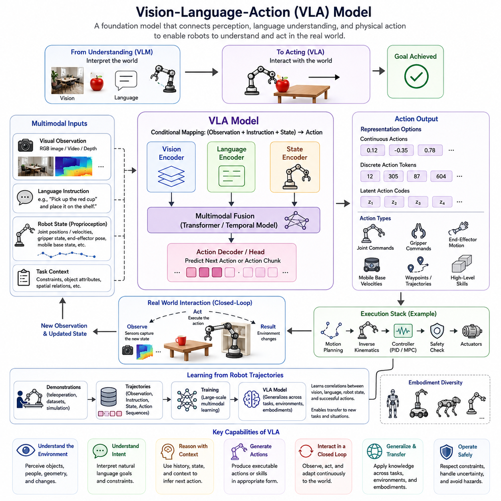{width="7.268055555555556in" height="7.268055555555556in"}

A Vision-Language-Action model, or VLA, is a multimodal foundation model designed to connect perception, language understanding, and physical action within a unified learning framework. Unlike a Vision-Language Model that primarily interprets visual information and produces semantic or linguistic outputs, a VLA model generates actions that can be executed by a robot. It therefore extends multimodal intelligence from understanding the world toward actively interacting with it.

The fundamental function of a VLA model can be expressed as a conditional mapping from observations and instructions to actions. The observation describes the robot and its surrounding environment, while the language instruction specifies a goal, task, or constraint. Given this context, the model predicts an appropriate action or sequence of actions. In this sense, a VLA operates as a learned robot policy conditioned on multimodal information rather than as a purely descriptive perception model.

Visual observations may include RGB images, video frames, depth maps, or representations produced by other perception systems. These inputs provide information about objects, people, obstacles, geometry, spatial relationships, and changes in the environment. A vision encoder transforms the raw observations into representations that can be combined with language and robot-state information, allowing the model to reason about both semantic meaning and physically relevant properties of the scene.

Language provides the VLA with a flexible mechanism for specifying intent. Instructions such as "pick up the red cup," "move the box to the shelf," or "navigate to the charging station" describe desired outcomes without requiring a separately programmed interface for every task. Language representations can also encode constraints, object attributes, spatial relationships, and task context, making natural language an important mechanism for conditioning general-purpose robot behavior.

Robot state adds information that cannot always be inferred from vision alone. Joint positions, joint velocities, gripper states, end-effector poses, mobile-base states, and proprioceptive measurements describe the current configuration of the physical system. Combining this information with visual observations enables the VLA to distinguish between what exists in the environment and what the robot is physically capable of doing from its present configuration.

The action output distinguishes a VLA from a conventional VLM. Depending on the robot and model architecture, actions can correspond to joint commands, Cartesian end-effector motions, gripper commands, mobile-base velocities, waypoints, trajectories, or higher-level skills. These outputs may be represented as continuous values, discretized action tokens, learned latent codes, or structured combinations of several representations, creating different interfaces between foundation models and robot controllers.

A VLA model is typically learned from robot trajectories that associate observations and task descriptions with demonstrated actions. A trajectory contains a temporal sequence showing how an agent changes its behavior as the environment evolves. Through training on many such examples, the model learns correlations between visual situations, linguistic intentions, robot configurations, and successful behaviors rather than relying entirely on manually specified rules for individual tasks.

This learning process makes temporal information fundamental to VLA behavior. The correct action often depends not only on the current observation but also on what happened previously. A robot placing an object must know whether it has already approached, grasped, lifted, or transported that object. Observation history, previous actions, memory, or temporally encoded representations can therefore provide context for determining both task progress and the next appropriate action.

VLA models can generate either individual actions or action chunks containing multiple future commands. Single-step prediction allows frequent feedback from the environment but may require repeated model inference. Action chunks can reduce inference frequency and represent temporally coherent motion over longer intervals. The appropriate approach depends on task dynamics, model latency, control requirements, and how rapidly the robot must respond to unexpected environmental changes.

Another defining characteristic of VLA models is physical grounding. Concepts learned from images and language acquire operational meaning when associated with robot interaction. The concept of "grasping," for example, becomes connected with approaching an object, positioning an end effector, closing a gripper, and producing an observable state transition. VLA training therefore links semantic knowledge with patterns of physical behavior and their consequences in the environment.

This grounding must also reflect embodiment. The same semantic instruction may require very different actions from a humanoid robot, mobile manipulator, quadruped, or industrial arm. Their kinematics, sensors, actuators, workspaces, and action spaces are different even when their task objectives are similar. VLA systems must consequently distinguish transferable semantic knowledge from embodiment-specific mechanisms required to execute that knowledge through a particular physical platform.

Large-scale VLA training aims to exploit common structure across many tasks rather than learning every behavior independently. Manipulation tasks may share concepts such as reaching, grasping, moving, and placing, while navigation tasks share concepts involving destinations, obstacles, traversability, and spatial goals. By learning these regularities across diverse datasets, a VLA can serve as the foundation of a generalist robot policy capable of transferring knowledge between related situations.

Pretrained vision and language representations are especially valuable because robot interaction data is much more expensive to collect than internet-scale image and text data. A VLA can inherit semantic and perceptual capabilities from multimodal foundation models and subsequently ground those representations using robot trajectories. This approach allows broad visual-language knowledge to complement the smaller but physically meaningful datasets obtained from teleoperation, demonstrations, autonomous operation, or simulation.

Despite their end-to-end learning capability, VLA models do not necessarily replace conventional robotic components. A VLA may generate a target pose or action sequence while motion planning, inverse kinematics, feedback controllers, and collision avoidance handle execution. Alternatively, a model may predict lower-level commands more directly. The boundary between learned policy and classical control therefore depends on the required precision, safety, latency, hardware platform, and available training data.

Closed-loop feedback is particularly important because physical environments are uncertain and dynamically changing. After executing an action, the robot can acquire another observation, reassess its state, and generate a revised action. This repeated observation-action cycle enables correction when an object moves, a grasp fails, an obstacle appears, or execution differs from prediction. A practical VLA should therefore be understood as part of a continuously interacting control loop rather than a one-time command generator.

Safety introduces requirements that are less prominent in ordinary language or vision generation. Because VLA outputs can directly influence actuators, incorrect predictions may create collisions, unstable motion, excessive force, or unsafe interactions with people. Deployment architectures can therefore combine VLA predictions with constraint checking, safety controllers, uncertainty estimation, runtime monitoring, and fallback behaviors that prevent unrestricted model outputs from directly producing hazardous physical actions.

The concept of a VLA ultimately represents a shift in the role of multimodal foundation models. Vision answers what the robot perceives, language communicates what should be accomplished, robot state describes the agent's physical condition, and action determines how the environment should be changed. A VLA learns relationships among these elements so that semantic understanding can be converted into goal-directed physical behavior while continuously responding to the consequences of previous actions.

For Physical AI, this makes VLA models an important candidate architecture for general-purpose embodied intelligence. Their long-term objective is not merely to recognize more objects or understand more instructions, but to reuse knowledge across tasks, environments, and potentially different embodiments while producing reliable actions. In this framework, intelligence becomes grounded in a continuous cycle of seeing, understanding, deciding, acting, observing the result, and adapting future behavior accordingly.

비전-언어-행동 모델(Vision-Language-Action Model, VLA)은 지각(perception), 언어 이해(language understanding), 물리적 행동(physical action)을 하나의 통합 학습 프레임워크(unified learning framework) 안에서 연결하도록 설계된 멀티모달 파운데이션 모델(multimodal foundation model)이다. 주로 시각 정보를 해석하고 의미적 또는 언어적 출력을 생성하는 비전-언어 모델(Vision-Language Model, VLM)과 달리, VLA 모델은 로봇이 실제로 실행할 수 있는 행동을 생성한다. 따라서 멀티모달 지능(multimodal intelligence)을 세계를 이해하는 단계에서 세계와 능동적으로 상호작용하는 단계로 확장한다.

VLA 모델의 기본적인 기능은 관찰(observation)과 명령(instruction)을 조건으로 행동(action)을 생성하는 조건부 매핑(conditional mapping)으로 표현할 수 있다. 관찰은 로봇과 주변 환경의 상태를 설명하고, 언어 명령은 목표, 작업 또는 제약 조건을 지정한다. 이러한 문맥(context)이 주어지면 모델은 적절한 행동 또는 행동 시퀀스(action sequence)를 예측한다. 이러한 의미에서 VLA는 단순한 설명형 지각 모델이 아니라 멀티모달 정보를 조건으로 동작하는 학습된 로봇 정책(learned robot policy)이라고 할 수 있다.

시각적 관찰(visual observation)은 RGB 이미지, 비디오 프레임(video frame), 깊이 맵(depth map), 또는 다른 지각 시스템(perception system)이 생성한 표현을 포함할 수 있다. 이러한 입력은 객체, 사람, 장애물, 기하 구조(geometry), 공간적 관계(spatial relationship), 환경 변화에 관한 정보를 제공한다. 비전 인코더(vision encoder)는 원시 관찰 데이터를 언어 및 로봇 상태 정보와 결합할 수 있는 표현으로 변환하여 모델이 장면의 의미적 의미와 물리적으로 중요한 특성을 함께 추론할 수 있도록 한다.

언어(language)는 VLA에 의도(intent)를 지정하기 위한 유연한 메커니즘을 제공한다. "빨간 컵을 집어라", "상자를 선반으로 옮겨라", "충전 스테이션으로 이동하라"와 같은 명령은 각각의 작업을 위한 별도의 프로그래밍 인터페이스 없이도 원하는 결과를 표현할 수 있다. 언어 표현(language representation)은 제약 조건, 객체 속성, 공간적 관계, 작업 문맥(task context)도 인코딩할 수 있으므로 자연어(natural language)는 범용 로봇 행동을 조건화하는 중요한 수단이 된다.

로봇 상태(robot state)는 시각 정보만으로 항상 추론할 수 없는 정보를 추가한다. 관절 위치(joint position), 관절 속도(joint velocity), 그리퍼 상태(gripper state), 말단장치 자세(end-effector pose), 모바일 베이스 상태(mobile-base state), 고유수용성 측정(proprioceptive measurement)은 물리적 시스템의 현재 구성을 설명한다. 이 정보를 시각적 관찰과 결합하면 VLA는 환경에 무엇이 존재하는지뿐만 아니라 현재 구성에서 로봇이 물리적으로 무엇을 수행할 수 있는지도 구분할 수 있다.

행동 출력(action output)은 VLA와 기존 VLM을 구별하는 핵심 요소이다. 로봇과 모델 아키텍처(model architecture)에 따라 행동은 관절 명령(joint command), 카테시안 말단장치 움직임(Cartesian end-effector motion), 그리퍼 명령(gripper command), 모바일 베이스 속도(mobile-base velocity), 웨이포인트(waypoint), 궤적(trajectory), 또는 상위 수준 스킬(high-level skill)에 대응할 수 있다. 이러한 출력은 연속값(continuous value), 이산화된 행동 토큰(discretized action token), 학습된 잠재 코드(learned latent code), 또는 여러 표현을 결합한 구조로 표현될 수 있으며, 파운데이션 모델과 로봇 제어기 사이의 다양한 인터페이스를 구성한다.

VLA 모델은 일반적으로 관찰 및 작업 설명과 시연된 행동을 연결하는 로봇 궤적(robot trajectory)으로부터 학습된다. 하나의 궤적은 환경이 변화함에 따라 에이전트(agent)의 행동이 어떻게 변화하는지를 보여주는 시간적 시퀀스(temporal sequence)를 포함한다. 모델은 이러한 많은 사례를 학습하면서 개별 작업마다 사람이 규칙을 모두 명시하는 대신 시각적 상황, 언어적 의도, 로봇 구성, 성공적인 행동 사이의 상관관계를 학습한다.

이러한 학습 과정에서는 시간적 정보(temporal information)가 VLA 행동의 핵심 요소가 된다. 올바른 행동은 현재 관찰뿐만 아니라 이전에 어떤 일이 발생했는지에 따라 달라지는 경우가 많다. 객체를 배치하는 로봇은 이미 객체에 접근했는지, 잡았는지, 들어 올렸는지, 이동시켰는지를 알아야 한다. 따라서 관찰 이력(observation history), 이전 행동(previous action), 메모리(memory), 시간적으로 인코딩된 표현(temporally encoded representation)은 작업 진행 상태와 다음에 수행할 적절한 행동을 판단하는 문맥을 제공할 수 있다.

VLA 모델은 개별 행동을 생성하거나 여러 미래 명령으로 구성된 행동 청크(action chunk)를 생성할 수 있다. 단일 단계 예측(single-step prediction)은 환경으로부터 빈번한 피드백을 받을 수 있지만 반복적인 모델 추론(model inference)이 필요할 수 있다. 행동 청크는 추론 빈도를 낮추면서 더 긴 시간 구간의 일관된 움직임을 표현할 수 있다. 적절한 방식은 작업의 동역학(task dynamics), 모델 지연시간(model latency), 제어 요구사항, 예상하지 못한 환경 변화에 얼마나 빠르게 대응해야 하는지에 따라 달라진다.

VLA 모델을 정의하는 또 다른 중요한 특성은 물리적 그라운딩(physical grounding)이다. 이미지와 언어에서 학습된 개념은 로봇의 상호작용과 연결될 때 실제 동작상의 의미를 갖게 된다. 예를 들어 "잡기(grasping)"라는 개념은 객체에 접근하고, 말단장치를 위치시키고, 그리퍼를 닫고, 관찰 가능한 상태 변화를 발생시키는 행동과 연결된다. 따라서 VLA 학습은 의미적 지식(semantic knowledge)을 물리적 행동 패턴 및 환경에서 발생하는 결과와 연결한다.

이러한 그라운딩은 체화(embodiment)의 특성도 반영해야 한다. 동일한 의미의 명령이라도 휴머노이드 로봇(humanoid robot), 모바일 매니퓰레이터(mobile manipulator), 4족 로봇(quadruped), 산업용 로봇 팔(industrial arm)이 수행해야 하는 행동은 크게 다를 수 있다. 작업 목표가 유사하더라도 운동학(kinematics), 센서, 액추에이터(actuator), 작업 공간(workspace), 행동 공간(action space)이 서로 다르기 때문이다. 따라서 VLA 시스템은 전이 가능한 의미적 지식과 특정 물리적 플랫폼을 통해 이를 실행하는 데 필요한 체화 특화 메커니즘(embodiment-specific mechanism)을 구분해야 한다.

대규모 VLA 학습(large-scale VLA training)은 각각의 행동을 독립적으로 학습하는 대신 다양한 작업에서 공통적으로 나타나는 구조를 활용하는 것을 목표로 한다. 조작 작업(manipulation task)은 접근하기, 잡기, 이동하기, 놓기와 같은 공통 개념을 공유하며, 내비게이션 작업(navigation task)은 목적지, 장애물, 주행 가능성(traversability), 공간적 목표와 관련된 개념을 공유한다. VLA는 다양한 데이터셋에서 이러한 규칙성을 학습함으로써 서로 관련된 상황 사이에서 지식을 전이할 수 있는 범용 로봇 정책(generalist robot policy)의 기반이 될 수 있다.

사전학습된 비전 및 언어 표현(pretrained vision and language representation)은 로봇 상호작용 데이터가 인터넷 규모의 이미지 및 텍스트 데이터보다 훨씬 비싸게 수집되기 때문에 특히 중요하다. VLA는 멀티모달 파운데이션 모델에서 의미적 및 지각적 능력을 계승한 후 로봇 궤적을 이용해 이러한 표현을 물리적 행동에 그라운딩할 수 있다. 이를 통해 광범위한 시각-언어 지식이 원격조작(teleoperation), 시연(demonstration), 자율 동작(autonomous operation), 시뮬레이션(simulation)에서 얻은 상대적으로 작지만 물리적으로 의미 있는 데이터셋을 보완할 수 있다.

VLA 모델이 종단간 학습(end-to-end learning) 능력을 갖추고 있더라도 기존 로봇 구성요소를 반드시 대체하는 것은 아니다. VLA가 목표 자세(target pose)나 행동 시퀀스를 생성하고 모션 플래닝(motion planning), 역기구학(inverse kinematics), 피드백 제어기(feedback controller), 충돌 회피(collision avoidance)가 실제 실행을 담당할 수 있다. 반대로 모델이 보다 직접적으로 저수준 명령(low-level command)을 예측할 수도 있다. 따라서 학습된 정책과 고전적 제어(classical control) 사이의 경계는 필요한 정밀도, 안전성, 지연시간, 하드웨어 플랫폼, 이용 가능한 학습 데이터에 따라 달라진다.

폐루프 피드백(closed-loop feedback)은 물리적 환경이 불확실하고 동적으로 변화하기 때문에 특히 중요하다. 행동을 실행한 후 로봇은 새로운 관찰을 획득하고 자신의 상태를 다시 평가하여 수정된 행동을 생성할 수 있다. 이러한 반복적인 관찰-행동 순환(observation-action cycle)을 통해 객체가 움직이거나, 파지가 실패하거나, 새로운 장애물이 나타나거나, 실제 실행 결과가 예측과 다른 경우에도 행동을 수정할 수 있다. 따라서 실제 VLA는 일회성 명령 생성기가 아니라 지속적으로 환경과 상호작용하는 제어 루프(control loop)의 일부로 이해해야 한다.

안전성(safety)은 일반적인 언어 또는 이미지 생성에서는 상대적으로 덜 강조되는 추가적인 요구사항을 제시한다. VLA 출력은 액추에이터에 직접 영향을 줄 수 있기 때문에 잘못된 예측은 충돌, 불안정한 움직임, 과도한 힘, 사람과의 위험한 상호작용을 발생시킬 수 있다. 따라서 실제 배포 아키텍처(deployment architecture)는 VLA 예측과 제약 조건 검사(constraint checking), 안전 제어기(safety controller), 불확실성 추정(uncertainty estimation), 런타임 모니터링(runtime monitoring), 폴백 행동(fallback behavior)을 결합하여 제한되지 않은 모델 출력이 직접 위험한 물리적 행동으로 이어지는 것을 방지할 수 있다.

VLA라는 개념은 궁극적으로 멀티모달 파운데이션 모델의 역할이 변화하고 있음을 나타낸다. 비전(vision)은 로봇이 무엇을 지각하는지를 제공하고, 언어(language)는 무엇을 달성해야 하는지를 전달하며, 로봇 상태는 에이전트의 물리적 조건을 설명하고, 행동(action)은 환경을 어떻게 변화시킬지를 결정한다. VLA는 이러한 요소 사이의 관계를 학습하여 의미적 이해를 목표 지향적 물리 행동(goal-directed physical behavior)으로 변환하고 이전 행동의 결과에 지속적으로 대응할 수 있도록 한다.

피지컬 AI(Physical AI)의 관점에서 VLA 모델은 범용 체화 지능(general-purpose embodied intelligence)을 위한 중요한 후보 아키텍처이다. 장기적인 목표는 단순히 더 많은 객체를 인식하거나 더 많은 명령을 이해하는 것이 아니라 다양한 작업, 환경, 잠재적으로 서로 다른 체화체 사이에서 지식을 재사용하면서 신뢰성 있는 행동을 생성하는 것이다. 이러한 프레임워크에서 지능은 보고(seeing), 이해하고(understanding), 결정하고(deciding), 행동하고(acting), 결과를 관찰하며(observing), 이후의 행동을 적응시키는(adapting) 지속적인 순환 과정 속에서 물리적 세계에 그라운딩된다.

## 04.03. Vision Language Action Architecture

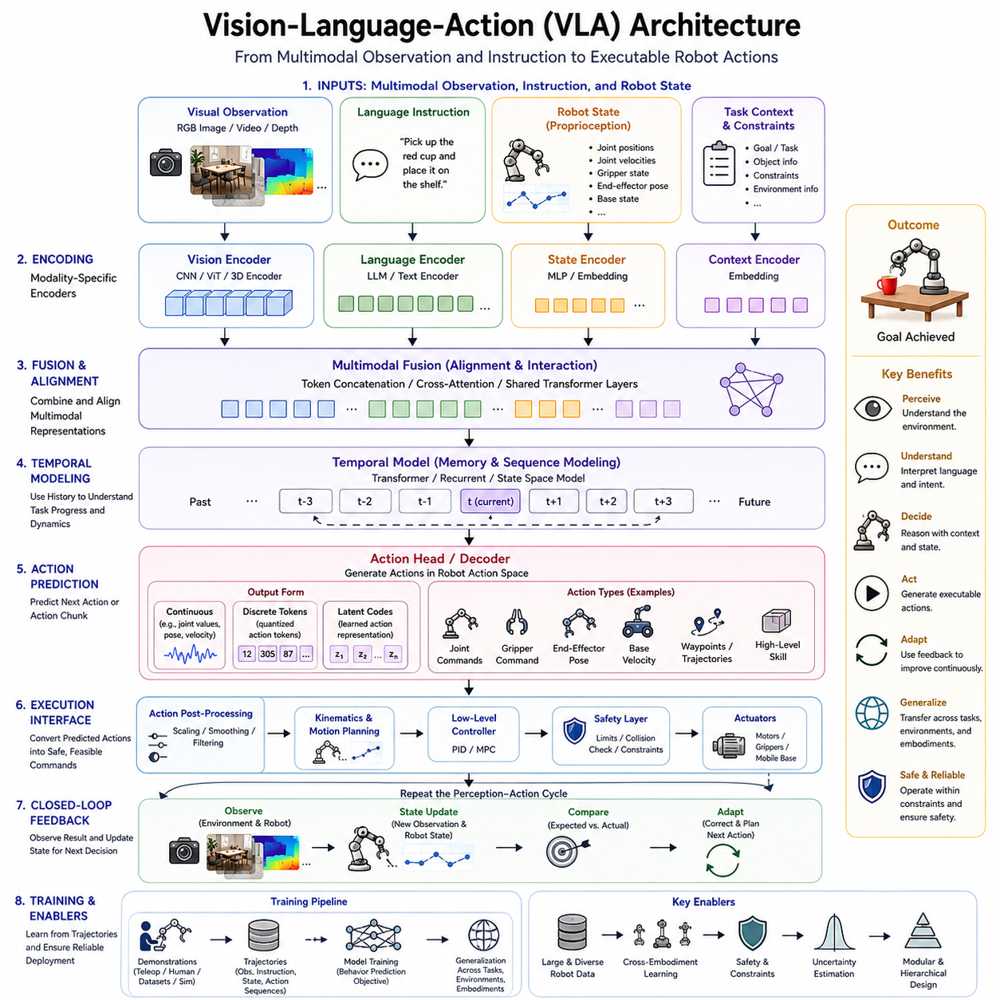{width="7.268055555555556in" height="7.268055555555556in"}

A Vision-Language-Action architecture transforms heterogeneous sensory, linguistic, and robot-state information into executable physical actions. Its core structure can be understood as a pipeline connecting multimodal observation encoding, representation alignment, temporal fusion, action prediction, and robot execution. Unlike a conventional VLM architecture, the output pathway must represent behavior that can directly or indirectly control a physical system.

The input layer begins with visual observations that describe the external environment. RGB images, video frames, depth measurements, or other spatial representations can provide information about objects, geometry, people, obstacles, and scene changes. A vision encoder converts these high-dimensional observations into compact visual features or tokens that preserve semantic and spatial information relevant to subsequent reasoning and action generation.

Language forms another major input pathway. A language encoder or pretrained language-model backbone transforms natural-language instructions into semantic representations describing goals, constraints, objects, and relationships. Commands such as "pick up the red cup and place it on the shelf" provide task-level intent, while the visual stream determines where relevant entities are located and how the current physical situation relates to the requested objective.

Robot-state information provides the architecture with an internal description of the embodiment. Joint positions, velocities, gripper states, end-effector poses, mobile-base states, and proprioceptive signals can be encoded into state representations. These features allow the model to reason not only about the external scene but also about the robot\'s current configuration, which strongly influences which actions are physically feasible at a particular moment.

The encoded modalities must then be combined into a shared representation. Multimodal fusion may occur through token concatenation, cross-attention, shared Transformer layers, projection modules, or related mechanisms. The objective is to establish relationships among visual entities, linguistic concepts, robot state, and task context so that the model can determine which parts of an observation are relevant to the instruction and how they should influence subsequent behavior.

Attention mechanisms are especially useful within this fusion stage because different tasks require different information. When instructed to grasp a red cup, the model should emphasize the visual features corresponding to the cup, the linguistic representation of the requested operation, and the robot state relevant to reaching and grasping. Attention therefore provides a mechanism for dynamically selecting relationships among multimodal features instead of treating every input component as equally important.

A practical VLA architecture also requires temporal modeling because robotic behavior unfolds over sequences rather than isolated observations. Previous images, actions, robot states, or compact memory tokens can be incorporated into the model\'s context. A Transformer or another temporal architecture can use this history to infer task progress, recognize the consequences of previous actions, and distinguish between visually similar situations that require different actions because they occur at different stages of a task.

The multimodal representation is passed to an action prediction component, often described as an action head or action decoder. This module converts the internal representation into a form compatible with the robot\'s action space. The action head may predict joint commands, end-effector displacement, gripper state, mobile-base velocity, waypoints, trajectories, skills, or combinations of these variables depending on the embodiment and the abstraction level selected by the architecture.

Action representation significantly influences the design of the decoder. Continuous architectures can directly predict numerical control variables such as position, velocity, or pose. Discrete architectures quantize actions into tokens that can be generated similarly to language tokens. Other systems use learned latent action codes that compress complex behavior into a lower-dimensional representation. Each approach changes how action distributions are modeled and how outputs are translated into robot commands.

Autoregressive architectures provide one possible mechanism for action generation. In this formulation, actions or action tokens are predicted sequentially, with previously generated outputs becoming part of the context for later predictions. This approach naturally integrates with Transformer-based foundation models and can represent multimodal sequences using a common prediction framework, although inference latency and accumulated prediction errors must be considered when operating physical systems.

An alternative architecture can generate actions using continuous generative mechanisms such as diffusion-based prediction. Rather than selecting each action token sequentially, the model can iteratively construct a continuous action trajectory or action chunk conditioned on observations and instructions. Such approaches are useful when robot behavior is naturally represented by smooth, multimodal continuous distributions, although they introduce different computational and real-time inference requirements.

The architecture may predict one immediate action or an action chunk covering multiple future time steps. Single-step prediction provides frequent opportunities to incorporate new sensor feedback, whereas action chunks can represent coherent motion and reduce repeated foundation-model inference. Many practical designs therefore separate the slower semantic reasoning rate of the VLA backbone from faster execution loops handled by controllers, creating a hierarchical relationship between learned decision making and real-time control.

The execution interface translates predicted actions into commands that the physical platform can safely perform. Depending on the abstraction level, VLA outputs may be passed through inverse kinematics, trajectory generation, motion planning, or low-level feedback controllers before reaching actuators. This separation allows a foundation model to reason at an appropriate semantic or behavioral level while established robotic control mechanisms enforce timing, dynamics, and hardware-specific requirements.

Closed-loop feedback completes the architecture. After an action is executed, sensors observe the resulting environmental and robot-state changes, producing a new multimodal input for the next inference cycle. The architecture therefore operates as a recurrent perception-action process rather than a static input-output mapping. This feedback allows the model to correct trajectories, respond to disturbances, detect failed interactions, and modify future actions according to actual physical outcomes.

Safety mechanisms can surround the learned action pathway without necessarily being part of the foundation-model backbone itself. Predicted commands may be checked against joint limits, collision constraints, workspace boundaries, velocity limits, or other operational requirements. Runtime monitors and fallback controllers can intervene when model confidence is insufficient or proposed behavior violates predefined constraints, preventing unrestricted learned outputs from directly controlling safety-critical hardware.

Training connects all of these architectural components through robot trajectory data. Demonstrations provide sequences containing observations, language instructions, robot states, and corresponding actions. During optimization, visual and linguistic representations become associated with physical behavior through the action prediction objective. Diverse trajectories expose the architecture to different objects, environments, task stages, and action patterns, allowing shared representations to support multiple behaviors rather than one narrowly programmed task.

The architecture can also be divided conceptually into reusable and embodiment-specific components. Vision and language backbones may capture knowledge transferable across many robots, while state encoders, action representations, and execution interfaces can depend more strongly on morphology and hardware. This separation creates a path toward cross-embodiment learning in which common semantic knowledge is retained while relatively small components adapt the model to different manipulators, mobile robots, humanoids, or other platforms.

Consequently, a VLA architecture should not be viewed merely as a sequence of vision encoder, language model, and motor output layers. It is a multimodal perception-action system in which representation learning, temporal context, embodiment information, action generation, feedback, and physical execution are tightly connected. Its central architectural objective is to preserve broad foundation-model knowledge while providing a reliable pathway from observation and instruction to context-sensitive physical behavior.

Within the broader Robot Foundation Model framework, this architecture provides the computational bridge between multimodal understanding and generalist robot policies. Vision describes the environment, language specifies intent, robot state grounds reasoning in the current embodiment, temporal context captures task evolution, and the action pathway converts the resulting representation into behavior. Together, these components establish the basic architectural foundation upon which more advanced VLA action generation, adaptation, and long-horizon autonomy can be developed.

비전-언어-행동 아키텍처(Vision-Language-Action Architecture)는 서로 다른 형태의 감각 정보, 언어 정보, 로봇 상태 정보를 실행 가능한 물리적 행동으로 변환한다. 핵심 구조는 멀티모달 관찰 인코딩(multimodal observation encoding), 표현 정렬(representation alignment), 시간적 융합(temporal fusion), 행동 예측(action prediction), 로봇 실행(robot execution)을 연결하는 파이프라인으로 이해할 수 있다. 기존 VLM 아키텍처와 달리 출력 경로는 물리적 시스템을 직접 또는 간접적으로 제어할 수 있는 행동을 표현해야 한다.

입력 계층(input layer)은 외부 환경을 설명하는 시각적 관찰(visual observation)에서 시작한다. RGB 이미지, 비디오 프레임(video frame), 깊이 측정(depth measurement), 기타 공간 표현(spatial representation)은 객체, 기하 구조, 사람, 장애물, 장면 변화에 관한 정보를 제공할 수 있다. 비전 인코더(vision encoder)는 이러한 고차원 관찰을 이후의 추론과 행동 생성에 필요한 의미적 및 공간적 정보를 유지하는 압축된 시각 특징(visual feature) 또는 토큰(token)으로 변환한다.

언어(language)는 또 다른 주요 입력 경로를 형성한다. 언어 인코더(language encoder) 또는 사전학습된 언어 모델 백본(pretrained language-model backbone)은 자연어 명령을 목표, 제약 조건, 객체, 관계를 설명하는 의미적 표현(semantic representation)으로 변환한다. "빨간 컵을 집어서 선반 위에 놓아라"와 같은 명령은 작업 수준의 의도(task-level intent)를 제공하며, 시각 스트림(visual stream)은 관련 객체의 위치와 현재 물리적 상황이 요청된 목표와 어떻게 연결되는지를 결정하는 데 사용된다.

로봇 상태 정보(robot-state information)는 아키텍처에 체화체(embodiment)의 내부 상태를 제공한다. 관절 위치(joint position), 속도(velocity), 그리퍼 상태(gripper state), 말단장치 자세(end-effector pose), 모바일 베이스 상태(mobile-base state), 고유수용성 신호(proprioceptive signal)는 상태 표현(state representation)으로 인코딩될 수 있다. 이를 통해 모델은 외부 장면뿐만 아니라 로봇의 현재 구성도 추론할 수 있으며, 이는 특정 순간에 어떤 행동이 물리적으로 실행 가능한지를 결정하는 데 중요한 영향을 미친다.

인코딩된 모달리티(modality)는 이후 하나의 공유 표현(shared representation)으로 결합되어야 한다. 멀티모달 융합(multimodal fusion)은 토큰 연결(token concatenation), 교차 어텐션(cross-attention), 공유 트랜스포머 계층(shared Transformer layer), 투영 모듈(projection module) 등의 메커니즘을 통해 수행될 수 있다. 목표는 시각적 객체, 언어적 개념, 로봇 상태, 작업 문맥 사이의 관계를 형성하여 관찰의 어떤 부분이 명령과 관련되고 이후 행동에 어떻게 영향을 미쳐야 하는지를 모델이 판단하도록 하는 것이다.

어텐션 메커니즘(attention mechanism)은 작업마다 필요한 정보가 다르기 때문에 이러한 융합 단계에서 특히 유용하다. 빨간 컵을 잡으라는 명령을 받은 경우 모델은 컵에 해당하는 시각 특징, 요청된 동작의 언어 표현, 접근 및 파지에 필요한 로봇 상태에 집중해야 한다. 따라서 어텐션은 모든 입력 요소를 동일하게 처리하는 대신 멀티모달 특징 사이에서 필요한 관계를 동적으로 선택할 수 있는 메커니즘을 제공한다.

실용적인 VLA 아키텍처에는 로봇 행동이 고립된 관찰이 아니라 시퀀스(sequence)를 따라 진행되기 때문에 시간적 모델링(temporal modeling)도 필요하다. 이전 이미지, 행동, 로봇 상태 또는 압축된 메모리 토큰(memory token)을 모델의 문맥에 포함할 수 있다. 트랜스포머(Transformer) 또는 다른 시간적 아키텍처는 이러한 이력을 이용하여 작업 진행 상태를 추론하고 이전 행동의 결과를 인식하며, 시각적으로 유사하더라도 작업 단계가 다르기 때문에 서로 다른 행동이 필요한 상황을 구분할 수 있다.

멀티모달 표현은 일반적으로 행동 헤드(action head) 또는 행동 디코더(action decoder)라고 불리는 행동 예측 구성요소로 전달된다. 이 모듈은 내부 표현을 로봇의 행동 공간(action space)과 호환되는 형태로 변환한다. 행동 헤드는 체화체와 아키텍처가 선택한 추상화 수준에 따라 관절 명령, 말단장치 변위(end-effector displacement), 그리퍼 상태, 모바일 베이스 속도, 웨이포인트(waypoint), 궤적(trajectory), 스킬(skill) 또는 이들 변수의 조합을 예측할 수 있다.

행동 표현(action representation)은 디코더 설계에 상당한 영향을 미친다. 연속형 아키텍처(continuous architecture)는 위치, 속도, 자세와 같은 수치형 제어 변수를 직접 예측할 수 있다. 이산형 아키텍처(discrete architecture)는 행동을 언어 토큰과 유사하게 생성할 수 있도록 토큰으로 양자화(quantization)한다. 다른 시스템은 복잡한 행동을 저차원 표현으로 압축하는 학습된 잠재 행동 코드(learned latent action code)를 사용한다. 각 방식은 행동 분포를 모델링하는 방법과 출력을 로봇 명령으로 변환하는 방법을 변화시킨다.

자기회귀 아키텍처(autoregressive architecture)는 행동 생성을 위한 하나의 가능한 메커니즘을 제공한다. 이 방식에서는 행동 또는 행동 토큰을 순차적으로 예측하며, 이전에 생성된 출력이 이후 예측을 위한 문맥의 일부가 된다. 이러한 접근 방식은 트랜스포머 기반 파운데이션 모델과 자연스럽게 통합되며 공통된 예측 프레임워크를 이용하여 멀티모달 시퀀스를 표현할 수 있지만, 물리적 시스템을 운용할 때는 추론 지연시간(inference latency)과 누적 예측 오류(accumulated prediction error)를 고려해야 한다.

대안적인 아키텍처는 확산 기반 예측(diffusion-based prediction)과 같은 연속형 생성 메커니즘(continuous generative mechanism)을 사용하여 행동을 생성할 수 있다. 각각의 행동 토큰을 순차적으로 선택하는 대신 관찰과 명령을 조건으로 연속적인 행동 궤적 또는 행동 청크(action chunk)를 반복적으로 구성할 수 있다. 이러한 접근 방식은 로봇 행동이 매끄럽고 다중모드적인 연속 분포(multimodal continuous distribution)로 표현되는 경우 유용하지만, 서로 다른 계산 요구사항과 실시간 추론(real-time inference) 요구사항을 발생시킨다.

아키텍처는 하나의 즉각적인 행동을 예측하거나 여러 미래 시간 단계에 걸친 행동 청크를 예측할 수 있다. 단일 단계 예측(single-step prediction)은 새로운 센서 피드백(sensor feedback)을 빈번하게 반영할 수 있는 반면, 행동 청크는 일관된 움직임을 표현하고 반복적인 파운데이션 모델 추론을 줄일 수 있다. 따라서 많은 실용적 설계에서는 VLA 백본의 상대적으로 느린 의미적 추론 속도와 제어기가 담당하는 빠른 실행 루프를 분리하여 학습 기반 의사결정과 실시간 제어 사이에 계층적 관계(hierarchical relationship)를 형성한다.

실행 인터페이스(execution interface)는 예측된 행동을 물리적 플랫폼이 안전하게 수행할 수 있는 명령으로 변환한다. 추상화 수준에 따라 VLA 출력은 액추에이터(actuator)에 전달되기 전에 역기구학(inverse kinematics), 궤적 생성(trajectory generation), 모션 플래닝(motion planning), 저수준 피드백 제어기(low-level feedback controller)를 통과할 수 있다. 이러한 분리를 통해 파운데이션 모델은 적절한 의미적 또는 행동 수준에서 추론하고, 기존 로봇 제어 메커니즘은 타이밍, 동역학, 하드웨어별 요구사항을 처리할 수 있다.

폐루프 피드백(closed-loop feedback)은 전체 아키텍처를 완성한다. 행동이 실행된 후 센서는 환경과 로봇 상태의 변화를 관찰하여 다음 추론 주기를 위한 새로운 멀티모달 입력을 생성한다. 따라서 아키텍처는 정적인 입력-출력 매핑(input-output mapping)이 아니라 반복적인 지각-행동 과정(perception-action process)으로 동작한다. 이러한 피드백을 통해 모델은 궤적을 수정하고, 외란(disturbance)에 대응하며, 실패한 상호작용을 감지하고, 실제 물리적 결과에 따라 이후 행동을 변경할 수 있다.

안전 메커니즘(safety mechanism)은 반드시 파운데이션 모델 백본 자체에 포함되지 않더라도 학습된 행동 경로 주변에 배치될 수 있다. 예측된 명령은 관절 제한(joint limit), 충돌 제약(collision constraint), 작업 공간 경계(workspace boundary), 속도 제한(velocity limit), 기타 운용 요구사항을 기준으로 검사될 수 있다. 런타임 모니터(runtime monitor)와 폴백 제어기(fallback controller)는 모델의 신뢰도가 부족하거나 제안된 행동이 사전에 정의된 제약을 위반할 경우 개입하여 제한되지 않은 학습 출력이 안전 중요 하드웨어(safety-critical hardware)를 직접 제어하는 것을 방지할 수 있다.

학습(training)은 로봇 궤적 데이터(robot trajectory data)를 통해 이러한 모든 아키텍처 구성요소를 연결한다. 시연(demonstration)은 관찰, 언어 명령, 로봇 상태, 이에 대응하는 행동으로 구성된 시퀀스를 제공한다. 최적화 과정에서 시각 및 언어 표현은 행동 예측 목표(action prediction objective)를 통해 물리적 행동과 연결된다. 다양한 궤적은 아키텍처를 서로 다른 객체, 환경, 작업 단계, 행동 패턴에 노출시켜 하나의 좁게 프로그래밍된 작업이 아니라 여러 행동을 지원하는 공유 표현을 학습하도록 한다.

아키텍처는 개념적으로 재사용 가능한 구성요소(reusable component)와 체화체 특화 구성요소(embodiment-specific component)로 구분할 수도 있다. 비전 및 언어 백본은 다양한 로봇에 전이 가능한 지식을 포착할 수 있는 반면, 상태 인코더(state encoder), 행동 표현, 실행 인터페이스는 형태학(morphology)과 하드웨어에 더 강하게 의존할 수 있다. 이러한 분리는 공통 의미 지식을 유지하면서 비교적 작은 구성요소를 서로 다른 매니퓰레이터, 모바일 로봇, 휴머노이드 또는 기타 플랫폼에 적응시키는 교차 체화 학습(cross-embodiment learning)의 경로를 제공한다.

따라서 VLA 아키텍처는 단순히 비전 인코더, 언어 모델, 모터 출력 계층을 순서대로 연결한 구조로 이해해서는 안 된다. 이는 표현 학습(representation learning), 시간적 문맥(temporal context), 체화 정보(embodiment information), 행동 생성(action generation), 피드백, 물리적 실행이 긴밀하게 연결된 멀티모달 지각-행동 시스템(multimodal perception-action system)이다. 핵심 아키텍처 목표는 광범위한 파운데이션 모델 지식을 유지하면서 관찰과 명령에서 문맥에 적합한 물리적 행동으로 이어지는 신뢰성 있는 경로를 제공하는 것이다.

보다 광범위한 로봇 파운데이션 모델(Robot Foundation Model) 프레임워크에서 이러한 아키텍처는 멀티모달 이해와 범용 로봇 정책(generalist robot policy)을 연결하는 계산적 가교(computational bridge)를 제공한다. 비전은 환경을 설명하고, 언어는 의도를 지정하며, 로봇 상태는 현재 체화체에 추론을 그라운딩하고, 시간적 문맥은 작업의 변화를 포착하며, 행동 경로는 결과 표현을 실제 행동으로 변환한다. 이러한 구성요소들은 더 발전된 VLA 행동 생성, 적응(adaptation), 장기 구간 자율성(long-horizon autonomy)을 구축하기 위한 기본적인 아키텍처 기반을 형성한다.

## 04.04. Observation Instruction Action Modeling

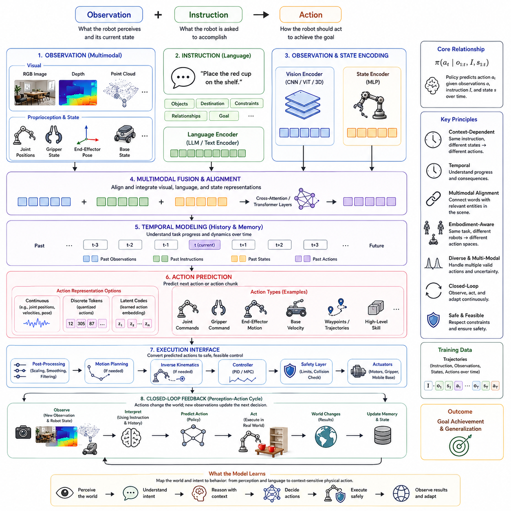{width="7.268055555555556in" height="7.268055555555556in"}

Observation-Instruction-Action modeling defines the central learning relationship of a Vision-Language-Action system. Instead of treating perception, language, and control as independent problems, the model learns a conditional policy in which an observation describes the current physical situation, an instruction specifies the intended objective, and an action determines how the robot should change its state or environment to make progress toward that objective.

An observation represents the information available to the robot at a particular moment. It may include RGB images, video, depth, point clouds, proprioceptive measurements, joint configurations, gripper states, end-effector poses, or mobile-base states. The observation should contain enough information to characterize both the external environment and the robot\'s own physical configuration because appropriate behavior depends on the relationship between these two sources of state.

Raw observations are usually transformed into compact representations before action prediction. Visual encoders extract object, scene, geometry, and spatial features, while state encoders represent proprioceptive variables in a form compatible with the model\'s internal feature space. These representations reduce heterogeneous sensor measurements into structured features that can be integrated with language while retaining information relevant to interaction and control.

The instruction provides semantic context describing what the robot is expected to accomplish. Natural language can specify objects, destinations, relationships, constraints, and desired outcomes without requiring a unique control program for every task. For example, "place the red cup on the shelf" identifies an object, an intended manipulation, and a destination while leaving the model responsible for determining the physical actions required to satisfy that instruction.

Instructions do not specify actions independently of observations. The same command can require completely different behavior depending on the current scene and robot state. If the cup is far away, the robot may first need to approach it; if it is already grasped, the next action may involve transport; if the robot is positioned beside the shelf, placement may be appropriate. The policy must therefore interpret language relative to the current physical context.

This relationship can be represented conceptually as a conditional policy in which an action at time t is predicted from the current observation, instruction, and relevant history. Rather than memorizing a fixed action for each sentence, the model learns how task meaning interacts with physical state. The instruction provides relatively stable goal information, while observations continuously update the model about the changing conditions under which that goal must be achieved.

Multimodal alignment is essential for connecting these information sources. Linguistic references such as "red cup," "left drawer," or "charging station" must become associated with corresponding visual entities and spatial structures. Cross-attention, shared Transformer layers, token fusion, or related mechanisms can establish these relationships, enabling the model to focus on observation features that are relevant to the instruction rather than processing the entire scene without task-specific context.

The action represents the behavioral consequence of this multimodal interpretation. Depending on the architecture, an action may specify joint positions, velocities, end-effector displacement, gripper state, mobile-base velocity, a waypoint, or a higher-level skill. The predicted representation must ultimately correspond to something executable by the robot, either directly through a controller or indirectly through motion planning, inverse kinematics, trajectory generation, and other execution components.

Observation-Instruction-Action modeling is naturally temporal because the meaning of an observation depends on task progress. A single image may not reveal whether the robot is beginning a task, recovering from failure, or completing a manipulation sequence. Incorporating previous observations, actions, or memory allows the model to estimate what has already happened and determine which part of the instruction remains unfinished, producing behavior that is coherent across multiple time steps.

Training data therefore commonly takes the form of trajectories rather than independent samples. Each trajectory associates a task instruction with sequences of observations and actions generated during interaction. At every step, the model can learn to predict demonstrated behavior conditioned on the available multimodal context. Across many trajectories, it learns recurring relationships among task semantics, physical situations, action choices, and temporal progression.

Behavior cloning provides a direct way to train this relationship. Given observation-instruction-action examples collected from human demonstrations, teleoperation, scripted policies, autonomous systems, or simulation, the model minimizes the difference between predicted and demonstrated actions. Large and diverse datasets can expose the policy to many combinations of objects, environments, instructions, robot states, and behaviors, supporting broader generalization than narrowly task-specific demonstrations.

An important challenge is that demonstrations may contain multiple valid actions for the same apparent situation. A robot can often approach an object from several directions or follow different trajectories while still completing the task successfully. Consequently, the conditional action distribution may be multimodal rather than centered around one deterministic answer. Action token models, probabilistic policies, diffusion methods, or latent action representations can help capture this diversity.

Action prediction can also operate at different temporal resolutions. A model may generate one action for the next control step or predict an action chunk covering several future steps. Single-step prediction maintains tight coupling with new observations, while action chunks can represent smooth and coordinated behavior over longer intervals. The modeling choice therefore determines how frequently observation and instruction context are reconsidered during execution.

The observation itself changes after every physical action. Moving the robot changes camera viewpoints, manipulating an object changes object poses, and opening a door exposes previously invisible regions. Observation-Instruction-Action modeling is therefore embedded within a closed-loop process in which action changes the world and the resulting observation conditions the next prediction. The policy continually updates behavior rather than assuming that an initial plan will execute exactly as expected.

This feedback structure also supports recovery from deviations. If a grasp fails, the next observation may show that the object remains on the table instead of being held by the gripper. A model using temporal and multimodal context can recognize that the intended state transition did not occur and select another action. Reliable physical intelligence therefore depends not only on predicting successful demonstrations but also on interpreting the consequences of previous behavior.

Embodiment introduces another modeling dimension because identical observation-instruction semantics can map to different actions for different robots. A mobile manipulator, industrial arm, and humanoid may all receive the instruction to retrieve an object, yet their kinematics and control spaces differ. Observation and instruction representations can potentially remain broadly transferable, while state and action representations may require embodiment-conditioned encoding or robot-specific interfaces.

The quality of Observation-Instruction-Action modeling depends heavily on dataset coverage. If training data contains limited environments, objects, camera viewpoints, language expressions, or robot configurations, the policy may learn superficial correlations instead of robust task relationships. Diverse robot trajectories are therefore valuable not merely because they increase dataset size but because they expose the model to alternative physical states that can correspond to similar semantic objectives.

Safety constraints must also influence the mapping from multimodal context to action. A semantically appropriate action may still be physically unsafe because of obstacles, joint limits, humans, unstable configurations, or excessive velocity. Practical systems can combine learned action prediction with constraint checking, safety controllers, uncertainty estimation, and runtime monitoring so that task completion remains subordinate to feasible and safe execution.

At a broader level, Observation-Instruction-Action modeling converts robot learning into a sequence prediction problem grounded in physical interaction. Observation answers what the robot currently perceives and how it is configured, instruction specifies what should be achieved, and action expresses what should happen next. Temporal history connects these elements across time, allowing the policy to represent not merely isolated reactions but the evolving structure of goal-directed behavior.

This formulation provides the foundation for more advanced VLA capabilities. Once observations, instructions, and actions can be represented within a common conditional modeling framework, the system can incorporate action tokenization, autoregressive generation, diffusion-based policies, action chunks, memory, adaptation, and cross-embodiment learning. The resulting objective is a generalist policy that continuously interprets the world relative to an intended goal and converts that interpretation into context-sensitive physical action.

관찰-명령-행동 모델링(Observation-Instruction-Action Modeling)은 비전-언어-행동 시스템(Vision-Language-Action System)의 핵심적인 학습 관계를 정의한다. 지각(perception), 언어(language), 제어(control)를 서로 독립적인 문제로 다루는 대신, 관찰(observation)이 현재의 물리적 상황을 설명하고, 명령(instruction)이 의도된 목표를 지정하며, 행동(action)이 해당 목표를 향해 진행하기 위해 로봇의 상태 또는 환경을 어떻게 변화시켜야 하는지를 결정하는 조건부 정책(conditional policy)을 학습한다.

관찰(observation)은 특정 시점에 로봇이 이용할 수 있는 정보를 나타낸다. 여기에는 RGB 이미지, 비디오(video), 깊이(depth), 포인트 클라우드(point cloud), 고유수용성 측정(proprioceptive measurement), 관절 구성(joint configuration), 그리퍼 상태(gripper state), 말단장치 자세(end-effector pose), 모바일 베이스 상태(mobile-base state) 등이 포함될 수 있다. 적절한 행동은 외부 환경과 로봇 자체의 물리적 상태 사이의 관계에 따라 달라지므로, 관찰에는 이 두 가지 상태를 충분히 표현할 수 있는 정보가 포함되어야 한다.

원시 관찰(raw observation)은 일반적으로 행동 예측(action prediction)에 사용되기 전에 압축된 표현으로 변환된다. 비전 인코더(vision encoder)는 객체, 장면, 기하 구조, 공간적 특징을 추출하고, 상태 인코더(state encoder)는 고유수용성 변수를 모델 내부의 특징 공간(feature space)과 호환되는 형태로 표현한다. 이러한 표현은 서로 다른 센서 측정값을 구조화된 특징으로 축약하면서 언어와 통합하는 데 필요한 상호작용 및 제어 관련 정보를 유지한다.

명령(instruction)은 로봇이 무엇을 달성해야 하는지를 설명하는 의미적 문맥(semantic context)을 제공한다. 자연어(natural language)는 각 작업마다 고유한 제어 프로그램을 요구하지 않고도 객체, 목적지, 관계, 제약 조건, 원하는 결과를 지정할 수 있다. 예를 들어 "빨간 컵을 선반 위에 놓아라"라는 명령은 객체, 수행해야 할 조작(manipulation), 목적지를 지정하면서 해당 명령을 만족시키는 데 필요한 물리적 행동을 결정하는 역할은 모델에 맡긴다.

명령은 관찰과 독립적으로 행동을 지정하지 않는다. 동일한 명령이라도 현재 장면과 로봇 상태에 따라 완전히 다른 행동이 필요할 수 있다. 컵이 멀리 있다면 로봇은 먼저 접근해야 하고, 이미 컵을 잡고 있다면 다음 행동은 운반이 될 수 있으며, 로봇이 선반 옆에 있다면 배치가 적절할 수 있다. 따라서 정책(policy)은 현재의 물리적 문맥을 기준으로 언어를 해석해야 한다.

이러한 관계는 개념적으로 시간 t의 행동이 현재 관찰, 명령, 관련 이력(history)으로부터 예측되는 조건부 정책으로 표현할 수 있다. 모델은 각 문장에 고정된 행동을 암기하는 대신 작업의 의미가 물리적 상태와 어떻게 상호작용하는지를 학습한다. 명령은 비교적 안정적인 목표 정보를 제공하는 반면, 관찰은 해당 목표를 달성해야 하는 물리적 조건이 어떻게 변화하는지를 지속적으로 모델에 업데이트한다.

멀티모달 정렬(multimodal alignment)은 이러한 정보원을 연결하는 데 필수적이다. "빨간 컵", "왼쪽 서랍", "충전 스테이션"과 같은 언어적 참조는 해당하는 시각적 객체 및 공간 구조와 연결되어야 한다. 교차 어텐션(cross-attention), 공유 트랜스포머 계층(shared Transformer layer), 토큰 융합(token fusion) 등의 메커니즘은 이러한 관계를 형성하여 모델이 전체 장면을 작업 문맥 없이 처리하는 대신 명령과 관련된 관찰 특징에 집중하도록 한다.

행동(action)은 이러한 멀티모달 해석(multimodal interpretation)의 행동적 결과를 나타낸다. 아키텍처에 따라 행동은 관절 위치, 속도, 말단장치 변위(end-effector displacement), 그리퍼 상태, 모바일 베이스 속도, 웨이포인트(waypoint), 또는 상위 수준 스킬(high-level skill)을 지정할 수 있다. 예측된 표현은 제어기를 통해 직접적으로 또는 모션 플래닝(motion planning), 역기구학(inverse kinematics), 궤적 생성(trajectory generation) 등의 실행 구성요소를 통해 간접적으로 로봇이 최종 실행할 수 있는 형태와 연결되어야 한다.

관찰-명령-행동 모델링은 관찰의 의미가 작업 진행 상태(task progress)에 따라 달라지기 때문에 본질적으로 시간적(temporal)이다. 하나의 이미지만으로는 로봇이 작업을 시작하는 단계인지, 실패에서 복구하는 중인지, 조작 시퀀스를 완료하는 단계인지 판단하기 어려울 수 있다. 이전 관찰, 행동 또는 메모리(memory)를 포함하면 모델은 이미 발생한 상황을 추정하고 명령에서 아직 완료되지 않은 부분을 판단하여 여러 시간 단계에 걸쳐 일관된 행동을 생성할 수 있다.

따라서 학습 데이터(training data)는 일반적으로 서로 독립적인 샘플보다 궤적(trajectory)의 형태를 갖는다. 각각의 궤적은 작업 명령을 상호작용 과정에서 생성된 관찰 및 행동 시퀀스와 연결한다. 각 단계에서 모델은 이용 가능한 멀티모달 문맥을 조건으로 시연된 행동을 예측하도록 학습할 수 있다. 많은 궤적을 통해 모델은 작업 의미, 물리적 상황, 행동 선택, 시간적 진행 사이에서 반복적으로 나타나는 관계를 학습한다.

행동 복제(Behavior Cloning)는 이러한 관계를 학습하는 직접적인 방법을 제공한다. 인간 시연(human demonstration), 원격조작(teleoperation), 스크립트 기반 정책(scripted policy), 자율 시스템(autonomous system), 시뮬레이션(simulation)에서 수집한 관찰-명령-행동 사례가 주어지면 모델은 예측 행동과 시연 행동 사이의 차이를 최소화한다. 크고 다양한 데이터셋은 정책을 다양한 객체, 환경, 명령, 로봇 상태, 행동 조합에 노출시켜 좁은 작업별 시연보다 폭넓은 일반화(generalization)를 지원한다.

중요한 문제 중 하나는 겉보기에 동일한 상황에서도 여러 개의 유효한 행동이 존재할 수 있다는 것이다. 로봇은 객체에 여러 방향에서 접근하거나 서로 다른 궤적을 따라가면서도 작업을 성공적으로 완료할 수 있다. 따라서 조건부 행동 분포(conditional action distribution)는 하나의 결정론적 답을 중심으로 하는 것이 아니라 다중모드(multimodal) 형태를 가질 수 있다. 행동 토큰 모델(action token model), 확률적 정책(probabilistic policy), 확산 방식(diffusion method), 잠재 행동 표현(latent action representation)은 이러한 다양성을 포착하는 데 도움을 줄 수 있다.

행동 예측은 서로 다른 시간 해상도(temporal resolution)에서도 수행될 수 있다. 모델은 다음 제어 단계를 위한 하나의 행동을 생성하거나 여러 미래 단계에 걸친 행동 청크(action chunk)를 예측할 수 있다. 단일 단계 예측(single-step prediction)은 새로운 관찰과 긴밀하게 결합할 수 있는 반면, 행동 청크는 더 긴 시간 구간에서 부드럽고 조정된 행동을 표현할 수 있다. 따라서 모델링 방식에 따라 실행 중 관찰과 명령 문맥을 얼마나 자주 다시 평가하는지가 결정된다.

물리적 행동이 실행될 때마다 관찰 자체도 변화한다. 로봇이 이동하면 카메라 시점(camera viewpoint)이 달라지고, 객체를 조작하면 객체 자세(object pose)가 변화하며, 문을 열면 이전에는 보이지 않던 영역이 나타난다. 따라서 관찰-명령-행동 모델링은 행동이 세계를 변화시키고 그 결과로 생성된 새로운 관찰이 다음 예측의 조건이 되는 폐루프 과정(closed-loop process)에 포함된다. 정책은 초기 계획이 예상대로 정확히 실행될 것이라고 가정하지 않고 행동을 지속적으로 업데이트한다.

이러한 피드백 구조(feedback structure)는 예상에서 벗어난 상황으로부터의 복구도 지원한다. 파지가 실패하면 다음 관찰에서 객체가 그리퍼에 잡혀 있지 않고 여전히 테이블 위에 있는 것으로 나타날 수 있다. 시간적 및 멀티모달 문맥을 사용하는 모델은 의도한 상태 전이(state transition)가 발생하지 않았음을 인식하고 다른 행동을 선택할 수 있다. 따라서 신뢰성 있는 물리적 지능은 성공적인 시연 행동을 예측하는 것뿐만 아니라 이전 행동의 결과를 해석하는 능력에도 의존한다.

체화(embodiment)는 동일한 관찰-명령 의미가 서로 다른 로봇에서 다른 행동으로 매핑될 수 있기 때문에 또 다른 모델링 차원을 제공한다. 모바일 매니퓰레이터(mobile manipulator), 산업용 로봇 팔(industrial arm), 휴머노이드(humanoid)가 모두 객체를 가져오라는 명령을 받을 수 있지만 각각의 운동학(kinematics)과 제어 공간(control space)은 서로 다르다. 관찰과 명령 표현은 폭넓게 전이될 수 있지만 상태 및 행동 표현에는 체화 조건부 인코딩(embodiment-conditioned encoding)이나 로봇별 인터페이스가 필요할 수 있다.

관찰-명령-행동 모델링의 품질은 데이터셋 범위(dataset coverage)에 크게 의존한다. 학습 데이터에 제한된 환경, 객체, 카메라 시점, 언어 표현 또는 로봇 구성만 포함되어 있다면 정책은 강건한 작업 관계 대신 피상적인 상관관계를 학습할 수 있다. 따라서 다양한 로봇 궤적은 단순히 데이터셋의 크기를 증가시키기 때문이 아니라 유사한 의미적 목표에 대응할 수 있는 다양한 물리적 상태를 모델에 제공한다는 점에서 중요하다.

안전 제약(safety constraint) 역시 멀티모달 문맥에서 행동으로 이어지는 매핑에 영향을 주어야 한다. 의미적으로 적절한 행동이라도 장애물, 관절 제한, 사람, 불안정한 구성, 과도한 속도 때문에 물리적으로 위험할 수 있다. 실제 시스템은 학습된 행동 예측을 제약 조건 검사(constraint checking), 안전 제어기(safety controller), 불확실성 추정(uncertainty estimation), 런타임 모니터링(runtime monitoring)과 결합하여 작업 완료보다 실행 가능성과 안전성을 우선하도록 구성할 수 있다.

보다 넓은 관점에서 관찰-명령-행동 모델링은 로봇 학습(robot learning)을 물리적 상호작용에 그라운딩된 시퀀스 예측 문제(sequence prediction problem)로 변환한다. 관찰은 로봇이 현재 무엇을 지각하고 어떻게 구성되어 있는지를 나타내고, 명령은 무엇을 달성해야 하는지를 지정하며, 행동은 다음에 무엇이 일어나야 하는지를 표현한다. 시간적 이력은 이러한 요소를 시간에 걸쳐 연결하여 정책이 고립된 반응이 아니라 목표 지향적 행동(goal-directed behavior)의 변화하는 구조를 표현할 수 있도록 한다.

이러한 구성은 더욱 발전된 VLA 기능을 위한 기반을 제공한다. 관찰, 명령, 행동을 공통된 조건부 모델링 프레임워크 안에서 표현할 수 있게 되면 시스템은 행동 토큰화(action tokenization), 자기회귀 생성(autoregressive generation), 확산 기반 정책(diffusion-based policy), 행동 청크, 메모리, 적응(adaptation), 교차 체화 학습(cross-embodiment learning)을 통합할 수 있다. 최종 목표는 의도된 목표를 기준으로 세계를 지속적으로 해석하고 그 해석을 문맥에 적합한 물리적 행동으로 변환하는 범용 정책(generalist policy)을 구축하는 것이다.

## 04.05. Multimodal Context and Action Generation

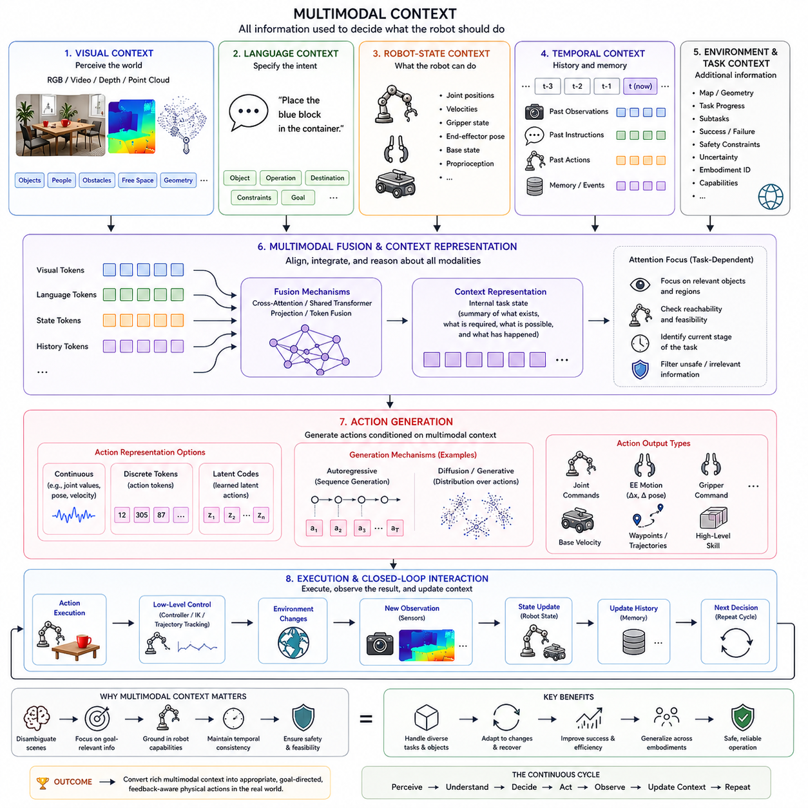{width="7.268055555555556in" height="7.268055555555556in"}

Multimodal context is the combined information a Vision-Language-Action model uses to determine what a robot should do at a particular moment. Rather than predicting actions from a single camera image, a VLA can integrate visual observations, language instructions, robot state, previous actions, task history, and environmental information. Together, these modalities provide a richer description of both the current situation and the intended objective.

Visual context provides evidence about the external world. Images, video, depth, and other perceptual representations can describe objects, people, obstacles, free space, geometry, and spatial relationships. For action generation, however, visual features must represent more than object identity. The model needs information about where relevant entities are located, how they can be interacted with, and how the scene has changed following previous robot actions.

Language context specifies the semantic objective that gives meaning to visual observations. An image containing several objects does not by itself determine which object matters or what should happen to it. An instruction such as "place the blue block in the container" identifies a relevant entity, desired operation, and destination. Language therefore acts as a task-conditioning signal that directs perception and action generation toward information related to the intended goal.

Robot-state context grounds this semantic interpretation in the physical capabilities and current configuration of the agent. Joint positions, velocities, gripper state, end-effector pose, mobile-base state, and proprioceptive measurements indicate what the robot is currently doing and which actions are feasible. Two identical visual scenes can require different commands if the robot begins from different poses or has already completed different parts of the task.

Temporal context extends the model beyond the instantaneous state. Previous observations and actions reveal how the current situation was reached, while memory can represent completed subtasks, previous failures, or important earlier events. This information is especially important when the current image is ambiguous. A robot seeing a cup near its gripper must distinguish whether it is approaching the cup, has just released it, or is recovering from an unsuccessful grasp.

The central modeling challenge is to fuse these heterogeneous signals into a representation that supports action prediction. Vision, language, state, and history may initially exist in different feature spaces and temporal resolutions. Projection layers, tokenization, cross-attention, shared Transformer layers, or related fusion mechanisms can align these representations so that information from one modality can influence the interpretation of another.

Attention provides a useful mechanism for constructing task-dependent context. When the instruction refers to a particular object, the model can emphasize visual tokens corresponding to that object while reducing the influence of irrelevant scene content. At the same time, robot-state tokens can indicate whether the target is reachable, and temporal tokens can indicate which stage of the task is active. Action generation is therefore conditioned on a dynamically selected subset of multimodal information.

A multimodal context representation can be understood as an internal task state rather than a simple collection of sensor features. It should encode what exists in the environment, what the instruction requires, what the robot can currently do, and what has already occurred. The action generator uses this representation to estimate which behavior is most appropriate next, converting multimodal understanding into a decision that can alter the physical environment.

Action generation may produce either low-level or higher-level outputs. Low-level predictions can represent joint values, end-effector motion, gripper commands, or mobile-base velocities, while higher-level outputs may specify waypoints, trajectories, or reusable skills. The appropriate abstraction depends on the architecture and task. In either case, the generated action must remain conditioned on the multimodal context rather than being determined by language or perception alone.

Different action representations provide different ways to model the relationship between context and behavior. Continuous outputs directly represent numerical control variables, while discrete action tokens allow actions to be generated using sequence-modeling techniques similar to language generation. Learned latent action representations provide another possibility by encoding complex motion patterns in a compact space. These choices influence both model training and physical execution.

Action generation can also be autoregressive. The model predicts an action or action token and then conditions subsequent predictions on the previously generated sequence. This formulation allows visual, linguistic, state, and action tokens to participate in a common sequential context. It is particularly compatible with Transformer architectures, although long action sequences can increase inference cost and may accumulate errors when generated without sufficiently frequent environmental feedback.

Another approach uses diffusion or related generative mechanisms to predict continuous actions or trajectories. Instead of committing immediately to one deterministic command, the model can represent a distribution of plausible behaviors conditioned on multimodal context. This is useful when several physical trajectories can satisfy the same instruction, such as approaching an object from different directions or selecting among multiple valid grasp configurations.

Action chunks provide a temporal abstraction between individual control commands and complete task plans. A model can predict several coordinated future actions from the current multimodal context and execute them over a short horizon. This can improve temporal consistency and reduce the frequency of expensive model inference. However, longer chunks reduce opportunities to incorporate new observations, creating a tradeoff between efficient generation and responsive closed-loop control.

Context length therefore becomes an important architectural consideration. Longer histories can provide useful information about task progress and previous interactions, but they also increase computation and may contain irrelevant observations. A practical VLA may compress history into memory tokens, selectively retain important events, or use hierarchical representations that distinguish recent sensor information from longer-term task state. The goal is to preserve useful temporal information without overwhelming action prediction.

Multimodal context is particularly important for long-horizon tasks because the robot must maintain consistency across multiple subtasks. An instruction such as "clear the table and put the dishes in the tray" cannot be completed through one isolated action. The model must track which objects have already been moved, identify remaining goals, and generate actions appropriate to the current stage. Context therefore functions as a bridge between task-level intent and moment-to-moment behavior.

Closed-loop interaction continually refreshes the multimodal context. After an action is executed, the environment changes and sensors provide a new observation. The robot state is updated, previous actions become part of history, and the model can reassess progress relative to the instruction. Action generation therefore becomes a repeated process of constructing context, predicting behavior, executing it, observing the result, and reconstructing context for the next decision.

This cycle enables adaptation when predictions and physical outcomes diverge. If an object slips from the gripper, a new observation can reveal the failure and alter the context used for the next prediction. If a person blocks the planned path, updated visual information can invalidate an earlier action choice. Reliable VLA behavior consequently depends on treating multimodal context as dynamic information that evolves through interaction rather than as a fixed prompt supplied only at task initiation.

Embodiment information can also become part of multimodal context. A shared VLA model may operate across manipulators, mobile robots, humanoids, or other platforms whose action spaces differ substantially. Encoding robot identity, morphology, kinematic structure, or available capabilities can condition action generation on the current embodiment. The same semantic objective can then produce different physical behaviors while preserving shared visual and linguistic understanding.

Safety and uncertainty further influence action generation. Context may indicate that an action is semantically appropriate but physically risky because a human is nearby, an obstacle has appeared, or the target lies near a workspace boundary. Uncertainty estimates, safety constraints, and runtime checks can therefore supplement multimodal reasoning before commands reach the actuators. Action generation must satisfy not only task relevance but also physical feasibility and operational safety.

At a broader level, multimodal context transforms action generation from a direct stimulus-response mapping into context-sensitive physical reasoning. Vision contributes evidence about the world, language defines intent, robot state establishes physical capability, and temporal history explains how the situation evolved. The action generator integrates these signals to determine behavior appropriate to the current task state rather than simply reproducing a memorized response.

This integration is central to the progression from specialized robot policies toward generalist VLA systems. A sufficiently capable model can reuse common multimodal representations across objects, instructions, environments, and embodiments while adapting its generated actions to each situation. Multimodal context and action generation therefore form the computational link through which broad foundation-model knowledge is transformed into temporally coherent, goal-directed, feedback-aware physical behavior.

멀티모달 문맥(multimodal context)은 비전-언어-행동 모델(Vision-Language-Action Model, VLA)이 특정 순간에 로봇이 무엇을 해야 하는지를 결정하기 위해 사용하는 결합된 정보이다. 단일 카메라 이미지로부터 행동을 예측하는 대신, VLA는 시각적 관찰(visual observation), 언어 명령(language instruction), 로봇 상태(robot state), 이전 행동(previous action), 작업 이력(task history), 환경 정보를 통합할 수 있다. 이러한 모달리티(modality)는 현재 상황과 의도된 목표를 더욱 풍부하게 표현한다.

시각적 문맥(visual context)은 외부 세계에 관한 정보를 제공한다. 이미지, 비디오(video), 깊이(depth), 기타 지각 표현(perceptual representation)은 객체, 사람, 장애물, 자유 공간(free space), 기하 구조(geometry), 공간적 관계(spatial relationship)를 설명할 수 있다. 그러나 행동 생성을 위해 시각 특징은 객체의 정체성뿐만 아니라 관련 객체의 위치, 상호작용 가능한 방법, 이전 로봇 행동 이후 장면이 어떻게 변화했는지에 관한 정보까지 표현해야 한다.

언어 문맥(language context)은 시각적 관찰에 의미를 부여하는 의미적 목표(semantic objective)를 지정한다. 여러 객체가 포함된 이미지 자체만으로는 어떤 객체가 중요하며 해당 객체에 무엇을 해야 하는지 결정할 수 없다. "파란색 블록을 컨테이너 안에 넣어라"와 같은 명령은 관련 객체, 원하는 동작, 목적지를 지정한다. 따라서 언어는 지각과 행동 생성을 의도된 목표와 관련된 정보로 유도하는 작업 조건화 신호(task-conditioning signal)로 작용한다.

로봇 상태 문맥(robot-state context)은 이러한 의미적 해석을 에이전트(agent)의 물리적 능력과 현재 구성에 그라운딩(grounding)한다. 관절 위치, 속도, 그리퍼 상태(gripper state), 말단장치 자세(end-effector pose), 모바일 베이스 상태(mobile-base state), 고유수용성 측정(proprioceptive measurement)은 로봇이 현재 무엇을 하고 있으며 어떤 행동을 실행할 수 있는지를 나타낸다. 동일한 시각적 장면이라도 로봇의 시작 자세나 이미 완료한 작업 단계가 다르면 서로 다른 명령이 필요할 수 있다.

시간적 문맥(temporal context)은 모델의 이해 범위를 순간적인 상태 이상으로 확장한다. 이전 관찰과 행동은 현재 상황에 어떻게 도달했는지를 보여주며, 메모리(memory)는 완료된 하위 작업(subtask), 이전의 실패 또는 중요한 과거 사건을 표현할 수 있다. 이러한 정보는 현재 이미지가 모호한 경우 특히 중요하다. 그리퍼 근처에 컵이 있을 때 로봇은 컵에 접근 중인지, 방금 컵을 놓았는지, 실패한 파지(grasp)에서 복구하는 중인지를 구분해야 한다.

핵심적인 모델링 과제는 이러한 이질적인 신호를 행동 예측(action prediction)을 지원하는 하나의 표현으로 융합하는 것이다. 비전, 언어, 상태, 이력은 처음에는 서로 다른 특징 공간(feature space)과 시간 해상도(temporal resolution)에 존재할 수 있다. 투영 계층(projection layer), 토큰화(tokenization), 교차 어텐션(cross-attention), 공유 트랜스포머 계층(shared Transformer layer) 등의 융합 메커니즘은 이러한 표현을 정렬하여 하나의 모달리티에서 얻은 정보가 다른 모달리티의 해석에 영향을 미치도록 할 수 있다.

어텐션(attention)은 작업 의존적 문맥(task-dependent context)을 구성하기 위한 유용한 메커니즘을 제공한다. 명령이 특정 객체를 지칭하면 모델은 해당 객체에 대응하는 시각 토큰(visual token)을 강조하면서 관련성이 낮은 장면 정보의 영향을 줄일 수 있다. 동시에 로봇 상태 토큰은 목표에 도달 가능한지를 나타내고, 시간적 토큰은 현재 활성화된 작업 단계를 나타낼 수 있다. 따라서 행동 생성은 동적으로 선택된 멀티모달 정보의 부분집합을 조건으로 수행된다.

멀티모달 문맥 표현(multimodal context representation)은 단순한 센서 특징의 집합이 아니라 내부 작업 상태(internal task state)로 이해할 수 있다. 이는 환경에 무엇이 존재하는지, 명령이 무엇을 요구하는지, 로봇이 현재 무엇을 수행할 수 있는지, 지금까지 무엇이 발생했는지를 인코딩해야 한다. 행동 생성기(action generator)는 이러한 표현을 이용하여 다음에 가장 적절한 행동을 추정하고 멀티모달 이해를 물리적 환경을 변화시킬 수 있는 의사결정으로 변환한다.

행동 생성(action generation)은 저수준(low-level) 또는 상위 수준(high-level)의 출력을 생성할 수 있다. 저수준 예측은 관절 값, 말단장치 움직임, 그리퍼 명령, 모바일 베이스 속도를 나타낼 수 있으며, 상위 수준 출력은 웨이포인트(waypoint), 궤적(trajectory), 재사용 가능한 스킬(skill)을 지정할 수 있다. 적절한 추상화 수준은 아키텍처와 작업에 따라 달라진다. 어느 경우든 생성된 행동은 언어나 지각만으로 결정되는 것이 아니라 멀티모달 문맥을 조건으로 해야 한다.

서로 다른 행동 표현(action representation)은 문맥과 행동 사이의 관계를 모델링하는 다양한 방법을 제공한다. 연속형 출력(continuous output)은 수치형 제어 변수를 직접 표현하는 반면, 이산 행동 토큰(discrete action token)은 언어 생성과 유사한 시퀀스 모델링(sequence modeling) 기법으로 행동을 생성할 수 있게 한다. 학습된 잠재 행동 표현(learned latent action representation)은 복잡한 움직임 패턴을 압축된 공간에 인코딩하는 또 다른 방법을 제공한다. 이러한 선택은 모델 학습과 물리적 실행 모두에 영향을 미친다.

행동 생성은 자기회귀적(autoregressive)으로 수행될 수도 있다. 모델은 행동 또는 행동 토큰을 예측하고 이후 생성되는 예측을 이전에 생성된 시퀀스를 조건으로 수행한다. 이러한 구성에서는 시각, 언어, 상태, 행동 토큰이 공통된 순차 문맥(sequential context)에 참여할 수 있다. 특히 트랜스포머(Transformer) 아키텍처와 호환성이 높지만, 긴 행동 시퀀스는 추론 비용을 증가시키며 충분히 빈번한 환경 피드백 없이 생성될 경우 오류가 누적될 수 있다.

또 다른 접근 방식은 확산(diffusion) 또는 관련 생성 메커니즘(generative mechanism)을 이용하여 연속 행동이나 궤적을 예측한다. 하나의 결정론적 명령에 즉시 확정하는 대신 모델은 멀티모달 문맥을 조건으로 가능한 행동의 분포를 표현할 수 있다. 이는 서로 다른 방향으로 객체에 접근하거나 여러 개의 유효한 파지 구성을 선택하는 것처럼 동일한 명령을 만족하는 여러 물리적 궤적이 존재하는 상황에서 유용하다.

행동 청크(action chunk)는 개별 제어 명령과 전체 작업 계획 사이의 시간적 추상화(temporal abstraction)를 제공한다. 모델은 현재의 멀티모달 문맥으로부터 여러 개의 조정된 미래 행동을 예측하여 짧은 시간 구간 동안 실행할 수 있다. 이를 통해 시간적 일관성(temporal consistency)을 높이고 비용이 높은 모델 추론의 빈도를 줄일 수 있다. 그러나 긴 행동 청크는 새로운 관찰을 반영할 기회를 감소시키므로 효율적인 생성과 반응성이 높은 폐루프 제어(closed-loop control) 사이에는 상충관계가 존재한다.

따라서 문맥 길이(context length)는 중요한 아키텍처 고려사항이 된다. 더 긴 이력은 작업 진행 상태와 이전 상호작용에 관한 유용한 정보를 제공할 수 있지만 계산량을 증가시키고 관련성이 낮은 관찰까지 포함할 수 있다. 실제 VLA는 이력을 메모리 토큰(memory token)으로 압축하거나 중요한 사건을 선택적으로 유지하거나, 최근 센서 정보와 장기 작업 상태를 구분하는 계층적 표현(hierarchical representation)을 사용할 수 있다. 목표는 행동 예측에 과도한 부담을 주지 않으면서 유용한 시간 정보를 유지하는 것이다.

멀티모달 문맥은 로봇이 여러 하위 작업에 걸쳐 일관성을 유지해야 하기 때문에 장기 구간 작업(long-horizon task)에서 특히 중요하다. "테이블을 정리하고 접시를 트레이에 넣어라"라는 명령은 하나의 독립적인 행동으로 완료할 수 없다. 모델은 이미 이동시킨 객체를 추적하고, 남아 있는 목표를 식별하며, 현재 작업 단계에 적절한 행동을 생성해야 한다. 따라서 문맥은 작업 수준의 의도(task-level intent)와 순간순간의 행동을 연결하는 가교 역할을 한다.

폐루프 상호작용(closed-loop interaction)은 멀티모달 문맥을 지속적으로 갱신한다. 행동이 실행된 이후 환경은 변화하고 센서는 새로운 관찰을 제공한다. 로봇 상태가 업데이트되고 이전 행동은 이력의 일부가 되며, 모델은 명령을 기준으로 작업 진행 상태를 다시 평가할 수 있다. 따라서 행동 생성은 문맥 구성, 행동 예측, 실행, 결과 관찰, 다음 의사결정을 위한 문맥 재구성의 반복적인 과정이 된다.

이러한 순환 과정은 예측과 실제 물리적 결과가 달라지는 경우에도 적응(adaptation)을 가능하게 한다. 객체가 그리퍼에서 미끄러지면 새로운 관찰을 통해 실패를 감지하고 다음 예측에 사용되는 문맥을 변경할 수 있다. 사람이 계획된 이동 경로를 막으면 업데이트된 시각 정보가 이전 행동 선택을 무효화할 수 있다. 따라서 신뢰성 있는 VLA 행동은 멀티모달 문맥을 작업 시작 시 한 번 제공되는 고정된 프롬프트가 아니라 상호작용을 통해 지속적으로 변화하는 동적 정보로 처리하는 것에 의존한다.

체화 정보(embodiment information) 역시 멀티모달 문맥의 일부가 될 수 있다. 공유 VLA 모델은 행동 공간이 크게 다른 매니퓰레이터(manipulator), 모바일 로봇(mobile robot), 휴머노이드(humanoid), 기타 플랫폼에서 동작할 수 있다. 로봇의 정체성, 형태학(morphology), 운동학 구조(kinematic structure), 이용 가능한 기능을 인코딩하면 현재 체화체를 조건으로 행동을 생성할 수 있다. 따라서 동일한 의미적 목표에서도 공유된 시각 및 언어 이해를 유지하면서 서로 다른 물리적 행동을 생성할 수 있다.

안전성(safety)과 불확실성(uncertainty) 역시 행동 생성에 영향을 미친다. 문맥상 어떤 행동이 의미적으로 적절하더라도 사람이 가까이 있거나, 장애물이 나타났거나, 목표가 작업 공간 경계(workspace boundary) 근처에 존재한다면 물리적으로 위험할 수 있다. 따라서 불확실성 추정(uncertainty estimation), 안전 제약(safety constraint), 런타임 검사(runtime check)는 명령이 액추에이터(actuator)에 전달되기 전에 멀티모달 추론을 보완할 수 있다. 행동 생성은 작업 관련성뿐만 아니라 물리적 실행 가능성과 운용 안전성도 만족해야 한다.

보다 넓은 관점에서 멀티모달 문맥은 행동 생성을 직접적인 자극-반응 매핑(stimulus-response mapping)에서 문맥 의존적인 물리적 추론(context-sensitive physical reasoning)으로 변화시킨다. 비전(vision)은 세계에 관한 정보를 제공하고, 언어(language)는 의도를 정의하며, 로봇 상태는 물리적 능력을 규정하고, 시간적 이력(temporal history)은 현재 상황이 어떻게 형성되었는지를 설명한다. 행동 생성기는 이러한 신호를 통합하여 단순히 암기된 반응을 재현하는 것이 아니라 현재 작업 상태에 적절한 행동을 결정한다.

이러한 통합은 특화된 로봇 정책(specialized robot policy)에서 범용 VLA 시스템(generalist VLA system)으로 발전하는 데 핵심적인 역할을 한다. 충분한 능력을 갖춘 모델은 객체, 명령, 환경, 체화체 전반에서 공통적인 멀티모달 표현을 재사용하면서 각 상황에 맞게 생성 행동을 조정할 수 있다. 따라서 멀티모달 문맥과 행동 생성은 광범위한 파운데이션 모델 지식(foundation-model knowledge)을 시간적으로 일관되고, 목표 지향적이며, 피드백을 인식하는 물리적 행동으로 변환하는 계산적 연결고리를 형성한다.

## 04.06. Autoregressive Action Generation

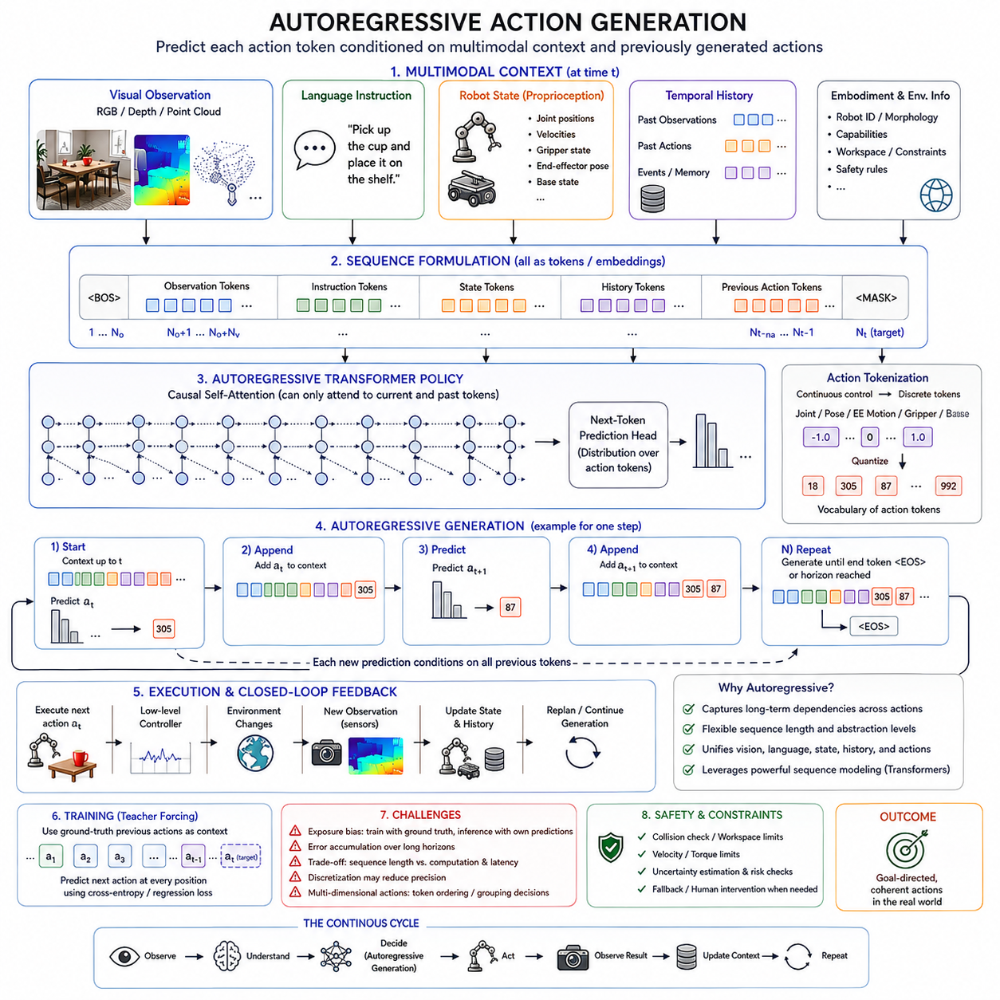{width="7.268055555555556in" height="7.268055555555556in"}

Autoregressive action generation treats robot behavior as a sequential prediction problem in which each action is generated conditionally on the multimodal context and previously generated actions. This formulation extends the next-token prediction principle used in language models into the physical action domain. A Vision-Language-Action model can therefore predict what the robot should do next while preserving dependencies among observations, instructions, states, and earlier behavior.

Conceptually, an autoregressive policy factorizes an action sequence into a series of conditional predictions. Instead of predicting an entire trajectory independently, the model estimates each action using the available observation, language instruction, robot state, temporal context, and preceding actions. Earlier predictions become part of the context for later predictions, allowing the generated sequence to maintain dependencies across multiple action steps.

This formulation is especially compatible with Transformer-based architectures. Visual observations, language instructions, robot states, and actions can be represented as tokens or embeddings and arranged within a common sequence. Self-attention allows the model to relate current action predictions to relevant multimodal information, while causal masking prevents a prediction from accessing future actions that would not be available during actual execution.

Action tokenization provides a natural interface between continuous robot control and autoregressive sequence modeling. Continuous quantities such as joint positions, velocities, end-effector motion, or gripper commands can be quantized into discrete intervals and assigned token identifiers. Once represented as tokens, robot actions can be predicted with mechanisms similar to those used for linguistic tokens, allowing a shared model architecture to process both semantic context and behavior.

Not every autoregressive VLA must use discrete actions. Continuous values can also be generated sequentially using parameterized probability distributions or regression heads conditioned on previous outputs. The defining characteristic is therefore not tokenization itself but causal factorization: later actions depend on earlier actions and available context. Discrete tokens simply make this relationship particularly convenient for architectures inherited from large language and multimodal models.

The multimodal context conditions every stage of autoregressive generation. Vision identifies relevant objects and spatial relationships, language specifies the task objective, robot state describes the current physical configuration, and temporal history indicates previous progress. The model uses this combined representation to estimate a distribution over possible next actions rather than producing behavior from any single modality independently.

For example, when executing "pick up the cup," the initial context may cause the model to generate actions that move the end effector toward the target. As these actions become part of the sequence, later predictions can represent alignment, approach, gripper closure, and lifting. The generated behavior therefore develops progressively, with each prediction influenced by both the original task context and the sequence already produced.

Autoregressive generation can occur at different levels of action abstraction. At a low level, individual tokens may correspond to small changes in joint or Cartesian coordinates. At a higher level, tokens may represent waypoints, motion primitives, or semantic skills such as reach, grasp, lift, or place. Higher abstraction can shorten the prediction sequence, while lower abstraction provides finer control but increases sequence length and computational requirements.

Multi-dimensional robot actions introduce an additional design decision concerning token ordering. A single time step may contain several joint values, Cartesian dimensions, rotation parameters, gripper states, or base commands. These variables can be serialized into separate tokens, grouped into compound action tokens, or represented through structured prediction heads. The chosen representation affects sequence length, modeling complexity, and dependencies among simultaneously executed control dimensions.

Autoregressive models can generate one immediate action at a time or produce an action chunk containing several future actions. Generating one step followed by a new observation provides strong closed-loop responsiveness, but repeated inference can be computationally expensive. Predicting an action chunk amortizes model computation across several control steps and can produce temporally coherent motion, although the robot receives fewer opportunities to revise behavior using new sensory information.

Causal attention is central to maintaining valid temporal structure. During training, the model may observe complete demonstration trajectories, but the attention mask ensures that the action at a particular position is predicted only from information that should already be available. This creates correspondence between training and deployment, where future actions are unknown and must be generated sequentially from observations, instructions, states, and previously generated outputs.

Training commonly uses teacher forcing, where demonstrated previous actions are supplied as context while the model learns to predict the next action. This provides efficient supervision across an entire trajectory because predictions for many sequence positions can be optimized simultaneously. The resulting objective resembles next-token prediction, except that the predicted sequence represents physical behavior rather than natural-language continuation.

A major challenge arises because deployment differs from teacher-forced training. During training, the context contains correct demonstrated actions, whereas during inference it contains the model\'s own predictions. A small early error can therefore change the context used for later predictions and lead to progressively larger deviations. This phenomenon, often associated with exposure bias, is particularly important in robotics because accumulated errors can alter the physical state observed by the robot.

Closed-loop feedback helps limit this accumulation. Instead of generating a long sequence once and executing it blindly, the robot can periodically observe the environment and condition subsequent generation on updated sensory and state information. New observations provide evidence about whether previous actions produced their intended effects. Autoregressive generation can therefore operate within a receding-horizon process that repeatedly predicts, executes, observes, and replans.

The probabilistic nature of autoregressive generation can represent uncertainty and multiple possible behaviors. At each step, the model may assign probability to several actions that are compatible with the current context. Sampling can produce diverse trajectories, while deterministic decoding can select a high-probability action. The decoding strategy must be chosen carefully because diversity that is useful in language generation can create unnecessary or unsafe variation in physical control.

Inference latency is another major consideration. Language generation may tolerate tens or hundreds of milliseconds between tokens, whereas robot control can require much faster update rates. Large VLA backbones may therefore operate at a slower decision frequency while lower-level controllers execute commands at high frequency. Action chunking, model compression, caching, efficient attention, and hierarchical control can reduce the gap between foundation-model inference and real-time physical execution.

Autoregressive generation also provides a convenient framework for combining different forms of robot information in one sequence. Observation tokens, instruction tokens, state tokens, embodiment identifiers, memory tokens, and action tokens can share a common modeling backbone. This unified representation can support multi-task learning and potentially cross-embodiment transfer because the model learns statistical relationships across heterogeneous contexts rather than relying on separate policies for every task.

However, autoregressive action generation is not automatically ideal for every robotic problem. Long sequences increase computation, sequential dependencies limit parallel generation, discretization may reduce control precision, and early mistakes can propagate through later predictions. Continuous control tasks with strongly multimodal trajectories may sometimes benefit from alternative generative formulations, including diffusion-based action generation, which models action chunks through a different prediction process.

Safety remains essential because autoregressive probabilities describe learned behavior rather than guaranteed physical feasibility. Generated actions may need to pass through workspace constraints, collision checks, velocity limits, motion planners, or safety controllers before execution. Uncertainty in the predicted sequence can also be used to trigger slower reasoning, replanning, fallback behavior, or human intervention when the model cannot confidently determine a safe next action.

Within VLA systems, autoregressive action generation provides a conceptually unified bridge from multimodal foundation models to sequential robot behavior. It transforms observations, instructions, robot state, and history into a causal sequence of physical decisions, using previous actions to structure future predictions. Its strength lies in reusing powerful sequence-modeling machinery while extending next-token prediction from linguistic continuation to goal-directed interaction with the physical world.

자기회귀 행동 생성(Autoregressive Action Generation)은 로봇 행동을 순차적 예측 문제(sequential prediction problem)로 다루며, 각각의 행동은 멀티모달 문맥(multimodal context)과 이전에 생성된 행동을 조건으로 순차적으로 생성된다. 이러한 방식은 언어 모델(language model)에서 사용하는 다음 토큰 예측(next-token prediction) 원리를 물리적 행동 영역으로 확장한다. 따라서 비전-언어-행동 모델(Vision-Language-Action Model, VLA)은 관찰, 명령, 상태, 이전 행동 사이의 의존성을 유지하면서 로봇이 다음에 무엇을 해야 하는지를 예측할 수 있다.

개념적으로 자기회귀 정책(autoregressive policy)은 행동 시퀀스(action sequence)를 일련의 조건부 예측(conditional prediction)으로 분해한다. 전체 궤적(trajectory)을 독립적으로 한 번에 예측하는 대신, 모델은 현재 이용 가능한 관찰, 언어 명령, 로봇 상태, 시간적 문맥(temporal context), 이전 행동을 이용하여 각각의 행동을 추정한다. 앞에서 생성된 예측은 이후 예측의 문맥 일부가 되므로 생성된 시퀀스는 여러 행동 단계에 걸쳐 의존 관계를 유지할 수 있다.

이러한 구성은 특히 트랜스포머 기반 아키텍처(Transformer-based architecture)와 높은 호환성을 가진다. 시각적 관찰, 언어 명령, 로봇 상태, 행동을 토큰(token) 또는 임베딩(embedding)으로 표현하여 하나의 공통 시퀀스 안에 배열할 수 있다. 자기 어텐션(self-attention)을 통해 현재 행동 예측을 관련 멀티모달 정보와 연결할 수 있으며, 인과 마스킹(causal masking)은 실제 실행 시 이용할 수 없는 미래 행동을 현재 예측이 참조하지 못하도록 제한한다.

행동 토큰화(action tokenization)는 연속적인 로봇 제어와 자기회귀 시퀀스 모델링을 연결하는 자연스러운 인터페이스를 제공한다. 관절 위치, 속도, 말단장치 움직임(end-effector motion), 그리퍼 명령(gripper command)과 같은 연속값을 이산 구간(discrete interval)으로 양자화(quantization)하고 토큰 식별자(token identifier)를 부여할 수 있다. 행동을 토큰으로 표현하면 언어 토큰과 유사한 메커니즘으로 로봇 행동을 예측할 수 있어 하나의 공유 모델 아키텍처에서 의미적 문맥과 행동을 함께 처리할 수 있다.

모든 자기회귀 VLA가 반드시 이산 행동(discrete action)을 사용할 필요는 없다. 연속값도 이전 출력을 조건으로 하는 매개변수화된 확률 분포(parameterized probability distribution) 또는 회귀 헤드(regression head)를 이용하여 순차적으로 생성할 수 있다. 따라서 자기회귀 방식의 핵심적인 특징은 토큰화 자체가 아니라 인과적 분해(causal factorization)에 있으며, 이후 행동이 이전 행동과 현재 이용 가능한 문맥에 의존한다는 점이다. 이산 토큰은 대규모 언어 및 멀티모달 모델에서 계승된 아키텍처에 이러한 관계를 적용하기 쉽게 만들어 준다.

멀티모달 문맥은 자기회귀 생성의 모든 단계를 조건화한다. 비전(vision)은 관련 객체와 공간적 관계를 식별하고, 언어(language)는 작업 목표를 지정하며, 로봇 상태(robot state)는 현재의 물리적 구성을 설명하고, 시간적 이력(temporal history)은 이전까지의 진행 상황을 나타낸다. 모델은 이러한 결합된 표현을 이용하여 특정 하나의 모달리티에만 의존해 행동을 생성하는 대신 가능한 다음 행동에 대한 확률 분포를 추정한다.

예를 들어 "컵을 집어라"라는 작업을 수행할 때 초기 문맥은 모델이 말단장치를 목표 객체 방향으로 이동시키는 행동을 생성하도록 할 수 있다. 이러한 행동이 시퀀스의 일부가 되면 이후 예측은 정렬(alignment), 접근(approach), 그리퍼 닫기(gripper closure), 들어 올리기(lifting)를 표현할 수 있다. 따라서 생성되는 행동은 점진적으로 전개되며 각각의 예측은 원래의 작업 문맥과 이미 생성된 행동 시퀀스 모두의 영향을 받는다.

자기회귀 생성은 서로 다른 행동 추상화 수준(action abstraction level)에서 수행될 수 있다. 저수준에서는 개별 토큰이 관절 또는 카테시안 좌표(Cartesian coordinate)의 작은 변화에 대응할 수 있다. 상위 수준에서는 토큰이 웨이포인트(waypoint), 모션 프리미티브(motion primitive), 또는 접근(reach), 파지(grasp), 들어 올리기(lift), 배치(place)와 같은 의미적 스킬(semantic skill)을 표현할 수 있다. 높은 추상화 수준은 예측 시퀀스를 짧게 만들 수 있는 반면, 낮은 추상화 수준은 더욱 세밀한 제어를 제공하지만 시퀀스 길이와 계산 요구량을 증가시킨다.

다차원 로봇 행동(multi-dimensional robot action)은 토큰 순서(token ordering)에 관한 추가적인 설계 결정을 요구한다. 하나의 시간 단계에는 여러 관절 값, 카테시안 차원, 회전 매개변수(rotation parameter), 그리퍼 상태, 베이스 명령이 포함될 수 있다. 이러한 변수들은 각각 별도의 토큰으로 직렬화(serialization)하거나 복합 행동 토큰(compound action token)으로 묶거나 구조화된 예측 헤드(structured prediction head)를 통해 표현할 수 있다. 선택한 표현 방식은 시퀀스 길이, 모델링 복잡성, 동시에 실행되는 제어 차원 사이의 의존성에 영향을 미친다.

자기회귀 모델은 하나의 즉각적인 행동을 순차적으로 생성하거나 여러 미래 행동을 포함하는 행동 청크(action chunk)를 생성할 수 있다. 한 단계를 생성한 후 새로운 관찰을 사용하는 방식은 강력한 폐루프 반응성(closed-loop responsiveness)을 제공하지만 반복적인 추론으로 계산 비용이 증가할 수 있다. 행동 청크를 예측하면 하나의 모델 추론으로 여러 제어 단계를 처리하면서 시간적으로 일관된 움직임을 생성할 수 있지만, 새로운 감각 정보를 이용해 행동을 수정할 기회는 감소한다.

인과 어텐션(causal attention)은 유효한 시간적 구조를 유지하는 핵심 요소이다. 학습 과정에서 모델은 전체 시연 궤적(demonstration trajectory)을 볼 수 있지만, 어텐션 마스크(attention mask)는 특정 위치의 행동이 해당 시점까지 이용할 수 있어야 하는 정보만으로 예측되도록 제한한다. 이를 통해 미래 행동을 알 수 없으며 관찰, 명령, 상태, 이전에 생성된 출력으로부터 행동을 순차적으로 생성해야 하는 실제 배포 환경과 학습 과정 사이의 대응 관계가 형성된다.

학습에는 일반적으로 교사 강제(teacher forcing)가 사용되며, 모델이 다음 행동을 예측하도록 학습할 때 시연 데이터의 올바른 이전 행동을 문맥으로 제공한다. 이를 통해 하나의 궤적에 존재하는 여러 시퀀스 위치의 예측을 동시에 최적화할 수 있어 효율적인 지도학습(supervision)이 가능하다. 결과적으로 학습 목표는 다음 토큰 예측과 유사하지만 예측되는 시퀀스가 자연어의 연속이 아니라 물리적 행동을 표현한다는 차이가 있다.

중요한 문제는 실제 배포가 교사 강제를 사용하는 학습과 다르다는 점에서 발생한다. 학습 중에는 문맥에 올바른 시연 행동이 포함되지만 추론 시에는 모델 자체가 생성한 예측이 포함된다. 따라서 초기에 발생한 작은 오류가 이후 예측에 사용되는 문맥을 변화시켜 점차 더 큰 편차를 만들 수 있다. 이러한 현상은 노출 편향(exposure bias)과 관련되며, 누적된 오류가 로봇이 관찰하는 실제 물리적 상태까지 변화시킬 수 있기 때문에 로보틱스에서 특히 중요하다.

폐루프 피드백(closed-loop feedback)은 이러한 오류 누적을 제한하는 데 도움을 준다. 긴 행동 시퀀스를 한 번에 생성하여 그대로 실행하는 대신 로봇은 주기적으로 환경을 관찰하고 업데이트된 감각 및 상태 정보를 조건으로 이후 행동을 생성할 수 있다. 새로운 관찰은 이전 행동이 의도한 결과를 만들어냈는지에 관한 정보를 제공한다. 따라서 자기회귀 생성은 예측, 실행, 관찰, 재계획을 반복하는 이동 구간 방식(receding-horizon process)으로 동작할 수 있다.

자기회귀 생성의 확률적 특성(probabilistic nature)은 불확실성과 여러 가능한 행동을 표현할 수 있게 한다. 각 단계에서 모델은 현재 문맥과 호환되는 여러 행동에 확률을 부여할 수 있다. 샘플링(sampling)은 다양한 궤적을 생성할 수 있으며 결정론적 디코딩(deterministic decoding)은 높은 확률의 행동을 선택할 수 있다. 그러나 언어 생성에서는 유용할 수 있는 다양성이 물리적 제어에서는 불필요하거나 위험한 변화를 발생시킬 수 있으므로 디코딩 전략(decoding strategy)을 신중하게 선택해야 한다.

추론 지연시간(inference latency) 역시 중요한 고려사항이다. 언어 생성은 토큰 사이에 수십 또는 수백 밀리초의 지연을 허용할 수 있지만 로봇 제어는 훨씬 빠른 업데이트 속도를 요구할 수 있다. 따라서 대규모 VLA 백본은 상대적으로 느린 의사결정 주파수(decision frequency)로 동작하고 저수준 제어기(low-level controller)가 높은 주파수로 명령을 실행하도록 구성할 수 있다. 행동 청크, 모델 압축(model compression), 캐싱(caching), 효율적인 어텐션(efficient attention), 계층적 제어(hierarchical control)는 파운데이션 모델 추론과 실시간 물리적 실행 사이의 차이를 줄이는 데 활용될 수 있다.

자기회귀 생성은 서로 다른 형태의 로봇 정보를 하나의 시퀀스에 결합할 수 있는 편리한 프레임워크도 제공한다. 관찰 토큰(observation token), 명령 토큰(instruction token), 상태 토큰(state token), 체화 식별자(embodiment identifier), 메모리 토큰(memory token), 행동 토큰(action token)이 하나의 공통 모델링 백본을 공유할 수 있다. 이를 통해 각각의 작업마다 별도의 정책에 의존하는 대신 다양한 문맥 사이의 통계적 관계를 학습하므로 멀티태스크 학습(multi-task learning)과 잠재적인 교차 체화 전이(cross-embodiment transfer)를 지원할 수 있다.

그러나 자기회귀 행동 생성이 모든 로봇 문제에 자동으로 최적인 것은 아니다. 긴 시퀀스는 계산량을 증가시키고, 순차적 의존성(sequential dependency)은 병렬 생성을 제한하며, 이산화(discretization)는 제어 정밀도를 감소시킬 수 있고, 초기의 실수가 이후 예측으로 전파될 수 있다. 강한 다중모드 궤적(multimodal trajectory)을 갖는 연속 제어 작업에서는 행동 청크를 다른 예측 방식으로 모델링하는 확산 기반 행동 생성(diffusion-based action generation)과 같은 대안적인 생성 방식이 더 유리할 수 있다.

안전성(safety)은 자기회귀 확률이 보장된 물리적 실행 가능성이 아니라 학습된 행동을 나타내기 때문에 여전히 필수적이다. 생성된 행동은 실행 전에 작업 공간 제약(workspace constraint), 충돌 검사(collision check), 속도 제한(velocity limit), 모션 플래너(motion planner), 안전 제어기(safety controller)를 통과해야 할 수 있다. 예측 시퀀스의 불확실성은 모델이 안전한 다음 행동을 확신하지 못하는 경우 더 느린 추론, 재계획, 폴백 행동(fallback behavior), 사람의 개입을 활성화하는 데 활용될 수도 있다.

VLA 시스템에서 자기회귀 행동 생성은 멀티모달 파운데이션 모델(multimodal foundation model)과 순차적 로봇 행동을 연결하는 개념적으로 통합된 가교를 제공한다. 관찰, 명령, 로봇 상태, 이력을 인과적인 물리적 의사결정 시퀀스로 변환하고 이전 행동을 이용하여 이후 예측을 구성한다. 핵심적인 강점은 강력한 시퀀스 모델링(sequence modeling) 메커니즘을 재사용하면서 다음 토큰 예측을 언어적 연속성에서 물리적 세계와의 목표 지향적 상호작용(goal-directed interaction)으로 확장한다는 점이다.

## 04.07. Diffusion Based Action Generation

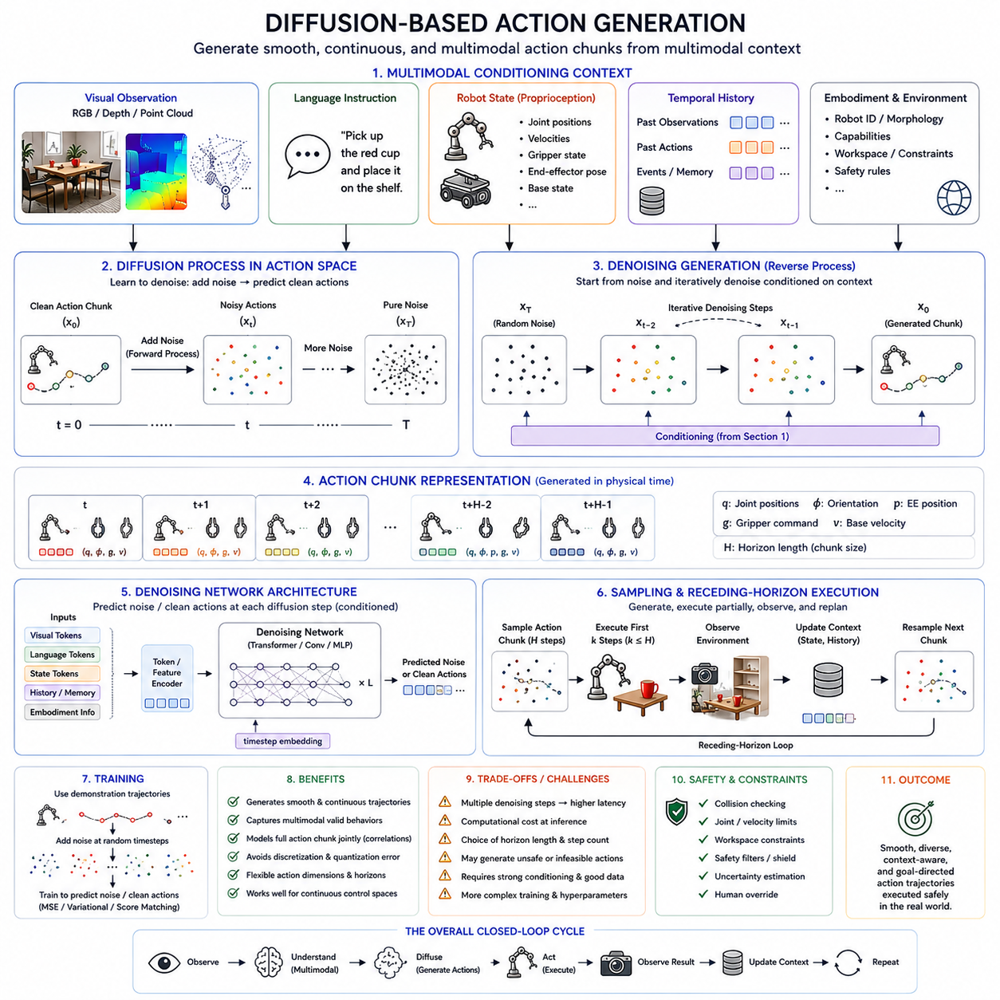{width="7.268055555555556in" height="7.268055555555556in"}

Diffusion-based action generation models robot behavior as a conditional generative process that gradually transforms noise into a coherent action sequence. Instead of predicting actions strictly one after another, as in autoregressive generation, a diffusion policy can construct multiple future actions jointly. In Vision-Language-Action systems, this provides a powerful mechanism for producing continuous, smooth, and potentially multimodal robot trajectories from rich multimodal context.

The central idea originates from diffusion generative modeling. During training, noise is progressively added to examples drawn from the real action distribution until their original structure becomes difficult to recognize. A neural network learns the reverse process by estimating how corrupted samples should be denoised. During inference, generation begins from random noise, and repeated denoising steps gradually transform that noise into an action trajectory consistent with the conditioning information.

For robotics, the generated sample can represent an action chunk containing several future control steps. Each step may include joint positions, joint velocities, end-effector translations and rotations, gripper commands, or mobile-base velocities. Rather than independently selecting every control variable, the diffusion process models the structure of the complete action chunk, allowing correlations among dimensions and across neighboring time steps to influence the generated motion.

Conditioning connects diffusion-based action generation with the broader VLA architecture. Visual observations describe objects, geometry, and spatial relationships; language specifies the intended task; robot state describes the current physical configuration; and temporal history provides information about previous behavior. These multimodal features condition the denoising network so that the generated action distribution reflects both semantic intent and the robot\'s current physical situation.

A useful conceptual formulation separates diffusion time from physical robot time. Physical time describes the sequence of actions that will be executed by the robot, whereas diffusion time describes the internal iterative denoising process used to generate that sequence. At each diffusion step, the current noisy action chunk is refined using multimodal context until the model produces a structured trajectory suitable for physical execution.

Training typically begins with demonstrated action trajectories collected from teleoperation, human demonstrations, scripted systems, autonomous policies, or simulation. Random noise of different magnitudes is applied to these action samples, and the model learns to estimate the noise, the clean action, or an equivalent denoising target. By repeating this process across diverse trajectories, the policy learns the conditional distribution of plausible robot behaviors rather than only a single deterministic mapping.

This distributional modeling is particularly valuable because robotic tasks often contain multiple valid solutions. A robot may grasp the same object from different orientations, approach it from several directions, or follow alternative collision-free paths while achieving the same goal. A deterministic regression model can average these alternatives and produce an undesirable intermediate behavior, whereas a diffusion model can preserve multiple distinct modes of successful action.

Diffusion-based generation is therefore well suited to continuous control spaces. Robot trajectories frequently contain highly correlated real-valued variables whose relationships must remain smooth over time. Instead of converting these values into discrete action tokens, a diffusion policy can directly generate continuous action sequences. This avoids quantization error and allows the model to represent fine motion variations that may be important for manipulation and precision control.

Action chunking is closely associated with this approach. The model can generate a short horizon of future actions simultaneously, producing a temporally coordinated plan rather than repeatedly invoking a large model for every control step. The resulting chunk may capture reaching, alignment, grasp preparation, or other locally coherent behavior. A lower-level controller can then track these commands at a higher control frequency than the diffusion model itself operates.

Generating several actions jointly also allows dependencies across future time steps to be represented explicitly. A movement performed early in a chunk can be coordinated with later end-effector positioning or gripper closure. The generated trajectory is therefore optimized as a structured temporal object rather than as a collection of unrelated commands. This property can improve smoothness and consistency in tasks requiring coordinated multi-step motion.

However, generating a complete action chunk does not imply that the robot must execute the entire chunk without feedback. Practical systems can use receding-horizon control, executing only the first action or a short portion of the generated sequence before acquiring new observations. The updated multimodal context is then used to generate another chunk. This combines the temporal coherence of diffusion generation with the adaptability of closed-loop control.

The denoising network can take several architectural forms. Transformer-based networks can model relationships among action time steps and multimodal tokens, while convolutional or other sequence-processing architectures can exploit local temporal structure. Cross-attention can inject visual and language context into the denoising process, enabling the model to refine candidate trajectories according to task-relevant objects, goals, robot state, and environmental constraints.

Diffusion inference differs substantially from autoregressive decoding. An autoregressive policy generally commits to actions sequentially, whereas diffusion repeatedly revises an entire candidate action representation. Early denoising iterations may establish broad trajectory structure, and later iterations refine details. The model can therefore reconsider multiple dimensions and time steps during generation rather than permanently committing to each predicted action before generating the next one.

This iterative refinement provides flexibility but introduces computational cost. Standard diffusion generation may require multiple neural-network evaluations before producing one action chunk, which can create significant latency for real-time robotics. Faster samplers, reduced denoising steps, distilled diffusion models, compact action horizons, efficient networks, and hardware acceleration can therefore be important when integrating diffusion policies into systems with strict timing requirements.

The number of denoising steps creates a practical tradeoff between computational efficiency and generation quality. More refinement steps can provide additional opportunities to shape a coherent trajectory, while fewer steps reduce inference latency. The appropriate balance depends on the dynamics of the robot, the complexity of the action distribution, available computing resources, and how frequently the system receives new observations and replans its behavior.

Multimodal conditioning must also remain stable throughout the generation process. If the visual context identifies the target object, the language instruction specifies the desired manipulation, and the robot state determines reachability, these signals should consistently guide every denoising stage. Effective conditioning prevents the generated trajectory from being merely smooth; it ensures that smoothness is combined with semantic relevance and physical appropriateness.

Temporal history can further condition diffusion-based generation. Previous observations and executed actions help the model infer whether the robot is approaching, grasping, transporting, placing, or recovering from failure. The generated action chunk can therefore reflect the current stage of a longer task. Memory mechanisms may extend this capability by preserving information that is no longer directly visible but remains important for completing long-horizon behavior.

Diffusion generation does not itself guarantee physical feasibility or safety. A statistically plausible trajectory can still violate joint limits, approach an obstacle, exceed velocity constraints, or become unsafe around people. Generated actions may therefore be combined with collision checking, trajectory validation, safety filters, low-level controllers, and runtime monitoring before execution. Learned generation and conventional control can operate together rather than being treated as mutually exclusive alternatives.

Compared with autoregressive action generation, diffusion-based methods offer a different balance of strengths. Autoregressive models naturally reuse next-token prediction and causal sequence modeling, while diffusion models naturally represent continuous, multimodal action distributions and jointly coordinated chunks. Neither approach is universally superior. The appropriate choice depends on action representation, latency, trajectory diversity, precision requirements, control frequency, and system architecture.

Hybrid architectures are also possible. A VLA model may use language-style autoregressive reasoning to generate a task-level plan or skill sequence while a diffusion policy generates continuous trajectories for individual skills. Alternatively, a shared multimodal backbone can provide context to different action decoders. Such combinations separate semantic reasoning from continuous motion generation while retaining a common representation of the task and environment.

Within Physical AI, diffusion-based action generation provides a mechanism for converting multimodal understanding into distributions of physically meaningful future behavior. Vision identifies the world, language specifies intent, robot state grounds the decision in embodiment, and diffusion transforms an initially unstructured action representation into a coherent trajectory. Combined with feedback and safety mechanisms, this enables smooth, diverse, context-sensitive, and goal-directed robot action.

확산 기반 행동 생성(Diffusion-Based Action Generation)은 로봇 행동을 노이즈(noise)에서 시작하여 일관된 행동 시퀀스(action sequence)로 점진적으로 변환하는 조건부 생성 과정(conditional generative process)으로 모델링한다. 자기회귀 생성(autoregressive generation)처럼 행동을 엄격하게 하나씩 순차 예측하는 대신, 확산 정책(diffusion policy)은 여러 미래 행동을 공동으로 구성할 수 있다. 비전-언어-행동 시스템(Vision-Language-Action System, VLA)에서 이는 풍부한 멀티모달 문맥(multimodal context)으로부터 연속적이고 부드러우며 잠재적으로 다중모드적인 로봇 궤적을 생성하는 강력한 메커니즘을 제공한다.

핵심 개념은 확산 생성 모델링(diffusion generative modeling)에서 비롯된다. 학습 과정에서는 실제 행동 분포에서 얻은 샘플에 점진적으로 노이즈를 추가하여 원래 구조를 식별하기 어려운 상태로 만든다. 신경망(neural network)은 손상된 샘플에서 노이즈를 제거하는 역과정(reverse process)을 학습한다. 추론 시에는 무작위 노이즈에서 생성을 시작하며, 반복적인 디노이징(denoising) 단계를 통해 해당 노이즈를 조건 정보에 부합하는 행동 궤적으로 점진적으로 변환한다.

로보틱스(robotics)에서 생성되는 샘플은 여러 미래 제어 단계를 포함하는 행동 청크(action chunk)를 표현할 수 있다. 각 단계에는 관절 위치(joint position), 관절 속도(joint velocity), 말단장치의 병진 및 회전(end-effector translation and rotation), 그리퍼 명령(gripper command), 모바일 베이스 속도(mobile-base velocity) 등이 포함될 수 있다. 각각의 제어 변수를 독립적으로 선택하는 대신 확산 과정은 전체 행동 청크의 구조를 모델링하여 여러 차원과 인접한 시간 단계 사이의 상관관계가 생성되는 움직임에 영향을 미치도록 한다.

조건화(conditioning)는 확산 기반 행동 생성을 보다 광범위한 VLA 아키텍처와 연결한다. 시각적 관찰(visual observation)은 객체, 기하 구조, 공간적 관계를 설명하고, 언어(language)는 의도된 작업을 지정하며, 로봇 상태(robot state)는 현재의 물리적 구성을 설명하고, 시간적 이력(temporal history)은 이전 행동에 관한 정보를 제공한다. 이러한 멀티모달 특징은 디노이징 네트워크(denoising network)를 조건화하여 생성되는 행동 분포가 의미적 의도와 로봇의 현재 물리적 상황을 모두 반영하도록 한다.

유용한 개념적 구성은 확산 시간(diffusion time)과 물리적 로봇 시간(physical robot time)을 구분하는 것이다. 물리적 시간은 로봇이 실제로 실행할 행동의 시퀀스를 나타내는 반면, 확산 시간은 해당 시퀀스를 생성하기 위해 내부적으로 수행되는 반복적 디노이징 과정을 나타낸다. 각각의 확산 단계에서 현재의 노이즈가 포함된 행동 청크는 멀티모달 문맥을 이용하여 점차 정제되며, 최종적으로 물리적 실행에 적합한 구조화된 궤적을 생성한다.

학습(training)은 일반적으로 원격조작(teleoperation), 인간 시연(human demonstration), 스크립트 기반 시스템(scripted system), 자율 정책(autonomous policy), 시뮬레이션(simulation) 등에서 수집된 시연 행동 궤적에서 시작한다. 서로 다른 크기의 무작위 노이즈를 행동 샘플에 적용하고, 모델은 노이즈 자체, 깨끗한 행동(clean action), 또는 이에 상응하는 디노이징 목표를 추정하도록 학습된다. 다양한 궤적에 걸쳐 이러한 과정을 반복함으로써 정책은 하나의 결정론적 매핑이 아니라 가능한 로봇 행동의 조건부 분포(conditional distribution)를 학습한다.

이러한 분포 모델링(distributional modeling)은 로봇 작업에 여러 개의 유효한 해결 방법이 존재하는 경우가 많기 때문에 특히 유용하다. 로봇은 동일한 객체를 서로 다른 방향에서 파지하거나, 여러 방향으로 접근하거나, 동일한 목표를 달성하면서 서로 다른 충돌 없는 경로를 따라갈 수 있다. 결정론적 회귀 모델(deterministic regression model)은 이러한 대안들을 평균화하여 바람직하지 않은 중간 행동을 생성할 수 있지만, 확산 모델은 성공적인 행동의 여러 개별 모드(mode)를 유지할 수 있다.

따라서 확산 기반 생성은 연속 제어 공간(continuous control space)에 특히 적합하다. 로봇 궤적은 시간에 따라 부드러운 관계를 유지해야 하는 높은 상관성을 가진 실수형 변수(real-valued variable)를 포함하는 경우가 많다. 이러한 값을 이산 행동 토큰(discrete action token)으로 변환하는 대신 확산 정책은 연속 행동 시퀀스를 직접 생성할 수 있다. 이를 통해 양자화 오류(quantization error)를 피하면서 조작 및 정밀 제어에 중요한 미세한 움직임의 변화를 표현할 수 있다.

행동 청킹(action chunking)은 이러한 접근 방식과 밀접하게 연결된다. 모델은 짧은 미래 구간에 해당하는 여러 행동을 동시에 생성하여 각각의 제어 단계마다 대규모 모델을 반복적으로 호출하는 대신 시간적으로 조정된 계획을 생성할 수 있다. 생성된 청크는 접근(reaching), 정렬(alignment), 파지 준비(grasp preparation) 등의 국소적으로 일관된 행동을 포착할 수 있다. 이후 저수준 제어기(low-level controller)는 확산 모델 자체보다 높은 제어 주파수로 이러한 명령을 추종할 수 있다.

여러 행동을 공동으로 생성하면 미래 시간 단계 사이의 의존성을 명시적으로 표현할 수도 있다. 행동 청크의 초기 움직임은 이후의 말단장치 위치 조정이나 그리퍼 닫기와 조율될 수 있다. 따라서 생성된 궤적은 서로 무관한 명령의 집합이 아니라 구조화된 시간적 객체(structured temporal object)로 모델링된다. 이러한 특성은 여러 단계의 움직임을 조정해야 하는 작업에서 부드러움(smoothness)과 일관성(consistency)을 향상시킬 수 있다.

그러나 완전한 행동 청크를 생성한다고 해서 로봇이 피드백 없이 전체 청크를 모두 실행해야 한다는 의미는 아니다. 실제 시스템에서는 이동 구간 제어(receding-horizon control)를 사용하여 생성된 시퀀스 중 첫 번째 행동이나 짧은 일부만 실행한 후 새로운 관찰을 획득할 수 있다. 이후 업데이트된 멀티모달 문맥을 이용하여 새로운 행동 청크를 다시 생성한다. 이를 통해 확산 생성의 시간적 일관성과 폐루프 제어(closed-loop control)의 적응성을 결합할 수 있다.

디노이징 네트워크는 여러 형태의 아키텍처를 사용할 수 있다. 트랜스포머 기반 네트워크(Transformer-based network)는 행동 시간 단계와 멀티모달 토큰 사이의 관계를 모델링할 수 있으며, 합성곱 네트워크(convolutional network) 또는 다른 시퀀스 처리 아키텍처는 국소적인 시간 구조를 활용할 수 있다. 교차 어텐션(cross-attention)은 시각 및 언어 문맥을 디노이징 과정에 주입하여 작업 관련 객체, 목표, 로봇 상태, 환경 제약 조건에 따라 후보 궤적을 정제하도록 할 수 있다.

확산 추론(diffusion inference)은 자기회귀 디코딩(autoregressive decoding)과 상당히 다르다. 자기회귀 정책은 일반적으로 행동을 순차적으로 확정하는 반면, 확산 방식은 전체 후보 행동 표현을 반복적으로 수정한다. 초기 디노이징 단계에서는 전체적인 궤적 구조를 형성하고 이후 단계에서는 세부 사항을 정제할 수 있다. 따라서 모델은 각각의 행동을 확정한 뒤 다음 행동을 생성하는 대신 생성 과정에서 여러 차원과 시간 단계를 반복적으로 재검토할 수 있다.

이러한 반복적 정제(iterative refinement)는 높은 유연성을 제공하지만 계산 비용(computational cost)을 발생시킨다. 일반적인 확산 생성은 하나의 행동 청크를 생성하기 전에 신경망을 여러 차례 평가해야 할 수 있으므로 실시간 로보틱스에서 상당한 지연시간(latency)을 발생시킬 수 있다. 따라서 빠른 샘플러(fast sampler), 디노이징 단계 감소, 증류된 확산 모델(distilled diffusion model), 짧은 행동 구간, 효율적인 네트워크, 하드웨어 가속(hardware acceleration)이 엄격한 시간 요구사항을 가진 시스템에 확산 정책을 통합할 때 중요할 수 있다.

디노이징 단계의 수는 계산 효율성과 생성 품질 사이의 실질적인 상충관계(tradeoff)를 형성한다. 더 많은 정제 단계는 일관된 궤적을 형성할 추가적인 기회를 제공할 수 있는 반면, 적은 단계는 추론 지연시간을 줄인다. 적절한 균형은 로봇의 동역학(robot dynamics), 행동 분포의 복잡성, 이용 가능한 컴퓨팅 자원, 시스템이 새로운 관찰을 획득하고 행동을 재계획하는 빈도에 따라 달라진다.

멀티모달 조건화(multimodal conditioning)는 전체 생성 과정에서 안정적으로 유지되어야 한다. 시각 문맥이 목표 객체를 식별하고, 언어 명령이 원하는 조작을 지정하며, 로봇 상태가 도달 가능성(reachability)을 결정한다면 이러한 신호는 모든 디노이징 단계에서 일관되게 작용해야 한다. 효과적인 조건화는 생성된 궤적이 단순히 부드러운 것에 그치지 않고 의미적 관련성(semantic relevance)과 물리적 적합성(physical appropriateness)을 함께 갖도록 한다.

시간적 이력도 확산 기반 생성을 추가적으로 조건화할 수 있다. 이전 관찰과 실행된 행동은 로봇이 접근, 파지, 운반, 배치 또는 실패 복구 중 어느 단계에 있는지를 모델이 추론하도록 돕는다. 따라서 생성되는 행동 청크는 보다 긴 작업에서 현재 진행 단계를 반영할 수 있다. 메모리 메커니즘(memory mechanism)은 현재 직접 관찰되지 않더라도 장기 구간 행동(long-horizon behavior)을 완료하는 데 중요한 정보를 보존함으로써 이러한 능력을 확장할 수 있다.

확산 생성 자체가 물리적 실행 가능성이나 안전성을 보장하는 것은 아니다. 통계적으로 그럴듯한 궤적이라도 관절 제한(joint limit)을 위반하거나 장애물에 접근하거나 속도 제약(velocity constraint)을 초과하거나 사람 주변에서 위험한 행동을 생성할 수 있다. 따라서 생성된 행동은 실행 전에 충돌 검사(collision checking), 궤적 검증(trajectory validation), 안전 필터(safety filter), 저수준 제어기, 런타임 모니터링(runtime monitoring)과 결합될 수 있다. 학습 기반 생성과 기존 제어는 상호 배타적인 대안이 아니라 함께 동작할 수 있다.

자기회귀 행동 생성과 비교하면 확산 기반 방식은 서로 다른 장단점의 균형을 제공한다. 자기회귀 모델은 다음 토큰 예측과 인과적 시퀀스 모델링(causal sequence modeling)을 자연스럽게 재사용하는 반면, 확산 모델은 연속적이고 다중모드적인 행동 분포와 공동으로 조정된 행동 청크를 자연스럽게 표현한다. 어느 접근 방식도 모든 상황에서 절대적으로 우월하지 않으며, 적절한 선택은 행동 표현, 지연시간, 궤적 다양성, 정밀도 요구사항, 제어 주파수, 시스템 아키텍처에 따라 달라진다.

하이브리드 아키텍처(hybrid architecture)도 가능하다. VLA 모델이 언어와 유사한 자기회귀 추론을 이용하여 작업 수준 계획(task-level plan)이나 스킬 시퀀스(skill sequence)를 생성하고, 확산 정책이 각각의 스킬에 필요한 연속 궤적을 생성하도록 구성할 수 있다. 또는 공유 멀티모달 백본(shared multimodal backbone)이 서로 다른 행동 디코더(action decoder)에 문맥을 제공할 수도 있다. 이러한 결합은 작업과 환경에 대한 공통 표현을 유지하면서 의미적 추론과 연속적인 움직임 생성을 분리할 수 있게 한다.

피지컬 AI(Physical AI)의 관점에서 확산 기반 행동 생성은 멀티모달 이해를 물리적으로 의미 있는 미래 행동의 분포로 변환하는 메커니즘을 제공한다. 비전(vision)은 세계를 식별하고, 언어는 의도를 지정하며, 로봇 상태는 의사결정을 체화체(embodiment)에 그라운딩하고, 확산 과정은 초기의 비구조화된 행동 표현을 일관된 궤적으로 변환한다. 피드백 및 안전 메커니즘과 결합하면 이를 통해 부드럽고 다양하며 문맥에 민감하고 목표 지향적인 로봇 행동을 생성할 수 있다.

## 04.08. Continuous vs Discrete Action Prediction

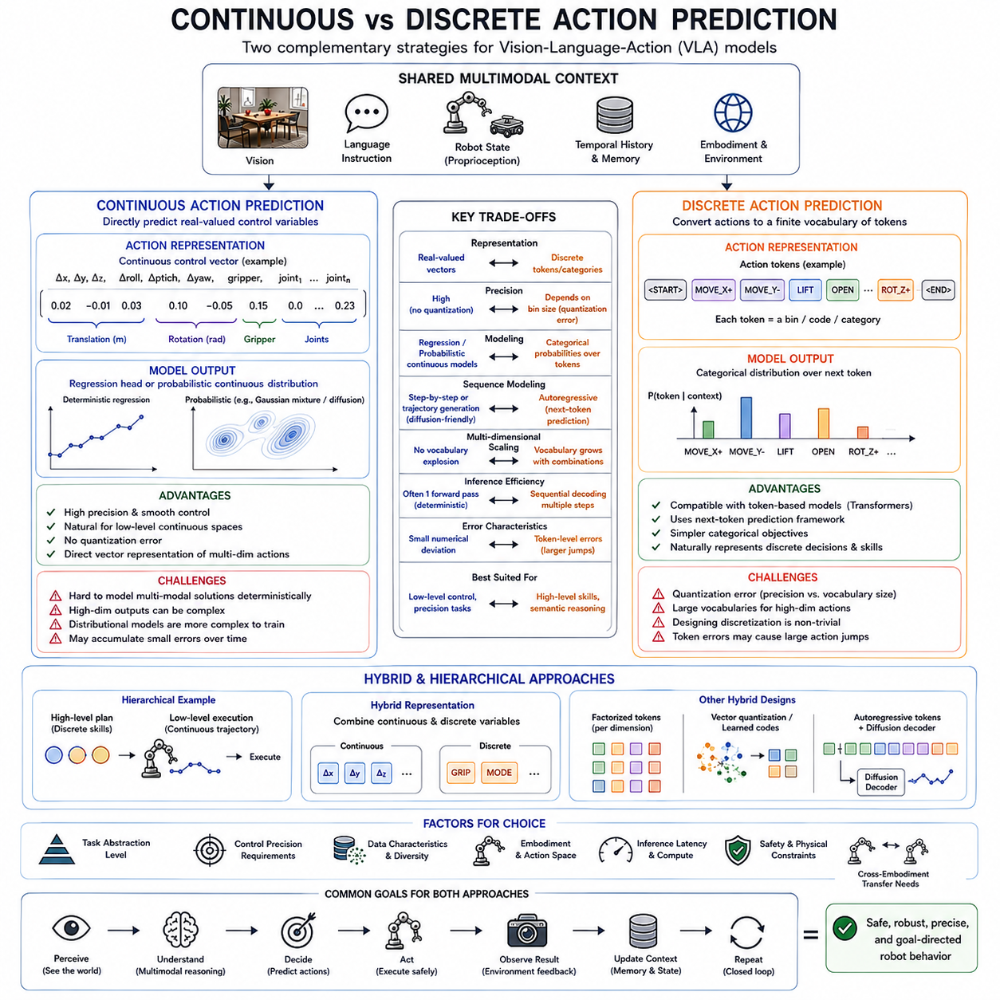{width="7.268055555555556in" height="7.268055555555556in"}

Continuous and discrete action prediction represent two fundamental strategies for converting the internal representations of a Vision-Language-Action model into executable robot behavior. Continuous prediction directly estimates real-valued control variables, whereas discrete prediction transforms the action space into a finite vocabulary of tokens or categories. The choice influences model architecture, training objectives, precision, inference, and integration with multimodal foundation models.

Continuous action prediction naturally reflects the numerical structure of many robotic control spaces. Joint positions, joint velocities, Cartesian translations, rotations, gripper commands, and mobile-base velocities are commonly represented as real-valued quantities. A continuous action head can therefore map multimodal features directly to values that preserve the resolution of the underlying control variables without first converting them into symbolic action categories.

For example, a manipulation policy may predict an end-effector displacement containing three translational values, rotational parameters, and a gripper command. These quantities can be generated through regression heads or probabilistic continuous distributions. Because small numerical differences may correspond to small physical changes, continuous representations are particularly appropriate when precise positioning, smooth motion, or coordinated multi-dimensional control is important.

A deterministic continuous model can be trained by minimizing differences between predicted actions and demonstrated actions using regression objectives. This approach is computationally straightforward but can become problematic when several different actions are valid in the same context. Averaging multiple valid trajectories may produce an intermediate action that does not correspond to any desirable behavior, especially in manipulation tasks with multiple grasp poses or approach directions.

Probabilistic continuous models address this limitation by representing distributions rather than single numerical predictions. Gaussian mixtures, latent-variable policies, diffusion-based action generators, and related methods can capture uncertainty or multiple modes in continuous action space. This enables the model to represent several physically valid solutions while preserving the fine resolution required for robot motion, although the resulting training and inference procedures may become more complex.

Discrete action prediction takes a different approach by dividing continuous control dimensions into bins, clusters, codes, or learned categories. Each resulting action can then be represented by one or more discrete tokens. For example, an end-effector displacement may be quantized into intervals corresponding to different movement magnitudes, while gripper states can naturally be represented through discrete commands such as open and close.

Tokenization makes robot actions compatible with sequence modeling methods originally developed for language. A Transformer can process visual tokens, language tokens, robot-state tokens, and action tokens within a common architecture and predict actions using next-token objectives. This architectural compatibility is one reason discrete action representations are attractive for VLA systems derived from large language models and multimodal foundation models.

Discrete prediction also enables the use of categorical probability distributions. Rather than directly estimating a precise numerical value, the model predicts probabilities over candidate action tokens. This can simplify optimization and naturally represent uncertainty among several alternatives. Autoregressive generation can then produce action tokens sequentially, allowing previously generated actions to become part of the context for subsequent predictions.

The principal cost of discretization is quantization error. When a continuous range is divided into a finite number of bins, multiple numerical values map to the same discrete representation. Coarse quantization reduces vocabulary size but may lose important control precision, while fine quantization improves resolution at the cost of a larger action vocabulary and potentially more difficult learning. The discretization strategy therefore creates a direct tradeoff between precision and representational complexity.

Multi-dimensional actions make this tradeoff more significant. A robot command may contain many joints, Cartesian dimensions, rotations, gripper variables, and mobile-base commands. Creating a token for every possible combination can produce an impractically large vocabulary. Consequently, systems may tokenize dimensions separately, factorize the action representation, use vector quantization, or construct learned action codes that capture correlations without enumerating every possible combination.

Continuous prediction avoids this vocabulary explosion because multiple control dimensions can be represented directly as vectors. However, high-dimensional continuous outputs can themselves be difficult to model when strong correlations exist among joints or across time. Generating each dimension independently may ignore coordinated motion structure. Continuous generative models and action-chunk architectures can address this problem by jointly modeling several dimensions and future time steps.

Temporal representation further distinguishes the two approaches. Discrete actions naturally form token sequences that can be modeled autoregressively, while continuous actions can be predicted step by step or generated jointly as trajectories. Diffusion policies are particularly suited to continuous action chunks because they can model correlated future commands as a structured distribution. Thus, action representation and temporal generation strategy are closely interconnected design choices.

Continuous and discrete prediction also differ in how errors appear during physical execution. Continuous models can produce small numerical deviations that accumulate over time, while discrete models can produce token-level errors that may correspond to larger jumps between action categories. Closed-loop feedback is important in both cases because new observations allow the policy to detect the consequences of executed commands and revise subsequent behavior before errors grow excessively.

The appropriate representation can depend on the abstraction level of the action. Low-level motor control generally benefits from continuous values because actuator commands and physical states are naturally numerical. Higher-level behavior can often be represented discretely through actions such as navigate, reach, grasp, open, lift, or place. Consequently, discrete representations become increasingly natural as the policy moves from precise control toward semantic skills and task-level decisions.

This observation motivates hierarchical architectures that combine both representations. A VLA model can predict a discrete skill token such as "grasp," while a lower-level continuous policy generates the trajectory required to execute that skill. Alternatively, a model can autoregressively generate task-level action tokens and use a diffusion decoder to produce continuous action chunks. Such architectures separate semantic decision making from precise physical control while retaining interaction between the two levels.

Hybrid representations can also combine continuous and discrete variables within the same action. A mobile manipulator might predict continuous base velocities and end-effector motion together with a discrete gripper command. Other architectures may discretize some dimensions while leaving high-precision variables continuous. The action representation can therefore be designed around the physical meaning and control requirements of individual variables rather than forcing the entire robot into one format.

Data characteristics also affect the choice. If demonstrations contain smooth, high-frequency trajectories, continuous modeling can preserve subtle motion structure. If the dataset contains heterogeneous robots with incompatible action spaces, discretized or learned latent action codes may provide a more standardized representation. Cross-embodiment learning may therefore benefit from separating transferable semantic action concepts from platform-specific continuous execution variables.

Inference efficiency must also be considered. A continuous action head can often generate numerical values in a single forward pass, whereas autoregressive discrete generation may require multiple sequential decoding operations. Conversely, iterative continuous generators such as diffusion models can require several denoising evaluations. The practical latency of either representation therefore depends not only on whether actions are continuous or discrete but also on the generation algorithm built around them.

Safety requirements interact with representation choice as well. Continuous commands can be checked against numerical limits for joint position, velocity, acceleration, force, or workspace boundaries. Discrete actions can be constrained by masking unsafe tokens or preventing invalid skill transitions. Regardless of representation, learned predictions should remain subject to physical feasibility checks, collision avoidance, runtime monitoring, and appropriate low-level safety mechanisms.

Continuous and discrete action prediction should therefore not be viewed as mutually exclusive competing philosophies. They represent different abstractions for encoding physical behavior, each with advantages for particular layers of robotic intelligence. Continuous representations preserve numerical precision and smooth control, while discrete representations provide compatibility with token-based sequence models and semantic action abstractions.

For VLA systems, the central design question is where continuous physical control should meet discrete foundation-model reasoning. Vision and language models operate effectively over structured tokens, while robots ultimately interact with a continuous physical world. Effective architectures bridge these domains through tokenization, continuous decoders, latent actions, hierarchical policies, or hybrid representations, allowing semantic reasoning to be translated into precise and executable movement.

The broader objective is not to select one representation universally but to construct an action interface appropriate to the task, embodiment, dataset, and control architecture. Continuous prediction, discrete token generation, and hybrid approaches can each contribute different capabilities. Their integration provides a path from multimodal understanding and high-level intent to temporally coherent, physically accurate, feedback-aware robot behavior.

연속 및 이산 행동 예측(Continuous and Discrete Action Prediction)은 비전-언어-행동 모델(Vision-Language-Action Model, VLA)의 내부 표현을 실행 가능한 로봇 행동으로 변환하는 두 가지 기본적인 전략이다. 연속 예측(continuous prediction)은 실수형 제어 변수(real-valued control variable)를 직접 추정하는 반면, 이산 예측(discrete prediction)은 행동 공간(action space)을 유한한 토큰(token) 또는 범주(category)의 어휘로 변환한다. 이러한 선택은 모델 아키텍처, 학습 목표, 정밀도, 추론, 멀티모달 파운데이션 모델(multimodal foundation model)과의 통합 방식에 영향을 미친다.

연속 행동 예측(continuous action prediction)은 많은 로봇 제어 공간이 가지는 수치적 구조를 자연스럽게 반영한다. 관절 위치(joint position), 관절 속도(joint velocity), 카테시안 병진(Cartesian translation), 회전(rotation), 그리퍼 명령(gripper command), 모바일 베이스 속도(mobile-base velocity)는 일반적으로 실수값으로 표현된다. 따라서 연속 행동 헤드(continuous action head)는 멀티모달 특징을 기호적인 행동 범주로 먼저 변환하지 않고 기본 제어 변수의 해상도를 유지하는 값으로 직접 매핑할 수 있다.

예를 들어 조작 정책(manipulation policy)은 세 개의 병진 값, 회전 매개변수, 그리퍼 명령으로 구성된 말단장치 변위(end-effector displacement)를 예측할 수 있다. 이러한 값은 회귀 헤드(regression head) 또는 확률적 연속 분포(probabilistic continuous distribution)를 통해 생성할 수 있다. 작은 수치 차이가 작은 물리적 변화에 대응할 수 있으므로 연속 표현은 정밀한 위치 결정, 부드러운 움직임, 조정된 다차원 제어가 중요한 경우 특히 적합하다.

결정론적 연속 모델(deterministic continuous model)은 예측된 행동과 시연된 행동 사이의 차이를 회귀 목표(regression objective)를 이용하여 최소화하는 방식으로 학습할 수 있다. 이러한 접근 방식은 계산적으로 단순하지만 동일한 문맥에서 서로 다른 여러 행동이 유효한 경우 문제가 발생할 수 있다. 여러 유효한 궤적을 평균화하면 특히 다양한 파지 자세나 접근 방향이 존재하는 조작 작업에서 실제로 바람직한 행동과 일치하지 않는 중간 행동을 생성할 수 있다.

확률적 연속 모델(probabilistic continuous model)은 하나의 수치 예측 대신 분포(distribution)를 표현함으로써 이러한 한계를 해결한다. 가우시안 혼합(Gaussian mixture), 잠재 변수 정책(latent-variable policy), 확산 기반 행동 생성기(diffusion-based action generator) 등의 방법은 연속 행동 공간에서 불확실성이나 여러 모드(mode)를 포착할 수 있다. 이를 통해 로봇 움직임에 필요한 높은 해상도를 유지하면서 여러 개의 물리적으로 유효한 해결책을 표현할 수 있지만, 학습 및 추론 과정은 더욱 복잡해질 수 있다.

이산 행동 예측(discrete action prediction)은 연속 제어 차원을 구간(bin), 클러스터(cluster), 코드(code), 또는 학습된 범주로 분할하는 다른 접근 방식을 사용한다. 이렇게 생성된 각각의 행동은 하나 이상의 이산 토큰(discrete token)으로 표현할 수 있다. 예를 들어 말단장치 변위는 서로 다른 이동 크기에 대응하는 구간으로 양자화할 수 있으며, 그리퍼 상태는 열기(open)와 닫기(close) 같은 이산 명령으로 자연스럽게 표현할 수 있다.

토큰화(tokenization)는 로봇 행동을 원래 언어를 위해 개발된 시퀀스 모델링(sequence modeling) 방법과 호환되도록 한다. 트랜스포머(Transformer)는 시각 토큰(visual token), 언어 토큰(language token), 로봇 상태 토큰(robot-state token), 행동 토큰(action token)을 하나의 공통 아키텍처에서 처리하고 다음 토큰 예측(next-token prediction)을 통해 행동을 생성할 수 있다. 이러한 아키텍처적 호환성은 대규모 언어 모델과 멀티모달 파운데이션 모델에서 파생된 VLA 시스템에서 이산 행동 표현이 매력적인 이유 중 하나이다.

이산 예측은 범주형 확률 분포(categorical probability distribution)를 사용할 수도 있다. 정확한 수치값을 직접 추정하는 대신 모델은 후보 행동 토큰에 대한 확률을 예측한다. 이를 통해 최적화 과정을 단순화하면서 여러 대안 사이의 불확실성을 자연스럽게 표현할 수 있다. 이후 자기회귀 생성(autoregressive generation)을 통해 행동 토큰을 순차적으로 생성하고, 이전에 생성된 행동을 이후 예측을 위한 문맥의 일부로 사용할 수 있다.

이산화(discretization)의 가장 중요한 비용은 양자화 오류(quantization error)이다. 연속 범위를 유한한 수의 구간으로 나누면 여러 수치값이 동일한 이산 표현으로 매핑된다. 거친 양자화(coarse quantization)는 어휘 크기를 줄이지만 중요한 제어 정밀도를 잃을 수 있으며, 세밀한 양자화(fine quantization)는 해상도를 향상시키는 대신 행동 어휘를 크게 만들고 학습을 어렵게 할 수 있다. 따라서 이산화 전략은 정밀도와 표현 복잡성 사이에 직접적인 상충관계(tradeoff)를 형성한다.

다차원 행동(multi-dimensional action)은 이러한 상충관계를 더욱 중요하게 만든다. 하나의 로봇 명령에는 여러 관절, 카테시안 차원, 회전, 그리퍼 변수, 모바일 베이스 명령이 포함될 수 있다. 가능한 모든 조합마다 토큰을 생성하면 비현실적으로 큰 어휘가 만들어질 수 있다. 따라서 시스템은 각 차원을 별도로 토큰화하거나 행동 표현을 인수분해(factorization)하거나 벡터 양자화(vector quantization)를 사용하거나 모든 조합을 직접 열거하지 않고 상관관계를 포착하는 학습된 행동 코드(learned action code)를 구성할 수 있다.

연속 예측은 여러 제어 차원을 직접 벡터(vector)로 표현할 수 있기 때문에 이러한 어휘 폭발(vocabulary explosion)을 피할 수 있다. 그러나 관절 사이 또는 시간에 걸쳐 강한 상관관계가 존재하는 경우 고차원 연속 출력 자체를 모델링하는 것도 어려울 수 있다. 각 차원을 독립적으로 생성하면 조정된 움직임 구조를 제대로 반영하지 못할 수 있다. 연속 생성 모델(continuous generative model)과 행동 청크 아키텍처(action-chunk architecture)는 여러 차원과 미래 시간 단계를 공동으로 모델링하여 이러한 문제를 해결할 수 있다.

시간적 표현(temporal representation)은 두 접근 방식의 차이를 더욱 분명하게 한다. 이산 행동은 자연스럽게 자기회귀 방식으로 모델링할 수 있는 토큰 시퀀스를 형성하는 반면, 연속 행동은 단계별로 예측하거나 궤적 전체를 공동으로 생성할 수 있다. 확산 정책(diffusion policy)은 상관관계를 가진 미래 명령을 구조화된 분포로 모델링할 수 있기 때문에 연속 행동 청크에 특히 적합하다. 따라서 행동 표현과 시간적 생성 전략(temporal generation strategy)은 서로 긴밀하게 연결된 설계 선택이다.

연속 및 이산 예측은 물리적 실행 과정에서 오류가 나타나는 방식에서도 차이가 있다. 연속 모델은 시간이 지남에 따라 누적될 수 있는 작은 수치 편차를 생성할 수 있는 반면, 이산 모델의 토큰 수준 오류(token-level error)는 행동 범주 사이에서 상대적으로 큰 변화로 나타날 수 있다. 두 방식 모두에서 폐루프 피드백(closed-loop feedback)이 중요하며, 새로운 관찰을 통해 실행된 명령의 결과를 감지하고 오류가 과도하게 증가하기 전에 이후 행동을 수정할 수 있다.

적절한 표현 방식은 행동의 추상화 수준(abstraction level)에 따라 달라질 수 있다. 저수준 모터 제어(low-level motor control)는 액추에이터 명령과 물리적 상태가 본질적으로 수치형이기 때문에 일반적으로 연속값이 적합하다. 반면 상위 수준 행동은 이동(navigate), 접근(reach), 파지(grasp), 열기(open), 들어 올리기(lift), 배치(place)와 같은 이산 행동으로 표현하기 쉽다. 따라서 정책이 정밀 제어에서 의미적 스킬 및 작업 수준 의사결정으로 이동할수록 이산 표현이 더욱 자연스러워진다.

이러한 특성은 두 표현을 결합하는 계층적 아키텍처(hierarchical architecture)의 필요성을 제시한다. VLA 모델은 "파지(grasp)"와 같은 이산 스킬 토큰(discrete skill token)을 예측하고, 저수준 연속 정책(low-level continuous policy)이 해당 스킬을 실행하는 데 필요한 궤적을 생성할 수 있다. 또는 모델이 작업 수준 행동 토큰을 자기회귀적으로 생성하고 확산 디코더(diffusion decoder)가 연속 행동 청크를 생성할 수도 있다. 이러한 아키텍처는 의미적 의사결정과 정밀한 물리 제어를 분리하면서 두 수준 사이의 상호작용을 유지한다.

하이브리드 표현(hybrid representation)은 하나의 행동 안에서 연속 변수와 이산 변수를 결합할 수도 있다. 모바일 매니퓰레이터(mobile manipulator)는 연속적인 베이스 속도와 말단장치 움직임을 예측하면서 동시에 이산적인 그리퍼 명령을 생성할 수 있다. 다른 아키텍처는 일부 차원을 이산화하면서 높은 정밀도가 필요한 변수는 연속값으로 유지할 수 있다. 따라서 전체 로봇을 하나의 표현 형식으로 강제하기보다 각 변수의 물리적 의미와 제어 요구사항에 따라 행동 표현을 설계할 수 있다.

데이터 특성(data characteristics) 역시 표현 방식의 선택에 영향을 미친다. 시연 데이터가 부드러운 고주파 궤적을 포함한다면 연속 모델링이 미세한 움직임 구조를 유지할 수 있다. 데이터셋에 서로 호환되지 않는 행동 공간을 가진 다양한 로봇이 포함된다면 이산화되거나 학습된 잠재 행동 코드(latent action code)가 보다 표준화된 표현을 제공할 수 있다. 따라서 교차 체화 학습(cross-embodiment learning)은 전이 가능한 의미적 행동 개념과 플랫폼 특화 연속 실행 변수를 분리함으로써 이점을 얻을 수 있다.

추론 효율성(inference efficiency) 역시 고려해야 한다. 연속 행동 헤드는 하나의 순전파(forward pass)로 수치값을 생성할 수 있는 반면, 자기회귀 이산 생성은 여러 번의 순차적 디코딩 연산을 요구할 수 있다. 반대로 확산 모델과 같은 반복적 연속 생성기(iterative continuous generator)는 여러 번의 디노이징 평가를 필요로 할 수 있다. 따라서 실제 지연시간은 행동이 연속인지 이산인지뿐만 아니라 그 표현을 기반으로 사용하는 생성 알고리즘에도 영향을 받는다.

안전 요구사항(safety requirement)도 표현 방식의 선택과 상호작용한다. 연속 명령은 관절 위치, 속도, 가속도, 힘(force), 작업 공간 경계(workspace boundary)와 같은 수치적 제한을 기준으로 검사할 수 있다. 이산 행동은 위험한 토큰을 마스킹(masking)하거나 유효하지 않은 스킬 전이(skill transition)를 방지하는 방식으로 제한할 수 있다. 어떤 표현을 사용하더라도 학습된 예측에는 물리적 실행 가능성 검사, 충돌 회피(collision avoidance), 런타임 모니터링(runtime monitoring), 적절한 저수준 안전 메커니즘이 적용되어야 한다.

따라서 연속 및 이산 행동 예측은 서로 배타적으로 경쟁하는 방식으로 이해해서는 안 된다. 이들은 물리적 행동을 인코딩하기 위한 서로 다른 추상화 방법이며, 각각 로봇 지능의 특정 계층에서 장점을 가진다. 연속 표현은 수치적 정밀도와 부드러운 제어를 유지하는 데 유리하고, 이산 표현은 토큰 기반 시퀀스 모델(token-based sequence model)과 의미적 행동 추상화(semantic action abstraction)에 높은 호환성을 제공한다.

VLA 시스템에서 핵심적인 설계 문제는 연속적인 물리 제어와 이산적인 파운데이션 모델 추론(foundation-model reasoning)이 어느 지점에서 연결되어야 하는지를 결정하는 것이다. 비전 및 언어 모델은 구조화된 토큰을 효과적으로 처리하지만 로봇은 궁극적으로 연속적인 물리 세계와 상호작용한다. 효과적인 아키텍처는 토큰화, 연속 디코더(continuous decoder), 잠재 행동(latent action), 계층적 정책(hierarchical policy), 하이브리드 표현을 통해 두 영역을 연결하여 의미적 추론을 정밀하고 실행 가능한 움직임으로 변환한다.

보다 광범위한 목표는 하나의 표현을 모든 상황에 적용하는 것이 아니라 작업, 체화체(embodiment), 데이터셋, 제어 아키텍처에 적합한 행동 인터페이스(action interface)를 구축하는 것이다. 연속 예측, 이산 토큰 생성, 하이브리드 접근 방식은 각각 서로 다른 능력을 제공할 수 있다. 이들을 적절하게 통합하면 멀티모달 이해와 상위 수준 의도를 시간적으로 일관되고, 물리적으로 정확하며, 피드백을 인식하는 로봇 행동으로 연결할 수 있다.

## 04.09. Single Step vs Action Chunk Prediction

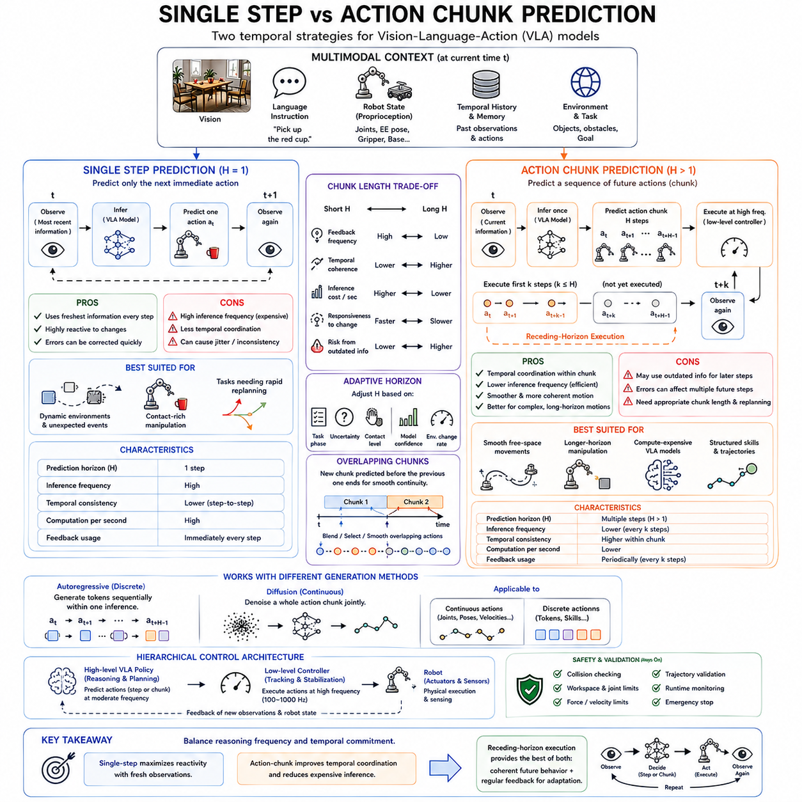{width="7.268055555555556in" height="7.268055555555556in"}

Single-step and action-chunk prediction define two different temporal strategies for generating robot behavior in Vision-Language-Action models. Single-step prediction generates the next immediate action and then observes the environment again, whereas action-chunk prediction generates several future actions together as a short sequence. The choice determines how frequently the model reasons, how strongly actions are coordinated over time, and how rapidly behavior can respond to new observations.

In single-step prediction, the model receives the current visual observation, language instruction, robot state, and relevant temporal context and predicts one action for the next control step. After execution, the robot obtains another observation and repeats the process. This creates a tightly coupled perception-action loop in which every prediction can incorporate the most recent information about the environment and the consequences of previous behavior.

This frequent feedback is the primary advantage of single-step prediction. If an object moves, a grasp fails, or an obstacle suddenly appears, the next inference can immediately incorporate the changed situation. The policy does not need to remain committed to a long sequence generated from an outdated observation. Single-step prediction is therefore naturally compatible with reactive behavior and tasks in which environmental conditions can change rapidly.

However, repeatedly invoking a large VLA model for every action can be computationally expensive. Robot controllers may operate at tens, hundreds, or even thousands of updates per second, while a large multimodal model may require substantially more time for each inference. Attempting to generate every low-level control command directly from the foundation model can therefore create a mismatch between model inference frequency and the control frequency required by physical hardware.

Single-step prediction can also produce temporally inconsistent behavior if each action is optimized primarily from the current context. Small variations in observations or model outputs may cause neighboring commands to fluctuate, producing jitter or unstable motion. Temporal history and smoothing mechanisms can reduce this problem, but individual predictions still provide less explicit coordination across future time steps than methods that jointly model a sequence of upcoming actions.

Action-chunk prediction addresses these limitations by generating a sequence of future actions from a single inference. If the chunk horizon is H, the model predicts actions from the current step through several future steps as one structured output. These actions may contain joint commands, end-effector poses, gripper states, base velocities, or other control variables, depending on the robot and the action representation used by the VLA architecture.

Predicting multiple actions jointly allows the model to capture temporal dependencies within the chunk. An approach movement can be coordinated with later alignment, gripper closure, and lifting rather than treating each command as an isolated decision. This can produce smoother and more coherent behavior because the model explicitly represents how nearby future actions should relate to one another over a short physical horizon.

Action chunks also reduce the required inference frequency of the large model. A VLA can generate several future commands at once, while a lower-level controller executes them at a higher frequency. This separation is particularly useful when multimodal reasoning is computationally expensive. The foundation model can operate as a slower behavioral policy while real-time control, interpolation, tracking, and stabilization remain the responsibility of faster robot-control components.

The length of an action chunk is an important design parameter. Short chunks preserve frequent opportunities for environmental feedback but provide only limited computational savings and temporal planning. Longer chunks reduce inference frequency and can capture more extended motion structure, but they increase the risk that later actions become inappropriate as the environment changes. Chunk length therefore creates a tradeoff between temporal coherence, computational efficiency, and responsiveness.

A fixed chunk length is not always optimal. Simple free-space movement may tolerate a relatively long prediction horizon, whereas contact-rich manipulation may require frequent replanning. Adaptive approaches can potentially shorten the chunk near uncertain interactions and extend it during predictable motion. The appropriate temporal horizon can therefore depend on task phase, environmental uncertainty, robot dynamics, model confidence, and the expected rate of external change.

Action-chunk prediction does not require open-loop execution of the complete predicted sequence. A common strategy is receding-horizon execution, in which the model predicts H future actions but the robot executes only the first k actions, where k is smaller than H. The system then obtains a new observation and predicts another chunk. This preserves some benefits of joint temporal prediction while regularly incorporating feedback from the physical environment.

Overlapping action chunks can further improve continuity between successive predictions. When a new chunk is generated before the previous one has completely expired, the system can combine, select, or smooth overlapping commands. This reduces abrupt transitions between independently generated chunks and can improve motion consistency. Temporal ensembling is one possible mechanism for combining predictions corresponding to the same physical time step from different inference cycles.

Action chunking can be used with both autoregressive and diffusion-based action generation. An autoregressive model may sequentially produce several future action tokens during one inference cycle, while a diffusion policy can jointly refine an entire continuous action chunk from noise. The concept of chunking therefore describes the temporal organization of predicted behavior rather than requiring one specific generative architecture or action representation.

Continuous action chunks are especially useful for coordinated trajectories containing strongly correlated numerical variables. A sequence of end-effector positions, orientations, and gripper states can be modeled jointly so that motion remains consistent across dimensions and time. Discrete action chunks can similarly represent sequences of action tokens or semantic skills. Thus, chunk prediction can operate at multiple abstraction levels, from motor commands to reusable robot behaviors.

Training requirements differ according to the selected prediction horizon. For single-step prediction, each trajectory can provide many observation-action pairs in which the model learns the next immediate command. For chunk prediction, each training sample associates the current context with a future segment of the demonstrated trajectory. The model must therefore learn not only which action follows the current state but also the short-term temporal structure of successful behavior.

Longer chunks can increase uncertainty because future actions depend on environmental states that have not yet been observed. At the beginning of a chunk, the model may predict actions based on an expected evolution of the scene. If execution produces an unexpected result, later predictions may no longer match reality. This uncertainty grows with prediction horizon, making feedback frequency and replanning particularly important when operating in dynamic or contact-sensitive environments.

Single-step and chunk-based methods also differ in their exposure to prediction errors. Single-step errors can be corrected quickly through the next observation, but frequent independent predictions may introduce noise. Chunk prediction can generate internally consistent motion, yet an incorrect early assumption may affect several future commands simultaneously. Neither approach eliminates error accumulation; instead, each distributes uncertainty differently across the perception-action loop.

Safety considerations strongly favor periodic feedback regardless of prediction strategy. Even a coherent action chunk should not be treated as an unconditional command sequence when people, obstacles, contacts, or uncertain dynamics are present. Collision checking, workspace constraints, force limits, trajectory validation, runtime monitoring, and emergency controllers can evaluate commands during execution and interrupt a chunk when the physical situation becomes unsafe.

A hierarchical architecture can exploit both temporal strategies. A VLA model may generate short action chunks at a moderate frequency, while a conventional controller executes and stabilizes individual commands at a much higher frequency. At another level, a task planner may generate longer semantic skill sequences. This creates multiple temporal scales in which high-level reasoning, learned action generation, and low-level control operate at frequencies appropriate to their computational and physical responsibilities.

The distinction between single-step and action-chunk prediction is therefore better understood as a continuum than as a strict binary choice. A chunk of length one corresponds to single-step prediction, while increasing the horizon progressively shifts the architecture toward longer temporal commitments. Practical systems can select different horizons according to task requirements or dynamically modify them as uncertainty, contact conditions, and environmental complexity change.

For VLA systems, the central objective is to balance reasoning frequency with physical responsiveness. Single-step prediction maximizes opportunities to use fresh observations, while action chunks improve temporal coordination and amortize expensive model inference across multiple commands. Receding-horizon execution provides an important middle ground by generating coherent future behavior while repeatedly returning to perception for correction and adaptation.

Ultimately, temporal action prediction determines how multimodal intelligence is translated into behavior across physical time. Vision and robot state describe the current situation, language specifies the objective, and the VLA must decide not only what action to produce but how far into the future it should commit. Effective systems coordinate prediction horizon, feedback frequency, model latency, controller rate, and uncertainty to achieve responsive, smooth, efficient, and reliable robot behavior.

단일 단계 및 행동 청크 예측(Single-Step and Action-Chunk Prediction)은 비전-언어-행동 모델(Vision-Language-Action Model, VLA)에서 로봇 행동을 생성하기 위한 서로 다른 두 가지 시간적 전략(temporal strategy)을 정의한다. 단일 단계 예측(single-step prediction)은 바로 다음의 즉각적인 행동을 생성한 후 환경을 다시 관찰하는 반면, 행동 청크 예측(action-chunk prediction)은 여러 미래 행동을 짧은 시퀀스로 함께 생성한다. 이러한 선택은 모델이 얼마나 자주 추론하는지, 행동이 시간에 걸쳐 얼마나 강하게 조정되는지, 새로운 관찰에 얼마나 빠르게 대응할 수 있는지를 결정한다.

단일 단계 예측에서 모델은 현재의 시각적 관찰(visual observation), 언어 명령(language instruction), 로봇 상태(robot state), 관련 시간적 문맥(temporal context)을 입력받아 다음 제어 단계를 위한 하나의 행동을 예측한다. 행동이 실행된 후 로봇은 새로운 관찰을 획득하고 이 과정을 반복한다. 이를 통해 각각의 예측이 환경에 관한 최신 정보와 이전 행동의 결과를 반영할 수 있는 긴밀하게 결합된 지각-행동 루프(perception-action loop)가 형성된다.

이러한 빈번한 피드백(frequent feedback)은 단일 단계 예측의 가장 중요한 장점이다. 객체가 움직이거나, 파지(grasp)가 실패하거나, 장애물이 갑자기 나타나는 경우 다음 추론에서 변화된 상황을 즉시 반영할 수 있다. 정책은 오래된 관찰을 기반으로 생성된 긴 시퀀스에 계속 구속될 필요가 없다. 따라서 단일 단계 예측은 반응형 행동(reactive behavior)과 환경 조건이 빠르게 변화할 수 있는 작업에 자연스럽게 적합하다.

그러나 모든 행동마다 대규모 VLA 모델을 반복적으로 호출하는 것은 계산 비용이 높을 수 있다. 로봇 제어기(robot controller)는 초당 수십, 수백 또는 수천 번의 업데이트로 동작할 수 있지만 대규모 멀티모달 모델(multimodal model)은 각각의 추론에 훨씬 더 많은 시간을 필요로 할 수 있다. 따라서 모든 저수준 제어 명령(low-level control command)을 파운데이션 모델에서 직접 생성하려고 하면 모델의 추론 주파수와 물리적 하드웨어가 요구하는 제어 주파수 사이에 불일치가 발생할 수 있다.

각각의 행동이 주로 현재 문맥을 기준으로 최적화된다면 단일 단계 예측은 시간적으로 일관되지 않은 행동을 생성할 수도 있다. 관찰이나 모델 출력의 작은 변화로 인해 인접한 명령이 변동하면서 떨림(jitter)이나 불안정한 움직임이 발생할 수 있다. 시간적 이력(temporal history)과 평활화 메커니즘(smoothing mechanism)을 통해 이러한 문제를 줄일 수 있지만, 개별 예측은 미래 행동 시퀀스를 공동으로 모델링하는 방식보다 미래 시간 단계 사이의 명시적인 조정 능력이 제한적이다.

행동 청크 예측은 한 번의 추론으로 미래 행동 시퀀스를 생성함으로써 이러한 한계를 해결한다. 청크 구간(chunk horizon)이 H라면 모델은 현재 단계부터 여러 미래 단계까지의 행동을 하나의 구조화된 출력(structured output)으로 예측한다. 이러한 행동은 로봇과 VLA 아키텍처에서 사용하는 행동 표현에 따라 관절 명령(joint command), 말단장치 자세(end-effector pose), 그리퍼 상태(gripper state), 베이스 속도(base velocity), 기타 제어 변수를 포함할 수 있다.

여러 행동을 공동으로 예측하면 모델은 청크 내부의 시간적 의존성(temporal dependency)을 포착할 수 있다. 접근 움직임(approach movement)을 이후의 정렬(alignment), 그리퍼 닫기(gripper closure), 들어 올리기(lifting)와 조정할 수 있으므로 각각의 명령을 독립적인 결정으로 처리하지 않아도 된다. 이를 통해 모델은 가까운 미래의 행동들이 짧은 물리적 시간 구간에서 서로 어떻게 연결되어야 하는지를 명시적으로 표현하여 더욱 부드럽고 일관된 행동을 생성할 수 있다.

행동 청크는 대규모 모델에서 요구되는 추론 주파수(inference frequency)도 낮춘다. VLA는 여러 미래 명령을 한 번에 생성하고 저수준 제어기가 이를 더 높은 주파수로 실행할 수 있다. 이러한 분리는 멀티모달 추론(multimodal reasoning)의 계산 비용이 높은 경우 특히 유용하다. 파운데이션 모델은 상대적으로 느린 행동 정책(behavioral policy)으로 동작하고 실시간 제어, 보간(interpolation), 추종(tracking), 안정화(stabilization)는 더 빠른 로봇 제어 구성요소가 담당할 수 있다.

행동 청크의 길이는 중요한 설계 매개변수(design parameter)이다. 짧은 청크는 환경 피드백을 빈번하게 반영할 수 있지만 계산 비용 절감과 시간적 계획의 효과가 제한된다. 긴 청크는 추론 빈도를 낮추고 보다 긴 움직임 구조를 포착할 수 있지만 환경이 변화하면 청크 후반부의 행동이 더 이상 적절하지 않을 위험이 증가한다. 따라서 청크 길이는 시간적 일관성, 계산 효율성, 반응성 사이의 상충관계(tradeoff)를 형성한다.

고정된 청크 길이(fixed chunk length)가 항상 최적인 것은 아니다. 단순한 자유 공간 움직임(free-space movement)에서는 비교적 긴 예측 구간을 사용할 수 있지만 접촉이 많은 조작(contact-rich manipulation)에서는 빈번한 재계획(replanning)이 필요할 수 있다. 적응형 접근 방식(adaptive approach)은 불확실한 상호작용 주변에서는 청크를 짧게 하고 예측 가능한 움직임에서는 길게 설정할 수 있다. 따라서 적절한 시간 구간은 작업 단계, 환경 불확실성, 로봇 동역학(robot dynamics), 모델 신뢰도(model confidence), 외부 변화 속도에 따라 달라질 수 있다.

행동 청크 예측이 예측된 전체 시퀀스를 개루프(open-loop) 방식으로 실행해야 한다는 의미는 아니다. 일반적인 전략은 이동 구간 실행(receding-horizon execution)을 사용하는 것으로, 모델이 H개의 미래 행동을 예측하더라도 로봇은 H보다 작은 k개의 초기 행동만 실행한다. 이후 시스템은 새로운 관찰을 획득하고 다시 새로운 청크를 예측한다. 이를 통해 공동 시간 예측의 장점을 유지하면서 물리적 환경으로부터 정기적으로 피드백을 반영할 수 있다.

중첩 행동 청크(overlapping action chunk)는 연속적인 예측 사이의 일관성을 더욱 향상시킬 수 있다. 이전 청크가 완전히 종료되기 전에 새로운 청크를 생성하면 시스템은 중첩되는 명령을 결합하거나 선택하거나 평활화할 수 있다. 이를 통해 서로 독립적으로 생성된 청크 사이의 급격한 전환을 줄이고 움직임의 일관성을 높일 수 있다. 시간적 앙상블링(temporal ensembling)은 서로 다른 추론 주기에서 동일한 물리적 시간 단계에 대해 생성된 예측을 결합하는 하나의 가능한 메커니즘이다.

행동 청킹(action chunking)은 자기회귀 행동 생성(autoregressive action generation)과 확산 기반 행동 생성(diffusion-based action generation) 모두에서 사용할 수 있다. 자기회귀 모델은 한 번의 추론 주기에서 여러 미래 행동 토큰(action token)을 순차적으로 생성할 수 있으며, 확산 정책(diffusion policy)은 노이즈로부터 전체 연속 행동 청크를 공동으로 정제할 수 있다. 따라서 청킹은 특정 생성 아키텍처나 행동 표현을 요구하는 개념이 아니라 예측된 행동의 시간적 구성 방식을 의미한다.

연속 행동 청크(continuous action chunk)는 강한 상관관계를 갖는 수치형 변수로 구성된 조정된 궤적에 특히 유용하다. 말단장치 위치, 방향, 그리퍼 상태의 시퀀스를 공동으로 모델링하면 움직임이 여러 차원과 시간에 걸쳐 일관성을 유지할 수 있다. 이산 행동 청크(discrete action chunk) 역시 행동 토큰이나 의미적 스킬(semantic skill)의 시퀀스를 표현할 수 있다. 따라서 청크 예측은 모터 명령에서 재사용 가능한 로봇 행동에 이르기까지 다양한 추상화 수준에서 동작할 수 있다.

학습 요구사항(training requirement)은 선택한 예측 구간에 따라 달라진다. 단일 단계 예측에서는 각각의 궤적에서 모델이 바로 다음 명령을 학습하는 많은 관찰-행동 쌍(observation-action pair)을 생성할 수 있다. 청크 예측에서는 각각의 학습 샘플이 현재 문맥과 시연 궤적의 미래 구간을 연결한다. 따라서 모델은 현재 상태 다음에 어떤 행동이 수행되는지만 학습하는 것이 아니라 성공적인 행동의 단기적인 시간 구조(short-term temporal structure)도 함께 학습해야 한다.

긴 청크는 미래 행동이 아직 관찰되지 않은 환경 상태에 의존하기 때문에 불확실성(uncertainty)을 증가시킬 수 있다. 청크 시작 시점에서 모델은 예상되는 장면의 변화에 기초하여 행동을 예측할 수 있다. 실행 과정에서 예상하지 못한 결과가 발생하면 후반부 예측은 더 이상 실제 상황과 일치하지 않을 수 있다. 이러한 불확실성은 예측 구간이 길어질수록 증가하므로 동적 환경이나 접촉에 민감한 환경에서는 피드백 주파수(feedback frequency)와 재계획이 특히 중요하다.

단일 단계 방식과 청크 기반 방식은 예측 오류에 노출되는 방식에서도 차이가 있다. 단일 단계 오류는 다음 관찰을 통해 빠르게 수정할 수 있지만 빈번한 독립 예측으로 인해 노이즈가 발생할 수 있다. 청크 예측은 내부적으로 일관된 움직임을 생성할 수 있지만 초기의 잘못된 가정이 여러 미래 명령에 동시에 영향을 미칠 수 있다. 두 접근 방식 모두 오류 누적(error accumulation)을 완전히 제거하지는 않으며, 대신 지각-행동 루프에서 불확실성을 서로 다른 방식으로 분배한다.

안전성(safety)을 고려하면 예측 전략과 관계없이 주기적인 피드백이 중요하다. 일관성 있게 생성된 행동 청크라도 사람, 장애물, 접촉 또는 불확실한 동역학이 존재하는 상황에서는 무조건 실행해야 하는 명령 시퀀스로 취급해서는 안 된다. 충돌 검사(collision checking), 작업 공간 제약(workspace constraint), 힘 제한(force limit), 궤적 검증(trajectory validation), 런타임 모니터링(runtime monitoring), 비상 제어기(emergency controller)는 실행 중 명령을 평가하고 물리적 상황이 위험해지면 청크 실행을 중단할 수 있다.

계층적 아키텍처(hierarchical architecture)는 두 가지 시간적 전략을 모두 활용할 수 있다. VLA 모델은 중간 수준의 주파수에서 짧은 행동 청크를 생성하고 기존 제어기(conventional controller)는 훨씬 높은 주파수에서 개별 명령을 실행하고 안정화할 수 있다. 또 다른 상위 계층에서는 작업 플래너(task planner)가 더 긴 의미적 스킬 시퀀스를 생성할 수 있다. 이를 통해 상위 수준 추론, 학습된 행동 생성, 저수준 제어가 각각의 계산적·물리적 역할에 적합한 주파수로 동작하는 다중 시간 척도(multiple temporal scale)를 구성할 수 있다.

따라서 단일 단계 예측과 행동 청크 예측의 차이는 엄격한 이분법(binary choice)이 아니라 연속적인 스펙트럼(continuum)으로 이해하는 것이 적절하다. 길이가 1인 청크는 단일 단계 예측에 해당하며, 구간을 증가시키면 아키텍처는 점차 더 긴 시간적 행동을 예측하는 방향으로 이동한다. 실제 시스템은 작업 요구사항에 따라 서로 다른 구간을 선택하거나 불확실성, 접촉 조건, 환경 복잡성이 변화함에 따라 이를 동적으로 조절할 수 있다.

VLA 시스템의 핵심 목표는 추론 주파수(reasoning frequency)와 물리적 반응성(physical responsiveness) 사이의 균형을 맞추는 것이다. 단일 단계 예측은 최신 관찰을 활용할 수 있는 기회를 극대화하는 반면, 행동 청크는 시간적 조정 능력을 높이고 비용이 높은 모델 추론을 여러 명령에 분산시킨다. 이동 구간 실행은 일관된 미래 행동을 생성하면서도 수정과 적응을 위해 반복적으로 지각 과정으로 돌아갈 수 있다는 점에서 두 접근 방식 사이의 중요한 절충점을 제공한다.

궁극적으로 시간적 행동 예측(temporal action prediction)은 멀티모달 지능(multimodal intelligence)이 물리적 시간에 걸쳐 어떻게 행동으로 변환되는지를 결정한다. 비전(vision)과 로봇 상태는 현재 상황을 설명하고, 언어(language)는 목표를 지정하며, VLA는 어떤 행동을 생성할 것인지뿐만 아니라 미래의 어느 시점까지 행동을 결정할 것인지도 판단해야 한다. 효과적인 시스템은 예측 구간(prediction horizon), 피드백 주파수, 모델 지연시간(model latency), 제어기 주기(controller rate), 불확실성을 조정하여 반응성이 높고 부드러우며 효율적이고 신뢰성 있는 로봇 행동을 구현한다.

## 04.10. History Memory and Temporal Context

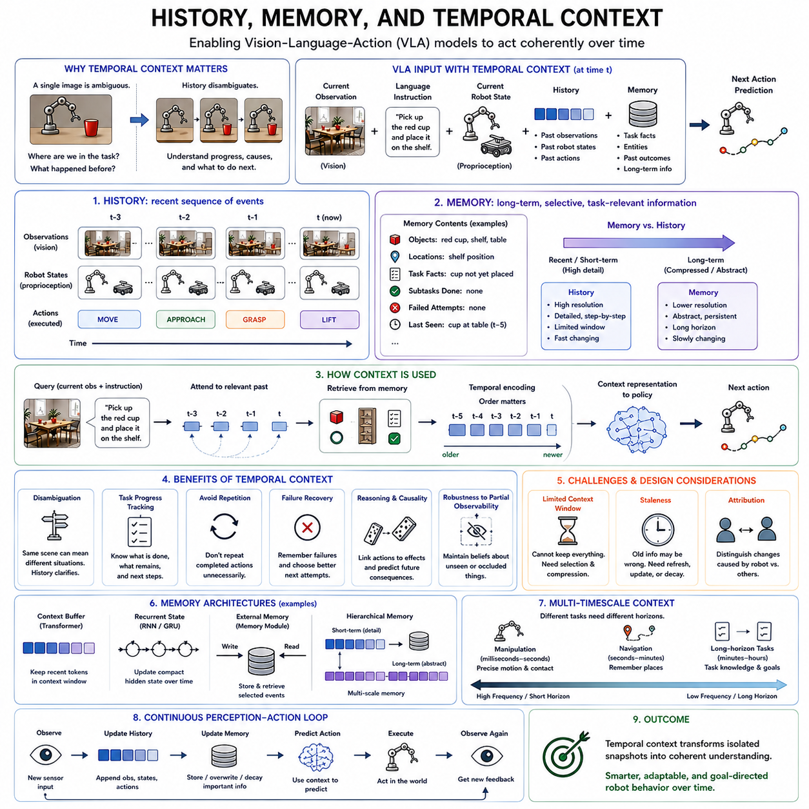{width="7.268055555555556in" height="7.268055555555556in"}

History, memory, and temporal context allow a Vision-Language-Action model to understand that robotic behavior unfolds through time rather than as a sequence of unrelated snapshots. A current observation may describe what is visible now, but it often cannot explain how the scene reached its present state, which actions have already been completed, or what remains to be done. Temporal information supplies this missing continuity and enables behavior to depend on past interaction.

History is the explicit record of previous observations, robot states, instructions, and actions available to the model. A short history may contain several recent camera frames and control commands, while a longer history can represent an extended interaction trajectory. By examining this sequence, the VLA can infer motion, changes in object state, task progress, and causal relationships that cannot be reliably recovered from a single instantaneous observation.

For example, an image showing a cup beside a robot gripper is inherently ambiguous. The robot may be approaching the cup, may have just released it, or may be recovering after an unsuccessful grasp. Previous observations and actions disambiguate these possibilities by revealing the direction of motion and the sequence of events. Temporal context therefore transforms static scene interpretation into an understanding of evolving interaction.

Robot-state history provides another important temporal signal. Joint positions, velocities, end-effector poses, gripper states, forces, and mobile-base motion can reveal how the embodiment has changed over recent time steps. These signals are particularly useful when visual observations are noisy, partially occluded, or insufficient for detecting contact. Combining proprioceptive history with vision gives the model a more complete representation of physical interaction.

Action history records what the robot previously attempted. This is important because the same observation may require different next actions depending on earlier commands. If the robot has already issued a grasp command, the next appropriate behavior may be lifting or checking grasp success rather than grasping again. Action history therefore provides procedural context that prevents unnecessary repetition and supports coherent progression through multi-stage tasks.

Memory extends temporal context beyond the immediate observation window. Whereas history can be viewed as a sequence of recent raw or encoded events, memory selectively preserves information that remains useful over longer periods. A memory representation might store completed subtasks, previously visited locations, object identities, failed attempts, interaction outcomes, or task-relevant facts that are no longer directly visible in the current sensor input.

This distinction becomes important because the context window of a VLA is finite. Continuously appending every camera frame, state vector, and action would cause the sequence to grow rapidly, increasing computation and eventually exceeding the model\'s usable context length. Effective temporal modeling therefore requires deciding which information should remain in detailed recent history, which should be compressed into memory, and which can safely be discarded.

A common strategy is to maintain a high-resolution short-term context while compressing older information. Recent observations may remain as detailed visual and state tokens because they are directly relevant to immediate control. Earlier events can be summarized into compact memory tokens or latent representations. This creates a temporal hierarchy in which information resolution decreases as events become more distant while important task-level meaning is preserved.

Attention mechanisms can help the model retrieve relevant information from temporal context. The current observation and instruction can act as queries that emphasize particular past events while ignoring unrelated history. When a robot needs to remember where an object was placed, attention can focus on the earlier observation associated with that placement rather than processing every previous event equally. Memory therefore becomes useful through selective retrieval rather than simple accumulation.

Temporal position information is also necessary because identical observations can have different meanings depending on their ordering. Positional encodings, timestamps, relative temporal embeddings, or structured sequence representations can indicate whether an event occurred recently or much earlier. The model must distinguish not only what happened but also when it happened and in what order, since causal interpretation depends strongly on temporal relationships.

Long-horizon tasks make memory especially important. An instruction such as "collect the objects from the table and place them in the storage box" requires multiple perception-action cycles. The robot must remember which objects have already been handled, which remain, where the destination is located, and whether earlier placements succeeded. Without persistent task memory, the policy may repeat completed actions, overlook remaining goals, or lose overall task coherence.

Memory can represent task progress at different abstraction levels. Low-level memory may preserve recent sensor and motor information, while higher-level memory can encode semantic states such as "drawer opened," "red object collected," or "first waypoint visited." Abstract memory reduces the amount of information that must be retained and aligns temporal reasoning with meaningful task stages. This can support planning over longer horizons without storing every physical detail.

Failure recovery is another major reason for maintaining temporal context. A robot needs to distinguish a new task state from a failed attempt that requires correction. If a grasp fails, memory of the attempted approach, gripper closure, and resulting object motion can inform a different second attempt. Without such history, the model may repeatedly generate the same unsuccessful behavior because each new observation is interpreted without knowledge of previous failure.

Temporal context can also support causal reasoning. Observing that an object moved after the robot pushed it provides evidence connecting an action with a physical consequence. Across many interactions, models can learn relationships between actions, state transitions, and outcomes. Although temporal correlation alone does not guarantee causal understanding, action-conditioned histories provide a foundation for predicting how future robot behavior may change the environment.

In dynamic environments, memory must balance persistence with updating. Information that was correct several seconds ago may no longer describe the current world because objects can move, people can enter the scene, or another agent can modify the environment. A useful memory system therefore needs mechanisms for refreshing, overwriting, invalidating, or reducing confidence in outdated information rather than treating every stored representation as permanently true.

This problem becomes more challenging when robots operate under partial observability. Important objects or regions may temporarily disappear from view, yet their previous states remain relevant. Temporal memory allows the model to maintain beliefs about hidden aspects of the environment until new evidence becomes available. The VLA can therefore act using an internal representation that extends beyond what is immediately visible while remaining prepared to revise that representation after new observations.

Multi-robot and multi-agent environments introduce additional temporal complexity. The robot may need to distinguish changes caused by its own actions from changes produced by people or other robots. Histories containing observations, self-actions, and possibly communicated information can help attribute state transitions to different agents. Maintaining temporal identity and interaction history becomes essential when behavior depends on coordination, turn-taking, or shared task progress.

Memory architectures can range from simple context buffers to explicit external memory systems. Transformer models can retain history directly as tokens within their context window, recurrent representations can update a compact hidden state over time, and dedicated memory modules can store and retrieve selected events. Hierarchical systems may combine these approaches, using short-term token context for immediate control and persistent memory for longer-term task knowledge.

The appropriate memory design depends on the timescale of the behavior. Fast manipulation may require detailed history over fractions of a second to infer motion and contact, while navigation may require remembering locations over minutes. Complex household or industrial tasks may require semantic memory lasting throughout an entire mission. A general VLA therefore benefits from multiple temporal scales rather than treating all historical information with the same resolution and persistence.

Temporal context must ultimately interact with action generation. Whether the policy uses autoregressive tokens, continuous prediction, diffusion-based trajectories, or action chunks, the generated behavior should reflect what has already happened. Each execution cycle adds new observations and actions to history, updates memory, and changes the context for future predictions. Memory is therefore not a passive archive but an active component of the perception-action loop.

In a capable VLA system, history provides detailed evidence about recent interaction, memory preserves important information across longer horizons, and temporal context organizes these elements into an evolving representation of the task. Together they allow the robot to understand progress, avoid repetition, recover from failures, reason under partial observability, and adapt to environmental change. Temporal intelligence thus connects isolated actions into coherent, goal-directed behavior across physical time.

이력(history), 메모리(memory), 시간적 문맥(temporal context)은 비전-언어-행동 모델(Vision-Language-Action Model, VLA)이 로봇 행동을 서로 무관한 스냅샷(snapshot)의 연속이 아니라 시간에 따라 전개되는 과정으로 이해할 수 있도록 한다. 현재 관찰은 지금 무엇이 보이는지를 설명할 수 있지만, 장면이 현재 상태에 어떻게 도달했는지, 어떤 행동이 이미 완료되었는지, 무엇이 아직 남아 있는지는 설명하지 못할 수 있다. 시간적 정보는 이러한 연속성을 제공하여 과거 상호작용에 기반한 행동을 가능하게 한다.

이력(history)은 모델이 이용할 수 있는 이전 관찰, 로봇 상태, 명령, 행동의 명시적인 기록이다. 짧은 이력에는 최근의 여러 카메라 프레임과 제어 명령이 포함될 수 있으며, 긴 이력은 확장된 상호작용 궤적(interaction trajectory)을 표현할 수 있다. VLA는 이러한 시퀀스를 분석하여 하나의 순간적인 관찰만으로는 안정적으로 파악하기 어려운 움직임, 객체 상태 변화, 작업 진행 상황, 인과적 관계(causal relationship)를 추론할 수 있다.

예를 들어 로봇 그리퍼(robot gripper) 옆에 컵이 있는 이미지는 본질적으로 모호하다. 로봇이 컵에 접근하고 있을 수도 있고, 방금 컵을 놓았을 수도 있으며, 실패한 파지(grasp) 이후 복구하고 있을 수도 있다. 이전 관찰과 행동은 움직임의 방향과 사건의 시퀀스를 보여줌으로써 이러한 가능성을 구분한다. 따라서 시간적 문맥은 정적인 장면 해석(static scene interpretation)을 변화하는 상호작용에 대한 이해로 확장한다.

로봇 상태 이력(robot-state history)은 또 다른 중요한 시간적 신호를 제공한다. 관절 위치, 속도, 말단장치 자세(end-effector pose), 그리퍼 상태, 힘(force), 모바일 베이스 움직임(mobile-base motion)은 최근 시간 단계에서 체화체(embodiment)가 어떻게 변화했는지를 보여줄 수 있다. 이러한 신호는 시각적 관찰에 노이즈가 있거나 부분적으로 가려졌거나 접촉을 감지하기에 충분하지 않은 경우 특히 유용하다. 고유수용성 이력(proprioceptive history)과 비전을 결합하면 물리적 상호작용을 더욱 완전하게 표현할 수 있다.

행동 이력(action history)은 로봇이 이전에 무엇을 시도했는지를 기록한다. 이는 동일한 관찰이라도 이전 명령에 따라 서로 다른 다음 행동이 필요할 수 있기 때문에 중요하다. 로봇이 이미 파지 명령을 실행했다면 다음의 적절한 행동은 다시 파지하는 것이 아니라 들어 올리거나 파지 성공 여부를 확인하는 것일 수 있다. 따라서 행동 이력은 불필요한 반복을 방지하고 여러 단계의 작업이 일관되게 진행되도록 하는 절차적 문맥(procedural context)을 제공한다.

메모리(memory)는 시간적 문맥을 즉각적인 관찰 구간 이상으로 확장한다. 이력이 최근의 원시 또는 인코딩된 사건 시퀀스로 이해될 수 있다면, 메모리는 더 긴 시간 동안 유용하게 유지되는 정보를 선택적으로 보존한다. 메모리 표현(memory representation)은 완료된 하위 작업(subtask), 이전에 방문한 위치, 객체의 정체성, 실패한 시도, 상호작용 결과 또는 현재 센서 입력에서는 더 이상 직접 보이지 않지만 작업에 중요한 사실을 저장할 수 있다.

이러한 구분은 VLA의 문맥 창(context window)이 유한하기 때문에 중요하다. 모든 카메라 프레임, 상태 벡터(state vector), 행동을 계속 추가하면 시퀀스가 빠르게 증가하여 계산량이 커지고 결국 모델이 사용할 수 있는 문맥 길이를 초과하게 된다. 따라서 효과적인 시간적 모델링은 어떤 정보를 세부적인 최근 이력으로 유지하고, 어떤 정보를 메모리로 압축하며, 어떤 정보를 안전하게 제거할 수 있는지를 결정해야 한다.

일반적인 전략은 고해상도의 단기 문맥(short-term context)을 유지하면서 오래된 정보를 압축하는 것이다. 최근 관찰은 즉각적인 제어와 직접적으로 관련되기 때문에 상세한 시각 및 상태 토큰으로 유지할 수 있다. 이전 사건은 압축된 메모리 토큰(memory token)이나 잠재 표현(latent representation)으로 요약할 수 있다. 이를 통해 사건이 오래될수록 정보의 해상도는 낮아지지만 중요한 작업 수준의 의미는 보존되는 시간적 계층(temporal hierarchy)을 구성할 수 있다.

어텐션 메커니즘(attention mechanism)은 모델이 시간적 문맥에서 관련 정보를 검색하도록 지원할 수 있다. 현재 관찰과 명령은 특정 과거 사건을 강조하고 관련성이 낮은 이력을 무시하는 질의(query)로 작동할 수 있다. 로봇이 객체를 어디에 배치했는지 기억해야 한다면 모든 과거 사건을 동일하게 처리하는 대신 해당 배치와 관련된 이전 관찰에 집중할 수 있다. 따라서 메모리는 단순한 정보 축적이 아니라 선택적 검색(selective retrieval)을 통해 유용해진다.

동일한 관찰이라도 발생 순서에 따라 서로 다른 의미를 가질 수 있기 때문에 시간적 위치 정보(temporal position information)도 필요하다. 위치 인코딩(positional encoding), 타임스탬프(timestamp), 상대적 시간 임베딩(relative temporal embedding), 구조화된 시퀀스 표현(structured sequence representation)은 사건이 최근에 발생했는지 또는 훨씬 이전에 발생했는지를 나타낼 수 있다. 인과적 해석은 시간적 관계에 크게 의존하므로 모델은 무엇이 발생했는지뿐만 아니라 언제, 어떤 순서로 발생했는지도 구분해야 한다.

장기 구간 작업(long-horizon task)에서는 메모리가 특히 중요하다. "테이블에 있는 객체들을 수집하여 보관함에 넣어라"라는 명령은 여러 번의 지각-행동 주기(perception-action cycle)를 필요로 한다. 로봇은 어떤 객체를 이미 처리했는지, 어떤 객체가 남아 있는지, 목적지가 어디에 있는지, 이전 배치가 성공했는지를 기억해야 한다. 지속적인 작업 메모리(task memory)가 없다면 정책은 완료된 행동을 반복하거나 남아 있는 목표를 놓치거나 전체 작업의 일관성을 잃을 수 있다.

메모리는 서로 다른 추상화 수준(abstraction level)에서 작업 진행 상태를 표현할 수 있다. 저수준 메모리(low-level memory)는 최근 센서 및 모터 정보를 유지할 수 있으며, 상위 수준 메모리(high-level memory)는 "서랍 열림", "빨간 객체 수집 완료", "첫 번째 웨이포인트 방문 완료"와 같은 의미적 상태(semantic state)를 인코딩할 수 있다. 추상적 메모리(abstract memory)는 유지해야 하는 정보량을 줄이고 시간적 추론을 의미 있는 작업 단계와 정렬하여 모든 물리적 세부 정보를 저장하지 않고도 더 긴 구간의 계획을 지원할 수 있다.

실패 복구(failure recovery)는 시간적 문맥을 유지해야 하는 또 다른 중요한 이유이다. 로봇은 새로운 작업 상태와 수정이 필요한 실패한 시도를 구분해야 한다. 파지가 실패한 경우 시도했던 접근, 그리퍼 닫기, 그 결과 발생한 객체 움직임에 관한 메모리는 두 번째 시도에서 다른 행동을 선택하는 데 활용될 수 있다. 이러한 이력이 없다면 각각의 새로운 관찰이 이전 실패에 대한 정보 없이 해석되므로 모델은 동일한 실패 행동을 반복적으로 생성할 수 있다.

시간적 문맥은 인과적 추론(causal reasoning)도 지원할 수 있다. 로봇이 객체를 민 이후 객체가 움직였다는 사실을 관찰하면 행동과 물리적 결과를 연결하는 증거를 얻을 수 있다. 많은 상호작용을 통해 모델은 행동, 상태 전이(state transition), 결과 사이의 관계를 학습할 수 있다. 시간적 상관관계만으로 인과적 이해가 보장되는 것은 아니지만, 행동 조건부 이력(action-conditioned history)은 미래의 로봇 행동이 환경을 어떻게 변화시킬 수 있는지를 예측하기 위한 기반을 제공한다.

동적 환경(dynamic environment)에서 메모리는 정보의 지속성과 업데이트 사이의 균형을 유지해야 한다. 몇 초 전에 정확했던 정보도 객체가 이동하거나 사람이 장면에 들어오거나 다른 에이전트(agent)가 환경을 변경하면 더 이상 현재 세계를 설명하지 못할 수 있다. 따라서 유용한 메모리 시스템은 저장된 모든 표현을 영구적으로 사실이라고 간주하는 대신 오래된 정보를 갱신(refresh), 덮어쓰기(overwrite), 무효화(invalidate)하거나 신뢰도를 낮추는 메커니즘을 필요로 한다.

이 문제는 로봇이 부분 관찰 가능성(partial observability) 아래에서 동작할 때 더욱 어려워진다. 중요한 객체나 영역이 일시적으로 시야에서 사라질 수 있지만 이전 상태는 여전히 중요할 수 있다. 시간적 메모리는 새로운 증거가 나타날 때까지 환경의 보이지 않는 부분에 대한 믿음(belief)을 유지하도록 한다. 따라서 VLA는 즉시 보이는 정보의 범위를 넘어서는 내부 표현을 이용하여 행동하면서 새로운 관찰이 획득되면 해당 표현을 수정할 준비를 유지할 수 있다.

다중 로봇 및 다중 에이전트 환경(multi-robot and multi-agent environment)은 추가적인 시간적 복잡성을 발생시킨다. 로봇은 자신의 행동으로 발생한 변화와 사람 또는 다른 로봇에 의해 발생한 변화를 구분해야 할 수 있다. 관찰, 자신의 행동(self-action), 필요한 경우 통신된 정보를 포함하는 이력은 상태 전이를 서로 다른 에이전트에 귀속시키는 데 도움을 줄 수 있다. 행동이 협력(coordination), 순서 교대(turn-taking), 공유 작업 진행 상태에 의존한다면 시간적 정체성과 상호작용 이력의 유지가 필수적이다.

메모리 아키텍처(memory architecture)는 단순한 문맥 버퍼(context buffer)에서 명시적인 외부 메모리 시스템(external memory system)에 이르기까지 다양하게 구성할 수 있다. 트랜스포머 모델은 문맥 창 내부의 토큰으로 이력을 직접 유지할 수 있고, 순환 표현(recurrent representation)은 시간에 따라 압축된 은닉 상태(hidden state)를 갱신할 수 있으며, 전용 메모리 모듈(memory module)은 선택된 사건을 저장하고 검색할 수 있다. 계층적 시스템은 이러한 접근 방식을 결합하여 즉각적인 제어에는 단기 토큰 문맥을 사용하고 장기 작업 지식에는 지속적 메모리를 사용할 수 있다.

적절한 메모리 설계는 행동의 시간 척도(timescale)에 따라 달라진다. 빠른 조작은 움직임과 접촉을 추론하기 위해 몇 분의 1초 수준의 상세한 이력이 필요할 수 있는 반면, 내비게이션(navigation)은 수 분 동안 위치를 기억해야 할 수 있다. 복잡한 가정용 또는 산업용 작업은 전체 임무 동안 유지되는 의미적 메모리(semantic memory)를 필요로 할 수 있다. 따라서 범용 VLA는 모든 과거 정보를 동일한 해상도와 지속성으로 처리하기보다 여러 시간 척도(multiple temporal scales)를 활용하는 것이 유리하다.

시간적 문맥은 궁극적으로 행동 생성(action generation)과 상호작용해야 한다. 정책이 자기회귀 토큰(autoregressive token), 연속 예측(continuous prediction), 확산 기반 궤적(diffusion-based trajectory), 행동 청크(action chunk) 중 어떤 방식을 사용하더라도 생성되는 행동은 지금까지 발생한 상황을 반영해야 한다. 각각의 실행 주기는 새로운 관찰과 행동을 이력에 추가하고 메모리를 갱신하며 이후 예측을 위한 문맥을 변화시킨다. 따라서 메모리는 수동적인 기록 저장소가 아니라 지각-행동 루프의 능동적인 구성요소이다.

고성능 VLA 시스템에서 이력은 최근 상호작용에 관한 상세한 증거를 제공하고, 메모리는 더 긴 시간 구간에 걸쳐 중요한 정보를 보존하며, 시간적 문맥은 이러한 요소를 변화하는 작업 표현으로 구성한다. 이들은 함께 로봇이 작업 진행 상황을 이해하고, 반복을 방지하며, 실패에서 복구하고, 부분 관찰 가능성 아래에서 추론하며, 환경 변화에 적응하도록 한다. 따라서 시간적 지능(temporal intelligence)은 서로 고립된 행동들을 물리적 시간에 걸쳐 일관되고 목표 지향적인 행동으로 연결한다.

## 04.11. VLA Pretraining and Post Training

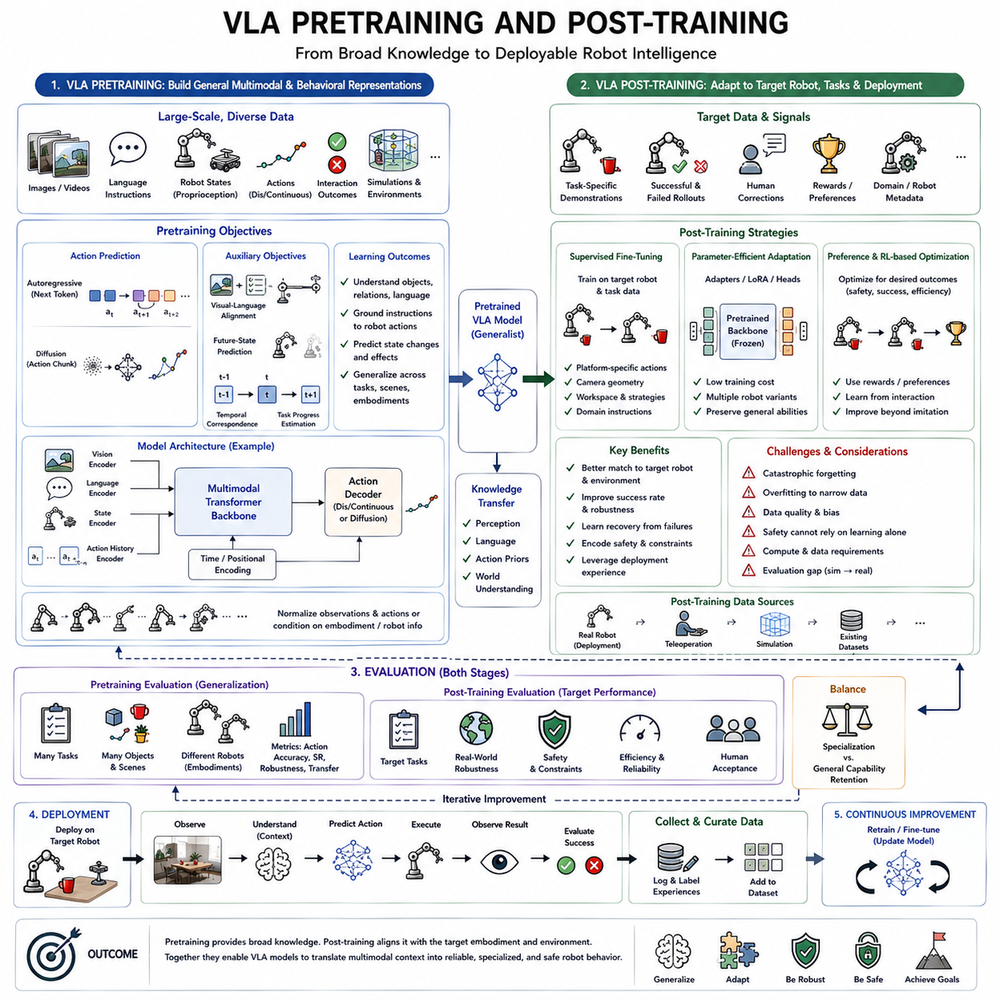{width="7.268055555555556in" height="7.268055555555556in"}

VLA pretraining establishes the broad perceptual, linguistic, and behavioral representations required for a Vision-Language-Action model to operate across many robotic tasks. Instead of learning one policy from a small task-specific dataset, pretraining exposes the model to large and diverse collections of images, language, robot trajectories, actions, and interaction data. The objective is to create reusable representations that can later be adapted to specific embodiments, environments, and operational requirements.

The starting point of many VLA systems is a pretrained vision-language foundation model. Large-scale image-text and multimodal training provides knowledge about objects, attributes, spatial relationships, activities, and linguistic concepts before robot-specific learning begins. This prior knowledge allows a robot model to recognize and reason about many concepts without requiring every visual category and language expression to be learned again exclusively from robotic demonstrations.

Robot data introduces the physical grounding that conventional vision-language pretraining does not provide. A vision-language model may understand what a cup, drawer, or shelf is, but it does not automatically know which motor commands will grasp the cup or open the drawer. Robot trajectories connect observations and instructions with executable actions, transforming semantic representations into representations that can support interaction with the physical world.

A typical robot trajectory contains a language instruction together with sequences of visual observations, robot states, and actions. Additional modalities may include depth, force, tactile sensing, proprioception, or environment metadata. During pretraining, the VLA learns statistical relationships among these modalities, such as how a command refers to an object, how the object\'s state changes after manipulation, and which actions commonly produce successful task transitions.

Pretraining data can originate from human teleoperation, scripted policies, autonomous robot execution, simulation, or previously collected robot datasets. Each source provides different advantages. Human demonstrations can contain flexible and natural behavior, scripted systems provide scalable structured trajectories, and simulation can generate large amounts of controlled experience. Combining sources can increase coverage while also introducing differences in quality, action distributions, and sensor configurations.

Large-scale VLA pretraining must handle substantial heterogeneity across robot embodiments. Different robots may have different numbers of joints, camera configurations, grippers, coordinate systems, control frequencies, and action spaces. A shared model therefore requires mechanisms for normalizing observations and actions or conditioning predictions on embodiment information. Cross-embodiment data is valuable because it can teach transferable relationships between semantic goals and physical behavior.

Action representation strongly influences the pretraining objective. Discrete action tokenization allows robot behavior to be trained using next-token prediction objectives similar to language modeling. Continuous actions can instead be learned through regression, probabilistic prediction, or diffusion-based objectives. Hybrid architectures may use a shared multimodal backbone while attaching specialized action decoders, allowing semantic knowledge to remain common even when physical control representations differ.

Autoregressive VLA pretraining commonly predicts future action tokens conditioned on observations, instructions, states, and previous actions. This turns robot learning into causal sequence modeling. Diffusion-based systems can instead learn to reconstruct or denoise future action chunks conditioned on multimodal context. Although their training objectives differ, both approaches attempt to learn a conditional distribution that maps the current task situation to plausible future robot behavior.

Pretraining may also incorporate objectives beyond direct action prediction. Models can learn visual-language alignment, future-state prediction, temporal correspondence, task progress, or other auxiliary relationships that improve internal representations. Such objectives can encourage the model to understand not only which action occurred but also how objects, robot state, and environment conditions evolve through interaction, potentially improving transfer to unfamiliar situations.

Data diversity is often as important as raw dataset size. Repeated demonstrations of a narrow task can improve performance within that distribution but provide limited support for generalization. Broader pretraining benefits from variation in objects, backgrounds, viewpoints, instructions, tasks, robot morphologies, trajectories, and failure conditions. Diversity exposes the model to alternative ways in which similar semantic objectives can appear and be achieved in the physical world.

After broad pretraining, post-training adapts the general VLA to desired behavioral characteristics or deployment conditions. The pretrained model may possess extensive perceptual and action knowledge but still be poorly matched to a specific robot, factory, home, control interface, or task family. Post-training narrows this gap by using targeted data and objectives while attempting to preserve useful capabilities acquired during large-scale pretraining.

Supervised fine-tuning is a direct form of VLA post-training. A pretrained model is further trained on demonstrations from the target robot or application. These examples can teach platform-specific action conventions, camera geometry, workspace characteristics, manipulation strategies, or domain-specific instructions. Fine-tuning can update the complete network or selected components depending on available data, computing resources, and the need to preserve general representations.

Parameter-efficient adaptation provides another strategy when updating the entire VLA is expensive or unnecessary. Adapter modules, low-rank updates, or other lightweight trainable components can specialize a large pretrained backbone while leaving most parameters unchanged. This can reduce training cost and make it easier to maintain multiple robot-specific variants derived from a common foundation model, although the appropriate method depends on architecture and deployment constraints.

Post-training can also incorporate successful and unsuccessful interactions rather than relying only on expert demonstrations. Preference information, task rewards, success labels, corrections, or autonomous experience can provide signals about which behaviors are more desirable. The model can then be optimized not merely to imitate recorded actions but to favor behavior associated with successful, efficient, or otherwise preferred outcomes under the chosen training objective.

Interactive data collection creates an important feedback loop between deployment and post-training. Once a VLA is placed on a robot, its failures reveal states that may have been rare or absent in the original training distribution. These cases can be recorded, corrected by humans or other controllers, added to the dataset, and used for further training. Post-training therefore becomes a mechanism for converting deployment experience into improved policy coverage.

Failure data is particularly valuable because demonstration datasets often overrepresent successful trajectories. A model trained only on ideal behavior may perform well while remaining near the training distribution but struggle to recover after an unexpected event. Including failed grasps, navigation deviations, misplaced objects, interrupted actions, and corresponding recovery demonstrations can teach the VLA how to recognize undesirable states and return toward successful task execution.

Safety-oriented post-training can focus the policy on constraints that may not be sufficiently represented during broad pretraining. Training examples can emphasize collision avoidance, human-aware behavior, force limitations, workspace restrictions, uncertainty responses, and safe recovery. Nevertheless, learned safety behavior should complement rather than replace independent runtime safety mechanisms, because statistical training objectives cannot guarantee compliance with every physical constraint.

Another challenge is catastrophic forgetting. Aggressive fine-tuning on a narrow target dataset can improve specialized performance while degrading broader capabilities learned during pretraining. Mixing general and specialized data, limiting parameter updates, regularizing training, or using modular adaptation can reduce this effect. Effective post-training must therefore balance specialization with retention of transferable perception, language understanding, and general robot skills.

Evaluation is essential throughout both stages. Pretraining evaluation measures whether the model develops transferable multimodal and behavioral competence across tasks, objects, environments, and embodiments. Post-training evaluation examines whether adaptation improves the intended deployment domain without unacceptable degradation elsewhere. Physical robot evaluation is particularly important because offline prediction accuracy does not necessarily translate directly into successful closed-loop interaction.

The complete VLA development process can therefore be understood as a progression from broad knowledge acquisition to targeted behavioral adaptation. Pretraining builds general representations from large-scale multimodal and robot experience, while post-training shapes those representations for particular robots, tasks, safety requirements, and deployment environments. The boundary between these stages can vary, but their functional roles remain distinct and complementary.

Ultimately, VLA pretraining and post-training provide the learning pipeline through which foundation-model capabilities become deployable physical intelligence. Broad pretraining supplies visual understanding, language grounding, transferable action knowledge, and behavioral priors. Post-training then aligns these capabilities with the target embodiment and operating domain, creating a policy that can translate multimodal context into increasingly reliable, specialized, and physically executable behavior.

VLA 사전학습(VLA pretraining)은 비전-언어-행동 모델(Vision-Language-Action Model, VLA)이 다양한 로봇 작업에서 동작하는 데 필요한 광범위한 지각적, 언어적, 행동적 표현을 구축한다. 작은 작업 특화 데이터셋에서 하나의 정책만 학습하는 대신, 사전학습에서는 이미지, 언어, 로봇 궤적, 행동, 상호작용 데이터의 대규모이고 다양한 집합에 모델을 노출한다. 목표는 이후 특정 체화체(embodiment), 환경, 운용 요구사항에 적응할 수 있는 재사용 가능한 표현을 만드는 것이다.

많은 VLA 시스템의 출발점은 사전학습된 비전-언어 파운데이션 모델(vision-language foundation model)이다. 대규모 이미지-텍스트(image-text) 및 멀티모달 학습(multimodal training)은 로봇 특화 학습이 시작되기 전에 객체, 속성, 공간적 관계, 활동, 언어적 개념에 관한 지식을 제공한다. 이러한 사전 지식(prior knowledge)을 통해 로봇 모델은 모든 시각 범주와 언어 표현을 로봇 시연만으로 다시 학습하지 않고도 다양한 개념을 인식하고 추론할 수 있다.

로봇 데이터(robot data)는 기존의 비전-언어 사전학습이 제공하지 못하는 물리적 그라운딩(physical grounding)을 도입한다. 비전-언어 모델은 컵, 서랍, 선반이 무엇인지는 이해할 수 있지만, 어떤 모터 명령이 컵을 파지하거나 서랍을 열 수 있는지는 자동으로 알지 못한다. 로봇 궤적(robot trajectory)은 관찰과 명령을 실행 가능한 행동과 연결하여 의미적 표현(semantic representation)을 물리적 세계와의 상호작용을 지원할 수 있는 표현으로 변환한다.

일반적인 로봇 궤적은 언어 명령(language instruction)과 함께 시각적 관찰(visual observation), 로봇 상태(robot state), 행동(action)의 시퀀스를 포함한다. 추가적인 모달리티(modality)에는 깊이(depth), 힘(force), 촉각 감지(tactile sensing), 고유수용감각(proprioception), 환경 메타데이터(environment metadata)가 포함될 수 있다. 사전학습 과정에서 VLA는 명령이 객체를 어떻게 지칭하는지, 조작 이후 객체 상태가 어떻게 변화하는지, 어떤 행동이 성공적인 작업 전이(task transition)를 만들어내는지와 같은 모달리티 간의 통계적 관계를 학습한다.

사전학습 데이터는 인간 원격조작(human teleoperation), 스크립트 기반 정책(scripted policy), 자율 로봇 실행(autonomous robot execution), 시뮬레이션(simulation), 기존에 수집된 로봇 데이터셋 등에서 얻을 수 있다. 각 데이터 소스는 서로 다른 장점을 제공한다. 인간 시연은 유연하고 자연스러운 행동을 포함할 수 있고, 스크립트 기반 시스템은 확장 가능한 구조화된 궤적을 제공하며, 시뮬레이션은 대규모의 통제된 경험을 생성할 수 있다. 여러 소스를 결합하면 데이터 범위를 확대할 수 있지만 품질, 행동 분포, 센서 구성의 차이도 함께 발생한다.

대규모 VLA 사전학습은 서로 다른 로봇 체화체 사이의 상당한 이질성(heterogeneity)을 처리해야 한다. 로봇마다 관절 수, 카메라 구성, 그리퍼, 좌표계, 제어 주파수, 행동 공간(action space)이 서로 다를 수 있다. 따라서 공유 모델(shared model)은 관찰과 행동을 정규화(normalization)하거나 체화체 정보를 조건으로 행동을 예측하는 메커니즘을 필요로 한다. 교차 체화 데이터(cross-embodiment data)는 의미적 목표와 물리적 행동 사이에서 전이 가능한 관계를 학습할 수 있기 때문에 가치가 있다.

행동 표현(action representation)은 사전학습 목표에 큰 영향을 미친다. 이산 행동 토큰화(discrete action tokenization)를 사용하면 언어 모델링과 유사한 다음 토큰 예측(next-token prediction) 목표를 이용하여 로봇 행동을 학습할 수 있다. 연속 행동(continuous action)은 회귀(regression), 확률적 예측(probabilistic prediction), 확산 기반 목표(diffusion-based objective)를 통해 학습할 수 있다. 하이브리드 아키텍처(hybrid architecture)는 공유 멀티모달 백본(shared multimodal backbone)에 특화된 행동 디코더(action decoder)를 연결하여 물리적 제어 표현이 다르더라도 의미적 지식을 공유할 수 있다.

자기회귀 VLA 사전학습(autoregressive VLA pretraining)은 일반적으로 관찰, 명령, 상태, 이전 행동을 조건으로 미래 행동 토큰을 예측한다. 이를 통해 로봇 학습을 인과적 시퀀스 모델링(causal sequence modeling) 문제로 변환한다. 확산 기반 시스템(diffusion-based system)은 멀티모달 문맥을 조건으로 미래 행동 청크(action chunk)를 복원하거나 디노이징(denoising)하도록 학습할 수 있다. 학습 목표는 서로 다르지만 두 접근 방식 모두 현재 작업 상황을 가능한 미래 로봇 행동으로 매핑하는 조건부 분포(conditional distribution)를 학습하는 것을 목표로 한다.

사전학습은 직접적인 행동 예측 이외의 목표도 포함할 수 있다. 모델은 시각-언어 정렬(visual-language alignment), 미래 상태 예측(future-state prediction), 시간적 대응 관계(temporal correspondence), 작업 진행 상태(task progress), 기타 내부 표현을 향상시키는 보조 관계(auxiliary relationship)를 학습할 수 있다. 이러한 목표는 어떤 행동이 발생했는지를 학습하는 것뿐만 아니라 객체, 로봇 상태, 환경 조건이 상호작용을 통해 어떻게 변화하는지를 이해하도록 하여 새로운 상황으로의 전이 능력을 향상시킬 수 있다.

데이터 다양성(data diversity)은 단순한 데이터셋 크기만큼 중요할 수 있다. 제한된 작업의 반복적인 시연은 해당 분포 내에서 성능을 향상시킬 수 있지만 일반화(generalization)를 지원하는 능력은 제한적이다. 광범위한 사전학습에서는 객체, 배경, 시점, 명령, 작업, 로봇 형태(morphology), 궤적, 실패 조건의 다양성이 중요하다. 이러한 다양성은 유사한 의미적 목표가 물리적 세계에서 서로 다른 형태로 나타나고 달성될 수 있는 다양한 방식을 모델에 노출한다.

광범위한 사전학습 이후에는 사후학습(post-training)을 통해 일반적인 VLA를 원하는 행동 특성이나 배포 조건(deployment condition)에 적응시킨다. 사전학습된 모델은 광범위한 지각 및 행동 지식을 가지고 있더라도 특정 로봇, 공장, 가정, 제어 인터페이스 또는 작업군(task family)에 충분히 적합하지 않을 수 있다. 사후학습은 대규모 사전학습에서 획득한 유용한 능력을 유지하면서 목표화된 데이터와 학습 목표를 이용하여 이러한 차이를 줄인다.

지도 미세조정(supervised fine-tuning)은 VLA 사후학습의 직접적인 형태이다. 사전학습된 모델을 목표 로봇이나 응용 분야에서 수집한 시연 데이터를 이용하여 추가로 학습한다. 이러한 예제는 플랫폼 특화 행동 규칙, 카메라 기하(camera geometry), 작업 공간 특성, 조작 전략, 도메인 특화 명령(domain-specific instruction)을 학습시킬 수 있다. 이용 가능한 데이터, 컴퓨팅 자원, 일반적인 표현을 유지해야 하는 필요성에 따라 전체 네트워크 또는 선택된 구성요소만 업데이트할 수 있다.

전체 VLA를 업데이트하는 것이 비용이 많이 들거나 필요하지 않은 경우 매개변수 효율적 적응(parameter-efficient adaptation)을 사용할 수 있다. 어댑터 모듈(adapter module), 저랭크 업데이트(low-rank update), 기타 경량 학습 구성요소를 이용하면 대부분의 매개변수를 고정한 상태에서 대규모 사전학습 백본을 특화할 수 있다. 이를 통해 학습 비용을 줄이고 하나의 공통 파운데이션 모델에서 파생된 여러 로봇 특화 버전을 보다 쉽게 유지할 수 있지만, 적절한 방법은 아키텍처와 배포 제약에 따라 달라진다.

사후학습은 전문가 시연(expert demonstration)에만 의존하지 않고 성공 및 실패한 상호작용을 함께 활용할 수도 있다. 선호도 정보(preference information), 작업 보상(task reward), 성공 레이블(success label), 교정(correction), 자율 경험(autonomous experience)은 어떤 행동이 더 바람직한지를 나타내는 신호를 제공할 수 있다. 모델은 기록된 행동을 단순히 모방하는 데 그치지 않고 선택한 학습 목표에 따라 성공적이고 효율적이거나 선호되는 결과와 관련된 행동을 선택하도록 최적화될 수 있다.

상호작용 기반 데이터 수집(interactive data collection)은 배포와 사후학습 사이에 중요한 피드백 루프(feedback loop)를 형성한다. VLA를 실제 로봇에 배포하면 모델의 실패를 통해 기존 학습 분포에서 드물거나 존재하지 않았던 상태를 발견할 수 있다. 이러한 사례를 기록하고 사람이나 다른 제어기가 교정한 후 데이터셋에 추가하여 추가 학습에 사용할 수 있다. 따라서 사후학습은 실제 배포 경험을 향상된 정책 범위(policy coverage)로 전환하는 메커니즘이 된다.

실패 데이터(failure data)는 시연 데이터셋이 성공적인 궤적을 과도하게 포함하는 경우가 많기 때문에 특히 중요하다. 이상적인 행동만 학습한 모델은 학습 분포 근처에서는 잘 동작하지만 예상하지 못한 사건 이후 복구하는 데 어려움을 겪을 수 있다. 실패한 파지, 내비게이션 편차(navigation deviation), 잘못 배치된 객체, 중단된 행동과 이에 대응하는 복구 시연(recovery demonstration)을 포함하면 VLA가 바람직하지 않은 상태를 인식하고 성공적인 작업 수행으로 복귀하는 방법을 학습할 수 있다.

안전 중심 사후학습(safety-oriented post-training)은 광범위한 사전학습에서 충분히 표현되지 않았을 수 있는 제약 조건을 정책에 반영하는 데 초점을 맞출 수 있다. 학습 예제는 충돌 회피(collision avoidance), 사람을 고려한 행동(human-aware behavior), 힘 제한(force limitation), 작업 공간 제한(workspace restriction), 불확실성 대응(uncertainty response), 안전한 복구(safe recovery)를 강조할 수 있다. 그러나 통계적 학습 목표가 모든 물리적 제약의 준수를 보장할 수는 없으므로 학습된 안전 행동은 독립적인 런타임 안전 메커니즘(runtime safety mechanism)을 대체하는 것이 아니라 보완해야 한다.

또 다른 중요한 문제는 파국적 망각(catastrophic forgetting)이다. 제한된 목표 데이터셋에 지나치게 강하게 미세조정하면 특화된 성능은 향상되지만 사전학습에서 습득한 광범위한 능력이 저하될 수 있다. 일반 데이터와 특화 데이터를 혼합하거나, 매개변수 업데이트를 제한하거나, 학습에 정규화(regularization)를 적용하거나, 모듈형 적응(modular adaptation)을 사용하면 이러한 영향을 줄일 수 있다. 효과적인 사후학습은 특화와 전이 가능한 지각, 언어 이해, 일반 로봇 스킬의 유지 사이에서 균형을 이루어야 한다.

평가(evaluation)는 두 학습 단계 모두에서 필수적이다. 사전학습 평가는 모델이 다양한 작업, 객체, 환경, 체화체에 걸쳐 전이 가능한 멀티모달 및 행동 능력을 획득하는지를 측정한다. 사후학습 평가는 적응 과정이 목표 배포 도메인의 성능을 향상시키면서 다른 영역의 능력을 허용할 수 없는 수준으로 저하시키지 않는지를 확인한다. 오프라인 예측 정확도(offline prediction accuracy)가 성공적인 폐루프 상호작용(closed-loop interaction)으로 직접 이어지는 것은 아니므로 실제 로봇 평가가 특히 중요하다.

따라서 전체 VLA 개발 과정은 광범위한 지식 획득에서 목표 지향적 행동 적응으로 진행되는 과정으로 이해할 수 있다. 사전학습은 대규모 멀티모달 및 로봇 경험으로부터 일반적인 표현을 구축하고, 사후학습은 이러한 표현을 특정 로봇, 작업, 안전 요구사항, 배포 환경에 맞게 조정한다. 두 단계의 경계는 시스템에 따라 달라질 수 있지만 각각의 기능적 역할은 서로 구별되면서 상호 보완적이다.

궁극적으로 VLA 사전학습과 사후학습은 파운데이션 모델의 능력을 실제 배포 가능한 물리적 지능(physical intelligence)으로 변환하는 학습 파이프라인(learning pipeline)을 제공한다. 광범위한 사전학습은 시각적 이해, 언어 그라운딩(language grounding), 전이 가능한 행동 지식, 행동 사전정보(behavioral prior)를 제공한다. 이후 사후학습은 이러한 능력을 목표 체화체와 운용 도메인에 정렬하여 멀티모달 문맥을 더욱 신뢰성 있고 특화되며 물리적으로 실행 가능한 행동으로 변환할 수 있는 정책을 구축한다.

## 04.12. VLA for Long Horizon Robot Tasks

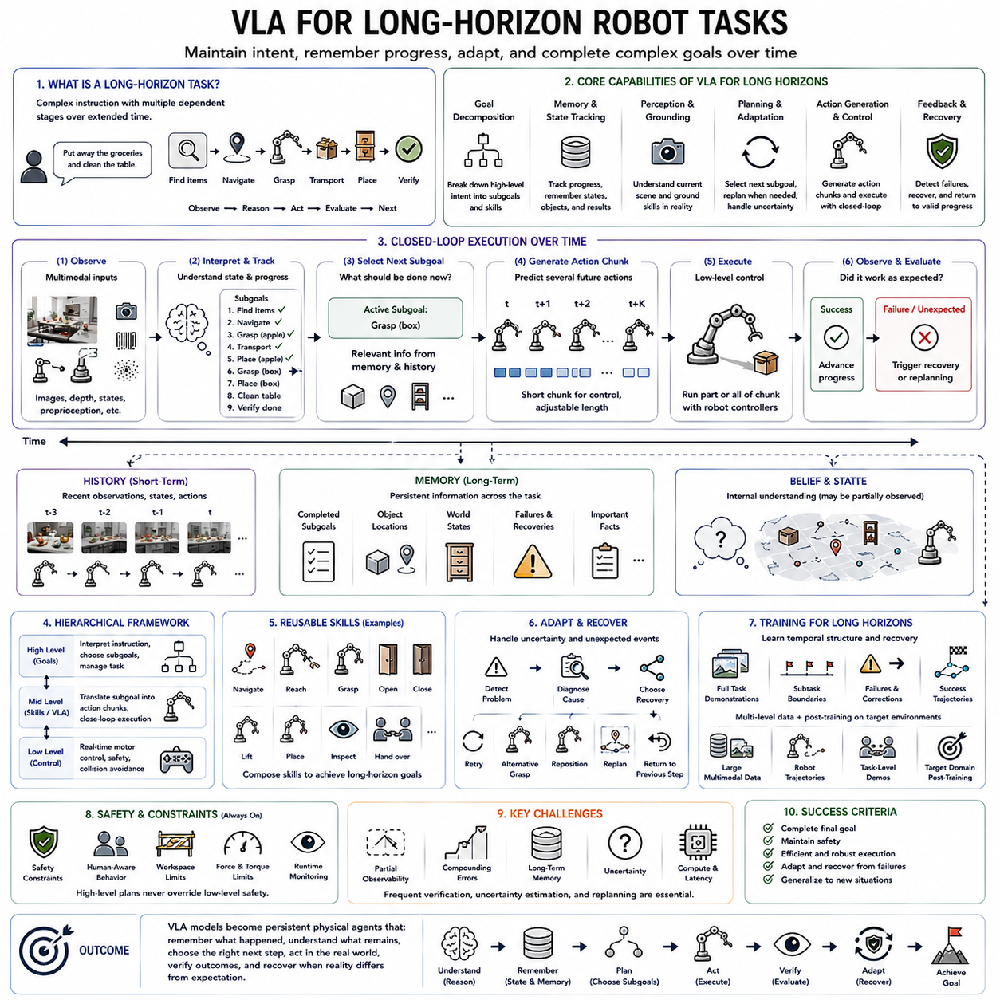{width="7.268055555555556in" height="7.268055555555556in"}

Long-horizon robot tasks require a Vision-Language-Action model to maintain coherent behavior across extended sequences of perception, reasoning, and physical interaction. Unlike short tasks that may be completed with a single reach or grasp, long-horizon tasks contain multiple dependent stages whose outcomes affect later decisions. The VLA must therefore connect high-level intent with continuously changing observations, robot states, intermediate goals, and actions over time.

A typical long-horizon instruction may ask a robot to organize a workspace, prepare an object for use, clean an area, or retrieve several items from different locations. Such instructions cannot be mapped directly to one motor command. They implicitly describe a sequence of subtasks, such as identifying relevant objects, navigating, manipulating containers, grasping items, transporting them, verifying results, and deciding what should happen next.

Task decomposition is therefore central to long-horizon VLA behavior. A complex instruction can be interpreted as a hierarchy of goals and subgoals that progressively transform the environment toward the desired final state. Instead of predicting every low-level action from the original instruction alone, the system can identify an active subtask and generate actions appropriate to that stage while preserving the overall objective as persistent context.

Language provides a useful representation for this hierarchical structure because semantic goals can often be expressed independently of particular motor commands. A high-level objective such as "put away the groceries" can be decomposed into locating items, identifying storage destinations, transporting objects, opening containers when necessary, and confirming placement. The VLA can connect these semantic stages with physical skills learned from robot interaction data.

Long-horizon execution also requires persistent task state. The robot must know not only what the instruction originally requested but what portions have already been completed. If three objects must be moved, the system should remember which objects have been successfully placed and which remain. Without such progress tracking, a policy may repeat completed subtasks, skip necessary steps, or lose alignment between its current behavior and the final goal.

History and memory provide the temporal continuity required for this progress tracking. Recent observations and actions describe immediate interaction, while longer-term memory can preserve completed subgoals, object locations, failures, and important environmental changes. This distinction allows detailed information to support current manipulation while compressed semantic information maintains coherence across a much longer task without indefinitely expanding the model\'s context window.

Partial observability makes memory particularly important. Objects relevant to a future subtask may disappear from the camera view as the robot moves through the environment. A drawer that was opened earlier may no longer be visible, yet its state may remain important. The VLA therefore benefits from maintaining internal beliefs about task-relevant world states and updating those beliefs when new observations provide confirming or contradictory evidence.

Long-horizon behavior requires closed-loop execution rather than a single fixed action plan. After each meaningful action or action chunk, the robot can observe the resulting state and compare it with the expected outcome. Successful execution advances the task, while unexpected results can trigger correction or replanning. The process becomes a repeated cycle of observing, interpreting progress, selecting the next subgoal, acting, and evaluating the physical consequence.

This feedback loop is essential because physical environments contain uncertainty. Grasping may fail, objects may shift, doors may not open completely, navigation paths may become blocked, or people may alter the environment. A plan generated at the beginning of a task cannot anticipate every possible outcome. Long-horizon VLA systems must therefore treat plans as adaptable structures rather than immutable sequences of commands.

Failure recovery becomes increasingly important as task length grows. Even if each individual action has a high probability of success, the probability that every step succeeds decreases across a long sequence. A capable VLA must recognize when expected state transitions did not occur, determine whether the current subgoal remains valid, and select a recovery behavior. Recovery may involve retrying, choosing an alternative grasp, repositioning, replanning, or returning to an earlier task stage.

Hierarchical control provides a natural architecture for separating different temporal and semantic scales. A high-level component can interpret the instruction and select goals or skills, a VLA policy can translate the active goal into short action sequences, and low-level controllers can execute precise motor commands. Each level operates at a timescale appropriate to its responsibility, reducing the burden on a single model to perform language reasoning and high-frequency control simultaneously.

Reusable skills can simplify long-horizon planning. Behaviors such as navigate, reach, grasp, open, close, lift, place, inspect, or hand over can function as intermediate abstractions between language and continuous motor control. Rather than planning every joint movement across an entire mission, the model can compose learned skills according to the current task state. Skill composition reduces effective planning depth while preserving flexibility at the semantic level.

However, skill execution must remain grounded in current perception. A symbolic instruction such as "open the drawer" does not specify the exact handle pose, collision-free approach, required force, or robot configuration. Visual and state information must parameterize the selected skill according to the physical situation. Long-horizon intelligence therefore depends on interaction between abstract task structure and continuously updated sensor-grounded action generation.

Action chunks can provide an intermediate temporal abstraction within this hierarchy. The VLA may predict several coordinated future actions for the active subtask and execute only part of the chunk before observing again. This receding-horizon strategy reduces expensive model inference while preserving opportunities for correction. Shorter chunks may be used near contact or uncertainty, while longer chunks may be appropriate for predictable free-space movement.

Temporal abstraction also helps manage computational resources. High-level planning does not need to run at the frequency of motor control, and semantic memory does not need to preserve every camera frame. A long-horizon architecture can allocate different update rates to task reasoning, memory, action generation, perception, and control. Such multi-timescale processing makes it possible to combine computationally expensive foundation-model reasoning with responsive physical execution.

Goal verification is another critical capability. Completing an action does not necessarily mean completing the intended subgoal. Closing the gripper does not guarantee that an object was grasped, and moving toward a shelf does not guarantee successful placement. The system should evaluate observations after execution and determine whether the expected goal condition has actually been achieved before advancing to the next stage.

Long-horizon tasks also expose compounding error. Small mistakes in perception, localization, memory, planning, or control can influence later decisions and gradually move the robot away from the intended task trajectory. Frequent state verification, uncertainty estimation, replanning, and recovery reduce this accumulation. Robustness therefore depends less on assuming perfect predictions and more on repeatedly detecting and correcting deviations during execution.

Training data for long-horizon behavior must expose models to temporal structure beyond isolated actions. Demonstrations can contain complete tasks, subtask boundaries, language annotations, state transitions, failures, corrections, and successful recoveries. Short trajectory segments remain useful for learning individual skills, but longer sequences teach relationships among stages and provide evidence about how intermediate accomplishments contribute to final task completion.

Training can also combine data at different levels of abstraction. Large multimodal datasets provide semantic and perceptual knowledge, robot trajectories provide physical grounding, and task-level demonstrations show how skills are composed over time. Post-training on target environments can further teach domain-specific procedures, recovery patterns, and operational constraints. This layered training supports both general understanding and reliable long-horizon execution.

Safety becomes more challenging over extended operation because the robot encounters a larger variety of states and interactions. Every generated subgoal and action should remain subject to physical constraints, collision avoidance, workspace limits, human-aware behavior, and runtime monitoring. A high-level plan should never override low-level safety mechanisms, and unsafe or uncertain conditions should be able to interrupt execution and trigger replanning or controlled fallback behavior.

Long-horizon VLA systems ultimately require integration of language reasoning, multimodal perception, memory, planning, action generation, feedback, and control. No single prediction is sufficient to solve an extended physical task. Intelligence emerges from maintaining a coherent objective while repeatedly updating beliefs and actions according to the consequences of interaction, allowing the robot to preserve intent without becoming rigidly committed to an outdated plan.

The broader goal is to transform VLA models from reactive instruction followers into persistent physical agents capable of completing structured tasks over meaningful periods of time. Such systems must remember what happened, understand what remains, select appropriate intermediate goals, execute grounded actions, verify outcomes, and recover when reality differs from expectation. Long-horizon competence therefore represents a central step toward general-purpose robots that can autonomously pursue complex goals in dynamic physical environments.

장기 구간 로봇 작업(long-horizon robot task)은 비전-언어-행동 모델(Vision-Language-Action Model, VLA)이 장시간에 걸쳐 이어지는 지각, 추론, 물리적 상호작용의 시퀀스에서 일관된 행동을 유지할 것을 요구한다. 한 번의 접근이나 파지로 완료될 수 있는 짧은 작업과 달리 장기 구간 작업은 여러 개의 상호 의존적인 단계로 구성되며, 각 단계의 결과가 이후 의사결정에 영향을 미친다. 따라서 VLA는 상위 수준 의도(high-level intent)를 지속적으로 변화하는 관찰, 로봇 상태, 중간 목표, 행동과 시간에 걸쳐 연결해야 한다.

일반적인 장기 구간 명령(long-horizon instruction)은 로봇에게 작업 공간을 정리하거나, 객체를 사용할 수 있도록 준비하거나, 특정 영역을 청소하거나, 서로 다른 위치에서 여러 물체를 가져오도록 요청할 수 있다. 이러한 명령은 하나의 모터 명령으로 직접 변환할 수 없다. 대신 관련 객체 식별, 내비게이션(navigation), 컨테이너 조작, 객체 파지, 운반, 결과 확인, 다음 행동 결정과 같은 일련의 하위 작업(subtask)을 암묵적으로 포함한다.

따라서 작업 분해(task decomposition)는 장기 구간 VLA 행동의 핵심이다. 복잡한 명령은 환경을 원하는 최종 상태로 점진적으로 변화시키는 목표(goal)와 하위 목표(subgoal)의 계층 구조로 해석할 수 있다. 시스템은 원래의 명령만을 기반으로 모든 저수준 행동을 직접 예측하는 대신 현재 활성화된 하위 작업을 식별하고, 전체 목표를 지속적인 문맥으로 유지하면서 해당 단계에 적절한 행동을 생성할 수 있다.

언어(language)는 의미적 목표를 특정 모터 명령과 독립적으로 표현할 수 있기 때문에 이러한 계층 구조를 표현하는 데 유용하다. "식료품을 정리하라"와 같은 상위 수준 목표는 물품 위치 확인, 보관 장소 식별, 객체 운반, 필요한 경우 컨테이너 열기, 배치 결과 확인 등의 단계로 분해할 수 있다. VLA는 이러한 의미적 단계(semantic stage)를 로봇 상호작용 데이터에서 학습한 물리적 스킬(physical skill)과 연결할 수 있다.

장기 구간 실행(long-horizon execution)은 지속적인 작업 상태(persistent task state)도 필요로 한다. 로봇은 원래 명령이 무엇을 요구했는지뿐만 아니라 어떤 부분이 이미 완료되었는지도 알아야 한다. 세 개의 객체를 이동해야 한다면 시스템은 어떤 객체가 성공적으로 배치되었고 어떤 객체가 남아 있는지를 기억해야 한다. 이러한 진행 상태 추적(progress tracking)이 없으면 정책은 완료된 하위 작업을 반복하거나 필요한 단계를 건너뛰거나 현재 행동과 최종 목표 사이의 정렬을 잃을 수 있다.

이력(history)과 메모리(memory)는 이러한 진행 상태 추적에 필요한 시간적 연속성(temporal continuity)을 제공한다. 최근의 관찰과 행동은 즉각적인 상호작용을 설명하는 반면, 장기 메모리(long-term memory)는 완료된 하위 목표, 객체 위치, 실패, 중요한 환경 변화를 보존할 수 있다. 이러한 구분을 통해 상세한 정보는 현재 조작을 지원하고 압축된 의미 정보는 모델의 문맥 창(context window)을 무한히 확장하지 않으면서 훨씬 긴 작업에 걸쳐 일관성을 유지할 수 있다.

부분 관찰 가능성(partial observability)은 메모리를 특히 중요하게 만든다. 미래 하위 작업과 관련된 객체는 로봇이 환경을 이동하면서 카메라 시야에서 사라질 수 있다. 이전에 열었던 서랍이 더 이상 보이지 않더라도 그 상태는 여전히 중요할 수 있다. 따라서 VLA는 작업과 관련된 세계 상태(world state)에 대한 내부 믿음(internal belief)을 유지하고, 새로운 관찰이 이를 확인하거나 반박하는 정보를 제공할 때 해당 믿음을 업데이트하는 것이 유리하다.

장기 구간 행동은 하나의 고정된 행동 계획이 아니라 폐루프 실행(closed-loop execution)을 필요로 한다. 의미 있는 각각의 행동 또는 행동 청크(action chunk)를 실행한 후 로봇은 결과 상태를 관찰하고 예상했던 결과와 비교할 수 있다. 성공적인 실행은 작업을 다음 단계로 진행시키지만 예상하지 못한 결과는 수정이나 재계획(replanning)을 유발할 수 있다. 따라서 전체 과정은 관찰, 진행 상황 해석, 다음 하위 목표 선택, 행동, 물리적 결과 평가가 반복되는 주기가 된다.

이러한 피드백 루프(feedback loop)는 물리적 환경에 불확실성이 존재하기 때문에 필수적이다. 파지가 실패하거나, 객체가 이동하거나, 문이 완전히 열리지 않거나, 내비게이션 경로가 차단되거나, 사람이 환경을 변화시킬 수 있다. 작업 시작 시 생성한 계획은 가능한 모든 결과를 예측할 수 없다. 따라서 장기 구간 VLA 시스템은 계획을 변경할 수 없는 명령 시퀀스가 아니라 상황에 따라 조정할 수 있는 적응형 구조(adaptable structure)로 다루어야 한다.

작업 길이가 증가할수록 실패 복구(failure recovery)는 더욱 중요해진다. 각각의 개별 행동이 높은 성공 확률을 가지더라도 긴 시퀀스 전체에서 모든 단계가 성공할 확률은 감소한다. 고성능 VLA는 예상된 상태 전이(state transition)가 발생하지 않았음을 인식하고, 현재 하위 목표가 여전히 유효한지를 판단하며, 복구 행동(recovery behavior)을 선택해야 한다. 복구에는 재시도, 다른 파지 선택, 위치 재조정, 재계획 또는 이전 작업 단계로의 복귀가 포함될 수 있다.

계층적 제어(hierarchical control)는 서로 다른 시간적 및 의미적 척도를 분리하기 위한 자연스러운 아키텍처를 제공한다. 상위 수준 구성요소는 명령을 해석하고 목표 또는 스킬(skill)을 선택하며, VLA 정책은 활성화된 목표를 짧은 행동 시퀀스로 변환하고, 저수준 제어기(low-level controller)는 정밀한 모터 명령을 실행할 수 있다. 각 계층은 자신의 역할에 적합한 시간 척도로 동작하여 하나의 모델이 언어 추론과 고주파 제어를 동시에 수행해야 하는 부담을 줄인다.

재사용 가능한 스킬(reusable skill)은 장기 구간 계획을 단순화할 수 있다. 이동(navigate), 접근(reach), 파지(grasp), 열기(open), 닫기(close), 들어 올리기(lift), 배치(place), 검사(inspect), 전달(hand over)과 같은 행동은 언어와 연속 모터 제어 사이의 중간 추상화(intermediate abstraction)로 사용할 수 있다. 전체 임무에 걸쳐 모든 관절 움직임을 직접 계획하는 대신 모델은 현재 작업 상태에 따라 학습된 스킬을 조합할 수 있다. 스킬 조합(skill composition)은 의미적 수준의 유연성을 유지하면서 실질적인 계획 깊이를 줄인다.

그러나 스킬 실행(skill execution)은 현재의 지각 정보에 지속적으로 그라운딩되어야 한다. "서랍을 열어라"와 같은 기호적 명령(symbolic instruction)은 정확한 손잡이 자세, 충돌 없는 접근 방법, 필요한 힘, 로봇 구성을 지정하지 않는다. 선택된 스킬은 시각 및 상태 정보를 이용하여 실제 물리적 상황에 맞게 매개변수화되어야 한다. 따라서 장기 구간 지능은 추상적인 작업 구조와 지속적으로 업데이트되는 센서 기반 행동 생성(sensor-grounded action generation)의 상호작용에 의존한다.

행동 청크(action chunk)는 이러한 계층 구조에서 중간 수준의 시간적 추상화(temporal abstraction)를 제공할 수 있다. VLA는 현재 하위 작업을 위해 여러 개의 조정된 미래 행동을 예측하고, 다시 관찰하기 전에 청크의 일부만 실행할 수 있다. 이러한 이동 구간 전략(receding-horizon strategy)은 비용이 높은 모델 추론을 줄이면서 수정할 기회를 유지한다. 접촉이나 불확실성이 높은 상황에서는 짧은 청크를 사용하고, 예측 가능한 자유 공간 움직임에서는 긴 청크를 사용할 수 있다.

시간적 추상화는 컴퓨팅 자원(computational resource)을 관리하는 데에도 도움이 된다. 상위 수준 계획은 모터 제어와 동일한 주파수로 실행할 필요가 없으며, 의미적 메모리(semantic memory)는 모든 카메라 프레임을 보존할 필요가 없다. 장기 구간 아키텍처는 작업 추론, 메모리, 행동 생성, 지각, 제어에 서로 다른 업데이트 주기(update rate)를 할당할 수 있다. 이러한 다중 시간 척도 처리(multi-timescale processing)를 통해 계산 비용이 높은 파운데이션 모델 추론과 반응성이 높은 물리적 실행을 결합할 수 있다.

목표 검증(goal verification)은 또 다른 핵심 능력이다. 하나의 행동을 완료했다고 해서 의도한 하위 목표까지 완료되었다는 의미는 아니다. 그리퍼를 닫았다고 해서 객체를 성공적으로 파지한 것은 아니며, 선반 방향으로 이동했다고 해서 객체가 성공적으로 배치된 것도 아니다. 시스템은 실행 이후의 관찰을 평가하고 예상된 목표 조건(goal condition)이 실제로 달성되었는지를 확인한 후 다음 단계로 진행해야 한다.

장기 구간 작업에서는 누적 오류(compounding error)의 문제도 더욱 명확하게 나타난다. 지각, 위치추정(localization), 메모리, 계획, 제어에서 발생한 작은 오류가 이후 의사결정에 영향을 미쳐 로봇을 의도한 작업 궤적에서 점차 벗어나게 할 수 있다. 빈번한 상태 검증(state verification), 불확실성 추정(uncertainty estimation), 재계획, 복구를 통해 이러한 오류 누적을 줄일 수 있다. 따라서 강건성(robustness)은 완벽한 예측을 가정하는 것보다 실행 과정에서 편차를 반복적으로 감지하고 수정하는 능력에 더 크게 의존한다.

장기 구간 행동을 위한 학습 데이터(training data)는 고립된 개별 행동을 넘어서는 시간적 구조에 모델을 노출해야 한다. 시연 데이터(demonstration)는 전체 작업, 하위 작업 경계(subtask boundary), 언어 주석(language annotation), 상태 전이, 실패, 수정, 성공적인 복구를 포함할 수 있다. 짧은 궤적 구간은 개별 스킬을 학습하는 데 여전히 유용하지만, 긴 시퀀스는 여러 단계 사이의 관계를 학습하고 중간 단계의 성취가 최종 작업 완료에 어떻게 기여하는지를 이해할 수 있는 정보를 제공한다.

학습은 서로 다른 추상화 수준의 데이터를 결합할 수도 있다. 대규모 멀티모달 데이터셋(multimodal dataset)은 의미적 및 지각적 지식을 제공하고, 로봇 궤적은 물리적 그라운딩을 제공하며, 작업 수준 시연(task-level demonstration)은 스킬이 시간에 따라 어떻게 조합되는지를 보여준다. 목표 환경에서의 사후학습(post-training)은 도메인 특화 절차, 복구 패턴, 운용 제약을 추가적으로 학습할 수 있다. 이러한 계층화된 학습(layered training)은 일반적인 이해 능력과 신뢰성 있는 장기 구간 실행을 함께 지원한다.

안전성(safety)은 장시간의 운용에서 로봇이 더 다양한 상태와 상호작용을 경험하기 때문에 더욱 어려운 문제가 된다. 생성된 모든 하위 목표와 행동은 물리적 제약, 충돌 회피(collision avoidance), 작업 공간 제한(workspace limit), 사람을 고려한 행동(human-aware behavior), 런타임 모니터링(runtime monitoring)의 적용을 받아야 한다. 상위 수준 계획이 저수준 안전 메커니즘을 무시해서는 안 되며, 위험하거나 불확실한 조건에서는 실행을 중단하고 재계획 또는 통제된 폴백 행동(controlled fallback behavior)을 수행할 수 있어야 한다.

장기 구간 VLA 시스템은 궁극적으로 언어 추론(language reasoning), 멀티모달 지각(multimodal perception), 메모리, 계획(planning), 행동 생성(action generation), 피드백, 제어(control)를 통합해야 한다. 하나의 예측만으로 장시간의 물리적 작업을 해결할 수는 없다. 지능은 일관된 목표를 유지하면서 상호작용의 결과에 따라 내부 믿음과 행동을 반복적으로 업데이트하는 과정에서 나타나며, 이를 통해 로봇은 오래된 계획에 경직되게 구속되지 않으면서도 원래의 의도를 지속적으로 유지할 수 있다.

보다 광범위한 목표는 VLA 모델을 반응형 명령 수행기(reactive instruction follower)에서 의미 있는 시간 동안 구조화된 작업을 완료할 수 있는 지속적 물리 에이전트(persistent physical agent)로 발전시키는 것이다. 이러한 시스템은 무엇이 발생했는지를 기억하고, 무엇이 남아 있는지를 이해하며, 적절한 중간 목표를 선택하고, 물리적으로 그라운딩된 행동을 실행하고, 결과를 검증하며, 현실이 예상과 다를 때 복구할 수 있어야 한다. 따라서 장기 구간 수행 능력(long-horizon competence)은 동적인 물리 환경에서 복잡한 목표를 자율적으로 수행하는 범용 로봇(general-purpose robot)으로 발전하기 위한 핵심 단계이다.

## 04.13. Minimal VLA Model [w/Code]

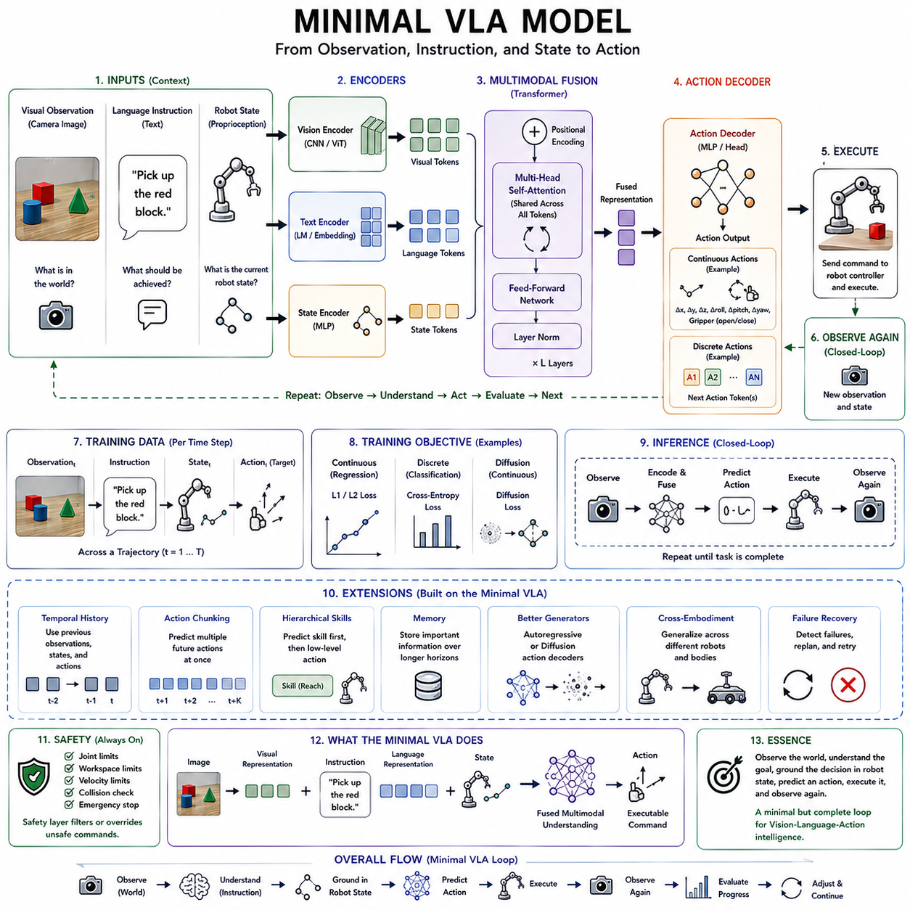{width="7.268055555555556in" height="7.268055555555556in"}

A minimal Vision-Language-Action model is the simplest architecture that connects visual perception, language understanding, robot state, and action generation within one learnable policy. Its purpose is not to reproduce every capability of a large robotic foundation model, but to expose the essential computational path from observing a scene and understanding an instruction to producing an executable action. This makes the minimal VLA useful for understanding the fundamental structure of embodied multimodal intelligence.

The model begins with three primary sources of context: visual observations, language instructions, and robot state. A camera image describes the external environment, an instruction specifies the intended task, and proprioceptive information describes the robot\'s current physical configuration. Together these inputs answer three basic questions: what is in the world, what should be achieved, and what physical state is the robot currently in.

Visual observations are processed by a vision encoder that converts raw images into compact visual features or tokens. The encoder may be a convolutional network, Vision Transformer, or pretrained visual backbone. Its role is to represent task-relevant information such as objects, shapes, spatial relationships, and scene structure in a form that can be combined with language and robot-state information rather than operating directly on image pixels.

The language instruction is transformed into language tokens or embeddings by a text encoder or language-model component. An instruction such as "pick up the red block" provides semantic information about the target object and desired interaction. Language therefore acts as a task-conditioning signal that determines which parts of the visual scene are relevant and what type of physical transformation the robot should attempt to produce.

Robot state provides the physical grounding required to turn perception and language into executable behavior. A minimal state vector may contain joint positions, end-effector pose, gripper state, or mobile-base configuration. Even when the visual scene and instruction remain unchanged, the correct next action can differ depending on the current robot configuration. State information therefore connects semantic understanding with the robot\'s immediate control possibilities.

Each input modality must be converted into a representation compatible with the shared VLA model. Visual features, language embeddings, and state vectors may initially have different dimensions and statistical properties. Projection layers can map them into a common embedding dimension, after which they can be represented as multimodal tokens. This simple alignment step creates a unified interface through which heterogeneous information can participate in shared reasoning.

The core of the minimal VLA can be implemented as a multimodal Transformer. Visual tokens describe the observed scene, language tokens encode the instruction, and state tokens represent the robot configuration. Self-attention allows information from these modalities to interact. A language token referring to an object can influence attention toward relevant visual features, while state information can affect which physically reachable action should be selected.

A minimal architecture does not require a separate symbolic planner. Instead, the multimodal backbone can learn a direct mapping from the combined context to an action representation. This produces an end-to-end policy in which semantic interpretation and physical action prediction are optimized together. Although more advanced systems may introduce planning, memory, world models, or hierarchical skills, the minimal model demonstrates that the essential VLA loop can be constructed without these additional components.

The action decoder converts the fused multimodal representation into robot commands. In the simplest continuous formulation, a small multilayer perceptron or regression head can predict a vector containing end-effector translation, rotation, and gripper state. For a mobile robot, the output might instead contain linear and angular velocity. The decoder therefore provides the final interface between learned multimodal representations and the robot\'s control system.

A discrete version can quantize action dimensions into tokens and predict them using a categorical output head. This formulation allows action generation to resemble next-token prediction in language models. The model receives visual, language, and state tokens and predicts one or more action tokens representing the next movement. Discrete prediction simplifies integration with Transformer sequence modeling but introduces quantization and action-vocabulary design choices.

The minimal model can also predict a single action or a short action chunk. Single-step prediction produces one immediate command and then processes a new observation, providing frequent closed-loop feedback. Action-chunk prediction produces several future commands in one inference, reducing model invocation frequency and improving short-term temporal coordination. Both strategies can use the same basic visual-language-state backbone with different action output structures.

Training requires demonstration tuples that connect observations and instructions with correct robot behavior. A simple sample can be written conceptually as an observation, instruction, robot state, and target action. Across a trajectory, these tuples form sequences showing how actions change as the robot and environment evolve. The model parameters are optimized so that predicted actions increasingly match demonstrated actions under the corresponding multimodal context.

For continuous actions, training may use regression losses between predicted and demonstrated control values. For discrete actions, cross-entropy can train the model to predict the correct action token. A diffusion objective can also be attached to the same multimodal context if continuous action chunks are desired. These alternatives modify the action-generation mechanism while preserving the essential VLA principle of conditioning physical behavior on perception, language, and state.

At inference time, the model operates inside a closed perception-action loop. The robot captures an image, reads its current state, combines them with the task instruction, and generates an action. The action is executed through the robot controller, producing a new physical state and a changed environment. New observations are then supplied to the model, allowing the next action to reflect the consequences of the previous one.

This repeated feedback is important because even a minimal VLA should not be interpreted as a one-shot mapping from an instruction to an entire physical task. Robot interaction contains uncertainty, and predicted movements may not produce exactly the expected outcome. Re-observation allows the model to adjust its behavior after motion, contact, object displacement, or other environmental changes, converting the policy into a basic closed-loop agent.

A useful minimal implementation can therefore be summarized computationally as perception encoding, language encoding, state encoding, multimodal fusion, and action decoding. The resulting path is compact enough to study and implement while still containing the essential ingredients of VLA modeling. Each component has a clear function, and more sophisticated capabilities can later be introduced by extending rather than replacing this basic architecture.

Temporal history is one natural extension. Instead of providing only the current observation and state, the model can receive previous observations, states, and actions as additional context. This enables it to distinguish situations that appear visually similar but arise from different interaction histories. Memory mechanisms can extend the same principle further by preserving task-relevant information across longer horizons without retaining every previous sensor input.

Another extension is hierarchical action generation. The minimal VLA can first predict a semantic skill such as reach, grasp, or place, while a lower-level controller generates precise continuous motion. Alternatively, the shared multimodal representation can condition an autoregressive or diffusion action decoder. These additions increase planning and generation capability while retaining the original architecture\'s central connection between multimodal understanding and physical action.

Safety components should remain outside or alongside the learned policy even in a minimal implementation. Predicted commands can be checked against joint limits, workspace boundaries, velocity constraints, and collision conditions before execution. An emergency controller or safety layer can override inappropriate outputs. The VLA therefore determines intended behavior while deterministic robot-control mechanisms continue to enforce critical physical constraints.

The value of the minimal VLA model lies in revealing the essential transformation performed by the broader architecture. Images become visual representations, instructions become semantic representations, robot states provide embodiment context, multimodal fusion combines these signals, and an action decoder converts the resulting representation into movement. Training links this complete path to demonstrated physical interaction.

From this compact foundation, increasingly capable VLA systems can be constructed by scaling data and models and adding temporal memory, action chunking, diffusion generation, hierarchical planning, cross-embodiment representations, failure recovery, and long-horizon reasoning. The minimal VLA therefore serves as both a conceptual baseline and an architectural building block: observe the world, understand the goal, ground the decision in robot state, predict an action, execute it, and observe again.

최소 비전-언어-행동 모델(Minimal Vision-Language-Action Model)은 시각적 지각(visual perception), 언어 이해(language understanding), 로봇 상태(robot state), 행동 생성(action generation)을 하나의 학습 가능한 정책(learnable policy)으로 연결하는 가장 단순한 아키텍처이다. 그 목적은 대규모 로봇 파운데이션 모델(robotic foundation model)의 모든 능력을 재현하는 것이 아니라, 장면을 관찰하고 명령을 이해하는 단계에서 실행 가능한 행동을 생성하는 단계까지의 핵심적인 계산 경로를 보여주는 것이다. 따라서 최소 VLA는 체화된 멀티모달 지능(embodied multimodal intelligence)의 기본 구조를 이해하는 데 유용하다.

모델은 시각적 관찰(visual observation), 언어 명령(language instruction), 로봇 상태(robot state)라는 세 가지 주요 문맥 정보에서 시작한다. 카메라 이미지는 외부 환경을 설명하고, 명령은 수행해야 할 작업을 지정하며, 고유수용성 정보(proprioceptive information)는 로봇의 현재 물리적 구성을 나타낸다. 이러한 입력은 함께 세계에 무엇이 존재하는지, 무엇을 달성해야 하는지, 로봇이 현재 어떤 물리적 상태에 있는지라는 세 가지 기본적인 질문에 답한다.

시각적 관찰은 원시 이미지를 압축된 시각 특징(visual feature) 또는 토큰(token)으로 변환하는 비전 인코더(vision encoder)에 의해 처리된다. 인코더는 합성곱 신경망(convolutional network), 비전 트랜스포머(Vision Transformer), 또는 사전학습된 시각 백본(pretrained visual backbone)이 될 수 있다. 그 역할은 이미지 픽셀을 직접 처리하는 대신 객체, 형태, 공간적 관계, 장면 구조와 같은 작업 관련 정보를 언어 및 로봇 상태 정보와 결합할 수 있는 형태로 표현하는 것이다.

언어 명령은 텍스트 인코더(text encoder) 또는 언어 모델 구성요소(language-model component)를 통해 언어 토큰(language token)이나 임베딩(embedding)으로 변환된다. "빨간 블록을 집어라"와 같은 명령은 목표 객체와 원하는 상호작용에 대한 의미 정보를 제공한다. 따라서 언어는 시각 장면의 어떤 부분이 관련되어 있으며 로봇이 어떤 유형의 물리적 변화를 만들어야 하는지를 결정하는 작업 조건화 신호(task-conditioning signal)로 작동한다.

로봇 상태는 지각과 언어를 실행 가능한 행동으로 변환하는 데 필요한 물리적 그라운딩(physical grounding)을 제공한다. 최소 상태 벡터(state vector)는 관절 위치(joint position), 말단장치 자세(end-effector pose), 그리퍼 상태(gripper state), 모바일 베이스 구성(mobile-base configuration)을 포함할 수 있다. 시각 장면과 명령이 동일하게 유지되더라도 현재 로봇 구성에 따라 올바른 다음 행동은 달라질 수 있다. 따라서 상태 정보는 의미적 이해와 로봇의 즉각적인 제어 가능성을 연결한다.

각각의 입력 모달리티(input modality)는 공유 VLA 모델과 호환되는 표현으로 변환되어야 한다. 시각 특징, 언어 임베딩, 상태 벡터는 처음에는 서로 다른 차원과 통계적 특성을 가질 수 있다. 투영 계층(projection layer)은 이를 공통 임베딩 차원(common embedding dimension)으로 매핑할 수 있으며, 이후 멀티모달 토큰(multimodal token)으로 표현할 수 있다. 이러한 단순한 정렬 단계(alignment step)는 이질적인 정보가 공유 추론(shared reasoning)에 참여할 수 있는 통합 인터페이스를 구성한다.

최소 VLA의 핵심은 멀티모달 트랜스포머(multimodal Transformer)로 구현할 수 있다. 시각 토큰은 관찰된 장면을 설명하고, 언어 토큰은 명령을 인코딩하며, 상태 토큰(state token)은 로봇 구성을 나타낸다. 셀프 어텐션(self-attention)은 이러한 모달리티 사이의 정보가 상호작용하도록 한다. 객체를 지칭하는 언어 토큰은 관련 시각 특징에 대한 어텐션에 영향을 줄 수 있으며, 상태 정보는 물리적으로 도달 가능한 행동의 선택에 영향을 줄 수 있다.

최소 아키텍처는 별도의 기호적 플래너(symbolic planner)를 반드시 필요로 하지 않는다. 대신 멀티모달 백본(multimodal backbone)은 결합된 문맥에서 행동 표현(action representation)으로 직접 매핑하는 방법을 학습할 수 있다. 이를 통해 의미적 해석과 물리적 행동 예측이 함께 최적화되는 엔드투엔드 정책(end-to-end policy)을 구성한다. 더 발전된 시스템에서는 계획, 메모리, 월드 모델(world model), 계층적 스킬(hierarchical skill)을 추가할 수 있지만 최소 모델은 이러한 추가 구성요소 없이도 핵심 VLA 루프를 구성할 수 있음을 보여준다.

행동 디코더(action decoder)는 융합된 멀티모달 표현을 로봇 명령으로 변환한다. 가장 단순한 연속 표현(continuous formulation)에서는 작은 다층 퍼셉트론(multilayer perceptron) 또는 회귀 헤드(regression head)가 말단장치의 병진(translation), 회전(rotation), 그리퍼 상태를 포함하는 벡터를 예측할 수 있다. 모바일 로봇에서는 선속도(linear velocity)와 각속도(angular velocity)를 출력할 수 있다. 따라서 디코더는 학습된 멀티모달 표현과 로봇 제어 시스템 사이의 최종 인터페이스를 제공한다.

이산 버전(discrete version)은 행동 차원을 토큰으로 양자화(quantization)하고 범주형 출력 헤드(categorical output head)를 사용하여 이를 예측할 수 있다. 이러한 방식은 행동 생성을 언어 모델의 다음 토큰 예측(next-token prediction)과 유사하게 만든다. 모델은 시각, 언어, 상태 토큰을 입력받고 다음 움직임을 나타내는 하나 이상의 행동 토큰(action token)을 예측한다. 이산 예측은 트랜스포머 시퀀스 모델링(Transformer sequence modeling)과의 통합을 단순화하지만 양자화 및 행동 어휘(action vocabulary) 설계가 필요하다.

최소 모델은 하나의 행동 또는 짧은 행동 청크(action chunk)를 예측할 수도 있다. 단일 단계 예측(single-step prediction)은 하나의 즉각적인 명령을 생성한 후 새로운 관찰을 처리하여 빈번한 폐루프 피드백(closed-loop feedback)을 제공한다. 행동 청크 예측은 한 번의 추론에서 여러 미래 명령을 생성하여 모델 호출 빈도를 줄이고 단기적인 시간적 조정 능력을 향상시킨다. 두 전략 모두 동일한 기본 시각-언어-상태 백본(visual-language-state backbone)을 사용하면서 서로 다른 행동 출력 구조를 적용할 수 있다.

학습에는 관찰과 명령을 올바른 로봇 행동과 연결하는 시연 튜플(demonstration tuple)이 필요하다. 간단한 학습 샘플은 개념적으로 관찰, 명령, 로봇 상태, 목표 행동(target action)으로 구성할 수 있다. 하나의 궤적에서 이러한 튜플은 로봇과 환경이 변화함에 따라 행동이 어떻게 달라지는지를 보여주는 시퀀스를 형성한다. 모델 매개변수는 해당 멀티모달 문맥에서 예측 행동이 시연 행동과 점차 일치하도록 최적화된다.

연속 행동의 경우 예측된 제어값과 시연된 제어값 사이에 회귀 손실(regression loss)을 사용할 수 있다. 이산 행동에서는 교차 엔트로피(cross-entropy)를 이용하여 올바른 행동 토큰을 예측하도록 모델을 학습할 수 있다. 연속 행동 청크가 필요한 경우 동일한 멀티모달 문맥에 확산 목표(diffusion objective)를 연결할 수도 있다. 이러한 방법들은 행동 생성 메커니즘을 변경하지만 지각, 언어, 상태를 조건으로 물리적 행동을 생성한다는 VLA의 핵심 원리는 유지한다.

추론 시 모델은 폐쇄형 지각-행동 루프(closed perception-action loop) 내부에서 동작한다. 로봇은 이미지를 획득하고 현재 상태를 읽은 후 이를 작업 명령과 결합하여 행동을 생성한다. 행동은 로봇 제어기를 통해 실행되며 새로운 물리적 상태와 변화된 환경을 만든다. 이후 새로운 관찰이 다시 모델에 입력되므로 다음 행동은 이전 행동이 만들어낸 결과를 반영할 수 있다.

이러한 반복적인 피드백은 최소 VLA도 명령에서 전체 물리적 작업으로 한 번에 매핑하는 원샷 모델(one-shot model)로 이해해서는 안 된다는 점에서 중요하다. 로봇 상호작용에는 불확실성이 존재하며 예측된 움직임이 항상 예상한 결과를 만들어내는 것은 아니다. 재관찰(re-observation)을 통해 모델은 움직임, 접촉, 객체 이동 또는 기타 환경 변화 이후 행동을 조정할 수 있으며, 이를 통해 정책은 기본적인 폐루프 에이전트(closed-loop agent)로 동작한다.

따라서 유용한 최소 구현은 계산적으로 지각 인코딩(perception encoding), 언어 인코딩(language encoding), 상태 인코딩(state encoding), 멀티모달 융합(multimodal fusion), 행동 디코딩(action decoding)으로 요약할 수 있다. 이러한 경로는 연구하고 구현하기에 충분히 간결하면서도 VLA 모델링의 핵심 요소를 포함한다. 각각의 구성요소는 명확한 기능을 가지며, 이후 기본 아키텍처를 교체하지 않고 확장하는 방식으로 보다 정교한 능력을 추가할 수 있다.

시간적 이력(temporal history)은 자연스럽게 추가할 수 있는 확장 기능이다. 현재의 관찰과 상태만 제공하는 대신 이전 관찰, 상태, 행동을 추가적인 문맥으로 모델에 제공할 수 있다. 이를 통해 모델은 시각적으로 유사해 보이지만 서로 다른 상호작용 이력에서 발생한 상황을 구분할 수 있다. 메모리 메커니즘(memory mechanism)은 모든 이전 센서 입력을 유지하지 않고도 더 긴 시간에 걸쳐 작업 관련 정보를 보존함으로써 이러한 원리를 더욱 확장할 수 있다.

또 다른 확장 방식은 계층적 행동 생성(hierarchical action generation)이다. 최소 VLA는 먼저 접근(reach), 파지(grasp), 배치(place)와 같은 의미적 스킬(semantic skill)을 예측하고, 저수준 제어기가 정밀한 연속 움직임을 생성하도록 할 수 있다. 또는 공유 멀티모달 표현을 자기회귀 행동 디코더(autoregressive action decoder)나 확산 행동 디코더(diffusion action decoder)의 조건으로 사용할 수도 있다. 이러한 추가 기능은 멀티모달 이해와 물리적 행동 사이의 핵심적인 연결을 유지하면서 계획 및 생성 능력을 향상시킨다.

최소 구현에서도 안전 구성요소(safety component)는 학습된 정책 외부 또는 정책과 병렬적으로 유지되어야 한다. 예측된 명령은 실행 전에 관절 제한(joint limit), 작업 공간 경계(workspace boundary), 속도 제약(velocity constraint), 충돌 조건(collision condition)을 기준으로 검사할 수 있다. 비상 제어기(emergency controller)나 안전 계층(safety layer)은 부적절한 출력을 무시하고 개입할 수 있다. 따라서 VLA는 의도된 행동을 결정하지만 결정론적 로봇 제어 메커니즘(deterministic robot-control mechanism)은 중요한 물리적 제약을 지속적으로 적용한다.

최소 VLA 모델의 가치는 전체 아키텍처가 수행하는 핵심적인 변환 과정을 명확하게 보여준다는 데 있다. 이미지는 시각 표현(visual representation)이 되고, 명령은 의미 표현(semantic representation)이 되며, 로봇 상태는 체화 문맥(embodiment context)을 제공하고, 멀티모달 융합은 이러한 신호를 결합하며, 행동 디코더는 그 결과로 생성된 표현을 움직임으로 변환한다. 학습은 이러한 전체 경로를 시연된 물리적 상호작용과 연결한다.

이러한 간결한 기반에서 데이터와 모델의 규모를 확장하고 시간적 메모리(temporal memory), 행동 청킹(action chunking), 확산 생성(diffusion generation), 계층적 계획(hierarchical planning), 교차 체화 표현(cross-embodiment representation), 실패 복구(failure recovery), 장기 구간 추론(long-horizon reasoning)을 추가함으로써 더욱 강력한 VLA 시스템을 구축할 수 있다. 따라서 최소 VLA는 개념적 기준선(conceptual baseline)이자 아키텍처 구성 요소로서 세계를 관찰하고, 목표를 이해하고, 로봇 상태에 의사결정을 그라운딩하고, 행동을 예측하고, 실행한 후 다시 관찰하는 기본 순환 구조를 제공한다.
