**Volume 08. Robot Foundation Models and VLA**

# Chapter 05. Action Tokenization

## 05.01. Why Actions Need Representations

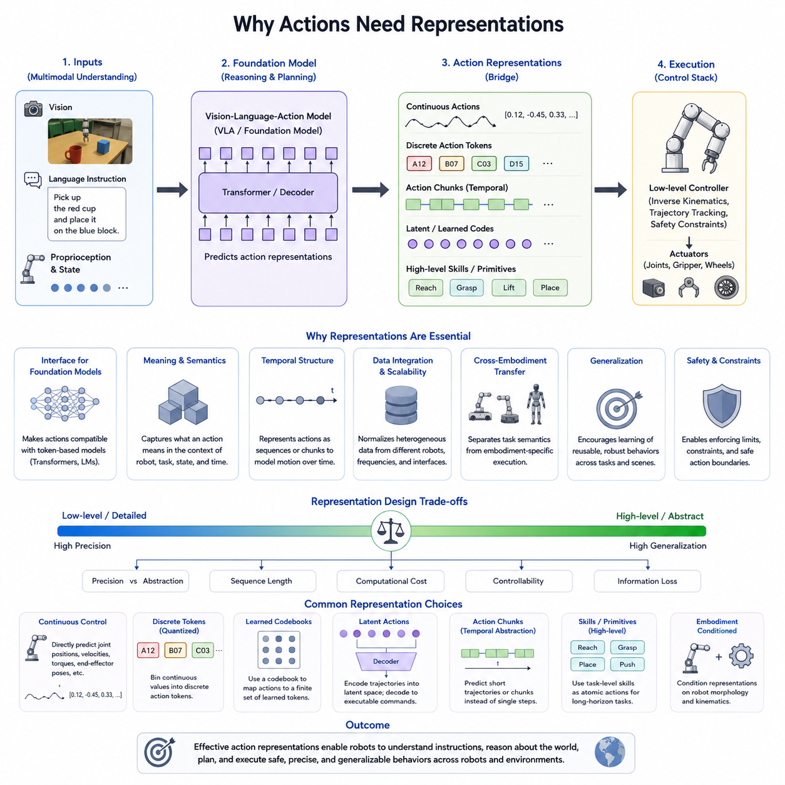{width="7.268055555555556in" height="7.268055555555556in"}

Robots ultimately interact with the physical world through actions, but raw actuator commands are not naturally compatible with the representations used by modern foundation models. A language model operates on structured tokens and embeddings, while a robot may control joint positions, velocities, torques, gripper states, wheel speeds, or Cartesian poses. Action representation provides the interface that connects these two fundamentally different computational domains.

An action is more than a numerical command sent to a motor. Its meaning depends on the robot, the task, the current physical state, and the time over which the command is executed. A value representing a joint angle has a different interpretation from the same numerical value representing velocity or torque. Therefore, robot learning systems need an explicit representation that describes what an action means before actions can be predicted, compared, learned, or transferred.

This requirement becomes especially important in Vision-Language-Action models. VLA systems receive observations and instructions expressed through images, language, proprioception, and other sensor signals, but their outputs must eventually become executable physical behavior. The model therefore needs a computational bridge from multimodal semantic representations to motor-level commands. Action representations create this bridge by expressing physical behavior in a form that neural architectures can efficiently process.

Raw continuous control vectors are one possible representation. A manipulation policy might directly predict joint positions, joint velocities, Cartesian end-effector displacement, or gripper commands. This approach preserves precise control information and can support smooth motion. However, continuous values do not naturally behave like the discrete symbols used by language-oriented Transformer architectures, making their integration with token-based foundation models more difficult.

Discrete representations provide another possibility. Continuous action dimensions can be divided into intervals, and each interval can be represented by an action token. A model can then predict actions using mechanisms similar to next-token prediction in language models. For example, Cartesian movement, wrist rotation, and gripper state may each be converted into discrete symbols. This makes action generation compatible with autoregressive architectures, although discretization introduces quantization error.

The choice of representation determines what the model can easily learn. Low-level representations expose detailed motor behavior but require the model to reason over long sequences of small control changes. Higher-level representations can describe meaningful skills such as reaching, grasping, moving, placing, or navigating. These abstractions shorten the effective planning horizon, but they may hide information required for precise control. Action representation is therefore closely related to temporal abstraction and hierarchical behavior.

Actions also have temporal structure. Many robot tasks cannot be understood as isolated control commands because individual movements are meaningful only as parts of sequences. Instead of predicting one action at a time, a model can represent a short trajectory as an action chunk. Such chunks capture correlations between consecutive commands and allow the policy to generate coherent motion over a longer interval. This is particularly useful when observations arrive more slowly than the underlying motor control frequency.

A useful action representation must also preserve the relationship between perception and physical consequences. When a robot observes an object and receives an instruction to grasp it, the predicted action should encode not merely motion but an interaction with the environment. The representation must support learning associations among visual states, linguistic goals, robot configurations, and resulting state transitions. Actions therefore become part of a larger observation-instruction-action modeling framework rather than isolated outputs.

Representation is equally important for learning from large robot datasets. Demonstrations collected from different robots may use different coordinate systems, control frequencies, joint configurations, grippers, and command interfaces. Training directly on these heterogeneous raw commands makes data integration difficult. Normalization, canonical coordinate frames, action tokenization, latent representations, and embodiment conditioning can transform heterogeneous commands into more comparable forms suitable for large-scale robot pretraining.

This issue becomes even more significant for cross-embodiment learning. A mobile manipulator, humanoid, quadruped, and industrial arm do not share identical actuator spaces, yet they may perform conceptually similar behaviors. A purely joint-level representation binds knowledge tightly to a particular morphology. More abstract action representations can separate task semantics from embodiment-specific execution, allowing shared representations to describe goals or motion patterns while robot-specific controllers translate them into executable commands.

Action representations also influence generalization. If a model memorizes particular actuator values, it may perform well only on familiar robots and environments. Representations based on relative motion, end-effector displacement, object-centric relationships, or learned latent actions can capture reusable structure. For example, representing motion relative to an object rather than in fixed world coordinates can make a learned manipulation behavior less dependent on the object\'s absolute location.

Learned latent action representations extend this principle by allowing neural networks to discover compact structures within complex behavior. Instead of manually defining every action dimension or discrete category, an encoder can map trajectories into a latent space containing recurring patterns of movement. A policy predicts these latent variables, and a decoder converts them back into executable controls. Such representations can capture correlations among joints, temporal patterns, and reusable motor primitives.

However, compression introduces a fundamental tradeoff. An action representation must be compact enough for efficient learning while retaining enough information for accurate physical execution. Excessive compression may remove subtle motion information needed for contact-rich manipulation or balance control. Excessively detailed representations may create long prediction sequences and make optimization difficult. Designing action representations therefore requires balancing precision, abstraction, sequence length, computational cost, and controllability.

The representation must also reflect the control architecture surrounding the foundation model. A VLA model does not necessarily need to command motors directly. It may predict target poses, trajectories, skills, or subgoals that are executed by lower-level controllers. This separation allows the foundation model to operate at a semantic or behavioral timescale while conventional feedback control handles fast dynamics. Action representation consequently defines an important boundary between learned intelligence and deterministic control.

Safety further strengthens the need for structured action representations. Robot outputs must respect joint limits, collision constraints, velocity limits, workspace boundaries, and task-specific safety conditions. Representations can make these constraints easier to enforce by restricting the set or range of actions that the model is allowed to generate. A carefully designed action interface therefore serves not only as a learning mechanism but also as a controllable boundary between probabilistic model outputs and physical execution.

Ultimately, action representation determines how abstract intelligence becomes physical behavior. Vision provides information about the environment, language specifies goals and constraints, and learned multimodal representations support reasoning, but none of these capabilities can affect the world until they are converted into executable actions. Action tokenization addresses this conversion by creating representations that can be predicted by foundation models and subsequently decoded into robot commands.

For this reason, action representation is a foundational design problem rather than a minor preprocessing choice. Continuous controls, discrete tokens, learned codebooks, latent actions, action chunks, and embodiment-conditioned representations offer different compromises between precision and abstraction. Understanding why actions require representations establishes the conceptual basis for examining robot action spaces, continuous and discrete representations, quantization, learned codebooks, temporal abstraction, and universal action interfaces.

로봇(Robot)은 궁극적으로 행동(Action)을 통해 물리적 세계(Physical World)와 상호작용하지만, 원시 액추에이터 명령(Raw Actuator Commands)은 현대 파운데이션 모델(Foundation Model)이 사용하는 표현(Representation)과 자연스럽게 호환되지 않는다. 언어 모델(Language Model)은 구조화된 토큰(Token)과 임베딩(Embedding)을 처리하는 반면, 로봇은 관절 위치(Joint Position), 속도(Velocity), 토크(Torque), 그리퍼 상태(Gripper State), 휠 속도(Wheel Speed), 또는 데카르트 좌표계 자세(Cartesian Pose)를 제어할 수 있다. 행동 표현(Action Representation)은 이처럼 근본적으로 다른 두 계산 영역을 연결하는 인터페이스(Interface)를 제공한다.

행동(Action)은 단순히 모터(Motor)에 전달되는 수치 명령 이상의 의미를 가진다. 행동의 의미는 로봇, 작업(Task), 현재 물리적 상태(Physical State), 그리고 명령이 실행되는 시간에 따라 달라진다. 관절 각도(Joint Angle)를 나타내는 값은 동일한 숫자가 속도나 토크를 나타낼 때와 전혀 다른 의미를 갖는다. 따라서 로봇 학습 시스템(Robot Learning System)은 행동을 예측하고 비교하고 학습하거나 전이(Transfer)하기 전에 행동이 무엇을 의미하는지를 설명하는 명시적인 표현이 필요하다.

이러한 요구사항은 비전-언어-행동 모델(Vision-Language-Action Model, VLA)에서 특히 중요해진다. VLA 시스템은 이미지(Image), 언어(Language), 고유수용감각(Proprioception), 기타 센서 신호(Sensor Signal)를 통해 표현된 관측(Observation)과 명령(Instruction)을 입력으로 받지만, 그 출력은 궁극적으로 실행 가능한 물리적 행동(Physical Behavior)이 되어야 한다. 따라서 모델에는 멀티모달 의미 표현(Multimodal Semantic Representation)을 모터 수준 명령(Motor-Level Command)으로 변환하는 계산적 연결 장치가 필요하며, 행동 표현이 이러한 연결을 가능하게 한다.

원시 연속 제어 벡터(Raw Continuous Control Vector)는 가능한 행동 표현 방식 중 하나이다. 조작 정책(Manipulation Policy)은 관절 위치, 관절 속도, 데카르트 좌표계 엔드이펙터 변위(Cartesian End-Effector Displacement), 또는 그리퍼 명령을 직접 예측할 수 있다. 이러한 방식은 정밀한 제어 정보를 유지하고 부드러운 움직임을 지원할 수 있다. 그러나 연속값(Continuous Value)은 언어 중심 트랜스포머(Transformer) 아키텍처에서 사용하는 이산 심볼(Discrete Symbol)처럼 자연스럽게 동작하지 않기 때문에 토큰 기반 파운데이션 모델과 통합하기 어렵다.

이산 표현(Discrete Representation)은 또 다른 가능성을 제공한다. 연속 행동 차원(Continuous Action Dimension)을 여러 구간으로 나누고 각 구간을 행동 토큰(Action Token)으로 표현할 수 있다. 그러면 모델은 언어 모델의 다음 토큰 예측(Next-Token Prediction)과 유사한 메커니즘으로 행동을 예측할 수 있다. 예를 들어 데카르트 좌표계 이동(Cartesian Movement), 손목 회전(Wrist Rotation), 그리퍼 상태를 각각 이산 심볼로 변환할 수 있다. 이는 행동 생성을 자기회귀 아키텍처(Autoregressive Architecture)와 호환되도록 하지만, 이산화(Discretization)는 양자화 오차(Quantization Error)를 발생시킬 수 있다.

표현 방식의 선택은 모델이 무엇을 쉽게 학습할 수 있는지를 결정한다. 저수준 표현(Low-Level Representation)은 세밀한 모터 동작을 제공하지만, 모델이 작은 제어 변화로 구성된 긴 시퀀스(Sequence)를 추론해야 한다. 반대로 고수준 표현(High-Level Representation)은 도달하기(Reaching), 잡기(Grasping), 이동하기(Moving), 놓기(Placing), 탐색하기(Navigating)와 같은 의미 있는 기술(Skill)을 표현할 수 있다. 이러한 추상화는 실질적인 계획 지평(Planning Horizon)을 단축하지만 정밀 제어에 필요한 정보를 감출 수 있다. 따라서 행동 표현은 시간적 추상화(Temporal Abstraction) 및 계층적 행동(Hierarchical Behavior)과 밀접하게 연결된다.

행동에는 시간적 구조(Temporal Structure)도 존재한다. 많은 로봇 작업은 개별 제어 명령만으로 이해할 수 없는데, 각각의 움직임은 시퀀스의 일부로 존재할 때 의미를 갖기 때문이다. 모델은 한 번에 하나의 행동을 예측하는 대신 짧은 궤적(Trajectory)을 행동 청크(Action Chunk)로 표현할 수 있다. 이러한 청크는 연속된 명령 사이의 상관관계를 포착하고 정책(Policy)이 더 긴 시간 구간에 걸쳐 일관된 움직임을 생성하도록 한다. 이는 특히 관측 주기가 기본 모터 제어 주파수(Motor Control Frequency)보다 느린 경우에 유용하다.

유용한 행동 표현은 지각(Perception)과 물리적 결과(Physical Consequence) 사이의 관계도 보존해야 한다. 로봇이 물체를 관찰하고 그것을 잡으라는 명령을 받는 경우, 예측된 행동은 단순한 움직임이 아니라 환경과의 상호작용(Interaction)을 인코딩해야 한다. 표현은 시각적 상태(Visual State), 언어적 목표(Linguistic Goal), 로봇 구성(Robot Configuration), 그리고 결과적인 상태 전이(State Transition) 사이의 연관성을 학습할 수 있어야 한다. 따라서 행동은 독립된 출력이 아니라 더 큰 관측-명령-행동 모델링(Observation-Instruction-Action Modeling) 프레임워크의 일부가 된다.

표현은 대규모 로봇 데이터셋(Robot Dataset)으로부터 학습하는 과정에서도 중요하다. 서로 다른 로봇에서 수집한 시연 데이터(Demonstration Data)는 서로 다른 좌표계(Coordinate System), 제어 주파수(Control Frequency), 관절 구성(Joint Configuration), 그리퍼, 명령 인터페이스(Command Interface)를 사용할 수 있다. 이러한 이질적인 원시 명령을 직접 학습하면 데이터 통합이 어려워진다. 정규화(Normalization), 표준 좌표계(Canonical Coordinate Frame), 행동 토큰화(Action Tokenization), 잠재 표현(Latent Representation), 체화 조건화(Embodiment Conditioning)는 서로 다른 명령을 대규모 로봇 사전학습(Robot Pretraining)에 적합한 형태로 변환할 수 있다.

이 문제는 교차 체화 학습(Cross-Embodiment Learning)에서 더욱 중요해진다. 모바일 매니퓰레이터(Mobile Manipulator), 휴머노이드(Humanoid), 4족 보행 로봇(Quadruped), 산업용 로봇 팔(Industrial Arm)은 동일한 액추에이터 공간(Actuator Space)을 공유하지 않지만 개념적으로 유사한 행동을 수행할 수 있다. 순수한 관절 수준 표현(Joint-Level Representation)은 지식을 특정 형태학(Morphology)에 강하게 종속시킨다. 보다 추상적인 행동 표현은 작업 의미(Task Semantics)를 체화별 실행(Embodiment-Specific Execution)과 분리하여, 공유 표현(Shared Representation)이 목표나 움직임 패턴을 기술하고 로봇별 제어기가 이를 실행 가능한 명령으로 변환하도록 할 수 있다.

행동 표현은 일반화(Generalization)에도 영향을 미친다. 모델이 특정 액추에이터 값을 암기한다면 익숙한 로봇과 환경에서만 우수한 성능을 보일 수 있다. 상대적 움직임(Relative Motion), 엔드이펙터 변위(End-Effector Displacement), 객체 중심 관계(Object-Centric Relationship), 또는 학습된 잠재 행동(Learned Latent Action)에 기반한 표현은 재사용 가능한 구조를 포착할 수 있다. 예를 들어 고정된 세계 좌표(World Coordinate)가 아니라 물체를 기준으로 움직임을 표현하면 학습된 조작 행동이 물체의 절대 위치에 덜 의존하게 된다.

학습된 잠재 행동 표현(Learned Latent Action Representation)은 신경망(Neural Network)이 복잡한 행동 내부의 압축된 구조를 발견하도록 함으로써 이러한 원리를 확장한다. 모든 행동 차원이나 이산 범주를 사람이 직접 정의하는 대신, 인코더(Encoder)가 궤적을 반복적인 움직임 패턴을 포함하는 잠재 공간(Latent Space)으로 매핑할 수 있다. 정책은 이러한 잠재 변수(Latent Variable)를 예측하고 디코더(Decoder)는 이를 실행 가능한 제어 명령으로 다시 변환한다. 이러한 표현은 관절 사이의 상관관계, 시간적 패턴, 재사용 가능한 모터 프리미티브(Motor Primitive)를 포착할 수 있다.

그러나 압축(Compression)은 근본적인 절충관계(Tradeoff)를 발생시킨다. 행동 표현은 효율적인 학습이 가능할 정도로 압축되어야 하지만 정확한 물리적 실행에 필요한 정보도 충분히 유지해야 한다. 지나친 압축은 접촉 중심 조작(Contact-Rich Manipulation)이나 균형 제어(Balance Control)에 필요한 미세한 움직임 정보를 제거할 수 있다. 반대로 지나치게 세밀한 표현은 예측 시퀀스를 길게 만들고 최적화(Optimization)를 어렵게 한다. 따라서 행동 표현 설계에는 정밀도(Precision), 추상화(Abstraction), 시퀀스 길이, 계산 비용(Computational Cost), 제어 가능성(Controllability) 사이의 균형이 필요하다.

행동 표현은 파운데이션 모델을 둘러싼 제어 아키텍처(Control Architecture)도 반영해야 한다. VLA 모델이 반드시 모터를 직접 명령할 필요는 없다. 대신 목표 자세(Target Pose), 궤적, 기술, 또는 하위 목표(Subgoal)를 예측하고 이를 저수준 제어기(Low-Level Controller)가 실행하도록 구성할 수 있다. 이러한 분리는 파운데이션 모델이 의미적 또는 행동적 시간 척도(Semantic or Behavioral Timescale)에서 작동하도록 하고, 기존 피드백 제어(Feedback Control)가 빠른 동역학(Fast Dynamics)을 처리하도록 한다. 따라서 행동 표현은 학습된 지능(Learned Intelligence)과 결정론적 제어(Deterministic Control) 사이의 중요한 경계를 정의한다.

안전성(Safety)은 구조화된 행동 표현의 필요성을 더욱 강화한다. 로봇 출력은 관절 한계(Joint Limit), 충돌 제약(Collision Constraint), 속도 제한(Velocity Limit), 작업 공간 경계(Workspace Boundary), 작업별 안전 조건(Task-Specific Safety Condition)을 준수해야 한다. 표현을 적절하게 설계하면 모델이 생성할 수 있는 행동의 집합이나 범위를 제한하여 이러한 제약을 보다 쉽게 적용할 수 있다. 따라서 잘 설계된 행동 인터페이스(Action Interface)는 학습 메커니즘일 뿐만 아니라 확률적 모델 출력(Probabilistic Model Output)과 물리적 실행 사이의 제어 가능한 안전 경계 역할도 수행한다.

궁극적으로 행동 표현(Action Representation)은 추상적 지능(Abstract Intelligence)이 어떻게 물리적 행동으로 변환되는지를 결정한다. 비전(Vision)은 환경에 대한 정보를 제공하고, 언어는 목표와 제약조건을 정의하며, 학습된 멀티모달 표현은 추론(Reasoning)을 지원한다. 그러나 이러한 능력은 실행 가능한 행동으로 변환되기 전까지 물리적 세계에 영향을 줄 수 없다. 행동 토큰화(Action Tokenization)는 파운데이션 모델이 예측할 수 있고 이후 로봇 명령으로 디코딩할 수 있는 표현을 생성함으로써 이러한 변환 문제를 해결한다.

따라서 행동 표현은 단순한 전처리 선택(Preprocessing Choice)이 아니라 근본적인 설계 문제(Foundational Design Problem)이다. 연속 제어(Continuous Control), 이산 토큰(Discrete Token), 학습된 코드북(Learned Codebook), 잠재 행동(Latent Action), 행동 청크(Action Chunk), 체화 조건부 표현(Embodiment-Conditioned Representation)은 정밀성과 추상화 사이에서 서로 다른 절충관계를 제공한다. 행동에 왜 표현이 필요한지를 이해하는 것은 로봇 행동 공간(Robot Action Space), 연속 및 이산 표현, 양자화(Quantization), 학습된 코드북, 시간적 추상화, 범용 행동 인터페이스(Universal Action Interface)를 이해하기 위한 개념적 기반이 된다.

## 05.02. Robot Action Spaces

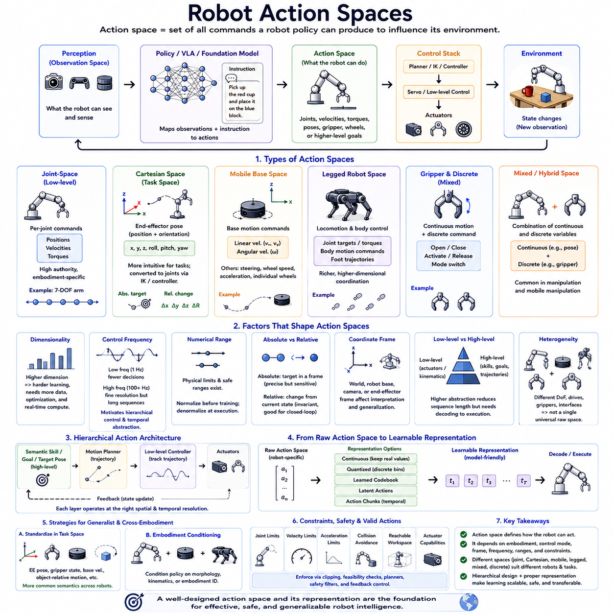{width="7.268055555555556in" height="7.268055555555556in"}

An action space defines the complete set of commands that a robot policy is allowed to produce. While an observation space describes what the robot can perceive, the action space specifies how the robot can influence its environment. For a physical agent, this may include joint positions, velocities, torques, end-effector poses, gripper commands, wheel velocities, or higher-level motion goals.

The structure of an action space is closely tied to robot embodiment. A six-axis industrial manipulator may operate in a six-dimensional joint space, while a mobile robot may use linear and angular velocity commands. A humanoid can require dozens of coordinated joint variables, and a mobile manipulator combines locomotion with manipulation. Consequently, there is no single raw action space that naturally applies to every robot morphology.

Joint-space control represents actions directly through individual robot joints. A policy can command desired joint positions, joint velocities, or joint torques depending on the control architecture. Position commands describe where joints should move, velocity commands specify their rate of motion, and torque commands influence the forces that generate motion. Moving toward lower-level commands generally increases control authority while also increasing the difficulty of learning stable behavior.

Joint-position action spaces are common when a reliable lower-level controller already exists. Instead of learning detailed actuator dynamics, the policy predicts target configurations while servo controllers handle tracking. This reduces the burden placed on the learned model and can improve stability. However, joint-space commands remain strongly dependent on robot morphology because different robots have different numbers of joints, joint limits, kinematic structures, and coordinate conventions.

Cartesian action spaces provide an alternative representation for manipulation. Rather than specifying every joint independently, a policy can predict the desired position and orientation of an end effector. The controller or inverse kinematics module then converts this Cartesian target into joint commands. This representation can correspond more directly to task objectives such as moving toward an object, approaching a handle, lifting a tool, or placing an item at a target location.

Cartesian actions may be represented as absolute targets or relative changes. An absolute representation specifies a desired pose in a defined coordinate frame, whereas a relative representation predicts changes such as Δx, Δy, Δz and rotational increments. Relative actions often provide useful invariance because the same movement pattern can be applied from different initial configurations. However, their interpretation still depends on the selected world, robot, camera, or end-effector coordinate frame.

Mobile robots introduce another family of action spaces. A differential-drive robot can often be controlled through linear velocity and angular velocity, while other mobile platforms may expose steering angle, wheel velocity, acceleration, or individual wheel commands. Legged robots require considerably richer action spaces involving joint targets, torques, body motion commands, foot trajectories, or locomotion objectives. The appropriate representation depends strongly on the underlying control hierarchy.

Grippers and other discrete mechanisms introduce mixed action spaces. A manipulation policy may predict continuous end-effector motion together with a binary or discrete command such as open, close, activate, or release. Robot action spaces can therefore contain heterogeneous variables with different numerical ranges and semantics. VLA systems must represent these components consistently enough that a single policy can learn relationships between language instructions, perceived states, and physical execution.

The dimensionality of the action space strongly affects the learning problem. Predicting two mobile-base velocities is fundamentally easier than directly generating dozens of torque commands for a humanoid. As action dimensionality increases, the model must learn more dependencies among control variables and collect enough data to cover meaningful regions of the space. High-dimensional actions therefore create significant challenges for data efficiency, optimization, generalization, and real-time inference.

Action frequency introduces an additional dimension to the problem. A policy operating at one hertz produces far fewer decisions than a controller operating at hundreds of hertz. High-frequency action spaces provide fine temporal resolution but require long sequences to represent even short tasks. Foundation models generally benefit from operating at a slower semantic timescale, while dedicated low-level controllers execute high-frequency dynamics. This motivates hierarchical action architectures and temporal abstraction.

The numerical range of each action dimension must also be defined carefully. Joint angles have physical limits, velocities have safe operating ranges, and Cartesian displacements must remain within reachable regions. Robot learning pipelines commonly normalize these values before training so that dimensions with different physical units can be processed consistently. The resulting normalized representation is later transformed back into robot-specific physical commands during execution.

Absolute and relative action spaces provide different forms of inductive bias. Absolute commands can precisely specify a target configuration but may depend heavily on coordinate calibration and scene geometry. Relative commands describe how the current state should change and can generalize more naturally across different positions. For many manipulation policies, predicting incremental motion creates a convenient connection between current observations and immediate corrective actions within a closed-loop control process.

Another distinction exists between low-level and high-level action spaces. Low-level spaces describe actuator or kinematic commands, while higher-level spaces represent skills, motion primitives, waypoints, trajectories, or subgoals. A command such as "move the end effector five centimeters forward" is more abstract than individual joint torques, while "grasp the cup" is more abstract still. Increasing abstraction reduces sequence complexity but requires another mechanism to translate abstract decisions into physical execution.

Action spaces are therefore often organized hierarchically. A foundation model may select a semantic skill or predict a target pose, a motion planner may generate a feasible trajectory, and a low-level controller may convert that trajectory into actuator commands. Such decomposition allows different layers to operate at appropriate spatial and temporal resolutions. It also prevents a large multimodal model from having to learn every aspect of fast feedback control directly from data.

For generalist robot policies, heterogeneous action spaces create a major scaling challenge. Training data may contain manipulators with different degrees of freedom, mobile bases with different drive mechanisms, and robots with different grippers or control interfaces. Simply concatenating their raw commands does not create a meaningful universal space. The training system must identify which action dimensions are shared, which are embodiment-specific, and how their physical meanings correspond across platforms.

One strategy is to transform robot-specific commands into more standardized task-space representations. End-effector motion, gripper state, body velocity, object-relative displacement, and other semantically interpretable variables can provide greater commonality than raw actuator commands. Another strategy is to retain embodiment-specific action spaces while conditioning the model on robot morphology, kinematics, or embodiment identifiers. These approaches prepare the foundation for cross-embodiment transfer.

The action space also determines which physical constraints can be expressed and enforced. Joint limits, maximum velocities, acceleration limits, collision restrictions, reachable workspaces, and actuator capabilities constrain the set of valid actions. A policy that generates mathematically valid values may still produce physically impossible or unsafe behavior. Practical robot systems therefore combine learned action generation with clipping, feasibility checking, motion planning, safety filtering, and feedback control.

From the perspective of action tokenization, the robot action space is the raw domain that must eventually be encoded into a representation suitable for learning. Continuous dimensions can remain continuous, be quantized into discrete bins, mapped into learned codebooks, compressed into latent actions, or grouped into temporal action chunks. The characteristics of the original action space determine which representation strategy preserves the information required for successful execution.

Understanding robot action spaces is therefore essential before selecting an action tokenizer or VLA output architecture. Degrees of freedom, control modes, coordinate frames, temporal frequency, numerical ranges, embodiment differences, and safety constraints all determine what an action means physically. Action tokenization does not eliminate these properties; instead, it creates a learnable interface that preserves their important structure while making heterogeneous robot behavior accessible to foundation models.

행동 공간(Action Space)은 로봇 정책(Robot Policy)이 생성할 수 있도록 허용된 모든 명령의 집합을 정의한다. 관측 공간(Observation Space)이 로봇이 무엇을 인식할 수 있는지를 설명한다면, 행동 공간은 로봇이 환경에 어떻게 영향을 미칠 수 있는지를 규정한다. 물리적 에이전트(Physical Agent)의 행동 공간에는 관절 위치(Joint Position), 속도(Velocity), 토크(Torque), 엔드이펙터 자세(End-Effector Pose), 그리퍼 명령(Gripper Command), 휠 속도(Wheel Velocity), 또는 보다 고수준의 움직임 목표(Motion Goal)가 포함될 수 있다.

행동 공간의 구조는 로봇 체화(Robot Embodiment)와 밀접하게 연결된다. 6축 산업용 매니퓰레이터(Six-Axis Industrial Manipulator)는 6차원 관절 공간(Joint Space)에서 동작할 수 있는 반면, 모바일 로봇(Mobile Robot)은 선속도(Linear Velocity)와 각속도(Angular Velocity) 명령을 사용할 수 있다. 휴머노이드(Humanoid)는 수십 개의 조정된 관절 변수를 필요로 할 수 있으며, 모바일 매니퓰레이터(Mobile Manipulator)는 이동과 조작을 결합한다. 따라서 모든 로봇 형태(Morphology)에 자연스럽게 적용되는 하나의 원시 행동 공간(Raw Action Space)은 존재하지 않는다.

관절 공간 제어(Joint-Space Control)는 개별 로봇 관절을 통해 행동을 직접 표현한다. 정책은 제어 아키텍처(Control Architecture)에 따라 원하는 관절 위치, 관절 속도, 또는 관절 토크를 명령할 수 있다. 위치 명령(Position Command)은 관절이 이동해야 하는 위치를 나타내고, 속도 명령(Velocity Command)은 움직임의 변화율을 지정하며, 토크 명령(Torque Command)은 움직임을 발생시키는 힘에 영향을 준다. 더 저수준의 명령으로 이동할수록 제어 권한(Control Authority)은 증가하지만 안정적인 행동을 학습하는 어려움도 커진다.

관절 위치 행동 공간(Joint-Position Action Space)은 신뢰할 수 있는 저수준 제어기(Low-Level Controller)가 이미 존재할 때 일반적으로 사용된다. 정책이 세부적인 액추에이터 동역학(Actuator Dynamics)을 학습하는 대신 목표 관절 구성(Target Configuration)을 예측하고, 서보 제어기(Servo Controller)가 이를 추종한다. 이러한 방식은 학습 모델의 부담을 줄이고 안정성을 향상시킬 수 있다. 그러나 관절 공간 명령은 로봇마다 관절 수, 관절 한계, 운동학 구조(Kinematic Structure), 좌표 규약(Coordinate Convention)이 다르기 때문에 로봇 형태에 강하게 의존한다.

데카르트 행동 공간(Cartesian Action Space)은 조작(Manipulation)을 위한 또 다른 표현 방식을 제공한다. 정책은 각 관절을 개별적으로 지정하는 대신 엔드이펙터(End Effector)의 목표 위치와 방향(Orientation)을 예측할 수 있다. 이후 제어기 또는 역기구학 모듈(Inverse Kinematics Module)이 이 데카르트 목표(Cartesian Target)를 관절 명령으로 변환한다. 이러한 표현은 물체로 이동하거나 손잡이에 접근하고, 도구를 들어 올리거나 목표 위치에 물체를 놓는 것과 같은 작업 목적(Task Objective)에 보다 직접적으로 대응할 수 있다.

데카르트 행동은 절대 목표(Absolute Target) 또는 상대적 변화(Relative Change)로 표현할 수 있다. 절대 표현(Absolute Representation)은 정의된 좌표계에서 원하는 자세(Pose)를 지정하는 반면, 상대 표현(Relative Representation)은 Δx, Δy, Δz와 회전 증분(Rotational Increment) 같은 변화를 예측한다. 상대 행동은 동일한 움직임 패턴을 서로 다른 초기 구성에서 적용할 수 있기 때문에 유용한 불변성(Invariance)을 제공한다. 그러나 그 의미는 선택된 세계, 로봇, 카메라 또는 엔드이펙터 좌표계에 여전히 의존한다.

모바일 로봇은 또 다른 종류의 행동 공간을 갖는다. 차동 구동 로봇(Differential-Drive Robot)은 일반적으로 선속도와 각속도를 통해 제어할 수 있으며, 다른 모바일 플랫폼은 조향각(Steering Angle), 휠 속도, 가속도(Acceleration), 또는 개별 휠 명령을 사용할 수 있다. 보행 로봇(Legged Robot)은 관절 목표, 토크, 몸체 움직임 명령(Body Motion Command), 발 궤적(Foot Trajectory), 보행 목표(Locomotion Objective)를 포함하는 훨씬 복잡한 행동 공간을 필요로 한다. 적절한 표현은 기본 제어 계층(Control Hierarchy)에 크게 의존한다.

그리퍼(Gripper)와 기타 이산 메커니즘(Discrete Mechanism)은 혼합 행동 공간(Mixed Action Space)을 만든다. 조작 정책은 연속적인 엔드이펙터 움직임과 함께 열기(Open), 닫기(Close), 활성화(Activate), 해제(Release)와 같은 이진 또는 이산 명령을 예측할 수 있다. 따라서 로봇 행동 공간에는 서로 다른 수치 범위와 의미를 가진 이질적인 변수(Heterogeneous Variable)가 포함될 수 있다. VLA 시스템은 하나의 정책이 언어 명령, 인식된 상태, 물리적 실행 사이의 관계를 학습할 수 있도록 이러한 구성 요소를 일관성 있게 표현해야 한다.

행동 공간의 차원(Dimensionality)은 학습 문제의 난이도에 큰 영향을 준다. 모바일 베이스(Mobile Base)의 두 개 속도를 예측하는 것은 휴머노이드의 수십 개 토크 명령을 직접 생성하는 것보다 근본적으로 단순하다. 행동 차원이 증가하면 모델은 제어 변수 사이의 더 많은 의존관계를 학습해야 하며, 의미 있는 공간 영역을 충분히 포괄하는 데이터를 수집해야 한다. 따라서 고차원 행동(High-Dimensional Action)은 데이터 효율성(Data Efficiency), 최적화(Optimization), 일반화(Generalization), 실시간 추론(Real-Time Inference)에 상당한 어려움을 발생시킨다.

행동 주파수(Action Frequency)는 문제에 또 다른 차원을 추가한다. 1Hz로 작동하는 정책은 수백 Hz로 작동하는 제어기보다 훨씬 적은 의사결정을 생성한다. 고주파 행동 공간(High-Frequency Action Space)은 세밀한 시간 해상도(Temporal Resolution)를 제공하지만 짧은 작업조차 표현하기 위해 긴 시퀀스(Sequence)가 필요하다. 파운데이션 모델(Foundation Model)은 일반적으로 더 느린 의미적 시간 척도(Semantic Timescale)에서 동작하는 것이 유리하며, 전용 저수준 제어기가 고주파 동역학을 실행한다. 이는 계층적 행동 아키텍처(Hierarchical Action Architecture)와 시간적 추상화(Temporal Abstraction)의 필요성을 만든다.

각 행동 차원의 수치 범위(Numerical Range)도 신중하게 정의해야 한다. 관절 각도에는 물리적 한계가 있고, 속도에는 안전 운전 범위(Safe Operating Range)가 있으며, 데카르트 변위(Cartesian Displacement)는 도달 가능한 영역(Reachable Region) 안에 있어야 한다. 로봇 학습 파이프라인(Robot Learning Pipeline)은 서로 다른 물리 단위를 가진 차원을 일관성 있게 처리하기 위해 학습 전에 이러한 값을 정규화(Normalization)하는 경우가 많다. 이후 실행 과정에서 정규화된 표현을 다시 로봇별 물리 명령으로 변환한다.

절대 행동 공간(Absolute Action Space)과 상대 행동 공간(Relative Action Space)은 서로 다른 귀납적 편향(Inductive Bias)을 제공한다. 절대 명령은 목표 구성을 정확하게 지정할 수 있지만 좌표 보정(Coordinate Calibration)과 장면 기하(Scene Geometry)에 크게 의존할 수 있다. 상대 명령은 현재 상태가 어떻게 변화해야 하는지를 나타내기 때문에 서로 다른 위치에서도 보다 자연스럽게 일반화할 수 있다. 많은 조작 정책에서 증분 움직임(Incremental Motion)을 예측하면 현재 관측과 폐루프 제어(Closed-Loop Control) 과정의 즉각적인 보정 행동을 편리하게 연결할 수 있다.

저수준 행동 공간(Low-Level Action Space)과 고수준 행동 공간(High-Level Action Space) 사이에도 중요한 차이가 있다. 저수준 공간은 액추에이터 또는 운동학 명령을 표현하고, 고수준 공간은 기술(Skill), 모션 프리미티브(Motion Primitive), 웨이포인트(Waypoint), 궤적(Trajectory), 또는 하위 목표(Subgoal)를 표현한다. "엔드이펙터를 5cm 앞으로 이동"이라는 명령은 개별 관절 토크보다 추상적이며, "컵을 잡아라"라는 명령은 이보다 더 높은 수준의 추상화를 갖는다. 추상화 수준을 높이면 시퀀스 복잡성은 감소하지만 추상적 결정을 실제 물리적 실행으로 변환하는 추가 메커니즘이 필요하다.

따라서 행동 공간은 흔히 계층적(Hierarchical)으로 구성된다. 파운데이션 모델이 의미적 기술(Semantic Skill)을 선택하거나 목표 자세를 예측하면, 모션 플래너(Motion Planner)가 실행 가능한 궤적을 생성하고 저수준 제어기가 이를 액추에이터 명령으로 변환할 수 있다. 이러한 분해(Decomposition)를 통해 서로 다른 계층이 적절한 공간 및 시간 해상도(Spatial and Temporal Resolution)에서 동작할 수 있다. 또한 대규모 멀티모달 모델(Multimodal Model)이 빠른 피드백 제어의 모든 요소를 데이터로부터 직접 학습해야 하는 부담을 줄인다.

범용 로봇 정책(Generalist Robot Policy)의 관점에서 이질적인 행동 공간은 중요한 확장성 문제(Scaling Challenge)를 발생시킨다. 학습 데이터에는 서로 다른 자유도(Degrees of Freedom)를 가진 매니퓰레이터, 서로 다른 구동 메커니즘을 가진 모바일 베이스, 다양한 그리퍼와 제어 인터페이스를 가진 로봇이 포함될 수 있다. 이들의 원시 명령을 단순히 연결한다고 해서 의미 있는 범용 공간(Universal Space)이 만들어지는 것은 아니다. 학습 시스템은 어떤 행동 차원이 공유되고 어떤 차원이 체화별(Embodiment-Specific)이며, 그 물리적 의미가 플랫폼 사이에서 어떻게 대응되는지를 식별해야 한다.

한 가지 전략은 로봇별 명령을 보다 표준화된 작업 공간 표현(Task-Space Representation)으로 변환하는 것이다. 엔드이펙터 움직임, 그리퍼 상태, 몸체 속도(Body Velocity), 객체 상대 변위(Object-Relative Displacement), 기타 의미적으로 해석 가능한 변수는 원시 액추에이터 명령보다 높은 공통성을 제공할 수 있다. 또 다른 전략은 체화별 행동 공간을 유지하면서 모델을 로봇 형태, 운동학(Kinematics), 또는 체화 식별자(Embodiment Identifier)에 조건화하는 것이다. 이러한 접근법은 교차 체화 전이(Cross-Embodiment Transfer)를 위한 기반을 마련한다.

행동 공간은 어떤 물리적 제약(Physical Constraint)을 표현하고 강제할 수 있는지도 결정한다. 관절 한계(Joint Limit), 최대 속도(Maximum Velocity), 가속도 제한(Acceleration Limit), 충돌 제약(Collision Restriction), 도달 가능한 작업 공간(Reachable Workspace), 액추에이터 성능(Actuator Capability)은 유효한 행동의 집합을 제한한다. 정책이 수학적으로 유효한 값을 생성하더라도 물리적으로 불가능하거나 안전하지 않은 행동을 만들 수 있다. 따라서 실제 로봇 시스템은 학습된 행동 생성과 함께 클리핑(Clipping), 실행 가능성 검사(Feasibility Checking), 모션 플래닝(Motion Planning), 안전 필터링(Safety Filtering), 피드백 제어를 결합한다.

행동 토큰화(Action Tokenization)의 관점에서 로봇 행동 공간은 궁극적으로 학습에 적합한 표현으로 인코딩되어야 하는 원시 영역(Raw Domain)이다. 연속 차원은 그대로 연속적으로 유지하거나 이산 구간(Discrete Bin)으로 양자화(Quantization)할 수 있으며, 학습된 코드북(Learned Codebook)에 매핑하거나 잠재 행동(Latent Action)으로 압축하거나 시간적 행동 청크(Temporal Action Chunk)로 묶을 수도 있다. 원래 행동 공간의 특성은 성공적인 실행에 필요한 정보를 어떤 표현 전략이 가장 잘 보존하는지를 결정한다.

따라서 행동 토크나이저(Action Tokenizer) 또는 VLA 출력 아키텍처(Output Architecture)를 선택하기 전에 로봇 행동 공간을 이해하는 것이 필수적이다. 자유도, 제어 모드(Control Mode), 좌표계(Coordinate Frame), 시간 주파수(Temporal Frequency), 수치 범위, 체화 차이(Embodiment Difference), 안전 제약은 모두 행동이 물리적으로 무엇을 의미하는지를 결정한다. 행동 토큰화는 이러한 특성을 제거하는 것이 아니라, 중요한 구조를 보존하면서 이질적인 로봇 행동을 파운데이션 모델이 처리할 수 있도록 학습 가능한 인터페이스(Learnable Interface)를 만드는 과정이다.

## 05.03. Continuous Action Representation

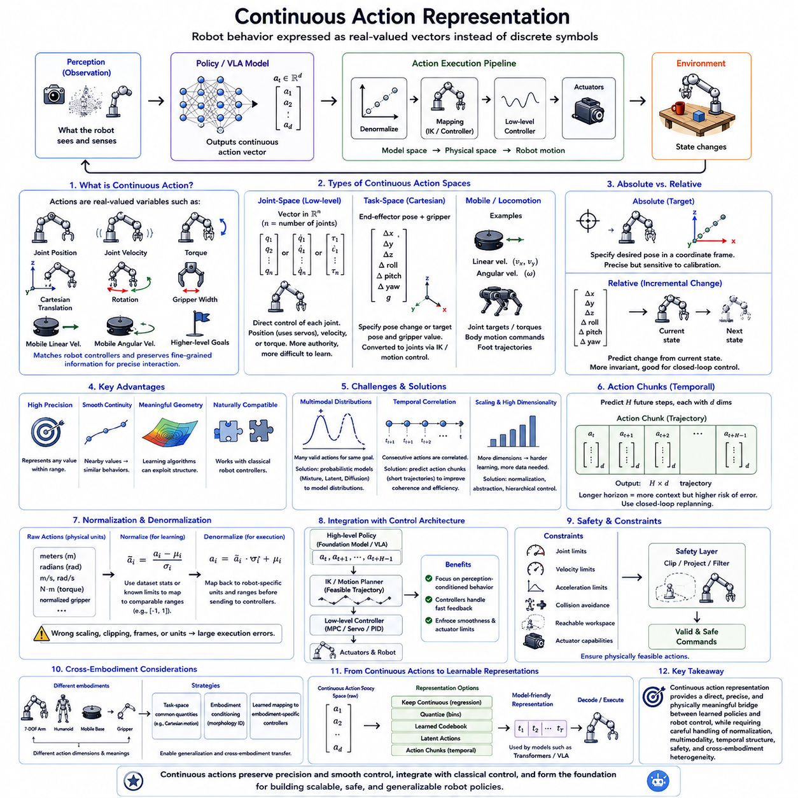{width="7.268055555555556in" height="7.268055555555556in"}

Continuous action representation expresses robot behavior directly as real-valued variables rather than converting actions into discrete symbols. A policy may predict joint positions, joint velocities, torques, Cartesian translations, rotations, gripper widths, or mobile-base velocities as continuous numerical outputs. This approach closely matches the mathematical form of many robot controllers and preserves fine-grained information required for precise physical interaction.

A continuous action can be represented as a vector (a_t \\in \\mathbb{R}\^d), where each dimension corresponds to a controllable quantity at time (t). For a manipulator, the vector might contain translational displacement, rotational change, and gripper command. For a mobile robot, it might contain linear and angular velocity. The dimensionality and physical interpretation therefore depend directly on the robot\'s embodiment and control interface.

The main advantage of continuous representation is precision. Unlike discrete action tokens that divide a numerical range into predefined intervals, continuous outputs can theoretically represent any value within the permitted range. This is particularly important for tasks requiring accurate positioning, smooth trajectory following, delicate grasping, contact-rich manipulation, or coordinated locomotion, where small differences in commands may produce significantly different physical outcomes.

Continuous representations also preserve local relationships between actions. Two nearby numerical values usually correspond to physically similar commands, such as two slightly different joint angles or end-effector displacements. This continuity gives the action space a meaningful geometry that learning algorithms can exploit. A policy can gradually modify its output as observations change instead of switching abruptly between unrelated symbolic actions.

Joint-space continuous representations are among the most direct forms. A robot with (n) controllable joints can represent an action using (n) target positions, velocities, or torques. Position-based representations rely on lower-level servo controllers to track desired configurations, while velocity and torque representations expose progressively more of the robot dynamics to the learned policy. The appropriate level depends on control frequency, task complexity, and available feedback control.

Task-space continuous actions describe behavior through Cartesian quantities rather than individual joints. A manipulation model may predict changes in end-effector position and orientation together with a gripper value. These commands can then be transformed into joint motion through inverse kinematics or motion control. Task-space representations often correspond more naturally to visual and linguistic concepts because instructions commonly describe interactions with objects rather than specific joint configurations.

Relative continuous actions are particularly useful in closed-loop robot learning. Instead of predicting an absolute target, a policy generates incremental changes from the current state, such as small translations or rotations. After the robot executes the command, new observations are acquired and another correction is predicted. This repeated perception-action cycle allows the policy to compensate for disturbances, modeling errors, object motion, and imperfect calibration during execution.

Continuous values generally require normalization before they are used for large-scale learning. Different action dimensions may have very different units and ranges, such as meters, radians, meters per second, or normalized gripper positions. Without normalization, dimensions with larger numerical magnitudes may disproportionately affect optimization. Dataset statistics or known physical limits can therefore be used to map heterogeneous action dimensions into comparable numerical ranges.

Normalization must preserve the physical meaning required during execution. A normalized value predicted by the model is not itself an actuator command; it must be transformed back into the corresponding robot-specific unit and range. The deployment pipeline therefore maintains mappings between model-space actions and physical-space commands. Incorrect scaling, clipping, coordinate conventions, or unit conversion can cause substantial execution errors even when the learned policy produces statistically reasonable outputs.

A major challenge arises from multimodal action distributions. In many situations, several physically valid actions can accomplish the same goal. A robot approaching an object might move around an obstacle from either side, and a manipulator may have multiple valid grasp trajectories. A simple regression model trained with mean-squared error can average these alternatives, potentially producing an action that corresponds to none of the valid behaviors.

Probabilistic continuous-action models address this problem by representing distributions rather than single deterministic values. The policy can model uncertainty or multiple possible action modes and sample an appropriate behavior during inference. Modern robot policies may use mixture distributions, stochastic latent variables, or diffusion-based action generation to represent complex continuous trajectories. These methods retain continuous control precision while providing greater flexibility than direct deterministic regression.

Temporal structure is also important because useful robot behavior rarely consists of independent continuous vectors. Consecutive commands are strongly correlated through robot dynamics and task progression. Predicting an action chunk allows a model to generate several continuous actions together as a short trajectory. This can improve temporal coherence, reduce repeated inference overhead, and allow the model to represent meaningful motion patterns extending beyond a single control step.

Continuous action chunks create an output space with both action and temporal dimensions. If each action contains (d) values and the model predicts (H) future steps, the output effectively represents an (H \\times d) trajectory. Longer horizons provide more temporal context but increase prediction complexity and may become inaccurate when the environment changes unexpectedly. Closed-loop replanning can address this by executing only part of a predicted chunk before observing the environment again.

Continuous representations integrate naturally with conventional robot control architectures. A foundation model or VLA policy can predict target poses or short trajectories, while inverse kinematics, trajectory controllers, model predictive controllers, or servo loops handle lower-level execution. This division allows learned models to focus on perception-conditioned behavior while established control mechanisms enforce fast feedback, smooth motion, actuator limits, and other physical constraints.

Safety constraints remain essential because continuous models can theoretically generate values anywhere within their numerical output domain. Predicted commands may exceed joint limits, velocity bounds, acceleration limits, reachable workspaces, or collision-free regions. Practical systems therefore constrain, clip, project, or filter continuous actions before execution. The action representation and safety layer must work together so that numerical predictions are converted into physically feasible commands.

Continuous representations become more difficult to standardize across different embodiments. A seven-degree-of-freedom manipulator and a humanoid do not share the same joint vector, while a mobile robot uses entirely different control variables. Task-space actions can reduce some of this mismatch by expressing behavior through common quantities such as Cartesian motion, but differences in kinematics, reachable workspace, grippers, and control dynamics still remain.

This embodiment dependence motivates normalization, embodiment conditioning, shared task-space interfaces, and learned mappings between common representations and robot-specific controllers. A generalist model can reason in a relatively standardized continuous space while an embodiment-specific component translates its outputs into commands appropriate for each platform. Such separation can preserve continuous precision without requiring every robot to expose exactly the same actuator-level action dimensions.

Continuous action representation therefore offers a direct and physically meaningful connection between learned policies and robot control. It preserves precision, smoothness, geometric relationships, and compatibility with established control systems, but introduces challenges involving multimodality, scaling, temporal prediction, safety, and cross-embodiment heterogeneity. These properties explain why continuous actions remain fundamental while also motivating discrete tokenization, learned codebooks, latent actions, and action chunks as alternative or complementary representations.

연속 행동 표현(Continuous Action Representation)은 행동을 이산 심볼(Discrete Symbol)로 변환하지 않고 실수값 변수(Real-Valued Variable)로 직접 표현하는 방식이다. 정책(Policy)은 관절 위치(Joint Position), 관절 속도(Joint Velocity), 토크(Torque), 데카르트 좌표계 이동(Cartesian Translation), 회전(Rotation), 그리퍼 폭(Gripper Width), 또는 모바일 베이스 속도(Mobile-Base Velocity)를 연속적인 수치 출력으로 예측할 수 있다. 이 방식은 많은 로봇 제어기(Robot Controller)의 수학적 형태와 직접 대응하며 정밀한 물리적 상호작용에 필요한 세밀한 정보를 보존한다.

연속 행동(Continuous Action)은 (a_t \\in \\mathbb{R}\^d) 형태의 벡터(Vector)로 표현할 수 있으며, 각 차원은 시간 (t)에서 제어 가능한 하나의 물리량에 대응한다. 매니퓰레이터(Manipulator)의 경우 벡터에는 병진 변위(Translational Displacement), 회전 변화(Rotational Change), 그리퍼 명령이 포함될 수 있다. 모바일 로봇의 경우 선속도(Linear Velocity)와 각속도(Angular Velocity)를 포함할 수 있다. 따라서 행동의 차원과 물리적 의미는 로봇의 체화(Embodiment)와 제어 인터페이스(Control Interface)에 직접적으로 의존한다.

연속 표현의 가장 중요한 장점은 정밀도(Precision)이다. 수치 범위를 미리 정의된 구간으로 나누는 이산 행동 토큰(Discrete Action Token)과 달리, 연속 출력은 허용된 범위 내에서 이론적으로 임의의 값을 표현할 수 있다. 이는 정확한 위치 결정(Accurate Positioning), 부드러운 궤적 추종(Smooth Trajectory Following), 섬세한 파지(Delicate Grasping), 접촉 중심 조작(Contact-Rich Manipulation), 협응 보행(Coordinated Locomotion)처럼 명령의 작은 차이가 물리적 결과에 큰 영향을 줄 수 있는 작업에서 특히 중요하다.

연속 표현은 행동 사이의 국소적 관계(Local Relationship)도 보존한다. 서로 가까운 두 수치값은 일반적으로 약간 다른 관절 각도나 엔드이펙터 변위처럼 물리적으로 유사한 명령에 대응한다. 이러한 연속성(Continuity)은 행동 공간(Action Space)에 학습 알고리즘이 활용할 수 있는 의미 있는 기하학적 구조(Geometry)를 제공한다. 정책은 관측이 변화함에 따라 서로 관련 없는 심볼 사이를 갑작스럽게 전환하는 대신 출력을 점진적으로 변경할 수 있다.

관절 공간 연속 표현(Joint-Space Continuous Representation)은 가장 직접적인 형태 가운데 하나이다. (n)개의 제어 가능한 관절을 가진 로봇은 (n)개의 목표 위치, 속도, 또는 토크를 이용해 행동을 표현할 수 있다. 위치 기반 표현(Position-Based Representation)은 저수준 서보 제어기(Low-Level Servo Controller)가 목표 구성을 추종하도록 하고, 속도 및 토크 표현은 점차 더 많은 로봇 동역학(Robot Dynamics)을 학습 정책에 노출한다. 적절한 수준은 제어 주파수(Control Frequency), 작업 복잡성(Task Complexity), 사용 가능한 피드백 제어(Feedback Control)에 따라 달라진다.

작업 공간 연속 행동(Task-Space Continuous Action)은 개별 관절이 아니라 데카르트 좌표계 물리량을 통해 행동을 표현한다. 조작 모델(Manipulation Model)은 엔드이펙터의 위치 및 방향 변화와 그리퍼 값을 함께 예측할 수 있다. 이러한 명령은 역기구학(Inverse Kinematics) 또는 모션 제어(Motion Control)를 통해 관절 움직임으로 변환된다. 작업 공간 표현은 명령이 일반적으로 특정 관절 구성이 아니라 물체와의 상호작용을 기술한다는 점에서 시각적·언어적 개념과 보다 자연스럽게 대응하는 경우가 많다.

상대적 연속 행동(Relative Continuous Action)은 폐루프 로봇 학습(Closed-Loop Robot Learning)에서 특히 유용하다. 정책은 절대 목표(Absolute Target)를 예측하는 대신 작은 병진이나 회전처럼 현재 상태에서의 증분 변화(Incremental Change)를 생성한다. 로봇이 명령을 실행한 후 새로운 관측을 획득하고 다시 보정 행동을 예측한다. 이러한 반복적인 지각-행동 주기(Perception-Action Cycle)를 통해 정책은 실행 중 발생하는 외란(Disturbance), 모델링 오차(Modeling Error), 물체 움직임, 불완전한 보정(Calibration)을 보상할 수 있다.

연속값은 일반적으로 대규모 학습에 사용되기 전에 정규화(Normalization)가 필요하다. 서로 다른 행동 차원은 미터(Meter), 라디안(Radian), 초당 미터(Meter per Second), 정규화된 그리퍼 위치 등 매우 다른 단위와 범위를 가질 수 있다. 정규화를 수행하지 않으면 수치 크기가 큰 차원이 최적화(Optimization)에 과도한 영향을 줄 수 있다. 따라서 데이터셋 통계(Dataset Statistics) 또는 알려진 물리적 한계(Physical Limit)를 이용하여 이질적인 행동 차원을 비교 가능한 수치 범위로 매핑할 수 있다.

정규화는 실행 과정에 필요한 물리적 의미를 보존해야 한다. 모델이 예측한 정규화 값(Normalized Value)은 그 자체로 액추에이터 명령(Actuator Command)이 아니며, 해당 로봇의 물리 단위와 범위로 다시 변환되어야 한다. 따라서 배포 파이프라인(Deployment Pipeline)은 모델 공간 행동(Model-Space Action)과 물리 공간 명령(Physical-Space Command) 사이의 매핑을 유지한다. 잘못된 스케일링(Scaling), 클리핑(Clipping), 좌표 규약(Coordinate Convention), 단위 변환(Unit Conversion)은 학습된 정책이 통계적으로 합리적인 출력을 생성하더라도 심각한 실행 오류를 일으킬 수 있다.

중요한 문제 중 하나는 다중 모드 행동 분포(Multimodal Action Distribution)에서 발생한다. 많은 상황에서 동일한 목표를 달성할 수 있는 물리적으로 유효한 행동이 여러 개 존재한다. 로봇은 장애물의 어느 쪽으로도 우회할 수 있으며, 매니퓰레이터는 여러 개의 유효한 파지 궤적(Grasp Trajectory)을 가질 수 있다. 평균제곱오차(Mean-Squared Error)로 학습된 단순 회귀 모델(Regression Model)은 이러한 대안들을 평균화하여 실제로는 어떤 유효한 행동에도 해당하지 않는 출력을 생성할 수 있다.

확률적 연속 행동 모델(Probabilistic Continuous-Action Model)은 하나의 결정론적 값(Deterministic Value)이 아니라 분포(Distribution)를 표현함으로써 이러한 문제를 해결한다. 정책은 불확실성(Uncertainty)이나 여러 가능한 행동 모드(Action Mode)를 모델링하고 추론 과정에서 적절한 행동을 샘플링할 수 있다. 현대 로봇 정책은 혼합 분포(Mixture Distribution), 확률적 잠재 변수(Stochastic Latent Variable), 또는 확산 기반 행동 생성(Diffusion-Based Action Generation)을 이용해 복잡한 연속 궤적을 표현할 수 있다. 이러한 방법은 연속 제어의 정밀도를 유지하면서 직접적인 결정론적 회귀보다 높은 유연성을 제공한다.

유용한 로봇 행동은 독립적인 연속 벡터들의 집합으로 구성되는 경우가 드물기 때문에 시간적 구조(Temporal Structure)도 중요하다. 연속된 명령은 로봇 동역학과 작업 진행 과정에 의해 강하게 상관되어 있다. 행동 청크(Action Chunk)를 예측하면 모델이 여러 개의 연속 행동을 하나의 짧은 궤적으로 함께 생성할 수 있다. 이는 시간적 일관성(Temporal Coherence)을 향상시키고 반복적인 추론 오버헤드(Inference Overhead)를 줄이며 단일 제어 단계보다 긴 의미 있는 움직임 패턴을 표현하도록 한다.

연속 행동 청크(Continuous Action Chunk)는 행동 차원과 시간 차원을 동시에 갖는 출력 공간을 만든다. 각 행동이 (d)개의 값을 포함하고 모델이 미래 (H)단계를 예측한다면 출력은 실질적으로 (H \\times d) 크기의 궤적을 표현한다. 더 긴 예측 지평(Prediction Horizon)은 더 많은 시간적 문맥(Temporal Context)을 제공하지만 예측 복잡성을 증가시키며 환경이 예상치 못하게 변할 경우 부정확해질 수 있다. 폐루프 재계획(Closed-Loop Replanning)은 예측된 청크의 일부만 실행한 후 환경을 다시 관측함으로써 이러한 문제를 완화할 수 있다.

연속 표현은 기존 로봇 제어 아키텍처(Robot Control Architecture)와 자연스럽게 통합된다. 파운데이션 모델(Foundation Model) 또는 VLA 정책이 목표 자세(Target Pose)나 짧은 궤적을 예측하면, 역기구학, 궤적 제어기(Trajectory Controller), 모델 예측 제어기(Model Predictive Controller), 또는 서보 루프(Servo Loop)가 저수준 실행을 담당할 수 있다. 이러한 역할 분리는 학습 모델이 지각 조건부 행동(Perception-Conditioned Behavior)에 집중하도록 하고 기존 제어 메커니즘이 빠른 피드백, 부드러운 움직임, 액추에이터 한계 등 물리적 제약을 처리하도록 한다.

연속 모델은 수치 출력 영역 내에서 이론적으로 임의의 값을 생성할 수 있기 때문에 안전 제약(Safety Constraint)은 여전히 필수적이다. 예측된 명령은 관절 한계(Joint Limit), 속도 범위(Velocity Bound), 가속도 제한(Acceleration Limit), 도달 가능한 작업 공간(Reachable Workspace), 또는 충돌 없는 영역(Collision-Free Region)을 벗어날 수 있다. 따라서 실제 시스템은 실행 전에 연속 행동을 제한하거나 클리핑하고, 실행 가능한 영역으로 투영(Project)하거나 필터링한다. 행동 표현과 안전 계층(Safety Layer)은 수치 예측이 물리적으로 실행 가능한 명령으로 변환되도록 함께 작동해야 한다.

연속 표현은 서로 다른 체화(Embodiment) 사이에서 표준화하기가 더욱 어렵다. 7자유도 매니퓰레이터(Seven-Degree-of-Freedom Manipulator)와 휴머노이드는 동일한 관절 벡터를 공유하지 않으며, 모바일 로봇은 완전히 다른 제어 변수를 사용한다. 작업 공간 행동은 데카르트 움직임과 같은 공통 물리량을 통해 이러한 불일치를 일부 줄일 수 있지만 운동학(Kinematics), 도달 가능 작업 공간, 그리퍼, 제어 동역학(Control Dynamics)의 차이는 여전히 존재한다.

이러한 체화 의존성(Embodiment Dependence)은 정규화, 체화 조건화(Embodiment Conditioning), 공유 작업 공간 인터페이스(Shared Task-Space Interface), 그리고 공통 표현과 로봇별 제어기 사이의 학습된 매핑(Learned Mapping)을 필요로 한다. 범용 모델(Generalist Model)은 비교적 표준화된 연속 공간에서 추론하고, 체화별 구성 요소가 출력을 각 플랫폼에 적합한 명령으로 변환할 수 있다. 이러한 분리를 통해 모든 로봇이 정확히 동일한 액추에이터 수준 행동 차원을 사용하지 않더라도 연속 표현의 정밀도를 유지할 수 있다.

따라서 연속 행동 표현(Continuous Action Representation)은 학습된 정책과 로봇 제어 사이에 직접적이고 물리적으로 의미 있는 연결을 제공한다. 정밀도, 부드러움(Smoothness), 기하학적 관계(Geometric Relationship), 기존 제어 시스템과의 호환성을 보존하지만 다중 모드성(Multimodality), 스케일링, 시간적 예측, 안전성, 교차 체화 이질성(Cross-Embodiment Heterogeneity)과 같은 문제를 발생시킨다. 이러한 특성은 연속 행동이 여전히 로봇 제어의 핵심 표현인 동시에 이산 토큰화(Discrete Tokenization), 학습된 코드북(Learned Codebook), 잠재 행동(Latent Action), 행동 청크가 대안 또는 보완적 표현으로 필요한 이유를 설명한다.

## 05.04. Discrete Action Tokenization

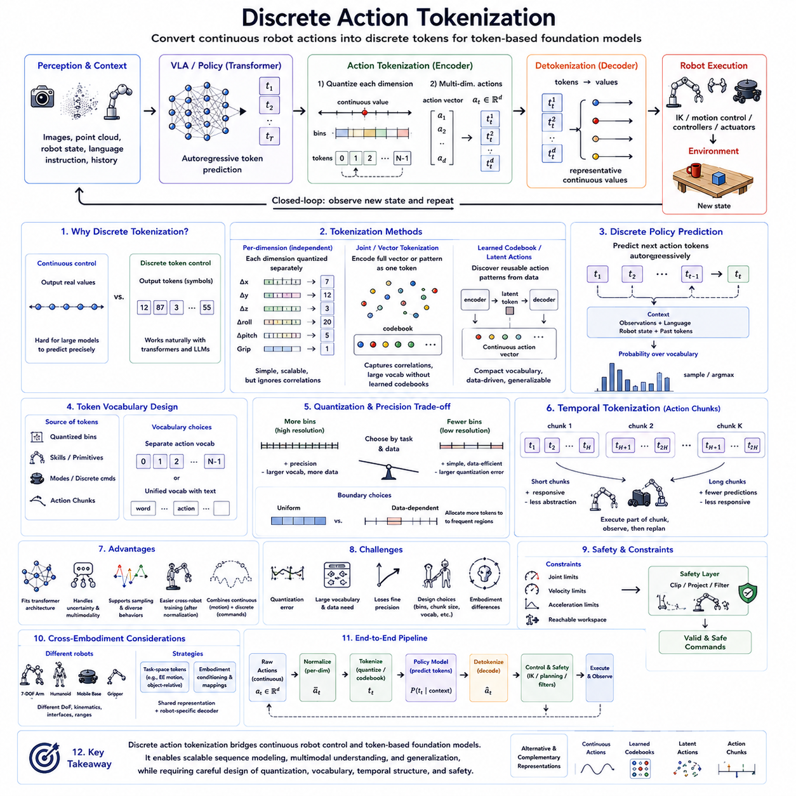{width="7.268055555555556in" height="7.268055555555556in"}

Discrete action tokenization converts robot actions into a finite set of symbolic units that can be processed similarly to words or subword tokens in language models. Instead of predicting arbitrary real-valued commands directly, a robot policy selects action tokens representing predefined regions or patterns of the action space. This creates a common computational interface between physical control signals and token-based foundation model architectures.

The basic motivation comes from the architecture of modern Transformers. Large language models are optimized to predict sequences of discrete tokens, whereas robot controllers typically operate with continuous variables such as joint angles, velocities, Cartesian displacements, and gripper positions. By transforming these continuous quantities into discrete action tokens, robot learning can reuse autoregressive prediction, sequence modeling, attention, and categorical output mechanisms developed for language.

A simple tokenization method divides each continuous action dimension into a fixed number of intervals or bins. For example, an end-effector displacement along the x-axis may be divided into 256 ranges, with each range assigned a unique token. A continuous value is mapped to the nearest or corresponding interval during encoding, while the selected token is converted back to a representative numerical value during robot execution.

For a multidimensional action vector, each dimension can be tokenized independently. Cartesian translation, rotation, joint motion, and gripper state may therefore produce several tokens for one control step. A model can generate these tokens sequentially or predict groups of tokens together. Independent tokenization is straightforward and scalable, although it may fail to explicitly represent correlations among dimensions that normally move together during coordinated physical behavior.

Another approach treats combinations of action dimensions as unified symbols. Instead of separately encoding translation, rotation, and gripper commands, a tokenizer can represent a complete action vector or recurring action pattern using one code. This captures relationships among dimensions more directly but greatly increases the number of possible combinations. Learned codebooks and latent action representations can reduce this combinatorial problem by discovering reusable action patterns from data.

Tokenization changes continuous control prediction into a classification problem. A continuous regression policy estimates numerical values directly, whereas a discrete policy predicts a probability distribution over possible action tokens. This allows the model to express uncertainty among several candidate actions and naturally supports sampling. It can also represent multimodal behavior more effectively when several different actions are valid in the same observed situation.

Autoregressive action generation becomes particularly natural after tokenization. Given visual observations, language instructions, robot state, and previous actions, a VLA model can predict the next action token using essentially the same sequence-prediction principle used for text generation. Generated action tokens can then become part of the context for subsequent predictions, allowing perception, language, reasoning, and physical actions to be represented within a unified sequential framework.

The vocabulary used for action tokens may be separate from the language vocabulary or integrated into a shared token space. A separate vocabulary makes the distinction between linguistic and physical symbols explicit, while a unified vocabulary allows a single decoder architecture to process multiple modalities. In either design, action tokens require clear semantics so that the decoding stage can reliably transform predicted symbols into executable robot commands.

Quantization introduces an unavoidable precision tradeoff. When a continuous range is divided into discrete bins, multiple real-valued actions are mapped to the same token. A larger number of bins provides finer control resolution but increases vocabulary size and may require more data to learn reliable token probabilities. Fewer bins simplify learning but introduce larger quantization errors that can become significant during precise manipulation or contact-sensitive tasks.

The choice of bin boundaries is therefore important. Uniform quantization divides the action range into equally sized intervals and is simple to implement, but robot datasets rarely contain actions uniformly across their physical limits. Data-dependent quantization can allocate more tokens to frequently observed regions and fewer tokens to rarely used extremes. This can improve effective resolution where the robot normally operates while maintaining a manageable action vocabulary.

Discrete tokenization also simplifies the treatment of naturally discrete robot commands. Gripper open and close states, mode switches, tool activation, termination commands, and skill selections already have categorical structure and can directly correspond to tokens. A VLA policy can therefore combine discretized continuous motion with inherently discrete actions in a common representation, reducing architectural differences between different types of robot outputs.

Temporal tokenization extends the concept beyond individual control steps. Rather than assigning tokens only to instantaneous actions, a system can encode short action sequences or action chunks as discrete units. A token may then represent a brief reaching motion, coordinated joint pattern, or manipulation primitive. This introduces temporal abstraction, shortens generated sequences, and allows the model to reason over behavior at a timescale closer to meaningful robot skills.

However, action chunks create additional design choices. Longer chunks reduce the number of predictions required for a task but may become less responsive when the environment changes. Shorter chunks preserve closed-loop responsiveness but provide less temporal abstraction. Practical VLA systems can repeatedly predict overlapping or short-horizon chunks, execute only part of each prediction, observe the resulting state, and then generate updated actions.

Discrete actions can also improve compatibility across heterogeneous datasets. Robot demonstrations may contain different numerical ranges, sampling rates, coordinate conventions, and actuator interfaces. After appropriate normalization and canonicalization, tokenization can map these values into standardized symbolic spaces. This does not automatically eliminate embodiment differences, but it provides a consistent representation layer that can make large-scale multi-robot training easier to organize.

Cross-embodiment learning remains challenging because identical tokens must have well-defined physical interpretations. A token representing a particular joint displacement cannot be directly shared between robots with different kinematic structures. More transferable token spaces can instead represent Cartesian changes, object-relative motions, skills, or learned latent actions, while embodiment-specific decoders convert those shared representations into commands appropriate for each robot.

Safety constraints must be preserved when tokens are decoded. Although a discrete vocabulary restricts outputs to known symbols, a valid token can still produce an unsafe command in a particular state. Joint limits, collision conditions, reachable workspace, velocity restrictions, and environmental context remain relevant. Token decoding should therefore operate together with feasibility checking, safety filtering, motion control, and closed-loop feedback before physical execution.

Discrete tokenization offers important computational advantages but does not universally replace continuous actions. Highly precise control may benefit from direct continuous prediction, while large multimodal sequence models may benefit from tokenized actions. Hybrid architectures can combine both approaches, using discrete tokens for semantic decisions or coarse motion and continuous controllers for refinement, trajectory tracking, contact response, and other precision-sensitive execution.

Discrete action tokenization therefore acts as a bridge between continuous physical control and token-based robot foundation models. It transforms actions into symbols that can participate in sequence prediction, multimodal attention, autoregressive generation, and large-scale pretraining while introducing tradeoffs involving quantization error, vocabulary size, temporal abstraction, embodiment dependence, and safety. These tradeoffs motivate more advanced techniques such as adaptive quantization, learned action codebooks, and latent action representations.

이산 행동 토큰화(Discrete Action Tokenization)는 로봇 행동을 언어 모델(Language Model)의 단어나 서브워드 토큰(Subword Token)과 유사하게 처리할 수 있는 유한한 심볼 단위(Symbolic Unit)의 집합으로 변환한다. 로봇 정책(Robot Policy)은 임의의 실수값 명령을 직접 예측하는 대신 행동 공간(Action Space)의 미리 정의된 영역이나 패턴을 나타내는 행동 토큰(Action Token)을 선택한다. 이를 통해 물리적 제어 신호와 토큰 기반 파운데이션 모델(Foundation Model) 아키텍처 사이에 공통된 계산 인터페이스(Computational Interface)를 구축할 수 있다.

기본적인 동기는 현대 트랜스포머(Transformer)의 아키텍처에서 비롯된다. 대규모 언어 모델(Large Language Model)은 이산 토큰의 시퀀스(Sequence)를 예측하도록 최적화되어 있지만, 로봇 제어기(Robot Controller)는 일반적으로 관절 각도(Joint Angle), 속도(Velocity), 데카르트 변위(Cartesian Displacement), 그리퍼 위치(Gripper Position)와 같은 연속 변수(Continuous Variable)를 사용한다. 이러한 연속 물리량을 이산 행동 토큰으로 변환하면 언어 분야에서 발전한 자기회귀 예측(Autoregressive Prediction), 시퀀스 모델링(Sequence Modeling), 어텐션(Attention), 범주형 출력(Categorical Output) 메커니즘을 로봇 학습에 활용할 수 있다.

간단한 토큰화 방법은 각각의 연속 행동 차원(Continuous Action Dimension)을 일정한 수의 구간 또는 빈(Bin)으로 나누는 것이다. 예를 들어 x축 방향의 엔드이펙터 변위(End-Effector Displacement)를 256개의 범위로 나누고 각 범위에 고유한 토큰을 할당할 수 있다. 인코딩(Encoding) 과정에서는 연속값을 가장 가까운 구간이나 해당 범위에 매핑하고, 로봇 실행 과정에서는 선택된 토큰을 대표 수치값으로 다시 변환한다.

다차원 행동 벡터(Multidimensional Action Vector)의 경우 각 차원을 독립적으로 토큰화할 수 있다. 따라서 데카르트 병진(Cartesian Translation), 회전(Rotation), 관절 움직임(Joint Motion), 그리퍼 상태는 하나의 제어 단계에서 여러 개의 토큰을 생성할 수 있다. 모델은 이러한 토큰을 순차적으로 생성하거나 여러 토큰을 하나의 그룹으로 함께 예측할 수 있다. 독립적 토큰화(Independent Tokenization)는 구현이 간단하고 확장성이 높지만, 협응된 물리적 행동에서 함께 움직이는 차원들 사이의 상관관계를 명시적으로 표현하지 못할 수 있다.

또 다른 접근법은 여러 행동 차원의 조합을 하나의 통합된 심볼(Unified Symbol)로 처리하는 것이다. 병진, 회전, 그리퍼 명령을 각각 인코딩하는 대신 토크나이저(Tokenizer)가 전체 행동 벡터나 반복적으로 나타나는 행동 패턴을 하나의 코드(Code)로 표현할 수 있다. 이는 차원 사이의 관계를 보다 직접적으로 포착하지만 가능한 조합의 수를 크게 증가시킨다. 학습된 코드북(Learned Codebook)과 잠재 행동 표현(Latent Action Representation)은 데이터에서 재사용 가능한 행동 패턴을 발견함으로써 이러한 조합 폭발(Combinatorial Problem)을 완화할 수 있다.

토큰화는 연속 제어 예측(Continuous Control Prediction)을 분류 문제(Classification Problem)로 변환한다. 연속 회귀 정책(Continuous Regression Policy)은 수치값을 직접 추정하지만, 이산 정책(Discrete Policy)은 가능한 행동 토큰에 대한 확률 분포(Probability Distribution)를 예측한다. 이를 통해 모델은 여러 후보 행동 사이의 불확실성(Uncertainty)을 표현하고 자연스럽게 샘플링(Sampling)을 수행할 수 있다. 또한 동일한 관측 상황에서 여러 서로 다른 행동이 모두 유효한 경우 다중 모드 행동(Multimodal Behavior)을 보다 효과적으로 표현할 수 있다.

행동이 토큰화되면 자기회귀 행동 생성(Autoregressive Action Generation)이 특히 자연스러워진다. 시각 관측(Visual Observation), 언어 명령(Language Instruction), 로봇 상태(Robot State), 이전 행동(Previous Action)이 주어지면 VLA 모델은 텍스트 생성과 본질적으로 동일한 시퀀스 예측 원리를 이용하여 다음 행동 토큰을 예측할 수 있다. 생성된 행동 토큰은 이후 예측을 위한 문맥(Context)의 일부가 될 수 있으므로 지각(Perception), 언어, 추론(Reasoning), 물리적 행동을 하나의 통합된 순차 프레임워크(Sequential Framework) 안에서 표현할 수 있다.

행동 토큰에 사용되는 어휘집(Vocabulary)은 언어 어휘집과 분리하거나 하나의 공유 토큰 공간(Shared Token Space)으로 통합할 수 있다. 별도의 어휘집은 언어 심볼과 물리적 심볼의 차이를 명확하게 구분하며, 통합 어휘집은 하나의 디코더 아키텍처(Decoder Architecture)가 여러 모달리티(Modality)를 처리하도록 한다. 어느 방식을 사용하든 행동 토큰은 디코딩(Decoding) 단계에서 예측된 심볼을 실행 가능한 로봇 명령으로 안정적으로 변환할 수 있도록 명확한 의미를 가져야 한다.

양자화(Quantization)는 피할 수 없는 정밀도 절충관계(Precision Tradeoff)를 발생시킨다. 연속 범위를 이산 빈으로 나누면 여러 실수값 행동이 동일한 토큰으로 매핑된다. 빈의 수를 늘리면 제어 해상도(Control Resolution)가 높아지지만 어휘집 크기(Vocabulary Size)가 증가하고 신뢰할 수 있는 토큰 확률을 학습하기 위해 더 많은 데이터가 필요할 수 있다. 반대로 빈의 수를 줄이면 학습은 단순해지지만 양자화 오차(Quantization Error)가 커져 정밀 조작(Precise Manipulation)이나 접촉 민감 작업(Contact-Sensitive Task)에 영향을 줄 수 있다.

따라서 빈 경계(Bin Boundary)의 선택이 중요하다. 균일 양자화(Uniform Quantization)는 행동 범위를 동일한 크기의 구간으로 나누기 때문에 구현이 간단하지만, 실제 로봇 데이터셋(Robot Dataset)의 행동은 물리적 범위 전체에 균일하게 분포하는 경우가 드물다. 데이터 의존적 양자화(Data-Dependent Quantization)는 자주 관측되는 영역에 더 많은 토큰을 할당하고 드물게 사용되는 극단 영역에는 더 적은 토큰을 할당할 수 있다. 이를 통해 관리 가능한 행동 어휘집을 유지하면서 로봇이 주로 동작하는 영역의 실질적인 해상도를 향상시킬 수 있다.

이산 토큰화는 본질적으로 이산적인 로봇 명령의 처리도 단순화한다. 그리퍼 열기(Open)와 닫기(Close), 모드 전환(Mode Switch), 도구 활성화(Tool Activation), 종료 명령(Termination Command), 기술 선택(Skill Selection)은 이미 범주형 구조(Categorical Structure)를 가지므로 직접 토큰에 대응시킬 수 있다. 따라서 VLA 정책은 이산화된 연속 움직임과 본질적인 이산 행동을 공통 표현(Common Representation)으로 결합하여 서로 다른 종류의 로봇 출력 사이의 아키텍처 차이를 줄일 수 있다.

시간적 토큰화(Temporal Tokenization)는 개념을 개별 제어 단계 이상으로 확장한다. 시스템은 순간적인 행동에만 토큰을 할당하는 대신 짧은 행동 시퀀스나 행동 청크(Action Chunk)를 하나의 이산 단위로 인코딩할 수 있다. 하나의 토큰이 짧은 도달 동작(Reaching Motion), 협응된 관절 패턴(Coordinated Joint Pattern), 또는 조작 프리미티브(Manipulation Primitive)를 나타낼 수 있다. 이는 시간적 추상화(Temporal Abstraction)를 제공하고 생성해야 하는 시퀀스의 길이를 줄이며 모델이 의미 있는 로봇 기술에 가까운 시간 척도에서 행동을 추론하도록 한다.

그러나 행동 청크는 추가적인 설계 선택을 필요로 한다. 긴 청크는 하나의 작업을 수행하기 위해 필요한 예측 횟수를 줄이지만 환경이 변화할 때 반응성이 낮아질 수 있다. 짧은 청크는 폐루프 반응성(Closed-Loop Responsiveness)을 유지하지만 시간적 추상화 수준은 낮아진다. 실제 VLA 시스템은 중첩된 청크(Overlapping Chunk) 또는 짧은 예측 지평(Short-Horizon)의 청크를 반복적으로 생성하고, 각 예측의 일부만 실행한 뒤 결과 상태를 관측하여 새로운 행동을 생성할 수 있다.

이산 행동은 이질적인 데이터셋(Heterogeneous Dataset) 사이의 호환성도 향상시킬 수 있다. 로봇 시연 데이터(Robot Demonstration Data)는 서로 다른 수치 범위, 샘플링 속도(Sampling Rate), 좌표 규약(Coordinate Convention), 액추에이터 인터페이스(Actuator Interface)를 포함할 수 있다. 적절한 정규화(Normalization)와 표준화(Canonicalization)를 거친 후 토큰화를 적용하면 이러한 값들을 표준화된 심볼 공간(Symbolic Space)으로 매핑할 수 있다. 이것이 체화 차이(Embodiment Difference)를 자동으로 제거하는 것은 아니지만 대규모 다중 로봇 학습(Multi-Robot Training)을 보다 일관되게 구성할 수 있는 표현 계층을 제공한다.

교차 체화 학습(Cross-Embodiment Learning)은 동일한 토큰이 명확한 물리적 의미를 가져야 하기 때문에 여전히 어려운 문제이다. 특정 관절 변위를 나타내는 토큰은 서로 다른 운동학 구조(Kinematic Structure)를 가진 로봇 사이에서 직접 공유할 수 없다. 보다 전이 가능한 토큰 공간(Transferable Token Space)은 데카르트 변화(Cartesian Change), 객체 상대 움직임(Object-Relative Motion), 기술(Skill), 또는 학습된 잠재 행동(Learned Latent Action)을 표현하고, 체화별 디코더(Embodiment-Specific Decoder)가 이러한 공유 표현을 각 로봇에 적합한 명령으로 변환하도록 구성할 수 있다.

토큰이 디코딩될 때에도 안전 제약(Safety Constraint)은 반드시 유지되어야 한다. 이산 어휘집이 출력을 알려진 심볼로 제한하더라도 특정 상태에서는 유효한 토큰이 안전하지 않은 명령을 생성할 수 있다. 관절 한계(Joint Limit), 충돌 조건(Collision Condition), 도달 가능한 작업 공간(Reachable Workspace), 속도 제한(Velocity Restriction), 환경 문맥(Environmental Context)은 여전히 중요하다. 따라서 토큰 디코딩은 실제 실행 전에 실행 가능성 검사(Feasibility Checking), 안전 필터링(Safety Filtering), 모션 제어(Motion Control), 폐루프 피드백(Closed-Loop Feedback)과 함께 작동해야 한다.

이산 토큰화는 중요한 계산적 장점(Computational Advantage)을 제공하지만 연속 행동(Continuous Action)을 모든 상황에서 대체하는 것은 아니다. 매우 정밀한 제어에는 직접적인 연속 예측이 유리할 수 있는 반면, 대규모 멀티모달 시퀀스 모델(Multimodal Sequence Model)에는 토큰화된 행동이 유리할 수 있다. 하이브리드 아키텍처(Hybrid Architecture)는 두 접근법을 결합하여 의미적 의사결정(Semantic Decision)이나 거친 움직임(Coarse Motion)에는 이산 토큰을 사용하고, 세밀한 보정(Refinement), 궤적 추종(Trajectory Tracking), 접촉 반응(Contact Response)과 같은 정밀 실행에는 연속 제어기를 사용할 수 있다.

따라서 이산 행동 토큰화(Discrete Action Tokenization)는 연속적인 물리 제어와 토큰 기반 로봇 파운데이션 모델(Robot Foundation Model)을 연결하는 가교 역할을 한다. 행동을 시퀀스 예측, 멀티모달 어텐션(Multimodal Attention), 자기회귀 생성, 대규모 사전학습(Large-Scale Pretraining)에 참여할 수 있는 심볼로 변환하지만, 동시에 양자화 오차, 어휘집 크기, 시간적 추상화, 체화 의존성(Embodiment Dependence), 안전성과 관련된 절충관계를 발생시킨다. 이러한 절충관계는 적응형 양자화(Adaptive Quantization), 학습된 행동 코드북(Learned Action Codebook), 잠재 행동 표현과 같은 보다 발전된 기법이 필요한 이유가 된다.

## 05.05. Action Quantization and Binning

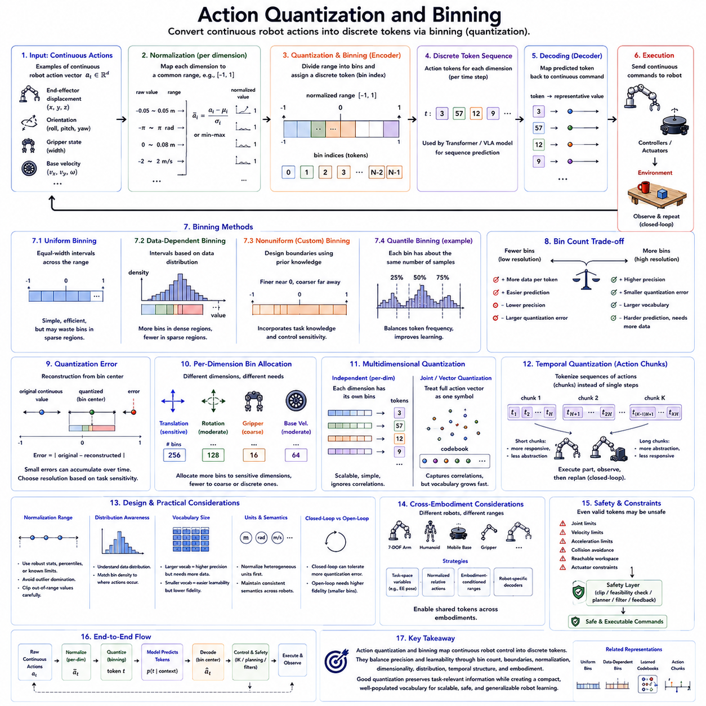{width="7.268055555555556in" height="7.268055555555556in"}

Action quantization converts continuous robot commands into a finite number of discrete values that can be represented as action tokens. Binning is the mechanism used to divide a continuous range into intervals, with each interval assigned a discrete identifier. Together, quantization and binning provide the numerical foundation for discrete action tokenization by mapping continuous physical controls into a vocabulary suitable for token-based robot foundation models.

Consider a continuous action dimension such as an end-effector displacement ranging from −0.05 to +0.05 meters. Instead of predicting every possible real value, the range can be divided into a fixed number of bins. A measured or demonstrated action is assigned to the bin containing its value, and the corresponding bin index becomes the action token used during model training and prediction.

During decoding, each predicted bin must be converted back into a continuous command that a robot controller can execute. A common approach uses the center value of the selected interval as its representative action. Consequently, encoding and decoding form a two-way mapping: continuous action to bin index during tokenization, followed by bin index to representative continuous value during physical execution.

Uniform binning divides an action range into intervals of equal width. If a normalized dimension ranges from −1 to +1 and is divided into 256 bins, each interval covers approximately the same numerical distance. Uniform quantization is simple, deterministic, and computationally efficient, making it attractive for large robot datasets. However, equal numerical intervals do not necessarily reflect how actions are distributed in real demonstrations.

Robot action data are frequently concentrated around particular values. Manipulation trajectories may contain many small corrective movements near zero and relatively few commands near maximum displacement or velocity. With uniform binning, many bins in rarely visited regions may receive little training data, while frequently used regions may have insufficient resolution. The resulting vocabulary can therefore use its representational capacity inefficiently.

Data-dependent binning addresses this problem by choosing boundaries according to the observed action distribution. Quantile-based methods, for example, can construct intervals so that each bin contains approximately similar numbers of training samples. Dense regions of the action distribution then receive narrower intervals and greater numerical resolution, while sparse regions are represented using wider intervals.

This adaptive allocation can improve learning because token frequencies become more balanced. In a uniformly quantized dataset, central action tokens may dominate training while extreme tokens appear only rarely. Data-dependent boundaries can reduce this imbalance and provide the model with a more useful categorical prediction problem. However, the resulting bins no longer correspond to equal physical distances, making interpretation and transfer more complicated.

The number of bins establishes a fundamental precision-capacity tradeoff. Increasing the number of bins reduces the maximum quantization error because each interval becomes narrower. At the same time, the action vocabulary grows, individual tokens receive fewer examples, and the output classification problem becomes more difficult. Reducing the number of bins improves data density and simplifies prediction but decreases the resolution of reconstructed physical commands.

Quantization error is the difference between the original continuous action and the representative value recovered from its assigned bin. Even small errors can accumulate when many actions are executed sequentially. In precision manipulation, repeated position or orientation errors may alter a grasp trajectory, while in locomotion they may affect stability or path tracking. Quantization resolution must therefore be selected according to the physical sensitivity of each action dimension.

Different dimensions do not necessarily require the same number of bins. Translational motion, rotational motion, gripper state, joint velocity, and mobile-base commands may have different ranges, distributions, and precision requirements. A tokenizer can assign more bins to sensitive dimensions and fewer bins to coarse or naturally discrete variables. Dimension-specific quantization allows representational capacity to be allocated according to control importance rather than uniformly.

Normalization usually precedes binning so that heterogeneous physical quantities can be treated consistently. Joint angles, Cartesian displacement, angular rotation, and velocity may first be mapped into standardized numerical ranges. The normalized values are then quantized into token indices. During execution, this sequence is reversed: the predicted token is decoded to a normalized representative value and then denormalized into the robot-specific physical unit.

The normalization range itself strongly affects quantization quality. If extreme outliers determine the minimum and maximum values, most normal actions may become compressed into a narrow central portion of the available bins. Robust statistics, percentile-based limits, or known physical operating ranges can reduce this problem. Values outside the selected range can be clipped, although clipping introduces additional information loss and must be handled carefully.

Bin boundaries can also be nonlinear even when they are not directly estimated from quantiles. A system may intentionally allocate fine resolution near zero, where precise corrective motion is common, and progressively coarser resolution toward larger actions. Such nonuniform quantization incorporates prior knowledge about robot control into the tokenizer. The design can therefore reflect both empirical action statistics and physical requirements of the target tasks.

Multidimensional actions create additional design choices because quantization can be performed independently or jointly. Independent binning assigns a token to each action dimension separately, keeping vocabulary size manageable and simplifying decoding. However, it ignores correlations among dimensions. Joint quantization treats combinations of values as unified action categories, capturing coordinated patterns but potentially causing an exponential increase in the number of possible bins.

This dimensionality problem motivates learned action codebooks. Instead of manually defining every multidimensional interval, a learned quantizer can discover representative action vectors or latent patterns from training data. Each codebook entry functions like a learned bin whose meaning reflects recurring behavior. Such methods can capture correlations among joints and motion dimensions more efficiently than independent scalar binning, especially for structured manipulation trajectories.

Temporal structure provides another extension of quantization. Rather than quantizing a single instantaneous action, a tokenizer can encode a sequence of actions or an action chunk. The resulting token or token sequence represents a short trajectory rather than one control command. This can reduce sequence length and capture coordinated temporal patterns, but quantization errors now affect an entire motion segment and may reduce responsiveness to unexpected environmental changes.

Quantization must also be considered in relation to closed-loop control. A discretized action does not need to perfectly reproduce an expert command if the robot can observe the result and correct its next action. Frequent perception and replanning can compensate for moderate quantization error. Conversely, open-loop execution of long token sequences requires higher fidelity because small reconstruction errors can accumulate without intermediate feedback.

Cross-embodiment training makes bin design more difficult because robots may have different physical ranges and action semantics. A displacement that is small for one manipulator may be large for another, while joint-space values may have no direct correspondence at all. Standardized task-space variables, normalized relative motions, embodiment-conditioned ranges, or robot-specific decoders can help map shared tokens into physically appropriate commands for different platforms.

Safety remains essential when quantized values are decoded. A token belongs to a valid vocabulary but its reconstructed command may still violate a joint limit, velocity constraint, collision boundary, or reachable workspace in the current state. Practical systems therefore combine token decoding with clipping, feasibility checks, motion planning, safety filters, and feedback controllers before commands reach physical actuators.

Action quantization and binning therefore determine how much continuous physical detail survives the conversion into discrete symbols. Bin count, boundary placement, normalization, dimensionality, action distribution, temporal structure, and embodiment all influence the balance between precision and learnability. Effective quantization preserves task-relevant control information while producing a compact, well-populated vocabulary that foundation models can predict reliably.

This makes quantization more than a numerical preprocessing step. It defines the interface between continuous robot dynamics and discrete sequence modeling, directly affecting token frequency, prediction difficulty, reconstruction accuracy, control smoothness, and generalization. Uniform and data-dependent bins provide useful starting points, while learned codebooks and latent action representations extend the same principle toward representations discovered directly from large-scale robot data.

행동 양자화(Action Quantization)는 연속적인 로봇 명령(Continuous Robot Command)을 행동 토큰(Action Token)으로 표현할 수 있는 유한한 수의 이산값(Discrete Value)으로 변환한다. 비닝(Binning)은 연속 범위를 여러 구간으로 나누고 각 구간에 이산 식별자(Discrete Identifier)를 할당하는 메커니즘이다. 양자화와 비닝은 함께 연속적인 물리 제어를 토큰 기반 로봇 파운데이션 모델(Robot Foundation Model)에 적합한 어휘집(Vocabulary)으로 매핑함으로써 이산 행동 토큰화(Discrete Action Tokenization)의 수치적 기반을 제공한다.

−0.05미터에서 +0.05미터 범위를 갖는 엔드이펙터 변위(End-Effector Displacement)와 같은 연속 행동 차원(Continuous Action Dimension)을 생각할 수 있다. 가능한 모든 실수값을 직접 예측하는 대신 이 범위를 일정한 수의 빈(Bin)으로 나눌 수 있다. 측정되거나 시연된 행동은 해당 값이 포함된 빈에 할당되고, 그 빈의 인덱스(Bin Index)가 모델 학습과 예측 과정에서 사용하는 행동 토큰이 된다.

디코딩(Decoding) 과정에서는 예측된 각 빈을 로봇 제어기(Robot Controller)가 실행할 수 있는 연속 명령으로 다시 변환해야 한다. 일반적인 방법은 선택된 구간의 중앙값(Center Value)을 대표 행동(Representative Action)으로 사용하는 것이다. 따라서 인코딩(Encoding)과 디코딩은 양방향 매핑(Two-Way Mapping)을 구성한다. 토큰화 과정에서는 연속 행동을 빈 인덱스로 변환하고, 물리적 실행 과정에서는 빈 인덱스를 대표 연속값으로 다시 변환한다.

균일 비닝(Uniform Binning)은 행동 범위를 동일한 폭의 구간으로 나눈다. 정규화된 행동 차원이 −1에서 +1까지이고 이를 256개의 빈으로 나눈다면 각 구간은 거의 동일한 수치적 거리를 포함한다. 균일 양자화(Uniform Quantization)는 단순하고 결정론적(Deterministic)이며 계산 효율성이 높기 때문에 대규모 로봇 데이터셋에 적용하기 용이하다. 그러나 동일한 수치 간격이 실제 시연 데이터에서 행동이 분포하는 방식을 반드시 반영하는 것은 아니다.

로봇 행동 데이터(Robot Action Data)는 특정 값 주변에 집중되는 경우가 많다. 조작 궤적(Manipulation Trajectory)에는 0에 가까운 작은 보정 움직임이 많이 포함되는 반면 최대 변위나 최대 속도에 가까운 명령은 상대적으로 적을 수 있다. 균일 비닝에서는 거의 사용되지 않는 영역의 많은 빈이 충분한 학습 데이터를 확보하지 못하는 반면 자주 사용되는 영역의 해상도는 부족할 수 있다. 결과적으로 행동 어휘집의 표현 용량(Representational Capacity)이 비효율적으로 사용될 수 있다.

데이터 의존적 비닝(Data-Dependent Binning)은 관측된 행동 분포(Action Distribution)에 따라 경계를 선택함으로써 이러한 문제를 해결한다. 예를 들어 분위수 기반 방법(Quantile-Based Method)은 각각의 빈에 대략 비슷한 수의 학습 샘플이 포함되도록 구간을 구성할 수 있다. 이에 따라 행동 분포가 밀집된 영역에는 더 좁은 구간과 높은 수치 해상도(Numerical Resolution)가 할당되고, 희소한 영역은 더 넓은 구간으로 표현된다.

이러한 적응적 할당(Adaptive Allocation)은 토큰 빈도(Token Frequency)를 보다 균형 있게 만들어 학습 성능을 향상시킬 수 있다. 균일하게 양자화된 데이터셋에서는 중앙 영역의 행동 토큰이 학습을 지배하는 반면 극단 영역의 토큰은 매우 드물게 나타날 수 있다. 데이터 의존적 경계는 이러한 불균형을 줄여 모델에 보다 유용한 범주형 예측 문제(Categorical Prediction Problem)를 제공한다. 그러나 각 빈이 동일한 물리적 거리를 의미하지 않기 때문에 해석과 전이(Transfer)가 더 복잡해질 수 있다.

빈의 개수(Number of Bins)는 정밀도-용량 절충관계(Precision-Capacity Tradeoff)를 결정한다. 빈의 수를 증가시키면 각 구간이 좁아지므로 최대 양자화 오차(Quantization Error)를 줄일 수 있다. 그러나 동시에 행동 어휘집의 크기가 증가하고 개별 토큰이 학습 과정에서 접하는 샘플 수는 감소하며 출력 분류 문제가 어려워진다. 반대로 빈의 수를 줄이면 데이터 밀도(Data Density)가 높아지고 예측은 단순해지지만 복원된 물리 명령의 해상도는 감소한다.

양자화 오차는 원래의 연속 행동과 해당 빈에서 복원된 대표값 사이의 차이를 의미한다. 작은 오차라도 많은 행동이 순차적으로 실행되면 누적될 수 있다. 정밀 조작(Precision Manipulation)에서는 반복적인 위치 또는 방향 오차가 파지 궤적(Grasp Trajectory)을 변화시킬 수 있으며, 이동(Locomotion)에서는 안정성이나 경로 추종(Path Tracking)에 영향을 미칠 수 있다. 따라서 양자화 해상도는 각 행동 차원의 물리적 민감도(Physical Sensitivity)에 따라 선택해야 한다.

서로 다른 행동 차원에 반드시 동일한 수의 빈을 사용할 필요는 없다. 병진 운동(Translational Motion), 회전 운동(Rotational Motion), 그리퍼 상태(Gripper State), 관절 속도(Joint Velocity), 모바일 베이스 명령(Mobile-Base Command)은 서로 다른 범위, 분포, 정밀도 요구사항을 가질 수 있다. 토크나이저(Tokenizer)는 민감한 차원에는 더 많은 빈을 할당하고, 거친 제어나 본질적으로 이산적인 변수에는 더 적은 빈을 할당할 수 있다. 차원별 양자화(Dimension-Specific Quantization)는 표현 용량을 균일하게 배분하는 대신 제어 중요도에 따라 할당할 수 있게 한다.

일반적으로 비닝 이전에 정규화(Normalization)를 수행하여 서로 다른 물리량을 일관성 있게 처리한다. 관절 각도(Joint Angle), 데카르트 변위(Cartesian Displacement), 각도 회전(Angular Rotation), 속도(Velocity)를 먼저 표준화된 수치 범위로 매핑한 다음 정규화된 값을 토큰 인덱스로 양자화할 수 있다. 실행 과정에서는 이 순서를 반대로 적용하여 예측 토큰을 정규화된 대표값으로 디코딩한 다음 로봇별 물리 단위(Physical Unit)로 역정규화(Denormalization)한다.

정규화 범위(Normalization Range) 자체도 양자화 품질에 큰 영향을 준다. 극단적인 이상치(Outlier)가 최소값과 최대값을 결정하면 대부분의 정상적인 행동이 사용 가능한 빈의 좁은 중앙 영역에 압축될 수 있다. 강건 통계(Robust Statistics), 백분위수 기반 한계(Percentile-Based Limit), 또는 알려진 물리적 작동 범위(Physical Operating Range)를 이용하면 이러한 문제를 줄일 수 있다. 선택된 범위를 벗어나는 값은 클리핑(Clipping)할 수 있지만, 클리핑 역시 추가적인 정보 손실(Information Loss)을 발생시키므로 신중하게 처리해야 한다.

빈 경계(Bin Boundary)는 분위수에서 직접 추정하지 않더라도 비선형(Nonlinear)으로 설계할 수 있다. 시스템은 정밀한 보정 움직임이 빈번한 0 근처에 의도적으로 높은 해상도를 할당하고, 더 큰 행동으로 갈수록 점차 낮은 해상도를 사용할 수 있다. 이러한 비균일 양자화(Nonuniform Quantization)는 로봇 제어에 관한 사전 지식(Prior Knowledge)을 토크나이저에 반영한다. 따라서 비닝 설계에는 경험적 행동 통계와 목표 작업의 물리적 요구사항을 함께 반영할 수 있다.

다차원 행동(Multidimensional Action)은 양자화를 독립적으로 수행할 것인지 공동으로 수행할 것인지에 대한 추가적인 설계 선택을 발생시킨다. 독립 비닝(Independent Binning)은 각 행동 차원에 별도의 토큰을 할당하여 어휘집 크기를 관리하기 쉽고 디코딩을 단순화한다. 그러나 차원 사이의 상관관계(Correlation)를 무시한다. 공동 양자화(Joint Quantization)는 여러 값의 조합을 하나의 통합된 행동 범주로 처리하여 협응 패턴을 포착할 수 있지만 가능한 빈의 수가 기하급수적으로 증가할 수 있다.

이러한 차원 문제는 학습된 행동 코드북(Learned Action Codebook)의 필요성을 만든다. 모든 다차원 구간을 사람이 직접 정의하는 대신 학습된 양자화기(Learned Quantizer)가 학습 데이터에서 대표적인 행동 벡터나 잠재 패턴(Latent Pattern)을 발견하도록 할 수 있다. 각각의 코드북 항목(Codebook Entry)은 반복적으로 나타나는 행동을 반영하는 학습된 빈처럼 작동한다. 특히 구조화된 조작 궤적에서는 이러한 방식이 독립적인 스칼라 비닝(Scalar Binning)보다 관절과 움직임 차원 사이의 상관관계를 효율적으로 포착할 수 있다.

시간적 구조(Temporal Structure)는 양자화 개념을 더욱 확장한다. 하나의 순간적인 행동만 양자화하는 대신 토크나이저는 행동 시퀀스(Action Sequence) 또는 행동 청크(Action Chunk)를 인코딩할 수 있다. 그 결과 생성되는 토큰이나 토큰 시퀀스는 하나의 제어 명령이 아니라 짧은 궤적을 나타낸다. 이는 시퀀스 길이를 줄이고 협응된 시간적 패턴을 포착할 수 있지만, 양자화 오차가 전체 움직임 구간에 영향을 미칠 수 있으며 예상하지 못한 환경 변화에 대한 반응성을 감소시킬 수 있다.

양자화는 폐루프 제어(Closed-Loop Control)와의 관계에서도 고려해야 한다. 로봇이 실행 결과를 관측하고 다음 행동을 보정할 수 있다면 이산화된 행동이 전문가 명령(Expert Command)을 완벽하게 재현할 필요는 없다. 빈번한 지각(Perception)과 재계획(Replanning)은 적당한 수준의 양자화 오차를 보상할 수 있다. 반대로 긴 토큰 시퀀스를 개루프(Open-Loop)로 실행하는 경우 중간 피드백 없이 작은 복원 오차가 누적될 수 있기 때문에 더 높은 충실도(Fidelity)가 필요하다.

교차 체화 학습(Cross-Embodiment Training)은 로봇마다 물리적 범위와 행동 의미(Action Semantics)가 다를 수 있기 때문에 빈 설계를 더욱 어렵게 만든다. 하나의 매니퓰레이터에서 작은 변위가 다른 로봇에서는 큰 변위일 수 있으며, 관절 공간 값(Joint-Space Value)은 서로 직접 대응하지 않을 수도 있다. 표준화된 작업 공간 변수(Task-Space Variable), 정규화된 상대 움직임(Relative Motion), 체화 조건부 범위(Embodiment-Conditioned Range), 또는 로봇별 디코더(Robot-Specific Decoder)는 공유 토큰을 각 플랫폼에 적합한 물리 명령으로 매핑하는 데 도움을 줄 수 있다.

양자화된 값이 디코딩될 때에도 안전성(Safety)은 필수적이다. 어떤 토큰이 유효한 어휘집에 포함되어 있더라도 복원된 명령은 현재 상태에서 관절 한계(Joint Limit), 속도 제약(Velocity Constraint), 충돌 경계(Collision Boundary), 또는 도달 가능한 작업 공간(Reachable Workspace)을 위반할 수 있다. 따라서 실제 시스템은 명령이 물리적 액추에이터(Physical Actuator)에 전달되기 전에 토큰 디코딩과 함께 클리핑, 실행 가능성 검사(Feasibility Check), 모션 플래닝(Motion Planning), 안전 필터(Safety Filter), 피드백 제어(Feedback Control)를 적용한다.

따라서 행동 양자화와 비닝(Action Quantization and Binning)은 연속적인 물리적 세부 정보가 이산 심볼로 변환되는 과정에서 얼마나 보존될지를 결정한다. 빈의 개수, 경계 위치, 정규화, 차원성(Dimensionality), 행동 분포, 시간적 구조, 체화는 모두 정밀도와 학습 가능성(Learnability) 사이의 균형에 영향을 준다. 효과적인 양자화는 작업에 중요한 제어 정보를 보존하면서 파운데이션 모델이 안정적으로 예측할 수 있는 작고 충분한 데이터가 포함된 어휘집을 생성한다.

이러한 이유로 양자화는 단순한 수치 전처리(Numerical Preprocessing) 단계 이상의 의미를 가진다. 양자화는 연속적인 로봇 동역학(Continuous Robot Dynamics)과 이산 시퀀스 모델링(Discrete Sequence Modeling) 사이의 인터페이스를 정의하며 토큰 빈도, 예측 난이도, 복원 정확도(Reconstruction Accuracy), 제어 부드러움(Control Smoothness), 일반화(Generalization)에 직접적인 영향을 미친다. 균일 빈과 데이터 의존적 빈은 유용한 출발점을 제공하며, 학습된 코드북과 잠재 행동 표현(Latent Action Representation)은 동일한 원리를 대규모 로봇 데이터에서 직접 발견되는 표현으로 확장한다.

## 05.06. Learned Action Codebooks

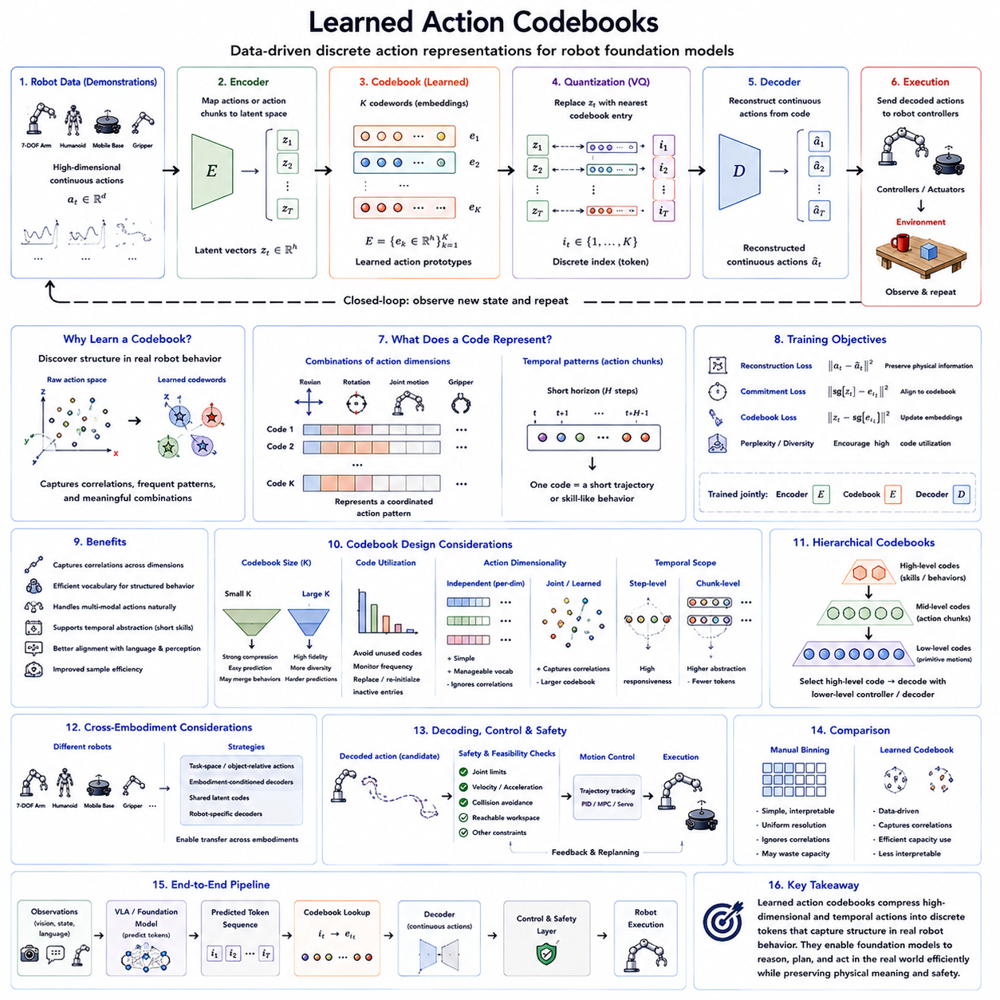{width="7.268055555555556in" height="7.268055555555556in"}

Learned action codebooks provide a data-driven alternative to manually designed action bins. Instead of dividing each continuous action dimension according to fixed numerical boundaries, the system learns a finite collection of representative action patterns from robot demonstrations. Each codebook entry acts as a discrete action symbol that can be predicted by a foundation model and later decoded into continuous robot commands.

The central idea is to discover structure that already exists within robot behavior. Real robot actions are rarely distributed uniformly throughout a high-dimensional control space. Demonstrations contain recurring combinations of translations, rotations, joint movements, gripper commands, and temporal patterns. A learned codebook identifies these frequently occurring structures and assigns discrete codes to them instead of treating every numerical region equally.

A typical codebook contains (K) learned vectors, often called codewords or embeddings. Given an action vector or short trajectory, an encoder maps the input into a latent representation and selects the codebook entry that most closely represents it. The selected entry is identified by an integer index, which becomes an action token. A decoder then reconstructs the corresponding continuous action from the selected latent code.

This creates an encode-quantize-decode pipeline. Continuous robot actions first pass through an action encoder, producing latent vectors that capture behaviorally important information. A vector quantization stage replaces each latent vector with a nearby codebook entry. The resulting discrete index can be modeled as a token, while the decoder maps the selected code back into joint commands, Cartesian motion, gripper states, or other executable control variables.

Unlike independent scalar binning, learned codebooks can represent correlations among multiple action dimensions. A single code may encode a coordinated combination of forward motion, wrist rotation, and gripper adjustment that frequently occurs during manipulation. This makes codebooks particularly useful when actions occupy structured regions of a high-dimensional space rather than behaving as independent numerical variables.

The codebook can also represent temporal patterns instead of individual actions. An encoder may process several consecutive control steps and compress the resulting action chunk into a discrete latent code. One token can then represent a short reaching trajectory, grasp adjustment, locomotion pattern, or other recurring movement sequence. This combines action tokenization with temporal abstraction and can substantially reduce the sequence length seen by a VLA model.

Learning the codebook requires an objective that preserves useful action information. The encoder should map similar behaviors to nearby latent representations, while the decoder should reconstruct the original actions with sufficient accuracy. Reconstruction loss measures how much physical information is lost, while quantization-related objectives encourage encoded vectors to align with available codebook entries and encourage the entries themselves to represent useful regions of the action distribution.

Vector-quantized representation learning provides a common framework for implementing this process. The encoder produces a continuous latent vector, which is replaced by the nearest vector from a finite codebook. The decoder reconstructs the original action from that selected vector. During training, specialized optimization mechanisms allow the encoder, decoder, and codebook to evolve together despite the discrete selection operation between them.

A well-trained codebook allocates its representational capacity according to the robot data. Frequently occurring motion structures can receive specialized codes, while rare or similar actions may share representations. This differs from uniform binning, where equal numerical intervals receive equal representational capacity regardless of how often they occur. Learned codebooks can therefore use a limited vocabulary more efficiently when robot behavior has strong statistical structure.

Codebook size remains an important design parameter. A small codebook provides strong compression and a compact action vocabulary, making token prediction easier but potentially merging physically different behaviors. A large codebook provides finer reconstruction and more behavioral diversity but increases prediction complexity and may leave some codes poorly trained. The appropriate size depends on dataset scale, action dimensionality, task diversity, and required control precision.

Codebook utilization is as important as codebook size. During training, some entries may be selected frequently while others are rarely or never used. This phenomenon reduces the effective vocabulary and wastes representational capacity. Training procedures may therefore monitor token frequency, encourage diverse code usage, replace inactive entries, or modify optimization objectives so that the learned representation does not collapse onto only a small subset of available codes.

Reconstruction quality alone does not guarantee that the learned codes are useful for robot intelligence. A codebook could accurately reproduce low-level motion while failing to capture distinctions important for tasks and planning. Useful action codes should ideally preserve behaviorally meaningful structure, allowing the policy to distinguish actions associated with reaching, approaching, grasping, repositioning, releasing, or recovering even when their raw numerical trajectories partially overlap.

Language and perception provide additional opportunities for shaping codebook semantics. In a VLA system, action codes are predicted from visual observations, robot state, and linguistic instructions. Training can therefore encourage action representations that align with task-relevant multimodal context rather than only numerical similarity. Codes that reflect meaningful interaction patterns may be easier for a foundation model to associate with objects, affordances, goals, and changing environmental states.

Learned codebooks can improve multimodal action modeling because multiple discrete codes may represent different valid responses to the same situation. Instead of averaging alternative continuous trajectories, the policy predicts a probability distribution over action codes. For example, several grasp approaches may correspond to different tokens. The model can select or sample among these alternatives while each code still decodes into a coherent continuous behavior.

Hierarchical codebooks can represent behavior at several levels of abstraction. Lower-level codes may describe small Cartesian or joint-motion patterns, while higher-level codes represent longer skills or action chunks. A high-level policy can select a behavioral code and a lower-level decoder or controller can realize its detailed motion. Such organization provides a path from semantic reasoning toward physical control without requiring a foundation model to predict every actuator command independently.

Cross-embodiment learning creates both opportunities and difficulties for learned codebooks. A codebook trained directly on joint trajectories may become tightly coupled to one robot morphology. More transferable representations can instead encode task-space motion, object-relative behavior, or latent interaction patterns. Embodiment-conditioned decoders can then translate shared codes into different joint configurations and control commands appropriate for each robot.

Codebooks must still interact with conventional control and safety mechanisms. Decoding a learned token produces a candidate physical action, not an unconditional command to actuators. The reconstructed trajectory should be checked against joint limits, velocity and acceleration constraints, collision conditions, reachable workspaces, and other safety requirements. Feedback controllers and replanning mechanisms can further correct execution errors or environmental changes.

Compared with manually designed bins, learned codebooks trade simplicity and interpretability for representational flexibility. Fixed bins have clear numerical meanings and predictable resolution, whereas learned codes may represent complex combinations that are difficult to interpret directly. However, this flexibility allows the representation to follow the actual geometry and statistics of robot behavior rather than imposing an arbitrary grid on the action space.

Learned action codebooks therefore provide an important intermediate representation between continuous robot control and discrete foundation-model reasoning. They compress high-dimensional or temporal actions into reusable discrete symbols while preserving correlations and behavioral structure learned from data. Their effectiveness depends on reconstruction fidelity, vocabulary size, code utilization, semantic relevance, temporal abstraction, embodiment transfer, and safe decoding.

In the broader action-tokenization pipeline, learned codebooks extend the principle of quantization from manually defined intervals to learned behavioral prototypes. Continuous actions are encoded into latent space, matched to discrete codes, predicted as tokens by a VLA or robot foundation model, and decoded back into executable behavior. This provides the conceptual foundation for latent action representations, where the objective expands from discovering discrete action prototypes toward learning more general hidden structures of physical behavior.

학습된 행동 코드북(Learned Action Codebook)은 사람이 직접 설계한 행동 빈(Action Bin)을 대체하는 데이터 기반(Data-Driven) 접근법을 제공한다. 각각의 연속 행동 차원(Continuous Action Dimension)을 고정된 수치 경계에 따라 나누는 대신, 시스템은 로봇 시연 데이터(Robot Demonstration)로부터 대표적인 행동 패턴(Action Pattern)의 유한한 집합을 학습한다. 각 코드북 항목(Codebook Entry)은 파운데이션 모델(Foundation Model)이 예측하고 이후 연속적인 로봇 명령으로 디코딩할 수 있는 이산 행동 심볼(Discrete Action Symbol)의 역할을 한다.

핵심 아이디어는 로봇 행동 내부에 이미 존재하는 구조를 발견하는 것이다. 실제 로봇 행동은 고차원 제어 공간(High-Dimensional Control Space) 전체에 균일하게 분포하는 경우가 드물다. 시연 데이터에는 병진(Translation), 회전(Rotation), 관절 움직임(Joint Movement), 그리퍼 명령(Gripper Command), 시간적 패턴(Temporal Pattern)의 반복적인 조합이 포함된다. 학습된 코드북은 이러한 빈번한 구조를 찾아내고 모든 수치 영역을 동일하게 처리하는 대신 각각에 이산 코드(Discrete Code)를 할당한다.

일반적인 코드북은 코드워드(Codeword) 또는 임베딩(Embedding)이라고 불리는 (K)개의 학습된 벡터(Learned Vector)를 포함한다. 행동 벡터(Action Vector) 또는 짧은 궤적(Short Trajectory)이 입력되면 인코더(Encoder)가 이를 잠재 표현(Latent Representation)으로 매핑하고 가장 가까운 코드북 항목을 선택한다. 선택된 항목은 정수 인덱스(Integer Index)로 식별되며 행동 토큰(Action Token)이 된다. 이후 디코더(Decoder)가 선택된 잠재 코드(Latent Code)를 해당하는 연속 행동으로 복원한다.

이 과정은 인코딩-양자화-디코딩(Encode-Quantize-Decode) 파이프라인을 구성한다. 연속적인 로봇 행동은 먼저 행동 인코더(Action Encoder)를 통과하여 행동적으로 중요한 정보를 포착하는 잠재 벡터(Latent Vector)로 변환된다. 벡터 양자화(Vector Quantization) 단계는 각각의 잠재 벡터를 가까운 코드북 항목으로 대체한다. 생성된 이산 인덱스는 토큰으로 모델링할 수 있으며, 디코더는 선택된 코드를 관절 명령(Joint Command), 데카르트 움직임(Cartesian Motion), 그리퍼 상태(Gripper State), 또는 기타 실행 가능한 제어 변수로 다시 변환한다.

독립적인 스칼라 비닝(Independent Scalar Binning)과 달리 학습된 코드북은 여러 행동 차원 사이의 상관관계(Correlation)를 표현할 수 있다. 하나의 코드는 조작 과정에서 빈번하게 함께 나타나는 전방 이동(Forward Motion), 손목 회전(Wrist Rotation), 그리퍼 조정(Gripper Adjustment)의 협응된 조합을 인코딩할 수 있다. 따라서 행동이 서로 독립적인 수치 변수로 움직이기보다 고차원 공간의 구조화된 영역을 차지하는 경우 코드북이 특히 유용하다.

코드북은 개별 행동뿐만 아니라 시간적 패턴(Temporal Pattern)도 표현할 수 있다. 인코더가 연속된 여러 제어 단계를 처리하고 그 결과로 생성된 행동 청크(Action Chunk)를 하나의 이산 잠재 코드(Discrete Latent Code)로 압축할 수 있다. 그러면 하나의 토큰이 짧은 도달 궤적(Reaching Trajectory), 파지 조정(Grasp Adjustment), 이동 패턴(Locomotion Pattern), 또는 반복적인 움직임 시퀀스를 나타낼 수 있다. 이는 행동 토큰화(Action Tokenization)와 시간적 추상화(Temporal Abstraction)를 결합하며 VLA 모델이 처리해야 하는 시퀀스 길이를 크게 줄일 수 있다.

코드북을 학습하려면 유용한 행동 정보를 보존하는 목적 함수(Objective)가 필요하다. 인코더는 유사한 행동을 가까운 잠재 표현으로 매핑해야 하며, 디코더는 원래 행동을 충분한 정확도로 복원해야 한다. 복원 손실(Reconstruction Loss)은 얼마나 많은 물리적 정보가 손실되었는지를 측정하며, 양자화 관련 목적 함수(Quantization-Related Objective)는 인코딩된 벡터가 사용 가능한 코드북 항목과 정렬되도록 하고 코드북 항목 자체가 행동 분포의 유용한 영역을 표현하도록 유도한다.

벡터 양자화 표현 학습(Vector-Quantized Representation Learning)은 이러한 과정을 구현하기 위한 일반적인 프레임워크를 제공한다. 인코더는 연속 잠재 벡터를 생성하고, 이 벡터는 유한한 코드북에서 가장 가까운 벡터로 대체된다. 디코더는 선택된 벡터로부터 원래 행동을 복원한다. 학습 과정에서는 특수한 최적화 메커니즘(Optimization Mechanism)을 사용하여 중간에 이산 선택 연산(Discrete Selection Operation)이 존재하더라도 인코더, 디코더, 코드북이 함께 발전하도록 한다.

잘 학습된 코드북은 로봇 데이터의 특성에 따라 표현 용량(Representational Capacity)을 배분한다. 빈번하게 나타나는 움직임 구조에는 특화된 코드가 할당될 수 있으며, 드물거나 서로 유사한 행동은 표현을 공유할 수 있다. 이는 행동의 발생 빈도와 관계없이 동일한 수치 간격에 동일한 표현 용량을 할당하는 균일 비닝(Uniform Binning)과 다르다. 따라서 로봇 행동에 강한 통계적 구조(Statistical Structure)가 존재한다면 제한된 어휘집(Vocabulary)을 보다 효율적으로 사용할 수 있다.

코드북 크기(Codebook Size)는 여전히 중요한 설계 매개변수(Design Parameter)이다. 작은 코드북은 강한 압축(Compression)과 작은 행동 어휘집을 제공하여 토큰 예측을 쉽게 만들지만, 물리적으로 서로 다른 행동을 하나의 표현으로 합칠 가능성이 있다. 큰 코드북은 보다 세밀한 복원과 높은 행동 다양성(Behavioral Diversity)을 제공하지만 예측 복잡성이 증가하고 일부 코드가 충분히 학습되지 않을 수 있다. 적절한 크기는 데이터셋 규모, 행동 차원, 작업 다양성(Task Diversity), 요구되는 제어 정밀도(Control Precision)에 따라 달라진다.

코드북 활용도(Codebook Utilization)는 코드북 크기만큼 중요하다. 학습 과정에서 일부 항목은 매우 자주 선택되는 반면 다른 항목은 거의 또는 전혀 사용되지 않을 수 있다. 이러한 현상은 실질적인 어휘집 크기를 감소시키고 표현 용량을 낭비한다. 따라서 학습 과정에서는 토큰 빈도(Token Frequency)를 모니터링하고 다양한 코드 사용을 장려하거나, 비활성 항목(Inactive Entry)을 교체하거나, 학습된 표현이 사용 가능한 코드 중 일부에만 집중되지 않도록 최적화 목적을 조정할 수 있다.

복원 품질(Reconstruction Quality)이 높다고 해서 학습된 코드가 반드시 로봇 지능(Robot Intelligence)에 유용한 것은 아니다. 코드북이 저수준 움직임을 정확하게 복원하면서도 작업이나 계획(Planning)에 중요한 구분을 포착하지 못할 수 있다. 유용한 행동 코드는 원시 수치 궤적이 부분적으로 중첩되더라도 도달하기(Reaching), 접근하기(Approaching), 잡기(Grasping), 위치 변경하기(Repositioning), 놓기(Releasing), 복구하기(Recovering)와 관련된 행동을 정책이 구분할 수 있도록 행동적으로 의미 있는 구조(Behaviorally Meaningful Structure)를 보존하는 것이 이상적이다.

언어(Language)와 지각(Perception)은 코드북 의미론(Codebook Semantics)을 형성할 수 있는 추가적인 기회를 제공한다. VLA 시스템에서 행동 코드는 시각 관측(Visual Observation), 로봇 상태(Robot State), 언어 명령(Linguistic Instruction)을 기반으로 예측된다. 따라서 학습은 단순한 수치적 유사성뿐만 아니라 작업과 관련된 멀티모달 문맥(Multimodal Context)에 정렬되는 행동 표현을 유도할 수 있다. 의미 있는 상호작용 패턴을 반영하는 코드는 파운데이션 모델이 물체(Object), 어포던스(Affordance), 목표(Goal), 변화하는 환경 상태와 연결하기 더 쉬울 수 있다.

학습된 코드북은 여러 이산 코드가 동일한 상황에 대한 서로 다른 유효한 반응을 표현할 수 있기 때문에 다중 모드 행동 모델링(Multimodal Action Modeling)을 향상시킬 수 있다. 정책은 서로 다른 연속 궤적을 평균화하는 대신 행동 코드에 대한 확률 분포(Probability Distribution)를 예측한다. 예를 들어 여러 개의 파지 접근 방식(Grasp Approach)이 서로 다른 토큰에 대응할 수 있다. 모델은 이러한 대안 가운데 하나를 선택하거나 샘플링할 수 있으며, 각각의 코드는 여전히 일관된 연속 행동으로 디코딩된다.

계층적 코드북(Hierarchical Codebook)은 여러 추상화 수준(Abstraction Level)에서 행동을 표현할 수 있다. 저수준 코드는 작은 데카르트 또는 관절 움직임 패턴을 설명하고, 고수준 코드는 더 긴 기술(Skill)이나 행동 청크를 나타낼 수 있다. 고수준 정책(High-Level Policy)이 행동 코드를 선택하면 저수준 디코더 또는 제어기(Low-Level Controller)가 세부 움직임을 구현한다. 이러한 구성은 파운데이션 모델이 모든 액추에이터 명령을 독립적으로 예측하지 않고도 의미적 추론(Semantic Reasoning)을 물리적 제어로 연결할 수 있는 경로를 제공한다.

교차 체화 학습(Cross-Embodiment Learning)은 학습된 코드북에 기회와 어려움을 동시에 제공한다. 관절 궤적(Joint Trajectory)을 직접 이용해 학습된 코드북은 특정 로봇 형태(Morphology)에 강하게 종속될 수 있다. 보다 전이 가능한 표현(Transferable Representation)은 작업 공간 움직임(Task-Space Motion), 객체 상대 행동(Object-Relative Behavior), 또는 잠재 상호작용 패턴(Latent Interaction Pattern)을 인코딩할 수 있다. 이후 체화 조건부 디코더(Embodiment-Conditioned Decoder)가 공유 코드를 각 로봇에 적합한 관절 구성과 제어 명령으로 변환할 수 있다.

코드북은 기존의 제어 및 안전 메커니즘(Control and Safety Mechanism)과도 함께 작동해야 한다. 학습된 토큰을 디코딩하여 생성된 것은 액추에이터에 무조건 전달되는 명령이 아니라 후보 물리 행동(Candidate Physical Action)이다. 복원된 궤적은 관절 한계(Joint Limit), 속도 및 가속도 제약(Velocity and Acceleration Constraint), 충돌 조건(Collision Condition), 도달 가능한 작업 공간(Reachable Workspace), 기타 안전 요구사항을 기준으로 검사해야 한다. 피드백 제어기(Feedback Controller)와 재계획 메커니즘(Replanning Mechanism)은 실행 오차나 환경 변화도 추가로 보정할 수 있다.

사람이 설계한 빈과 비교하면 학습된 코드북은 단순성과 해석 가능성(Interpretability)을 일부 포기하는 대신 표현 유연성(Representational Flexibility)을 얻는다. 고정 빈(Fixed Bin)은 명확한 수치적 의미와 예측 가능한 해상도를 가지지만, 학습된 코드는 직접적으로 해석하기 어려운 복잡한 조합을 나타낼 수 있다. 그러나 이러한 유연성 덕분에 행동 공간에 임의의 격자(Grid)를 강제로 적용하는 대신 실제 로봇 행동의 기하학적 구조와 통계적 특성을 따라 표현을 구성할 수 있다.

따라서 학습된 행동 코드북은 연속적인 로봇 제어(Continuous Robot Control)와 이산적인 파운데이션 모델 추론(Discrete Foundation-Model Reasoning) 사이의 중요한 중간 표현(Intermediate Representation)을 제공한다. 고차원 또는 시간적 행동을 재사용 가능한 이산 심볼로 압축하면서 데이터로부터 학습된 상관관계와 행동 구조를 보존한다. 그 효과는 복원 충실도(Reconstruction Fidelity), 어휘집 크기, 코드 활용도, 의미적 관련성(Semantic Relevance), 시간적 추상화, 체화 전이(Embodiment Transfer), 안전한 디코딩(Safe Decoding)에 의해 결정된다.

보다 광범위한 행동 토큰화 파이프라인(Action-Tokenization Pipeline)에서 학습된 코드북은 사람이 정의한 구간에 기반한 양자화 원리를 학습된 행동 프로토타입(Learned Behavioral Prototype)으로 확장한다. 연속 행동은 잠재 공간(Latent Space)으로 인코딩되고 이산 코드와 매칭된 후 VLA 또는 로봇 파운데이션 모델이 토큰으로 예측하며, 다시 실행 가능한 행동으로 디코딩된다. 이는 이산적인 행동 프로토타입을 발견하는 수준에서 더 나아가 물리적 행동의 보다 일반적인 숨겨진 구조(Hidden Structure)를 학습하는 잠재 행동 표현(Latent Action Representation)의 개념적 기반을 제공한다.

## 05.07. Latent Action Representations

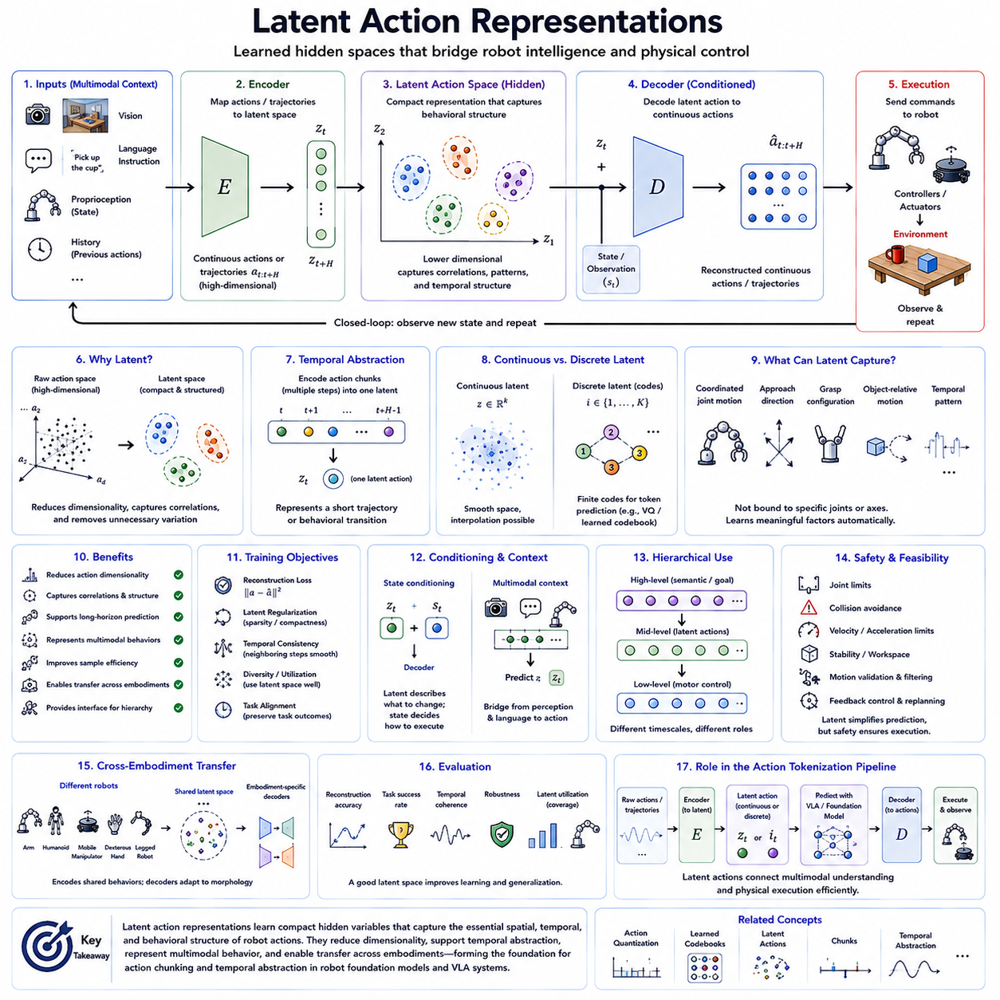{width="7.268055555555556in" height="7.268055555555556in"}

Latent action representations encode robot behavior in a learned hidden space rather than directly describing every actuator command or assigning each numerical interval a predefined token. An encoder transforms continuous actions, trajectories, or interaction sequences into compact latent variables that preserve important behavioral structure. These variables provide an intermediate language between high-level robot intelligence and low-level physical control.

The central motivation is that raw robot action spaces are often unnecessarily complex for learning. A manipulation trajectory may contain many correlated joint values even though they collectively describe a relatively simple behavior such as reaching, lifting, rotating, or placing. Latent representations attempt to discover these underlying factors automatically, compressing high-dimensional control signals into lower-dimensional structures that are easier for policies to predict.

A typical latent action architecture contains an encoder and decoder. Given an action sequence (a_{t:t+H}), the encoder produces a latent representation (z_t) that summarizes the behavior over a selected time horizon. The decoder receives (z_t), often together with the current robot or environmental state, and reconstructs the corresponding continuous actions. Learning therefore encourages the latent space to preserve information necessary for successful physical execution.

Unlike manually designed action variables, latent dimensions do not need to correspond directly to individual joints, Cartesian axes, or actuator quantities. One latent dimension may capture coordinated movement across several joints, while another may represent changes associated with approach direction or grasp configuration. This flexibility allows the representation to follow the statistical structure of behavior rather than a predefined engineering decomposition.

Latent actions are especially useful for high-dimensional robots. Humanoids, dexterous hands, mobile manipulators, and legged systems may expose dozens of coupled control variables. Predicting all of these values independently increases learning complexity and ignores correlations created by kinematics and dynamics. A compact latent space can represent coordinated patterns as unified behavioral variables, reducing the effective dimensionality of the policy output.

Temporal abstraction is another major advantage. Instead of encoding one instantaneous command, an encoder can map several consecutive actions into a single latent action. The latent variable then represents a short motion segment or behavioral transition rather than one control cycle. This allows a policy to reason over longer effective horizons because fewer predictions are required to represent an extended task.

The relationship between latent actions and action chunks is therefore particularly close. An action chunk explicitly groups several future controls, whereas a latent action compresses that chunk into a learned representation. The decoder expands the latent variable back into the detailed trajectory required by the robot. This combination can shorten sequence length while retaining smooth temporal relationships among consecutive commands.

Latent action spaces may remain continuous or be discretized. A continuous latent representation allows the policy to predict vectors within a learned embedding space and can preserve smooth variation between related behaviors. A discrete latent representation maps behaviors to a finite set of codes, often using vector quantization or learned codebooks. Both approaches compress raw actions, but they provide different interfaces for downstream foundation models.

Continuous latent spaces can support interpolation between behaviors. Nearby latent vectors may decode into similar trajectories, potentially allowing smooth transitions between learned motion patterns. However, unconstrained latent spaces can be difficult to interpret and may contain regions that decode into unrealistic behavior. Training objectives and regularization are therefore important for shaping a latent geometry that remains useful for control.

Discrete latent actions are naturally compatible with token-based architectures. Once an action segment is mapped to a discrete latent code, a Transformer can predict that code similarly to a language token. The code may represent a complex multidimensional or temporal behavior rather than a simple quantized scalar value. This provides substantially more expressive tokens than conventional per-dimension binning while maintaining a finite prediction vocabulary.

Learning useful latent actions requires more than minimizing reconstruction error. A representation that perfectly reconstructs actuator trajectories may still encode irrelevant details while failing to expose meaningful behavioral structure. Training objectives can therefore encourage compactness, temporal consistency, predictability, diversity, or alignment with task outcomes. The desired latent representation should retain information that matters for selecting and executing actions while discarding unnecessary variation.

State conditioning can make the latent representation more efficient. The decoder may receive the current observation or robot state in addition to the latent action, allowing the latent variable to describe what should change rather than fully specifying every physical detail. The same latent intention can then produce different low-level commands depending on the current configuration. This separation helps distinguish behavioral intent from state-dependent execution.

Visual and linguistic context can further shape latent action semantics. In a VLA architecture, the policy predicts latent actions from images, language instructions, proprioception, and interaction history. Repeated associations between instructions, objects, environmental states, and motion can encourage the latent space to capture behaviorally meaningful distinctions. Latent actions can therefore become a bridge between multimodal semantic reasoning and continuous physical trajectories.

Such representations are valuable for multimodal behavior because several latent actions can correspond to different valid strategies for the same task. A robot may grasp an object from different directions or navigate around either side of an obstacle. Rather than averaging incompatible trajectories, a probabilistic policy can represent multiple regions or modes in latent space and select an appropriate behavioral alternative according to context.

Latent representations also offer a potential route toward cross-embodiment learning. Raw joint commands differ substantially across robots, but higher-level interaction patterns can be shared. A common latent space might encode behaviors such as approaching, grasping, transporting, or repositioning while embodiment-specific decoders translate those representations into appropriate joint trajectories. This separates shared behavioral knowledge from robot-specific execution.

Achieving such transfer is difficult because a latent space does not automatically become embodiment-independent. If the encoder is trained only on the joint trajectories of one platform, its representations may encode morphology-specific characteristics. Cross-robot datasets, task-space information, object-relative motion, embodiment conditioning, shared objectives, and robot-specific decoders can help encourage representations that capture more transferable aspects of behavior.

Hierarchical control can use latent actions at several timescales. A high-level foundation model may predict a semantic goal or skill, an intermediate policy may convert that decision into latent action sequences, and a low-level decoder or controller may generate detailed motor commands. This hierarchy distributes reasoning, trajectory generation, and fast feedback control across representations appropriate to their respective temporal and physical scales.

Safety remains necessary because latent variables are learned abstractions rather than guaranteed feasible controls. A decoded trajectory can violate joint limits, collision constraints, velocity bounds, stability requirements, or workspace restrictions. Practical systems therefore combine latent action decoding with motion validation, safety filtering, feedback control, and replanning. The latent representation simplifies prediction but does not remove the physical constraints governing execution.

Evaluation of latent actions must consider both representation quality and downstream behavior. Reconstruction accuracy measures whether original trajectories can be recovered, but control success, task completion, temporal coherence, robustness, code or latent-space utilization, and transfer performance are equally important. A useful representation should improve policy learning or generalization rather than merely compressing action data efficiently.

Latent action representations therefore generalize the idea behind learned action codebooks. Instead of manually specifying how every physical command should be represented, the system learns hidden variables that capture recurring spatial, temporal, and behavioral structure from robot experience. These variables can be continuous embeddings, discrete latent tokens, or hierarchical representations depending on the requirements of the policy and control architecture.

Within robot foundation models and VLA systems, latent actions provide a powerful interface between multimodal understanding and physical execution. They reduce action dimensionality, capture correlations, support temporal abstraction, represent multimodal behavior, and potentially enable transfer across embodiments. Their design also establishes the foundation for action chunking and temporal abstraction, where meaningful behavior must be represented across multiple control steps rather than at isolated moments.

잠재 행동 표현(Latent Action Representation)은 모든 액추에이터 명령(Actuator Command)을 직접 기술하거나 각 수치 구간에 미리 정의된 토큰(Token)을 할당하는 대신, 학습된 숨겨진 공간(Learned Hidden Space)에서 로봇 행동을 인코딩한다. 인코더(Encoder)는 연속 행동(Continuous Action), 궤적(Trajectory), 또는 상호작용 시퀀스(Interaction Sequence)를 중요한 행동 구조를 보존하는 압축된 잠재 변수(Latent Variable)로 변환한다. 이러한 변수는 고수준 로봇 지능(High-Level Robot Intelligence)과 저수준 물리 제어(Low-Level Physical Control)를 연결하는 중간 언어 역할을 한다.

핵심적인 동기는 원시 로봇 행동 공간(Raw Robot Action Space)이 학습에 필요한 것보다 지나치게 복잡한 경우가 많다는 점이다. 하나의 조작 궤적(Manipulation Trajectory)은 많은 상관된 관절값(Joint Value)을 포함할 수 있지만, 이 값들이 전체적으로 표현하는 행동은 도달하기(Reaching), 들어 올리기(Lifting), 회전하기(Rotating), 놓기(Placing)와 같이 비교적 단순할 수 있다. 잠재 표현은 이러한 근본적인 요인을 자동으로 발견하고 고차원 제어 신호를 정책(Policy)이 보다 쉽게 예측할 수 있는 저차원 구조로 압축한다.

일반적인 잠재 행동 아키텍처(Latent Action Architecture)는 인코더와 디코더(Decoder)로 구성된다. 행동 시퀀스 (a_{t:t+H})가 주어지면 인코더는 선택된 시간 지평(Time Horizon)의 행동을 요약하는 잠재 표현 (z_t)를 생성한다. 디코더는 (z_t)와 필요한 경우 현재 로봇 상태 또는 환경 상태(Environmental State)를 입력받아 해당하는 연속 행동을 복원한다. 따라서 학습 과정은 잠재 공간이 성공적인 물리적 실행에 필요한 정보를 보존하도록 유도한다.

사람이 직접 설계한 행동 변수(Action Variable)와 달리 잠재 차원(Latent Dimension)은 개별 관절, 데카르트 축(Cartesian Axis), 또는 액추에이터 물리량에 직접 대응할 필요가 없다. 하나의 잠재 차원이 여러 관절에 걸친 협응 움직임(Coordinated Movement)을 포착할 수 있으며, 다른 잠재 차원은 접근 방향(Approach Direction)이나 파지 구성(Grasp Configuration)의 변화와 관련된 특성을 표현할 수 있다. 이러한 유연성은 미리 정의된 공학적 분해(Engineering Decomposition)가 아니라 실제 행동의 통계적 구조를 따라 표현을 학습할 수 있도록 한다.

잠재 행동은 고차원 로봇(High-Dimensional Robot)에 특히 유용하다. 휴머노이드(Humanoid), 덱스터러스 핸드(Dexterous Hand), 모바일 매니퓰레이터(Mobile Manipulator), 보행 로봇(Legged System)은 수십 개의 서로 결합된 제어 변수를 가질 수 있다. 이러한 값을 독립적으로 예측하면 학습 복잡성이 증가하고 운동학(Kinematics)과 동역학(Dynamics)에 의해 형성되는 상관관계를 무시하게 된다. 압축된 잠재 공간은 협응 패턴을 통합된 행동 변수로 표현하여 정책 출력의 실질적인 차원을 줄일 수 있다.

시간적 추상화(Temporal Abstraction)는 또 다른 중요한 장점이다. 하나의 순간적인 명령을 인코딩하는 대신 인코더는 연속된 여러 행동을 하나의 잠재 행동으로 매핑할 수 있다. 이 경우 잠재 변수는 단일 제어 주기(Control Cycle)가 아니라 짧은 움직임 구간(Motion Segment) 또는 행동 전이(Behavioral Transition)를 표현한다. 하나의 확장된 작업을 표현하는 데 필요한 예측 횟수가 줄어들기 때문에 정책은 실질적으로 더 긴 시간 지평에 걸쳐 추론할 수 있다.

따라서 잠재 행동과 행동 청크(Action Chunk)는 매우 밀접한 관계를 가진다. 행동 청크는 미래의 여러 제어 명령을 명시적으로 하나로 묶는 반면, 잠재 행동은 해당 청크를 학습된 표현으로 압축한다. 디코더는 잠재 변수를 로봇이 필요로 하는 세부 궤적으로 다시 확장한다. 이러한 조합은 연속된 명령 사이의 부드러운 시간적 관계를 유지하면서 시퀀스 길이를 줄일 수 있다.

잠재 행동 공간(Latent Action Space)은 연속적인 형태로 유지하거나 이산화(Discretization)할 수 있다. 연속 잠재 표현(Continuous Latent Representation)은 정책이 학습된 임베딩 공간(Embedding Space) 안의 벡터를 예측하도록 하며 관련 행동 사이의 부드러운 변화를 보존할 수 있다. 이산 잠재 표현(Discrete Latent Representation)은 일반적으로 벡터 양자화(Vector Quantization) 또는 학습된 코드북(Learned Codebook)을 이용해 행동을 유한한 코드 집합으로 매핑한다. 두 방식 모두 원시 행동을 압축하지만 이후 파운데이션 모델과 연결되는 인터페이스는 서로 다르다.

연속 잠재 공간은 서로 다른 행동 사이의 보간(Interpolation)을 지원할 수 있다. 서로 가까운 잠재 벡터는 유사한 궤적으로 디코딩될 수 있으므로 학습된 움직임 패턴 사이에서 부드럽게 전환할 가능성을 제공한다. 그러나 제약되지 않은 잠재 공간(Unconstrained Latent Space)은 해석하기 어려울 수 있으며 비현실적인 행동으로 디코딩되는 영역을 포함할 수도 있다. 따라서 제어에 유용한 잠재 공간의 기하학적 구조(Latent Geometry)를 형성하기 위해 학습 목적 함수(Training Objective)와 정규화(Regularization)가 중요하다.

이산 잠재 행동(Discrete Latent Action)은 토큰 기반 아키텍처(Token-Based Architecture)와 자연스럽게 호환된다. 하나의 행동 구간이 이산 잠재 코드(Discrete Latent Code)로 매핑되면 트랜스포머(Transformer)는 이를 언어 토큰(Language Token)과 유사하게 예측할 수 있다. 이러한 코드는 단순하게 양자화된 하나의 스칼라값이 아니라 복잡한 다차원 또는 시간적 행동을 표현할 수 있다. 따라서 유한한 예측 어휘집(Vocabulary)을 유지하면서 기존의 차원별 비닝(Per-Dimension Binning)보다 훨씬 표현력이 높은 토큰을 구성할 수 있다.

유용한 잠재 행동을 학습하려면 복원 오차(Reconstruction Error)를 최소화하는 것만으로는 충분하지 않다. 액추에이터 궤적을 완벽하게 복원하는 표현이라도 불필요한 세부 정보를 인코딩하면서 행동적으로 중요한 구조를 드러내지 못할 수 있다. 따라서 학습 목적은 압축성(Compactness), 시간적 일관성(Temporal Consistency), 예측 가능성(Predictability), 다양성(Diversity), 작업 결과(Task Outcome)와의 정렬을 장려할 수 있다. 바람직한 잠재 표현은 행동 선택과 실행에 필요한 정보를 유지하면서 불필요한 변동을 제거해야 한다.

상태 조건화(State Conditioning)는 잠재 표현을 더욱 효율적으로 만들 수 있다. 디코더가 잠재 행동뿐만 아니라 현재 관측(Current Observation)이나 로봇 상태를 함께 입력받으면 잠재 변수는 모든 물리적 세부 정보를 완전히 지정하는 대신 무엇이 변화해야 하는지를 표현할 수 있다. 그러면 동일한 잠재 의도(Latent Intention)가 현재 구성에 따라 서로 다른 저수준 명령을 생성할 수 있다. 이러한 분리는 행동 의도(Behavioral Intent)와 상태 의존적 실행(State-Dependent Execution)을 구분하는 데 도움이 된다.

시각 및 언어 문맥(Visual and Linguistic Context)은 잠재 행동의 의미론(Semantics)을 더욱 발전시킬 수 있다. VLA 아키텍처에서 정책은 이미지(Image), 언어 명령(Language Instruction), 고유수용감각(Proprioception), 상호작용 이력(Interaction History)을 기반으로 잠재 행동을 예측한다. 명령, 물체, 환경 상태, 움직임 사이의 반복적인 연관관계를 학습하면 잠재 공간이 행동적으로 의미 있는 차이를 포착하도록 유도할 수 있다. 따라서 잠재 행동은 멀티모달 의미 추론(Multimodal Semantic Reasoning)과 연속적인 물리 궤적 사이의 연결 역할을 할 수 있다.

이러한 표현은 동일한 작업에 여러 개의 잠재 행동이 서로 다른 유효한 전략을 나타낼 수 있기 때문에 다중 모드 행동(Multimodal Behavior)에 유용하다. 로봇은 서로 다른 방향에서 물체를 잡거나 장애물의 양쪽 가운데 어느 한 방향으로 이동할 수 있다. 확률적 정책(Probabilistic Policy)은 서로 호환되지 않는 궤적을 평균화하는 대신 잠재 공간의 여러 영역이나 모드(Mode)를 표현하고 문맥에 따라 적절한 행동 대안을 선택할 수 있다.

잠재 표현은 교차 체화 학습(Cross-Embodiment Learning)을 위한 잠재적인 경로도 제공한다. 원시 관절 명령(Raw Joint Command)은 로봇마다 크게 다르지만 고수준 상호작용 패턴(High-Level Interaction Pattern)은 공유될 수 있다. 공통 잠재 공간(Common Latent Space)은 접근하기(Approaching), 잡기(Grasping), 운반하기(Transporting), 위치 변경하기(Repositioning)와 같은 행동을 인코딩하고, 체화별 디코더(Embodiment-Specific Decoder)가 이를 각 로봇에 적합한 관절 궤적으로 변환하도록 할 수 있다. 이를 통해 공유 행동 지식과 로봇별 실행을 분리할 수 있다.

그러나 잠재 공간이 자동으로 체화 독립적(Embodiment-Independent)이 되는 것은 아니므로 이러한 전이를 달성하기는 어렵다. 인코더가 하나의 플랫폼에서 수집된 관절 궤적만으로 학습된다면 잠재 표현에 특정 형태(Morphology)의 특성이 포함될 수 있다. 교차 로봇 데이터셋(Cross-Robot Dataset), 작업 공간 정보(Task-Space Information), 객체 상대 움직임(Object-Relative Motion), 체화 조건화(Embodiment Conditioning), 공유 목적 함수(Shared Objective), 로봇별 디코더를 활용하면 보다 전이 가능한 행동 특성을 포착하도록 유도할 수 있다.

계층적 제어(Hierarchical Control)는 여러 시간 척도(Timescale)에서 잠재 행동을 사용할 수 있다. 고수준 파운데이션 모델이 의미적 목표(Semantic Goal)나 기술(Skill)을 예측하면 중간 수준 정책(Intermediate Policy)이 이를 잠재 행동 시퀀스로 변환하고, 저수준 디코더 또는 제어기(Low-Level Controller)가 세부 모터 명령을 생성할 수 있다. 이러한 계층 구조는 추론, 궤적 생성, 빠른 피드백 제어를 각각의 시간적·물리적 규모에 적합한 표현으로 분담한다.

잠재 변수는 학습된 추상 표현이지 실행 가능성이 보장된 제어 명령이 아니므로 안전성(Safety)은 여전히 필요하다. 디코딩된 궤적은 관절 한계(Joint Limit), 충돌 제약(Collision Constraint), 속도 제한(Velocity Bound), 안정성 요구사항(Stability Requirement), 작업 공간 제한(Workspace Restriction)을 위반할 수 있다. 따라서 실제 시스템은 잠재 행동 디코딩과 모션 검증(Motion Validation), 안전 필터링(Safety Filtering), 피드백 제어(Feedback Control), 재계획(Replanning)을 결합한다. 잠재 표현은 예측을 단순화하지만 물리적 실행을 지배하는 제약을 제거하지는 않는다.

잠재 행동의 평가는 표현 품질(Representation Quality)과 실제 하위 행동(Downstream Behavior)을 함께 고려해야 한다. 복원 정확도(Reconstruction Accuracy)는 원래 궤적을 얼마나 잘 복원할 수 있는지를 측정하지만, 제어 성공률(Control Success), 작업 완료(Task Completion), 시간적 일관성, 강건성(Robustness), 코드 또는 잠재 공간 활용도(Latent-Space Utilization), 전이 성능(Transfer Performance)도 동일하게 중요하다. 유용한 표현은 단순히 행동 데이터를 효율적으로 압축하는 것을 넘어 정책 학습이나 일반화를 향상시켜야 한다.

따라서 잠재 행동 표현은 학습된 행동 코드북(Learned Action Codebook)의 기본 아이디어를 보다 일반적인 형태로 확장한다. 모든 물리 명령을 어떻게 표현할지 사람이 직접 지정하는 대신 시스템은 로봇 경험(Robot Experience)으로부터 반복되는 공간적(Spatial), 시간적(Temporal), 행동적 구조(Behavioral Structure)를 포착하는 숨겨진 변수를 학습한다. 이러한 변수는 정책과 제어 아키텍처의 요구사항에 따라 연속 임베딩(Continuous Embedding), 이산 잠재 토큰(Discrete Latent Token), 또는 계층적 표현(Hierarchical Representation)의 형태를 가질 수 있다.

로봇 파운데이션 모델(Robot Foundation Model)과 VLA 시스템에서 잠재 행동은 멀티모달 이해(Multimodal Understanding)와 물리적 실행 사이에 강력한 인터페이스를 제공한다. 행동 차원을 줄이고 상관관계를 포착하며 시간적 추상화를 지원하고 다중 모드 행동을 표현하며 체화 간 전이 가능성을 제공한다. 또한 잠재 행동의 설계는 의미 있는 행동을 개별 순간이 아니라 여러 제어 단계에 걸쳐 표현해야 하는 행동 청킹(Action Chunking)과 시간적 추상화의 기반을 마련한다.

## 05.08. Action Chunks and Temporal Abstraction

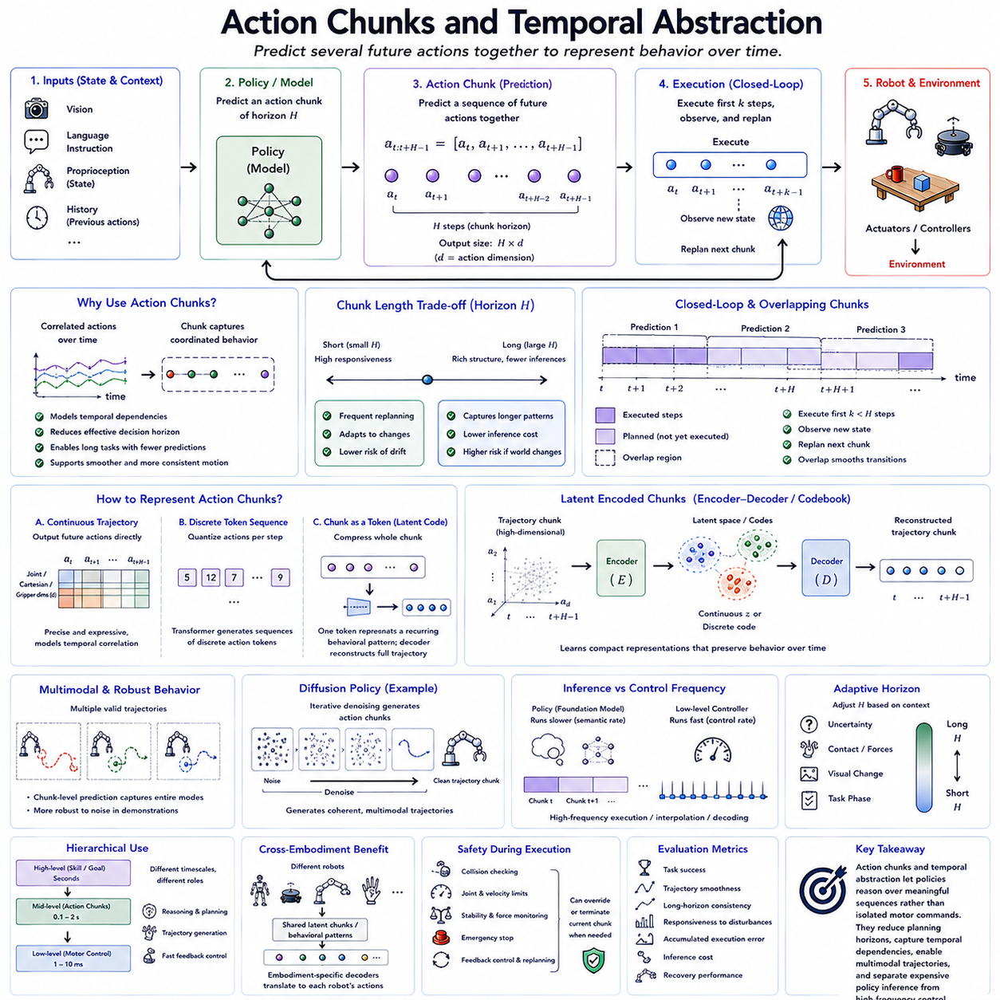{width="7.268055555555556in" height="7.268055555555556in"}

Action chunks represent robot behavior as short sequences of coordinated control commands rather than treating every control step as an independent prediction. A policy predicts several future actions together, forming a compact trajectory segment that can be executed over multiple timesteps. This shifts robot learning from instantaneous motor prediction toward temporally structured behavior and provides an important form of temporal abstraction.

Consider a policy operating with an action vector (a_t \\in \\mathbb{R}\^d). Conventional step-by-step control predicts only (a_t) at each inference cycle, whereas action chunking predicts (a_{t:t+H-1}), where (H) is the chunk horizon. The resulting output contains (H \\times d) control values and describes how the robot should move over a short future interval rather than specifying only its immediate next command.

The motivation comes from the temporal structure of physical behavior. Robot actions are strongly correlated across neighboring timesteps because manipulation, locomotion, and navigation involve continuous motion governed by kinematics and dynamics. Reaching toward an object, closing a gripper, or moving around an obstacle requires coordinated sequences rather than unrelated commands. Action chunks allow the policy to model these dependencies directly.

Chunking can substantially reduce the effective decision horizon of a task. If a task requires hundreds of low-level control steps, predicting each action independently creates a long sequential reasoning problem. When multiple controls are grouped into chunks, the policy makes fewer high-level predictions to describe the same behavior. This allows learning systems to represent longer tasks while reducing the number of autoregressive or repeated inference operations required.

Temporal abstraction refers more broadly to representing behavior at timescales longer than individual control cycles. An instantaneous action may describe a tiny joint or Cartesian displacement, while a chunk can represent a meaningful movement segment such as approaching an object or repositioning the gripper. Higher abstractions may represent complete skills. Action chunking therefore occupies an intermediate level between low-level motor commands and semantic robot skills.

The length of an action chunk creates an important design tradeoff. Short chunks preserve responsiveness because the robot frequently returns to the policy for updated predictions based on new observations. Longer chunks capture richer temporal structure and reduce inference frequency but assume that predicted future actions remain appropriate for a longer period. Unexpected object motion, disturbances, or perception errors can therefore make long open-loop chunks increasingly unreliable.

Closed-loop execution provides a practical solution to this problem. A policy can predict a relatively long action chunk while executing only its first few commands before observing the environment again. It then generates a new chunk conditioned on the updated state. This receding-horizon strategy combines the temporal consistency of multi-step prediction with the responsiveness of feedback control and resembles principles used in model predictive control.

Overlapping action chunks create another mechanism for maintaining smooth closed-loop behavior. Consecutive predictions may cover some of the same future timesteps, producing multiple estimates for an action that will eventually be executed. These predictions can be combined or temporally weighted to reduce abrupt changes between successive chunks. Such aggregation can improve trajectory smoothness while allowing the policy to continuously incorporate new observations.

Action chunks can be represented directly as continuous trajectories. A model may output a matrix containing several future joint positions, Cartesian displacements, rotations, or gripper commands. This retains the precision of continuous control while explicitly modeling temporal correlation. The dimensionality of the output increases with chunk length, however, requiring the model to learn coherent relationships across both action dimensions and future timesteps.

Discrete action tokenization can also be combined with chunking. Individual actions within a chunk may be quantized into tokens, allowing a Transformer to generate sequences of discrete action symbols. Alternatively, an entire action chunk can be compressed into one or several learned codes. In this case, each token represents a recurring temporal behavior pattern rather than a single instantaneous numerical command.

Learned codebooks and latent action representations provide particularly natural mechanisms for compressing action chunks. An encoder can map a high-dimensional trajectory segment into a compact latent variable, which may remain continuous or be quantized into a discrete code. A decoder reconstructs the detailed control sequence from this representation. The policy then predicts compact behavioral units instead of directly generating every low-level value.

Chunking can improve robustness to noisy demonstrations because it encourages the model to capture coherent trajectory structure rather than fitting every instantaneous fluctuation independently. Human teleoperation and robot demonstrations often contain small corrections, delays, or control noise. Modeling several timesteps jointly can help distinguish the broader intended movement from local variations, particularly when combined with latent representations or trajectory-level objectives.

Multimodal actions are also easier to represent when chunks capture complete alternatives. A manipulation task may permit several valid trajectories, such as approaching an object from the left or right. Step-wise regression can average incompatible commands at individual timesteps. A chunk-level generative model can instead represent entire trajectory modes, preserving consistency among the consecutive actions belonging to each behavioral strategy.

Diffusion-based robot policies provide one example of trajectory-level action generation. Rather than predicting a single deterministic command, a diffusion model can generate a sequence of continuous future actions conditioned on observations and task context. Iterative denoising produces coherent action chunks that can represent complex and multimodal trajectories. Only part of the generated sequence may be executed before replanning from a new observation.

Chunking also changes the relationship between model inference frequency and robot control frequency. A large VLA or foundation model does not necessarily need to run at the same rate as low-level motor controllers. The model can generate action chunks at a slower semantic frequency, while servo controllers execute interpolated or decoded commands at higher frequencies. This separation reduces computational pressure on the large model and supports hierarchical control.

The appropriate chunk horizon depends on task dynamics and environmental predictability. Slow manipulation in a stable workspace may tolerate longer chunks, whereas rapidly changing environments require frequent replanning. Contact-rich tasks can demand especially short feedback intervals because forces and object states can change quickly. A fixed chunk length is therefore not always optimal across different tasks, phases, robots, and operating conditions.

Adaptive temporal abstraction offers a more flexible approach. A policy could produce short chunks during uncertain or contact-sensitive phases and longer chunks during predictable free-space motion. Confidence, predicted uncertainty, task phase, visual change, or interaction events can provide signals for adjusting the effective planning horizon. This allows computational effort and feedback frequency to follow the temporal complexity of the physical task.

Hierarchical policies extend temporal abstraction beyond fixed chunks. A high-level model may select a goal or skill lasting several seconds, an intermediate policy may generate action chunks spanning shorter intervals, and low-level controllers may execute commands at millisecond timescales. Each layer therefore operates at a temporal resolution appropriate to its function, connecting semantic reasoning to increasingly detailed physical execution.

Cross-embodiment learning can also benefit from temporal abstraction because short behavioral segments may reveal common structure that individual actuator commands do not share. Different robots can realize an approach, lift, transport, or release behavior using different joint trajectories. Shared latent chunks can represent these behavioral patterns, while embodiment-specific decoders translate them into control sequences compatible with each robot\'s morphology and dynamics.

Safety mechanisms must remain active throughout chunk execution. Even if a predicted trajectory is feasible when generated, environmental conditions may change before all commands are executed. Collision checks, joint and velocity limits, stability constraints, force monitoring, emergency stopping, and feedback controllers can override or terminate a chunk when necessary. Temporal abstraction should reduce prediction complexity without weakening real-time safety supervision.

Evaluation of action chunking should therefore extend beyond single-step prediction error. Important measures include task success, trajectory smoothness, long-horizon consistency, responsiveness to disturbances, accumulated execution error, inference cost, and recovery performance. Chunk length and execution horizon should be evaluated together because a model may predict long trajectories while deliberately executing only a small portion before replanning.

Action chunks and temporal abstraction ultimately reorganize robot control around meaningful sequences rather than isolated motor commands. They reduce effective planning horizons, capture temporal correlations, enable multimodal trajectory generation, and separate expensive policy inference from high-frequency control. Combined with latent actions, learned codebooks, closed-loop replanning, and hierarchical controllers, they provide a scalable interface between foundation-model reasoning and continuous physical behavior.

행동 청크(Action Chunk)는 모든 제어 단계를 독립적인 예측으로 처리하는 대신, 로봇 행동을 짧고 협응된 제어 명령 시퀀스(Coordinated Control Command Sequence)로 표현한다. 정책(Policy)은 여러 미래 행동을 함께 예측하여 여러 시간 단계(Timestep)에 걸쳐 실행할 수 있는 압축된 궤적 구간(Trajectory Segment)을 형성한다. 이는 로봇 학습을 순간적인 모터 예측(Instantaneous Motor Prediction)에서 시간적으로 구조화된 행동(Temporally Structured Behavior)으로 전환하며 중요한 형태의 시간적 추상화(Temporal Abstraction)를 제공한다.

행동 벡터(Action Vector) (a_t \\in \\mathbb{R}\^d)를 사용하는 정책을 생각할 수 있다. 기존의 단계별 제어(Step-by-Step Control)는 각 추론 주기(Inference Cycle)에서 (a_t)만 예측하지만, 행동 청킹(Action Chunking)은 (H)를 청크 지평(Chunk Horizon)이라고 할 때 (a_{t:t+H-1})을 예측한다. 결과 출력은 (H \\times d)개의 제어값을 포함하며, 로봇의 바로 다음 명령만 지정하는 대신 짧은 미래 구간 동안 로봇이 어떻게 움직여야 하는지를 나타낸다.

이러한 접근법의 동기는 물리적 행동의 시간적 구조(Temporal Structure)에서 비롯된다. 조작(Manipulation), 이동(Locomotion), 내비게이션(Navigation)은 운동학(Kinematics)과 동역학(Dynamics)의 영향을 받는 연속적인 움직임으로 구성되기 때문에 인접한 시간 단계의 로봇 행동은 강한 상관관계를 갖는다. 물체에 접근하거나 그리퍼를 닫거나 장애물을 우회하는 과정에는 서로 독립된 명령이 아니라 협응된 시퀀스가 필요하다. 행동 청크는 정책이 이러한 시간적 의존관계를 직접 모델링하도록 한다.

청킹(Chunking)은 작업의 실질적인 의사결정 지평(Decision Horizon)을 크게 줄일 수 있다. 하나의 작업에 수백 개의 저수준 제어 단계가 필요하다면 각각의 행동을 독립적으로 예측하는 것은 긴 순차적 추론 문제(Sequential Reasoning Problem)를 만든다. 여러 제어 명령을 청크로 묶으면 정책은 동일한 행동을 표현하기 위해 더 적은 수의 고수준 예측을 수행한다. 이를 통해 학습 시스템은 필요한 자기회귀(Autoregressive) 또는 반복 추론 횟수를 줄이면서 더 긴 작업을 표현할 수 있다.

시간적 추상화는 개별 제어 주기보다 긴 시간 척도에서 행동을 표현하는 개념을 보다 광범위하게 의미한다. 순간 행동(Instantaneous Action)은 매우 작은 관절 또는 데카르트 변위(Cartesian Displacement)를 나타낼 수 있지만, 하나의 청크는 물체에 접근하거나 그리퍼 위치를 조정하는 것과 같은 의미 있는 움직임 구간을 표현할 수 있다. 더 높은 추상화 수준에서는 완전한 기술(Skill)을 표현할 수 있다. 따라서 행동 청킹은 저수준 모터 명령(Low-Level Motor Command)과 의미적 로봇 기술(Semantic Robot Skill) 사이의 중간 수준을 차지한다.

행동 청크의 길이(Chunk Length)는 중요한 설계 절충관계(Design Tradeoff)를 만든다. 짧은 청크는 로봇이 새로운 관측을 기반으로 업데이트된 예측을 얻기 위해 정책으로 자주 돌아가기 때문에 높은 반응성(Responsiveness)을 유지한다. 긴 청크는 풍부한 시간적 구조를 포착하고 추론 빈도(Inference Frequency)를 줄이지만 예측된 미래 행동이 더 오랫동안 적절하게 유지될 것이라고 가정한다. 따라서 예상하지 못한 물체 움직임, 외란(Disturbance), 지각 오류(Perception Error)는 긴 개루프 청크(Open-Loop Chunk)의 신뢰성을 점차 감소시킬 수 있다.

폐루프 실행(Closed-Loop Execution)은 이러한 문제에 대한 실용적인 해결책을 제공한다. 정책은 비교적 긴 행동 청크를 예측하면서도 환경을 다시 관측하기 전에 그중 처음 몇 개의 명령만 실행할 수 있다. 이후 업데이트된 상태를 조건으로 새로운 청크를 생성한다. 이러한 이동 지평 전략(Receding-Horizon Strategy)은 다단계 예측(Multi-Step Prediction)의 시간적 일관성과 피드백 제어(Feedback Control)의 반응성을 결합하며 모델 예측 제어(Model Predictive Control)의 원리와 유사하다.

중첩 행동 청크(Overlapping Action Chunk)는 부드러운 폐루프 행동을 유지하기 위한 또 다른 메커니즘을 제공한다. 연속적인 예측은 일부 동일한 미래 시간 단계를 포함할 수 있으며, 결과적으로 실제로 실행될 하나의 행동에 대해 여러 개의 추정값을 생성할 수 있다. 이러한 예측을 결합하거나 시간적으로 가중(Temporal Weighting)하면 연속된 청크 사이에서 발생하는 갑작스러운 변화를 줄일 수 있다. 이러한 집계(Aggregation)는 정책이 새로운 관측을 지속적으로 반영하도록 하면서 궤적의 부드러움(Trajectory Smoothness)을 향상시킬 수 있다.

행동 청크는 연속 궤적(Continuous Trajectory)으로 직접 표현할 수 있다. 모델은 여러 미래 관절 위치(Joint Position), 데카르트 변위, 회전(Rotation), 또는 그리퍼 명령(Gripper Command)을 포함하는 행렬(Matrix)을 출력할 수 있다. 이는 연속 제어(Continuous Control)의 정밀도를 유지하면서 시간적 상관관계를 명시적으로 모델링한다. 그러나 청크 길이가 증가하면 출력 차원도 증가하므로 모델은 행동 차원과 미래 시간 단계에 걸쳐 일관된 관계를 학습해야 한다.

이산 행동 토큰화(Discrete Action Tokenization)도 청킹과 결합할 수 있다. 청크 내부의 개별 행동을 토큰으로 양자화(Quantization)하여 트랜스포머(Transformer)가 이산 행동 심볼의 시퀀스를 생성하도록 할 수 있다. 또는 전체 행동 청크를 하나 이상의 학습된 코드(Learned Code)로 압축할 수도 있다. 이 경우 각각의 토큰은 순간적인 하나의 수치 명령이 아니라 반복적으로 나타나는 시간적 행동 패턴(Temporal Behavior Pattern)을 나타낸다.

학습된 코드북(Learned Codebook)과 잠재 행동 표현(Latent Action Representation)은 행동 청크를 압축하기 위한 특히 자연스러운 메커니즘을 제공한다. 인코더(Encoder)는 고차원 궤적 구간을 압축된 잠재 변수(Latent Variable)로 매핑할 수 있으며, 이 변수는 연속적인 형태로 유지하거나 이산 코드로 양자화할 수 있다. 디코더(Decoder)는 이러한 표현으로부터 세부 제어 시퀀스를 복원한다. 따라서 정책은 모든 저수준 값을 직접 생성하는 대신 압축된 행동 단위(Behavioral Unit)를 예측한다.

청킹은 모델이 각각의 순간적인 변동을 독립적으로 맞추기보다 일관된 궤적 구조(Coherent Trajectory Structure)를 포착하도록 유도하기 때문에 잡음이 포함된 시연 데이터(Noisy Demonstration)에 대한 강건성(Robustness)을 향상시킬 수 있다. 인간 원격조작(Human Teleoperation)과 로봇 시연에는 작은 보정, 지연, 제어 잡음(Control Noise)이 포함되는 경우가 많다. 여러 시간 단계를 공동으로 모델링하면 특히 잠재 표현이나 궤적 수준 목적 함수(Trajectory-Level Objective)와 결합할 때 국소적 변동에서 전체적으로 의도된 움직임을 구별하는 데 도움이 될 수 있다.

다중 모드 행동(Multimodal Action) 역시 청크가 완전한 행동 대안을 포착할 때 보다 효과적으로 표현할 수 있다. 하나의 조작 작업에서는 물체의 왼쪽이나 오른쪽에서 접근하는 것처럼 여러 개의 유효한 궤적이 존재할 수 있다. 단계별 회귀(Step-Wise Regression)는 개별 시간 단계에서 서로 호환되지 않는 명령을 평균화할 수 있다. 반면 청크 수준 생성 모델(Chunk-Level Generative Model)은 전체 궤적 모드(Trajectory Mode)를 표현하여 각각의 행동 전략에 포함된 연속 행동 사이의 일관성을 보존할 수 있다.

확산 기반 로봇 정책(Diffusion-Based Robot Policy)은 궤적 수준 행동 생성의 한 가지 예를 제공한다. 하나의 결정론적 명령(Deterministic Command)을 예측하는 대신 확산 모델(Diffusion Model)은 관측과 작업 문맥(Task Context)을 조건으로 미래의 연속 행동 시퀀스를 생성할 수 있다. 반복적인 잡음 제거(Iterative Denoising)를 통해 복잡하고 다중 모드적인 궤적을 표현할 수 있는 일관된 행동 청크를 생성한다. 생성된 시퀀스의 일부만 실행한 뒤 새로운 관측으로부터 다시 계획할 수도 있다.

청킹은 모델 추론 주파수(Model Inference Frequency)와 로봇 제어 주파수(Robot Control Frequency)의 관계도 변화시킨다. 대규모 VLA 또는 파운데이션 모델(Foundation Model)이 저수준 모터 제어기와 동일한 속도로 실행될 필요는 없다. 모델은 더 느린 의미적 주파수(Semantic Frequency)에서 행동 청크를 생성하고, 서보 제어기(Servo Controller)는 보간(Interpolation)되거나 디코딩된 명령을 더 높은 주파수에서 실행할 수 있다. 이러한 분리는 대규모 모델의 계산 부담을 줄이고 계층적 제어(Hierarchical Control)를 지원한다.

적절한 청크 지평은 작업 동역학(Task Dynamics)과 환경의 예측 가능성(Environmental Predictability)에 따라 달라진다. 안정적인 작업 공간에서 수행되는 느린 조작은 비교적 긴 청크를 허용할 수 있지만 빠르게 변화하는 환경에서는 빈번한 재계획(Replanning)이 필요하다. 접촉 중심 작업(Contact-Rich Task)은 힘과 물체 상태가 빠르게 변할 수 있기 때문에 특히 짧은 피드백 간격이 필요할 수 있다. 따라서 고정된 청크 길이가 모든 작업, 단계, 로봇, 운용 조건에 항상 최적인 것은 아니다.

적응형 시간적 추상화(Adaptive Temporal Abstraction)는 보다 유연한 접근법을 제공한다. 정책은 불확실하거나 접촉에 민감한 단계에서는 짧은 청크를 생성하고, 예측 가능한 자유 공간 움직임(Free-Space Motion)에서는 긴 청크를 생성할 수 있다. 신뢰도(Confidence), 예측 불확실성(Predicted Uncertainty), 작업 단계(Task Phase), 시각적 변화(Visual Change), 상호작용 이벤트(Interaction Event)를 이용해 실질적인 계획 지평을 조정할 수 있다. 이를 통해 계산 자원과 피드백 빈도를 물리적 작업의 시간적 복잡성에 맞출 수 있다.

계층적 정책(Hierarchical Policy)은 시간적 추상화를 고정된 청크 이상으로 확장한다. 고수준 모델은 수초 동안 지속되는 목표(Goal)나 기술을 선택하고, 중간 수준 정책은 더 짧은 구간에 걸친 행동 청크를 생성하며, 저수준 제어기는 밀리초(Millisecond) 수준의 시간 척도에서 명령을 실행할 수 있다. 따라서 각 계층은 자신의 기능에 적합한 시간 해상도(Temporal Resolution)에서 작동하며 의미적 추론을 점차 세부적인 물리적 실행으로 연결한다.

교차 체화 학습(Cross-Embodiment Learning)도 시간적 추상화의 이점을 얻을 수 있다. 개별 액추에이터 명령은 로봇 사이에서 공유하기 어렵지만 짧은 행동 구간은 공통된 구조를 드러낼 수 있기 때문이다. 서로 다른 로봇은 접근(Approach), 들어 올리기(Lift), 운반(Transport), 놓기(Release)를 서로 다른 관절 궤적으로 수행할 수 있다. 공유 잠재 청크(Shared Latent Chunk)는 이러한 행동 패턴을 표현하고, 체화별 디코더(Embodiment-Specific Decoder)가 각 로봇의 형태와 동역학에 적합한 제어 시퀀스로 변환할 수 있다.

안전 메커니즘(Safety Mechanism)은 청크 실행 전체 과정에서 지속적으로 활성화되어야 한다. 예측된 궤적이 생성 시점에는 실행 가능하더라도 모든 명령이 실행되기 전에 환경 조건이 변화할 수 있다. 충돌 검사(Collision Check), 관절 및 속도 제한(Joint and Velocity Limit), 안정성 제약(Stability Constraint), 힘 모니터링(Force Monitoring), 비상 정지(Emergency Stop), 피드백 제어기는 필요할 경우 청크를 무시하거나 중단할 수 있어야 한다. 시간적 추상화는 실시간 안전 감독(Real-Time Safety Supervision)을 약화시키지 않으면서 예측 복잡성을 줄여야 한다.

따라서 행동 청킹의 평가는 단일 단계 예측 오차(Single-Step Prediction Error)를 넘어 이루어져야 한다. 중요한 평가 지표에는 작업 성공률(Task Success), 궤적 부드러움, 장기 시간적 일관성(Long-Horizon Consistency), 외란에 대한 반응성, 누적 실행 오차(Accumulated Execution Error), 추론 비용(Inference Cost), 복구 성능(Recovery Performance)이 포함된다. 모델이 긴 궤적을 예측하면서 실제로는 재계획 전에 그중 일부만 실행할 수 있으므로 청크 길이와 실행 지평(Execution Horizon)을 함께 평가해야 한다.

궁극적으로 행동 청크와 시간적 추상화는 로봇 제어를 고립된 모터 명령(Isolated Motor Command)이 아니라 의미 있는 시퀀스를 중심으로 재구성한다. 이는 실질적인 계획 지평을 줄이고 시간적 상관관계를 포착하며 다중 모드 궤적 생성을 가능하게 하고, 계산 비용이 높은 정책 추론과 고주파 제어(High-Frequency Control)를 분리한다. 잠재 행동, 학습된 코드북, 폐루프 재계획, 계층적 제어기와 결합하면 파운데이션 모델의 추론과 연속적인 물리 행동(Continuous Physical Behavior)을 연결하는 확장 가능한 인터페이스를 제공한다.

## 05.09. Embodiment Specific vs Universal Actions

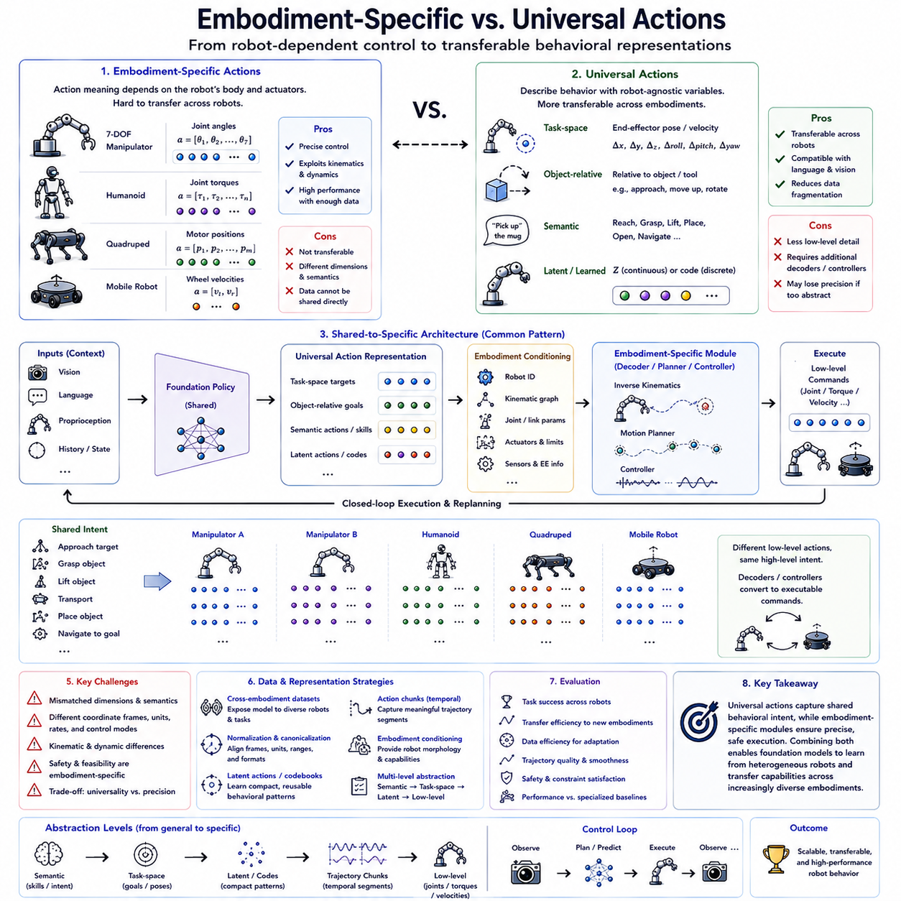{width="7.268055555555556in" height="7.268055555555556in"}

Embodiment-specific actions are control representations whose meaning depends directly on the physical structure of a particular robot. Joint angles, motor torques, wheel velocities, tendon commands, and actuator positions are examples because their dimensions and numerical meanings follow a robot's morphology, kinematics, and hardware. These representations provide precise control but make action knowledge difficult to share across different robotic platforms.

A seven-degree-of-freedom manipulator, a humanoid, a quadruped, and a differential-drive mobile robot expose fundamentally different actuator spaces. Even two manipulators designed for similar tasks may differ in joint count, axis orientation, workspace, gripper mechanism, control frequency, or joint limits. Consequently, an action vector learned for one embodiment generally cannot be executed directly by another embodiment without transformation.

Embodiment-specific representations have important advantages when control performance is the primary objective. Because the action interface matches the robot hardware closely, a policy can exploit detailed information about kinematics, dynamics, actuator capabilities, and mechanical constraints. Joint-space or torque-level policies can produce highly specialized behaviors that use the physical characteristics of a particular platform efficiently, especially when large amounts of embodiment-specific training data are available.

The disadvantage is limited transferability. A joint displacement that has a clear meaning for one robot may have no equivalent dimension on another. Differences in link lengths, joint topology, end effectors, locomotion mechanisms, and control modes further complicate correspondence. Large-scale robot foundation models therefore face a representation problem: heterogeneous demonstrations cannot simply be combined as though all action vectors belonged to one common physical space.

Universal action representations attempt to describe behavior using quantities whose meaning is less dependent on a specific robot body. Instead of commanding individual actuators, they may represent end-effector displacement, object-relative motion, body velocity, target pose, waypoint, contact objective, or semantic skill. The goal is not to make robot hardware identical, but to express behavioral intent through variables that can be interpreted across multiple embodiments.

Task-space actions provide a useful example. Two manipulators with different joint structures may both understand a command specifying that an end effector should move toward a target position. Their required joint trajectories can be completely different, yet the task-space objective remains similar. An embodiment-specific inverse kinematics module, motion planner, or controller can translate the shared target into commands appropriate for each robot.

Object-relative actions can provide an additional level of invariance. Rather than describing motion in a fixed robot or world coordinate frame, an action can specify movement relative to an object, handle, tool, surface, or interaction target. Commands such as approach the grasp point, move upward from the object, or rotate around a tool axis can preserve useful meaning across changes in robot configuration, scene location, and potentially embodiment.

Semantic actions move abstraction even further from raw control. Representations such as reach, grasp, lift, transport, place, open, or navigate describe intended behavior without specifying exactly how individual motors should move. Such abstractions are highly compatible with language-conditioned reasoning and task planning. However, semantic universality shifts complexity into lower layers that must convert each abstract decision into dynamically feasible physical motion.

Universal actions are therefore rarely universal at every level of the control stack. A shared representation may capture common behavioral intent, while execution ultimately requires embodiment-specific commands. The practical objective is often to identify the highest level of physical detail that can be shared without losing information necessary for reliable control. This produces architectures that combine universal representations with robot-specific adapters, decoders, planners, or controllers.

Embodiment conditioning provides another solution without forcing every robot into exactly the same action space. A generalist policy can receive information describing robot morphology, available degrees of freedom, kinematic structure, sensors, end effectors, or control interface. The model then interprets its observations and actions in relation to the current embodiment. Shared parameters capture common knowledge while conditioning signals identify how that knowledge should be instantiated physically.

Robot identifiers are a simple form of embodiment conditioning, but richer descriptions can provide greater generalization. Kinematic graphs, joint parameters, link geometry, actuator properties, camera configuration, and end-effector characteristics can explicitly describe the robot body. Such information may allow a model to reason about previously unseen or modified embodiments more systematically than a fixed identifier that merely associates each training robot with a separate category.

Latent action representations offer another path toward universality. Instead of manually defining a common physical action interface, an encoder can learn compact behavioral variables from heterogeneous demonstrations. A shared latent action may represent coordinated concepts such as approaching, repositioning, or manipulating, while embodiment-specific decoders reconstruct the appropriate low-level trajectories. This separates behavioral structure from the exact actuator commands used to realize it.

Learned action codebooks can similarly discover reusable patterns across robots when training data provide sufficient correspondence. Discrete codes may represent recurring task-space transitions or interaction patterns rather than specific joint movements. A foundation model can predict these shared codes as action tokens, while robot-specific decoding converts them into executable behavior. The usefulness of this approach depends strongly on whether the learned codes capture genuinely shared structure rather than morphology-specific details.

Action chunks can improve cross-embodiment representation because meaningful similarities often emerge over time rather than within a single control step. Two robots may use very different instantaneous motor commands while producing comparable short-term outcomes, such as approaching an object and establishing a grasp. Encoding these trajectory segments as latent chunks can emphasize behavioral effects and temporal structure instead of exact actuator correspondence.

Cross-embodiment datasets are essential for learning such common representations. If a model is trained only on one robot, its latent variables and action conventions can easily become specialized to that morphology. Training across manipulators, mobile platforms, grippers, and other embodiments exposes the model to variations in how similar objectives are physically realized. Shared tasks and interaction outcomes provide signals for identifying structure that persists across platforms.

Data heterogeneity nevertheless introduces substantial difficulties. Different robot datasets may use different coordinate frames, units, sampling frequencies, control modes, action ranges, gripper conventions, and trajectory formats. Before universal action learning becomes meaningful, these differences often require normalization and canonicalization. Otherwise, the model may interpret dataset-specific formatting differences as behavioral distinctions rather than recognizing equivalent physical intentions.

There is also a fundamental tradeoff between universality and control precision. Highly abstract actions transfer more easily across robots but contain less information about exact physical execution. Low-level actions provide detailed control but are tightly coupled to embodiment. Effective architectures therefore use multiple abstraction levels, allowing shared representations to capture transferable intent while specialized components preserve the precision required by each physical platform.

Hierarchical control naturally supports this separation. A foundation model may predict a universal semantic skill or task-space objective, an intermediate embodiment-aware policy may generate a trajectory or latent action chunk, and a low-level controller may produce actuator commands. Information becomes progressively more robot-specific as it moves down the hierarchy, creating a bridge from general reasoning to embodiment-dependent physical execution.

The distinction also matters for Vision-Language-Action models. Vision and language can describe concepts that generalize broadly across robots, while action outputs must eventually interact with specific hardware. A scalable VLA architecture therefore needs mechanisms for grounding shared semantic understanding into different bodies. Universal action representations, embodiment tokens, learned adapters, latent actions, and robot-specific decoders provide complementary approaches to solving this grounding problem.

Safety and feasibility remain embodiment-specific even when high-level actions are shared. The same target pose may be reachable for one manipulator and impossible for another, while identical navigation objectives may require different constraints for wheeled and legged robots. Robot-specific controllers must enforce joint limits, stability conditions, collision constraints, actuator capabilities, and workspace boundaries before shared action intentions become physical execution.

Evaluation should consequently measure both transfer and specialization. A universal representation should support task performance across multiple trained embodiments and ideally generalize to new configurations, while embodiment-specific decoding should retain sufficient precision and safety. Useful metrics include task success, transfer efficiency, adaptation data requirements, trajectory quality, reconstruction fidelity, robustness, and performance degradation relative to policies trained specifically for each robot.

Embodiment-specific and universal actions should therefore be viewed as complementary rather than mutually exclusive alternatives. Physical execution inevitably depends on a robot's body, but many goals, interaction patterns, and temporal behaviors can be represented at more transferable levels. The central design problem is deciding where in the action hierarchy shared representation should end and embodiment-specific interpretation should begin.

For robot foundation models, this boundary is crucial to scalable multi-robot intelligence. A useful architecture can learn common behavioral knowledge from heterogeneous experience, represent that knowledge through task-space, semantic, latent, or temporally abstract actions, and translate it through embodiment-aware components into precise control. This shared-to-specific pathway provides a foundation for transferring learned capabilities across increasingly diverse robotic bodies.

체화 특화 행동(Embodiment-Specific Action)은 특정 로봇의 물리적 구조에 따라 의미가 직접적으로 결정되는 제어 표현(Control Representation)이다. 관절 각도(Joint Angle), 모터 토크(Motor Torque), 휠 속도(Wheel Velocity), 텐던 명령(Tendon Command), 액추에이터 위치(Actuator Position)가 대표적인 예이며, 이들의 차원과 수치적 의미는 로봇의 형태(Morphology), 운동학(Kinematics), 하드웨어에 따라 결정된다. 이러한 표현은 정밀한 제어를 제공하지만 서로 다른 로봇 플랫폼 사이에서 행동 지식(Action Knowledge)을 공유하기 어렵게 만든다.

7자유도 매니퓰레이터(Seven-Degree-of-Freedom Manipulator), 휴머노이드(Humanoid), 4족 보행 로봇(Quadruped), 차동 구동 모바일 로봇(Differential-Drive Mobile Robot)은 근본적으로 서로 다른 액추에이터 공간(Actuator Space)을 가진다. 유사한 작업을 위해 설계된 두 매니퓰레이터조차 관절 수, 축 방향(Axis Orientation), 작업 공간(Workspace), 그리퍼 메커니즘(Gripper Mechanism), 제어 주파수(Control Frequency), 관절 한계(Joint Limit)가 다를 수 있다. 따라서 하나의 체화를 위해 학습된 행동 벡터(Action Vector)는 일반적으로 변환 과정 없이 다른 체화에서 직접 실행할 수 없다.

체화 특화 표현(Embodiment-Specific Representation)은 제어 성능(Control Performance)이 주요 목표일 때 중요한 장점을 가진다. 행동 인터페이스(Action Interface)가 로봇 하드웨어와 밀접하게 대응하기 때문에 정책(Policy)은 운동학, 동역학(Dynamics), 액추에이터 성능(Actuator Capability), 기계적 제약(Mechanical Constraint)에 관한 세부 정보를 활용할 수 있다. 특히 충분한 체화 특화 학습 데이터가 존재한다면 관절 공간(Joint-Space) 또는 토크 수준(Torque-Level) 정책은 특정 플랫폼의 물리적 특성을 효율적으로 활용하는 고도로 특화된 행동을 생성할 수 있다.

단점은 제한적인 전이 가능성(Transferability)이다. 하나의 로봇에서 명확한 의미를 갖는 관절 변위(Joint Displacement)가 다른 로봇에서는 이에 대응하는 차원 자체를 갖지 않을 수 있다. 링크 길이(Link Length), 관절 토폴로지(Joint Topology), 엔드이펙터(End Effector), 이동 메커니즘(Locomotion Mechanism), 제어 모드(Control Mode)의 차이는 이러한 대응 관계를 더욱 복잡하게 만든다. 따라서 대규모 로봇 파운데이션 모델(Robot Foundation Model)은 서로 다른 시연 데이터를 모두 하나의 공통 물리 공간(Common Physical Space)에 속하는 행동 벡터처럼 단순하게 결합할 수 없는 표현 문제에 직면한다.

범용 행동 표현(Universal Action Representation)은 특정 로봇 몸체에 대한 의존성이 상대적으로 낮은 물리량을 이용하여 행동을 기술하려는 접근법이다. 개별 액추에이터를 직접 명령하는 대신 엔드이펙터 변위(End-Effector Displacement), 객체 상대 움직임(Object-Relative Motion), 몸체 속도(Body Velocity), 목표 자세(Target Pose), 웨이포인트(Waypoint), 접촉 목표(Contact Objective), 의미적 기술(Semantic Skill)을 표현할 수 있다. 목표는 로봇 하드웨어를 동일하게 만드는 것이 아니라 여러 체화에서 해석할 수 있는 변수를 통해 행동 의도(Behavioral Intent)를 표현하는 것이다.

작업 공간 행동(Task-Space Action)은 유용한 예를 제공한다. 서로 다른 관절 구조를 가진 두 매니퓰레이터 모두 엔드이펙터를 목표 위치로 이동시키라는 명령을 이해할 수 있다. 필요한 관절 궤적(Joint Trajectory)은 완전히 다를 수 있지만 작업 공간의 목표는 유사하게 유지된다. 체화 특화 역기구학 모듈(Embodiment-Specific Inverse Kinematics Module), 모션 플래너(Motion Planner), 또는 제어기(Controller)가 이러한 공유 목표를 각 로봇에 적합한 명령으로 변환할 수 있다.

객체 상대 행동(Object-Relative Action)은 추가적인 수준의 불변성(Invariance)을 제공할 수 있다. 고정된 로봇 또는 세계 좌표계(World Coordinate Frame)에서 움직임을 표현하는 대신 물체, 손잡이, 도구, 표면, 상호작용 목표를 기준으로 움직임을 지정할 수 있다. 파지 지점(Grasp Point)에 접근하거나, 물체에서 위쪽으로 이동하거나, 도구 축(Tool Axis)을 중심으로 회전하는 것과 같은 명령은 로봇 구성, 장면 위치, 잠재적으로는 체화 자체가 달라지더라도 유용한 의미를 유지할 수 있다.

의미적 행동(Semantic Action)은 추상화 수준을 원시 제어(Raw Control)에서 더욱 멀리 확장한다. 도달하기(Reach), 잡기(Grasp), 들어 올리기(Lift), 운반하기(Transport), 놓기(Place), 열기(Open), 이동하기(Navigate)와 같은 표현은 개별 모터가 정확히 어떻게 움직여야 하는지를 지정하지 않고 의도된 행동을 기술한다. 이러한 추상화는 언어 조건부 추론(Language-Conditioned Reasoning)과 작업 계획(Task Planning)에 매우 적합하지만, 각각의 추상적 결정을 동역학적으로 실행 가능한 물리적 움직임으로 변환해야 하는 복잡성을 하위 계층으로 이동시킨다.

따라서 범용 행동이 제어 스택(Control Stack)의 모든 계층에서 완전히 범용적인 경우는 드물다. 공유 표현(Shared Representation)은 공통된 행동 의도를 포착할 수 있지만 실제 실행에는 궁극적으로 체화 특화 명령이 필요하다. 실용적인 목표는 안정적인 제어에 필요한 정보를 잃지 않으면서 공유할 수 있는 가장 높은 수준의 물리적 세부 표현을 찾는 것이다. 이는 범용 표현을 로봇별 어댑터(Robot-Specific Adapter), 디코더(Decoder), 플래너(Planner), 제어기와 결합하는 아키텍처로 이어진다.

체화 조건화(Embodiment Conditioning)는 모든 로봇을 정확히 동일한 행동 공간에 강제로 맞추지 않고도 문제를 해결하는 또 다른 방법이다. 범용 정책(Generalist Policy)은 로봇 형태, 사용 가능한 자유도(Degrees of Freedom), 운동학 구조(Kinematic Structure), 센서(Sensor), 엔드이펙터, 제어 인터페이스를 설명하는 정보를 입력받을 수 있다. 모델은 현재 체화와 관련하여 관측과 행동을 해석한다. 공유 파라미터(Shared Parameter)는 공통 지식을 포착하고 조건화 신호(Conditioning Signal)는 해당 지식이 물리적으로 어떻게 구현되어야 하는지를 지정한다.

로봇 식별자(Robot Identifier)는 간단한 형태의 체화 조건화이지만, 보다 풍부한 설명은 더 높은 일반화(Generalization)를 제공할 수 있다. 운동학 그래프(Kinematic Graph), 관절 파라미터(Joint Parameter), 링크 기하(Link Geometry), 액추에이터 특성, 카메라 구성(Camera Configuration), 엔드이펙터 특성을 이용하여 로봇 몸체를 명시적으로 기술할 수 있다. 이러한 정보는 각 학습 로봇을 단순한 별도의 범주와 연결하는 고정 식별자보다 이전에 보지 못했거나 변경된 체화를 모델이 더욱 체계적으로 추론할 수 있도록 한다.

잠재 행동 표현(Latent Action Representation)은 범용성을 향한 또 다른 경로를 제공한다. 공통된 물리적 행동 인터페이스를 사람이 직접 정의하는 대신 인코더(Encoder)가 이질적인 시연 데이터(Heterogeneous Demonstration)로부터 압축된 행동 변수를 학습할 수 있다. 공유 잠재 행동(Shared Latent Action)은 접근, 위치 변경, 조작과 같은 협응된 개념을 표현하고, 체화 특화 디코더(Embodiment-Specific Decoder)는 적절한 저수준 궤적을 복원할 수 있다. 이를 통해 행동 구조를 실제 행동을 구현하는 구체적인 액추에이터 명령으로부터 분리할 수 있다.

학습된 행동 코드북(Learned Action Codebook)도 학습 데이터가 충분한 대응 관계를 제공한다면 로봇 사이에서 재사용 가능한 패턴을 발견할 수 있다. 이산 코드(Discrete Code)는 특정 관절 움직임이 아니라 반복적인 작업 공간 전이(Task-Space Transition) 또는 상호작용 패턴(Interaction Pattern)을 표현할 수 있다. 파운데이션 모델은 이러한 공유 코드를 행동 토큰(Action Token)으로 예측하고, 로봇별 디코딩을 통해 실행 가능한 행동으로 변환할 수 있다. 이러한 접근법의 유용성은 학습된 코드가 형태 특화 세부 정보가 아니라 실제로 공유 가능한 구조를 포착하는지에 크게 의존한다.

행동 청크(Action Chunk)는 의미 있는 유사성이 하나의 제어 단계가 아니라 시간에 걸쳐 나타나는 경우가 많기 때문에 교차 체화 표현(Cross-Embodiment Representation)을 향상시킬 수 있다. 두 로봇은 순간적으로 매우 다른 모터 명령을 사용하면서도 물체에 접근하고 파지를 형성하는 것처럼 유사한 단기 결과를 만들 수 있다. 이러한 궤적 구간을 잠재 청크(Latent Chunk)로 인코딩하면 정확한 액추에이터 대응보다 행동 효과(Behavioral Effect)와 시간적 구조(Temporal Structure)를 강조할 수 있다.

교차 체화 데이터셋(Cross-Embodiment Dataset)은 이러한 공통 표현을 학습하는 데 필수적이다. 하나의 로봇만으로 모델을 학습하면 잠재 변수와 행동 규약(Action Convention)이 해당 형태에 쉽게 특화될 수 있다. 매니퓰레이터, 모바일 플랫폼(Mobile Platform), 그리퍼, 기타 다양한 체화에서 학습하면 유사한 목표가 물리적으로 서로 다르게 구현되는 변화를 모델이 경험하게 된다. 공유 작업(Shared Task)과 상호작용 결과(Interaction Outcome)는 플랫폼 전반에 지속적으로 존재하는 구조를 식별하기 위한 신호를 제공한다.

그러나 데이터 이질성(Data Heterogeneity)은 상당한 어려움을 발생시킨다. 서로 다른 로봇 데이터셋은 좌표계(Coordinate Frame), 단위(Unit), 샘플링 주파수(Sampling Frequency), 제어 모드, 행동 범위(Action Range), 그리퍼 규약(Gripper Convention), 궤적 형식(Trajectory Format)이 서로 다를 수 있다. 범용 행동 학습이 의미를 가지려면 이러한 차이를 먼저 정규화(Normalization)하고 표준화(Canonicalization)해야 하는 경우가 많다. 그렇지 않으면 모델이 동일한 물리적 의도를 인식하는 대신 데이터셋 형식의 차이를 서로 다른 행동으로 해석할 수 있다.

범용성(Universality)과 제어 정밀도(Control Precision) 사이에는 근본적인 절충관계(Tradeoff)도 존재한다. 고도로 추상화된 행동은 로봇 사이에서 쉽게 전이되지만 정확한 물리적 실행에 관한 정보는 적다. 저수준 행동은 세밀한 제어 정보를 제공하지만 체화와 강하게 결합된다. 따라서 효과적인 아키텍처는 여러 추상화 수준을 사용하여 공유 표현이 전이 가능한 의도를 포착하고 특화된 구성 요소가 각각의 물리적 플랫폼에 필요한 정밀도를 유지하도록 한다.

계층적 제어(Hierarchical Control)는 이러한 분리를 자연스럽게 지원한다. 파운데이션 모델이 범용적인 의미적 기술이나 작업 공간 목표를 예측하면, 중간 수준의 체화 인식 정책(Embodiment-Aware Policy)이 궤적 또는 잠재 행동 청크를 생성하고, 저수준 제어기(Low-Level Controller)가 액추에이터 명령을 생성할 수 있다. 정보는 계층을 따라 아래로 이동하면서 점차 로봇 특화 형태로 변화하며, 일반적인 추론(General Reasoning)과 체화 의존적 물리 실행을 연결한다.

이러한 구분은 비전-언어-행동 모델(Vision-Language-Action Model)에서도 중요하다. 비전(Vision)과 언어(Language)는 다양한 로봇에 걸쳐 폭넓게 일반화되는 개념을 기술할 수 있지만 행동 출력(Action Output)은 궁극적으로 특정 하드웨어와 상호작용해야 한다. 따라서 확장 가능한 VLA 아키텍처는 공유된 의미 이해(Shared Semantic Understanding)를 서로 다른 몸체에 그라운딩(Grounding)할 수 있는 메커니즘이 필요하다. 범용 행동 표현, 체화 토큰(Embodiment Token), 학습된 어댑터(Learned Adapter), 잠재 행동, 로봇별 디코더는 이러한 문제를 해결하기 위한 상호 보완적인 접근법을 제공한다.

고수준 행동이 공유되더라도 안전성(Safety)과 실행 가능성(Feasibility)은 여전히 체화 특화적이다. 동일한 목표 자세가 하나의 매니퓰레이터에서는 도달 가능하지만 다른 로봇에서는 불가능할 수 있으며, 동일한 내비게이션 목표도 바퀴형 로봇과 보행 로봇에서 서로 다른 제약을 요구할 수 있다. 공유된 행동 의도가 실제 물리적 실행으로 변환되기 전에 로봇별 제어기가 관절 한계, 안정성 조건(Stability Condition), 충돌 제약(Collision Constraint), 액추에이터 성능, 작업 공간 경계를 적용해야 한다.

따라서 평가는 전이(Transfer)와 특화(Specialization)를 모두 측정해야 한다. 범용 표현은 여러 학습된 체화에서 작업 성능을 지원하고 가능하다면 새로운 구성으로 일반화할 수 있어야 하며, 체화 특화 디코딩은 충분한 정밀도와 안전성을 유지해야 한다. 유용한 평가 지표에는 작업 성공률(Task Success), 전이 효율성(Transfer Efficiency), 적응에 필요한 데이터량(Adaptation Data Requirement), 궤적 품질(Trajectory Quality), 복원 충실도(Reconstruction Fidelity), 강건성(Robustness), 개별 로봇 전용으로 학습된 정책 대비 성능 저하(Performance Degradation)가 포함된다.

따라서 체화 특화 행동과 범용 행동은 서로 배타적인 대안이 아니라 상호 보완적인 개념으로 이해해야 한다. 물리적 실행은 필연적으로 로봇의 몸체에 의존하지만 많은 목표, 상호작용 패턴, 시간적 행동은 보다 전이 가능한 수준에서 표현할 수 있다. 핵심적인 설계 문제는 행동 계층(Action Hierarchy)의 어느 지점까지 공유 표현을 사용하고, 어느 지점부터 체화 특화 해석(Embodiment-Specific Interpretation)을 적용할 것인지를 결정하는 것이다.

로봇 파운데이션 모델에서 이러한 경계는 확장 가능한 다중 로봇 지능(Scalable Multi-Robot Intelligence)을 구현하는 데 매우 중요하다. 효과적인 아키텍처는 이질적인 경험으로부터 공통 행동 지식(Common Behavioral Knowledge)을 학습하고, 이를 작업 공간, 의미적, 잠재적 또는 시간적으로 추상화된 행동으로 표현한 뒤 체화 인식 구성 요소(Embodiment-Aware Component)를 통해 정밀한 제어로 변환할 수 있다. 이러한 공유 표현에서 특화 실행으로 이어지는 경로(Shared-to-Specific Pathway)는 점점 더 다양한 로봇 몸체 사이에서 학습된 능력을 전이하기 위한 기반을 제공한다.

## 05.10. Action Tokenization Tradeoffs

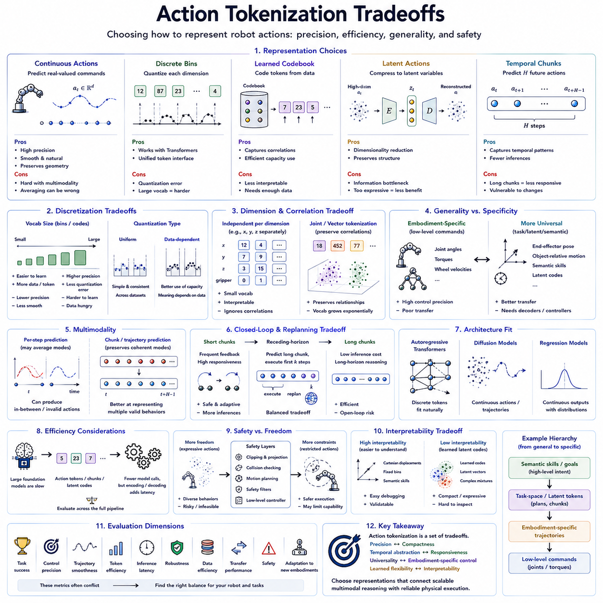{width="7.268055555555556in" height="7.268055555555556in"}

Action tokenization determines how continuous or structured robot behavior is converted into representations that a learning model can predict. No single representation is optimal for every robot, task, dataset, and control architecture. Continuous outputs, discrete bins, learned codebooks, latent actions, and temporal chunks each preserve different properties of behavior while introducing different compromises in precision, efficiency, scalability, and generalization.

Continuous action representations preserve the numerical resolution of robot commands and maintain the natural geometry of physical control spaces. Nearby outputs generally correspond to nearby motions, which supports smooth trajectory generation and precise corrections. However, continuous prediction can be difficult when demonstrations contain multiple valid behaviors because conventional regression may average incompatible alternatives and produce physically undesirable intermediate actions.

Discrete tokenization transforms continuous commands into categorical symbols that can be predicted using architectures originally developed for language modeling. This creates a unified sequence-modeling interface in which vision, language, state, and actions can all participate in token-based prediction. The major cost is quantization error because a finite vocabulary cannot exactly preserve every possible continuous command, particularly when high control precision is required.

The number of discrete bins illustrates a fundamental tradeoff between precision and learnability. A larger vocabulary provides finer action resolution and reduces reconstruction error, but each token may receive fewer training examples and the prediction problem becomes more difficult. A smaller vocabulary improves statistical efficiency and simplifies classification, yet different physical commands must share the same token, potentially reducing control accuracy and smoothness.

Uniform and data-dependent quantization introduce another tradeoff. Uniform bins have simple and predictable numerical meanings, making encoding and decoding straightforward across datasets. Data-dependent bins allocate more resolution to frequently observed regions and can use vocabulary capacity more efficiently. However, their physical meaning depends on training statistics, which can complicate interpretation, dataset combination, and transfer to robots with different action distributions.

Independent tokenization of each action dimension keeps vocabulary size manageable and provides transparent mappings between tokens and physical variables. Its limitation is that it treats coordinated dimensions separately even when robot motion depends strongly on their relationships. Joint tokenization can preserve correlations among translations, rotations, joints, and gripper states, but the number of possible combinations can grow rapidly as action dimensionality increases.

Learned action codebooks address this problem by discovering recurring multidimensional action patterns from data. They can represent coordinated behavior more efficiently than manually constructed scalar bins and adapt representational capacity to the actual distribution of demonstrations. The tradeoff is reduced interpretability: a learned code may represent a complex combination of movements whose physical meaning is less obvious than a predefined displacement or joint command.

Latent action representations extend this flexibility by compressing actions into learned hidden variables. They can reduce dimensionality, preserve correlations, and expose behavioral structure that is difficult to specify manually. Yet compression creates an information bottleneck. If the latent representation is too restrictive, details necessary for precise execution may disappear; if it is too expressive, the representation may provide little simplification over the original action space.

Continuous and discrete latent spaces also offer different benefits. Continuous latent variables preserve smooth relationships and permit interpolation between behaviors, but they do not naturally provide the finite vocabulary used by token-generating language models. Discrete latent variables integrate easily with Transformer-style prediction and can represent multimodal alternatives, but quantization and codebook utilization become additional optimization problems that must be managed during training.

Action chunks introduce a tradeoff between temporal abstraction and responsiveness. Predicting several future actions together captures temporal correlations, reduces effective sequence length, and decreases the number of expensive policy inferences. Longer chunks can represent coherent motion patterns efficiently, but they become vulnerable to environmental changes because future commands are predicted before later observations become available.

Short chunks preserve stronger closed-loop feedback because the policy frequently observes the consequences of its actions and replans. Their disadvantage is increased inference frequency and longer decision sequences. Long chunks reduce computational load and support longer-horizon temporal reasoning, but they increase open-loop risk. Receding-horizon execution provides a compromise by predicting longer chunks while executing only a limited prefix before replanning.

Temporal compression can also affect multimodality. Representing an entire trajectory segment allows the model to preserve coherent alternatives such as approaching an object from different directions. This can be superior to independently predicting individual timesteps that may average conflicting behaviors. However, modeling complete trajectory distributions requires greater representational capacity and may increase training and inference complexity, particularly for long or high-dimensional chunks.

Action tokenization must also balance generality against embodiment specificity. Raw joint or actuator commands preserve detailed information for one robot but transfer poorly to another morphology. Task-space actions, latent codes, and semantic representations can provide greater commonality across embodiments, yet they require robot-specific decoders or controllers to recover executable commands. Greater universality therefore usually shifts complexity rather than eliminating it.

A universal representation that is too abstract may lose information required for accurate physical interaction. Conversely, an action representation closely tied to actuator dynamics may achieve excellent performance on one platform while preventing effective cross-robot learning. Practical robot foundation models therefore often benefit from layered representations in which shared action abstractions are progressively converted into embodiment-specific trajectories and low-level commands.

Dataset scale influences these design choices. Large discrete vocabularies and expressive learned codebooks require sufficient examples to populate their representational space. With limited data, simpler continuous outputs or coarse quantization may generalize more reliably. As heterogeneous robot datasets grow, richer tokenization methods become increasingly attractive because they can discover recurring behavioral structure that would be difficult to specify manually.

Model architecture creates another constraint. Autoregressive Transformers naturally predict discrete sequences, making action tokens attractive when integrating robot control with language-model architectures. Continuous prediction may require specialized output heads or probability distributions, while diffusion models naturally support high-dimensional continuous action trajectories. Tokenization should therefore be selected together with the learning architecture rather than treated as an independent preprocessing decision.

Inference efficiency is especially important for physical robots. Large foundation models may not operate at the high frequencies required by servo control. Discrete latent actions and action chunks can reduce the number of model evaluations by representing more behavior with fewer predictions. However, additional encoding, decoding, diffusion sampling, or planning stages can introduce their own latency, so computational efficiency must be evaluated across the complete execution pipeline.

Representation quality must ultimately be judged by task performance rather than compression alone. Low reconstruction error does not guarantee successful manipulation, and high token prediction accuracy does not necessarily imply safe physical behavior. Small numerical errors can be irrelevant when feedback rapidly corrects them, while seemingly minor errors near contact, collision boundaries, or grasp transitions can cause complete task failure.

Safety creates an additional tradeoff between model freedom and constrained execution. Highly expressive action representations allow policies to generate diverse behavior but can also produce commands outside feasible or safe regions. Clipping, projection, collision checking, motion planning, safety filters, and low-level controllers restrict this freedom. Strong constraints improve execution reliability but may prevent the learned policy from expressing useful behaviors not anticipated by the safety layer.

Interpretability is another important consideration. Fixed bins, Cartesian displacements, and semantic skills provide relatively understandable action meanings, simplifying debugging and system validation. Learned latent codes can offer greater compression and behavioral expressiveness but may be difficult to inspect. For safety-critical or engineering-intensive applications, the ability to trace a predicted representation back to understandable physical behavior can be as important as raw model performance.

The optimal action representation can therefore vary across levels of a control hierarchy. A high-level model may operate with semantic skills or discrete latent tokens, an intermediate policy may predict Cartesian trajectories or action chunks, and a low-level controller may execute continuous joint positions, velocities, or torques. Hybrid architectures exploit the strengths of multiple representations instead of requiring one tokenization strategy to solve every level of control.

Evaluation should compare representations across several dimensions simultaneously, including task success, control precision, trajectory smoothness, token efficiency, inference latency, robustness, data efficiency, transfer performance, safety, and adaptation to new embodiments. These criteria frequently conflict, so optimizing only one metric can produce misleading conclusions. The best representation is the one whose compromises match the operational requirements of the robot system.

Action tokenization is therefore fundamentally a representation tradeoff rather than a simple conversion problem. Precision competes with vocabulary compactness, temporal abstraction competes with feedback responsiveness, universality competes with embodiment-specific control, and learned flexibility competes with interpretability. Understanding these tensions allows robot foundation models and VLA systems to choose representations that connect scalable multimodal reasoning with reliable physical execution.

행동 토큰화(Action Tokenization)는 연속적이거나 구조화된 로봇 행동을 학습 모델이 예측할 수 있는 표현으로 변환하는 방식을 결정한다. 모든 로봇, 작업, 데이터셋, 제어 아키텍처(Control Architecture)에 최적인 단일 표현 방식은 존재하지 않는다. 연속 출력(Continuous Output), 이산 빈(Discrete Bin), 학습된 코드북(Learned Codebook), 잠재 행동(Latent Action), 시간적 청크(Temporal Chunk)는 각각 행동의 서로 다른 특성을 보존하면서 정밀도, 효율성, 확장성(Scalability), 일반화(Generalization) 측면에서 서로 다른 절충관계를 만든다.

연속 행동 표현(Continuous Action Representation)은 로봇 명령의 수치 해상도(Numerical Resolution)를 보존하고 물리적 제어 공간의 자연스러운 기하학적 구조(Geometry)를 유지한다. 서로 가까운 출력값은 일반적으로 유사한 움직임에 대응하므로 부드러운 궤적 생성(Smooth Trajectory Generation)과 정밀한 보정을 지원한다. 그러나 시연 데이터에 여러 개의 유효한 행동이 존재하면 연속 예측이 어려워질 수 있으며, 기존 회귀(Regression)는 서로 호환되지 않는 대안을 평균화하여 물리적으로 바람직하지 않은 중간 행동을 생성할 수 있다.

이산 토큰화(Discrete Tokenization)는 연속 명령을 언어 모델링(Language Modeling)을 위해 개발된 아키텍처에서 예측할 수 있는 범주형 심볼(Categorical Symbol)로 변환한다. 이를 통해 비전(Vision), 언어(Language), 상태(State), 행동(Action)을 모두 토큰 기반 예측(Token-Based Prediction)에 포함할 수 있는 통합된 시퀀스 모델링 인터페이스(Sequence-Modeling Interface)가 만들어진다. 주요 대가는 양자화 오차(Quantization Error)이며, 특히 높은 제어 정밀도가 필요한 경우 유한한 어휘집(Vocabulary)으로 가능한 모든 연속 명령을 정확하게 보존할 수 없다.

이산 빈의 개수(Number of Discrete Bins)는 정밀도와 학습 가능성(Learnability) 사이의 근본적인 절충관계를 보여준다. 더 큰 어휘집은 더 세밀한 행동 해상도를 제공하고 복원 오차(Reconstruction Error)를 감소시키지만, 각각의 토큰이 학습 과정에서 접하는 예제 수가 줄어들고 예측 문제가 더 어려워질 수 있다. 작은 어휘집은 통계적 효율성(Statistical Efficiency)을 높이고 분류를 단순화하지만, 서로 다른 물리적 명령이 동일한 토큰을 공유해야 하므로 제어 정확도와 부드러움이 감소할 수 있다.

균일 양자화(Uniform Quantization)와 데이터 의존적 양자화(Data-Dependent Quantization)도 또 다른 절충관계를 만든다. 균일 빈(Uniform Bin)은 단순하고 예측 가능한 수치적 의미를 가지므로 여러 데이터셋에서 인코딩과 디코딩이 용이하다. 데이터 의존적 빈은 자주 관측되는 영역에 더 높은 해상도를 할당하여 어휘집 용량을 효율적으로 사용할 수 있다. 그러나 물리적 의미가 학습 데이터의 통계에 의존하기 때문에 해석, 데이터셋 결합, 서로 다른 행동 분포를 가진 로봇으로의 전이(Transfer)가 복잡해질 수 있다.

각 행동 차원의 독립적인 토큰화(Independent Tokenization)는 어휘집 크기를 관리 가능한 수준으로 유지하고 토큰과 물리 변수 사이에 투명한 매핑을 제공한다. 그러나 로봇 움직임이 여러 차원의 관계에 강하게 의존하더라도 협응된 차원을 개별적으로 처리한다는 한계가 있다. 공동 토큰화(Joint Tokenization)는 병진, 회전, 관절, 그리퍼 상태 사이의 상관관계를 보존할 수 있지만 행동 차원이 증가함에 따라 가능한 조합의 수가 빠르게 증가할 수 있다.

학습된 행동 코드북은 데이터에서 반복적으로 나타나는 다차원 행동 패턴(Multidimensional Action Pattern)을 발견함으로써 이러한 문제를 해결한다. 사람이 설계한 스칼라 빈(Scalar Bin)보다 협응된 행동을 효율적으로 표현할 수 있으며, 실제 시연 데이터의 분포에 맞추어 표현 용량(Representational Capacity)을 조정할 수 있다. 반면 해석 가능성(Interpretability)은 감소한다. 학습된 하나의 코드는 미리 정의된 변위나 관절 명령보다 물리적 의미를 이해하기 어려운 복잡한 움직임 조합을 나타낼 수 있다.

잠재 행동 표현(Latent Action Representation)은 행동을 학습된 숨겨진 변수(Hidden Variable)로 압축하여 이러한 유연성을 더욱 확장한다. 행동 차원을 줄이고 상관관계를 보존하며 사람이 직접 정의하기 어려운 행동 구조를 드러낼 수 있다. 그러나 압축은 정보 병목(Information Bottleneck)을 만든다. 잠재 표현이 지나치게 제한적이면 정밀한 실행에 필요한 세부 정보가 사라질 수 있으며, 지나치게 표현력이 높으면 원래 행동 공간에 비해 단순화 효과가 거의 없을 수 있다.

연속 잠재 공간(Continuous Latent Space)과 이산 잠재 공간(Discrete Latent Space) 역시 서로 다른 장점을 제공한다. 연속 잠재 변수는 부드러운 관계를 보존하고 행동 사이의 보간(Interpolation)을 가능하게 하지만 토큰 생성형 언어 모델이 사용하는 유한 어휘집을 자연스럽게 제공하지 않는다. 이산 잠재 변수는 트랜스포머(Transformer) 방식의 예측과 쉽게 통합되고 다중 모드 대안(Multimodal Alternative)을 표현할 수 있지만, 양자화와 코드북 활용도(Codebook Utilization)가 학습 과정에서 추가적으로 관리해야 할 최적화 문제가 된다.

행동 청크(Action Chunk)는 시간적 추상화(Temporal Abstraction)와 반응성(Responsiveness) 사이의 절충관계를 만든다. 여러 미래 행동을 함께 예측하면 시간적 상관관계를 포착하고 실질적인 시퀀스 길이를 줄이며 계산 비용이 높은 정책 추론 횟수를 감소시킬 수 있다. 긴 청크는 일관된 움직임 패턴을 효율적으로 표현할 수 있지만 이후의 관측이 제공되기 전에 미래 명령을 예측하기 때문에 환경 변화에 더욱 취약해진다.

짧은 청크는 정책이 행동의 결과를 자주 관측하고 재계획(Replanning)하기 때문에 더 강한 폐루프 피드백(Closed-Loop Feedback)을 유지한다. 반면 추론 빈도가 증가하고 의사결정 시퀀스가 길어진다. 긴 청크는 계산 부하를 줄이고 장기적인 시간 추론(Long-Horizon Temporal Reasoning)을 지원하지만 개루프 위험(Open-Loop Risk)을 증가시킨다. 이동 지평 실행(Receding-Horizon Execution)은 긴 청크를 예측하면서 재계획 전에 제한된 앞부분만 실행하여 두 접근법 사이의 절충점을 제공한다.

시간적 압축(Temporal Compression)은 다중 모드성(Multimodality)에도 영향을 줄 수 있다. 전체 궤적 구간을 표현하면 서로 다른 방향에서 물체에 접근하는 것과 같은 일관된 행동 대안을 보존할 수 있다. 이는 서로 충돌하는 행동을 평균화할 수 있는 개별 시간 단계의 독립적 예측보다 효과적일 수 있다. 그러나 완전한 궤적 분포(Trajectory Distribution)를 모델링하려면 더 큰 표현 용량이 필요하며, 특히 길거나 고차원적인 청크에서는 학습과 추론 복잡성이 증가할 수 있다.

행동 토큰화는 범용성(Generality)과 체화 특화성(Embodiment Specificity) 사이에서도 균형을 맞춰야 한다. 원시 관절 또는 액추에이터 명령은 하나의 로봇에 대한 세부 정보를 보존하지만 다른 형태(Morphology)의 로봇으로 전이하기 어렵다. 작업 공간 행동(Task-Space Action), 잠재 코드(Latent Code), 의미적 표현(Semantic Representation)은 체화 사이의 공통성을 높일 수 있지만 실행 가능한 명령을 복원하려면 로봇 특화 디코더(Robot-Specific Decoder)나 제어기가 필요하다. 따라서 높은 범용성은 일반적으로 복잡성을 제거하는 것이 아니라 다른 계층으로 이동시킨다.

지나치게 추상적인 범용 표현(Universal Representation)은 정확한 물리적 상호작용에 필요한 정보를 잃을 수 있다. 반대로 액추에이터 동역학(Actuator Dynamics)에 밀접하게 연결된 행동 표현은 하나의 플랫폼에서는 뛰어난 성능을 달성하면서도 효과적인 교차 로봇 학습(Cross-Robot Learning)을 방해할 수 있다. 따라서 실제 로봇 파운데이션 모델(Robot Foundation Model)은 공유 행동 추상화(Shared Action Abstraction)가 점진적으로 체화 특화 궤적과 저수준 명령으로 변환되는 계층적 표현(Layered Representation)을 활용하는 것이 유리하다.

데이터셋 규모(Dataset Scale)는 이러한 설계 선택에 영향을 준다. 큰 이산 어휘집과 표현력이 높은 학습 코드북은 표현 공간을 충분히 채울 수 있는 많은 학습 예제를 필요로 한다. 데이터가 제한적이라면 단순한 연속 출력이나 거친 양자화(Coarse Quantization)가 더 안정적으로 일반화될 수 있다. 이질적인 로봇 데이터셋이 증가하면 사람이 직접 지정하기 어려운 반복적인 행동 구조를 발견할 수 있기 때문에 보다 풍부한 토큰화 방식이 점차 매력적인 선택이 된다.

모델 아키텍처(Model Architecture)도 또 다른 제약을 만든다. 자기회귀 트랜스포머(Autoregressive Transformer)는 본질적으로 이산 시퀀스를 예측하는 데 적합하기 때문에 로봇 제어를 언어 모델 아키텍처와 통합할 때 행동 토큰이 유리하다. 연속 예측에는 특수한 출력 헤드(Output Head)나 확률 분포(Probability Distribution)가 필요할 수 있으며, 확산 모델(Diffusion Model)은 고차원 연속 행동 궤적을 자연스럽게 지원한다. 따라서 토큰화는 독립적인 전처리 결정으로 취급하기보다 학습 아키텍처와 함께 선택해야 한다.

추론 효율성(Inference Efficiency)은 물리 로봇에서 특히 중요하다. 대규모 파운데이션 모델은 서보 제어(Servo Control)에 필요한 높은 주파수로 작동하지 못할 수 있다. 이산 잠재 행동과 행동 청크는 더 적은 예측으로 더 많은 행동을 표현하여 모델 평가 횟수를 줄일 수 있다. 그러나 추가적인 인코딩, 디코딩, 확산 샘플링(Diffusion Sampling), 계획 단계가 자체적인 지연시간(Latency)을 발생시킬 수 있으므로 전체 실행 파이프라인을 기준으로 계산 효율성을 평가해야 한다.

표현 품질(Representation Quality)은 궁극적으로 압축 성능 자체가 아니라 작업 성능(Task Performance)을 기준으로 평가해야 한다. 낮은 복원 오차가 성공적인 조작을 보장하는 것은 아니며 높은 토큰 예측 정확도(Token Prediction Accuracy)가 반드시 안전한 물리적 행동을 의미하지도 않는다. 피드백이 빠르게 오차를 수정할 수 있는 경우 작은 수치 오차는 중요하지 않을 수 있지만, 접촉(Contact), 충돌 경계(Collision Boundary), 파지 전환(Grasp Transition) 근처에서 발생하는 작은 오차는 전체 작업 실패로 이어질 수 있다.

안전성(Safety)은 모델의 자유도(Model Freedom)와 제약된 실행(Constrained Execution) 사이에 추가적인 절충관계를 만든다. 표현력이 높은 행동 표현은 정책이 다양한 행동을 생성할 수 있도록 하지만 실행 가능하거나 안전한 영역을 벗어나는 명령도 생성할 수 있다. 클리핑(Clipping), 투영(Projection), 충돌 검사(Collision Checking), 모션 플래닝(Motion Planning), 안전 필터(Safety Filter), 저수준 제어기는 이러한 자유도를 제한한다. 강한 제약은 실행 신뢰성을 향상시키지만 안전 계층에서 예상하지 못한 유용한 행동을 학습 정책이 표현하지 못하게 할 수도 있다.

해석 가능성 역시 중요한 고려사항이다. 고정 빈(Fixed Bin), 데카르트 변위(Cartesian Displacement), 의미적 기술(Semantic Skill)은 비교적 이해하기 쉬운 행동 의미를 제공하여 디버깅(Debugging)과 시스템 검증(System Validation)을 단순화한다. 학습된 잠재 코드는 더 높은 압축성과 행동 표현력을 제공할 수 있지만 직접적으로 분석하기 어려울 수 있다. 안전 중요 시스템(Safety-Critical System)이나 공학적 검증이 중요한 응용에서는 예측된 표현을 이해 가능한 물리적 행동으로 추적할 수 있는 능력이 순수한 모델 성능만큼 중요할 수 있다.

따라서 최적의 행동 표현은 제어 계층(Control Hierarchy)의 수준에 따라 달라질 수 있다. 고수준 모델은 의미적 기술 또는 이산 잠재 토큰(Discrete Latent Token)을 사용하고, 중간 수준 정책은 데카르트 궤적(Cartesian Trajectory)이나 행동 청크를 예측하며, 저수준 제어기는 연속적인 관절 위치, 속도 또는 토크를 실행할 수 있다. 하이브리드 아키텍처(Hybrid Architecture)는 하나의 토큰화 전략으로 모든 제어 계층을 해결하려 하기보다 여러 표현 방식의 장점을 함께 활용한다.

평가(Evaluation)는 작업 성공률(Task Success), 제어 정밀도(Control Precision), 궤적 부드러움(Trajectory Smoothness), 토큰 효율성(Token Efficiency), 추론 지연시간(Inference Latency), 강건성(Robustness), 데이터 효율성(Data Efficiency), 전이 성능(Transfer Performance), 안전성, 새로운 체화에 대한 적응성(Adaptation)을 포함한 여러 차원을 동시에 비교해야 한다. 이러한 기준들은 서로 충돌하는 경우가 많으므로 하나의 지표만 최적화하면 잘못된 결론에 도달할 수 있다. 가장 적절한 표현은 로봇 시스템의 실제 운용 요구사항에 부합하는 절충관계를 제공하는 표현이다.

따라서 행동 토큰화는 단순한 변환 문제가 아니라 근본적인 표현 절충 문제(Representation Tradeoff)이다. 정밀도는 어휘집의 압축성(Vocabulary Compactness)과 경쟁하고, 시간적 추상화는 피드백 반응성과 경쟁하며, 범용성은 체화 특화 제어와 경쟁하고, 학습된 유연성(Learned Flexibility)은 해석 가능성과 경쟁한다. 이러한 긴장 관계를 이해하면 로봇 파운데이션 모델과 비전-언어-행동 시스템(Vision-Language-Action System)이 확장 가능한 멀티모달 추론(Multimodal Reasoning)과 신뢰할 수 있는 물리적 실행을 연결하는 적절한 표현을 선택할 수 있다.

## 05.11. Action Tokenizer [w/Code]

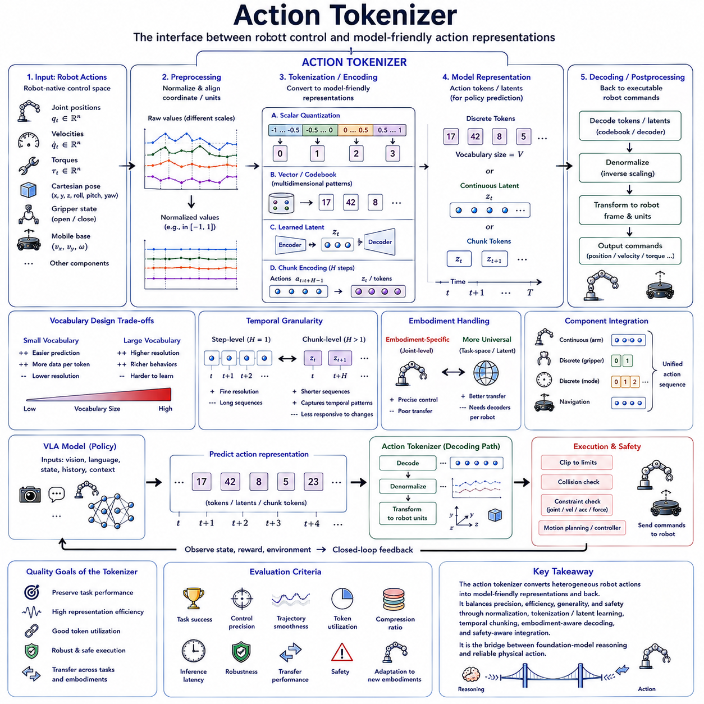{width="7.268055555555556in" height="7.268055555555556in"}

An action tokenizer is the interface that converts robot behavior between physical control representations and model-compatible action symbols. It determines how continuous commands, multidimensional trajectories, or latent behaviors are encoded before learning and how predicted representations are decoded during execution. In VLA systems, this interface connects multimodal reasoning with the numerical commands required by a physical robot.

The tokenizer receives actions expressed in a robot's native control space. These inputs may include joint positions, velocities, torques, Cartesian translations and rotations, gripper states, mobile-base velocities, or combinations of these variables. Because different robots expose different control interfaces, the tokenizer must understand the dimensionality, numerical range, coordinate convention, temporal frequency, and semantics of the incoming action data.

A preprocessing stage commonly normalizes raw actions before tokenization. Physical variables measured in meters, radians, velocities, or actuator-specific units can have substantially different scales. Normalization maps them into standardized numerical ranges so that no dimension dominates simply because of its unit or magnitude. The transformation parameters must be preserved because decoding requires the inverse mapping back into physical robot units.

The simplest tokenizer can apply scalar quantization independently to each action dimension. Each normalized value is assigned to one of several predefined bins, and the corresponding bin index becomes a discrete token. This creates a deterministic mapping from continuous commands to a finite vocabulary. During execution, predicted token indices are converted to representative bin values and then denormalized into executable physical commands.

Uniform binning provides equally spaced intervals and therefore simple, interpretable mappings. Data-dependent binning instead places boundaries according to the observed action distribution, providing greater resolution where demonstrations are concentrated. The tokenizer design determines whether simplicity and consistent physical interpretation are prioritized or whether vocabulary capacity is adapted to the statistical structure of the training data.

More advanced tokenizers operate on multidimensional actions rather than independent scalar values. A translation, rotation, and gripper command can be treated as a coordinated vector whose components are statistically related. Vector quantization or learned codebooks can assign the entire pattern to a discrete code. This reduces the need to predict each dimension separately and allows individual tokens to represent recurring combinations of robot motion.

A learned action tokenizer typically contains an encoder, a quantization or latent representation mechanism, and a decoder. The encoder transforms raw actions into a compact latent space, where behaviorally similar patterns can become nearby representations. The quantization stage may select a codebook entry, while the decoder reconstructs continuous robot commands. These components can be optimized jointly using large collections of robot demonstrations.

The action tokenizer can operate on individual control steps or complete action chunks. Step-level tokenization preserves fine temporal resolution but produces long token sequences for extended tasks. Chunk-level tokenization processes several consecutive commands together, allowing one representation to describe a short trajectory segment. This temporal compression can significantly reduce the effective sequence length presented to a robot foundation model.

For an action sequence (a_{t:t+H-1}), a chunk tokenizer can encode the complete (H)-step segment into a latent variable (z_t) or a sequence of discrete codes. The decoder reconstructs the corresponding future controls from that representation. Increasing (H) provides stronger temporal abstraction and compression, but it also requires the representation to preserve more information about the detailed trajectory within each tokenized segment.

The tokenizer therefore determines the semantic capacity of an action token. A token may represent a narrow numerical interval, a multidimensional motion vector, a short trajectory, or a learned behavioral pattern. Tokens with richer meaning reduce sequence length and may capture stronger behavioral structure, but their decoding becomes more complex. The appropriate semantic granularity depends on the policy architecture, task horizon, and required control precision.

Token vocabulary design is another central component. A small vocabulary concentrates training examples into relatively few action categories and makes token prediction easier, but it limits representational resolution. A large vocabulary can encode more detailed or diverse behaviors while creating a harder classification problem and increasing the possibility of sparsely trained tokens. Learned tokenizers must additionally ensure that available codebook entries are actually used.

Token frequency can strongly influence learning. Robot demonstrations often contain highly imbalanced action distributions, with small corrective motions occurring much more frequently than large movements. If tokenization preserves this imbalance directly, common tokens may dominate the training objective. Quantile-based binning, balanced codebook learning, weighting strategies, or data sampling can help construct a vocabulary that uses model capacity more effectively.

A tokenizer must also define how heterogeneous action components are combined. Continuous arm motion may coexist with binary gripper commands, discrete mode switches, or navigation actions. Some components can be tokenized separately, while others can be represented jointly. The design must preserve their distinct semantics while producing an output format that the policy can predict consistently as part of a unified action sequence.

In Transformer-based VLA systems, discrete action tokens can be integrated into the same sequence-processing framework used for text and other tokenized modalities. The model receives visual, linguistic, state, and historical context and predicts action tokens conditioned on that information. Special token ranges or action vocabularies can distinguish robot actions from linguistic symbols while retaining the computational advantages of sequence modeling.

Not every action tokenizer must produce discrete outputs. A tokenizer can also provide continuous latent representations that compress raw actions without converting them into categorical indices. Such representations may be useful when the downstream policy or generative architecture naturally predicts continuous variables. Diffusion-based policies, for example, can operate on continuous action trajectories or compressed latent trajectories while still benefiting from action preprocessing and temporal abstraction.

Embodiment differences create one of the most difficult requirements for general-purpose action tokenizers. Joint-level tokenization is naturally tied to a particular robot, whereas task-space, object-relative, or latent representations may provide greater commonality. A general tokenizer can normalize behavior into a shared representation and use embodiment information or robot-specific decoders to translate predicted actions back into platform-specific commands.

This shared-to-specific design allows the tokenizer to participate directly in cross-embodiment learning. A common token may describe a transferable behavioral pattern while different decoders realize that pattern using different joint trajectories. However, shared tokens are useful only when they preserve genuinely common behavioral structure. Poor alignment between robots can cause the same token to acquire inconsistent physical meanings and degrade transfer.

The decoding pathway is as important as encoding because model outputs must ultimately become physical behavior. A predicted token or latent action is converted into normalized continuous values, transformed into the appropriate coordinate frame and physical units, and passed toward the robot controller. Errors in scaling, coordinate conventions, temporal alignment, or embodiment selection can produce incorrect behavior even when the foundation model predicts the intended representation.

Safety layers are therefore commonly positioned after or alongside action decoding. Reconstructed actions can be clipped to permitted ranges, projected into feasible regions, checked for collisions, or validated against joint, velocity, acceleration, force, and workspace constraints. A motion planner or low-level controller can further modify the decoded command. The tokenizer creates the model-control interface but does not replace the safety mechanisms required for physical execution.

Closed-loop operation also affects tokenizer requirements. The robot can execute decoded commands, observe the resulting state, and generate another token prediction from updated sensory information. Frequent replanning can correct moderate tokenization and reconstruction errors. When longer action chunks are used, only part of a decoded trajectory may be executed before the system returns to the VLA model, providing a balance between temporal efficiency and environmental responsiveness.

An action tokenizer should be evaluated as part of the complete robot learning system rather than only by numerical reconstruction accuracy. Important criteria include task success, control precision, trajectory smoothness, token utilization, compression ratio, sequence length, inference latency, robustness, transfer across tasks and embodiments, and safety. A representation that reconstructs demonstrations accurately may still be ineffective if it is difficult for the policy to predict reliably.

The action tokenizer therefore acts as a critical representation layer between robot data and robot intelligence. It determines what information about physical behavior becomes visible to the learning model, how efficiently that information can be predicted, and how predictions return to executable control. Its design combines normalization, quantization, latent learning, codebooks, temporal chunking, embodiment handling, decoding, and safety-aware integration.

A scalable VLA action tokenizer ultimately seeks a balanced interface rather than a universally optimal encoding. It must preserve enough physical detail for reliable execution while compressing behavior into structures that large multimodal models can learn efficiently. By connecting heterogeneous robot actions to shared predictive representations and then translating them back into embodiment-specific control, the tokenizer becomes a central bridge between foundation-model reasoning and physical action.

행동 토크나이저(Action Tokenizer)는 로봇 행동을 물리적 제어 표현(Physical Control Representation)과 모델이 처리할 수 있는 행동 심볼(Action Symbol) 사이에서 변환하는 인터페이스이다. 이는 연속 명령(Continuous Command), 다차원 궤적(Multidimensional Trajectory), 또는 잠재 행동(Latent Behavior)이 학습 전에 어떻게 인코딩되고 예측된 표현이 실행 과정에서 어떻게 디코딩되는지를 결정한다. VLA 시스템에서 이 인터페이스는 멀티모달 추론(Multimodal Reasoning)과 물리 로봇에 필요한 수치 명령을 연결한다.

토크나이저는 로봇의 고유 제어 공간(Native Control Space)으로 표현된 행동을 입력받는다. 이러한 입력에는 관절 위치(Joint Position), 속도(Velocity), 토크(Torque), 데카르트 병진 및 회전(Cartesian Translation and Rotation), 그리퍼 상태(Gripper State), 모바일 베이스 속도(Mobile-Base Velocity), 또는 이들 변수의 조합이 포함될 수 있다. 서로 다른 로봇은 서로 다른 제어 인터페이스를 사용하기 때문에 토크나이저는 입력 행동 데이터의 차원성(Dimensionality), 수치 범위(Numerical Range), 좌표 규약(Coordinate Convention), 시간 주파수(Temporal Frequency), 의미론(Semantics)을 이해해야 한다.

전처리 단계(Preprocessing Stage)에서는 일반적으로 토큰화 이전에 원시 행동(Raw Action)을 정규화(Normalization)한다. 미터, 라디안, 속도 또는 액추에이터별 단위로 측정된 물리 변수는 서로 크게 다른 척도(Scale)를 가질 수 있다. 정규화는 단위나 크기 때문에 특정 차원이 과도하게 영향을 미치지 않도록 이들을 표준화된 수치 범위로 매핑한다. 디코딩 과정에서는 물리적 로봇 단위로 역변환해야 하므로 이러한 변환 파라미터(Transformation Parameter)를 보존해야 한다.

가장 단순한 토크나이저는 각각의 행동 차원에 독립적으로 스칼라 양자화(Scalar Quantization)를 적용할 수 있다. 각각의 정규화된 값은 미리 정의된 여러 빈(Bin) 가운데 하나에 할당되며, 해당 빈의 인덱스가 이산 토큰(Discrete Token)이 된다. 이를 통해 연속 명령에서 유한한 어휘집(Vocabulary)으로 결정론적 매핑(Deterministic Mapping)이 생성된다. 실행 과정에서는 예측된 토큰 인덱스를 대표 빈 값으로 변환한 뒤 역정규화(Denormalization)하여 실행 가능한 물리 명령으로 복원한다.

균일 비닝(Uniform Binning)은 동일한 간격의 구간을 제공하므로 단순하고 해석 가능한 매핑을 제공한다. 반면 데이터 의존적 비닝(Data-Dependent Binning)은 관측된 행동 분포(Action Distribution)에 따라 경계를 배치하여 시연 데이터가 집중된 영역에 더 높은 해상도를 제공한다. 토크나이저 설계는 단순성과 일관된 물리적 해석을 우선할 것인지, 아니면 학습 데이터의 통계적 구조에 맞추어 어휘집의 표현 용량(Representational Capacity)을 조정할 것인지를 결정한다.

보다 발전된 토크나이저는 독립적인 스칼라값이 아니라 다차원 행동(Multidimensional Action)을 처리한다. 병진, 회전, 그리퍼 명령은 각 구성 요소가 통계적으로 연관된 하나의 협응 벡터(Coordinated Vector)로 처리할 수 있다. 벡터 양자화(Vector Quantization) 또는 학습된 코드북(Learned Codebook)은 전체 패턴에 하나의 이산 코드를 할당할 수 있다. 이를 통해 각각의 차원을 개별적으로 예측해야 하는 필요성을 줄이고 개별 토큰이 반복적으로 나타나는 로봇 움직임의 조합을 표현하도록 할 수 있다.

학습된 행동 토크나이저(Learned Action Tokenizer)는 일반적으로 인코더(Encoder), 양자화 또는 잠재 표현 메커니즘(Latent Representation Mechanism), 디코더(Decoder)로 구성된다. 인코더는 원시 행동을 압축된 잠재 공간(Latent Space)으로 변환하며, 이 공간에서는 행동적으로 유사한 패턴이 서로 가까운 표현이 될 수 있다. 양자화 단계는 코드북 항목(Codebook Entry)을 선택할 수 있으며, 디코더는 연속적인 로봇 명령을 복원한다. 이러한 구성 요소는 대규모 로봇 시연 데이터(Robot Demonstration)를 이용하여 공동으로 최적화할 수 있다.

행동 토크나이저는 개별 제어 단계(Control Step) 또는 전체 행동 청크(Action Chunk)를 대상으로 작동할 수 있다. 단계 수준 토큰화(Step-Level Tokenization)는 세밀한 시간 해상도(Temporal Resolution)를 보존하지만 긴 작업에서는 매우 긴 토큰 시퀀스를 생성한다. 청크 수준 토큰화(Chunk-Level Tokenization)는 여러 개의 연속 명령을 함께 처리하여 하나의 표현이 짧은 궤적 구간(Trajectory Segment)을 기술하도록 한다. 이러한 시간적 압축(Temporal Compression)은 로봇 파운데이션 모델(Robot Foundation Model)에 제공되는 실질적인 시퀀스 길이를 크게 줄일 수 있다.

행동 시퀀스 (a_{t:t+H-1})에 대해 청크 토크나이저(Chunk Tokenizer)는 전체 (H)-단계 구간을 잠재 변수 (z_t) 또는 이산 코드 시퀀스로 인코딩할 수 있다. 디코더는 이 표현으로부터 해당 미래 제어 명령을 복원한다. (H)를 증가시키면 더 강한 시간적 추상화(Temporal Abstraction)와 압축을 제공하지만, 각 토큰화된 구간 내부의 세부 궤적에 관한 더 많은 정보를 표현이 보존해야 한다.

따라서 토크나이저는 행동 토큰의 의미적 용량(Semantic Capacity)을 결정한다. 하나의 토큰은 좁은 수치 구간, 다차원 움직임 벡터, 짧은 궤적 또는 학습된 행동 패턴(Learned Behavioral Pattern)을 표현할 수 있다. 더 풍부한 의미를 가진 토큰은 시퀀스 길이를 줄이고 보다 강한 행동 구조를 포착할 수 있지만 디코딩은 더욱 복잡해진다. 적절한 의미적 세분성(Semantic Granularity)은 정책 아키텍처(Policy Architecture), 작업 지평(Task Horizon), 필요한 제어 정밀도(Control Precision)에 따라 결정된다.

토큰 어휘집 설계(Token Vocabulary Design)는 또 다른 핵심 구성 요소이다. 작은 어휘집은 학습 예제를 상대적으로 적은 행동 범주에 집중시켜 토큰 예측을 쉽게 만들지만 표현 해상도를 제한한다. 큰 어휘집은 보다 세밀하거나 다양한 행동을 인코딩할 수 있지만 더 어려운 분류 문제(Classification Problem)를 만들고 충분히 학습되지 않은 희소 토큰(Sparse Token)이 발생할 가능성을 증가시킨다. 학습된 토크나이저는 사용 가능한 코드북 항목이 실제로 활용되는지도 보장해야 한다.

토큰 빈도(Token Frequency)는 학습에 큰 영향을 미칠 수 있다. 로봇 시연 데이터에는 작은 보정 움직임이 큰 움직임보다 훨씬 자주 나타나는 것처럼 매우 불균형한 행동 분포가 존재하는 경우가 많다. 토큰화가 이러한 불균형을 그대로 유지하면 자주 등장하는 토큰이 학습 목적 함수(Training Objective)를 지배할 수 있다. 분위수 기반 비닝(Quantile-Based Binning), 균형 잡힌 코드북 학습(Balanced Codebook Learning), 가중치 전략(Weighting Strategy), 데이터 샘플링(Data Sampling)을 이용하면 모델의 표현 용량을 보다 효과적으로 활용하는 어휘집을 구성할 수 있다.

토크나이저는 이질적인 행동 구성 요소(Heterogeneous Action Component)를 어떻게 결합할 것인지도 정의해야 한다. 연속적인 로봇 팔 움직임과 이진 그리퍼 명령(Binary Gripper Command), 이산 모드 전환(Discrete Mode Switch), 내비게이션 행동(Navigation Action)이 함께 존재할 수 있다. 일부 구성 요소는 별도로 토큰화하고 다른 구성 요소는 공동으로 표현할 수 있다. 설계 과정에서는 서로 다른 의미를 보존하면서도 정책이 통합된 행동 시퀀스의 일부로 일관되게 예측할 수 있는 출력 형식을 만들어야 한다.

트랜스포머 기반 VLA 시스템(Transformer-Based VLA System)에서는 이산 행동 토큰을 텍스트와 다른 토큰화된 모달리티(Tokenized Modality)에 사용되는 동일한 시퀀스 처리 프레임워크에 통합할 수 있다. 모델은 시각, 언어, 상태, 과거 이력(Historical Context)을 입력받아 해당 정보를 조건으로 행동 토큰을 예측한다. 특수 토큰 범위(Special Token Range) 또는 행동 어휘집을 사용하면 시퀀스 모델링의 계산적 장점을 유지하면서 로봇 행동과 언어 심볼을 구분할 수 있다.

모든 행동 토크나이저가 반드시 이산 출력을 생성해야 하는 것은 아니다. 토크나이저는 원시 행동을 범주형 인덱스로 변환하지 않고 압축하는 연속 잠재 표현(Continuous Latent Representation)을 제공할 수도 있다. 이러한 표현은 하위 정책이나 생성 아키텍처(Generative Architecture)가 본질적으로 연속 변수를 예측할 때 유용할 수 있다. 예를 들어 확산 기반 정책(Diffusion-Based Policy)은 행동 전처리와 시간적 추상화의 이점을 유지하면서 연속 행동 궤적 또는 압축된 잠재 궤적(Compressed Latent Trajectory)을 처리할 수 있다.

체화 차이(Embodiment Difference)는 범용 행동 토크나이저(General-Purpose Action Tokenizer)가 해결해야 하는 가장 어려운 요구사항 가운데 하나이다. 관절 수준 토큰화(Joint-Level Tokenization)는 본질적으로 특정 로봇에 종속되지만, 작업 공간(Task Space), 객체 상대(Object-Relative), 잠재 표현은 더 높은 공통성을 제공할 수 있다. 범용 토크나이저는 행동을 공유 표현(Shared Representation)으로 정규화하고 체화 정보(Embodiment Information) 또는 로봇별 디코더(Robot-Specific Decoder)를 이용하여 예측된 행동을 플랫폼별 명령으로 다시 변환할 수 있다.

이러한 공유-특화 설계(Shared-to-Specific Design)를 통해 토크나이저는 교차 체화 학습(Cross-Embodiment Learning)에 직접 참여할 수 있다. 하나의 공통 토큰이 전이 가능한 행동 패턴(Transferable Behavioral Pattern)을 나타내고 서로 다른 디코더가 해당 패턴을 서로 다른 관절 궤적으로 구현할 수 있다. 그러나 공유 토큰은 실제로 공통적인 행동 구조를 보존할 때만 유용하다. 로봇 사이의 정렬(Alignment)이 제대로 이루어지지 않으면 동일한 토큰이 일관되지 않은 물리적 의미를 갖게 되어 전이 성능을 저하시킬 수 있다.

디코딩 경로(Decoding Pathway)는 모델 출력이 궁극적으로 물리적 행동이 되어야 하기 때문에 인코딩만큼 중요하다. 예측된 토큰 또는 잠재 행동은 정규화된 연속값으로 변환되고 적절한 좌표계와 물리 단위로 변환된 뒤 로봇 제어기로 전달된다. 스케일링(Scaling), 좌표 규약, 시간 정렬(Temporal Alignment), 체화 선택(Embodiment Selection)에 오류가 발생하면 파운데이션 모델이 의도된 표현을 정확하게 예측하더라도 잘못된 행동이 발생할 수 있다.

따라서 안전 계층(Safety Layer)은 일반적으로 행동 디코딩 이후 또는 디코딩과 함께 배치된다. 복원된 행동은 허용 범위로 클리핑(Clipping)하거나 실행 가능한 영역으로 투영(Projection)하고, 충돌 여부를 검사하거나 관절, 속도, 가속도, 힘(Force), 작업 공간 제약(Workspace Constraint)에 대해 검증할 수 있다. 모션 플래너(Motion Planner) 또는 저수준 제어기(Low-Level Controller)가 디코딩된 명령을 추가로 수정할 수도 있다. 토크나이저는 모델과 제어 사이의 인터페이스를 생성하지만 물리적 실행에 필요한 안전 메커니즘을 대체하지는 않는다.

폐루프 운용(Closed-Loop Operation) 역시 토크나이저의 요구사항에 영향을 준다. 로봇은 디코딩된 명령을 실행하고 그 결과 상태를 관측한 뒤 업데이트된 센서 정보를 기반으로 새로운 토큰을 예측할 수 있다. 빈번한 재계획(Replanning)은 일정 수준의 토큰화 및 복원 오차를 보정할 수 있다. 긴 행동 청크를 사용할 경우 디코딩된 궤적의 일부만 실행한 뒤 다시 VLA 모델로 돌아갈 수 있으며, 이를 통해 시간적 효율성과 환경 변화에 대한 반응성(Responsiveness) 사이에서 균형을 확보할 수 있다.

행동 토크나이저는 단순한 수치적 복원 정확도(Numerical Reconstruction Accuracy)만으로 평가하기보다 전체 로봇 학습 시스템의 일부로 평가해야 한다. 중요한 기준에는 작업 성공률(Task Success), 제어 정밀도, 궤적 부드러움(Trajectory Smoothness), 토큰 활용도(Token Utilization), 압축률(Compression Ratio), 시퀀스 길이(Sequence Length), 추론 지연시간(Inference Latency), 강건성(Robustness), 작업 및 체화 사이의 전이 성능(Transfer Performance), 안전성이 포함된다. 시연 데이터를 정확하게 복원하는 표현이라도 정책이 안정적으로 예측하기 어렵다면 효과적이지 않을 수 있다.

따라서 행동 토크나이저는 로봇 데이터와 로봇 지능(Robot Intelligence) 사이에서 핵심적인 표현 계층(Representation Layer)으로 작동한다. 물리적 행동에 관한 어떤 정보가 학습 모델에 노출되는지, 해당 정보를 얼마나 효율적으로 예측할 수 있는지, 그리고 예측 결과가 어떻게 다시 실행 가능한 제어로 변환되는지를 결정한다. 토크나이저의 설계에는 정규화, 양자화, 잠재 학습(Latent Learning), 코드북, 시간적 청킹(Temporal Chunking), 체화 처리(Embodiment Handling), 디코딩, 안전 인식 통합(Safety-Aware Integration)이 결합된다.

확장 가능한 VLA 행동 토크나이저(Scalable VLA Action Tokenizer)는 궁극적으로 모든 상황에 최적인 단일 인코딩보다 균형 잡힌 인터페이스를 추구한다. 신뢰할 수 있는 실행에 필요한 충분한 물리적 세부 정보를 보존하면서 대규모 멀티모달 모델(Large Multimodal Model)이 효율적으로 학습할 수 있는 구조로 행동을 압축해야 한다. 이질적인 로봇 행동을 공유 예측 표현(Shared Predictive Representation)에 연결하고 다시 체화 특화 제어(Embodiment-Specific Control)로 변환함으로써 토크나이저는 파운데이션 모델 추론(Foundation-Model Reasoning)과 물리적 행동(Physical Action)을 연결하는 핵심적인 가교 역할을 한다.
