**Volume 08. Robot Foundation Models and VLA**

# Chapter 06. Generalist Robot Policies

## 06.01. What Makes a Robot Policy Generalist

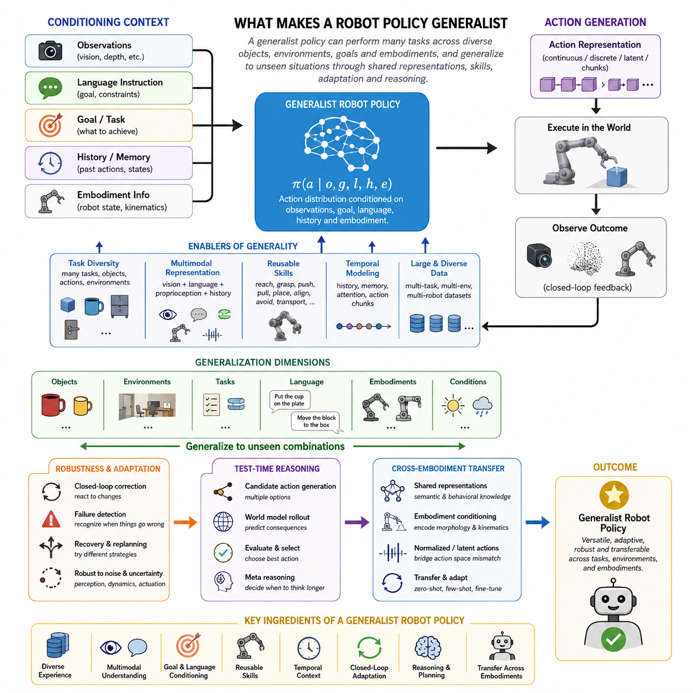{width="7.268055555555556in" height="7.268055555555556in"}

A generalist robot policy is a control model that can perform many tasks across different objects, scenes, goals, and operating conditions rather than being optimized for one narrowly defined behavior. Its defining property is not simply the number of tasks it has memorized, but its ability to reuse learned representations and behaviors when the situation differs from the demonstrations or environments encountered during training.

Traditional specialist policies usually assume a relatively fixed relationship between observations, goals, and actions. A grasping policy may grasp objects, while a navigation policy may move toward destinations. A generalist policy instead learns a broader mapping from multimodal context to behavior, allowing a common policy backbone to support manipulation, navigation, interaction, tool use, and other physical skills through appropriate conditioning.

A useful abstraction is to describe the policy as an action distribution conditioned on observations, goals, instructions, history, and embodiment information. Instead of learning only π(a\|s), the model may approximate π(a\|o, g, l, h, e), where observations o describe the current world, goals g specify desired outcomes, language l provides semantic instructions, history h captures temporal context, and embodiment e describes the robot executing the behavior.

Task diversity is therefore a fundamental ingredient of generalist behavior. Training data should expose the policy to different goals, objects, actions, environments, viewpoints, and interaction patterns. When diverse experiences share a common representation space, knowledge acquired from one task can support another. Opening a drawer, for example, may contribute transferable concepts about handles, pulling motions, contact, resistance, and state changes that are useful in previously unseen situations.

Generalization also requires variation within each task rather than demonstrations of a single canonical configuration. A robot that has learned to pick up one cup from one table has learned a narrow behavior, even if its success rate is high. A stronger policy must tolerate changes in object appearance, pose, scale, lighting, background, camera viewpoint, clutter, initial robot configuration, and environmental dynamics while preserving the intended semantic objective.

Language conditioning provides an important mechanism for expressing this diversity without assigning a separate policy identifier to every task. Instructions such as "place the red block in the box" or "move the cup beside the plate" encode goals compositionally through familiar concepts and relations. A language-conditioned policy can therefore connect semantic knowledge with physical behavior and potentially interpret new combinations of known objects, actions, attributes, and spatial relationships.

Multimodal representation learning further separates generalist policies from conventional controllers. Visual observations provide information about objects and geometry, language expresses intent and semantic constraints, proprioception describes the robot\'s physical state, and action history reveals how the interaction is evolving. Integrating these signals into shared representations allows the policy to select actions from the combined meaning of the situation rather than responding to isolated sensor measurements.

Temporal competence is equally important because meaningful robot behavior usually extends beyond a single action. The consequence of an action changes the observations available for the next decision, creating a closed perception-action loop. Generalist policies therefore benefit from histories, recurrent state, temporal attention, or action chunks that represent behavioral continuity. Such mechanisms help distinguish visually similar situations that require different actions because of what happened earlier.

A generalist policy must also learn reusable physical skills. Reaching, grasping, pushing, pulling, placing, transporting, aligning, avoiding obstacles, and manipulating articulated objects can serve as behavioral primitives that participate in many tasks. Generality emerges when these capabilities are not stored as isolated routines but are represented in ways that allow them to be selected, parameterized, sequenced, and recombined according to the current goal and environment.

Large and heterogeneous robot datasets are consequently central to generalist policy learning. Data collected from many tasks and environments exposes the model to a broader distribution of physical interactions, while mixtures from multiple robots can further increase diversity. However, dataset scale alone is insufficient. The policy must discover shared structure across experiences so that additional data improves transferable representations instead of merely increasing the number of memorized trajectories.

The distinction between memorization and generalization becomes especially important when evaluating these systems. High performance on training-like objects and environments may demonstrate effective imitation without demonstrating generality. Stronger evidence comes from controlled distribution shifts involving unseen objects, altered layouts, new task combinations, unfamiliar instructions, or environmental perturbations. Evaluation should therefore measure how gracefully performance degrades as conditions move away from the training distribution.

Generalist policies also need robustness to imperfect execution. Physical environments contain uncertainty from perception errors, object motion, contact dynamics, actuator variation, and unexpected human or environmental interference. A policy that generates an appropriate initial action but cannot react to deviations remains fragile. Closed-loop observation and continuous action correction allow the robot to detect changing conditions and modify behavior instead of blindly replaying a predetermined trajectory.

Failure recovery extends this principle beyond local correction. A capable generalist robot should recognize when an intended subgoal has not been achieved, determine whether another attempt or strategy is appropriate, and continue toward the higher-level objective. This transforms the policy from a trajectory generator into an adaptive behavioral system. Recovery capability becomes increasingly important as tasks become longer because small execution errors otherwise accumulate into complete task failure.

Another dimension of generality concerns embodiment. Policies trained for one robot often exploit its specific camera arrangement, kinematics, gripper geometry, and action coordinates. More general systems attempt to separate transferable semantic and behavioral knowledge from embodiment-specific control details. Shared representations, embodiment conditioning, normalized action interfaces, latent actions, and reusable skill abstractions can help knowledge transfer between robots while specialized components translate abstract intentions into feasible motions.

Generalist behavior should therefore be understood as a spectrum rather than a binary property. A policy may generalize across objects but not environments, across tasks but not embodiments, or across language instructions while remaining sensitive to visual changes. The relevant question is which dimensions of variation the policy can tolerate and how far it can move beyond its training distribution before adaptation becomes necessary. This multidimensional view provides a more meaningful definition of robot generality.

Ultimately, a generalist robot policy combines broad experience, multimodal representations, task and goal conditioning, reusable physical skills, temporal context, closed-loop adaptation, and transfer beyond familiar situations. Its objective is not to eliminate specialist controllers entirely, but to provide a shared behavioral foundation from which many capabilities can emerge. This foundation prepares robot systems for multi-task learning, language-conditioned control, long-horizon behavior, failure recovery, and generalization to unseen tasks developed in subsequent stages.

제너럴리스트 로봇 정책(generalist robot policy)은 하나의 좁게 정의된 행동에 최적화되는 대신, 서로 다른 객체(object), 장면(scene), 목표(goal), 운용 조건(operating condition)에 걸쳐 다양한 작업을 수행할 수 있는 제어 모델(control model)이다. 이를 정의하는 핵심 특성은 단순히 많은 작업을 기억했다는 것이 아니라, 학습 과정에서 접했던 시연(demonstration)이나 환경과 다른 상황에서도 학습된 표현(representation)과 행동을 재사용할 수 있는 능력이다.

전통적인 스페셜리스트 정책(specialist policy)은 일반적으로 관측(observation), 목표(goal), 행동(action) 사이에 비교적 고정된 관계가 있다고 가정한다. 파지 정책(grasping policy)은 객체를 잡고, 내비게이션 정책(navigation policy)은 목적지를 향해 이동한다. 반면 제너럴리스트 정책은 멀티모달 맥락(multimodal context)에서 행동으로 이어지는 더 광범위한 매핑(mapping)을 학습하여, 하나의 공통 정책 백본(policy backbone)이 적절한 조건화(conditioning)를 통해 조작(manipulation), 내비게이션(navigation), 상호작용(interaction), 도구 사용(tool use) 등의 물리적 기술을 지원하도록 한다.

유용한 추상화(abstraction)는 정책을 관측(observation), 목표(goal), 명령(instruction), 이력(history), 임바디먼트 정보(embodiment information)에 의해 조건화된 행동 분포(action distribution)로 표현하는 것이다. 단순히 π(a\|s)를 학습하는 대신, 모델은 π(a\|o, g, l, h, e)를 근사할 수 있다. 여기서 관측 o는 현재 세계를, 목표 g는 원하는 결과를, 언어 l은 의미적 명령을, 이력 h는 시간적 맥락(temporal context)을, 임바디먼트 e는 행동을 수행하는 로봇의 물리적 특성을 나타낸다.

따라서 작업 다양성(task diversity)은 제너럴리스트 행동(generalist behavior)의 핵심 요소이다. 학습 데이터는 정책이 서로 다른 목표, 객체, 행동, 환경, 시점(viewpoint), 상호작용 패턴(interaction pattern)을 경험하도록 해야 한다. 다양한 경험이 공통 표현 공간(shared representation space)을 사용하면 한 작업에서 획득한 지식이 다른 작업을 지원할 수 있다. 예를 들어 서랍을 여는 경험은 손잡이(handle), 당기기 동작(pulling motion), 접촉(contact), 저항(resistance), 상태 변화(state change)에 대한 전이 가능한 개념을 제공할 수 있다.

일반화(generalization)는 각 작업 내부에서도 하나의 표준적인 구성만 시연하는 것이 아니라 다양한 변화를 요구한다. 하나의 테이블에서 하나의 컵을 집는 방법만 학습한 로봇은 성공률이 높더라도 좁은 행동을 학습한 것이다. 더 강력한 정책은 객체의 외형, 자세(pose), 크기(scale), 조명(lighting), 배경(background), 카메라 시점(camera viewpoint), 복잡한 배치(clutter), 초기 로봇 구성(initial robot configuration), 환경 동역학(environmental dynamics)이 달라지더라도 의도된 의미적 목표를 유지할 수 있어야 한다.

언어 조건화(language conditioning)는 모든 작업에 별도의 정책 식별자(policy identifier)를 부여하지 않고 이러한 다양성을 표현할 수 있는 중요한 메커니즘을 제공한다. "빨간 블록을 상자 안에 놓아라" 또는 "컵을 접시 옆으로 이동시켜라"와 같은 명령은 익숙한 개념과 관계를 조합적으로(compositionally) 사용하여 목표를 표현한다. 따라서 언어 조건화 정책(language-conditioned policy)은 의미적 지식(semantic knowledge)을 물리적 행동과 연결하고, 알려진 객체, 행동, 속성, 공간적 관계의 새로운 조합을 해석할 가능성을 제공한다.

멀티모달 표현 학습(multimodal representation learning)은 제너럴리스트 정책을 기존 제어기(conventional controller)와 구별하는 또 다른 핵심 요소이다. 시각 관측(visual observation)은 객체와 기하학적 구조에 대한 정보를 제공하고, 언어는 의도와 의미적 제약조건(semantic constraint)을 표현하며, 고유수용감각(proprioception)은 로봇의 물리적 상태를 나타내고, 행동 이력(action history)은 상호작용이 어떻게 진행되고 있는지를 보여준다. 이러한 신호를 공유 표현(shared representation)으로 통합하면 정책은 개별 센서 측정값이 아니라 상황의 통합된 의미를 바탕으로 행동을 선택할 수 있다.

시간적 역량(temporal competence) 역시 중요하다. 의미 있는 로봇 행동은 일반적으로 하나의 행동만으로 끝나지 않기 때문이다. 어떤 행동의 결과는 다음 의사결정에 사용되는 관측을 변화시키면서 폐쇄형 인지-행동 루프(closed perception-action loop)를 형성한다. 따라서 제너럴리스트 정책은 이력(history), 순환 상태(recurrent state), 시간적 어텐션(temporal attention), 행동 청크(action chunk) 등을 통해 행동의 연속성을 표현할 수 있다. 이러한 메커니즘은 시각적으로 비슷한 상황이라도 이전에 발생한 사건에 따라 서로 다른 행동이 필요한 경우를 구별하는 데 도움을 준다.

제너럴리스트 정책은 재사용 가능한 물리적 기술(reusable physical skill)도 학습해야 한다. 도달(reaching), 파지(grasping), 밀기(pushing), 당기기(pulling), 배치(placing), 운반(transporting), 정렬(aligning), 장애물 회피(obstacle avoidance), 관절형 객체 조작(articulated object manipulation) 등은 여러 작업에서 활용되는 행동 프리미티브(behavioral primitive)가 될 수 있다. 이러한 능력이 서로 분리된 루틴으로 저장되는 것이 아니라 현재 목표와 환경에 따라 선택되고, 매개변수화(parameterization)되고, 순서화(sequencing)되며, 재조합될 수 있을 때 일반성이 나타난다.

따라서 크고 이질적인 로봇 데이터셋(heterogeneous robot dataset)은 제너럴리스트 정책 학습의 핵심 기반이다. 다양한 작업과 환경에서 수집된 데이터는 모델을 더 넓은 물리적 상호작용 분포에 노출시키며, 여러 종류의 로봇에서 얻은 데이터 혼합(data mixture)은 다양성을 더욱 증가시킬 수 있다. 그러나 데이터 규모만으로는 충분하지 않다. 정책은 경험 사이에 존재하는 공통 구조(shared structure)를 발견해야 하며, 이를 통해 추가 데이터가 단순히 기억된 궤적(trajectory)의 수를 증가시키는 것이 아니라 전이 가능한 표현을 향상시켜야 한다.

이러한 시스템을 평가할 때는 기억(memorization)과 일반화(generalization)의 차이가 특히 중요하다. 학습 환경과 유사한 객체 및 환경에서 높은 성능을 보이는 것은 효과적인 모방(imitation)을 보여줄 수 있지만 일반성을 입증하지는 못한다. 더 강력한 증거는 미지의 객체(unseen object), 변경된 배치(altered layout), 새로운 작업 조합(new task combination), 익숙하지 않은 명령(unfamiliar instruction), 환경 교란(environmental perturbation)과 같은 통제된 분포 변화(distribution shift)에서 나온다. 따라서 평가는 조건이 학습 분포(training distribution)에서 멀어질수록 성능이 얼마나 안정적으로 유지되는지를 측정해야 한다.

제너럴리스트 정책은 불완전한 실행(imperfect execution)에 대한 강건성(robustness)도 필요하다. 물리적 환경에는 인지 오류(perception error), 객체 움직임, 접촉 동역학(contact dynamics), 액추에이터 변동(actuator variation), 예상하지 못한 인간 또는 환경의 개입에서 발생하는 불확실성(uncertainty)이 존재한다. 적절한 초기 행동을 생성하더라도 변화에 대응하지 못하는 정책은 취약하다. 폐쇄 루프 관측(closed-loop observation)과 지속적인 행동 보정(action correction)을 통해 로봇은 미리 정해진 궤적을 그대로 재생하는 대신 변화하는 조건을 감지하고 행동을 수정할 수 있다.

실패 복구(failure recovery)는 이러한 원리를 국소적인 보정 이상으로 확장한다. 유능한 제너럴리스트 로봇은 의도한 하위 목표(subgoal)가 달성되지 않았음을 인식하고, 다른 시도나 전략이 필요한지를 판단한 후 상위 수준 목표(higher-level objective)를 향해 행동을 계속할 수 있어야 한다. 이는 정책을 단순한 궤적 생성기(trajectory generator)에서 적응형 행동 시스템(adaptive behavioral system)으로 변화시킨다. 작업이 길어질수록 작은 실행 오류가 누적되어 전체 작업 실패로 이어질 수 있기 때문에 복구 능력은 더욱 중요해진다.

일반성의 또 다른 차원은 임바디먼트(embodiment)와 관련된다. 하나의 로봇에서 학습된 정책은 해당 로봇의 특정 카메라 배치, 운동학(kinematics), 그리퍼 형상(gripper geometry), 행동 좌표(action coordinate)에 의존하는 경우가 많다. 더욱 일반적인 시스템은 전이 가능한 의미적·행동적 지식과 임바디먼트 특화 제어(embodiment-specific control)를 분리하려 한다. 공유 표현(shared representation), 임바디먼트 조건화(embodiment conditioning), 정규화된 행동 인터페이스(normalized action interface), 잠재 행동(latent action), 재사용 가능한 기술 추상화(skill abstraction)는 추상적 의도를 실행 가능한 움직임으로 변환하면서 로봇 간 지식 전이를 지원할 수 있다.

따라서 제너럴리스트 행동은 이진적인 속성(binary property)이 아니라 연속적인 스펙트럼(spectrum)으로 이해해야 한다. 어떤 정책은 객체 사이에서는 일반화되지만 환경 사이에서는 일반화되지 않을 수 있으며, 작업 사이에서는 일반화되지만 임바디먼트 사이에서는 그렇지 않을 수 있다. 또는 언어 명령에는 일반화되지만 시각적 변화에는 민감할 수 있다. 중요한 것은 정책이 어떤 변화 차원(dimension of variation)을 견딜 수 있으며, 적응(adaptation)이 필요해지기 전에 학습 분포를 얼마나 벗어날 수 있는지를 파악하는 것이다. 이러한 다차원적 관점(multidimensional view)은 로봇 일반성(robot generality)을 보다 의미 있게 정의한다.

궁극적으로 제너럴리스트 로봇 정책(generalist robot policy)은 폭넓은 경험, 멀티모달 표현(multimodal representation), 작업 및 목표 조건화(task and goal conditioning), 재사용 가능한 물리적 기술, 시간적 맥락(temporal context), 폐쇄 루프 적응(closed-loop adaptation), 익숙한 상황을 넘어서는 전이(transfer)를 결합한다. 그 목적은 스페셜리스트 제어기(specialist controller)를 완전히 제거하는 것이 아니라 다양한 능력이 발현될 수 있는 공유 행동 기반(shared behavioral foundation)을 제공하는 것이다. 이러한 기반은 이후의 멀티태스크 학습(multi-task learning), 언어 조건화 제어(language-conditioned control), 장기 지평 행동(long-horizon behavior), 실패 복구(failure recovery), 미지 작업에 대한 일반화(generalization to unseen tasks)를 위한 토대를 형성한다.

## 06.02. Multi Task Policy Learning

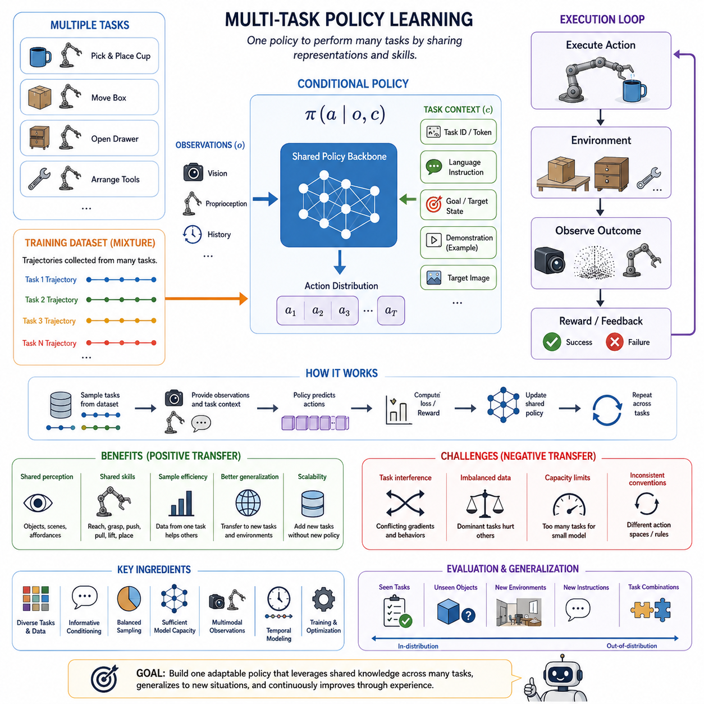{width="7.268055555555556in" height="7.268055555555556in"}

Multi-task policy learning trains a single robot policy to perform multiple behaviors rather than maintaining an independent controller for every task. The central objective is to discover representations and action strategies that can be shared across tasks while preserving the distinctions required for successful execution. This approach is a major step toward generalist robot policies because physical tasks often contain reusable perceptual concepts, motion patterns, and interaction skills.

A multi-task robot policy can be expressed as a conditional mapping from observations and task information to actions. Instead of learning a separate policy π₁, π₂, ..., πₙ for individual tasks, one model approximates π(a \| o, c), where o represents the robot\'s observations and c specifies the task context. The context may be a task identifier, goal state, language instruction, demonstration, image, or multimodal representation describing what the robot should accomplish.

The fundamental advantage of this formulation is parameter sharing. Visual features for recognizing objects, spatial relationships, free space, contact points, and affordances can support many behaviors simultaneously. Similarly, motor patterns such as reaching, grasping, pushing, pulling, lifting, and placing occur repeatedly across different tasks. Shared parameters allow experience collected for one behavior to improve representations that may also benefit other behaviors.

Consider a robot trained to place cups, move boxes, open drawers, and arrange tools. These tasks appear different at the semantic level, yet they contain overlapping physical structures. Reaching toward an object, selecting an interaction point, controlling contact, monitoring motion, and verifying an outcome are useful across the entire task mixture. Multi-task learning attempts to capture these recurring structures instead of relearning them independently for every behavior.

Task conditioning is essential because the same observation may require different actions depending on the intended objective. A robot looking at a cup might need to pick it up, move it aside, place it on a tray, or leave it untouched. The policy therefore requires information that distinguishes the desired behavior. Task tokens, goal embeddings, language instructions, target images, or demonstrations can provide this conditioning signal and guide the shared policy toward the appropriate action sequence.

Language is particularly useful for multi-task policies because it provides a flexible semantic interface between tasks and actions. Instructions such as "pick up the blue block," "place the cup beside the plate," and "open the upper drawer" can be embedded into a common representation space. Rather than assigning an arbitrary numerical identity to each task, language describes objects, relations, actions, and goals compositionally, creating opportunities to generalize to new combinations of familiar concepts.

The training dataset is usually organized as a mixture of trajectories collected from many tasks. Each trajectory contains observations, task context, robot states, and corresponding actions over time. During training, examples from different tasks are sampled and optimized jointly. The policy must learn which information is common across the mixture and which information should remain task-specific, producing a representation that balances transfer with behavioral specialization.

How tasks are sampled strongly influences the resulting policy. If one task contributes far more trajectories than others, optimization may become dominated by that behavior and performance on smaller tasks can deteriorate. Uniform task sampling, dataset-proportional sampling, weighted sampling, or adaptive balancing can be used depending on the desired behavior. The appropriate mixture depends not only on dataset size but also on task difficulty, diversity, quality, and similarity.

Positive transfer occurs when learning one task improves performance on another. For example, extensive object-grasping experience may improve a placing task because both require object localization and stable grasp formation. Navigation through clutter may improve mobile manipulation by providing stronger spatial representations. Multi-task learning is valuable when the model discovers such common structure and converts experience from different tasks into reusable knowledge rather than isolated behaviors.

The opposite phenomenon, negative transfer, occurs when jointly learned tasks interfere with one another. Two tasks may require conflicting actions under visually similar conditions, use different control conventions, or produce gradients that encourage incompatible representations. Increasing the number of tasks therefore does not automatically create a better generalist policy. Architecture, conditioning, data balance, optimization, and model capacity must be sufficient to separate conflicting behaviors while retaining useful shared structure.

Model capacity becomes increasingly important as task diversity grows. A small network may represent several related tasks successfully but struggle when the dataset contains many distinct environments and behaviors. Larger shared backbones can encode broader knowledge, while task-conditioned layers, adapters, mixture-of-experts mechanisms, or specialized action heads can introduce selective specialization. The design challenge is deciding what should be universally shared and what should remain dependent on task or context.

Multi-task policy learning also benefits from multimodal observations. Vision describes objects and scene geometry, proprioception represents the robot\'s configuration, language specifies intent, and action history provides temporal context. Combining these modalities enables the policy to determine not only what exists in the environment but also what should happen next. Attention mechanisms can further allow the model to emphasize different parts of the context depending on the current task and execution stage.

Temporal modeling is necessary because many tasks cannot be solved through independent single-step decisions. Picking and placing requires approaching, grasping, lifting, transporting, positioning, releasing, and verifying the result. A multi-task policy must preserve task identity and progress across these stages while responding to new observations. History representations, recurrent state, temporal attention, and action chunks can provide the continuity required for coherent multi-step behavior.

Training commonly begins with behavior cloning or imitation learning, where the policy predicts actions demonstrated by humans, teleoperators, scripted controllers, or previously trained agents. Large collections of demonstrations can establish a broad behavioral prior across many tasks. Reinforcement learning or other policy-improvement methods may subsequently refine behaviors using task success, reward signals, preferences, or environmental feedback when imitation alone does not produce sufficiently robust execution.

Evaluation must separate task coverage from true multi-task generalization. A policy that successfully reproduces every training task demonstrates broad competence, but stronger generality requires performance under variations not directly represented during training. Tests can modify object instances, initial configurations, scene layouts, instructions, or combinations of subtasks. Such evaluation reveals whether shared learning produced transferable structure or merely compressed multiple specialist policies into a single network.

Ultimately, multi-task policy learning provides the mechanism through which many robot behaviors can coexist within a shared policy. Its success depends on diverse task data, informative conditioning, balanced sampling, sufficient model capacity, multimodal representations, temporal reasoning, and careful control of transfer and interference. When these elements work together, experience from individual tasks becomes shared behavioral knowledge that supports progressively broader and more adaptable robot intelligence.

멀티태스크 정책 학습(multi-task policy learning)은 각각의 작업마다 독립적인 제어기(controller)를 유지하는 대신, 하나의 로봇 정책(robot policy)이 여러 행동을 수행하도록 학습하는 방법이다. 핵심 목표는 성공적인 실행에 필요한 작업별 차이를 유지하면서 여러 작업에서 공유할 수 있는 표현(representation)과 행동 전략(action strategy)을 발견하는 것이다. 이러한 접근법은 물리적 작업들이 재사용 가능한 지각 개념, 움직임 패턴, 상호작용 기술을 공유하기 때문에 제너럴리스트 로봇 정책(generalist robot policy)을 향한 중요한 단계가 된다.

멀티태스크 로봇 정책(multi-task robot policy)은 관측(observation)과 작업 정보(task information)로부터 행동(action)을 생성하는 조건부 매핑(conditional mapping)으로 표현할 수 있다. 개별 작업마다 π₁, π₂, ..., πₙ과 같은 별도의 정책을 학습하는 대신, 하나의 모델이 π(a \| o, c)를 근사한다. 여기서 o는 로봇의 관측을 나타내고 c는 작업 맥락(task context)을 지정한다. 이 맥락은 작업 식별자(task identifier), 목표 상태(goal state), 언어 명령(language instruction), 시연(demonstration), 이미지(image), 또는 로봇이 수행해야 할 것을 설명하는 멀티모달 표현(multimodal representation)이 될 수 있다.

이러한 구성의 근본적인 장점은 매개변수 공유(parameter sharing)에 있다. 객체, 공간적 관계, 자유 공간(free space), 접촉 지점(contact point), 어포던스(affordance)를 인식하기 위한 시각적 특징(visual feature)은 여러 행동을 동시에 지원할 수 있다. 마찬가지로 도달(reaching), 파지(grasping), 밀기(pushing), 당기기(pulling), 들어 올리기(lifting), 배치(placing)와 같은 운동 패턴(motor pattern)은 서로 다른 작업에서 반복적으로 나타난다. 공유 매개변수는 한 행동에서 수집된 경험이 다른 행동에도 유용한 표현을 향상시키도록 한다.

컵 배치, 상자 이동, 서랍 열기, 도구 정리 등을 학습하는 로봇을 생각할 수 있다. 이러한 작업들은 의미적 수준(semantic level)에서는 서로 다르게 보이지만, 중복되는 물리적 구조를 포함한다. 객체에 접근하고, 상호작용 지점을 선택하고, 접촉을 제어하고, 움직임을 모니터링하고, 결과를 검증하는 과정은 전체 작업 혼합(task mixture)에서 공통적으로 유용하다. 멀티태스크 학습은 각각의 행동을 독립적으로 다시 학습하는 대신 이러한 반복적인 구조를 포착하려 한다.

작업 조건화(task conditioning)는 동일한 관측에서도 의도된 목표에 따라 서로 다른 행동이 필요할 수 있기 때문에 필수적이다. 로봇이 컵을 바라보고 있더라도 컵을 집거나, 옆으로 옮기거나, 트레이 위에 놓거나, 그대로 두어야 할 수 있다. 따라서 정책에는 원하는 행동을 구별할 수 있는 정보가 필요하다. 작업 토큰(task token), 목표 임베딩(goal embedding), 언어 명령, 목표 이미지(target image), 시연 등이 이러한 조건화 신호(conditioning signal)를 제공하고 공유 정책이 적절한 행동 시퀀스(action sequence)를 생성하도록 안내할 수 있다.

언어(language)는 작업과 행동 사이에 유연한 의미적 인터페이스(semantic interface)를 제공하기 때문에 멀티태스크 정책에서 특히 유용하다. "파란 블록을 집어라", "컵을 접시 옆에 놓아라", "위쪽 서랍을 열어라"와 같은 명령을 공통 표현 공간(common representation space)에 임베딩(embedding)할 수 있다. 각 작업에 임의의 숫자 식별자를 부여하는 대신, 언어는 객체, 관계, 행동, 목표를 조합적으로(compositionally) 설명하여 익숙한 개념들의 새로운 조합으로 일반화할 가능성을 제공한다.

학습 데이터셋(training dataset)은 일반적으로 여러 작업에서 수집된 궤적(trajectory)의 혼합으로 구성된다. 각 궤적에는 시간에 따른 관측, 작업 맥락, 로봇 상태(robot state), 그리고 이에 대응하는 행동이 포함된다. 학습 과정에서는 서로 다른 작업의 예제를 샘플링하여 공동으로 최적화(joint optimization)한다. 정책은 혼합 데이터에서 어떤 정보가 공통적인지, 어떤 정보가 작업별로 유지되어야 하는지를 학습하여 전이(transfer)와 행동 특화(behavioral specialization)의 균형을 이루는 표현을 생성해야 한다.

작업을 어떻게 샘플링(task sampling)하는가는 결과 정책에 큰 영향을 미친다. 하나의 작업이 다른 작업보다 훨씬 많은 궤적을 제공하면 최적화 과정이 해당 행동에 지배되어 데이터가 적은 작업의 성능이 저하될 수 있다. 목표에 따라 균등 작업 샘플링(uniform task sampling), 데이터셋 비례 샘플링(dataset-proportional sampling), 가중 샘플링(weighted sampling), 적응형 균형화(adaptive balancing)를 사용할 수 있다. 적절한 혼합은 데이터셋 크기뿐만 아니라 작업 난이도, 다양성, 품질, 유사성에도 영향을 받는다.

긍정적 전이(positive transfer)는 하나의 작업을 학습한 결과가 다른 작업의 성능을 향상시키는 현상이다. 예를 들어 풍부한 객체 파지 경험은 객체 위치 파악과 안정적인 파지 형성(grasp formation)이 모두 필요하기 때문에 배치 작업의 성능을 향상시킬 수 있다. 복잡한 환경에서의 내비게이션 경험은 더 강력한 공간 표현(spatial representation)을 제공하여 모바일 매니퓰레이션(mobile manipulation)을 향상시킬 수 있다. 멀티태스크 학습의 가치는 모델이 이러한 공통 구조를 발견하고 서로 다른 작업의 경험을 분리된 행동이 아니라 재사용 가능한 지식으로 변환할 때 나타난다.

반대 현상인 부정적 전이(negative transfer)는 공동으로 학습되는 작업들이 서로 간섭할 때 발생한다. 두 작업이 시각적으로 유사한 조건에서 서로 상충하는 행동을 요구하거나, 서로 다른 제어 규칙(control convention)을 사용하거나, 호환되지 않는 표현을 유도하는 그래디언트(gradient)를 생성할 수 있다. 따라서 작업의 수를 증가시키는 것만으로 더 우수한 제너럴리스트 정책이 자동으로 만들어지는 것은 아니다. 상충하는 행동을 분리하면서 유용한 공유 구조를 유지하려면 아키텍처(architecture), 조건화, 데이터 균형, 최적화, 모델 용량(model capacity)이 충분해야 한다.

작업 다양성이 증가할수록 모델 용량은 더욱 중요해진다. 작은 네트워크는 서로 관련된 몇 가지 작업을 성공적으로 표현할 수 있지만, 데이터셋에 매우 다양한 환경과 행동이 포함되면 어려움을 겪을 수 있다. 더 큰 공유 백본(shared backbone)은 폭넓은 지식을 인코딩할 수 있으며, 작업 조건부 계층(task-conditioned layer), 어댑터(adapter), 전문가 혼합 메커니즘(mixture-of-experts mechanism), 특화 행동 헤드(specialized action head)는 선택적인 특화를 제공할 수 있다. 설계의 핵심 과제는 무엇을 보편적으로 공유하고 무엇을 작업이나 맥락에 의존하도록 유지할 것인지를 결정하는 것이다.

멀티태스크 정책 학습은 멀티모달 관측(multimodal observation)을 통해서도 향상될 수 있다. 비전(vision)은 객체와 장면의 기하학적 구조를 설명하고, 고유수용감각(proprioception)은 로봇의 구성을 나타내며, 언어는 의도를 지정하고, 행동 이력(action history)은 시간적 맥락(temporal context)을 제공한다. 이러한 모달리티(modality)를 결합하면 정책은 환경에 무엇이 존재하는지만 판단하는 것이 아니라 다음에 무엇을 해야 하는지도 결정할 수 있다. 어텐션 메커니즘(attention mechanism)은 현재 작업과 실행 단계에 따라 서로 다른 맥락 정보에 선택적으로 집중하도록 지원할 수 있다.

많은 작업은 서로 독립적인 단일 단계 의사결정(single-step decision)만으로 해결할 수 없기 때문에 시간적 모델링(temporal modeling)이 필요하다. 집어서 배치하는 작업(pick-and-place)은 접근, 파지, 들어 올리기, 운반, 위치 조정, 놓기, 결과 검증의 과정을 요구한다. 멀티태스크 정책은 새로운 관측에 대응하면서 이러한 단계 전체에 걸쳐 작업 정체성(task identity)과 진행 상태를 유지해야 한다. 이력 표현(history representation), 순환 상태(recurrent state), 시간적 어텐션(temporal attention), 행동 청크(action chunk)는 일관된 다단계 행동(multi-step behavior)에 필요한 연속성을 제공할 수 있다.

학습은 일반적으로 행동 복제(behavior cloning) 또는 모방 학습(imitation learning)으로 시작하며, 정책은 인간, 원격조작자(teleoperator), 스크립트 기반 제어기(scripted controller), 또는 기존에 학습된 에이전트가 시연한 행동을 예측한다. 대규모 시연 데이터는 여러 작업에 걸쳐 폭넓은 행동 사전지식(behavioral prior)을 형성할 수 있다. 이후 모방만으로 충분히 강건한 실행이 이루어지지 않을 경우 강화학습(reinforcement learning)이나 다른 정책 개선 방법(policy-improvement method)을 통해 작업 성공, 보상 신호(reward signal), 선호도(preference), 환경 피드백(environmental feedback)을 이용하여 행동을 개선할 수 있다.

평가에서는 작업 범위(task coverage)와 진정한 멀티태스크 일반화(multi-task generalization)를 구분해야 한다. 모든 학습 작업을 성공적으로 재현하는 정책은 폭넓은 역량을 보여주지만, 더 강한 일반성을 입증하려면 학습 과정에서 직접 표현되지 않았던 변화에서도 높은 성능을 보여야 한다. 평가에서는 객체 인스턴스(object instance), 초기 구성(initial configuration), 장면 배치(scene layout), 명령, 하위 작업 조합(subtask combination) 등을 변경할 수 있다. 이러한 평가는 공유 학습이 전이 가능한 구조를 생성했는지, 아니면 단순히 여러 스페셜리스트 정책을 하나의 네트워크로 압축했는지를 보여준다.

궁극적으로 멀티태스크 정책 학습(multi-task policy learning)은 여러 로봇 행동이 하나의 공유 정책(shared policy) 안에서 공존할 수 있도록 하는 메커니즘을 제공한다. 그 성공 여부는 다양한 작업 데이터, 정보가 풍부한 조건화(informative conditioning), 균형 잡힌 샘플링, 충분한 모델 용량, 멀티모달 표현, 시간적 추론(temporal reasoning), 그리고 전이와 간섭(interference)에 대한 세심한 제어에 달려 있다. 이러한 요소들이 함께 작동하면 개별 작업에서 얻은 경험은 공유 행동 지식(shared behavioral knowledge)으로 발전하여 더욱 광범위하고 적응 가능한 로봇 지능(robot intelligence)을 지원한다.

## 06.03. Multi Object and Multi Environment Generalization

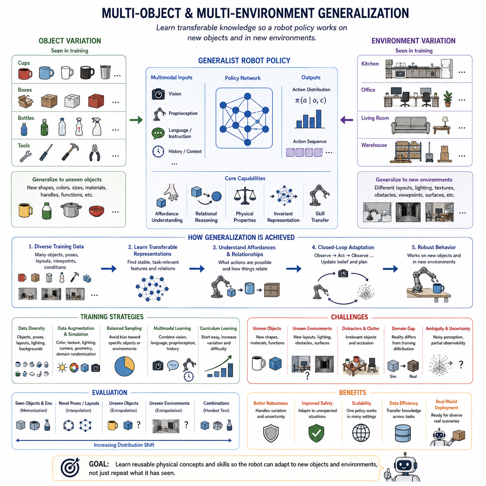{width="7.268055555555556in" height="7.268055555555556in"}

Multi-object and multi-environment generalization describes a robot policy's ability to preserve useful behavior when the objects and surroundings encountered during deployment differ from those represented in training. For a generalist robot policy, success should not depend on memorizing a particular cup, drawer, table, room, or camera configuration. Instead, the policy should learn transferable representations of physical properties, relationships, affordances, and interaction patterns.

Object generalization requires the policy to recognize that visually different instances can support similar actions. Cups may vary in color, texture, material, size, handle geometry, and orientation while still offering related grasping and placement possibilities. Rather than associating actions with exact pixel patterns, a robust policy should extract task-relevant properties such as shape, pose, graspable regions, functional parts, spatial relationships, and likely physical behavior.

This capability extends beyond recognizing members of a familiar object category. Robots frequently encounter objects whose appearance or geometry was not explicitly represented during training. The policy must determine whether previously learned skills remain applicable and how their parameters should change. A grasping strategy, for example, may transfer to a novel container if the policy can identify compatible surfaces and geometric constraints instead of relying only on category identity.

Affordance representations are particularly valuable for multi-object generalization because they describe what interactions an object supports. A handle suggests pulling or grasping, a flat surface may support placement, and an opening may permit insertion. Different objects can therefore share functional structure even when their visual appearance is substantially different. Learning these action-oriented regularities allows physical knowledge to transfer across object categories and previously unseen instances.

Environment generalization introduces another dimension of variation. A policy trained in one laboratory or workspace may encounter different room layouts, furniture, lighting conditions, backgrounds, camera viewpoints, obstacles, floor surfaces, and object arrangements during deployment. The underlying task may remain unchanged, but the observation distribution can change significantly. A generalist policy must separate task-relevant structure from incidental characteristics of the training environment.

Spatial representations help achieve this separation by encoding relationships rather than fixed locations. Concepts such as above, inside, beside, reachable, blocked, near, and aligned can remain meaningful when the entire scene changes. A robot instructed to place an object inside a container should reason about the relationship between the object and target rather than memorize coordinates from previous demonstrations. Relational representations therefore provide a reusable basis for behavior across layouts.

Multi-object and multi-environment generalization interact strongly because real deployment usually changes both simultaneously. A robot may encounter a new cup in an unfamiliar kitchen, a new package configuration in a warehouse, or a different tool arrangement at a manufacturing station. Evaluating object variation independently from environmental variation can identify specific weaknesses, but robust deployment ultimately requires policies that tolerate combinations of multiple distribution shifts at the same time.

Training diversity is one of the primary mechanisms for developing this capability. Demonstrations collected across many object instances, poses, layouts, backgrounds, viewpoints, and environmental conditions prevent the policy from relying too heavily on narrow correlations. Diversity teaches the model which properties remain stable across examples and which features are incidental. The objective is not merely to expose the model to every possible case, but to reveal reusable structure through systematic variation.

Data augmentation and simulation can expand this variation beyond what is practical to collect physically. Images can be modified in appearance, object positions can be changed, and simulated environments can vary lighting, textures, geometry, camera parameters, and scene composition. Domain randomization intentionally exposes the policy to broad variations so that real deployment becomes another point within a sufficiently diverse distribution rather than an entirely unfamiliar condition.

However, excessive or unrealistic variation does not automatically improve generalization. Randomization that destroys meaningful physical correlations may make learning unnecessarily difficult or encourage representations that ignore useful information. Training variation should preserve task-relevant structure while changing nuisance factors. Effective dataset design therefore requires understanding which properties should remain invariant and which properties must be represented explicitly because they affect feasible actions.

Multimodal representations provide another mechanism for maintaining stable behavior across changing objects and environments. Vision captures appearance and geometry, language describes semantic identity and task intent, proprioception represents the robot configuration, and temporal context records recent interaction. When these modalities reinforce one another, the policy can rely less on any single fragile signal and instead infer actions from a richer representation of the current physical situation.

Language conditioning can further support object and environment generalization by identifying relevant entities and relationships without requiring fixed task labels. Instructions such as "pick up the bottle beside the box" or "place the tool on the empty shelf" specify behavior through semantic and relational concepts. If these concepts have been learned compositionally, the same policy can potentially interpret them when the referenced objects or surrounding scene differ from examples encountered during training.

Closed-loop control is critical because unfamiliar objects and environments increase uncertainty. The policy may initially estimate an object pose incorrectly, encounter unexpected contact, or discover that a planned motion is obstructed. By repeatedly observing the environment after acting, the robot can update its estimate and modify subsequent actions. Generalization therefore depends not only on producing a good initial prediction but also on adapting behavior as new physical evidence becomes available.

Failure recovery provides an additional layer of robustness under distribution shift. A grasp may slip because an unfamiliar object has different friction, or a planned trajectory may fail because a new environment contains an unexpected obstacle. A capable policy should recognize the discrepancy between expected and observed outcomes, reconsider its current strategy, and attempt an alternative behavior. Such recovery mechanisms reduce the need for perfect zero-shot predictions in every unfamiliar situation.

Evaluation should carefully distinguish memorization, interpolation, and genuine generalization. Testing different poses of objects already seen during training measures a weaker form of variation than testing entirely unseen instances. Similarly, rearranging a familiar environment is different from transferring to a new room or facility. Evaluation protocols should therefore control the degree of novelty and separately measure unseen objects, unseen layouts, unseen environments, and combinations of these conditions.

Performance under increasing distribution shift provides a useful picture of policy robustness. Rather than reporting only success or failure on one benchmark, evaluation can examine how success changes as object appearance, geometry, scene layout, sensing conditions, and environmental dynamics become progressively less familiar. A strong generalist policy should degrade gracefully and retain transferable skills even when exact training configurations are unavailable.

Ultimately, multi-object and multi-environment generalization emerges from the interaction of diverse training experience, transferable representations, affordance understanding, relational reasoning, multimodal context, and closed-loop adaptation. The goal is not to memorize every object and environment a robot may encounter, which is impossible, but to learn sufficiently reusable physical concepts that familiar skills can be interpreted and adapted when the world changes.

다중 객체 및 다중 환경 일반화(multi-object and multi-environment generalization)는 배포 과정에서 마주치는 객체와 주변 환경이 학습 데이터에 포함된 것과 달라지더라도 로봇 정책(robot policy)이 유용한 행동을 유지하는 능력을 의미한다. 제너럴리스트 로봇 정책(generalist robot policy)의 성공은 특정 컵, 서랍, 테이블, 방 또는 카메라 구성을 암기하는 것에 의존해서는 안 된다. 대신 정책은 물리적 속성, 관계, 어포던스(affordance), 상호작용 패턴(interaction pattern)에 대한 전이 가능한 표현(transferable representation)을 학습해야 한다.

객체 일반화(object generalization)를 위해서는 시각적으로 서로 다른 객체 인스턴스(instance)가 유사한 행동을 지원할 수 있음을 정책이 인식해야 한다. 컵은 색상, 질감, 재질, 크기, 손잡이 형상, 방향이 서로 다르더라도 유사한 파지 및 배치 가능성을 제공할 수 있다. 강건한 정책(robust policy)은 정확한 픽셀 패턴과 행동을 연결하는 대신 형상, 자세(pose), 파지 가능한 영역, 기능적 부분(functional part), 공간적 관계, 예상되는 물리적 행동과 같은 작업 관련 속성을 추출해야 한다.

이러한 능력은 익숙한 객체 범주(object category)의 구성원을 인식하는 것을 넘어선다. 로봇은 학습 과정에서 명시적으로 경험하지 않은 외형이나 형상을 가진 객체를 자주 만나게 된다. 정책은 이전에 학습한 기술이 여전히 적용 가능한지, 그리고 그 매개변수를 어떻게 변경해야 하는지를 판단해야 한다. 예를 들어 파지 전략(grasping strategy)은 범주 정체성에만 의존하지 않고 적합한 표면과 기하학적 제약조건을 식별할 수 있다면 새로운 용기에도 전이될 수 있다.

어포던스 표현(affordance representation)은 객체가 어떤 상호작용을 지원하는지를 설명하기 때문에 다중 객체 일반화에 특히 중요하다. 손잡이는 당기거나 잡는 행동을 가능하게 하고, 평평한 표면은 객체 배치를 지원하며, 개구부(opening)는 삽입을 가능하게 할 수 있다. 따라서 서로 다른 객체도 시각적 외형이 크게 다르더라도 기능적 구조(functional structure)를 공유할 수 있다. 이러한 행동 중심의 규칙성을 학습하면 물리적 지식을 객체 범주와 이전에 보지 못한 인스턴스 사이에서 전이할 수 있다.

환경 일반화(environment generalization)는 또 다른 변화 차원을 추가한다. 하나의 실험실이나 작업 공간에서 학습된 정책은 배포 과정에서 서로 다른 공간 배치, 가구, 조명 조건, 배경, 카메라 시점, 장애물, 바닥 표면, 객체 배열을 경험할 수 있다. 기본 작업 자체는 동일하게 유지되더라도 관측 분포(observation distribution)는 크게 달라질 수 있다. 제너럴리스트 정책은 작업과 관련된 구조를 학습 환경의 부수적인 특성으로부터 분리할 수 있어야 한다.

공간 표현(spatial representation)은 고정된 위치가 아니라 관계를 인코딩함으로써 이러한 분리를 지원한다. 위쪽(above), 내부(inside), 옆쪽(beside), 도달 가능(reachable), 차단됨(blocked), 가까움(near), 정렬됨(aligned)과 같은 개념은 전체 장면이 달라져도 의미를 유지할 수 있다. 객체를 용기 안에 넣으라는 명령을 받은 로봇은 이전 시연의 좌표를 암기하는 대신 객체와 목표 사이의 관계를 추론해야 한다. 따라서 관계적 표현(relational representation)은 서로 다른 배치에서 행동을 재사용할 수 있는 기반을 제공한다.

다중 객체 일반화와 다중 환경 일반화는 실제 배포 환경에서는 두 요소가 동시에 변화하는 경우가 많기 때문에 강하게 상호작용한다. 로봇은 익숙하지 않은 주방에서 새로운 컵을 만나거나, 창고에서 새로운 패키지 구성을 처리하거나, 제조 작업장에서 서로 다른 도구 배치를 경험할 수 있다. 객체 변화와 환경 변화를 독립적으로 평가하면 구체적인 약점을 확인할 수 있지만, 강건한 배포를 위해서는 여러 분포 변화(distribution shift)의 조합을 동시에 견딜 수 있는 정책이 필요하다.

학습 다양성(training diversity)은 이러한 능력을 개발하는 주요 메커니즘 중 하나이다. 다양한 객체 인스턴스, 자세, 배치, 배경, 시점, 환경 조건에서 수집된 시연은 정책이 좁은 상관관계에 과도하게 의존하는 것을 방지한다. 다양성은 여러 사례에서 어떤 속성이 안정적으로 유지되고 어떤 특징이 부수적인지를 모델이 학습하도록 한다. 목표는 가능한 모든 사례를 모델에 보여주는 것이 아니라 체계적인 변화를 통해 재사용 가능한 구조(reusable structure)를 발견하도록 하는 것이다.

데이터 증강(data augmentation)과 시뮬레이션(simulation)은 실제 환경에서 수집하기 어려운 수준까지 이러한 변화를 확장할 수 있다. 이미지의 외형을 변경하거나 객체 위치를 바꿀 수 있으며, 시뮬레이션 환경에서는 조명, 질감, 기하학적 구조, 카메라 매개변수, 장면 구성을 변화시킬 수 있다. 도메인 랜덤화(domain randomization)는 정책을 폭넓은 변화에 의도적으로 노출하여 실제 배포 환경이 완전히 새로운 조건이 아니라 충분히 다양한 분포 내부의 또 다른 지점이 되도록 한다.

그러나 과도하거나 비현실적인 변화가 자동으로 일반화를 향상시키는 것은 아니다. 의미 있는 물리적 상관관계를 파괴하는 랜덤화(randomization)는 학습을 불필요하게 어렵게 만들거나 유용한 정보를 무시하는 표현을 유도할 수 있다. 학습 변화(training variation)는 작업 관련 구조를 유지하면서 방해 요인(nuisance factor)을 변화시켜야 한다. 따라서 효과적인 데이터셋 설계(dataset design)를 위해서는 어떤 속성이 불변(invariant)이어야 하고, 어떤 속성이 실행 가능한 행동에 영향을 미치기 때문에 명시적으로 표현되어야 하는지를 이해해야 한다.

멀티모달 표현(multimodal representation)은 변화하는 객체와 환경에서도 안정적인 행동을 유지하기 위한 또 다른 메커니즘을 제공한다. 비전(vision)은 외형과 기하학적 구조를 포착하고, 언어(language)는 의미적 정체성과 작업 의도를 설명하며, 고유수용감각(proprioception)은 로봇의 구성을 표현하고, 시간적 맥락(temporal context)은 최근의 상호작용을 기록한다. 이러한 모달리티가 서로 보완하면 정책은 하나의 취약한 신호에 대한 의존성을 줄이고 현재 물리적 상황에 대한 더 풍부한 표현으로부터 행동을 추론할 수 있다.

언어 조건화(language conditioning)는 고정된 작업 레이블(task label)을 요구하지 않고 관련 객체와 관계를 지정함으로써 객체 및 환경 일반화를 더욱 지원할 수 있다. "상자 옆에 있는 병을 집어라" 또는 "도구를 빈 선반 위에 놓아라"와 같은 명령은 의미적이고 관계적인 개념을 통해 행동을 지정한다. 이러한 개념을 조합적으로(compositionally) 학습했다면 동일한 정책은 참조되는 객체나 주변 장면이 학습 사례와 달라지더라도 명령을 해석할 가능성이 있다.

폐쇄 루프 제어(closed-loop control)는 익숙하지 않은 객체와 환경에서 불확실성(uncertainty)이 증가하기 때문에 매우 중요하다. 정책은 처음에 객체 자세를 잘못 추정하거나 예상하지 못한 접촉을 경험하거나 계획된 움직임이 장애물에 의해 차단되었음을 발견할 수 있다. 로봇은 행동 후 환경을 반복적으로 관측함으로써 자신의 추정을 갱신하고 이후 행동을 수정할 수 있다. 따라서 일반화는 좋은 초기 예측을 생성하는 것뿐만 아니라 새로운 물리적 증거가 나타날 때 행동을 적응시키는 능력에도 의존한다.

실패 복구(failure recovery)는 분포 변화 상황에서 추가적인 강건성을 제공한다. 익숙하지 않은 객체의 마찰 특성이 달라 파지가 미끄러질 수 있으며, 새로운 환경에 예상하지 못한 장애물이 존재하여 계획된 궤적이 실패할 수도 있다. 유능한 정책은 예상된 결과와 실제 관측된 결과 사이의 차이를 인식하고 현재 전략을 재검토한 후 대안적인 행동을 시도해야 한다. 이러한 복구 메커니즘(recovery mechanism)은 모든 익숙하지 않은 상황에서 완벽한 제로샷 예측(zero-shot prediction)을 수행해야 할 필요성을 줄여준다.

평가에서는 암기(memorization), 보간(interpolation), 진정한 일반화(genuine generalization)를 신중하게 구분해야 한다. 학습 중 이미 경험한 객체의 다른 자세를 평가하는 것은 완전히 새로운 객체 인스턴스를 평가하는 것보다 약한 형태의 변화이다. 마찬가지로 익숙한 환경을 재배치하는 것과 새로운 방이나 시설로 전이하는 것은 서로 다르다. 따라서 평가 프로토콜(evaluation protocol)은 새로움의 정도를 통제하고 미지 객체, 미지 배치, 미지 환경, 그리고 이러한 조건의 조합을 각각 측정해야 한다.

분포 변화가 증가할 때 나타나는 성능은 정책의 강건성을 파악하는 데 유용하다. 하나의 벤치마크에서 성공 또는 실패만 보고하는 대신, 객체의 외형과 기하학적 구조, 장면 배치, 센싱 조건, 환경 동역학(environmental dynamics)이 점차 익숙하지 않게 변화함에 따라 성공률이 어떻게 달라지는지를 평가할 수 있다. 강력한 제너럴리스트 정책은 정확한 학습 구성을 사용할 수 없는 상황에서도 성능이 급격히 붕괴하지 않고 점진적으로 저하(graceful degradation)되면서 전이 가능한 기술을 유지해야 한다.

궁극적으로 다중 객체 및 다중 환경 일반화(multi-object and multi-environment generalization)는 다양한 학습 경험, 전이 가능한 표현, 어포던스 이해(affordance understanding), 관계적 추론(relational reasoning), 멀티모달 맥락(multimodal context), 폐쇄 루프 적응(closed-loop adaptation)의 상호작용을 통해 형성된다. 목표는 로봇이 마주칠 수 있는 모든 객체와 환경을 암기하는 것이 아니라, 세계가 변화하더라도 익숙한 기술을 해석하고 적응시킬 수 있을 만큼 충분히 재사용 가능한 물리적 개념(reusable physical concept)을 학습하는 것이다.

## 06.04. Language Conditioned Robot Policies

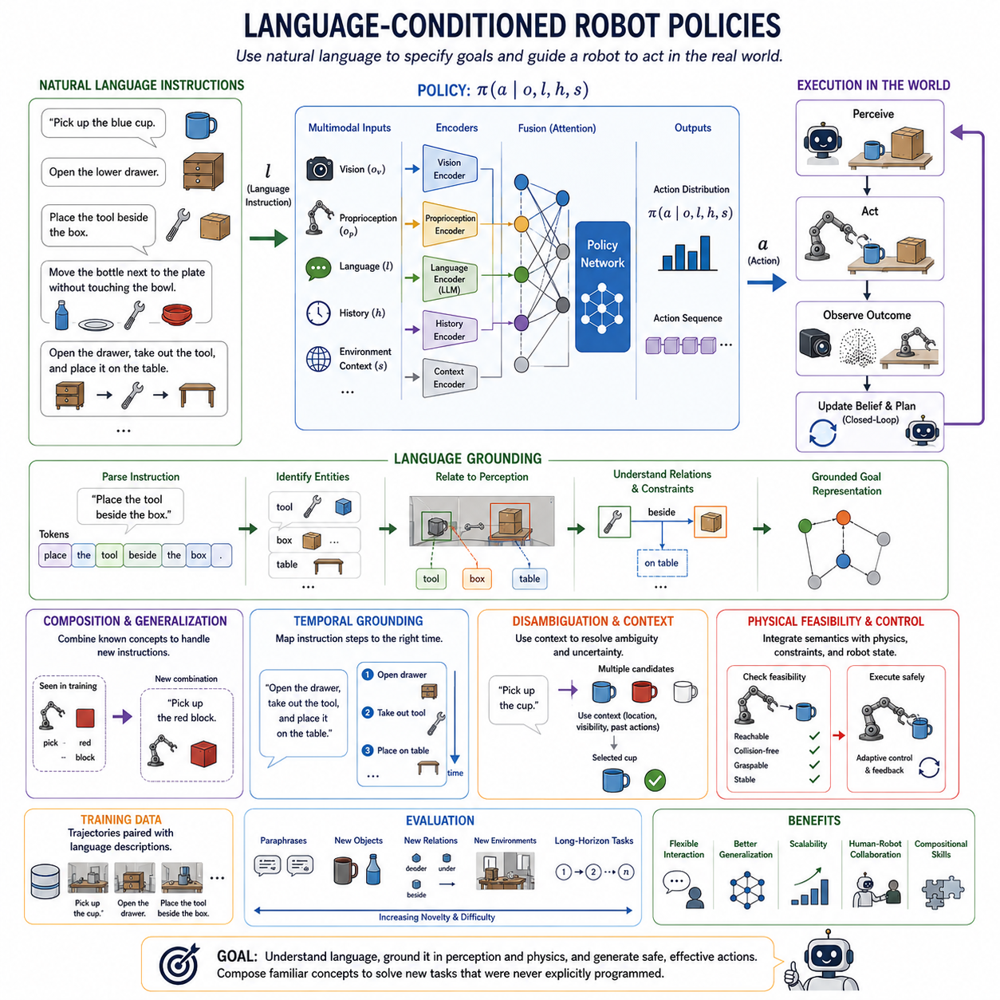{width="7.268055555555556in" height="7.268055555555556in"}

Language-conditioned robot policies use natural language as a flexible interface for specifying what a robot should do. Instead of assigning every behavior a fixed task identifier, the policy receives instructions such as "pick up the blue cup," "open the lower drawer," or "place the tool beside the box." Language provides semantic task context that can connect perception, goals, objects, relations, and actions within a shared policy.

A basic language-conditioned policy can be represented as π(a \| o, l), where a denotes the robot action, o represents observations, and l represents a language instruction. More capable systems may additionally condition on proprioception, action history, memory, and environmental context. The policy must transform these heterogeneous inputs into representations that jointly describe the physical situation, the requested objective, and the behavior needed to achieve it.

Language conditioning differs fundamentally from using discrete task IDs. A task ID identifies a known behavior but contains little information about its meaning or relationship to other tasks. Language can describe compositional structure through verbs, nouns, attributes, spatial relations, and constraints. Instructions involving "pick," "red," "block," and "inside" therefore contain reusable concepts that may also appear in many other commands.

This compositional structure creates an important path toward generalization. A robot may have encountered red cups, blue blocks, and commands involving picking during training without seeing the exact instruction "pick up the red block." If its representations capture the underlying concepts independently and combine them correctly, the policy may execute the new instruction without a dedicated training example for that exact combination.

Language must first be grounded in perception before it can guide physical action. When instructed to "move the bottle next to the plate," the robot must identify the bottle and plate in its observations and determine their spatial relationship. Language grounding therefore links linguistic tokens or embeddings to objects, regions, attributes, relationships, and potentially affordances within the perceived scene rather than treating instructions as isolated text.

Grounding also requires understanding action semantics. Words such as pick, push, open, insert, pour, and place correspond to different physical interaction patterns and constraints. The meaning of an action cannot be reduced to its linguistic definition because successful execution depends on geometry, contact, force, robot kinematics, and environmental state. Language-conditioned policies must therefore connect semantic action concepts with executable sensorimotor behavior.

Modern policies typically encode language using a pretrained language model or multimodal foundation model. The resulting language embeddings can be combined with visual tokens, proprioceptive features, and temporal information through attention or other fusion mechanisms. This allows the action model to focus on observation features that are relevant to the instruction while retaining broader semantic knowledge acquired during large-scale pretraining.

Vision-language representations are particularly valuable because they can provide semantic associations learned from large image-text datasets. Concepts such as object categories, colors, materials, activities, and spatial descriptions may already be represented before robot-specific training begins. Robot learning can then connect these semantic representations to actions, allowing the policy to leverage broader visual and linguistic knowledge while acquiring the physical grounding required for control.

Language can specify not only target objects but also goals, relationships, ordering, and constraints. "Put the cup on the tray" identifies an object and destination, while "move the cup without touching the bowl" introduces an additional behavioral restriction. More complex instructions may describe sequences such as "open the drawer, take out the tool, and place it on the table," requiring the policy to maintain linguistic intent across multiple stages of execution.

Long instructions create a temporal grounding problem because different parts of the instruction become relevant at different moments. The robot should focus on opening the drawer before attempting to retrieve the tool, and retrieval must occur before placement. Temporal attention, memory, hierarchical policies, or intermediate subgoal representations can help connect linguistic structure to the evolving physical state and maintain progress through long-horizon tasks.

Language-conditioned policies can also support corrections and contextual updates. If a user changes the instruction from "place the cup on the table" to "put it on the tray instead," the policy should incorporate the revised goal without requiring a new controller. This flexibility makes language useful as an interactive control layer through which humans can communicate intent while the robot determines the detailed actions required for physical execution.

Ambiguity remains a major challenge. An instruction such as "pick up the cup" may be underspecified when several cups are visible, while words such as "near," "large," or "carefully" may depend on context. A robust system must use perceptual and task context to resolve ambiguity when possible and recognize uncertainty when the intended interpretation is insufficiently clear. Incorrect semantic grounding can otherwise produce physically inappropriate actions.

Language understanding alone is therefore insufficient for reliable robot control. A language model may correctly interpret what "place the glass on the shelf" means while lacking accurate knowledge of reachability, collision constraints, grasp stability, or the current robot configuration. The policy must integrate semantic reasoning with physical state estimation and control so that linguistically appropriate intentions are translated into actions that are actually feasible in the environment.

Training data for language-conditioned policies commonly pairs robot trajectories with instructions or goal descriptions. These annotations may originate from human operators, scripted task templates, automatic labeling systems, or models that describe existing demonstrations. Variation in linguistic descriptions is valuable because the same behavior can be expressed in multiple ways, reducing dependence on specific wording and encouraging representations that capture instruction meaning rather than memorized phrases.

Evaluation should test more than performance on familiar instruction templates. A policy can be tested with paraphrases, new object references, unseen attribute combinations, novel spatial relations, and instructions that combine previously learned concepts. Stronger evaluations also vary the physical environment simultaneously, determining whether the policy can ground unfamiliar linguistic combinations in changing scenes rather than simply matching commands to memorized trajectories.

Ultimately, language-conditioned robot policies transform language from a descriptive modality into an actionable control signal. Their generality comes from combining semantic representations, visual grounding, physical skills, temporal context, and closed-loop execution within a shared policy. When these elements are effectively integrated, language becomes a scalable mechanism for specifying many robot behaviors and for composing familiar concepts into tasks that were not explicitly programmed in advance.

언어 조건부 로봇 정책(language-conditioned robot policy)은 자연어(natural language)를 로봇이 무엇을 수행해야 하는지 지정하는 유연한 인터페이스(interface)로 사용한다. 모든 행동에 고정된 작업 식별자(task identifier)를 할당하는 대신, 정책은 "파란색 컵을 집어라", "아래쪽 서랍을 열어라", "도구를 상자 옆에 놓아라"와 같은 명령을 입력받는다. 언어는 지각(perception), 목표(goal), 객체(object), 관계(relation), 행동(action)을 하나의 공유 정책(shared policy) 안에서 연결하는 의미적 작업 맥락(semantic task context)을 제공한다.

기본적인 언어 조건부 정책은 π(a \| o, l)로 표현할 수 있으며, 여기서 a는 로봇 행동(robot action), o는 관측(observation), l은 언어 명령(language instruction)을 의미한다. 더욱 발전된 시스템은 고유수용감각(proprioception), 행동 이력(action history), 메모리(memory), 환경 맥락(environmental context)을 추가적인 조건으로 사용할 수 있다. 정책은 이러한 이질적인 입력을 현재의 물리적 상황, 요청된 목표, 그리고 이를 달성하는 데 필요한 행동을 함께 설명하는 표현(representation)으로 변환해야 한다.

언어 조건화(language conditioning)는 이산 작업 ID(discrete task ID)를 사용하는 방식과 근본적으로 다르다. 작업 ID는 알려진 행동을 식별하지만 그 행동의 의미나 다른 작업과의 관계에 대한 정보는 거의 포함하지 않는다. 언어는 동사(verb), 명사(noun), 속성(attribute), 공간 관계(spatial relation), 제약조건(constraint)을 통해 조합적 구조(compositional structure)를 표현할 수 있다. 따라서 "집기(pick)", "빨간색(red)", "블록(block)", "내부(inside)"와 같은 요소는 다양한 명령에서 재사용할 수 있는 개념이 된다.

이러한 조합적 구조는 일반화(generalization)를 위한 중요한 경로를 제공한다. 로봇이 학습 과정에서 빨간색 컵, 파란색 블록, 그리고 집기와 관련된 명령을 경험했지만 정확히 "빨간색 블록을 집어라"라는 명령은 경험하지 않았을 수 있다. 정책의 표현이 기본 개념들을 독립적으로 포착하고 이를 올바르게 결합할 수 있다면, 해당 조합에 대한 별도의 학습 사례가 없어도 새로운 명령을 실행할 가능성이 있다.

언어가 물리적 행동을 안내하려면 먼저 지각(perception)에 그 의미가 그라운딩(grounding)되어야 한다. "병을 접시 옆으로 옮겨라"라는 명령을 받으면 로봇은 관측에서 병과 접시를 식별하고 이들의 공간적 관계를 파악해야 한다. 따라서 언어 그라운딩(language grounding)은 명령을 독립된 텍스트로 처리하는 것이 아니라 언어 토큰(token)이나 임베딩(embedding)을 지각된 장면의 객체, 영역(region), 속성, 관계, 잠재적인 어포던스(affordance)와 연결한다.

그라운딩은 행동 의미론(action semantics)에 대한 이해도 필요로 한다. 집기(pick), 밀기(push), 열기(open), 삽입하기(insert), 따르기(pour), 놓기(place)와 같은 단어는 서로 다른 물리적 상호작용 패턴과 제약조건에 대응한다. 행동의 의미는 언어적 정의만으로 환원할 수 없으며, 성공적인 실행은 기하학(geometry), 접촉(contact), 힘(force), 로봇 운동학(robot kinematics), 환경 상태(environmental state)에 영향을 받는다. 따라서 언어 조건부 정책은 의미적 행동 개념을 실행 가능한 감각운동 행동(sensorimotor behavior)과 연결해야 한다.

현대적인 정책은 일반적으로 사전학습 언어 모델(pretrained language model)이나 멀티모달 파운데이션 모델(multimodal foundation model)을 사용하여 언어를 인코딩(encoding)한다. 생성된 언어 임베딩(language embedding)은 어텐션(attention)이나 다른 융합 메커니즘(fusion mechanism)을 통해 시각 토큰(visual token), 고유수용감각 특징(proprioceptive feature), 시간 정보(temporal information)와 결합될 수 있다. 이를 통해 행동 모델은 대규모 사전학습에서 획득한 폭넓은 의미적 지식을 유지하면서 명령과 관련된 관측 특징에 집중할 수 있다.

비전-언어 표현(vision-language representation)은 대규모 이미지-텍스트 데이터셋(image-text dataset)에서 학습된 의미적 연관성을 제공할 수 있기 때문에 특히 유용하다. 객체 범주, 색상, 재질, 활동, 공간적 설명과 같은 개념은 로봇 특화 학습(robot-specific training)이 시작되기 전부터 이미 표현되어 있을 수 있다. 이후 로봇 학습은 이러한 의미적 표현을 행동과 연결하여, 정책이 폭넓은 시각 및 언어 지식을 활용하면서 제어에 필요한 물리적 그라운딩(physical grounding)을 습득하도록 할 수 있다.

언어는 목표 객체뿐만 아니라 목표(goal), 관계(relation), 순서(ordering), 제약조건도 지정할 수 있다. "컵을 트레이 위에 놓아라"는 객체와 목적지를 지정하는 반면, "그릇에 닿지 않도록 컵을 이동시켜라"는 추가적인 행동 제약조건을 제공한다. 더욱 복잡한 명령은 "서랍을 열고, 도구를 꺼낸 다음, 테이블 위에 놓아라"와 같은 시퀀스(sequence)를 설명할 수 있으며, 이 경우 정책은 여러 실행 단계에 걸쳐 언어적 의도(linguistic intent)를 유지해야 한다.

긴 명령(long instruction)은 명령의 서로 다른 부분이 실행 과정의 서로 다른 시점에서 중요해지기 때문에 시간적 그라운딩 문제(temporal grounding problem)를 발생시킨다. 로봇은 도구를 꺼내기 전에 서랍을 여는 데 집중해야 하며, 도구를 배치하기 전에 먼저 꺼내야 한다. 시간적 어텐션(temporal attention), 메모리, 계층적 정책(hierarchical policy), 중간 하위 목표 표현(intermediate subgoal representation)은 언어 구조를 변화하는 물리적 상태와 연결하고 장기 지평 작업(long-horizon task)의 진행 상태를 유지하도록 지원할 수 있다.

언어 조건부 정책은 수정 명령(correction)과 맥락 갱신(contextual update)도 지원할 수 있다. 사용자가 "컵을 테이블 위에 놓아라"라는 명령을 "대신 트레이 위에 놓아라"로 변경하면 정책은 새로운 제어기를 필요로 하지 않고 수정된 목표를 반영해야 한다. 이러한 유연성은 인간이 언어를 통해 의도(intent)를 전달하고 로봇이 물리적 실행에 필요한 세부 행동을 결정할 수 있도록 하는 상호작용형 제어 계층(interactive control layer)으로서 언어를 유용하게 만든다.

모호성(ambiguity)은 여전히 중요한 과제로 남아 있다. 여러 개의 컵이 보이는 상황에서 "컵을 집어라"라는 명령은 충분한 정보가 없을 수 있으며, "가까이(near)", "큰(large)", "조심스럽게(carefully)"와 같은 표현은 맥락에 따라 의미가 달라질 수 있다. 강건한 시스템(robust system)은 가능한 경우 지각 및 작업 맥락을 사용하여 모호성을 해결하고, 의도된 해석이 충분히 명확하지 않을 때 불확실성(uncertainty)을 인식해야 한다. 잘못된 의미적 그라운딩(semantic grounding)은 물리적으로 부적절한 행동으로 이어질 수 있다.

따라서 언어 이해(language understanding)만으로는 신뢰할 수 있는 로봇 제어를 구현하기에 충분하지 않다. 언어 모델(language model)은 "유리잔을 선반 위에 놓아라"라는 명령의 의미를 정확히 이해하더라도 도달 가능성(reachability), 충돌 제약조건(collision constraint), 파지 안정성(grasp stability), 현재 로봇 구성(robot configuration)에 대한 정확한 지식이 부족할 수 있다. 정책은 의미적 추론(semantic reasoning)을 물리적 상태 추정(physical state estimation) 및 제어와 통합하여 언어적으로 적절한 의도를 실제 환경에서 실행 가능한 행동으로 변환해야 한다.

언어 조건부 정책을 위한 학습 데이터(training data)는 일반적으로 로봇 궤적(robot trajectory)과 명령 또는 목표 설명(goal description)을 쌍으로 구성한다. 이러한 주석(annotation)은 인간 작업자, 스크립트 기반 작업 템플릿(scripted task template), 자동 라벨링 시스템(automatic labeling system), 기존 시연을 설명하는 모델 등으로부터 생성될 수 있다. 동일한 행동을 다양한 방식으로 표현하는 언어적 다양성(linguistic diversity)은 특정 표현에 대한 의존성을 줄이고, 정책이 암기된 문구보다 명령의 의미를 포착하는 표현을 학습하도록 한다.

평가는 익숙한 명령 템플릿(instruction template)에 대한 성능만을 테스트해서는 안 된다. 정책은 패러프레이즈(paraphrase), 새로운 객체 지시(new object reference), 경험하지 않은 속성 조합(unseen attribute combination), 새로운 공간 관계(novel spatial relation), 기존에 학습한 개념을 결합한 명령 등을 통해 평가할 수 있다. 더욱 강력한 평가는 물리적 환경까지 동시에 변화시켜 정책이 단순히 명령과 암기된 궤적을 연결하는 것이 아니라 변화하는 장면에서 익숙하지 않은 언어 조합을 실제 객체와 행동에 그라운딩할 수 있는지를 확인한다.

궁극적으로 언어 조건부 로봇 정책(language-conditioned robot policy)은 언어를 설명을 위한 모달리티(descriptive modality)에서 실행 가능한 제어 신호(actionable control signal)로 변화시킨다. 이러한 정책의 일반성(generality)은 의미적 표현, 시각적 그라운딩(visual grounding), 물리적 기술(physical skill), 시간적 맥락, 폐쇄 루프 실행(closed-loop execution)을 하나의 공유 정책 안에서 결합하는 데서 나온다. 이러한 요소들이 효과적으로 통합되면 언어는 다양한 로봇 행동을 지정하고 익숙한 개념들을 사전에 명시적으로 프로그래밍되지 않은 새로운 작업으로 조합할 수 있는 확장 가능한 메커니즘(scalable mechanism)이 된다.

## 06.05. Goal Conditioned and Context Conditioned Policies

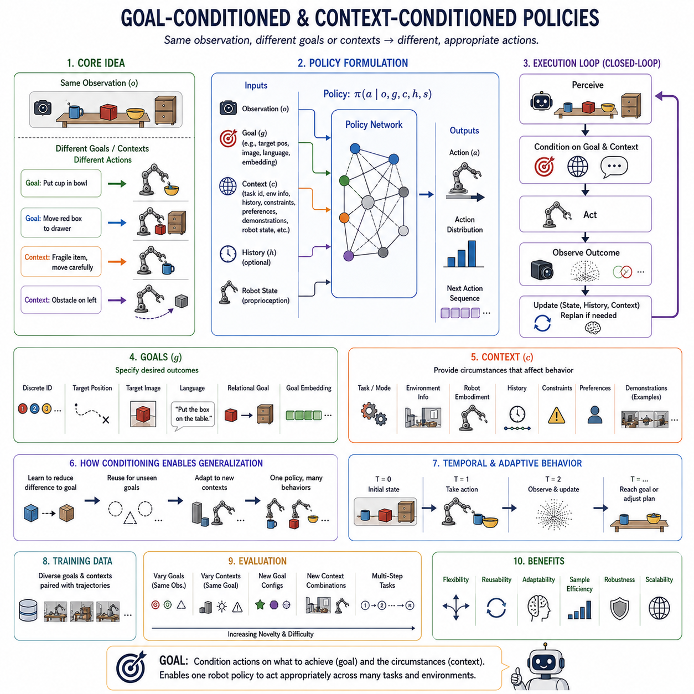{width="7.268055555555556in" height="7.268055555555556in"}

Goal-conditioned and context-conditioned policies allow a robot to select different behaviors from the same observed situation according to what should be achieved and under which circumstances it should act. Rather than mapping an observation directly to one predetermined action, these policies introduce additional conditioning variables that specify desired outcomes, environmental circumstances, prior events, or other information needed to determine appropriate behavior.

A goal-conditioned policy can be written as π(a \| o, g), where a represents the action, o represents the current observation, and g represents the desired goal. The goal changes the meaning of the same physical scene. When several objects are visible, for example, the robot may approach one object, manipulate another, or move toward a destination depending on the goal supplied to the policy.

Goals can be represented in many forms. A simple system may use a discrete goal identifier, while more general systems can condition on target positions, desired robot states, object configurations, images, language descriptions, or learned goal embeddings. The representation should contain enough information for the policy to compare the current situation with the desired outcome and determine which actions can reduce the difference between them.

Goal conditioning separates the specification of what should happen from the mechanism that generates actions. This separation enables one shared policy to support many objectives without training an entirely independent controller for each one. Reaching different positions, placing objects at different destinations, or navigating toward different locations can all be interpreted as variations of a common behavior conditioned by different goals.

Context conditioning extends this idea by incorporating information that may not explicitly describe the final objective but still influences how the robot should behave. A context-conditioned policy may be represented as π(a \| o, c), where c can include task identity, environment information, robot embodiment, action history, user preferences, demonstrations, constraints, or other signals. Context determines which interpretation and behavior are appropriate in the current situation.

The distinction between goal and context is useful but not always absolute. A target image may represent a goal in one system while functioning as contextual information in another. Language can describe a desired outcome, operational constraints, or both. More generally, robot policies can be represented as π(a \| o, g, c), combining explicit goals with broader contextual information to determine actions under changing physical circumstances.

Consider a robot standing near several containers. A goal such as "object A inside container B" specifies the desired final relationship, while context may indicate that one route is blocked, a fragile object must be handled carefully, or a particular gripper is installed. The goal determines what success means, whereas context influences which actions are feasible, safe, efficient, or appropriate for reaching that success state.

Goal representations can support generalization when they encode meaningful structure rather than arbitrary task labels. If a policy learns how actions transform current states toward target states, it may reuse this knowledge for goals not encountered exactly during training. Spatial targets, relational goals, semantic descriptions, and learned embeddings can expose similarities between objectives and allow experience collected for one goal to improve performance on related goals.

Context representations provide a complementary route to generalization because they allow behavior to adapt without replacing the underlying policy. The same navigation capability may operate differently depending on obstacle density, available sensors, robot geometry, or operational constraints. Likewise, the same manipulation skill may change its approach direction, force, speed, or grasp strategy according to object properties and surrounding conditions.

Multimodal foundation models can provide rich representations for both goals and contexts. Vision can encode target appearances and environmental structure, language can describe desired outcomes and constraints, proprioception can represent the robot\'s physical state, and history can describe recent interactions. Attention-based fusion allows the policy to combine these signals dynamically and emphasize the information most relevant to the current decision.

Temporal context is particularly important in tasks whose correct action depends on what happened previously. Two observations may appear almost identical while requiring different actions because the robot has already completed a subtask, attempted an unsuccessful grasp, or received a revised instruction. Action history, recurrent state, memory, and temporal attention can preserve information that is not recoverable from the current observation alone.

Demonstrations can also function as context. Instead of specifying a task with a predefined identifier or detailed language instruction, a robot may receive one or more example trajectories showing the intended behavior. The policy can infer relevant goals, interaction patterns, or strategies from these examples. This form of conditioning is useful for few-shot adaptation because new behaviors can potentially be communicated without modifying the model parameters.

Conditioning mechanisms must ensure that the policy actually uses the supplied goal or context. A model trained on biased data may discover shortcuts and ignore conditioning variables when observations alone strongly predict actions. Training datasets should therefore contain situations in which similar observations correspond to different actions under different goals or contexts. Such contrastive variation forces the policy to learn that conditioning information is necessary for correct behavior.

Goal achievement also requires continuous feedback rather than a single prediction from the initial state. After every action, the environment changes and the robot receives new observations. The policy can repeatedly compare the evolving state with the goal and adjust its behavior. This closed-loop process enables correction when execution deviates from expectation and naturally supports tasks in which the precise action sequence cannot be determined beforehand.

Context can change during execution as well. An obstacle may appear, an object may move, a human may provide a new constraint, or the robot may discover that a planned interaction is infeasible. A context-sensitive policy should incorporate these changes and modify its behavior while preserving the higher-level objective. This capability connects conditioning with online adaptation, failure recovery, and closed-loop replanning.

Evaluation should determine whether a policy follows the conditioning signal rather than merely succeeding on familiar trajectories. Tests can hold observations constant while changing goals, or preserve goals while varying context. Stronger evaluation introduces unseen target configurations, new combinations of constraints, altered environments, or unfamiliar demonstrations. These tests reveal whether the model has learned a flexible conditional behavior space rather than a collection of memorized responses.

Ultimately, goal-conditioned and context-conditioned policies provide a general mechanism for transforming a shared robot model into many situation-dependent behaviors. Goals define desired outcomes, while context supplies the information needed to interpret and pursue those outcomes appropriately. Combined with multimodal representations, temporal memory, diverse training, and closed-loop feedback, conditioning enables robot policies to become more flexible, reusable, and adaptable across tasks and environments.

목표 조건부 정책(goal-conditioned policy)과 맥락 조건부 정책(context-conditioned policy)은 동일한 상황을 관측하더라도 무엇을 달성해야 하는지, 그리고 어떤 상황에서 행동해야 하는지에 따라 로봇이 서로 다른 행동을 선택할 수 있도록 한다. 이러한 정책은 관측을 하나의 미리 결정된 행동으로 직접 매핑하는 대신, 원하는 결과, 환경적 상황, 이전 사건 또는 적절한 행동을 결정하는 데 필요한 추가 정보를 나타내는 조건화 변수(conditioning variable)를 도입한다.

목표 조건부 정책은 π(a \| o, g)로 표현할 수 있으며, 여기서 a는 행동(action), o는 현재 관측(observation), g는 원하는 목표(goal)를 나타낸다. 목표는 동일한 물리적 장면의 의미를 변화시킨다. 예를 들어 여러 객체가 보이는 상황에서도 정책에 제공되는 목표에 따라 로봇은 특정 객체에 접근하거나, 다른 객체를 조작하거나, 특정 목적지를 향해 이동할 수 있다.

목표는 다양한 형태로 표현될 수 있다. 단순한 시스템은 이산 목표 식별자(discrete goal identifier)를 사용할 수 있지만, 보다 일반적인 시스템은 목표 위치(target position), 원하는 로봇 상태(desired robot state), 객체 구성(object configuration), 이미지, 언어 설명(language description), 또는 학습된 목표 임베딩(learned goal embedding)을 조건으로 사용할 수 있다. 목표 표현은 정책이 현재 상황과 원하는 결과를 비교하고 그 차이를 줄일 수 있는 행동을 결정하기에 충분한 정보를 포함해야 한다.

목표 조건화(goal conditioning)는 무엇이 일어나야 하는지를 지정하는 과정과 행동을 생성하는 메커니즘을 분리한다. 이러한 분리를 통해 각각의 목표마다 완전히 독립적인 제어기(controller)를 학습하지 않고도 하나의 공유 정책(shared policy)이 다양한 목표를 지원할 수 있다. 서로 다른 위치에 도달하거나, 객체를 서로 다른 목적지에 배치하거나, 다양한 위치를 향해 이동하는 행동은 모두 서로 다른 목표에 의해 조건화되는 공통 행동의 변형으로 해석할 수 있다.

맥락 조건화(context conditioning)는 최종 목표를 명시적으로 설명하지 않더라도 로봇이 어떻게 행동해야 하는지에 영향을 주는 정보를 포함함으로써 이러한 개념을 확장한다. 맥락 조건부 정책은 π(a \| o, c)로 표현할 수 있으며, 여기서 c는 작업 정체성(task identity), 환경 정보, 로봇 임바디먼트(robot embodiment), 행동 이력(action history), 사용자 선호도(user preference), 시연(demonstration), 제약조건(constraint) 또는 기타 신호를 포함할 수 있다. 맥락은 현재 상황에서 어떤 해석과 행동이 적절한지를 결정한다.

목표와 맥락의 구분은 유용하지만 항상 절대적인 것은 아니다. 목표 이미지(target image)는 어떤 시스템에서는 목표를 나타내지만 다른 시스템에서는 맥락 정보(contextual information)로 사용될 수 있다. 언어는 원하는 결과, 운용 제약조건(operational constraint), 또는 이 둘을 모두 설명할 수 있다. 보다 일반적으로 로봇 정책은 π(a \| o, g, c)로 표현할 수 있으며, 명시적인 목표와 더 폭넓은 맥락 정보를 결합하여 변화하는 물리적 상황에서 행동을 결정한다.

여러 용기 근처에 있는 로봇을 생각해 볼 수 있다. "객체 A를 용기 B 안에 배치"와 같은 목표는 원하는 최종 관계를 지정하는 반면, 맥락은 하나의 경로가 차단되어 있거나, 깨지기 쉬운 객체를 조심스럽게 다루어야 하거나, 특정 그리퍼(gripper)가 장착되어 있다는 정보를 제공할 수 있다. 목표는 성공의 의미를 결정하는 반면, 맥락은 성공 상태에 도달하기 위해 어떤 행동이 실행 가능하고, 안전하며, 효율적이고, 적절한지를 결정하는 데 영향을 준다.

목표 표현(goal representation)이 임의의 작업 레이블(task label)이 아니라 의미 있는 구조를 인코딩하면 일반화(generalization)를 지원할 수 있다. 정책이 현재 상태를 목표 상태로 변화시키는 행동의 방식을 학습한다면, 학습 과정에서 정확히 경험하지 않은 목표에도 이러한 지식을 재사용할 수 있다. 공간적 목표(spatial target), 관계적 목표(relational goal), 의미적 설명(semantic description), 학습된 임베딩은 서로 다른 목표 사이의 유사성을 나타내고 하나의 목표에서 수집된 경험이 관련 목표의 성능을 향상시키도록 할 수 있다.

맥락 표현(context representation)은 기본 정책을 교체하지 않고 행동을 적응시킬 수 있기 때문에 일반화를 위한 상호보완적인 경로를 제공한다. 동일한 내비게이션 능력(navigation capability)도 장애물 밀도, 사용 가능한 센서, 로봇 형상(robot geometry), 운용 제약조건에 따라 다르게 작동할 수 있다. 마찬가지로 동일한 조작 기술(manipulation skill)도 객체의 특성과 주변 조건에 따라 접근 방향, 힘(force), 속도(speed), 파지 전략(grasp strategy)을 변경할 수 있다.

멀티모달 파운데이션 모델(multimodal foundation model)은 목표와 맥락 모두를 위한 풍부한 표현을 제공할 수 있다. 비전(vision)은 목표의 외형과 환경 구조를 인코딩하고, 언어(language)는 원하는 결과와 제약조건을 설명하며, 고유수용감각(proprioception)은 로봇의 물리적 상태를 나타내고, 이력(history)은 최근 상호작용을 설명할 수 있다. 어텐션 기반 융합(attention-based fusion)은 정책이 이러한 신호를 동적으로 결합하고 현재 의사결정에 가장 관련성이 높은 정보에 집중하도록 한다.

시간적 맥락(temporal context)은 올바른 행동이 이전에 발생한 사건에 따라 달라지는 작업에서 특히 중요하다. 두 관측이 거의 동일하게 보이더라도 로봇이 이미 하위 작업(subtask)을 완료했거나, 파지를 시도했다가 실패했거나, 수정된 명령을 받았다면 서로 다른 행동이 필요할 수 있다. 행동 이력, 순환 상태(recurrent state), 메모리, 시간적 어텐션(temporal attention)은 현재 관측만으로는 복원할 수 없는 정보를 유지할 수 있다.

시연(demonstration) 역시 맥락으로 사용될 수 있다. 미리 정의된 식별자나 상세한 언어 명령으로 작업을 지정하는 대신, 로봇은 의도된 행동을 보여주는 하나 이상의 예제 궤적(example trajectory)을 제공받을 수 있다. 정책은 이러한 예제로부터 관련 목표, 상호작용 패턴, 전략을 추론할 수 있다. 이러한 형태의 조건화는 모델 매개변수(model parameter)를 변경하지 않고 새로운 행동을 전달할 가능성을 제공하기 때문에 퓨샷 적응(few-shot adaptation)에 유용하다.

조건화 메커니즘(conditioning mechanism)은 정책이 제공된 목표나 맥락을 실제로 사용하도록 보장해야 한다. 편향된 데이터(biased data)로 학습된 모델은 관측만으로 행동을 강하게 예측할 수 있는 경우 지름길(shortcut)을 발견하고 조건화 변수를 무시할 수 있다. 따라서 학습 데이터셋은 유사한 관측에서도 서로 다른 목표나 맥락에 따라 서로 다른 행동이 요구되는 상황을 포함해야 한다. 이러한 대조적 변화(contrastive variation)는 정책이 올바른 행동을 위해 조건화 정보가 필요하다는 것을 학습하도록 한다.

목표 달성(goal achievement)은 초기 상태에서 한 번의 예측만 수행하는 것이 아니라 지속적인 피드백(continuous feedback)을 필요로 한다. 각 행동 이후 환경은 변화하고 로봇은 새로운 관측을 얻는다. 정책은 변화하는 상태와 목표를 반복적으로 비교하면서 행동을 조정할 수 있다. 이러한 폐쇄 루프 과정(closed-loop process)은 실행이 예상에서 벗어났을 때 행동을 수정할 수 있게 하며, 정확한 행동 시퀀스를 사전에 결정하기 어려운 작업을 자연스럽게 지원한다.

맥락 역시 실행 중에 변화할 수 있다. 새로운 장애물이 나타나거나, 객체가 움직이거나, 사람이 새로운 제약조건을 제공하거나, 로봇이 계획했던 상호작용이 실행 불가능하다는 것을 발견할 수 있다. 맥락 민감형 정책(context-sensitive policy)은 상위 수준의 목표를 유지하면서 이러한 변화를 반영하여 행동을 수정해야 한다. 이러한 능력은 조건화를 온라인 적응(online adaptation), 실패 복구(failure recovery), 폐쇄 루프 재계획(closed-loop replanning)과 연결한다.

평가에서는 정책이 단순히 익숙한 궤적을 성공적으로 재현하는 것이 아니라 실제로 조건화 신호(conditioning signal)를 따르는지를 확인해야 한다. 관측을 동일하게 유지하면서 목표를 변경하거나, 목표는 유지하면서 맥락을 변화시키는 방식으로 테스트할 수 있다. 더 강력한 평가에서는 미지의 목표 구성(unseen target configuration), 새로운 제약조건 조합, 변경된 환경, 익숙하지 않은 시연 등을 도입한다. 이러한 평가는 모델이 암기된 반응의 집합이 아니라 유연한 조건부 행동 공간(conditional behavior space)을 학습했는지를 보여준다.

궁극적으로 목표 조건부 정책(goal-conditioned policy)과 맥락 조건부 정책(context-conditioned policy)은 하나의 공유 로봇 모델(shared robot model)을 다양한 상황 의존적 행동(situation-dependent behavior)으로 변환하는 일반적인 메커니즘을 제공한다. 목표는 원하는 결과를 정의하고, 맥락은 이러한 결과를 적절하게 해석하고 추구하는 데 필요한 정보를 제공한다. 멀티모달 표현(multimodal representation), 시간적 메모리(temporal memory), 다양한 학습 데이터, 폐쇄 루프 피드백과 결합된 조건화는 로봇 정책이 여러 작업과 환경에서 더욱 유연하고 재사용 가능하며 적응 가능한 행동을 수행하도록 한다.

## 06.06. Behavior Cloning and Imitation Pretraining

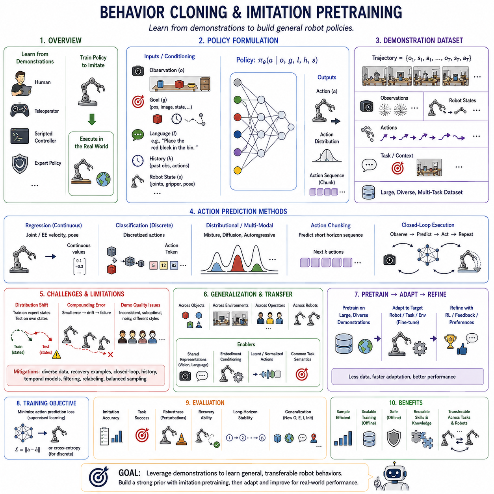{width="7.268055555555556in" height="7.268055555555556in"}

Behavior cloning is one of the most direct approaches for teaching robots from demonstrations. Instead of discovering useful behavior through trial and error, the robot observes trajectories produced by humans, teleoperators, scripted controllers, or expert policies and learns to reproduce their actions. This converts robot learning into a supervised prediction problem in which demonstrated observations are mapped to corresponding actions.

A behavior cloning policy can be expressed as πθ(a \| o), where the parameters θ are optimized so that predicted actions resemble expert actions contained in the training dataset. More general formulations condition the policy on goals, language, robot state, history, or task context, producing mappings such as πθ(a \| o, g, l, h). The learning objective remains fundamentally based on predicting actions demonstrated in collected trajectories.

A demonstration dataset typically contains sequences of observations, robot states, actions, and optional task descriptions. Observations may include RGB images, depth, tactile sensing, or other environmental measurements, while robot states can contain joint positions, velocities, gripper states, and end-effector poses. Each trajectory therefore records how perception and action evolve together while an expert performs a physical task.

The main advantage of behavior cloning is its simplicity and scalability. Once demonstrations have been collected, policy training can use conventional supervised-learning infrastructure without repeatedly interacting with the physical environment. This is particularly valuable in robotics, where online exploration can be slow, expensive, and potentially unsafe. Large offline datasets can therefore support extensive training before a policy is deployed on real hardware.

Imitation pretraining extends behavior cloning from learning a single task to learning broad behavioral representations from large and diverse collections of demonstrations. A policy may be pretrained on manipulation, navigation, object interaction, tool use, and other behaviors across many environments. The resulting model develops a behavioral prior that can later be adapted to particular tasks rather than learning every new behavior from randomly initialized parameters.

Diversity is essential for effective imitation pretraining. If demonstrations contain only one object, viewpoint, environment, or execution style, the policy may reproduce those narrow conditions without learning transferable structure. Data collected across different objects, layouts, operators, robots, goals, and task variations encourages the model to identify recurring relationships between perception, intent, physical state, and action.

Multi-task imitation datasets commonly associate each trajectory with task-conditioning information. This conditioning may consist of discrete task labels, language instructions, goal images, target states, or learned embeddings. During training, the policy learns both shared motor patterns and the distinctions required by individual objectives. One model can consequently acquire reaching, grasping, pushing, placing, opening, and other skills while selecting among them according to context.

Language-labeled demonstrations are especially useful for generalist robot policies. A trajectory paired with an instruction such as "place the red block in the container" connects semantic concepts with the physical actions required to accomplish them. Across many examples, the policy can learn relationships between words, visual entities, spatial configurations, and motor behavior, providing a foundation for language-conditioned control and compositional task generalization.

Behavior cloning can predict actions in several ways depending on the action representation. Continuous joint commands or end-effector motions may be learned through regression, while discretized actions can be predicted as categorical tokens. More expressive policies can model multimodal action distributions using mixture models, autoregressive prediction, diffusion policies, or action chunking, reducing the limitations of predicting a single average action when several valid behaviors exist.

Action chunking predicts a short sequence of future actions rather than only the immediate next command. This can improve temporal consistency and reduce sensitivity to small prediction errors at every control step. For tasks containing coordinated motions such as grasping, insertion, or tool manipulation, chunks can capture locally coherent behavior while still allowing the robot to periodically observe the environment and update its subsequent action sequence.

A fundamental limitation of behavior cloning is distribution shift. During training, the policy observes states generated by expert behavior, but during deployment it encounters states generated by its own predictions. A small action error may move the robot into a state that is rare or absent in the demonstration dataset. The next prediction then becomes less reliable, causing additional errors that can accumulate until the task fails.

This problem is often described as compounding error. In a long-horizon task, even a policy with high single-step prediction accuracy may gradually drift away from expert trajectories. Demonstration diversity, recovery examples, closed-loop observations, temporal models, and interactive data collection can reduce this effect. Training data that includes imperfect states and corrective actions is particularly valuable because it teaches the policy how to recover rather than only how to behave when everything proceeds correctly.

Demonstration quality also strongly affects the learned policy. Human operators may use inconsistent strategies, execute unnecessary motions, or provide demonstrations with different levels of skill. Simply increasing dataset size does not guarantee better behavior if the additional data contains systematic errors or conflicting conventions. Filtering, trajectory scoring, normalization, relabeling, and balanced sampling can improve the effective quality of large imitation datasets.

Cross-embodiment imitation introduces another challenge because different robots may use different kinematics, sensors, grippers, and action spaces. Directly combining their low-level commands can be difficult even when they perform conceptually similar tasks. Shared visual-language representations, normalized action descriptions, embodiment conditioning, latent actions, and common task semantics can help separate transferable behavioral knowledge from robot-specific execution details.

Imitation pretraining becomes especially powerful when followed by task-specific adaptation. A broadly pretrained policy can be fine-tuned using a smaller dataset collected for a target robot, environment, or task. Because perception, semantic grounding, and reusable motor structures have already been learned, adaptation may require substantially less data than training from scratch. This makes pretraining a practical mechanism for transferring experience across robot applications.

Reinforcement learning can complement imitation after pretraining. Behavior cloning provides a strong initial policy that already performs meaningful actions, while reinforcement learning can optimize outcomes that are difficult to capture from demonstrations alone. Task success, efficiency, robustness, safety constraints, or preference-based rewards can be used to refine the pretrained behavior while avoiding much of the inefficient exploration associated with learning entirely from scratch.

Evaluation should distinguish imitation accuracy from actual task performance. Low action-prediction error on held-out demonstrations does not necessarily guarantee successful closed-loop execution because small errors can have different physical consequences. Policies should therefore be evaluated through task success, robustness to perturbations, recovery ability, long-horizon stability, and generalization to new objects, environments, instructions, and initial conditions.

Ultimately, behavior cloning and imitation pretraining transform demonstrations into a scalable source of behavioral knowledge. Behavior cloning provides the supervised mechanism for mapping observations and context to demonstrated actions, while imitation pretraining expands this mechanism across large and diverse experience collections. Combined with multimodal conditioning, temporal modeling, recovery data, adaptation, and policy refinement, it provides a central foundation for building broadly capable robot policies.

행동 복제(behavior cloning)는 시연(demonstration)을 통해 로봇을 학습시키는 가장 직접적인 접근법 중 하나이다. 시행착오(trial and error)를 통해 유용한 행동을 스스로 발견하도록 하는 대신, 로봇은 인간, 원격조작자(teleoperator), 스크립트 기반 제어기(scripted controller), 전문가 정책(expert policy)이 생성한 궤적(trajectory)을 관찰하고 그 행동을 재현하도록 학습한다. 이를 통해 로봇 학습은 시연된 관측을 해당 행동에 매핑하는 지도 예측 문제(supervised prediction problem)로 변환된다.

행동 복제 정책(behavior cloning policy)은 πθ(a \| o)로 표현할 수 있으며, 매개변수 θ는 예측된 행동이 학습 데이터셋에 포함된 전문가 행동(expert action)과 유사하도록 최적화된다. 보다 일반적인 형태에서는 정책을 목표(goal), 언어(language), 로봇 상태(robot state), 이력(history), 작업 맥락(task context)에 따라 조건화하여 πθ(a \| o, g, l, h)와 같은 매핑을 생성한다. 학습 목표의 본질은 수집된 궤적에서 시연된 행동을 예측하는 데 있다.

시연 데이터셋(demonstration dataset)은 일반적으로 관측, 로봇 상태, 행동, 선택적인 작업 설명(task description)의 시퀀스로 구성된다. 관측에는 RGB 이미지, 깊이(depth), 촉각 감지(tactile sensing), 기타 환경 측정값이 포함될 수 있으며, 로봇 상태에는 관절 위치(joint position), 속도(velocity), 그리퍼 상태(gripper state), 말단장치 자세(end-effector pose)가 포함될 수 있다. 따라서 각 궤적은 전문가가 물리적 작업을 수행하는 동안 지각과 행동이 어떻게 함께 변화하는지를 기록한다.

행동 복제의 주요 장점은 단순성과 확장성(scalability)이다. 시연이 수집되면 물리적 환경과 반복적으로 상호작용하지 않고도 기존의 지도학습 인프라(supervised-learning infrastructure)를 이용하여 정책을 학습할 수 있다. 이는 온라인 탐색(online exploration)이 느리고 비용이 많이 들며 잠재적으로 위험할 수 있는 로보틱스(robotics)에서 특히 중요하다. 따라서 대규모 오프라인 데이터셋(offline dataset)을 활용하여 실제 하드웨어에 정책을 배포하기 전에 광범위한 학습을 수행할 수 있다.

모방 사전학습(imitation pretraining)은 단일 작업을 학습하는 행동 복제를 대규모의 다양한 시연으로부터 폭넓은 행동 표현(behavioral representation)을 학습하는 방식으로 확장한다. 하나의 정책을 여러 환경의 조작(manipulation), 내비게이션(navigation), 객체 상호작용(object interaction), 도구 사용(tool use), 기타 행동에 대해 사전학습할 수 있다. 그 결과 모델은 새로운 행동을 무작위 초기화된 매개변수에서 처음부터 학습하는 대신 특정 작업에 적응시킬 수 있는 행동 사전지식(behavioral prior)을 형성한다.

효과적인 모방 사전학습을 위해서는 다양성(diversity)이 필수적이다. 시연에 하나의 객체, 시점(viewpoint), 환경 또는 실행 방식만 포함된다면 정책은 전이 가능한 구조(transferable structure)를 학습하지 못하고 이러한 제한된 조건만 재현할 수 있다. 서로 다른 객체, 배치(layout), 작업자(operator), 로봇, 목표, 작업 변화에서 수집된 데이터는 모델이 지각, 의도(intent), 물리적 상태, 행동 사이에서 반복적으로 나타나는 관계를 발견하도록 한다.

멀티태스크 모방 데이터셋(multi-task imitation dataset)은 일반적으로 각 궤적을 작업 조건화 정보(task-conditioning information)와 연결한다. 이러한 조건화에는 이산 작업 레이블(discrete task label), 언어 명령(language instruction), 목표 이미지(goal image), 목표 상태(target state), 학습된 임베딩(learned embedding)이 포함될 수 있다. 학습 과정에서 정책은 공유되는 운동 패턴과 개별 목표에 필요한 차이를 동시에 학습한다. 따라서 하나의 모델이 도달(reaching), 파지(grasping), 밀기(pushing), 배치(placing), 열기(opening) 등의 기술을 습득하고 맥락에 따라 적절한 기술을 선택할 수 있다.

언어 레이블이 포함된 시연(language-labeled demonstration)은 제너럴리스트 로봇 정책(generalist robot policy)에 특히 유용하다. "빨간 블록을 용기 안에 놓아라"와 같은 명령과 연결된 궤적은 의미적 개념(semantic concept)을 해당 목표를 달성하는 데 필요한 물리적 행동과 연결한다. 많은 사례를 통해 정책은 단어, 시각적 개체(visual entity), 공간 구성(spatial configuration), 운동 행동(motor behavior) 사이의 관계를 학습하여 언어 조건부 제어(language-conditioned control)와 조합적 작업 일반화(compositional task generalization)를 위한 기반을 구축할 수 있다.

행동 복제는 행동 표현(action representation)에 따라 여러 방식으로 행동을 예측할 수 있다. 연속적인 관절 명령(joint command)이나 말단장치 움직임(end-effector motion)은 회귀(regression)를 통해 학습할 수 있으며, 이산화된 행동(discretized action)은 범주형 토큰(categorical token)으로 예측할 수 있다. 보다 표현력이 높은 정책은 혼합 모델(mixture model), 자기회귀 예측(autoregressive prediction), 확산 정책(diffusion policy), 행동 청킹(action chunking)을 이용하여 다중모드 행동 분포(multimodal action distribution)를 모델링할 수 있으며, 여러 유효한 행동이 존재할 때 하나의 평균 행동을 예측하는 방식의 한계를 줄일 수 있다.

행동 청킹은 바로 다음 하나의 명령만 예측하는 대신 짧은 미래 행동 시퀀스를 예측한다. 이를 통해 시간적 일관성(temporal consistency)을 향상시키고 각 제어 단계에서 발생하는 작은 예측 오류에 대한 민감도를 줄일 수 있다. 파지, 삽입(insertion), 도구 조작과 같이 협응된 움직임(coordinated motion)이 필요한 작업에서 행동 청크(action chunk)는 국소적으로 일관된 행동을 포착하면서도 로봇이 주기적으로 환경을 다시 관측하고 이후의 행동 시퀀스를 갱신하도록 할 수 있다.

행동 복제의 근본적인 한계는 분포 변화(distribution shift)이다. 학습 중에는 정책이 전문가 행동으로 생성된 상태를 관측하지만, 실제 배포에서는 자신의 예측으로 생성된 상태를 경험하게 된다. 작은 행동 오류가 로봇을 시연 데이터셋에서 거의 나타나지 않거나 전혀 존재하지 않는 상태로 이동시킬 수 있다. 그러면 다음 행동 예측의 신뢰성이 낮아지고 추가적인 오류가 발생하여 결국 작업 실패로 이어질 수 있다.

이러한 문제는 일반적으로 누적 오류(compounding error)라고 한다. 장기 지평 작업(long-horizon task)에서는 단일 단계의 행동 예측 정확도가 높은 정책이라도 전문가 궤적에서 점차 벗어날 수 있다. 시연 다양성, 복구 사례(recovery example), 폐쇄 루프 관측(closed-loop observation), 시간적 모델(temporal model), 상호작용형 데이터 수집(interactive data collection)은 이러한 문제를 줄일 수 있다. 특히 불완전한 상태와 이를 수정하는 행동을 포함하는 학습 데이터는 모든 과정이 정상적으로 진행될 때의 행동뿐만 아니라 실패에서 복구하는 방법까지 정책이 학습하도록 한다.

시연 품질(demonstration quality) 역시 학습된 정책에 큰 영향을 미친다. 인간 작업자는 일관되지 않은 전략을 사용하거나 불필요한 움직임을 수행할 수 있으며, 서로 다른 숙련 수준으로 시연을 제공할 수도 있다. 추가 데이터에 체계적인 오류(systematic error)나 상충되는 규칙이 포함되어 있다면 단순히 데이터셋 크기를 증가시키는 것만으로 더 나은 행동이 보장되지는 않는다. 필터링(filtering), 궤적 점수화(trajectory scoring), 정규화(normalization), 재레이블링(relabeling), 균형 샘플링(balanced sampling)을 통해 대규모 모방 데이터셋의 실질적인 품질을 향상시킬 수 있다.

교차 임바디먼트 모방(cross-embodiment imitation)은 서로 다른 로봇이 각기 다른 운동학(kinematics), 센서, 그리퍼, 행동 공간(action space)을 사용할 수 있기 때문에 또 다른 과제를 제기한다. 개념적으로 유사한 작업을 수행하더라도 저수준 명령(low-level command)을 직접 결합하기는 어렵다. 공유 비전-언어 표현(shared vision-language representation), 정규화된 행동 표현(normalized action description), 임바디먼트 조건화(embodiment conditioning), 잠재 행동(latent action), 공통 작업 의미론(common task semantics)은 전이 가능한 행동 지식을 로봇 특화 실행(robot-specific execution)과 분리하는 데 도움을 줄 수 있다.

모방 사전학습은 이후 작업 특화 적응(task-specific adaptation)과 결합될 때 특히 강력해진다. 폭넓게 사전학습된 정책은 목표 로봇, 환경 또는 작업에서 수집된 더 작은 데이터셋을 이용하여 미세조정(fine-tuning)할 수 있다. 지각, 의미적 그라운딩(semantic grounding), 재사용 가능한 운동 구조가 이미 학습되어 있기 때문에 처음부터 학습하는 것보다 훨씬 적은 데이터로 적응할 수 있다. 따라서 사전학습은 서로 다른 로봇 응용 분야 사이에서 경험을 전이하기 위한 실용적인 메커니즘을 제공한다.

강화학습(reinforcement learning)은 사전학습 이후 모방 학습을 보완할 수 있다. 행동 복제는 이미 의미 있는 행동을 수행할 수 있는 강력한 초기 정책(initial policy)을 제공하며, 강화학습은 시연만으로 표현하기 어려운 결과를 최적화할 수 있다. 작업 성공(task success), 효율성(efficiency), 강건성(robustness), 안전 제약조건(safety constraint), 선호도 기반 보상(preference-based reward)을 이용하여 사전학습된 행동을 개선하면서 처음부터 학습할 때 필요한 비효율적인 탐색을 크게 줄일 수 있다.

평가에서는 모방 정확도(imitation accuracy)와 실제 작업 성능(task performance)을 구분해야 한다. 홀드아웃 시연(held-out demonstration)에 대한 행동 예측 오류가 낮더라도 작은 오류가 서로 다른 물리적 결과를 가져올 수 있기 때문에 성공적인 폐쇄 루프 실행이 반드시 보장되는 것은 아니다. 따라서 정책은 작업 성공률, 교란(perturbation)에 대한 강건성, 복구 능력(recovery ability), 장기 지평 안정성(long-horizon stability), 새로운 객체, 환경, 명령, 초기 조건에 대한 일반화를 통해 평가되어야 한다.

궁극적으로 행동 복제(behavior cloning)와 모방 사전학습(imitation pretraining)은 시연을 확장 가능한 행동 지식(behavioral knowledge)의 원천으로 변환한다. 행동 복제는 관측과 맥락을 시연된 행동에 매핑하는 지도학습 메커니즘을 제공하고, 모방 사전학습은 이를 대규모의 다양한 경험 집합으로 확장한다. 멀티모달 조건화(multimodal conditioning), 시간적 모델링(temporal modeling), 복구 데이터(recovery data), 적응(adaptation), 정책 개선(policy refinement)과 결합하면 폭넓은 능력을 갖춘 로봇 정책을 구축하기 위한 핵심 기반을 제공한다.

## 06.07. Reinforcement Learning and Policy Improvement

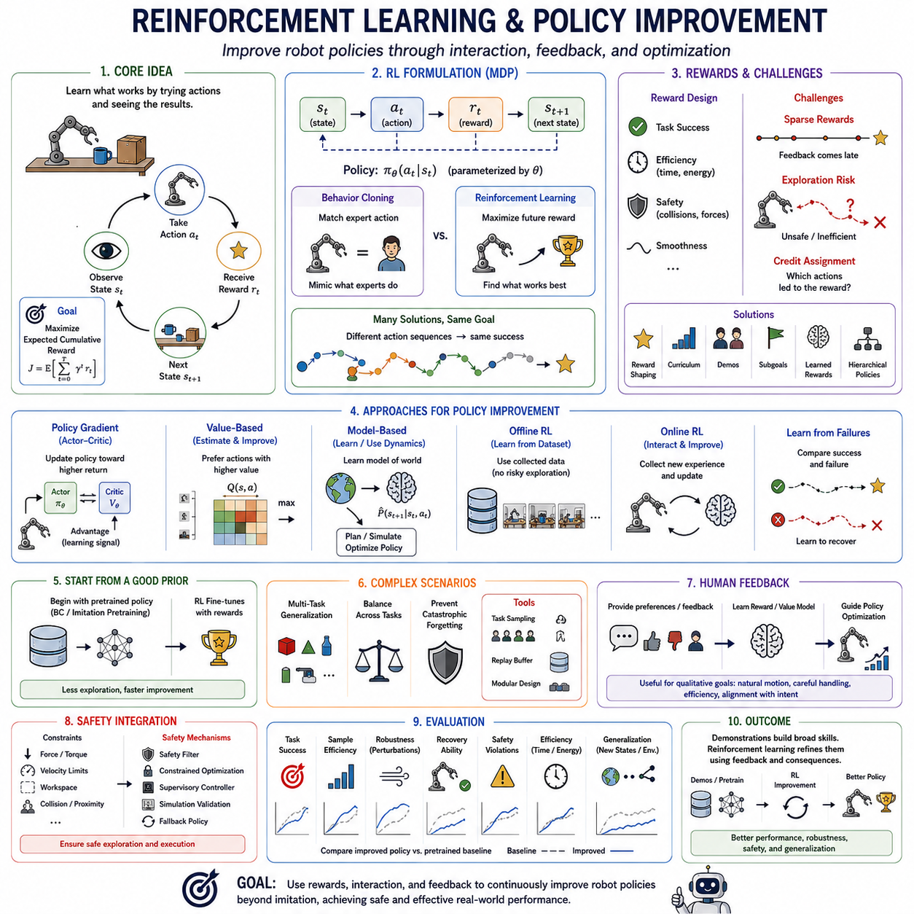{width="7.268055555555556in" height="7.268055555555556in"}

Reinforcement learning provides a framework for improving robot policies through interaction and feedback rather than relying only on demonstrations. The robot performs actions, observes their consequences, and receives signals indicating whether the resulting behavior is desirable. By repeatedly connecting actions with future outcomes, the policy can discover strategies that increase task success, efficiency, robustness, or other objectives defined for the robotic system.

A reinforcement learning problem is commonly formulated as a Markov decision process containing states, actions, transition dynamics, rewards, and a policy. At time t, the robot observes a state or observation, selects an action according to π(aₜ\|sₜ), transitions to a new state, and receives reward rₜ. Training seeks policy parameters that maximize the expected cumulative reward rather than simply matching an action demonstrated by an expert.

This objective distinguishes reinforcement learning from behavior cloning. Behavior cloning asks whether the predicted action resembles an expert action, whereas reinforcement learning asks whether the action contributes to desirable future outcomes. Multiple action sequences may successfully accomplish the same goal, allowing reinforcement learning to discover behaviors that differ from demonstrations while still producing equal or better task performance.

Rewards provide the optimization signal connecting behavior with task objectives. A manipulation task may reward successful grasping or placement, while navigation may reward reaching a destination and penalize collisions or excessive travel. More complex objectives can combine task completion, energy consumption, execution time, safety, smoothness, and interaction quality, although poorly designed reward functions can unintentionally encourage undesirable strategies.

Sparse rewards create a major challenge because the robot may receive useful feedback only after completing a long sequence of actions. If successful outcomes are initially rare, exploration provides little information about which intermediate decisions were helpful. Reward shaping, curriculum learning, demonstrations, intermediate subgoals, learned reward models, and hierarchical policies can provide denser guidance and make long-horizon policy improvement more practical.

Exploration is another defining component of reinforcement learning. The robot must sometimes attempt actions whose outcomes are uncertain in order to discover better strategies. Unstructured exploration is particularly problematic for physical robots because random behavior can waste time, damage equipment, or create unsafe situations. Practical systems therefore constrain exploration using pretrained policies, simulation, safety rules, demonstrations, uncertainty estimates, or carefully designed action limits.

Policy improvement often begins from a pretrained behavior rather than a randomly initialized controller. A policy obtained through behavior cloning or imitation pretraining already contains useful perceptual representations and physical skills. Reinforcement learning can then refine this behavioral prior using task outcomes. This sequence reduces unnecessary exploration and focuses optimization on improving behaviors that are already reasonably competent.

Policy-gradient methods directly adjust policy parameters toward actions associated with higher expected return. Actor-critic approaches combine a policy, called the actor, with a value estimator, called the critic, that predicts the quality of states or actions. The critic provides a learning signal that helps the actor improve its decisions. These methods are widely applicable to continuous robot control, although stability and sample efficiency remain important concerns.

Value-based reasoning offers another perspective by estimating the expected future return associated with states or state-action pairs. A policy can prefer actions with greater estimated value and gradually improve as value estimates become more accurate. In high-dimensional continuous robotics, value functions are often combined with learned policies rather than used as standalone action selectors, creating practical actor-critic and offline reinforcement learning systems.

Model-based reinforcement learning attempts to learn or use a model of environment dynamics. Instead of evaluating every candidate behavior through real-world execution, the robot can predict how states may evolve under possible actions and use these predictions for planning or policy optimization. Accurate world models can improve data efficiency, but prediction errors may accumulate when planning far beyond the distribution represented in training data.

Offline reinforcement learning is particularly attractive for robotics because it learns from previously collected datasets without requiring unrestricted online exploration. The dataset may contain demonstrations, autonomous trials, failed attempts, and diverse interaction trajectories. The algorithm attempts to identify actions associated with better outcomes while remaining cautious about actions poorly represented in the data, where value estimates may become unreliable.

Online reinforcement learning complements offline learning by allowing the robot to gather new experience with its current policy. Deployment outcomes reveal weaknesses that static datasets may not contain, including unusual states, recovery situations, or systematic execution errors. Carefully controlled online updates can therefore improve performance iteratively, creating a cycle of deployment, experience collection, evaluation, and policy refinement.

Failure data can be highly informative for policy improvement. Imitation datasets often emphasize successful demonstrations, while reinforcement learning can explicitly compare successful and unsuccessful outcomes. A failed grasp, blocked trajectory, unstable placement, or incomplete task provides information about behaviors that should be avoided or corrected. Learning from such outcomes can strengthen recovery behavior and improve robustness outside ideal demonstrations.

Generalist robot policies introduce additional complexity because improvement must occur across many tasks rather than one reward function. Training may combine task-specific rewards, success detectors, preferences, or learned evaluators. Optimization must prevent improvement on frequently sampled tasks from degrading other capabilities. Balanced task sampling, regularization, replay buffers, modular components, and selective updates can help preserve broad competence during policy refinement.

Human feedback can provide objectives that are difficult to specify mathematically. People may compare trajectories, rank outcomes, identify unsafe behavior, or indicate which execution better satisfies an instruction. These preferences can train reward or value models that subsequently guide policy optimization. Such feedback is useful when success depends on qualitative properties such as natural motion, careful handling, efficiency, or alignment with user intent.

Safety must remain integrated throughout reinforcement learning because maximizing reward does not automatically guarantee acceptable physical behavior. Constraints can limit forces, velocities, workspace regions, collisions, or proximity to humans and equipment. Safety filters, constrained optimization, supervisory controllers, simulation validation, and fallback policies can prevent exploratory or improved policies from violating critical operational boundaries.

Evaluation should measure whether policy improvement produces genuine closed-loop gains rather than merely higher predicted reward. Relevant tests include task success, sample efficiency, robustness to perturbations, recovery capability, safety violations, execution efficiency, and generalization to new initial states or environments. Comparisons with the pretrained policy are essential for determining whether reinforcement learning improved behavior without causing regressions elsewhere.

Ultimately, reinforcement learning provides a mechanism for transforming a competent pretrained robot policy into a progressively better decision-making system. Demonstrations can establish broad behavioral capabilities, while reward, value estimation, interaction data, and feedback refine how those capabilities are used. Combined with safe exploration, offline learning, world models, and continual evaluation, policy improvement enables robots to move beyond imitation toward behavior optimized by the consequences of their own actions.

강화학습(reinforcement learning)은 시연(demonstration)에만 의존하지 않고 상호작용(interaction)과 피드백(feedback)을 통해 로봇 정책(robot policy)을 개선하기 위한 프레임워크를 제공한다. 로봇은 행동을 수행하고 그 결과를 관측하며, 그 행동의 결과가 바람직한지를 나타내는 신호를 받는다. 행동과 미래 결과 사이의 관계를 반복적으로 학습함으로써 정책은 작업 성공률, 효율성, 강건성(robustness) 또는 로봇 시스템에 정의된 다른 목표를 향상시키는 전략을 발견할 수 있다.

강화학습 문제는 일반적으로 상태(state), 행동(action), 전이 동역학(transition dynamics), 보상(reward), 정책(policy)으로 구성된 마르코프 의사결정 과정(Markov decision process)으로 정식화된다. 시간 t에서 로봇은 상태 또는 관측을 확인하고 π(aₜ\|sₜ)에 따라 행동을 선택하며 새로운 상태로 전이한 후 보상 rₜ를 받는다. 학습은 전문가가 시연한 행동을 단순히 모방하는 것이 아니라 기대 누적 보상(expected cumulative reward)을 최대화하는 정책 매개변수를 찾는 것을 목표로 한다.

이러한 목표는 강화학습을 행동 복제(behavior cloning)와 구별한다. 행동 복제는 예측된 행동이 전문가 행동과 얼마나 유사한지를 학습하는 반면, 강화학습은 해당 행동이 바람직한 미래 결과에 얼마나 기여하는지를 학습한다. 동일한 목표를 성공적으로 달성할 수 있는 행동 시퀀스(action sequence)는 여러 개 존재할 수 있으므로, 강화학습은 시연과 다른 행동이라도 동일하거나 더 높은 작업 성능을 제공하는 전략을 발견할 수 있다.

보상(reward)은 행동과 작업 목표를 연결하는 최적화 신호(optimization signal)를 제공한다. 조작 작업(manipulation task)은 성공적인 파지 또는 배치에 보상을 제공할 수 있고, 내비게이션(navigation)은 목적지 도달에 보상을 주면서 충돌이나 과도한 이동을 페널티(penalty)로 처리할 수 있다. 보다 복잡한 목표는 작업 완료, 에너지 소비, 실행 시간, 안전성, 부드러운 움직임, 상호작용 품질을 결합할 수 있지만, 잘못 설계된 보상 함수(reward function)는 의도하지 않은 행동 전략을 유도할 수 있다.

희소 보상(sparse reward)은 로봇이 긴 행동 시퀀스를 완료한 후에만 유용한 피드백을 받을 수 있기 때문에 중요한 문제를 발생시킨다. 초기에는 성공적인 결과가 드물기 때문에 탐색(exploration)을 수행하더라도 어떤 중간 의사결정이 도움이 되었는지 파악하기 어렵다. 보상 형성(reward shaping), 커리큘럼 학습(curriculum learning), 시연, 중간 하위 목표(intermediate subgoal), 학습된 보상 모델(learned reward model), 계층적 정책(hierarchical policy)은 더 밀도 높은 학습 신호를 제공하여 장기 지평 정책 개선(long-horizon policy improvement)을 보다 실용적으로 만들 수 있다.

탐색은 강화학습을 정의하는 또 다른 핵심 요소이다. 로봇은 더 나은 전략을 발견하기 위해 결과가 불확실한 행동을 때때로 시도해야 한다. 구조화되지 않은 탐색(unstructured exploration)은 무작위 행동이 시간을 낭비하거나 장비를 손상시키거나 위험한 상황을 만들 수 있기 때문에 실제 로봇에서 특히 문제가 된다. 따라서 실용적인 시스템은 사전학습 정책(pretrained policy), 시뮬레이션(simulation), 안전 규칙, 시연, 불확실성 추정(uncertainty estimation), 신중하게 설계된 행동 제한(action limit)을 이용하여 탐색을 제약한다.

정책 개선(policy improvement)은 무작위로 초기화된 제어기보다 사전학습된 행동에서 시작하는 경우가 많다. 행동 복제 또는 모방 사전학습(imitation pretraining)을 통해 얻어진 정책은 이미 유용한 지각 표현(perceptual representation)과 물리적 기술을 포함한다. 이후 강화학습은 작업 결과를 이용하여 이러한 행동 사전지식(behavioral prior)을 개선할 수 있다. 이러한 과정은 불필요한 탐색을 줄이고 이미 합리적인 수준의 능력을 갖춘 행동을 향상시키는 데 최적화를 집중하도록 한다.

정책 그래디언트 방법(policy-gradient method)은 더 높은 기대 수익(expected return)과 연관된 행동을 선택하도록 정책 매개변수를 직접 조정한다. 액터-크리틱(actor-critic) 접근법은 정책인 액터(actor)와 상태 또는 행동의 품질을 예측하는 가치 추정기(value estimator)인 크리틱(critic)을 결합한다. 크리틱은 액터가 의사결정을 개선할 수 있도록 학습 신호를 제공한다. 이러한 방법은 연속적인 로봇 제어에 폭넓게 적용될 수 있지만 안정성과 샘플 효율성(sample efficiency)은 여전히 중요한 문제이다.

가치 기반 추론(value-based reasoning)은 상태 또는 상태-행동 쌍(state-action pair)과 관련된 기대 미래 수익(expected future return)을 추정하는 또 다른 관점을 제공한다. 정책은 더 높은 추정 가치(estimated value)를 갖는 행동을 선호할 수 있으며, 가치 추정이 정확해짐에 따라 점진적으로 개선된다. 고차원 연속 로보틱스(high-dimensional continuous robotics)에서는 가치 함수를 독립적인 행동 선택기로 사용하기보다 학습된 정책과 결합하여 실용적인 액터-크리틱 및 오프라인 강화학습(offline reinforcement learning) 시스템을 구성하는 경우가 많다.

모델 기반 강화학습(model-based reinforcement learning)은 환경 동역학 모델(environment dynamics model)을 학습하거나 활용한다. 가능한 모든 행동을 실제 환경에서 직접 실행하여 평가하는 대신, 로봇은 후보 행동에 따라 상태가 어떻게 변화할지를 예측하고 이러한 예측을 계획(planning)이나 정책 최적화에 사용할 수 있다. 정확한 월드 모델(world model)은 데이터 효율성을 향상시킬 수 있지만, 학습 데이터가 나타내는 분포를 크게 벗어나 장기간 계획하면 예측 오류가 누적될 수 있다.

오프라인 강화학습(offline reinforcement learning)은 제한 없는 온라인 탐색 없이 이전에 수집된 데이터셋으로부터 학습할 수 있기 때문에 로보틱스에서 특히 매력적이다. 데이터셋에는 시연, 자율 실행 결과, 실패한 시도, 다양한 상호작용 궤적(interaction trajectory)이 포함될 수 있다. 알고리즘은 더 나은 결과와 연관된 행동을 식별하면서 데이터에 충분히 표현되지 않은 행동에 대해서는 신중하게 접근해야 한다. 이러한 영역에서는 가치 추정이 신뢰하기 어려울 수 있기 때문이다.

온라인 강화학습(online reinforcement learning)은 현재 정책을 이용하여 로봇이 새로운 경험을 수집하도록 함으로써 오프라인 학습을 보완한다. 실제 배포 결과는 비정상적인 상태, 복구 상황, 반복적으로 발생하는 실행 오류와 같이 정적인 데이터셋에 포함되지 않은 약점을 드러낼 수 있다. 따라서 신중하게 통제된 온라인 업데이트는 배포, 경험 수집, 평가, 정책 개선으로 이어지는 반복적인 사이클을 통해 성능을 향상시킬 수 있다.

실패 데이터(failure data)는 정책 개선에 매우 유용한 정보를 제공할 수 있다. 모방 데이터셋은 성공적인 시연을 중심으로 구성되는 경우가 많지만, 강화학습은 성공한 결과와 실패한 결과를 명시적으로 비교할 수 있다. 실패한 파지, 차단된 궤적, 불안정한 배치, 완료되지 않은 작업은 피하거나 수정해야 할 행동에 대한 정보를 제공한다. 이러한 결과로부터 학습하면 이상적인 시연 조건을 벗어난 상황에서도 복구 행동(recovery behavior)을 강화하고 강건성을 향상시킬 수 있다.

제너럴리스트 로봇 정책(generalist robot policy)은 하나의 보상 함수가 아니라 여러 작업에 걸쳐 정책 개선이 이루어져야 하기 때문에 추가적인 복잡성을 갖는다. 학습은 작업별 보상(task-specific reward), 성공 판별기(success detector), 선호도(preference), 학습된 평가기(learned evaluator)를 결합할 수 있다. 최적화 과정에서는 자주 샘플링되는 작업의 성능 향상이 다른 능력을 저하시키지 않도록 해야 한다. 균형 잡힌 작업 샘플링, 정규화(regularization), 리플레이 버퍼(replay buffer), 모듈형 구성요소(modular component), 선택적 업데이트(selective update)는 정책 개선 과정에서 폭넓은 능력을 유지하는 데 도움을 줄 수 있다.

인간 피드백(human feedback)은 수학적으로 명확하게 정의하기 어려운 목표를 제공할 수 있다. 사람은 궤적을 비교하거나 결과의 순위를 정하고, 안전하지 않은 행동을 식별하거나, 어떤 실행이 명령을 더 잘 만족하는지 판단할 수 있다. 이러한 선호도를 이용하여 보상 모델이나 가치 모델(value model)을 학습하고 이후 정책 최적화를 안내할 수 있다. 이러한 피드백은 자연스러운 움직임, 조심스러운 취급, 효율성, 사용자 의도(user intent)와의 정렬처럼 정성적인 특성이 성공에 영향을 미칠 때 유용하다.

보상을 최대화하는 것만으로 물리적으로 허용 가능한 행동이 자동으로 보장되는 것은 아니므로 강화학습 전체 과정에 안전성(safety)이 통합되어야 한다. 제약조건은 힘(force), 속도(velocity), 작업 공간 영역(workspace region), 충돌, 사람 및 장비와의 근접성을 제한할 수 있다. 안전 필터(safety filter), 제약 최적화(constrained optimization), 감독 제어기(supervisory controller), 시뮬레이션 검증(simulation validation), 폴백 정책(fallback policy)은 탐색 중이거나 개선된 정책이 중요한 운용 경계(operational boundary)를 위반하는 것을 방지할 수 있다.

평가에서는 단순히 예측된 보상 값이 증가했는지가 아니라 정책 개선이 실제 폐쇄 루프 성능 향상(closed-loop gain)을 만들어냈는지를 측정해야 한다. 주요 평가 항목에는 작업 성공률, 샘플 효율성, 교란(perturbation)에 대한 강건성, 복구 능력, 안전 위반(safety violation), 실행 효율성, 새로운 초기 상태나 환경에 대한 일반화가 포함된다. 강화학습이 다른 영역의 성능 저하 없이 실제 행동을 개선했는지 확인하기 위해서는 사전학습 정책과의 비교도 중요하다.

궁극적으로 강화학습(reinforcement learning)은 이미 일정 수준의 능력을 갖춘 사전학습 로봇 정책(pretrained robot policy)을 점진적으로 더 우수한 의사결정 시스템(decision-making system)으로 발전시키는 메커니즘을 제공한다. 시연은 폭넓은 행동 능력을 구축하고, 보상, 가치 추정(value estimation), 상호작용 데이터, 피드백은 이러한 능력이 사용되는 방식을 개선한다. 안전한 탐색(safe exploration), 오프라인 학습, 월드 모델, 지속적인 평가와 결합된 정책 개선은 로봇이 단순한 모방을 넘어 자신의 행동이 만들어내는 결과를 기반으로 최적화된 행동으로 발전할 수 있도록 한다.

## 06.08. Hierarchical and Skill Based Policies

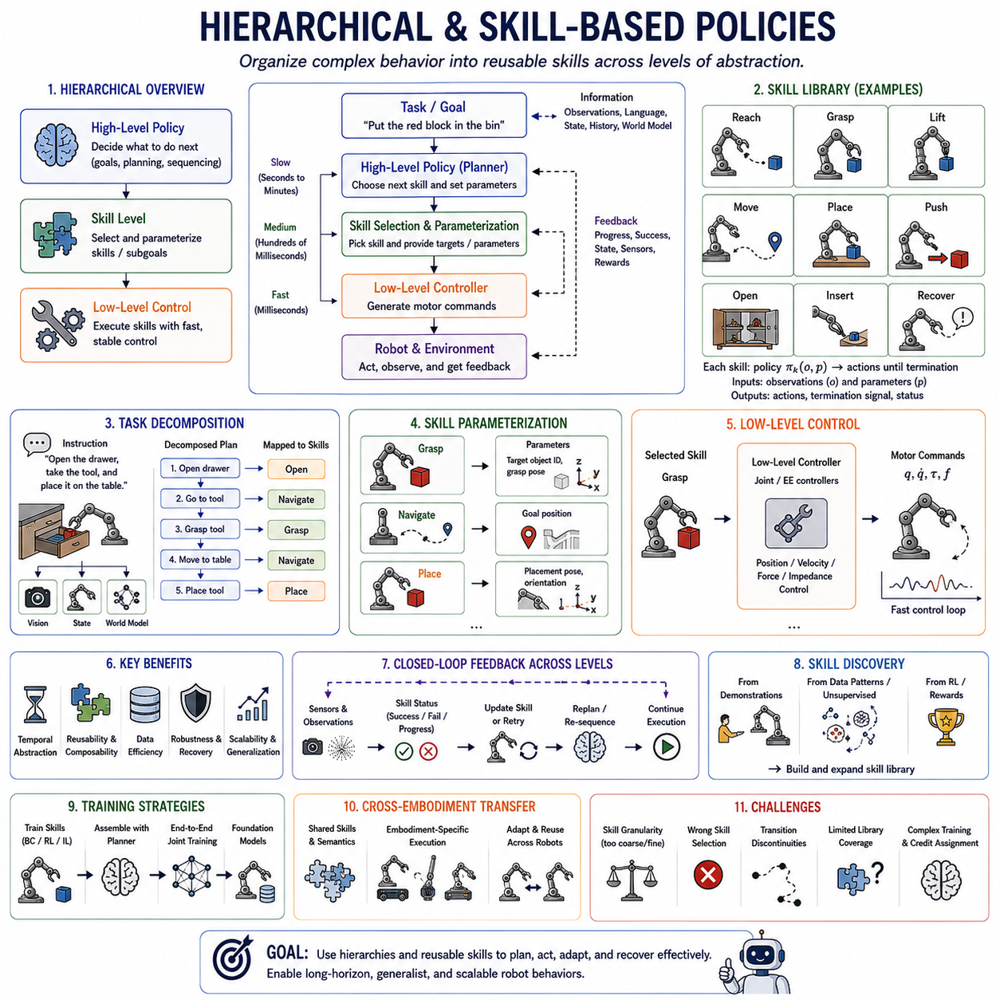{width="7.268055555555556in" height="7.268055555555556in"}

Hierarchical and skill-based policies organize robot behavior into multiple levels of abstraction instead of requiring one policy to reason directly from a complex task to every motor command. A high-level policy determines what should be accomplished next, intermediate components select reusable skills or subtasks, and low-level controllers translate those decisions into physical actions. This organization provides an important foundation for scalable generalist robot behavior.

The basic hierarchy can be understood as a progression from goals to skills to control. A task planner may decide that a robot should retrieve an object, while a skill-level policy decomposes this objective into reaching, grasping, transporting, and placing. Low-level controllers then generate joint, velocity, force, or end-effector commands. Different layers therefore operate at different semantic and temporal scales while contributing to one coherent behavior.

Temporal abstraction is one of the main advantages of hierarchical control. Low-level motor commands may need to operate at high frequency, whereas decisions such as selecting a grasping skill or choosing the next subgoal can remain valid for much longer intervals. By reasoning over meaningful skills instead of individual motor commands, a high-level policy faces a shorter effective decision horizon and can concentrate computational resources on strategically important choices.

A skill can be viewed as a reusable policy that performs a meaningful behavioral unit over multiple control steps. Examples include grasping, pushing, opening, inserting, navigating, docking, or recovering from a failed interaction. Skills receive relevant state or contextual information and produce actions until a termination condition is reached. They therefore occupy an intermediate level between abstract task descriptions and instantaneous actuator commands.

Skill libraries make complex behavior compositional. Instead of learning every long task as a completely independent policy, the robot can reuse familiar skills in different sequences and contexts. A manipulation system might combine approach, grasp, lift, move, align, and release to solve many pick-and-place variations. The same grasping or navigation capability can participate in numerous higher-level tasks, improving reuse and reducing duplicated learning.

The high-level policy is responsible for selecting, ordering, and parameterizing skills according to the current goal and environment. It may receive visual observations, language instructions, robot state, task history, or world-model information and determine which skill should execute next. Rather than generating detailed motor trajectories directly, this policy reasons over a structured behavioral space whose elements correspond to meaningful capabilities.

Skill parameterization increases flexibility beyond selecting fixed behaviors. A grasp skill may receive a target object and grasp pose, a navigation skill may receive a destination, and a placement skill may receive a desired spatial relationship. Consequently, one learned skill can support many situations. The high-level policy determines both which capability is appropriate and the parameters required to adapt that capability to the current task.

Low-level controllers provide the physical realization of selected skills. They may implement joint control, force control, impedance control, balance stabilization, trajectory tracking, or other fast feedback mechanisms. These controllers operate closer to the robot hardware and can react rapidly to disturbances. Separating them from slower semantic reasoning allows high-level intelligence and real-time physical control to coexist within the same architecture.

Hierarchical policies can also combine learned and conventional components. A foundation model may interpret language and select a manipulation skill, while a classical motion planner generates a collision-free path and an impedance controller manages contact. Alternatively, multiple layers may be learned end to end. The hierarchy describes the functional organization of decisions and does not require every component to use the same learning algorithm.

Skill discovery addresses the problem of determining which reusable behaviors should exist. Skills can be predefined by designers, extracted from demonstrations, discovered from repeated trajectory patterns, or learned through reinforcement learning. Unsupervised and latent-skill approaches attempt to identify recurring behavioral structures without requiring explicit labels, potentially creating skill spaces that capture useful regularities across large robot datasets.

Language provides a natural interface for hierarchical task decomposition. An instruction such as "open the drawer, retrieve the tool, and place it on the table" already contains a sequence of semantically meaningful subgoals. A language-conditioned planner can interpret this structure, map subgoals to available skills, and monitor their completion. This connects high-level semantic reasoning with reusable sensorimotor capabilities rather than requiring language to specify individual motor commands.

Hierarchies are particularly valuable for long-horizon tasks because errors and decisions can be managed at multiple levels. If a grasp fails, the system may retry the grasp skill without rebuilding the entire task plan. If the target object becomes inaccessible, the high-level policy may choose another strategy or reorder subtasks. Local recovery at the skill level and global replanning at the task level provide complementary mechanisms for robust execution.

Closed-loop feedback remains essential throughout the hierarchy. Low-level controllers monitor physical variables such as pose, force, velocity, and contact, while skill policies evaluate whether their local objectives have been achieved. The task-level policy monitors broader progress and decides whether the next skill should begin, the current skill should continue, or the plan should change. Information therefore flows both downward as commands and upward as execution feedback.

Skill-based organization can improve data efficiency because experience gathered while learning one reusable capability can support many tasks. Thousands of trajectories involving grasping may strengthen a grasp skill that later participates in sorting, assembly, tool use, and household manipulation. The value of the data is therefore not limited to the original task. Shared skills provide a mechanism for transferring physical knowledge across broader behavioral combinations.

Generalist policies can extend this principle across objects, environments, and robot embodiments. High-level task semantics may remain relatively stable even when the physical robot changes, while embodiment-specific components translate selected skills into appropriate actions. Shared representations, latent skills, normalized action abstractions, and specialized low-level controllers can separate broadly transferable behavioral intent from morphology-specific execution.

Hierarchical architectures also introduce important challenges. Incorrect skill selection at a high level can make perfect low-level execution irrelevant, while poorly defined skill boundaries may create discontinuities during transitions. A skill library that is too narrow limits task coverage, whereas an excessively fragmented library increases planning complexity. Effective systems must balance skill granularity, policy capacity, execution frequency, and the amount of information exchanged between levels.

Training can occur separately or jointly across hierarchical levels. Individual skills may first be learned through behavior cloning or reinforcement learning and then connected through a high-level planner. Alternatively, task-level and skill-level policies can be optimized together using demonstrations, rewards, or success signals. Pretrained foundation models can further provide semantic representations that help the planner recognize when and where learned physical skills should be applied.

Evaluation should examine more than success on individual skills. A hierarchical policy must select appropriate skills, sequence them correctly, parameterize them for changing conditions, transition between them smoothly, and recover when execution fails. Long-horizon task success, skill reuse, planning efficiency, robustness, recovery performance, and generalization to new skill combinations provide stronger evidence that the hierarchy supports genuinely reusable behavior.

Ultimately, hierarchical and skill-based policies transform complex robot behavior into compositions of decisions operating at different levels and timescales. High-level reasoning organizes goals and subgoals, reusable skills capture meaningful behavioral units, and low-level controllers provide fast and reliable physical execution. This structure reduces long-horizon complexity while enabling reuse, adaptation, recovery, and scalable composition of increasingly general robot capabilities.

계층적 및 기술 기반 정책(hierarchical and skill-based policy)은 하나의 정책이 복잡한 작업에서 모든 모터 명령(motor command)을 직접 추론하도록 하는 대신, 로봇 행동을 여러 추상화 수준(level of abstraction)으로 구성한다. 상위 수준 정책(high-level policy)은 다음에 무엇을 달성해야 하는지를 결정하고, 중간 구성요소는 재사용 가능한 기술(skill)이나 하위 작업(subtask)을 선택하며, 하위 수준 제어기(low-level controller)는 이러한 결정을 물리적 행동으로 변환한다. 이러한 구성은 확장 가능한 제너럴리스트 로봇 행동(generalist robot behavior)을 위한 중요한 기반을 제공한다.

기본적인 계층 구조(hierarchy)는 목표(goal)에서 기술(skill)을 거쳐 제어(control)로 이어지는 과정으로 이해할 수 있다. 작업 계획기(task planner)는 로봇이 객체를 가져와야 한다고 결정할 수 있으며, 기술 수준 정책(skill-level policy)은 이 목표를 도달(reaching), 파지(grasping), 운반(transporting), 배치(placing)로 분해한다. 이후 하위 수준 제어기는 관절, 속도, 힘 또는 말단장치(end-effector) 명령을 생성한다. 따라서 서로 다른 계층은 각기 다른 의미적·시간적 규모에서 작동하면서 하나의 일관된 행동에 기여한다.

시간적 추상화(temporal abstraction)는 계층적 제어(hierarchical control)의 주요 장점 중 하나이다. 하위 수준의 모터 명령은 높은 주파수로 작동해야 할 수 있지만, 파지 기술을 선택하거나 다음 하위 목표(subgoal)를 결정하는 것과 같은 의사결정은 훨씬 긴 시간 동안 유효할 수 있다. 상위 수준 정책은 개별 모터 명령 대신 의미 있는 기술을 기반으로 추론함으로써 실질적인 의사결정 지평(decision horizon)을 단축하고 전략적으로 중요한 선택에 계산 자원을 집중할 수 있다.

기술(skill)은 여러 제어 단계에 걸쳐 의미 있는 행동 단위(behavioral unit)를 수행하는 재사용 가능한 정책으로 볼 수 있다. 대표적인 예로 파지, 밀기(pushing), 열기(opening), 삽입(inserting), 내비게이션(navigating), 도킹(docking), 실패한 상호작용으로부터의 복구(recovery) 등이 있다. 기술은 관련 상태 또는 맥락 정보를 입력받고 종료 조건(termination condition)에 도달할 때까지 행동을 생성한다. 따라서 기술은 추상적인 작업 설명과 순간적인 액추에이터 명령(actuator command) 사이의 중간 수준을 구성한다.

기술 라이브러리(skill library)는 복잡한 행동을 조합 가능(compositional)하게 만든다. 모든 장기 작업(long-horizon task)을 완전히 독립적인 정책으로 학습하는 대신, 로봇은 익숙한 기술을 서로 다른 순서와 맥락으로 재사용할 수 있다. 조작 시스템(manipulation system)은 접근(approach), 파지, 들어 올리기(lift), 이동(move), 정렬(align), 놓기(release)를 결합하여 다양한 픽앤플레이스(pick-and-place) 작업을 해결할 수 있다. 동일한 파지 또는 내비게이션 능력을 여러 상위 작업에서 활용함으로써 재사용성을 높이고 중복 학습을 줄일 수 있다.

상위 수준 정책은 현재 목표와 환경에 따라 기술을 선택하고, 순서를 결정하며, 매개변수화(parameterization)하는 역할을 담당한다. 시각적 관측(visual observation), 언어 명령(language instruction), 로봇 상태(robot state), 작업 이력(task history), 월드 모델(world model) 정보 등을 입력받아 다음에 어떤 기술을 실행할지를 결정할 수 있다. 상세한 모터 궤적을 직접 생성하는 대신, 의미 있는 능력들로 구성된 구조화된 행동 공간(structured behavioral space)을 기반으로 추론한다.

기술 매개변수화(skill parameterization)는 고정된 행동을 선택하는 것보다 높은 유연성을 제공한다. 파지 기술은 목표 객체와 파지 자세(grasp pose)를 입력받을 수 있고, 내비게이션 기술은 목적지를 입력받을 수 있으며, 배치 기술은 원하는 공간적 관계(spatial relationship)를 입력받을 수 있다. 따라서 하나의 학습된 기술이 다양한 상황을 지원할 수 있다. 상위 수준 정책은 어떤 능력이 적절한지를 결정하는 동시에 현재 작업에 맞게 해당 능력을 조정하는 데 필요한 매개변수도 결정한다.

하위 수준 제어기(low-level controller)는 선택된 기술을 실제 물리적 행동으로 구현한다. 관절 제어(joint control), 힘 제어(force control), 임피던스 제어(impedance control), 균형 안정화(balance stabilization), 궤적 추종(trajectory tracking), 기타 빠른 피드백 메커니즘을 구현할 수 있다. 이러한 제어기는 로봇 하드웨어와 가까운 수준에서 작동하며 외란(disturbance)에 신속하게 반응할 수 있다. 이를 느린 의미적 추론(semantic reasoning)과 분리하면 상위 수준 지능과 실시간 물리 제어가 하나의 아키텍처 안에서 공존할 수 있다.

계층적 정책은 학습된 구성요소와 전통적인 구성요소(conventional component)를 결합할 수도 있다. 파운데이션 모델(foundation model)이 언어를 해석하고 조작 기술을 선택하는 동안 전통적인 모션 플래너(classical motion planner)가 충돌 없는 경로를 생성하고 임피던스 제어기가 접촉을 관리할 수 있다. 또는 여러 계층을 엔드투엔드(end-to-end) 방식으로 함께 학습할 수도 있다. 계층 구조는 의사결정의 기능적 구성을 의미하며 모든 구성요소가 동일한 학습 알고리즘을 사용해야 하는 것은 아니다.

기술 발견(skill discovery)은 어떤 재사용 가능한 행동이 존재해야 하는지를 결정하는 문제를 다룬다. 기술은 설계자가 미리 정의하거나, 시연(demonstration)에서 추출하거나, 반복되는 궤적 패턴(trajectory pattern)에서 발견하거나, 강화학습(reinforcement learning)을 통해 학습할 수 있다. 비지도 기술 발견(unsupervised skill discovery)과 잠재 기술(latent skill) 접근법은 명시적인 레이블 없이 반복적인 행동 구조를 식별하여 대규모 로봇 데이터셋에서 유용한 규칙성을 포착하는 기술 공간(skill space)을 구축하려 한다.

언어(language)는 계층적 작업 분해(hierarchical task decomposition)를 위한 자연스러운 인터페이스를 제공한다. "서랍을 열고, 도구를 꺼낸 다음, 테이블 위에 놓아라"와 같은 명령에는 이미 의미 있는 하위 목표의 시퀀스가 포함되어 있다. 언어 조건부 계획기(language-conditioned planner)는 이러한 구조를 해석하고 하위 목표를 사용 가능한 기술과 연결하며 완료 여부를 모니터링할 수 있다. 이를 통해 언어가 개별 모터 명령을 직접 지정하는 대신 상위 수준 의미적 추론과 재사용 가능한 감각운동 능력(sensorimotor capability)을 연결할 수 있다.

계층 구조는 오류와 의사결정을 여러 수준에서 관리할 수 있기 때문에 장기 지평 작업에서 특히 유용하다. 파지가 실패하면 시스템은 전체 작업 계획을 다시 생성하지 않고 파지 기술만 재시도할 수 있다. 목표 객체에 접근할 수 없게 되면 상위 수준 정책이 다른 전략을 선택하거나 하위 작업의 순서를 변경할 수 있다. 기술 수준의 국소적 복구(local recovery)와 작업 수준의 전역 재계획(global replanning)은 강건한 실행(robust execution)을 위한 상호보완적인 메커니즘을 제공한다.

폐쇄 루프 피드백(closed-loop feedback)은 계층 구조 전체에서 필수적이다. 하위 수준 제어기는 자세(pose), 힘, 속도, 접촉과 같은 물리적 변수를 모니터링하고, 기술 정책은 해당 기술의 국소적 목표가 달성되었는지를 평가한다. 작업 수준 정책은 전체적인 진행 상태를 모니터링하고 다음 기술을 시작할지, 현재 기술을 계속할지, 또는 계획을 변경할지를 결정한다. 따라서 정보는 명령으로서 상위 계층에서 하위 계층으로 흐르는 동시에 실행 피드백으로서 하위 계층에서 상위 계층으로 전달된다.

기술 기반 구성(skill-based organization)은 하나의 재사용 가능한 능력을 학습하면서 얻은 경험이 여러 작업을 지원할 수 있기 때문에 데이터 효율성(data efficiency)을 향상시킬 수 있다. 수천 개의 파지 궤적을 통해 강화된 파지 기술은 이후 분류(sorting), 조립(assembly), 도구 사용, 가정용 조작(household manipulation) 등 다양한 작업에 활용될 수 있다. 따라서 데이터의 가치는 원래 수집된 작업에만 제한되지 않으며, 공유 기술(shared skill)은 더 폭넓은 행동 조합 사이에서 물리적 지식을 전이하는 메커니즘을 제공한다.

제너럴리스트 정책은 이러한 원리를 객체, 환경, 로봇 임바디먼트(robot embodiment) 전반으로 확장할 수 있다. 물리적 로봇이 변경되더라도 상위 수준 작업 의미론(task semantics)은 비교적 안정적으로 유지될 수 있으며, 임바디먼트 특화 구성요소(embodiment-specific component)가 선택된 기술을 적절한 행동으로 변환할 수 있다. 공유 표현(shared representation), 잠재 기술, 정규화된 행동 추상화(normalized action abstraction), 특화된 하위 수준 제어기는 폭넓게 전이 가능한 행동 의도(behavioral intent)를 로봇 형태에 특화된 실행(morphology-specific execution)과 분리하는 데 도움을 준다.

계층적 아키텍처(hierarchical architecture)는 중요한 과제도 발생시킨다. 상위 수준에서 잘못된 기술을 선택하면 하위 수준의 실행이 완벽하더라도 작업을 성공시킬 수 없으며, 기술 경계(skill boundary)가 적절하게 정의되지 않으면 기술 사이의 전환 과정에서 불연속성이 발생할 수 있다. 기술 라이브러리가 지나치게 좁으면 작업 범위가 제한되고, 반대로 지나치게 세분화되면 계획 복잡성(planning complexity)이 증가한다. 효과적인 시스템은 기술 세분성(skill granularity), 정책 용량(policy capacity), 실행 주기, 계층 사이에서 교환되는 정보량의 균형을 유지해야 한다.

학습은 계층별로 독립적으로 수행하거나 여러 계층을 공동으로 수행할 수 있다. 개별 기술을 행동 복제(behavior cloning)나 강화학습을 통해 먼저 학습한 후 상위 수준 계획기와 연결할 수 있다. 또는 작업 수준과 기술 수준 정책을 시연, 보상(reward), 성공 신호(success signal)를 이용하여 함께 최적화할 수도 있다. 사전학습된 파운데이션 모델은 계획기가 학습된 물리적 기술을 언제 어디에 적용해야 하는지 판단하는 데 필요한 의미적 표현을 추가적으로 제공할 수 있다.

평가에서는 개별 기술의 성공 여부만 확인해서는 안 된다. 계층적 정책은 적절한 기술을 선택하고, 올바른 순서로 구성하고, 변화하는 조건에 맞게 매개변수화하며, 기술 사이를 부드럽게 전환하고, 실행 실패가 발생했을 때 복구할 수 있어야 한다. 장기 지평 작업 성공률, 기술 재사용(skill reuse), 계획 효율성(planning efficiency), 강건성, 복구 성능, 새로운 기술 조합에 대한 일반화는 계층 구조가 진정으로 재사용 가능한 행동을 지원하는지를 보여주는 더 강력한 평가 기준이 된다.

궁극적으로 계층적 및 기술 기반 정책(hierarchical and skill-based policy)은 복잡한 로봇 행동을 서로 다른 수준과 시간 척도(timescale)에서 작동하는 의사결정의 조합으로 변환한다. 상위 수준 추론(high-level reasoning)은 목표와 하위 목표를 구성하고, 재사용 가능한 기술은 의미 있는 행동 단위를 표현하며, 하위 수준 제어기는 빠르고 신뢰할 수 있는 물리적 실행을 제공한다. 이러한 구조는 장기 지평 문제의 복잡성을 줄이는 동시에 재사용(reuse), 적응(adaptation), 복구(recovery), 그리고 점점 더 일반적인 로봇 능력의 확장 가능한 조합(scalable composition)을 가능하게 한다.

## 06.09. Long Horizon Generalist Policies

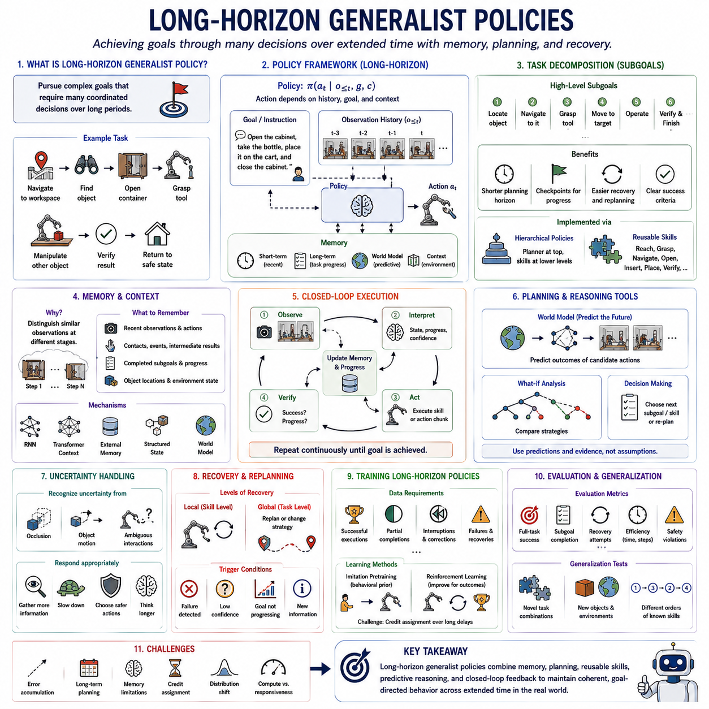{width="7.268055555555556in" height="7.268055555555556in"}

Long-horizon generalist policies enable robots to pursue goals that require many coordinated decisions over extended periods rather than completing isolated actions or short motion sequences. A robot may need to navigate to a workspace, locate an object, open a container, grasp a tool, manipulate another object, verify the result, and return to a safe state. Maintaining coherent behavior across such extended interactions is a central challenge for generalist robot intelligence.

The difficulty of long-horizon behavior grows because each action changes the state from which future decisions must be made. Small perception, planning, or control errors can accumulate over time, gradually moving execution away from the intended trajectory. A policy that performs individual skills reliably may therefore still fail when dozens of decisions must succeed sequentially. Long-horizon competence requires mechanisms for remembering, planning, monitoring, recovering, and replanning.

A useful formulation represents the policy as π(aₜ \| o≤t, g, c), where the current action depends not only on the latest observation but also on observation history, goal information, and context. This history allows the policy to distinguish situations that appear visually similar but occur at different stages of a task. Without temporal context, the robot may repeat completed actions, skip necessary subtasks, or lose track of progress toward the overall objective.

Memory is therefore a fundamental component of long-horizon policies. Short-term memory can preserve recent observations, actions, contacts, and intermediate outcomes, while longer-term representations can maintain task progress, discovered object locations, completed subgoals, and persistent environmental information. Recurrent networks, transformer context, external memory, structured state representations, and world models provide different mechanisms for maintaining information beyond the current observation.

Long-horizon tasks are easier to manage when decomposed into intermediate subgoals. Instead of directly predicting every motor command needed to "prepare the workspace," a policy can represent progress through stages such as locate the tool, navigate to it, grasp it, move to the target, perform the operation, and verify completion. Subgoals reduce effective planning depth and provide checkpoints at which progress can be evaluated before execution continues.

Hierarchical and skill-based policies naturally support this decomposition. A high-level planner selects subgoals or reusable skills, while lower-level policies execute reaching, grasping, navigation, insertion, placement, or other behaviors. Temporal abstraction allows one high-level decision to control many low-level steps, shortening the effective decision horizon and making complex tasks easier to organize. Skills can also be retried or replaced without reconstructing the entire plan.

Language can provide a semantic structure for long-horizon goals. An instruction such as "open the cabinet, take the bottle, place it on the cart, and close the cabinet" implicitly specifies several ordered subgoals. A language-conditioned policy must connect each clause to the appropriate physical state, remember which steps have been completed, and preserve the overall intent while executing actions that may take seconds or minutes.

Temporal grounding becomes important because different parts of an instruction matter at different stages. The robot should not attempt to retrieve an object before opening the container that holds it, and it should not close the container before removing the target. Attention and memory mechanisms can dynamically emphasize the relevant instruction component while maintaining representations of completed and pending steps, enabling semantic intent to remain synchronized with physical execution.

World models can strengthen long-horizon policies by providing predictive representations of how the environment may evolve under candidate actions. A robot can estimate possible future states, compare alternative strategies, and anticipate whether a decision may create problems later in the task. Such predictive reasoning supports planning and what-if analysis, although model errors can accumulate when predictions extend far beyond familiar data distributions.

Closed-loop execution is essential because long-horizon plans cannot assume that every intermediate action will succeed exactly as expected. After executing a skill, the robot should observe the resulting state and determine whether the intended subgoal was actually achieved. The next decision should depend on this evidence rather than on the assumption that previous commands succeeded. This creates a repeated cycle of observe, interpret, act, verify, and update.

Progress monitoring provides an internal measure of where the robot is within the task. The policy may track completed subgoals, active skills, remaining objectives, expected environmental states, and confidence in execution. Explicit progress representations can prevent repeated actions and help detect inconsistencies between planned and observed states. They also provide useful interfaces between high-level reasoning and lower-level physical execution.

Long-horizon policies must distinguish local failures from failures that invalidate the broader plan. A slightly inaccurate grasp may require only a local retry, while discovering that the target object is missing may require returning to perception or task planning. This distinction prevents unnecessary replanning while still allowing major deviations to trigger strategic changes. Hierarchical feedback makes it possible to perform correction at the level where the problem occurs.

Uncertainty becomes increasingly important as task duration grows. Perception confidence may decrease because of occlusion, object motion, or changing viewpoints, while uncertainty about task state can increase after ambiguous interactions. A robust policy should recognize when confidence is insufficient and gather additional information, slow execution, select a safer action, or invoke more deliberate reasoning instead of continuing blindly through an uncertain plan.

Generalist policies face an additional challenge because long-horizon reasoning must transfer across many tasks rather than being engineered for one fixed procedure. Reusable concepts such as searching, approaching, grasping, transporting, verifying, retrying, and completing can appear in numerous activities. Learning these structures across diverse demonstrations allows the policy to compose familiar behavioral elements into longer sequences appropriate for different goals and environments.

Training data should therefore contain temporal diversity in addition to object and task diversity. Short demonstrations teach local sensorimotor relationships, but long trajectories reveal how actions, subgoals, failures, and environmental changes interact across time. Datasets containing successful execution, partial completion, interruptions, corrections, and recovery trajectories can teach policies how task progress evolves rather than exposing them only to idealized sequences.

Imitation pretraining can establish long-horizon behavioral priors from such demonstrations, while reinforcement learning can refine decisions according to eventual task outcomes. This combination is useful because demonstrations provide structured examples of successful task organization, whereas reinforcement learning can improve choices that affect delayed success. Credit assignment remains difficult, however, because a failure near the end of a task may originate from a poor decision made much earlier.

Action chunking and temporal abstraction can reduce the number of decisions required during execution. Instead of predicting one low-level command at every instant, a policy can generate short coherent action sequences or invoke skills that persist until termination conditions are reached. The system must still observe frequently enough to detect unexpected changes, creating a tradeoff between temporal efficiency and responsiveness to new information.

Evaluation of long-horizon policies should emphasize complete task execution rather than isolated skill accuracy. Useful measures include full-task success, subgoal completion, number of recovery attempts, unnecessary repetitions, execution time, safety violations, and performance as task length increases. Testing under perturbations is especially important because long-horizon robustness depends on maintaining progress when intermediate states differ from the nominal plan.

Generalization should also be tested by changing the composition and ordering of familiar skills. A robot may know how to open, grasp, navigate, and place individually but still fail when these capabilities appear in a novel sequence. Strong long-horizon generalization therefore requires more than skill coverage; it requires the ability to organize reusable capabilities according to new goals, changing observations, and evolving task context.

Ultimately, long-horizon generalist policies combine temporal memory, task decomposition, reusable skills, predictive reasoning, progress monitoring, uncertainty handling, and closed-loop feedback. Their objective is not merely to produce longer action sequences, but to maintain coherent goal-directed behavior as the world changes throughout execution. These capabilities allow generalist robots to move from isolated demonstrations toward adaptive multi-stage activities in realistic physical environments.

장기 지평 제너럴리스트 정책(long-horizon generalist policy)은 단일 행동이나 짧은 움직임 시퀀스를 완료하는 수준을 넘어, 장시간에 걸쳐 수많은 의사결정을 조정해야 하는 목표를 로봇이 수행할 수 있도록 한다. 로봇은 작업 공간으로 이동하고, 객체를 찾고, 용기를 열고, 도구를 파지하고, 다른 객체를 조작하고, 결과를 확인한 후 안전한 상태로 복귀해야 할 수 있다. 이처럼 긴 상호작용 과정에서 일관된 행동을 유지하는 것은 제너럴리스트 로봇 지능(generalist robot intelligence)의 핵심 과제이다.

장기 지평 행동(long-horizon behavior)이 어려운 이유는 각각의 행동이 이후 의사결정이 이루어지는 상태를 변화시키기 때문이다. 작은 지각(perception), 계획(planning), 제어(control) 오류도 시간이 지나면서 누적되어 실행이 의도된 궤적에서 점차 벗어날 수 있다. 따라서 개별 기술(skill)을 안정적으로 수행하는 정책이라도 수십 개의 의사결정이 연속적으로 성공해야 하는 상황에서는 실패할 수 있다. 장기 지평 역량에는 기억, 계획, 모니터링, 복구, 재계획을 위한 메커니즘이 필요하다.

유용한 정식화는 정책을 π(aₜ \| o≤t, g, c)로 표현하는 것이다. 여기서 현재 행동은 최신 관측뿐만 아니라 관측 이력(observation history), 목표 정보(goal information), 맥락(context)에 의존한다. 이러한 이력을 통해 정책은 시각적으로 유사하지만 작업의 서로 다른 단계에서 발생하는 상황을 구별할 수 있다. 시간적 맥락(temporal context)이 없다면 로봇은 이미 완료한 행동을 반복하거나, 필요한 하위 작업(subtask)을 건너뛰거나, 전체 목표를 향한 진행 상태를 잃어버릴 수 있다.

따라서 메모리(memory)는 장기 지평 정책의 핵심 구성요소이다. 단기 메모리(short-term memory)는 최근 관측, 행동, 접촉, 중간 결과를 유지할 수 있으며, 장기적인 표현은 작업 진행 상태, 발견된 객체 위치, 완료된 하위 목표(subgoal), 지속적으로 필요한 환경 정보를 유지할 수 있다. 순환 신경망(recurrent network), 트랜스포머 맥락(transformer context), 외부 메모리(external memory), 구조화된 상태 표현(structured state representation), 월드 모델(world model)은 현재 관측을 넘어 정보를 유지하기 위한 다양한 메커니즘을 제공한다.

장기 지평 작업은 중간 하위 목표(intermediate subgoal)로 분해하면 보다 쉽게 관리할 수 있다. "작업 공간을 준비하라"는 목표에 필요한 모든 모터 명령을 직접 예측하는 대신, 정책은 도구 찾기, 도구까지 이동하기, 파지하기, 목표 위치로 이동하기, 작업 수행하기, 완료 확인하기와 같은 단계로 진행 상태를 표현할 수 있다. 하위 목표는 실질적인 계획 깊이(planning depth)를 줄이고 다음 실행으로 넘어가기 전에 진행 상황을 평가할 수 있는 체크포인트(checkpoint)를 제공한다.

계층적 및 기술 기반 정책(hierarchical and skill-based policy)은 이러한 분해를 자연스럽게 지원한다. 상위 수준 계획기(high-level planner)는 하위 목표 또는 재사용 가능한 기술을 선택하고, 하위 수준 정책은 도달(reaching), 파지(grasping), 내비게이션(navigation), 삽입(insertion), 배치(placement) 등의 행동을 실행한다. 시간적 추상화(temporal abstraction)를 통해 하나의 상위 수준 의사결정이 여러 하위 수준 단계를 제어할 수 있으므로 실질적인 의사결정 지평을 줄이고 복잡한 작업을 더 쉽게 구성할 수 있다. 기술은 전체 계획을 다시 만들지 않고도 재시도하거나 다른 기술로 대체할 수 있다.

언어(language)는 장기 지평 목표를 위한 의미적 구조(semantic structure)를 제공할 수 있다. "캐비닛을 열고, 병을 꺼내 카트 위에 놓은 다음, 캐비닛을 닫아라"와 같은 명령에는 여러 개의 순서화된 하위 목표가 암묵적으로 포함되어 있다. 언어 조건부 정책(language-conditioned policy)은 각 절(clause)을 적절한 물리적 상태와 연결하고, 어떤 단계가 완료되었는지를 기억하며, 수초 또는 수분 동안 지속될 수 있는 행동을 실행하면서 전체적인 의도를 유지해야 한다.

시간적 그라운딩(temporal grounding)은 명령의 서로 다른 부분이 작업의 서로 다른 단계에서 중요해지기 때문에 필요하다. 로봇은 객체가 들어 있는 용기를 열기 전에 객체를 꺼내려고 해서는 안 되며, 목표 객체를 제거하기 전에 용기를 닫아서도 안 된다. 어텐션(attention)과 메모리 메커니즘은 완료된 단계와 아직 남아 있는 단계를 표현하면서 현재 관련된 명령 부분을 동적으로 강조하여 의미적 의도와 물리적 실행이 동기화되도록 할 수 있다.

월드 모델(world model)은 후보 행동에 따라 환경이 어떻게 변화할지를 예측하는 표현을 제공함으로써 장기 지평 정책을 강화할 수 있다. 로봇은 가능한 미래 상태를 추정하고, 대안 전략을 비교하며, 현재의 결정이 작업 후반부에서 문제를 발생시킬 가능성을 예상할 수 있다. 이러한 예측적 추론(predictive reasoning)은 계획과 가상 시나리오 분석(what-if analysis)을 지원하지만, 학습 데이터의 익숙한 분포를 크게 벗어나 장기간 예측하면 모델 오류가 누적될 수 있다.

폐쇄 루프 실행(closed-loop execution)은 장기 지평 계획에서 모든 중간 행동이 예상대로 정확히 성공한다고 가정할 수 없기 때문에 필수적이다. 기술을 실행한 후 로봇은 결과 상태를 관측하고 의도한 하위 목표가 실제로 달성되었는지를 판단해야 한다. 다음 의사결정은 이전 명령이 성공했다고 가정하는 것이 아니라 이러한 증거에 기반해야 한다. 이를 통해 관측(observe), 해석(interpret), 행동(act), 검증(verify), 갱신(update)이 반복되는 순환 구조가 형성된다.

진행 상태 모니터링(progress monitoring)은 로봇이 전체 작업에서 현재 어느 단계에 있는지를 나타내는 내부 척도를 제공한다. 정책은 완료된 하위 목표, 활성 기술(active skill), 남아 있는 목표, 예상되는 환경 상태, 실행에 대한 신뢰도(confidence)를 추적할 수 있다. 명시적인 진행 상태 표현(progress representation)은 행동의 불필요한 반복을 방지하고 계획된 상태와 실제 관측 상태 사이의 불일치를 탐지하는 데 도움을 준다. 또한 상위 수준 추론과 하위 수준 물리적 실행을 연결하는 유용한 인터페이스를 제공한다.

장기 지평 정책은 국소적 실패(local failure)와 전체 계획을 무효화하는 실패를 구분해야 한다. 약간 부정확한 파지는 단순한 국소 재시도(local retry)만 필요할 수 있지만, 목표 객체가 존재하지 않는다는 사실을 발견하면 지각이나 작업 계획 단계로 되돌아가야 할 수 있다. 이러한 구분은 불필요한 재계획을 방지하면서도 중대한 편차가 발생했을 때 전략적 변화를 가능하게 한다. 계층적 피드백(hierarchical feedback)은 문제가 발생한 수준에서 적절한 수정이 이루어지도록 한다.

작업 시간이 길어질수록 불확실성(uncertainty)은 더욱 중요해진다. 가림(occlusion), 객체 이동, 시점 변화로 인해 지각 신뢰도가 낮아질 수 있으며, 모호한 상호작용 이후에는 작업 상태에 대한 불확실성이 증가할 수 있다. 강건한 정책(robust policy)은 신뢰도가 충분하지 않은 상황을 인식하고, 불확실한 계획을 맹목적으로 계속하는 대신 추가 정보를 수집하거나, 실행 속도를 낮추거나, 더 안전한 행동을 선택하거나, 보다 신중한 추론(deliberate reasoning)을 수행해야 한다.

제너럴리스트 정책(generalist policy)은 하나의 고정된 절차를 위해 설계되는 것이 아니라 여러 작업에 걸쳐 장기 지평 추론이 전이되어야 하기 때문에 추가적인 어려움을 가진다. 탐색(searching), 접근(approaching), 파지, 운반(transporting), 검증(verifying), 재시도(retrying), 완료(completing)와 같은 재사용 가능한 개념은 다양한 활동에서 반복적으로 나타날 수 있다. 다양한 시연으로부터 이러한 구조를 학습하면 정책은 익숙한 행동 요소를 서로 다른 목표와 환경에 적합한 더 긴 시퀀스로 조합할 수 있다.

따라서 학습 데이터(training data)는 객체 및 작업 다양성뿐만 아니라 시간적 다양성(temporal diversity)도 포함해야 한다. 짧은 시연은 국소적인 감각운동 관계(sensorimotor relationship)를 학습시키지만, 긴 궤적(long trajectory)은 행동, 하위 목표, 실패, 환경 변화가 시간에 따라 어떻게 상호작용하는지를 보여준다. 성공적인 실행뿐만 아니라 부분 완료(partial completion), 중단(interruption), 수정(correction), 복구 궤적(recovery trajectory)을 포함하는 데이터셋은 이상적인 시퀀스뿐만 아니라 작업 진행 상태가 어떻게 변화하는지도 정책이 학습하도록 한다.

모방 사전학습(imitation pretraining)은 이러한 시연으로부터 장기 지평 행동 사전지식(behavioral prior)을 구축할 수 있으며, 강화학습(reinforcement learning)은 최종적인 작업 결과에 따라 의사결정을 개선할 수 있다. 시연은 성공적인 작업 구성의 구조화된 사례를 제공하고, 강화학습은 지연된 성공(delayed success)에 영향을 미치는 선택을 개선할 수 있기 때문에 두 방법의 결합은 유용하다. 그러나 작업 후반부의 실패가 훨씬 이전의 잘못된 결정에서 시작되었을 수 있기 때문에 크레딧 할당(credit assignment)은 여전히 어려운 문제이다.

행동 청킹(action chunking)과 시간적 추상화는 실행 과정에서 필요한 의사결정 횟수를 줄일 수 있다. 매 순간 하나의 저수준 명령을 예측하는 대신, 정책은 짧고 일관된 행동 시퀀스를 생성하거나 종료 조건에 도달할 때까지 지속되는 기술을 호출할 수 있다. 그러나 예상하지 못한 변화를 탐지할 수 있을 만큼 충분히 자주 환경을 관측해야 하므로 시간적 효율성(temporal efficiency)과 새로운 정보에 대한 반응성(responsiveness) 사이에는 적절한 균형이 필요하다.

장기 지평 정책의 평가는 개별 기술 정확도가 아니라 전체 작업의 완전한 실행을 강조해야 한다. 유용한 평가 지표에는 전체 작업 성공률(full-task success), 하위 목표 완료율, 복구 시도 횟수, 불필요한 반복, 실행 시간, 안전 위반(safety violation), 작업 길이가 증가할 때의 성능 등이 포함된다. 장기 지평 강건성은 중간 상태가 원래 계획과 달라질 때에도 진행 상태를 유지하는 능력에 의존하므로 교란(perturbation)이 존재하는 조건에서의 평가가 특히 중요하다.

일반화(generalization)는 익숙한 기술의 구성과 순서를 변경하는 방식으로도 평가해야 한다. 로봇이 열기, 파지, 내비게이션, 배치 기술을 각각 알고 있더라도 이러한 능력이 새로운 순서로 등장하면 실패할 수 있다. 따라서 강력한 장기 지평 일반화(long-horizon generalization)는 단순히 많은 기술을 보유하는 것만으로는 충분하지 않으며, 새로운 목표, 변화하는 관측, 진화하는 작업 맥락에 따라 재사용 가능한 능력을 적절하게 조직할 수 있어야 한다.

궁극적으로 장기 지평 제너럴리스트 정책(long-horizon generalist policy)은 시간적 메모리(temporal memory), 작업 분해(task decomposition), 재사용 가능한 기술(reusable skill), 예측적 추론, 진행 상태 모니터링, 불확실성 처리(uncertainty handling), 폐쇄 루프 피드백을 결합한다. 그 목표는 단순히 더 긴 행동 시퀀스를 생성하는 것이 아니라 실행 과정에서 세계가 계속 변화하더라도 일관된 목표 지향 행동(goal-directed behavior)을 유지하는 것이다. 이러한 능력을 통해 제너럴리스트 로봇은 개별적인 시연 수행을 넘어 현실적인 물리 환경에서 적응 가능한 다단계 활동(adaptive multi-stage activity)을 수행할 수 있다.

## 06.10. Failure Recovery and Closed Loop Replanning

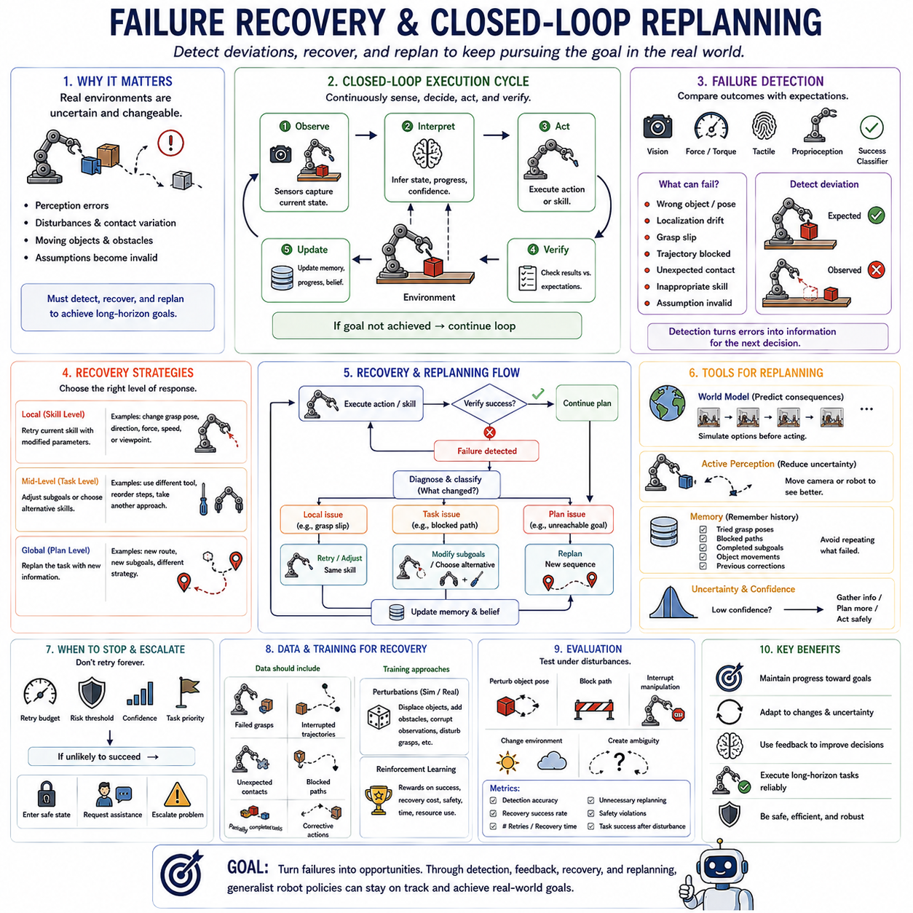{width="7.268055555555556in" height="7.268055555555556in"}

Failure recovery and closed-loop replanning allow a robot policy to continue pursuing its objective when execution does not unfold as expected. Real environments contain uncertainty, imperfect perception, contact variation, moving objects, obstacles, and disturbances that make flawless execution unrealistic. A capable generalist robot must therefore detect deviations, determine their significance, recover locally when possible, and revise its broader plan when necessary.

Failure can occur at many levels of a robot system. Perception may identify the wrong object, localization may drift, a grasp may slip, a trajectory may become blocked, or an interaction may produce an unexpected physical state. Higher-level failures can also occur when a selected skill is inappropriate or a task assumption becomes invalid. Recovery begins by recognizing that observed outcomes differ meaningfully from expected outcomes.

Failure detection requires explicit or implicit expectations about what should happen after an action. After executing a grasp, for example, the robot may expect the target object to move with the gripper and remain securely held. Visual observations, force measurements, tactile signals, proprioception, success classifiers, or learned value estimates can reveal whether this expectation has been satisfied. Reliable detection converts execution errors into information that subsequent decisions can use.

Closed-loop execution provides the foundation for recovery because the policy repeatedly observes the environment instead of assuming that issued commands succeeded. The basic cycle can be expressed as observe, interpret, act, verify, and update. Each action changes the physical world, and the resulting observation becomes evidence for the next decision. This continuous feedback prevents errors from propagating unnoticed through a long sequence of planned actions.

Verification is particularly important at meaningful transition points between skills or subgoals. Before proceeding from grasping to transporting, the system should verify that the object is actually secured. Before beginning insertion, it may confirm alignment with the target opening. These intermediate checks create execution checkpoints that prevent later behaviors from relying on invalid assumptions and make failures easier to isolate.

Not every failure requires complete replanning. A local failure may be handled by retrying the current skill with modified parameters. If a grasp misses because the object pose estimate was slightly inaccurate, the robot can observe the object again, choose another grasp pose, and retry. Local recovery preserves the valid portions of the existing task plan and avoids unnecessary computational and behavioral disruption.

More significant failures require higher-level replanning. If the target object has moved to an unreachable location, the planned route is permanently blocked, or a required tool is unavailable, repeating the same low-level action is unlikely to succeed. The robot must update its representation of the situation, reconsider available alternatives, and construct a new sequence of subgoals or skills that can still achieve the original objective.

Hierarchical policies provide a natural structure for managing different recovery scales. Low-level controllers can compensate for small disturbances, skill-level policies can retry or adjust manipulation strategies, and task-level planners can reorganize subgoals. Failure information can propagate upward only when lower levels cannot resolve the problem. This allows the system to respond proportionally rather than invoking expensive global reasoning after every minor deviation.

Recovery policies should avoid blind repetition. Repeatedly executing an unsuccessful action without changing the underlying conditions rarely constitutes meaningful recovery. Each retry should incorporate new evidence by changing the grasp pose, approach direction, force, trajectory, viewpoint, selected skill, or other relevant parameter. The objective is to transform failure into information that improves the probability of success on the next attempt.

Active perception can therefore become part of the recovery process. When uncertainty prevents reliable action selection, the robot can deliberately move a camera, change its viewpoint, inspect an object, or gather additional sensory information. Rather than immediately attempting another manipulation, it first reduces uncertainty about the physical state. Recovery thus involves both changing the world and improving the robot\'s knowledge of the world.

World models can support replanning by predicting the consequences of alternative recovery actions. The robot may estimate whether moving an obstacle, approaching from another direction, selecting another grasp, or changing the order of subtasks will lead toward a feasible state. Predictive simulation enables comparison of candidate strategies before physical execution, although replanning must remain grounded in new observations because learned models can themselves be inaccurate.

Memory is essential because effective recovery depends on understanding what has already been attempted. The policy should remember failed grasp poses, blocked paths, completed subgoals, observed object movements, and previous corrective actions. Without such history, the robot may repeatedly return to unsuccessful strategies. Temporal memory transforms individual failures into accumulated context that can guide increasingly informed decisions.

Uncertainty estimation helps determine when recovery or replanning should be triggered. Low confidence in object identity, pose, task state, or predicted success may indicate that continuing the nominal plan is unsafe or inefficient. The robot can respond by gathering more information, slowing execution, choosing a conservative skill, requesting assistance, or invoking more deliberate planning. Confidence therefore becomes an important control signal rather than merely a diagnostic quantity.

Recovery also requires deciding when to stop autonomous attempts. Unlimited retries can waste time, damage objects, drain energy, or create unsafe conditions. Policies can use retry budgets, risk thresholds, confidence levels, task priorities, or failure severity to determine when another attempt is justified. When autonomous recovery becomes unlikely to succeed, the appropriate behavior may be to enter a safe state or escalate the problem.

Training recovery behavior requires data beyond successful expert demonstrations. Datasets should include failed grasps, interrupted trajectories, unexpected contacts, misplaced objects, blocked paths, partial task completion, and the corrective actions that follow them. Such trajectories teach the policy not only what successful behavior looks like but also how execution can depart from nominal conditions and how those deviations can be corrected.

Artificial perturbations can systematically generate recovery experience. During simulation or controlled physical training, objects can be displaced, observations corrupted, grasps disturbed, obstacles introduced, or intermediate states modified. The policy must then restore progress toward the goal. Perturbation training expands the range of states encountered during learning and reduces dependence on perfectly executed demonstrations.

Reinforcement learning can further improve recovery by evaluating corrective actions according to their eventual outcomes. A recovery strategy may initially appear inefficient but prevent complete task failure later. Rewards based on task completion, recovery cost, safety, time, and resource consumption can encourage policies to select corrections that balance success with efficiency. Failed attempts themselves become useful experience for future policy improvement.

Closed-loop replanning is especially important for long-horizon generalist policies because uncertainty and error accumulate as task duration increases. A long plan should be treated as a provisional strategy rather than a rigid action script. After meaningful changes in the environment, the robot should reconsider whether its remaining plan is still valid. Planning and execution therefore become interleaved processes rather than strictly separate phases.

Evaluation should deliberately introduce failures rather than measuring only nominal task success. Tests can perturb object poses, block planned paths, interrupt manipulation, alter environmental conditions, or create ambiguous observations. Useful metrics include failure detection accuracy, recovery success rate, number of retries, time to recovery, unnecessary replanning, safety violations, and the percentage of tasks completed after an unexpected disturbance.

Ultimately, failure recovery and closed-loop replanning transform errors from terminal events into opportunities for adaptation. A robust robot observes the consequences of its actions, verifies progress, detects discrepancies, diagnoses whether correction should occur locally or globally, and updates behavior using new evidence. By combining feedback, memory, uncertainty estimation, hierarchical recovery, and continual replanning, generalist policies can maintain goal-directed behavior even when the physical world violates their initial expectations.

실패 복구(failure recovery)와 폐쇄 루프 재계획(closed-loop replanning)은 실행 과정이 예상대로 진행되지 않더라도 로봇 정책(robot policy)이 목표를 계속 추구할 수 있도록 한다. 실제 환경에는 불확실성(uncertainty), 불완전한 지각(perception), 접촉 변화(contact variation), 움직이는 객체, 장애물, 외란(disturbance)이 존재하기 때문에 완벽한 실행을 기대하기 어렵다. 따라서 유능한 제너럴리스트 로봇(generalist robot)은 편차를 감지하고 그 중요성을 판단하며, 가능한 경우 국소적으로 복구하고 필요할 때 전체 계획을 수정할 수 있어야 한다.

실패(failure)는 로봇 시스템의 여러 수준에서 발생할 수 있다. 지각 시스템이 잘못된 객체를 식별하거나, 위치 추정(localization)에 드리프트(drift)가 발생하거나, 파지(grasp)가 미끄러지거나, 궤적(trajectory)이 장애물에 의해 차단되거나, 상호작용이 예상하지 못한 물리적 상태를 만들 수 있다. 또한 선택한 기술(skill)이 적절하지 않거나 작업에 대한 가정(task assumption)이 더 이상 유효하지 않을 때 상위 수준의 실패가 발생할 수도 있다. 복구는 관측된 결과가 예상된 결과와 의미 있게 다르다는 사실을 인식하는 것에서 시작된다.

실패 감지(failure detection)를 위해서는 행동 이후 무엇이 발생해야 하는지에 대한 명시적 또는 암묵적인 기대(expectation)가 필요하다. 예를 들어 파지를 수행한 후 로봇은 목표 객체가 그리퍼(gripper)와 함께 움직이며 안정적으로 유지될 것으로 예상할 수 있다. 시각 관측, 힘 측정(force measurement), 촉각 신호(tactile signal), 고유수용감각(proprioception), 성공 분류기(success classifier), 학습된 가치 추정(learned value estimate)을 통해 이러한 기대가 충족되었는지 판단할 수 있다. 신뢰할 수 있는 감지는 실행 오류를 이후 의사결정에 활용할 수 있는 정보로 변환한다.

폐쇄 루프 실행(closed-loop execution)은 정책이 명령이 성공했다고 가정하지 않고 환경을 반복적으로 관측하기 때문에 복구의 기반을 제공한다. 기본적인 순환 과정은 관측(observe), 해석(interpret), 행동(act), 검증(verify), 갱신(update)으로 표현할 수 있다. 각각의 행동은 물리적 세계를 변화시키며, 그 결과에 대한 관측은 다음 의사결정을 위한 증거가 된다. 이러한 지속적인 피드백(continuous feedback)은 오류가 감지되지 않은 상태로 긴 행동 시퀀스 전체에 전파되는 것을 방지한다.

검증(verification)은 기술이나 하위 목표(subgoal) 사이의 의미 있는 전환 지점에서 특히 중요하다. 파지에서 운반으로 넘어가기 전에 시스템은 객체가 실제로 안정적으로 잡혀 있는지를 확인해야 한다. 삽입(insertion)을 시작하기 전에는 목표 개구부(target opening)와의 정렬 상태를 확인할 수 있다. 이러한 중간 검증은 실행 체크포인트(execution checkpoint)를 형성하여 이후 행동이 잘못된 가정에 의존하는 것을 방지하고 실패가 발생한 위치를 보다 쉽게 식별할 수 있도록 한다.

모든 실패가 전체적인 재계획을 필요로 하는 것은 아니다. 국소적 실패(local failure)는 현재 기술을 수정된 매개변수로 다시 시도함으로써 처리할 수 있다. 객체 자세 추정(object pose estimation)이 약간 부정확하여 파지에 실패했다면 로봇은 객체를 다시 관측하고 다른 파지 자세(grasp pose)를 선택하여 재시도할 수 있다. 국소 복구(local recovery)는 기존 작업 계획에서 여전히 유효한 부분을 유지하면서 불필요한 계산과 행동의 중단을 방지한다.

더 중요한 실패에는 상위 수준 재계획(high-level replanning)이 필요하다. 목표 객체가 도달할 수 없는 위치로 이동했거나, 계획된 경로가 영구적으로 차단되었거나, 필요한 도구를 사용할 수 없다면 동일한 하위 수준 행동을 반복해도 성공하기 어렵다. 로봇은 상황에 대한 표현을 갱신하고 사용 가능한 대안을 다시 검토한 후, 원래의 목표를 여전히 달성할 수 있는 새로운 하위 목표 또는 기술 시퀀스를 구성해야 한다.

계층적 정책(hierarchical policy)은 서로 다른 규모의 복구를 관리하기 위한 자연스러운 구조를 제공한다. 하위 수준 제어기(low-level controller)는 작은 외란을 보상하고, 기술 수준 정책(skill-level policy)은 조작 전략을 재시도하거나 수정하며, 작업 수준 계획기(task-level planner)는 하위 목표를 재구성할 수 있다. 하위 수준에서 문제를 해결할 수 없을 때만 실패 정보를 상위 수준으로 전달함으로써 모든 작은 편차마다 비용이 높은 전역 추론(global reasoning)을 수행하지 않고 문제의 크기에 비례하여 대응할 수 있다.

복구 정책(recovery policy)은 맹목적인 반복(blind repetition)을 피해야 한다. 실패한 행동을 기본 조건의 변화 없이 반복적으로 수행하는 것은 의미 있는 복구라고 보기 어렵다. 각각의 재시도는 파지 자세, 접근 방향(approach direction), 힘, 궤적, 시점(viewpoint), 선택된 기술 또는 다른 관련 매개변수를 변경함으로써 새로운 증거를 반영해야 한다. 목표는 실패를 다음 시도의 성공 가능성을 향상시키는 정보로 변환하는 것이다.

따라서 능동 지각(active perception)은 복구 과정의 일부가 될 수 있다. 불확실성 때문에 신뢰할 수 있는 행동 선택이 어려운 경우 로봇은 의도적으로 카메라를 이동하거나, 시점을 변경하거나, 객체를 자세히 검사하거나, 추가적인 센서 정보를 수집할 수 있다. 즉시 다른 조작을 시도하는 대신 먼저 물리적 상태에 대한 불확실성을 감소시키는 것이다. 따라서 복구에는 물리적 세계를 변화시키는 것뿐만 아니라 로봇이 세계에 대해 가지고 있는 지식을 향상시키는 것도 포함된다.

월드 모델(world model)은 대안적인 복구 행동의 결과를 예측함으로써 재계획을 지원할 수 있다. 로봇은 장애물을 이동하거나, 다른 방향에서 접근하거나, 다른 파지를 선택하거나, 하위 작업의 순서를 변경하는 것이 실행 가능한 상태로 이어질지를 추정할 수 있다. 예측 시뮬레이션(predictive simulation)은 실제 물리적 실행 전에 후보 전략을 비교할 수 있게 하지만, 학습된 모델 자체도 부정확할 수 있기 때문에 재계획은 새로운 관측에 지속적으로 그라운딩(grounding)되어야 한다.

효과적인 복구는 이미 어떤 행동을 시도했는지를 이해해야 하므로 메모리(memory)가 필수적이다. 정책은 실패한 파지 자세, 차단된 경로, 완료된 하위 목표, 관측된 객체 이동, 이전에 수행한 수정 행동(corrective action)을 기억해야 한다. 이러한 이력이 없다면 로봇은 실패한 전략으로 반복해서 돌아갈 수 있다. 시간적 메모리(temporal memory)는 개별적인 실패를 축적된 맥락(accumulated context)으로 변환하여 점점 더 많은 정보를 반영한 의사결정을 가능하게 한다.

불확실성 추정(uncertainty estimation)은 언제 복구나 재계획을 시작해야 하는지를 결정하는 데 도움을 준다. 객체 정체성, 자세, 작업 상태 또는 예측된 성공 가능성에 대한 신뢰도가 낮다면 기존 계획을 계속 수행하는 것이 안전하지 않거나 비효율적일 수 있다. 로봇은 추가 정보를 수집하거나, 실행 속도를 낮추거나, 보수적인 기술(conservative skill)을 선택하거나, 지원을 요청하거나, 보다 신중한 계획(deliberate planning)을 수행할 수 있다. 따라서 신뢰도(confidence)는 단순한 진단 수치가 아니라 중요한 제어 신호(control signal)가 된다.

복구에는 자율적인 시도를 언제 중단해야 하는지를 결정하는 것도 포함된다. 무제한적인 재시도는 시간을 낭비하고, 객체를 손상시키며, 에너지를 소비하거나 위험한 상황을 만들 수 있다. 정책은 재시도 예산(retry budget), 위험 임계값(risk threshold), 신뢰 수준(confidence level), 작업 우선순위(task priority), 실패 심각도(failure severity)를 이용하여 추가적인 시도가 정당한지를 판단할 수 있다. 자율 복구의 성공 가능성이 낮아지면 안전 상태(safe state)로 전환하거나 문제를 상위 수준으로 에스컬레이션(escalation)하는 것이 적절할 수 있다.

복구 행동을 학습하기 위해서는 성공적인 전문가 시연(expert demonstration) 이상의 데이터가 필요하다. 데이터셋에는 실패한 파지, 중단된 궤적, 예상하지 못한 접촉, 잘못 배치된 객체, 차단된 경로, 부분적으로 완료된 작업(partial task completion), 그리고 그 이후에 수행된 수정 행동이 포함되어야 한다. 이러한 궤적은 정책이 성공적인 행동의 형태뿐만 아니라 실행이 정상적인 조건에서 어떻게 벗어날 수 있으며 이러한 편차를 어떻게 수정해야 하는지도 학습하도록 한다.

인위적인 교란(artificial perturbation)을 통해 복구 경험을 체계적으로 생성할 수도 있다. 시뮬레이션 또는 통제된 물리적 학습 환경에서 객체를 이동시키거나, 관측을 손상시키거나, 파지를 방해하거나, 장애물을 추가하거나, 중간 상태를 변경할 수 있다. 이후 정책은 목표를 향한 진행 상태를 복원해야 한다. 교란 학습(perturbation training)은 학습 과정에서 경험하는 상태의 범위를 확대하고 완벽하게 실행된 시연에 대한 의존성을 줄인다.

강화학습(reinforcement learning)은 수정 행동의 최종 결과를 평가함으로써 복구 능력을 더욱 향상시킬 수 있다. 하나의 복구 전략이 처음에는 비효율적으로 보이더라도 이후의 전체 작업 실패를 방지할 수 있다. 작업 완료, 복구 비용(recovery cost), 안전성, 시간, 자원 소비에 기반한 보상(reward)을 이용하면 정책이 성공 가능성과 효율성 사이에서 균형을 이루는 수정 행동을 선택하도록 할 수 있다. 실패한 시도 자체도 이후의 정책 개선(policy improvement)을 위한 유용한 경험이 된다.

폐쇄 루프 재계획은 작업 시간이 길어질수록 불확실성과 오류가 누적되기 때문에 장기 지평 제너럴리스트 정책(long-horizon generalist policy)에서 특히 중요하다. 장기 계획(long-term plan)은 고정된 행동 스크립트가 아니라 잠정적인 전략(provisional strategy)으로 취급되어야 한다. 환경에 의미 있는 변화가 발생하면 로봇은 남아 있는 계획이 여전히 유효한지를 다시 검토해야 한다. 따라서 계획과 실행은 엄격하게 분리된 단계가 아니라 서로 교차하여 반복되는 과정이 된다.

평가에서는 정상적인 작업 성공률만 측정하는 것이 아니라 의도적으로 실패 상황을 도입해야 한다. 객체 자세를 변경하거나, 계획된 경로를 차단하거나, 조작을 중단시키거나, 환경 조건을 변화시키거나, 모호한 관측(ambiguous observation)을 생성하여 테스트할 수 있다. 유용한 평가 지표에는 실패 감지 정확도(failure detection accuracy), 복구 성공률(recovery success rate), 재시도 횟수, 복구 시간(time to recovery), 불필요한 재계획, 안전 위반(safety violation), 예상하지 못한 외란 이후 작업 완료율 등이 포함된다.

궁극적으로 실패 복구(failure recovery)와 폐쇄 루프 재계획(closed-loop replanning)은 오류를 작업을 종료시키는 사건에서 적응(adaptation)의 기회로 변화시킨다. 강건한 로봇은 자신의 행동 결과를 관측하고, 진행 상태를 검증하며, 불일치를 감지하고, 수정이 국소적으로 이루어져야 하는지 전역적으로 이루어져야 하는지를 판단한 후 새로운 증거를 이용하여 행동을 갱신한다. 피드백, 메모리, 불확실성 추정, 계층적 복구(hierarchical recovery), 지속적인 재계획을 결합하면 제너럴리스트 정책은 물리적 세계가 초기 예상과 다르게 변화하더라도 목표 지향 행동(goal-directed behavior)을 지속적으로 유지할 수 있다.

## 06.11. Generalization to Unseen Tasks

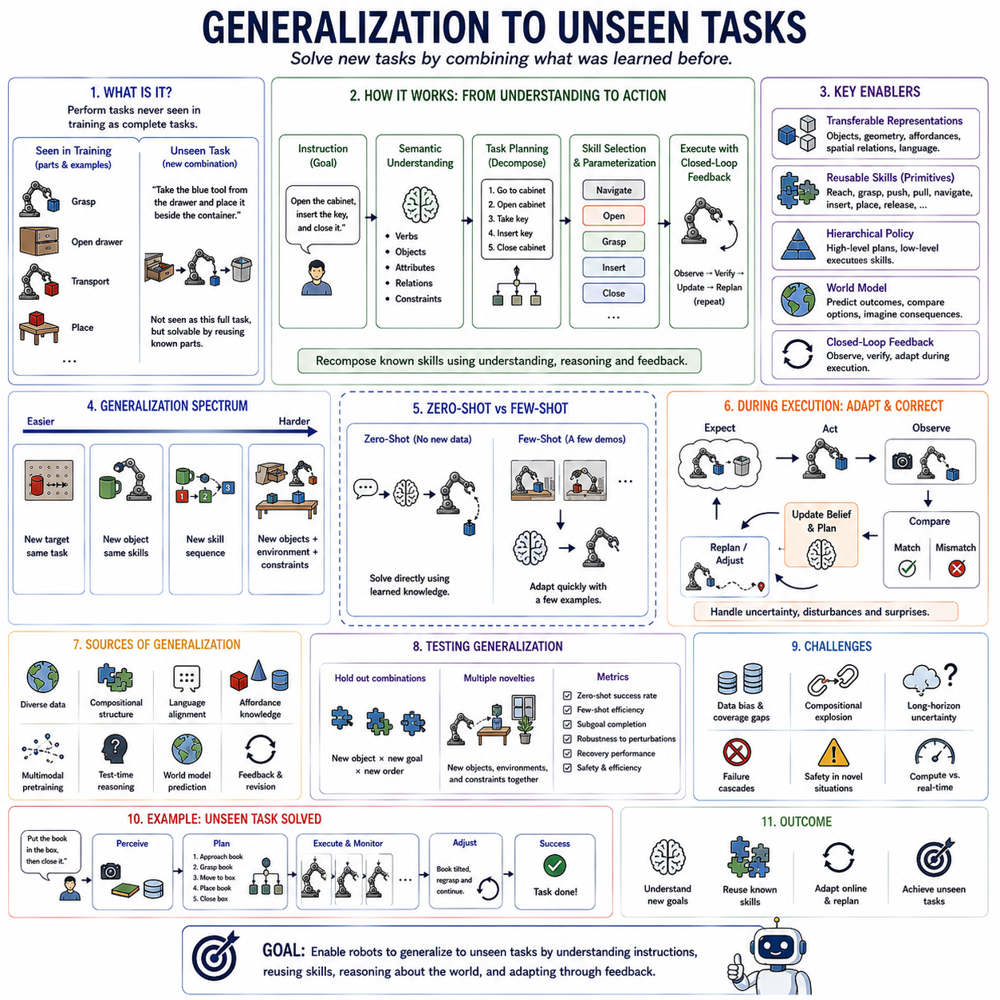{width="7.268055555555556in" height="7.268055555555556in"}

Generalization to unseen tasks is the ability of a robot policy to perform a task that was not explicitly represented as the same complete task during training. This capability distinguishes a generalist policy from a system that merely memorizes a collection of demonstrations. The robot must reuse knowledge acquired from previous tasks, objects, environments, instructions, and interactions to construct behavior appropriate for a novel objective.

An unseen task does not necessarily require entirely unfamiliar physical capabilities. It may instead combine familiar concepts in a configuration that was absent from the training data. A robot that has learned grasping, opening drawers, transporting objects, and placing items may encounter a new instruction requiring these skills in a different order. Generalization therefore depends strongly on whether learned knowledge can be recombined rather than retrieved only as complete memorized trajectories.

Compositional generalization provides a central mechanism for solving such tasks. Robot experience contains reusable components such as objects, actions, spatial relationships, goals, constraints, and skills. If these components are represented independently enough to be recombined, a policy can construct new behaviors from familiar elements. This transforms the learning problem from memorizing complete tasks into acquiring structured building blocks that support many possible task combinations.

Language conditioning is particularly useful because language naturally expresses compositional structure. An instruction such as "take the blue tool from the drawer and place it beside the container" combines familiar verbs, objects, attributes, and spatial relationships into a specific goal. Even if that exact sentence and task were absent from training, semantic representations can allow the policy to interpret its components and connect them to relevant physical skills.

Generalization also depends on transferable perceptual representations. The robot must recognize task-relevant entities and relationships without relying on exact visual appearances encountered during training. Representations that capture object identity, geometry, affordances, spatial relations, and interaction possibilities can remain useful across different tasks. Multimodal pretraining further connects these visual concepts with language, robot state, and action, creating a richer basis for interpreting novel objectives.

Affordance understanding helps bridge semantic novelty and physical execution. An unfamiliar task may refer to an object or interaction combination that the robot has never encountered as a complete example, yet the robot may understand that a handle can be pulled, a container can hold an object, or a flat surface can support placement. Such relational knowledge allows the policy to infer possible actions from functional structure rather than relying only on task-specific demonstrations.

Reusable skills provide the behavioral counterpart to transferable representations. Skills such as reach, grasp, push, pull, navigate, align, insert, transport, and release can serve as primitives for constructing new tasks. A generalist policy does not need to relearn these capabilities whenever the objective changes. Instead, higher-level reasoning can select, parameterize, and sequence existing skills according to the structure of the new task.

Hierarchical policies strengthen this ability by separating task interpretation from physical execution. A high-level component can decompose an unfamiliar goal into subgoals, while skill-level policies execute familiar behavioral units. For example, a previously unseen maintenance instruction might be decomposed into locating a tool, opening an access panel, manipulating a component, replacing the tool, and verifying completion. Novelty at the task level can therefore coexist with familiarity at the skill level.

Task generalization exists on a spectrum rather than as a binary property. A new task may differ only slightly from training tasks, such as placing an object on a new target, or it may require a new composition of known skills. More difficult cases introduce unfamiliar objects, environments, constraints, instructions, and task structures simultaneously. Performance should therefore be interpreted according to the magnitude and type of distribution shift separating training and evaluation conditions.

Zero-shot task generalization occurs when the robot performs an unseen task without task-specific parameter updates or additional demonstrations. Success depends entirely on representations, skills, and reasoning acquired previously. Few-shot adaptation relaxes this requirement by allowing a small number of demonstrations or interactions. These settings measure complementary capabilities: zero-shot evaluation tests immediate transfer, while few-shot evaluation tests how efficiently existing knowledge can support adaptation.

Large and diverse pretraining datasets are important because they expose the model to recurring structures across many tasks. Diversity allows the policy to discover that grasping is useful across sorting, assembly, tool use, storage, and delivery rather than being tied to one demonstration category. Data spanning objects, environments, goals, language, and robot interactions encourages representations that capture stable relationships instead of narrow correlations specific to individual training tasks.

However, data scale alone does not guarantee task generalization. A sufficiently large model may memorize many training combinations without learning the underlying structure needed to solve new ones. Training should therefore include systematic variation in goals, instructions, object roles, action sequences, and environmental conditions. Holding some combinations out during training provides a direct way to test whether the model can reconstruct them from reusable concepts at evaluation time.

World models can provide another mechanism for unseen-task reasoning by representing objects, states, dynamics, and interaction consequences independently of a specific task. Given a new objective, the robot can predict how candidate actions may transform the current state and determine which sequence moves the environment toward the desired outcome. Predictive understanding therefore enables task solving through consequences rather than requiring direct retrieval of a previously demonstrated solution.

Test-time reasoning becomes increasingly valuable as tasks move farther from the training distribution. Instead of immediately producing the most likely familiar action, a policy can generate candidate strategies, decompose the goal, retrieve relevant skills, predict possible outcomes, and compare alternatives. Additional computation at execution time can therefore compensate for the absence of an exact training example by constructing a solution from previously learned knowledge.

Closed-loop feedback remains necessary because a newly composed strategy may not execute exactly as predicted. After each meaningful action or skill, the robot should observe the resulting state and determine whether progress toward the unfamiliar goal is occurring. If assumptions prove incorrect, the system can revise its interpretation, modify parameters, select another skill, or replan. Generalization therefore includes adaptation during execution rather than only producing an initial plan.

Uncertainty awareness is especially important for unseen tasks because the robot may not know whether its previous experience transfers reliably. Confidence may be low when an instruction contains unfamiliar concepts, an object has unknown properties, or a proposed skill is being used in a new context. The policy should recognize these conditions and respond with additional perception, cautious exploration, deliberate reasoning, or assistance rather than treating every novel situation as familiar.

Failure recovery provides a practical test of whether generalization is robust. A robot may correctly infer the broad structure of a new task but encounter unexpected contact, an unsuitable grasp, or an incorrect assumption about an object. Recovery requires using feedback to modify the newly constructed strategy. A system that can adapt its plan after such failures demonstrates deeper task understanding than one that succeeds only when its first inferred sequence happens to work.

Evaluation must carefully separate unseen-task generalization from memorization. Training and test sets should differ in complete task definitions or combinations rather than merely using new recorded trajectories of essentially identical tasks. Evaluation can hold out combinations of objects, goals, instructions, skill sequences, spatial relationships, or constraints and then measure whether the policy can solve these combinations without direct task-specific training.

The strongest tests combine several dimensions of novelty. A policy may receive a new instruction describing a new composition of known skills, involving an unseen object instance in a changed environment. Such tests reveal whether semantic understanding, perception, skill reuse, planning, and closed-loop adaptation work together. They also provide a more realistic measure of generalist capability because real deployments rarely change only one variable at a time.

Successful generalization should be measured through complete task performance, not merely semantic interpretation or action prediction accuracy. Relevant measures include zero-shot success rate, few-shot adaptation efficiency, subgoal completion, robustness to perturbations, recovery performance, execution safety, and degradation as distribution shift increases. Comparison across progressively harder novelty levels can reveal where a policy transitions from reliable transfer to uncertain or unsuccessful behavior.

Ultimately, generalization to unseen tasks requires a robot to transform previous experience into reusable knowledge rather than a library of fixed responses. Transferable multimodal representations provide semantic understanding, reusable skills provide physical capabilities, hierarchical reasoning organizes those capabilities, world models predict consequences, and closed-loop feedback corrects execution. Together these mechanisms allow a generalist policy to construct appropriate behavior for tasks that were never explicitly demonstrated as complete solutions during training.

보지 못한 작업에 대한 일반화(generalization to unseen tasks)는 학습 과정에서 동일한 완전한 형태로 명시적으로 제시되지 않았던 작업을 로봇 정책(robot policy)이 수행할 수 있는 능력을 의미한다. 이러한 능력은 제너럴리스트 정책(generalist policy)을 단순히 여러 시연(demonstration)을 암기하는 시스템과 구별한다. 로봇은 이전 작업, 객체, 환경, 명령, 상호작용에서 습득한 지식을 재사용하여 새로운 목표에 적합한 행동을 구성해야 한다.

보지 못한 작업(unseen task)이 반드시 완전히 새로운 물리적 능력을 요구하는 것은 아니다. 오히려 학습 데이터에 존재하지 않았던 구성으로 익숙한 개념들을 결합하는 경우가 많다. 파지(grasping), 서랍 열기(opening drawers), 객체 운반(transporting objects), 물체 배치(placing items)를 학습한 로봇이 이러한 기술을 새로운 순서로 수행해야 하는 명령을 받을 수 있다. 따라서 일반화는 학습된 지식을 완전한 궤적으로만 검색하는 것이 아니라 새로운 형태로 재조합할 수 있는지에 크게 좌우된다.

조합적 일반화(compositional generalization)는 이러한 작업을 해결하는 핵심 메커니즘을 제공한다. 로봇의 경험에는 객체(object), 행동(action), 공간 관계(spatial relationship), 목표(goal), 제약조건(constraint), 기술(skill)과 같은 재사용 가능한 구성요소가 포함된다. 이러한 구성요소가 서로 재조합할 수 있을 정도로 독립적으로 표현된다면 정책은 익숙한 요소들로 새로운 행동을 구성할 수 있다. 이는 학습 문제를 완전한 작업의 암기에서 다양한 작업 조합을 지원하는 구조화된 구성요소(structured building block)의 습득으로 변화시킨다.

언어 조건화(language conditioning)는 언어가 본질적으로 조합적 구조(compositional structure)를 표현하기 때문에 특히 유용하다. "서랍에서 파란색 도구를 꺼내 용기 옆에 놓아라"와 같은 명령은 익숙한 동사, 객체, 속성(attribute), 공간 관계를 하나의 구체적인 목표로 결합한다. 해당 문장과 작업을 학습 과정에서 정확히 경험하지 않았더라도 의미적 표현(semantic representation)을 통해 정책은 각 구성요소를 해석하고 관련된 물리적 기술과 연결할 수 있다.

일반화는 전이 가능한 지각 표현(transferable perceptual representation)에도 의존한다. 로봇은 학습 과정에서 경험했던 정확한 시각적 외형에 의존하지 않고 작업과 관련된 개체와 관계를 인식해야 한다. 객체 정체성(object identity), 기하학(geometry), 어포던스(affordance), 공간 관계, 상호작용 가능성을 포착하는 표현은 서로 다른 작업에서도 유용하게 활용될 수 있다. 멀티모달 사전학습(multimodal pretraining)은 이러한 시각적 개념을 언어, 로봇 상태, 행동과 연결하여 새로운 목표를 해석하기 위한 더욱 풍부한 기반을 제공한다.

어포던스 이해(affordance understanding)는 의미적 새로움(semantic novelty)과 물리적 실행 사이를 연결하는 데 도움을 준다. 보지 못한 작업이 로봇이 완전한 사례로 경험하지 못했던 객체 또는 상호작용의 조합을 포함하더라도, 로봇은 손잡이는 당길 수 있고, 용기는 객체를 담을 수 있으며, 평평한 표면에는 물체를 놓을 수 있다는 사실을 이해할 수 있다. 이러한 관계적 지식(relational knowledge)을 통해 정책은 작업별 시연에만 의존하지 않고 기능적 구조(functional structure)로부터 가능한 행동을 추론할 수 있다.

재사용 가능한 기술(reusable skill)은 전이 가능한 표현에 대응하는 행동적 기반을 제공한다. 도달(reach), 파지, 밀기(push), 당기기(pull), 내비게이션(navigate), 정렬(align), 삽입(insert), 운반(transport), 놓기(release)와 같은 기술은 새로운 작업을 구성하는 기본 단위(primitive)로 사용될 수 있다. 제너럴리스트 정책은 목표가 변경될 때마다 이러한 능력을 다시 학습할 필요가 없다. 대신 상위 수준 추론(high-level reasoning)이 새로운 작업의 구조에 따라 기존 기술을 선택하고, 매개변수화(parameterization)하며, 적절한 순서로 구성할 수 있다.

계층적 정책(hierarchical policy)은 작업 해석(task interpretation)과 물리적 실행(physical execution)을 분리함으로써 이러한 능력을 강화한다. 상위 수준 구성요소는 익숙하지 않은 목표를 여러 하위 목표(subgoal)로 분해하고, 기술 수준 정책(skill-level policy)은 익숙한 행동 단위를 실행할 수 있다. 예를 들어 이전에 경험하지 않은 유지보수 명령은 도구 찾기, 접근 패널 열기, 구성요소 조작, 도구 원위치, 완료 검증과 같은 단계로 분해될 수 있다. 따라서 작업 수준에서는 새롭더라도 기술 수준에서는 익숙한 행동으로 구성할 수 있다.

작업 일반화(task generalization)는 이분법적인 특성이 아니라 연속적인 스펙트럼(spectrum)으로 존재한다. 새로운 작업은 객체를 새로운 목표 위치에 배치하는 것처럼 학습 작업과 약간만 다를 수도 있고, 이미 알고 있는 기술을 새로운 방식으로 조합해야 할 수도 있다. 더 어려운 경우에는 익숙하지 않은 객체, 환경, 제약조건, 명령, 작업 구조가 동시에 도입된다. 따라서 성능은 학습 조건과 평가 조건 사이에 존재하는 분포 변화(distribution shift)의 크기와 유형에 따라 해석해야 한다.

제로샷 작업 일반화(zero-shot task generalization)는 작업 특화 매개변수 갱신이나 추가적인 시연 없이 로봇이 보지 못한 작업을 수행하는 것을 의미한다. 성공 여부는 이전에 획득한 표현, 기술, 추론 능력에 전적으로 의존한다. 퓨샷 적응(few-shot adaptation)은 소수의 시연이나 상호작용을 허용하여 이러한 조건을 완화한다. 두 설정은 상호보완적인 능력을 측정하며, 제로샷 평가는 즉각적인 전이(immediate transfer)를 테스트하고 퓨샷 평가는 기존 지식이 새로운 작업에 얼마나 효율적으로 적응할 수 있는지를 평가한다.

대규모의 다양한 사전학습 데이터셋(pretraining dataset)은 모델이 여러 작업에서 반복적으로 나타나는 구조를 경험하도록 하기 때문에 중요하다. 데이터의 다양성을 통해 정책은 파지가 하나의 시연 범주에만 연결되는 것이 아니라 분류(sorting), 조립(assembly), 도구 사용(tool use), 보관(storage), 배송(delivery) 등에서 공통으로 유용하다는 것을 발견할 수 있다. 객체, 환경, 목표, 언어, 로봇 상호작용에 걸친 데이터는 개별 학습 작업의 좁은 상관관계보다 안정적인 관계를 포착하는 표현을 학습하도록 한다.

그러나 데이터 규모(data scale)만으로 작업 일반화가 보장되는 것은 아니다. 충분히 큰 모델은 새로운 작업을 해결하는 데 필요한 기본 구조를 학습하지 않고도 수많은 학습 조합을 암기할 수 있다. 따라서 학습에는 목표, 명령, 객체 역할(object role), 행동 시퀀스(action sequence), 환경 조건의 체계적인 변화(systematic variation)가 포함되어야 한다. 일부 조합을 의도적으로 학습에서 제외한 후 평가 과정에서 테스트하면 모델이 재사용 가능한 개념으로부터 해당 조합을 재구성할 수 있는지를 직접 확인할 수 있다.

월드 모델(world model)은 특정 작업과 독립적으로 객체, 상태, 동역학(dynamics), 상호작용의 결과를 표현함으로써 보지 못한 작업을 추론하는 또 다른 메커니즘을 제공할 수 있다. 새로운 목표가 주어지면 로봇은 후보 행동이 현재 상태를 어떻게 변화시킬지 예측하고 어떤 시퀀스가 환경을 원하는 결과로 이동시키는지를 판단할 수 있다. 따라서 예측적 이해(predictive understanding)는 이전에 시연된 해결책을 직접 검색하지 않고 행동의 결과를 기반으로 작업을 해결할 수 있도록 한다.

테스트 시간 추론(test-time reasoning)은 작업이 학습 분포(training distribution)에서 멀어질수록 더욱 중요해진다. 정책은 가장 익숙해 보이는 행동을 즉시 출력하는 대신 후보 전략(candidate strategy)을 생성하고, 목표를 분해하고, 관련 기술을 검색하고, 가능한 결과를 예측하고, 대안을 비교할 수 있다. 따라서 실행 시점에 추가적인 계산을 사용하면 정확히 일치하는 학습 사례가 없더라도 이전에 습득한 지식으로부터 새로운 해결책을 구성할 수 있다.

새롭게 조합된 전략이 항상 예상대로 실행되는 것은 아니므로 폐쇄 루프 피드백(closed-loop feedback)은 여전히 필수적이다. 의미 있는 행동이나 기술을 수행할 때마다 로봇은 결과 상태를 관측하고 익숙하지 않은 목표를 향해 실제로 진행하고 있는지를 판단해야 한다. 기존 가정이 잘못된 것으로 확인되면 시스템은 해석을 수정하고, 매개변수를 변경하고, 다른 기술을 선택하거나 재계획(replanning)할 수 있다. 따라서 일반화에는 초기 계획의 생성뿐만 아니라 실행 과정에서의 적응(adaptation)도 포함된다.

불확실성 인식(uncertainty awareness)은 로봇이 이전 경험을 새로운 작업에 신뢰성 있게 전이할 수 있는지 확신하지 못할 수 있기 때문에 보지 못한 작업에서 특히 중요하다. 명령에 익숙하지 않은 개념이 포함되거나, 객체의 속성을 알 수 없거나, 기존 기술을 새로운 맥락에서 사용해야 할 경우 신뢰도(confidence)가 낮아질 수 있다. 정책은 모든 새로운 상황을 익숙한 것으로 처리하지 않고 이러한 조건을 인식하여 추가적인 지각, 신중한 탐색(cautious exploration), 숙고적 추론(deliberate reasoning), 또는 지원 요청으로 대응해야 한다.

실패 복구(failure recovery)는 일반화가 얼마나 강건한지를 확인할 수 있는 실질적인 시험이다. 로봇이 새로운 작업의 전체적인 구조를 올바르게 추론하더라도 예상하지 못한 접촉, 부적절한 파지, 객체에 대한 잘못된 가정을 경험할 수 있다. 복구를 위해서는 피드백을 이용하여 새롭게 구성한 전략을 수정해야 한다. 이러한 실패 이후에도 계획을 적응시킬 수 있는 시스템은 최초에 추론한 시퀀스가 우연히 성공할 때만 작업을 수행하는 시스템보다 더 깊은 작업 이해(task understanding)를 보여준다.

평가에서는 보지 못한 작업에 대한 일반화와 암기(memorization)를 신중하게 구분해야 한다. 학습 세트(training set)와 테스트 세트(test set)는 본질적으로 동일한 작업의 새로운 기록 궤적만 사용하는 것이 아니라 완전한 작업 정의 또는 작업 조합 자체가 달라야 한다. 객체, 목표, 명령, 기술 시퀀스, 공간 관계, 제약조건의 특정 조합을 학습에서 제외한 후 정책이 직접적인 작업 특화 학습 없이 이러한 조합을 해결할 수 있는지를 측정할 수 있다.

가장 강력한 평가는 여러 차원의 새로움(novelty)을 동시에 결합한다. 정책은 알려진 기술의 새로운 조합을 설명하는 새로운 명령을 받고, 변화된 환경에서 보지 못한 객체 인스턴스(unseen object instance)를 다루어야 할 수 있다. 이러한 테스트는 의미적 이해, 지각, 기술 재사용(skill reuse), 계획, 폐쇄 루프 적응이 함께 작동하는지를 보여준다. 실제 배포 환경에서는 하나의 변수만 독립적으로 변화하는 경우가 드물기 때문에 이러한 방식은 제너럴리스트 능력(generalist capability)을 보다 현실적으로 측정할 수 있다.

성공적인 일반화는 의미적 해석이나 행동 예측 정확도만이 아니라 전체 작업 성능(complete task performance)을 통해 측정해야 한다. 주요 평가 지표에는 제로샷 성공률(zero-shot success rate), 퓨샷 적응 효율성(few-shot adaptation efficiency), 하위 목표 완료율, 교란(perturbation)에 대한 강건성, 복구 성능, 실행 안전성(execution safety), 분포 변화가 증가할 때의 성능 저하 등이 포함된다. 점진적으로 어려워지는 새로움 수준을 비교하면 정책이 신뢰할 수 있는 전이에서 불확실하거나 실패하는 행동으로 전환되는 지점을 파악할 수 있다.

궁극적으로 보지 못한 작업에 대한 일반화(generalization to unseen tasks)는 로봇이 이전 경험을 고정된 반응의 라이브러리가 아니라 재사용 가능한 지식(reusable knowledge)으로 변환할 것을 요구한다. 전이 가능한 멀티모달 표현(multimodal representation)은 의미적 이해를 제공하고, 재사용 가능한 기술은 물리적 능력을 제공하며, 계층적 추론은 이러한 능력을 조직하고, 월드 모델은 행동의 결과를 예측하며, 폐쇄 루프 피드백은 실행을 수정한다. 이러한 메커니즘이 결합되면 제너럴리스트 정책은 학습 과정에서 완전한 해결책으로 명시적으로 시연된 적이 없는 새로운 작업에 대해서도 적절한 행동을 구성할 수 있다.

## 06.12. Generalist Robot Policy [w/Code]

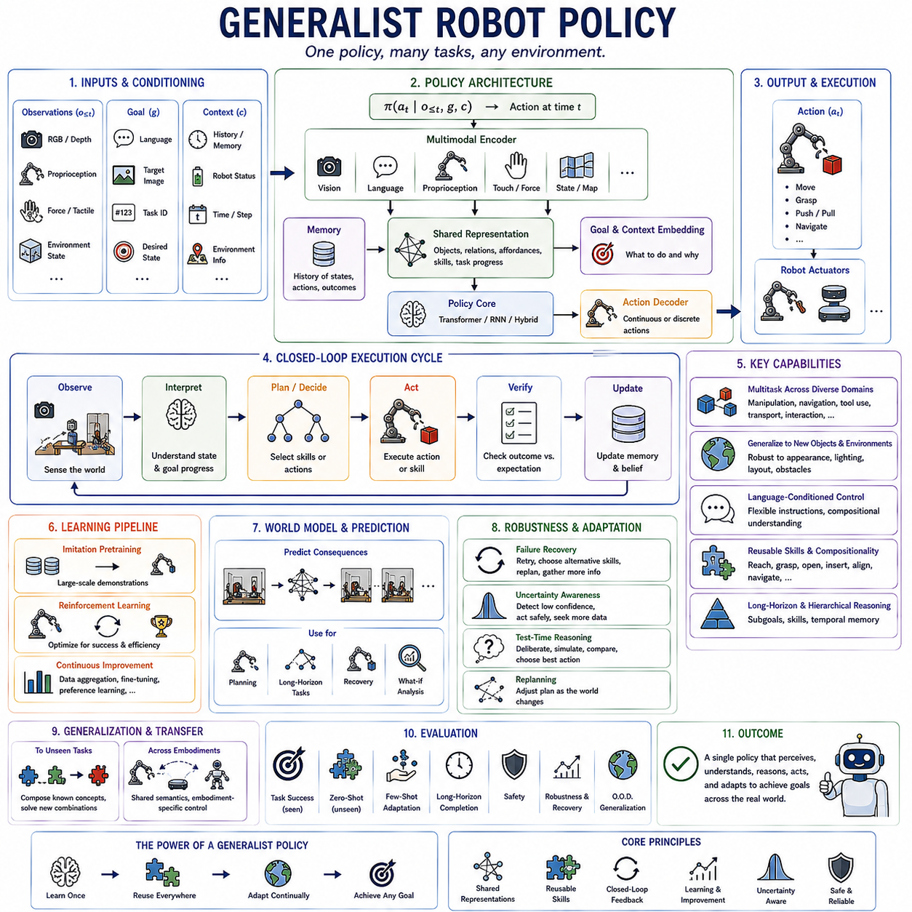{width="7.268055555555556in" height="7.268055555555556in"}

A generalist robot policy is a unified decision-making system designed to perform many tasks across diverse objects, environments, instructions, and operating conditions rather than being optimized for one narrowly defined behavior. Instead of maintaining a separate controller for every task, the policy learns shared representations and reusable behavioral knowledge that allow the same model to interpret goals, perceive relevant states, select actions, and adapt execution across a broad task distribution.

The policy can be expressed conceptually as π(aₜ \| o≤t, g, c), where actions depend on current and previous observations, a specified goal, and contextual information. Observations may include camera images, depth, proprioception, force, tactile sensing, or environmental state, while goals may be communicated through language, target images, task identifiers, or desired states. Context provides the temporal and situational information required to interpret these inputs correctly.

A central characteristic of a generalist policy is shared representation learning. Visual observations, language instructions, robot states, object properties, and actions must be mapped into representations that preserve relationships relevant to physical behavior. Rather than learning independent features for every task, the model identifies reusable concepts such as objects, spatial relations, affordances, motion patterns, contact conditions, and task progress that can support many different behaviors.

Multimodal integration allows these representations to connect semantic understanding with physical execution. Language can specify what should happen, vision can identify objects and geometric relationships, proprioception can describe the robot\'s configuration, and tactile or force signals can characterize contact. The policy must combine these modalities into a coherent state from which actions can be selected. This grounding connects abstract instructions with consequences in the physical world.

Task diversity is essential for developing generalist behavior. Training across manipulation, navigation, tool use, transport, interaction, and other activities exposes the model to behavioral structures that recur across apparently different tasks. A grasp learned during sorting may later support assembly, storage, or tool use. The objective is therefore not merely to increase the number of memorized tasks but to discover knowledge that transfers between them.

Object and environment diversity provide another dimension of generalization. The same policy should operate across objects with different appearances, shapes, sizes, poses, and functional properties while tolerating changes in lighting, backgrounds, workspace layouts, and obstacles. Robust representations should emphasize task-relevant geometry, relationships, and affordances instead of depending excessively on superficial visual correlations that appear only in the training distribution.

Language-conditioned control provides a flexible interface for specifying different goals without creating a new policy for every task. Instructions such as "place the red object in the container" or "bring the tool beside the workstation" can condition the same underlying model toward different behaviors. Language also supports compositionality because known concepts, actions, attributes, and relationships can be combined to describe tasks that were not explicitly demonstrated in exactly the same form.

Reusable skills provide behavioral structure beneath this semantic interface. Reaching, grasping, pushing, pulling, navigating, opening, inserting, aligning, transporting, and releasing can serve as components from which more complex behaviors are constructed. These capabilities may be represented explicitly as separate skills or implicitly within a shared policy. In either case, successful generalization depends on the ability to reuse physical knowledge across multiple task contexts.

Hierarchical organization becomes particularly useful as tasks grow longer and more complex. A high-level policy can interpret goals and select subgoals or skills, while lower-level policies generate detailed physical actions. This separation reduces the effective planning horizon and allows semantic reasoning to operate at a slower timescale than motor control. It also creates natural interfaces for verification, recovery, and replanning when intermediate execution does not proceed as expected.

Memory allows the policy to maintain coherence across extended interactions. The robot must remember what it has already observed, which actions were attempted, which subgoals were completed, and how the environment changed. Transformer context, recurrent state, structured memory, or external state representations can provide temporal information. Without memory, visually similar observations occurring at different task stages may lead to repeated, skipped, or contradictory actions.

Behavior cloning and imitation pretraining provide a practical foundation for learning broad robot capabilities. Large collections of demonstrations expose the model to relationships between observations, goals, and expert actions. Training across diverse trajectories can establish useful sensorimotor priors before autonomous interaction begins. The resulting policy can then be refined using reinforcement learning, corrective demonstrations, preference signals, or deployment experience.

Reinforcement learning extends imitation by optimizing behavior according to task outcomes rather than requiring exact reproduction of demonstrated actions. A pretrained generalist policy can explore alternative strategies, learn from successes and failures, and improve behaviors that influence long-term performance. Offline reinforcement learning can exploit previously collected datasets, while carefully controlled online learning can address states and failures encountered during real-world deployment.

World models can complement reactive policy execution by predicting how candidate actions may change the environment. Instead of choosing actions only from learned correlations, the robot can estimate future states, compare possible consequences, and reason about whether a candidate strategy moves the world toward the desired goal. Predictive models are particularly valuable for planning, long-horizon tasks, recovery, and situations requiring comparison between multiple plausible actions.

Closed-loop feedback ensures that plans remain grounded in actual physical outcomes. After executing an action or skill, the policy observes the resulting state, verifies whether the intended change occurred, and updates its next decision. This observe, interpret, act, verify, and update cycle prevents the robot from blindly following a predetermined sequence after environmental conditions change or an intermediate action fails.

Failure recovery is therefore a defining capability of practical generalist policies. A missed grasp, blocked path, displaced object, incorrect perception, or unexpected contact should not automatically terminate the task. The policy can retry locally with modified parameters, gather additional sensory information, select another skill, or revise the high-level plan. Effective recovery converts failures into evidence that improves subsequent decisions rather than simply repeating unsuccessful behavior.

Uncertainty estimation determines when ordinary policy execution is insufficient. The robot may encounter unfamiliar objects, ambiguous instructions, uncertain poses, or situations far from its training distribution. Instead of treating every prediction as equally reliable, a robust system should recognize low-confidence conditions and respond through additional perception, safer actions, test-time reasoning, replanning, or human assistance when autonomous continuation would be unreliable.

Generalization to unseen tasks represents one of the strongest tests of the architecture. A new task may combine familiar objects, skills, spatial relations, and goals in a configuration never observed as a complete demonstration. The policy must decompose the instruction, identify relevant capabilities, construct an appropriate sequence, execute it, and adapt using feedback. Such compositional transfer demonstrates reusable knowledge rather than simple trajectory memorization.

Generalization can also extend across robot embodiments when semantic task knowledge is separated from embodiment-specific control. High-level concepts such as grasp, transport, inspect, or place can remain shared, while specialized action interfaces translate these intentions into commands appropriate for different manipulators or mobile platforms. Shared latent representations and normalized action abstractions can further support transfer while preserving the physical constraints of each embodiment.

Scaling a generalist policy requires diversity in data, model capacity, tasks, and interaction experience. Increasing data volume is useful only when the dataset contains meaningful variation across goals, objects, environments, behaviors, successes, failures, and recovery trajectories. Balanced sampling is also important because frequently represented tasks can otherwise dominate optimization. The objective is broad capability coverage rather than maximum performance on only the most common behaviors.

Evaluation must therefore measure breadth, transfer, robustness, and adaptation together. Important measures include success across trained tasks, zero-shot performance on unseen combinations, few-shot adaptation efficiency, long-horizon completion, recovery after perturbations, safety, execution efficiency, and degradation under distribution shift. Evaluation should determine not only how many tasks the robot can perform, but whether the underlying capabilities remain reliable as conditions become less familiar.

Ultimately, a generalist robot policy integrates multimodal perception, semantic grounding, reusable skills, temporal memory, hierarchical reasoning, predictive modeling, policy learning, uncertainty awareness, and closed-loop adaptation within a unified behavioral system. Its purpose is not to memorize an enormous catalog of fixed responses, but to transform diverse experience into reusable physical intelligence that can interpret new goals, compose appropriate behavior, learn from outcomes, recover from failure, and operate across increasingly varied real-world situations.

제너럴리스트 로봇 정책(generalist robot policy)은 하나의 좁게 정의된 행동에 최적화되는 대신 다양한 객체, 환경, 명령, 운용 조건에 걸쳐 여러 작업을 수행하도록 설계된 통합 의사결정 시스템(unified decision-making system)이다. 각 작업마다 별도의 제어기(controller)를 유지하는 대신, 정책은 동일한 모델이 목표를 해석하고 관련 상태를 지각하며 행동을 선택하고 광범위한 작업 분포(task distribution)에 걸쳐 실행을 적응시킬 수 있도록 공유 표현(shared representation)과 재사용 가능한 행동 지식(reusable behavioral knowledge)을 학습한다.

정책은 개념적으로 π(aₜ \| o≤t, g, c)로 표현할 수 있으며, 행동은 현재 및 이전 관측(observation), 지정된 목표(goal), 맥락 정보(contextual information)에 의존한다. 관측에는 카메라 이미지, 깊이(depth), 고유수용감각(proprioception), 힘(force), 촉각 감지(tactile sensing), 환경 상태 등이 포함될 수 있으며, 목표는 언어, 목표 이미지(target image), 작업 식별자(task identifier), 원하는 상태(desired state)를 통해 전달될 수 있다. 맥락은 이러한 입력을 올바르게 해석하는 데 필요한 시간적·상황적 정보를 제공한다.

제너럴리스트 정책의 핵심적인 특징은 공유 표현 학습(shared representation learning)이다. 시각적 관측, 언어 명령(language instruction), 로봇 상태(robot state), 객체 속성(object property), 행동은 물리적 행동과 관련된 관계를 유지하는 표현으로 매핑되어야 한다. 모델은 각 작업마다 독립적인 특징을 학습하는 대신 객체, 공간 관계(spatial relation), 어포던스(affordance), 움직임 패턴(motion pattern), 접촉 조건(contact condition), 작업 진행 상태(task progress)와 같이 다양한 행동을 지원할 수 있는 재사용 가능한 개념을 식별한다.

멀티모달 통합(multimodal integration)은 이러한 표현을 통해 의미적 이해(semantic understanding)와 물리적 실행(physical execution)을 연결한다. 언어는 무엇이 일어나야 하는지를 지정하고, 비전(vision)은 객체와 기하학적 관계를 식별하며, 고유수용감각은 로봇의 구성을 설명하고, 촉각이나 힘 신호는 접촉 상태를 나타낼 수 있다. 정책은 이러한 모달리티(modality)를 일관된 상태 표현으로 결합하여 행동을 선택해야 한다. 이러한 그라운딩(grounding)은 추상적인 명령을 물리적 세계에서 발생하는 결과와 연결한다.

작업 다양성(task diversity)은 제너럴리스트 행동을 개발하는 데 필수적이다. 조작(manipulation), 내비게이션(navigation), 도구 사용(tool use), 운반(transport), 상호작용(interaction), 기타 다양한 활동에 걸쳐 학습하면 모델은 겉으로 서로 다른 작업에서 반복적으로 나타나는 행동 구조를 경험할 수 있다. 분류(sorting) 과정에서 학습된 파지(grasp)는 이후 조립(assembly), 보관(storage), 도구 사용에도 활용될 수 있다. 따라서 목표는 단순히 암기된 작업의 수를 늘리는 것이 아니라 작업 사이에서 전이되는 지식을 발견하는 것이다.

객체 및 환경 다양성(object and environment diversity)은 일반화(generalization)의 또 다른 차원을 제공한다. 동일한 정책은 외형, 형상, 크기, 자세(pose), 기능적 속성이 서로 다른 객체를 다루면서 조명, 배경, 작업 공간 배치(workspace layout), 장애물의 변화도 견딜 수 있어야 한다. 강건한 표현(robust representation)은 학습 분포에서만 나타나는 피상적인 시각적 상관관계에 지나치게 의존하는 대신 작업과 관련된 기하학, 관계, 어포던스를 강조해야 한다.

언어 조건부 제어(language-conditioned control)는 작업마다 새로운 정책을 생성하지 않고 다양한 목표를 지정할 수 있는 유연한 인터페이스를 제공한다. "빨간색 객체를 용기 안에 놓아라" 또는 "도구를 작업대 옆으로 가져와라"와 같은 명령은 동일한 기본 모델을 서로 다른 행동으로 조건화할 수 있다. 또한 언어는 알려진 개념, 행동, 속성, 관계를 조합하여 정확히 동일한 형태로 시연되지 않았던 작업을 표현할 수 있기 때문에 조합성(compositionality)을 지원한다.

재사용 가능한 기술(reusable skill)은 이러한 의미적 인터페이스 아래에서 행동 구조를 제공한다. 도달(reaching), 파지(grasping), 밀기(pushing), 당기기(pulling), 내비게이션, 열기(opening), 삽입(inserting), 정렬(aligning), 운반, 놓기(releasing)는 보다 복잡한 행동을 구성하는 요소로 사용될 수 있다. 이러한 능력은 명시적인 개별 기술로 표현되거나 공유 정책 내부에 암묵적으로 포함될 수 있다. 어느 경우든 성공적인 일반화는 물리적 지식을 여러 작업 맥락에서 재사용할 수 있는 능력에 의존한다.

작업이 길고 복잡해질수록 계층적 구성(hierarchical organization)이 특히 유용해진다. 상위 수준 정책(high-level policy)은 목표를 해석하고 하위 목표(subgoal) 또는 기술을 선택하며, 하위 수준 정책(low-level policy)은 세부적인 물리 행동을 생성할 수 있다. 이러한 분리는 실질적인 계획 지평(planning horizon)을 줄이고 의미적 추론이 모터 제어(motor control)보다 느린 시간 척도(timescale)에서 작동하도록 한다. 또한 중간 실행이 예상대로 진행되지 않을 때 검증(verification), 복구(recovery), 재계획(replanning)을 수행하기 위한 자연스러운 인터페이스를 제공한다.

메모리(memory)는 장시간의 상호작용 과정에서 정책이 일관성을 유지하도록 한다. 로봇은 이미 무엇을 관측했는지, 어떤 행동을 시도했는지, 어떤 하위 목표가 완료되었는지, 환경이 어떻게 변화했는지를 기억해야 한다. 트랜스포머 맥락(transformer context), 순환 상태(recurrent state), 구조화된 메모리(structured memory), 외부 상태 표현(external state representation)은 시간적 정보를 제공할 수 있다. 메모리가 없다면 작업의 서로 다른 단계에서 나타나는 시각적으로 유사한 관측이 행동의 반복, 누락 또는 모순을 발생시킬 수 있다.

행동 복제(behavior cloning)와 모방 사전학습(imitation pretraining)은 폭넓은 로봇 능력을 학습하기 위한 실용적인 기반을 제공한다. 대규모 시연 집합은 모델이 관측, 목표, 전문가 행동(expert action) 사이의 관계를 경험하도록 한다. 다양한 궤적(trajectory)에 걸쳐 학습하면 자율적인 상호작용을 시작하기 전에 유용한 감각운동 사전지식(sensorimotor prior)을 구축할 수 있다. 이후 학습된 정책은 강화학습(reinforcement learning), 수정 시연(corrective demonstration), 선호도 신호(preference signal), 실제 배포 경험을 통해 개선될 수 있다.

강화학습은 시연된 행동을 정확하게 재현하는 데만 의존하지 않고 작업 결과(task outcome)에 따라 행동을 최적화함으로써 모방 학습을 확장한다. 사전학습된 제너럴리스트 정책은 대안적인 전략을 탐색하고, 성공과 실패로부터 학습하며, 장기적인 성능에 영향을 미치는 행동을 개선할 수 있다. 오프라인 강화학습(offline reinforcement learning)은 기존에 수집된 데이터셋을 활용할 수 있으며, 신중하게 통제된 온라인 학습(online learning)은 실제 환경 배포에서 발생하는 상태와 실패를 다룰 수 있다.

월드 모델(world model)은 후보 행동이 환경을 어떻게 변화시킬 수 있는지를 예측함으로써 반응형 정책 실행(reactive policy execution)을 보완할 수 있다. 로봇은 단순히 학습된 상관관계로 행동을 선택하는 대신 미래 상태를 추정하고, 가능한 결과를 비교하며, 후보 전략이 세계를 원하는 목표 방향으로 변화시키는지를 추론할 수 있다. 예측 모델(predictive model)은 계획(planning), 장기 지평 작업(long-horizon task), 복구, 여러 가능한 행동 사이의 비교가 필요한 상황에서 특히 유용하다.

폐쇄 루프 피드백(closed-loop feedback)은 계획이 실제 물리적 결과에 지속적으로 그라운딩되도록 한다. 행동이나 기술을 실행한 후 정책은 결과 상태를 관측하고 의도한 변화가 실제로 발생했는지를 검증한 다음, 다음 의사결정을 갱신한다. 이러한 관측(observe), 해석(interpret), 행동(act), 검증(verify), 갱신(update)의 순환은 환경 조건이 변화하거나 중간 행동이 실패한 이후에도 로봇이 미리 결정된 시퀀스를 맹목적으로 따르는 것을 방지한다.

따라서 실패 복구(failure recovery)는 실용적인 제너럴리스트 정책을 정의하는 핵심 능력이다. 파지 실패, 차단된 경로, 이동된 객체, 잘못된 지각, 예상하지 못한 접촉이 발생하더라도 작업이 자동으로 종료되어서는 안 된다. 정책은 변경된 매개변수로 국소적인 재시도(local retry)를 수행하거나, 추가 센서 정보를 수집하거나, 다른 기술을 선택하거나, 상위 수준 계획을 수정할 수 있다. 효과적인 복구는 실패한 행동을 단순히 반복하는 대신 실패를 이후 의사결정을 개선하는 증거로 변환한다.

불확실성 추정(uncertainty estimation)은 일반적인 정책 실행만으로 충분하지 않은 시점을 결정한다. 로봇은 익숙하지 않은 객체, 모호한 명령, 불확실한 자세 또는 학습 분포에서 크게 벗어난 상황을 경험할 수 있다. 강건한 시스템은 모든 예측을 동일하게 신뢰하지 않고 낮은 신뢰도(low confidence)를 인식해야 하며, 추가 지각(additional perception), 보다 안전한 행동, 테스트 시간 추론(test-time reasoning), 재계획 또는 자율적인 진행이 신뢰하기 어려운 경우 인간 지원(human assistance)을 활용할 수 있어야 한다.

보지 못한 작업에 대한 일반화(generalization to unseen tasks)는 이러한 아키텍처를 평가하는 가장 강력한 시험 중 하나이다. 새로운 작업은 익숙한 객체, 기술, 공간 관계, 목표를 완전한 시연으로 경험하지 못한 새로운 구성으로 결합할 수 있다. 정책은 명령을 분해하고, 관련 능력을 식별하고, 적절한 시퀀스를 구성하고, 이를 실행하며, 피드백을 이용하여 적응해야 한다. 이러한 조합적 전이(compositional transfer)는 단순한 궤적 암기가 아니라 재사용 가능한 지식의 존재를 보여준다.

의미적 작업 지식(semantic task knowledge)을 임바디먼트 특화 제어(embodiment-specific control)와 분리하면 서로 다른 로봇 임바디먼트(robot embodiment) 사이에서도 일반화를 확장할 수 있다. 파지, 운반, 검사(inspect), 배치(place)와 같은 상위 수준 개념은 공유하면서 특화된 행동 인터페이스(action interface)가 이러한 의도를 서로 다른 매니퓰레이터(manipulator)나 모바일 플랫폼에 적합한 명령으로 변환할 수 있다. 공유 잠재 표현(shared latent representation)과 정규화된 행동 추상화(normalized action abstraction)는 각 임바디먼트의 물리적 제약조건을 유지하면서 전이를 지원할 수 있다.

제너럴리스트 정책의 스케일링(scaling)에는 데이터, 모델 용량(model capacity), 작업, 상호작용 경험의 다양성이 필요하다. 데이터 규모를 증가시키는 것은 데이터셋이 목표, 객체, 환경, 행동, 성공, 실패, 복구 궤적에 걸쳐 의미 있는 변화를 포함할 때 효과적이다. 자주 등장하는 작업이 최적화를 지배하지 않도록 균형 잡힌 샘플링(balanced sampling)도 중요하다. 목표는 가장 흔한 행동에서만 최대 성능을 얻는 것이 아니라 폭넓은 능력 범위(capability coverage)를 확보하는 것이다.

따라서 평가(evaluation)는 폭넓은 능력, 전이(transfer), 강건성, 적응을 함께 측정해야 한다. 주요 평가 지표에는 학습된 작업에서의 성공률, 보지 못한 조합에 대한 제로샷 성능(zero-shot performance), 퓨샷 적응 효율성(few-shot adaptation efficiency), 장기 지평 작업 완료율, 교란 이후 복구, 안전성, 실행 효율성(execution efficiency), 분포 변화에 따른 성능 저하가 포함된다. 평가는 로봇이 얼마나 많은 작업을 수행할 수 있는지만이 아니라 조건이 익숙하지 않게 변화할수록 기본 능력이 얼마나 신뢰성 있게 유지되는지도 확인해야 한다.

궁극적으로 제너럴리스트 로봇 정책(generalist robot policy)은 멀티모달 지각(multimodal perception), 의미적 그라운딩(semantic grounding), 재사용 가능한 기술, 시간적 메모리(temporal memory), 계층적 추론(hierarchical reasoning), 예측 모델링(predictive modeling), 정책 학습(policy learning), 불확실성 인식(uncertainty awareness), 폐쇄 루프 적응(closed-loop adaptation)을 하나의 통합 행동 시스템(unified behavioral system) 안에서 결합한다. 그 목적은 방대한 고정 반응 목록을 암기하는 것이 아니라 다양한 경험을 재사용 가능한 물리적 지능(reusable physical intelligence)으로 변환하여 새로운 목표를 해석하고, 적절한 행동을 조합하고, 결과로부터 학습하고, 실패에서 복구하며, 점점 더 다양한 실제 환경에서 작동할 수 있도록 하는 것이다.
