**Volume 08. Robot Foundation Models and VLA**

# Chapter 07. Physical Test Time Compute and Reasoning

## 07.01. Test Time Compute for Physical AI

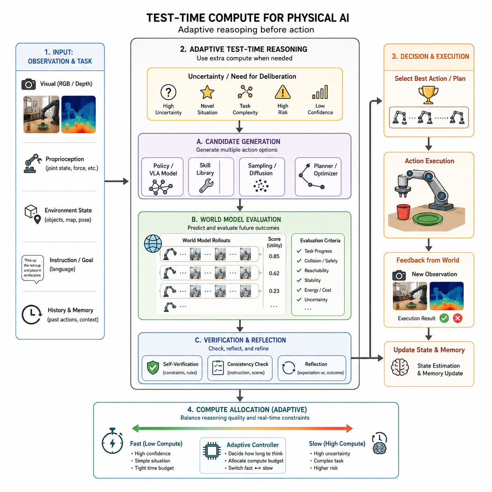{width="7.268055555555556in" height="7.268055555555556in"}

Test-time compute refers to the computational effort a Physical AI system spends after receiving a new observation or task but before committing to an action. Instead of relying on a single forward pass through a learned policy, the robot can allocate additional computation to interpret the situation, generate alternatives, predict consequences, compare candidate actions, and select a response that better satisfies task, safety, and physical constraints.

This concept extends inference-time reasoning from language and multimodal foundation models into embodied systems. For a robot, however, additional reasoning is not merely a matter of producing a better symbolic answer. Computation must ultimately influence physical behavior through motion, manipulation, navigation, or interaction. Test-time compute therefore connects perception and reasoning directly to decisions whose consequences unfold in the real world.

A conventional reactive policy can be expressed conceptually as a direct mapping from observation and task context to action. Such a design is attractive because inference is fast and predictable, but difficult situations may require reasoning that was not fully encoded in the immediate policy response. Physical test-time compute introduces an intermediate deliberation process in which the system can spend additional computational resources before choosing or refining the action.

The amount of useful computation can vary dramatically across situations. Moving through a familiar empty corridor may require little more than rapid perception and control, while manipulating an unfamiliar object in clutter may justify substantially more reasoning. A Physical AI system can therefore treat compute as an adaptive resource, spending little on routine states and increasing deliberation when ambiguity, novelty, uncertainty, task complexity, or potential consequences become significant.

Additional computation can be used to generate multiple candidate actions or action sequences rather than immediately executing the highest-probability prediction. Candidates may originate from a VLA model, generalist policy, skill library, planner, diffusion policy, or sampling process. The system can then evaluate these alternatives according to expected task progress, collision risk, reachability, stability, energy consumption, uncertainty, and other operational constraints.

World models provide an especially important mechanism for physical test-time compute because they allow candidate actions to be evaluated before execution. Given the current estimated state and a possible action sequence, a predictive model can roll the state forward and estimate likely future observations, configurations, contacts, or outcomes. Multiple imagined trajectories can therefore be compared without requiring the robot to physically attempt every alternative in the environment.

Test-time compute also enables search over possible future behaviors. Instead of asking only which action should occur next, the robot can examine several short or long action sequences and estimate their downstream consequences. Sampling, beam-like search, trajectory optimization, tree search, model predictive control, or learned search mechanisms can all contribute to this process, depending on the representation, available compute, and temporal requirements of the robotic platform.

Reasoning can occur at multiple abstraction levels. High-level deliberation may determine whether the robot should grasp an object, reposition itself, request assistance, or choose another route, while lower-level computation evaluates grasp poses, trajectories, contact configurations, or control sequences. Separating these levels allows expensive reasoning to focus on strategically important choices while fast controllers continue handling time-critical stabilization and execution.

Unlike digital reasoning systems, robots operate under strict latency constraints. A robot cannot indefinitely increase inference compute while the physical world continues changing around it. People move, objects fall, vehicles approach, and control states evolve continuously. Physical test-time compute must therefore balance reasoning quality against response time, making the computational budget itself part of the decision architecture rather than assuming that more computation is always beneficial.

This creates a natural distinction between fast and slow physical reasoning. Fast processing handles familiar, high-confidence, time-sensitive situations through direct policy execution or lightweight prediction. Slow processing is activated when the system detects uncertainty, novelty, conflicting objectives, difficult geometry, or elevated risk. The architecture can dynamically switch between these modes or combine them, allowing rapid reflex-like behavior to coexist with deliberate planning.

Uncertainty provides one practical signal for deciding when additional computation is justified. If perception is ambiguous, candidate actions disagree strongly, predicted outcomes have high variance, or the policy has low confidence, the robot can increase sampling, extend world-model rollouts, reconsider the scene, or invoke a stronger reasoning component. When confidence is high and the environment is routine, the same system can reduce compute and preserve latency, energy, and hardware capacity.

Self-verification further expands the role of test-time computation. Before execution, the robot can examine whether a proposed action is consistent with the instruction, current scene, physical constraints, and safety rules. A manipulation system might verify that the target object is correctly identified and reachable, while a mobile robot might confirm that a planned path remains traversable. Verification turns inference from simple generation into generation followed by structured evaluation.

Reflection can also occur after partial execution. Physical tasks generate new observations that reveal whether previous predictions were correct. A robot can compare expected and observed outcomes, identify deviations, update its state estimate, and replan from the new situation. In this sense, physical test-time reasoning is inherently closed-loop: computation is repeatedly interleaved with sensing and action rather than performed once at the beginning of a task.

The value of test-time compute becomes particularly clear in long-horizon tasks. Small mistakes made early in a sequence can create states from which later actions become difficult or impossible. By evaluating intermediate goals and possible future states, a robot can avoid locally attractive actions that undermine overall task completion. Additional inference computation therefore supports not only immediate action quality but also temporal consistency across extended physical behavior.

Compute allocation must nevertheless respect the hardware limitations of embodied platforms. Robots often operate with constrained GPU or NPU resources, limited memory, battery budgets, thermal limits, and competing perception and control workloads. A practical system may vary model size, rollout depth, number of candidates, sampling count, planning horizon, or verification frequency according to available resources and the urgency of the current situation.

This perspective changes the meaning of scaling for robot foundation models. Capability does not depend only on larger pretrained models or larger training datasets. Performance can also improve by using computation more intelligently during deployment. A moderately sized policy combined with candidate generation, predictive simulation, verification, and adaptive search may solve some difficult situations more reliably than a larger model forced to produce every physical decision in a single inference step.

Physical test-time compute should therefore be understood as an architectural principle rather than a single algorithm. It creates a computational layer between learned representations and irreversible physical action, allowing the system to decide not only what to do but how much reasoning should precede doing it. This layer can coordinate foundation models, VLA policies, world models, planners, safety monitors, and controllers within a common decision process.

Ultimately, the objective is not maximum reasoning but appropriate reasoning. Effective Physical AI must act quickly when speed is essential, deliberate when consequences justify additional computation, verify when uncertainty is high, and return to fast execution when the situation becomes clear. Test-time compute provides the mechanism for this adaptive balance, moving robot intelligence from fixed inference toward dynamically allocated physical reasoning under real-world constraints.

테스트 타임 컴퓨트(Test-Time Compute)는 물리 AI(Physical AI) 시스템이 새로운 관측(observation)이나 작업(task)을 받은 이후 실제 행동(action)을 실행하기 전에 사용하는 계산 자원을 의미한다. 학습된 정책(policy)을 단 한 번 순전파(forward pass)하여 행동을 결정하는 대신, 로봇은 상황을 해석하고 대안을 생성하며 결과를 예측하고 후보 행동을 비교한 뒤 작업, 안전성, 물리적 제약을 더 잘 만족하는 행동을 선택하기 위해 추가 계산을 할당할 수 있다.

이 개념은 언어 모델(language model)과 멀티모달 파운데이션 모델(multimodal foundation model)의 추론 시점 추론(inference-time reasoning)을 체화 시스템(embodied system)으로 확장한 것이다. 그러나 로봇에서 추가적인 추론(reasoning)은 단순히 더 나은 기호적 답변을 생성하는 문제가 아니다. 계산 결과는 궁극적으로 이동, 조작, 내비게이션 또는 상호작용과 같은 물리적 행동에 영향을 주어야 한다. 따라서 테스트 타임 컴퓨트는 지각(perception)과 추론을 실제 세계에서 결과가 발생하는 의사결정과 직접 연결한다.

전통적인 반응형 정책(reactive policy)은 개념적으로 관측과 작업 문맥(task context)을 행동으로 직접 매핑(mapping)하는 형태로 표현할 수 있다. 이러한 설계는 추론 속도가 빠르고 예측 가능하다는 장점이 있지만, 어려운 상황에서는 즉각적인 정책 응답에 충분히 포함되지 않은 추가 추론이 필요할 수 있다. 물리 테스트 타임 컴퓨트(Physical Test-Time Compute)는 행동을 선택하거나 개선하기 전에 시스템이 추가적인 계산 자원을 사용할 수 있는 중간 숙고 과정(deliberation process)을 도입한다.

유용한 계산량은 상황에 따라 크게 달라질 수 있다. 익숙하고 비어 있는 복도를 이동하는 경우에는 빠른 지각과 제어만으로 충분할 수 있지만, 복잡한 환경에서 처음 보는 물체를 조작하는 경우에는 훨씬 많은 추론이 필요할 수 있다. 따라서 물리 AI 시스템은 계산 자원을 적응형 자원(adaptive resource)으로 취급하여 일상적인 상태에서는 적은 계산을 사용하고, 모호성, 새로움, 불확실성, 작업 복잡성 또는 잠재적 결과의 중요성이 커질 때 숙고를 증가시킬 수 있다.

추가 계산은 가장 높은 확률의 예측을 즉시 실행하는 대신 여러 후보 행동(candidate action) 또는 행동 시퀀스(action sequence)를 생성하는 데 사용될 수 있다. 후보는 VLA 모델(Vision-Language-Action model), 범용 정책(generalist policy), 스킬 라이브러리(skill library), 플래너(planner), 확산 정책(diffusion policy), 샘플링 과정(sampling process) 등에서 생성될 수 있다. 시스템은 이후 예상 작업 진행도, 충돌 위험, 도달 가능성, 안정성, 에너지 소비, 불확실성 및 기타 운영 제약을 기준으로 이러한 대안을 평가할 수 있다.

월드 모델(world model)은 후보 행동을 실제 실행 전에 평가할 수 있기 때문에 물리 테스트 타임 컴퓨트를 구현하는 데 특히 중요한 메커니즘을 제공한다. 현재 추정 상태와 가능한 행동 시퀀스가 주어지면 예측 모델(predictive model)은 상태를 미래로 전개하고 예상되는 관측, 구성, 접촉 또는 결과를 추정할 수 있다. 따라서 로봇이 환경에서 모든 대안을 실제로 시도하지 않고도 여러 상상된 궤적(imagined trajectory)을 비교할 수 있다.

테스트 타임 컴퓨트는 가능한 미래 행동에 대한 탐색(search)도 가능하게 한다. 로봇은 단순히 다음에 어떤 행동을 해야 하는지를 결정하는 것을 넘어 여러 개의 짧거나 긴 행동 시퀀스를 검토하고 그 후속 결과를 추정할 수 있다. 표현 방식, 사용 가능한 계산 자원, 로봇 플랫폼의 시간적 요구 조건에 따라 샘플링(sampling), 빔 유사 탐색(beam-like search), 궤적 최적화(trajectory optimization), 트리 탐색(tree search), 모델 예측 제어(model predictive control), 학습 기반 탐색(learned search) 등이 이러한 과정에 활용될 수 있다.

추론은 여러 추상화 수준(abstraction level)에서 이루어질 수 있다. 고수준 숙고(high-level deliberation)는 로봇이 물체를 잡을지, 위치를 변경할지, 도움을 요청할지, 다른 경로를 선택할지를 결정할 수 있으며, 저수준 계산(low-level computation)은 파지 자세, 궤적, 접촉 구성 또는 제어 시퀀스를 평가할 수 있다. 이러한 수준을 분리하면 계산 비용이 높은 추론을 전략적으로 중요한 선택에 집중시키면서 빠른 제어기(controller)가 시간에 민감한 안정화와 실행을 계속 담당할 수 있다.

디지털 추론 시스템(digital reasoning system)과 달리 로봇은 엄격한 지연시간 제약(latency constraint) 아래에서 동작한다. 로봇이 추론 계산을 무한정 증가시키는 동안에도 물리적 세계는 계속 변화한다. 사람은 움직이고, 물체는 떨어지며, 차량은 접근하고, 제어 상태는 지속적으로 변한다. 따라서 물리 테스트 타임 컴퓨트는 추론 품질과 응답 시간 사이의 균형을 유지해야 하며, 더 많은 계산이 항상 더 좋다고 가정하는 대신 계산 예산(compute budget) 자체를 의사결정 아키텍처의 일부로 다루어야 한다.

이러한 특성은 빠른 물리적 추론(fast physical reasoning)과 느린 물리적 추론(slow physical reasoning)을 자연스럽게 구분한다. 빠른 처리는 익숙하고 신뢰도가 높으며 시간에 민감한 상황을 직접적인 정책 실행 또는 경량 예측을 통해 처리한다. 느린 처리는 시스템이 불확실성, 새로움, 상충하는 목표, 어려운 기하학적 조건 또는 높은 위험을 감지할 때 활성화된다. 아키텍처는 이러한 모드를 동적으로 전환하거나 결합하여 빠른 반사적 행동(reflex-like behavior)과 신중한 계획(deliberate planning)을 공존시킬 수 있다.

불확실성(uncertainty)은 추가 계산이 필요한 시점을 결정하는 실용적인 신호가 될 수 있다. 지각이 모호하거나 후보 행동 사이의 차이가 크거나 예측 결과의 분산이 높거나 정책 신뢰도가 낮다면 로봇은 샘플링을 증가시키고, 월드 모델 롤아웃(world-model rollout)을 연장하고, 장면을 다시 검토하거나, 더 강력한 추론 구성요소를 호출할 수 있다. 반대로 신뢰도가 높고 환경이 일상적이라면 계산량을 줄여 지연시간, 에너지 및 하드웨어 자원을 절약할 수 있다.

자기 검증(self-verification)은 테스트 타임 계산의 역할을 더욱 확장한다. 로봇은 실행 전에 제안된 행동이 명령, 현재 장면, 물리적 제약 및 안전 규칙과 일치하는지를 검토할 수 있다. 조작 시스템(manipulation system)은 목표 물체가 올바르게 식별되었으며 접근 가능한지 검증할 수 있고, 이동 로봇은 계획된 경로가 여전히 주행 가능한지 확인할 수 있다. 검증은 추론을 단순한 생성에서 생성 이후 구조화된 평가(structured evaluation)가 수행되는 과정으로 변화시킨다.

성찰(reflection)은 부분적인 행동 실행 이후에도 이루어질 수 있다. 물리적 작업은 이전 예측이 정확했는지를 판단할 수 있는 새로운 관측을 지속적으로 생성한다. 로봇은 예상 결과와 실제 관측 결과를 비교하고, 편차를 식별하며, 상태 추정(state estimation)을 갱신하고, 새로운 상황에서 다시 계획할 수 있다. 이러한 의미에서 물리 테스트 타임 추론(physical test-time reasoning)은 본질적으로 폐루프(closed-loop)이며, 작업 시작 시 한 번만 수행되는 것이 아니라 계산, 감지, 행동이 반복적으로 상호 연결된다.

테스트 타임 컴퓨트의 가치는 장기 작업(long-horizon task)에서 특히 명확하게 나타난다. 시퀀스 초기에 발생한 작은 실수는 이후 행동을 어렵거나 불가능하게 만드는 상태를 초래할 수 있다. 로봇은 중간 목표와 가능한 미래 상태를 평가함으로써 단기적으로는 매력적으로 보이지만 전체 작업 완료를 방해하는 행동을 피할 수 있다. 따라서 추가적인 추론 계산은 즉각적인 행동 품질뿐 아니라 장기간에 걸친 물리적 행동의 시간적 일관성(temporal consistency)도 지원한다.

그러나 계산 자원 할당(compute allocation)은 체화 플랫폼(embodied platform)의 하드웨어 제약을 반드시 고려해야 한다. 로봇은 제한된 GPU 또는 NPU 자원, 메모리, 배터리 예산, 열적 한계(thermal limit), 그리고 동시에 실행되는 지각 및 제어 작업의 제약 아래에서 동작하는 경우가 많다. 실용적인 시스템은 현재 상황의 긴급성과 사용 가능한 자원에 따라 모델 크기, 롤아웃 깊이, 후보 수, 샘플링 횟수, 계획 범위(planning horizon), 검증 빈도를 조절할 수 있다.

이러한 관점은 로봇 파운데이션 모델(robot foundation model)의 스케일링(scaling)이 의미하는 바를 변화시킨다. 능력 향상은 더 큰 사전학습 모델이나 더 큰 학습 데이터셋에만 의존하지 않는다. 배포 과정에서 계산 자원을 더욱 지능적으로 사용하는 것으로도 성능을 향상시킬 수 있다. 후보 생성, 예측 시뮬레이션, 검증 및 적응형 탐색과 결합된 중간 규모 정책은 모든 물리적 결정을 단일 추론 단계에서 생성해야 하는 더 큰 모델보다 일부 어려운 상황을 더 안정적으로 해결할 수 있다.

따라서 물리 테스트 타임 컴퓨트는 하나의 특정 알고리즘이라기보다 아키텍처 원칙(architectural principle)으로 이해해야 한다. 이는 학습된 표현(learned representation)과 되돌리기 어려운 물리적 행동 사이에 계산 계층(computational layer)을 형성하여 시스템이 무엇을 할 것인지뿐 아니라 행동하기 전에 얼마나 많은 추론을 수행할 것인지도 결정할 수 있게 한다. 이 계층은 파운데이션 모델, VLA 정책, 월드 모델, 플래너, 안전 모니터(safety monitor), 제어기를 하나의 공통 의사결정 과정으로 조정할 수 있다.

궁극적인 목표는 최대한 많은 추론(maximum reasoning)이 아니라 상황에 적절한 추론(appropriate reasoning)이다. 효과적인 물리 AI는 속도가 중요한 상황에서는 신속하게 행동하고, 결과의 중요성이 추가 계산을 정당화할 때는 충분히 숙고하며, 불확실성이 높을 때는 검증을 수행하고, 상황이 명확해지면 다시 빠른 실행으로 전환해야 한다. 테스트 타임 컴퓨트는 이러한 적응적 균형을 가능하게 하며, 로봇 지능을 고정된 추론에서 실제 세계의 제약 아래 계산 자원을 동적으로 할당하는 물리적 추론(physical reasoning)으로 발전시킨다.

## 07.02. Fast vs Slow Physical Reasoning

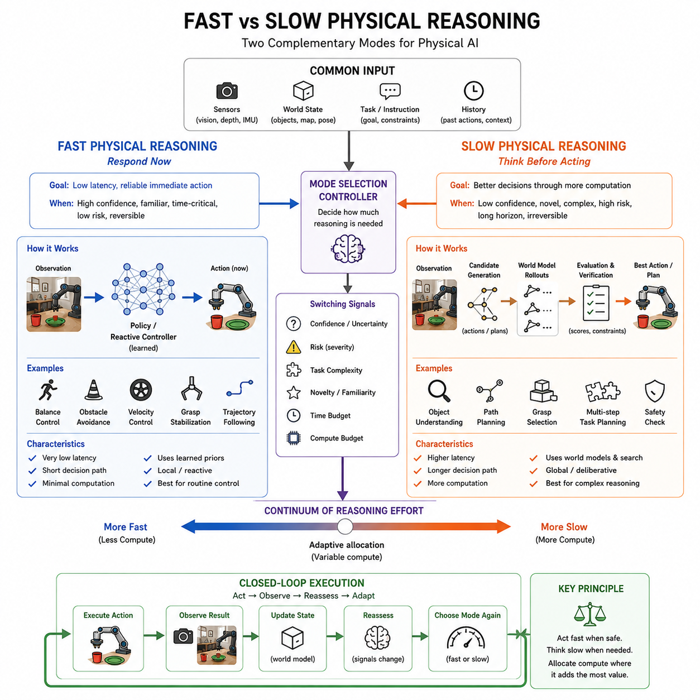{width="7.268055555555556in" height="7.268055555555556in"}

Physical reasoning in robots can be organized around two complementary modes: fast reasoning for immediate responses and slow reasoning for deliberate decisions. Fast reasoning emphasizes low latency and direct action, while slow reasoning allocates additional computation to interpretation, prediction, comparison, and planning. Effective Physical AI requires both because real environments contain situations ranging from routine control to unfamiliar problems that demand deeper evaluation.

Fast physical reasoning operates when the robot has sufficient confidence that a familiar policy or control response is appropriate. Perception is transformed into action with minimal intermediate computation, often through a learned policy, reactive controller, cached skill, or short predictive step. This mode is particularly important when the environment changes rapidly and delaying action would be more dangerous or costly than performing additional deliberation.

Examples of fast reasoning include maintaining balance, avoiding an immediately detected obstacle, correcting wheel velocity, stabilizing a grasp, or following a well-known trajectory. These behaviors may still involve sophisticated neural networks and sensor fusion, but their defining property is that they minimize decision depth. The objective is not necessarily to find the globally optimal action, but to produce a sufficiently reliable action within a strict temporal budget.

Slow physical reasoning becomes valuable when the situation cannot be handled confidently through a direct response. An unfamiliar object, ambiguous instruction, blocked route, failed grasp, unusual terrain, or conflict between safety and task objectives may require additional computation. The robot can then generate alternatives, predict possible outcomes, inspect constraints, compare plans, and reconsider assumptions before committing to physical execution.

The distinction between fast and slow reasoning should not be interpreted simply as small models versus large models. A large VLA model may still generate a direct action quickly, while a relatively compact system may perform extensive search over many candidate trajectories. The important difference is computational structure: fast reasoning follows a short path from observation to action, whereas slow reasoning expands the decision process through additional inference, simulation, search, or verification.

Fast reasoning is closely associated with reactive policies because both prioritize responsiveness. Given an observation, goal, and recent context, a policy can directly produce an action or action chunk. Such policies benefit from extensive pretraining because common physical patterns can be compressed into model parameters. What required explicit planning during learning can therefore become an efficient response during deployment when similar situations are encountered again.

Slow reasoning shifts some intelligence from stored policy knowledge into test-time computation. Rather than assuming that the first generated action is adequate, the system may produce several candidate actions and evaluate them before execution. A world model can simulate their consequences, a planner can test alternative paths, and a verifier can reject candidates that violate task or safety constraints. Additional computation effectively creates more opportunities to correct an initial decision.

World models provide a natural bridge between the two modes. Fast reasoning may use a lightweight prediction of the immediate next state, while slow reasoning can perform longer rollouts across multiple possible futures. If all predicted trajectories lead to similar safe outcomes, the system can act quickly. If outcomes diverge significantly, additional rollouts or deeper search can be triggered, allowing predictive uncertainty to influence the amount of reasoning.

Uncertainty is therefore central to switching between fast and slow reasoning. High-confidence perception, familiar scenes, stable dynamics, and agreement among candidate predictions generally favor fast execution. Low confidence, conflicting predictions, novel configurations, uncertain contacts, or incomplete observations provide reasons to deliberate longer. The robot does not need to classify every situation explicitly; uncertainty measures can act as continuous signals controlling computational effort.

Risk provides another important switching signal. Even when a policy is reasonably confident, the consequences of an incorrect action may justify additional verification. Moving through an empty warehouse aisle and operating close to a person may involve similar navigation capabilities but require different reasoning budgets. Physical reasoning should therefore consider not only the probability of failure but also the severity and reversibility of its potential consequences.

Task complexity can similarly influence reasoning depth. A simple reach movement may require only a direct policy output, whereas assembling components, rearranging multiple objects, or navigating through a changing environment can involve dependencies across many future actions. Slow reasoning allows the system to represent intermediate goals and evaluate whether immediate actions preserve the feasibility of later steps, which is particularly important for long-horizon robot tasks.

The two modes can also operate at different levels of the same robotic system. A high-level planner may deliberate slowly about goals and strategies while a low-level controller reacts rapidly to disturbances. A mobile manipulator, for example, might spend significant computation choosing where to stand before grasping an object, yet use fast feedback control during arm motion. This separation preserves responsiveness without eliminating strategic reasoning.

Fast reasoning is especially important for control loops whose timing is determined by physical dynamics. Balance control, collision avoidance, actuator regulation, and contact stabilization cannot wait for extensive foundation-model inference. These functions may therefore remain under dedicated controllers or compact policies. Slower VLM, VLA, world-model, or planning components can operate above them, providing goals and constraints without replacing time-critical control mechanisms.

Slow reasoning is most useful when additional computation can meaningfully improve the decision before the opportunity to act disappears. Candidate generation may explore alternative skills, grasp configurations, routes, or action sequences. Predictive models can estimate future states, while self-verification can check instruction consistency, reachability, collisions, stability, and task progress. The value of slow reasoning arises from converting extra computation into reduced uncertainty or improved action quality.

However, slow reasoning has costs. Longer inference increases latency, consumes GPU or NPU capacity, uses additional energy, and may compete with perception or control workloads. Excessive deliberation can also make a robot less effective if the environment changes while reasoning is taking place. The goal is therefore not to make every physical decision slower and more sophisticated, but to determine where additional computation has sufficient expected value.

An adaptive reasoning controller can manage this tradeoff by estimating whether further computation is worthwhile. Signals may include policy confidence, disagreement between candidates, world-model uncertainty, task novelty, risk level, available compute, and remaining time. Based on these signals, the controller can change the number of generated candidates, rollout depth, planning horizon, model size, sampling count, or verification effort rather than treating reasoning depth as fixed.

This creates a continuum rather than a strict binary architecture. Some situations may require almost no deliberation, others may require a few candidate comparisons, and exceptionally difficult cases may justify extensive search and repeated verification. Fast and slow reasoning are therefore useful conceptual endpoints of a variable-compute system in which inference effort can increase or decrease continuously according to the physical situation.

Closed-loop execution further reduces the need to solve everything before acting. A robot can perform a safe partial action, observe the resulting state, and decide whether deeper reasoning is now necessary. This interleaving of action and deliberation is particularly valuable in uncertain environments because physical interaction itself produces information. Slow reasoning can thus be invoked selectively at decision boundaries instead of delaying every low-level movement.

The combination of fast and slow physical reasoning provides a practical architecture for generalist robot intelligence. Fast pathways transform learned experience into responsive behavior, while slow pathways use test-time compute to address novelty, ambiguity, risk, and long-horizon dependencies. Together they allow foundation models and VLA policies to operate within the temporal constraints of robotics without reducing physical intelligence to either pure reaction or continuous expensive planning.

Ultimately, capable Physical AI must learn not only how to reason but when reasoning is worth its cost. Familiar and reversible situations should usually favor rapid execution, while uncertain, novel, complex, or consequential situations justify greater deliberation. The transition between these modes becomes a form of meta-reasoning, enabling the robot to allocate computational effort according to confidence, risk, time, and expected benefit before physical action.

로봇의 물리적 추론(physical reasoning)은 즉각적인 반응을 위한 빠른 추론(fast reasoning)과 신중한 의사결정을 위한 느린 추론(slow reasoning)이라는 두 가지 상호보완적 모드를 중심으로 구성할 수 있다. 빠른 추론은 낮은 지연시간(low latency)과 직접적인 행동을 중시하는 반면, 느린 추론은 해석, 예측, 비교, 계획을 위해 추가적인 계산 자원을 할당한다. 효과적인 물리 AI(Physical AI)는 일상적인 제어부터 심층 평가가 필요한 낯선 문제까지 다양한 실제 환경을 처리해야 하므로 두 가지 방식이 모두 필요하다.

빠른 물리적 추론(fast physical reasoning)은 로봇이 익숙한 정책(policy)이나 제어 응답(control response)이 적절하다고 충분히 확신할 수 있을 때 작동한다. 지각(perception)은 학습된 정책, 반응형 제어기(reactive controller), 캐시된 스킬(cached skill), 짧은 예측 단계 등을 통해 최소한의 중간 계산만 거쳐 행동으로 변환된다. 이 모드는 환경이 빠르게 변화하여 추가 숙고(deliberation)를 수행하는 것보다 행동을 지연시키는 것이 더 위험하거나 큰 비용을 초래할 수 있는 상황에서 특히 중요하다.

빠른 추론의 예로는 균형 유지, 즉시 감지된 장애물 회피, 바퀴 속도 보정, 파지 안정화, 익숙한 궤적 추종 등이 있다. 이러한 행동에도 정교한 신경망(neural network)과 센서 융합(sensor fusion)이 사용될 수 있지만, 핵심적인 특징은 의사결정 깊이(decision depth)를 최소화한다는 것이다. 목표는 반드시 전역적으로 최적인 행동을 찾는 것이 아니라 엄격한 시간 예산(temporal budget) 내에서 충분히 신뢰할 수 있는 행동을 생성하는 것이다.

느린 물리적 추론(slow physical reasoning)은 직접적인 반응만으로 상황을 자신 있게 처리하기 어려울 때 중요해진다. 낯선 물체, 모호한 명령, 차단된 경로, 실패한 파지, 비정상적인 지형 또는 안전과 작업 목표 사이의 충돌은 추가적인 계산을 요구할 수 있다. 이 경우 로봇은 실제 행동을 실행하기 전에 여러 대안을 생성하고, 가능한 결과를 예측하며, 제약조건을 검토하고, 계획을 비교하고, 기존 가정을 재검토할 수 있다.

빠른 추론과 느린 추론의 차이를 단순히 작은 모델(small model)과 큰 모델(large model)의 차이로 이해해서는 안 된다. 대규모 VLA 모델(Vision-Language-Action model)도 직접적인 행동을 빠르게 생성할 수 있으며, 상대적으로 작은 시스템도 많은 후보 궤적(candidate trajectory)에 대해 광범위한 탐색을 수행할 수 있다. 중요한 차이는 계산 구조(computational structure)에 있다. 빠른 추론은 관측에서 행동까지 짧은 경로를 따르는 반면, 느린 추론은 추가 추론, 시뮬레이션, 탐색 또는 검증을 통해 의사결정 과정을 확장한다.

빠른 추론은 반응형 정책(reactive policy)과 밀접한 관련이 있는데, 두 방식 모두 응답성(responsiveness)을 중요하게 생각하기 때문이다. 관측, 목표, 최근 문맥(context)이 주어지면 정책은 행동 또는 행동 청크(action chunk)를 직접 생성할 수 있다. 이러한 정책은 대규모 사전학습(pretraining)의 이점을 활용하여 일반적인 물리적 패턴을 모델 파라미터(model parameter)에 압축할 수 있다. 따라서 학습 과정에서 명시적인 계획이 필요했던 행동도 배포 시 유사한 상황을 만나면 효율적인 반응으로 실행될 수 있다.

느린 추론은 저장된 정책 지식(stored policy knowledge)에 집중되어 있던 지능의 일부를 테스트 타임 계산(test-time computation)로 이동시킨다. 시스템은 처음 생성된 행동이 충분하다고 가정하는 대신 여러 후보 행동을 생성하고 실행 전에 평가할 수 있다. 월드 모델(world model)은 후보의 결과를 시뮬레이션하고, 플래너(planner)는 대체 경로를 검토하며, 검증기(verifier)는 작업 또는 안전 제약을 위반하는 후보를 제거할 수 있다. 추가 계산은 초기 의사결정을 수정할 수 있는 기회를 실질적으로 증가시킨다.

월드 모델은 두 가지 추론 모드를 연결하는 자연스러운 가교 역할을 한다. 빠른 추론은 바로 다음 상태에 대한 경량 예측(lightweight prediction)을 사용할 수 있는 반면, 느린 추론은 여러 가능한 미래에 대해 더 긴 롤아웃(rollout)을 수행할 수 있다. 모든 예측 궤적이 유사하고 안전한 결과로 이어진다면 시스템은 빠르게 행동할 수 있다. 반대로 결과가 크게 달라진다면 추가 롤아웃이나 더 깊은 탐색을 활성화하여 예측 불확실성(predictive uncertainty)이 추론량에 영향을 미치도록 할 수 있다.

따라서 불확실성(uncertainty)은 빠른 추론과 느린 추론 사이를 전환하는 데 핵심적인 역할을 한다. 높은 신뢰도의 지각, 익숙한 장면, 안정적인 동역학(stable dynamics), 후보 예측 사이의 높은 일치도는 일반적으로 빠른 실행에 적합하다. 반대로 낮은 신뢰도, 상충하는 예측, 새로운 구성, 불확실한 접촉, 불완전한 관측은 더 오랜 숙고가 필요한 이유가 된다. 로봇은 모든 상황을 명시적으로 분류할 필요 없이 불확실성 척도(uncertainty measure)를 계산 노력(computational effort)을 조절하는 연속적인 신호로 활용할 수 있다.

위험(risk)은 또 다른 중요한 전환 신호이다. 정책이 상당한 수준의 확신을 가지고 있더라도 잘못된 행동이 초래할 결과가 심각하다면 추가 검증이 필요할 수 있다. 비어 있는 창고 통로를 이동하는 경우와 사람 가까이에서 이동하는 경우는 유사한 내비게이션 능력을 사용할 수 있지만 서로 다른 추론 예산(reasoning budget)이 요구될 수 있다. 따라서 물리적 추론은 실패 확률뿐 아니라 잠재적 결과의 심각성(severity)과 되돌릴 수 있는 정도인 가역성(reversibility)까지 고려해야 한다.

작업 복잡성(task complexity) 역시 추론 깊이(reasoning depth)에 영향을 줄 수 있다. 단순한 도달 동작(reach movement)은 직접적인 정책 출력만으로 충분할 수 있지만, 부품 조립, 여러 물체의 재배치 또는 변화하는 환경에서의 내비게이션은 다수의 미래 행동 사이에 의존성을 포함할 수 있다. 느린 추론을 사용하면 시스템은 중간 목표(intermediate goal)를 표현하고 즉각적인 행동이 이후 단계의 실행 가능성을 유지하는지 평가할 수 있으며, 이는 특히 장기 로봇 작업(long-horizon robot task)에서 중요하다.

두 가지 추론 모드는 동일한 로봇 시스템 내부의 서로 다른 수준에서도 동시에 작동할 수 있다. 고수준 플래너(high-level planner)는 목표와 전략에 대해 느리게 숙고하는 동안 저수준 제어기(low-level controller)는 외란(disturbance)에 빠르게 반응할 수 있다. 예를 들어 이동형 매니퓰레이터(mobile manipulator)는 물체를 파지하기 전에 어디에 위치해야 하는지 결정하는 데 상당한 계산을 사용할 수 있지만, 로봇 팔이 움직이는 동안에는 빠른 피드백 제어(feedback control)를 사용할 수 있다. 이러한 분리는 전략적 추론을 유지하면서도 신속한 반응성을 보장한다.

빠른 추론은 물리적 동역학(physical dynamics)에 의해 타이밍이 결정되는 제어 루프(control loop)에서 특히 중요하다. 균형 제어, 충돌 회피, 액추에이터 조절(actuator regulation), 접촉 안정화(contact stabilization)는 파운데이션 모델(foundation model)의 광범위한 추론을 기다릴 수 없다. 따라서 이러한 기능은 전용 제어기나 소형 정책(compact policy)이 담당할 수 있다. 상대적으로 느린 VLM, VLA, 월드 모델 또는 계획 구성요소는 상위 계층에서 동작하며 시간에 민감한 제어 메커니즘을 대체하지 않고 목표와 제약조건을 제공할 수 있다.

느린 추론은 행동할 기회가 사라지기 전에 추가 계산을 통해 의사결정을 의미 있게 개선할 수 있을 때 가장 유용하다. 후보 생성(candidate generation)은 대체 스킬, 파지 구성, 경로 또는 행동 시퀀스를 탐색할 수 있다. 예측 모델은 미래 상태를 추정하고, 자기 검증(self-verification)은 명령 일관성, 도달 가능성, 충돌, 안정성 및 작업 진행 상태를 확인할 수 있다. 느린 추론의 가치는 추가 계산을 불확실성 감소 또는 행동 품질 향상으로 전환하는 데 있다.

그러나 느린 추론에는 비용이 따른다. 긴 추론 과정은 지연시간을 증가시키고, GPU 또는 NPU 자원을 소비하며, 추가 에너지를 사용하고, 지각 또는 제어 작업과 계산 자원을 두고 경쟁할 수 있다. 또한 추론을 수행하는 동안 환경이 변화한다면 과도한 숙고가 오히려 로봇의 효율성을 떨어뜨릴 수 있다. 따라서 목표는 모든 물리적 의사결정을 더 느리고 복잡하게 만드는 것이 아니라 추가 계산이 충분한 기대 가치(expected value)를 가지는 상황을 판단하는 것이다.

적응형 추론 제어기(adaptive reasoning controller)는 추가적인 계산이 가치가 있는지를 추정하여 이러한 상충 관계(tradeoff)를 관리할 수 있다. 정책 신뢰도, 후보 사이의 불일치, 월드 모델의 불확실성, 작업의 새로움, 위험 수준, 사용 가능한 계산 자원 및 남은 시간 등이 판단 신호가 될 수 있다. 제어기는 이러한 신호를 기반으로 추론 깊이를 고정하는 대신 생성 후보 수, 롤아웃 깊이, 계획 범위(planning horizon), 모델 크기, 샘플링 횟수 또는 검증 수준을 조절할 수 있다.

이러한 구조는 엄격한 이진 구조(binary architecture)가 아니라 연속체(continuum)를 형성한다. 어떤 상황에서는 거의 숙고가 필요하지 않을 수 있고, 다른 상황에서는 몇 개의 후보를 비교해야 하며, 매우 어려운 상황에서는 광범위한 탐색과 반복적인 검증이 필요할 수 있다. 따라서 빠른 추론과 느린 추론은 추론 노력이 물리적 상황에 따라 연속적으로 증가하거나 감소할 수 있는 가변 계산 시스템(variable-compute system)의 개념적인 양 끝점으로 이해할 수 있다.

폐루프 실행(closed-loop execution)은 행동하기 전에 모든 문제를 완전히 해결해야 할 필요성을 더욱 줄여준다. 로봇은 안전한 부분 행동(partial action)을 수행하고 그 결과 상태를 관측한 다음 더 깊은 추론이 필요한지를 다시 판단할 수 있다. 행동과 숙고를 번갈아 수행하는 이러한 방식은 물리적 상호작용 자체가 새로운 정보를 생성하기 때문에 불확실한 환경에서 특히 유용하다. 따라서 느린 추론은 모든 저수준 움직임을 지연시키는 대신 중요한 의사결정 경계(decision boundary)에서 선택적으로 호출될 수 있다.

빠른 물리적 추론과 느린 물리적 추론의 결합은 범용 로봇 지능(generalist robot intelligence)을 위한 실용적인 아키텍처를 제공한다. 빠른 경로는 학습된 경험을 반응성 높은 행동으로 변환하고, 느린 경로는 테스트 타임 컴퓨트(test-time compute)를 활용하여 새로움, 모호성, 위험 및 장기 의존성(long-horizon dependency)을 처리한다. 두 방식을 결합하면 파운데이션 모델과 VLA 정책이 로봇의 시간적 제약 내에서 작동하면서도 물리적 지능을 단순한 반응이나 지속적인 고비용 계획 중 하나로 제한하지 않을 수 있다.

궁극적으로 유능한 물리 AI는 어떻게 추론할 것인지뿐 아니라 언제 추론 비용을 지불할 가치가 있는지도 학습해야 한다. 익숙하고 되돌릴 수 있는 상황에서는 일반적으로 빠른 실행을 우선해야 하지만, 불확실하고 새롭고 복잡하거나 결과가 중요한 상황에서는 더 많은 숙고가 필요하다. 이러한 모드 사이의 전환 자체가 메타 추론(meta-reasoning)의 한 형태가 되며, 로봇이 물리적 행동을 실행하기 전에 신뢰도, 위험, 시간 및 기대 효과에 따라 계산 노력을 적절하게 할당할 수 있도록 한다.

## 07.03. Candidate Action Generation

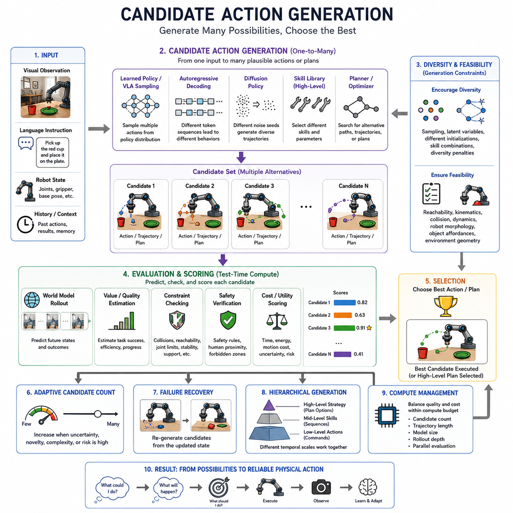{width="7.268055555555556in" height="7.268055555555556in"}

Candidate action generation is the process of producing multiple plausible actions or action sequences before a Physical AI system commits to execution. Instead of treating the first policy output as the final decision, the robot constructs a set of alternatives that can later be evaluated, ranked, verified, or simulated. This creates an explicit interface between action-producing models and test-time reasoning, allowing additional computation to improve physical decisions.

In a conventional reactive policy, an observation and task condition are mapped directly to an action. Candidate generation changes this structure from a single prediction into a one-to-many mapping. Given the same visual observation, language instruction, robot state, and history, the system may propose several feasible responses. These candidates represent alternative hypotheses about how the task can be accomplished under the current physical conditions.

The candidate set can contain individual motor commands, short action chunks, complete trajectories, parameterized skills, or high-level plans. The appropriate representation depends on the reasoning level of the system. A manipulation policy might generate several grasp poses, while a mobile robot may generate alternative paths. A generalist VLA system can instead propose semantic actions such as approach, reposition, grasp, push, inspect, or request assistance.

Candidate generation is valuable because physical tasks frequently have multiple valid solutions. A cup may be grasped from different directions, an obstacle may be bypassed on either side, and an object may be moved through several sequences of intermediate states. Producing alternatives prevents the robot from becoming unnecessarily committed to one interpretation and creates opportunities to discover actions that are safer, more efficient, or more robust.

A learned policy or VLA model can generate candidates by sampling from its action distribution. Rather than selecting only the highest-probability output, the system can sample several possibilities using different stochastic seeds, decoding parameters, or latent variables. This approach exploits diversity already represented inside the learned model and is particularly useful when the policy has learned multiple strategies for accomplishing similar goals.

Autoregressive action models naturally support candidate generation because alternative action-token sequences can be produced during decoding. Different early tokens may lead to substantially different future behaviors, allowing search to branch across possible action sequences. Beam-like methods can preserve several promising partial sequences, while stochastic decoding can increase behavioral diversity and reduce the tendency to repeatedly generate nearly identical solutions.

Diffusion-based policies provide another mechanism for producing diverse candidates. Starting from different noise samples, a diffusion model can generate multiple continuous action trajectories conditioned on the same observation and goal. Because the model represents a distribution over possible behaviors rather than a single deterministic trajectory, it can capture multimodal solutions such as different grasp approaches, manipulation directions, or collision-free motion patterns.

Skill-based systems can generate candidates at a higher level of abstraction. Instead of proposing raw joint commands, the robot may select among learned skills such as navigate, reach, grasp, lift, place, push, open, or inspect. Each skill can contain its own lower-level controller and parameters. Candidate generation then becomes a search over meaningful physical capabilities, reducing the complexity of reasoning across long action sequences.

Planning systems can also serve as candidate generators. Given an estimated world state and a goal, a planner may produce alternative routes, manipulation sequences, or task decompositions. Optimization-based methods can generate trajectories from different initializations, while graph or tree-based planners can identify distinct paths through state or configuration space. Learned policies and classical planning therefore need not compete; they can provide complementary candidate sources.

Candidate diversity is a critical property of the generation process. Producing ten nearly identical actions provides much less reasoning value than generating a smaller set that represents genuinely different strategies. Diversity can be encouraged through stochastic sampling, alternative goals, different planning initializations, latent variables, skill combinations, spatial constraints, or explicit penalties for similarity among candidates.

However, diversity must be balanced with feasibility. Randomly generating highly different actions is not useful if most violate kinematic, geometric, dynamic, or task constraints. Candidate generation should therefore incorporate physical knowledge whenever possible. Reachability, joint limits, collision constraints, contact conditions, robot morphology, object affordances, and environmental geometry can restrict the search space before expensive evaluation is performed.

The number of candidates represents an important test-time compute parameter. Routine situations may require only one or two alternatives, while ambiguous or high-risk situations may justify a larger candidate set. Increasing the number of candidates can improve the probability of discovering a strong solution, but it also increases the computational cost of subsequent world-model rollouts, scoring, verification, and planning.

Candidate generation can therefore be adaptive rather than fixed. When policy confidence is high and the environment is familiar, the system may execute the dominant candidate with minimal comparison. When uncertainty rises, additional candidates can be sampled. If the first candidate set contains no sufficiently safe or high-quality option, the system can expand the search, modify generation parameters, invoke another model, or move to a higher-level planning process.

World models transform candidate generation into a more powerful reasoning mechanism by enabling alternatives to be tested in imagination. Each candidate action or trajectory can be rolled forward through a predictive model to estimate future states and outcomes. Candidates can then be compared according to expected task progress, collision probability, stability, energy consumption, time, uncertainty, or other criteria without physically executing every possibility.

Candidate scoring may combine learned value estimates with explicit engineering constraints. A value model can estimate expected task success, while geometric checks evaluate collision and reachability. Safety monitors can reject dangerous actions, and cost functions can penalize excessive motion, energy use, instability, or time. Combining learned and structured evaluation allows candidate generation to remain flexible while preserving physical constraints.

Verification is particularly important because a candidate may appear plausible to a foundation model while remaining physically impossible. A language-grounded model might correctly understand that an object should be picked up but propose an unreachable approach. Before execution, the system can verify kinematic feasibility, collision clearance, support conditions, object identity, task consistency, and safety requirements, eliminating candidates that fail mandatory constraints.

Candidate generation also supports recovery from failure. If an executed grasp slips or a navigation route becomes blocked, the robot does not necessarily need to restart the entire task. The updated observation can be used to generate a new candidate set conditioned on the failure state. Previously rejected alternatives may become useful, and entirely new strategies can emerge from the changed physical context.

For long-horizon tasks, candidates can exist at several temporal scales simultaneously. A high-level candidate might represent an entire strategy, while lower-level candidates specify the immediate actions required to implement it. Hierarchical generation makes it possible to reason about task structure without enumerating every motor command far into the future. The robot can select a strategic branch and repeatedly regenerate detailed actions as execution progresses.

Candidate action generation is therefore closely connected to fast and slow physical reasoning. Fast reasoning may use a single dominant policy output or a very small candidate set, whereas slow reasoning can deliberately expand the number and diversity of alternatives. The reasoning controller can allocate more generation effort when uncertainty, novelty, complexity, or risk increases and reduce it when a straightforward action is sufficient.

Practical systems must also consider latency, memory, energy, and accelerator utilization. Generating many candidates in parallel may exploit GPU or NPU hardware efficiently, but evaluating each candidate can become expensive. Candidate count, trajectory length, model size, sampling strategy, and rollout depth must therefore be coordinated within a shared compute budget rather than independently maximized.

Ultimately, candidate action generation changes robot decision making from immediate prediction into structured choice. A robot first asks what it could do, then evaluates what is likely to happen, and finally determines what it should do. By separating possibility generation from action selection, Physical AI can combine the broad behavioral knowledge of foundation models with world-model prediction, planning, verification, and adaptive test-time compute to produce more reliable physical behavior.

후보 행동 생성(candidate action generation)은 물리 AI(Physical AI) 시스템이 실제 실행을 결정하기 전에 여러 개의 실행 가능한 행동 또는 행동 시퀀스(action sequence)를 생성하는 과정이다. 로봇은 정책(policy)이 처음 출력한 결과를 최종 결정으로 간주하는 대신, 이후 평가, 순위화, 검증 또는 시뮬레이션할 수 있는 대안 집합을 구성한다. 이는 행동 생성 모델과 테스트 타임 추론(test-time reasoning) 사이에 명시적인 인터페이스를 형성하여 추가 계산을 통해 물리적 의사결정을 개선할 수 있게 한다.

전통적인 반응형 정책(reactive policy)에서는 관측(observation)과 작업 조건(task condition)이 하나의 행동으로 직접 매핑된다. 후보 생성은 이러한 구조를 단일 예측에서 일대다 매핑(one-to-many mapping)으로 변화시킨다. 동일한 시각적 관측, 언어 명령, 로봇 상태 및 이력(history)이 주어졌을 때 시스템은 여러 개의 실행 가능한 대응 방법을 제안할 수 있다. 이러한 후보들은 현재의 물리적 조건에서 작업을 어떻게 수행할 수 있는지에 대한 서로 다른 가설을 나타낸다.

후보 집합(candidate set)은 개별 모터 명령(motor command), 짧은 행동 청크(action chunk), 완전한 궤적(trajectory), 파라미터화된 스킬(parameterized skill) 또는 고수준 계획(high-level plan)을 포함할 수 있다. 적절한 표현 방식은 시스템의 추론 수준에 따라 달라진다. 조작 정책은 여러 파지 자세(grasp pose)를 생성할 수 있고, 이동 로봇은 대체 경로를 생성할 수 있다. 범용 VLA 시스템은 접근, 위치 변경, 파지, 밀기, 검사 또는 도움 요청과 같은 의미적 행동(semantic action)을 제안할 수도 있다.

후보 생성은 물리적 작업에 여러 개의 유효한 해결 방법이 존재하는 경우가 많기 때문에 중요하다. 컵은 서로 다른 방향에서 잡을 수 있고, 장애물은 양쪽 어느 방향으로도 우회할 수 있으며, 물체는 여러 중간 상태의 시퀀스를 통해 이동할 수 있다. 대안을 생성하면 로봇이 하나의 해석에 불필요하게 고정되는 것을 방지하고, 더 안전하고 효율적이며 강건한(robust) 행동을 발견할 기회를 제공한다.

학습된 정책(learned policy)이나 VLA 모델은 행동 분포(action distribution)에서 샘플링하여 후보를 생성할 수 있다. 시스템은 가장 높은 확률의 출력 하나만 선택하는 대신 서로 다른 확률적 시드(stochastic seed), 디코딩 파라미터(decoding parameter) 또는 잠재 변수(latent variable)를 이용하여 여러 가능성을 샘플링할 수 있다. 이러한 방법은 학습된 모델 내부에 이미 표현된 다양성을 활용하며, 정책이 유사한 목표를 수행하기 위한 여러 전략을 학습한 경우 특히 유용하다.

자기회귀 행동 모델(autoregressive action model)은 디코딩 과정에서 대체 행동 토큰 시퀀스(action-token sequence)를 생성할 수 있기 때문에 자연스럽게 후보 생성을 지원한다. 서로 다른 초기 토큰은 이후의 행동을 크게 다르게 만들 수 있으므로 가능한 행동 시퀀스에 걸쳐 탐색이 분기될 수 있다. 빔 유사 방법(beam-like method)은 여러 유망한 부분 시퀀스를 유지할 수 있으며, 확률적 디코딩(stochastic decoding)은 행동 다양성을 증가시키고 거의 동일한 해결책을 반복적으로 생성하는 경향을 줄일 수 있다.

확산 기반 정책(diffusion-based policy)은 다양한 후보를 생성하기 위한 또 다른 메커니즘을 제공한다. 서로 다른 노이즈 샘플(noise sample)에서 시작하여 확산 모델(diffusion model)은 동일한 관측과 목표를 조건으로 여러 개의 연속 행동 궤적(continuous action trajectory)을 생성할 수 있다. 이 모델은 하나의 결정론적 궤적(deterministic trajectory)이 아니라 가능한 행동의 분포를 표현하기 때문에 서로 다른 파지 접근법, 조작 방향 또는 충돌 없는 움직임 패턴과 같은 다중 모드 해법(multimodal solution)을 표현할 수 있다.

스킬 기반 시스템(skill-based system)은 더 높은 추상화 수준에서 후보를 생성할 수 있다. 로봇은 원시 관절 명령(raw joint command)을 제안하는 대신 이동, 도달, 파지, 들어 올리기, 배치, 밀기, 열기 또는 검사와 같은 학습된 스킬 중에서 선택할 수 있다. 각각의 스킬은 자체적인 저수준 제어기(low-level controller)와 파라미터를 포함할 수 있다. 이 경우 후보 생성은 의미 있는 물리적 능력에 대한 탐색이 되어 긴 행동 시퀀스에 대한 추론 복잡성을 줄일 수 있다.

계획 시스템(planning system) 역시 후보 생성기(candidate generator) 역할을 수행할 수 있다. 추정된 세계 상태(world state)와 목표가 주어지면 플래너(planner)는 대체 경로, 조작 시퀀스 또는 작업 분해(task decomposition)를 생성할 수 있다. 최적화 기반 방법(optimization-based method)은 서로 다른 초기화에서 궤적을 생성할 수 있으며, 그래프 또는 트리 기반 플래너는 상태 공간(state space)이나 구성 공간(configuration space)을 통과하는 서로 다른 경로를 식별할 수 있다. 따라서 학습된 정책과 전통적인 계획은 경쟁 관계가 아니라 상호보완적인 후보 공급원이 될 수 있다.

후보 다양성(candidate diversity)은 생성 과정의 핵심적인 특성이다. 거의 동일한 행동 열 개를 생성하는 것은 실제로 서로 다른 전략을 나타내는 더 작은 후보 집합보다 추론 가치가 훨씬 낮다. 확률적 샘플링, 대체 목표, 서로 다른 계획 초기화, 잠재 변수, 스킬 조합, 공간적 제약 또는 후보 사이의 유사성에 대한 명시적 페널티(explicit penalty)를 이용하여 다양성을 높일 수 있다.

그러나 다양성은 실행 가능성(feasibility)과 균형을 이루어야 한다. 대부분이 운동학적, 기하학적, 동역학적 또는 작업 제약을 위반한다면 매우 다양한 행동을 무작위로 생성하는 것은 유용하지 않다. 따라서 후보 생성에는 가능한 경우 물리적 지식(physical knowledge)을 포함해야 한다. 도달 가능성(reachability), 관절 한계(joint limit), 충돌 제약, 접촉 조건, 로봇 형태(robot morphology), 물체 어포던스(object affordance), 환경 기하학(environmental geometry)을 이용하여 비용이 높은 평가를 수행하기 전에 탐색 공간을 제한할 수 있다.

후보 수(number of candidates)는 중요한 테스트 타임 컴퓨트(test-time compute) 파라미터를 나타낸다. 일상적인 상황에서는 하나 또는 두 개의 대안만 필요할 수 있지만, 모호하거나 위험도가 높은 상황에서는 더 큰 후보 집합을 사용하는 것이 정당화될 수 있다. 후보 수를 증가시키면 우수한 해결책을 발견할 가능성이 높아질 수 있지만, 이후 수행되는 월드 모델 롤아웃(world-model rollout), 점수화(scoring), 검증 및 계획의 계산 비용도 증가한다.

따라서 후보 생성은 고정적이 아니라 적응형(adaptive)으로 이루어질 수 있다. 정책 신뢰도가 높고 환경이 익숙한 경우 시스템은 최소한의 비교만 수행하고 가장 우세한 후보를 실행할 수 있다. 불확실성이 증가하면 추가 후보를 샘플링할 수 있다. 최초 후보 집합에서 충분히 안전하거나 품질이 높은 선택지를 찾지 못한다면 탐색을 확장하고, 생성 파라미터를 변경하며, 다른 모델을 호출하거나, 더 높은 수준의 계획 과정으로 전환할 수 있다.

월드 모델(world model)은 대안을 상상 속에서 시험할 수 있게 함으로써 후보 생성을 더욱 강력한 추론 메커니즘으로 변화시킨다. 각각의 후보 행동이나 궤적은 예측 모델(predictive model)을 통해 미래로 롤아웃되어 예상되는 상태와 결과를 추정할 수 있다. 이후 모든 가능성을 실제로 실행하지 않고도 예상 작업 진행도, 충돌 확률, 안정성, 에너지 소비, 시간, 불확실성 또는 기타 평가 기준에 따라 후보를 비교할 수 있다.

후보 점수화(candidate scoring)는 학습된 가치 추정(learned value estimate)과 명시적인 공학적 제약(engineering constraint)을 결합할 수 있다. 가치 모델(value model)은 예상 작업 성공률을 추정하고, 기하학적 검사(geometric check)는 충돌과 도달 가능성을 평가할 수 있다. 안전 모니터(safety monitor)는 위험한 행동을 제거하고, 비용 함수(cost function)는 과도한 움직임, 에너지 사용, 불안정성 또는 시간을 페널티로 처리할 수 있다. 학습 기반 평가와 구조화된 평가를 결합하면 물리적 제약을 유지하면서 후보 생성의 유연성을 확보할 수 있다.

파운데이션 모델(foundation model)이 생성한 후보는 그럴듯해 보이더라도 물리적으로 실행 불가능할 수 있으므로 검증(verification)이 특히 중요하다. 언어 기반 모델은 물체를 집어야 한다는 사실을 올바르게 이해하면서도 도달할 수 없는 접근 방법을 제안할 수 있다. 시스템은 실행 전에 운동학적 실행 가능성(kinematic feasibility), 충돌 여유 공간(collision clearance), 지지 조건, 물체 식별, 작업 일관성 및 안전 요구사항을 검증하여 필수 제약을 만족하지 못하는 후보를 제거할 수 있다.

후보 생성은 실패 복구(failure recovery)도 지원한다. 실행된 파지가 미끄러지거나 내비게이션 경로가 차단된 경우 로봇은 전체 작업을 반드시 처음부터 다시 시작할 필요가 없다. 갱신된 관측을 이용하여 실패 상태를 조건으로 새로운 후보 집합을 생성할 수 있다. 이전에 거부되었던 대안이 유용해질 수도 있으며, 변화된 물리적 문맥에서 완전히 새로운 전략이 나타날 수도 있다.

장기 작업(long-horizon task)에서는 여러 시간적 규모(temporal scale)의 후보가 동시에 존재할 수 있다. 고수준 후보는 전체 전략을 나타낼 수 있는 반면, 저수준 후보는 이를 구현하는 데 필요한 즉각적인 행동을 구체화한다. 계층적 생성(hierarchical generation)을 이용하면 먼 미래의 모든 모터 명령을 열거하지 않고도 작업 구조를 추론할 수 있다. 로봇은 전략적 분기(strategic branch)를 선택한 후 실행이 진행됨에 따라 세부 행동을 반복적으로 다시 생성할 수 있다.

따라서 후보 행동 생성은 빠른 물리적 추론(fast physical reasoning) 및 느린 물리적 추론(slow physical reasoning)과 밀접하게 연결된다. 빠른 추론에서는 하나의 지배적인 정책 출력 또는 매우 작은 후보 집합을 사용할 수 있는 반면, 느린 추론에서는 대안의 수와 다양성을 의도적으로 확대할 수 있다. 추론 제어기(reasoning controller)는 불확실성, 새로움, 복잡성 또는 위험이 증가할 때 생성에 더 많은 계산 자원을 할당하고 단순한 행동으로 충분한 경우 이를 줄일 수 있다.

실용적인 시스템은 지연시간(latency), 메모리, 에너지 및 가속기 활용도(accelerator utilization)도 고려해야 한다. 많은 후보를 병렬로 생성하면 GPU 또는 NPU 하드웨어를 효율적으로 활용할 수 있지만, 각각의 후보를 평가하는 비용은 매우 커질 수 있다. 따라서 후보 수, 궤적 길이, 모델 크기, 샘플링 전략 및 롤아웃 깊이는 각각 독립적으로 최대화하는 것이 아니라 하나의 공유 계산 예산(shared compute budget) 안에서 조정되어야 한다.

궁극적으로 후보 행동 생성은 로봇의 의사결정을 즉각적인 예측에서 구조화된 선택(structured choice)으로 변화시킨다. 로봇은 먼저 무엇을 할 수 있는지 묻고, 다음으로 그 행동을 수행하면 어떤 일이 발생할 가능성이 있는지를 평가하며, 마지막으로 무엇을 해야 하는지를 결정한다. 가능성 생성과 행동 선택을 분리함으로써 물리 AI는 파운데이션 모델의 광범위한 행동 지식을 월드 모델 예측, 계획, 검증 및 적응형 테스트 타임 컴퓨트(adaptive test-time compute)와 결합하여 더욱 신뢰할 수 있는 물리적 행동을 생성할 수 있다.

## 07.04. World Model Rollout for Action Evaluation

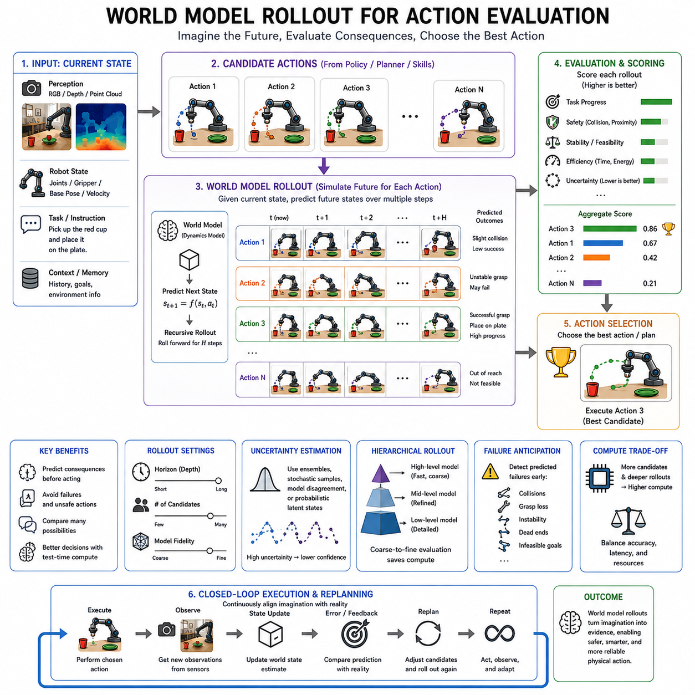{width="7.268055555555556in" height="7.268055555555556in"}

World model rollout for action evaluation is the process of predicting how the physical environment may evolve under different candidate actions before the robot executes them. Instead of judging an action only from its immediate policy score, the system uses a learned or structured world model to simulate possible future states. This converts action selection from direct prediction into consequence-aware reasoning about what is likely to happen next.

A rollout begins from an estimated representation of the current world state. This representation may contain visual features, object states, robot configuration, spatial relationships, task context, memory, or a compact latent state. Given a candidate action, the world model predicts a successor state, and this predicted state can then be recursively propagated to create an imagined trajectory extending several steps into the future.

The world model does not necessarily need to reconstruct complete photorealistic observations. For action evaluation, predicting task-relevant information is often more useful than generating every visual detail. A latent dynamics model may estimate future object positions, contacts, robot states, occupancy, affordances, or task progress in a compact representation, allowing many candidate trajectories to be evaluated with substantially less computation.

Action conditioning is essential because the predicted future must depend on what the robot intends to do. The model estimates transitions conceptually as a function of the current state and candidate action. Different actions applied to the same state should therefore produce different predicted futures. A grasp, push, retreat, turn, or navigation command changes the state trajectory and allows the robot to compare consequences before physical execution.

When candidate action generation produces several alternatives, each candidate can initiate its own rollout. A manipulation system might simulate different grasp approaches, while a mobile robot evaluates alternative paths around an obstacle. The resulting imagined futures can be compared according to task completion, safety, reachability, stability, efficiency, or uncertainty, transforming multiple possibilities into evidence for action selection.

Rollout depth determines how far into the future the system attempts to reason. Short rollouts are computationally inexpensive and can identify immediate collisions, unstable contacts, or obvious failures. Longer rollouts reveal delayed consequences and dependencies across multiple actions, but prediction errors can accumulate over time. Practical systems therefore balance planning horizon against model accuracy, compute availability, and task requirements.

A rollout can evaluate individual actions or entire action sequences. Evaluating one action at a time supports rapid closed-loop control because the robot repeatedly predicts, acts, observes, and replans. Evaluating longer sequences allows the system to detect whether an apparently useful immediate action creates a poor future state. This is particularly important for manipulation, navigation, and other long-horizon tasks containing irreversible or difficult-to-recover decisions.

World model rollout naturally supports model predictive control principles. The system can generate several possible action sequences, simulate them forward, select the most promising sequence, execute only an initial portion, and then repeat the process using new observations. Replanning prevents the robot from depending entirely on long predictions and continuously anchors imagined futures to the evolving physical world.

Scoring converts predicted trajectories into comparable values. A rollout may receive positive value for expected task progress, successful goal completion, stable contact, or efficient motion, while receiving penalties for collision, excessive energy consumption, long execution time, uncertainty, or safety violations. The evaluation function can combine learned value models with explicit engineering objectives and physical constraints.

Safety can be incorporated directly into rollout evaluation rather than treated only as a final filter. Predicted trajectories can be checked for proximity to humans, collisions, unstable configurations, forbidden regions, excessive forces, or other hazardous conditions. A candidate that appears efficient but passes through a dangerous predicted state can therefore be rejected before execution, even when its final predicted goal state appears successful.

Uncertainty is equally important because world models are imperfect approximations of physical reality. A predicted trajectory should not automatically be trusted simply because the model can generate it. The system can estimate uncertainty from ensembles, stochastic predictions, disagreement among models, probabilistic latent states, or repeated samples. Candidates whose outcomes vary substantially across predictions can be treated more cautiously than consistently predicted actions.

Multiple rollouts for the same candidate can represent different plausible futures. Contact-rich manipulation, human motion, deformable objects, and partially observed environments may have inherently uncertain outcomes. Sampling several futures allows the robot to evaluate not only expected performance but also variability and worst-case behavior. An action with slightly lower expected reward may be preferred when its outcomes are significantly more reliable.

The fidelity of a world model should match the decision being evaluated. High-level task planning may require semantic predictions such as whether an object becomes accessible after another object is moved. Motion planning may require geometry and occupancy, while grasp evaluation may require detailed contact and dynamics information. A single universal representation is not always necessary if specialized predictive levels can cooperate within the reasoning architecture.

Hierarchical rollouts can exploit this distinction. A lightweight high-level world model may rapidly evaluate many strategic possibilities, after which more detailed models analyze only the most promising candidates. This coarse-to-fine process reduces computational cost while preserving precision where it matters. Test-time compute can therefore be concentrated on decisions that survive earlier, cheaper stages of evaluation.

World model rollouts also support failure anticipation. Rather than waiting for an action to fail physically, the robot can detect predicted states associated with blocked motion, loss of grasp, instability, dead ends, or inability to complete later task steps. Avoiding such trajectories reduces unnecessary physical experimentation and is especially valuable when failures can damage objects, consume significant time, or create unsafe conditions.

However, rollout-based evaluation is only useful when prediction quality is sufficient for the decision horizon. Model bias can cause the robot to prefer trajectories that look successful in imagination but fail in reality. Distribution shifts, novel objects, unusual contacts, sensor errors, and unseen dynamics can all reduce predictive reliability. Rollout systems therefore need mechanisms for uncertainty estimation, verification, and frequent correction from real observations.

The number of candidate trajectories and rollout depth together determine a large portion of the test-time compute budget. Evaluating more candidates increases behavioral coverage, while deeper rollouts increase temporal foresight. Both cannot be increased without limit on an embodied platform. Adaptive reasoning can allocate computation according to task difficulty, uncertainty, risk, available accelerator capacity, and the time remaining before action is required.

Fast physical reasoning may use no explicit rollout or only a shallow prediction because familiar actions can be executed directly. Slow physical reasoning can activate broader and deeper world-model simulation when the environment is ambiguous or consequences are significant. World model rollout therefore provides a concrete mechanism through which additional test-time compute can be converted into more deliberate physical decision making.

Closed-loop interaction remains essential even when the world model is highly capable. After an action is executed, new sensory observations reveal how accurately the imagined trajectory matched reality. Prediction errors can update the state estimate, trigger replanning, modify confidence, and potentially provide data for future model improvement. The robot repeatedly alternates between imagined futures and measured physical outcomes.

This interaction creates a continuous cycle of observe, generate, imagine, evaluate, act, and observe again. Candidate generation defines what the robot could do, world model rollout predicts what might happen, evaluation estimates which future is preferable, and execution tests that reasoning against reality. Each new observation then becomes the starting point for another cycle, keeping decision making grounded in the physical environment.

Ultimately, world model rollout provides Physical AI with a form of internal experimentation. Instead of learning the consequences of every alternative through direct physical trial, the robot can explore many possibilities computationally before committing to one. Combined with candidate action generation, uncertainty estimation, safety verification, adaptive compute allocation, and closed-loop replanning, rollouts turn predictive world models into practical engines for test-time physical reasoning.

행동 평가를 위한 월드 모델 롤아웃(world model rollout for action evaluation)은 로봇이 실제로 행동을 실행하기 전에 서로 다른 후보 행동(candidate action)에 따라 물리적 환경이 어떻게 변화할 수 있는지를 예측하는 과정이다. 시스템은 행동을 즉각적인 정책 점수(policy score)만으로 판단하는 대신, 학습되거나 구조화된 월드 모델(world model)을 이용해 가능한 미래 상태를 시뮬레이션한다. 이를 통해 행동 선택은 직접적인 예측에서 앞으로 발생할 가능성이 있는 결과를 고려하는 결과 인식 추론(consequence-aware reasoning)으로 전환된다.

롤아웃(rollout)은 현재 세계 상태(world state)에 대한 추정 표현에서 시작한다. 이 표현에는 시각적 특징, 물체 상태, 로봇 구성, 공간적 관계, 작업 문맥(task context), 메모리 또는 압축된 잠재 상태(latent state)가 포함될 수 있다. 후보 행동이 주어지면 월드 모델은 다음 상태(successor state)를 예측하고, 이 예측 상태를 다시 재귀적으로 전개하여 미래의 여러 단계까지 확장되는 상상된 궤적(imagined trajectory)을 생성할 수 있다.

월드 모델이 반드시 완전한 사실적 관측(photorealistic observation)을 재구성해야 하는 것은 아니다. 행동 평가에서는 모든 시각적 세부사항을 생성하는 것보다 작업과 관련된 정보를 예측하는 것이 더 유용한 경우가 많다. 잠재 동역학 모델(latent dynamics model)은 미래의 물체 위치, 접촉, 로봇 상태, 점유 상태(occupancy), 어포던스(affordance) 또는 작업 진행도를 압축된 표현으로 추정하여 훨씬 적은 계산으로 많은 후보 궤적을 평가할 수 있다.

행동 조건화(action conditioning)는 예측되는 미래가 로봇이 무엇을 하려고 하는지에 따라 달라져야 하기 때문에 필수적이다. 모델은 개념적으로 현재 상태와 후보 행동의 함수로 상태 전이(state transition)를 추정한다. 따라서 동일한 상태에 서로 다른 행동을 적용하면 서로 다른 미래가 예측되어야 한다. 파지, 밀기, 후퇴, 회전 또는 내비게이션 명령은 각각 상태 궤적을 변화시키며, 이를 통해 로봇은 실제 실행 전에 결과를 비교할 수 있다.

후보 행동 생성(candidate action generation)이 여러 대안을 생성하면 각각의 후보는 독립적인 롤아웃을 시작할 수 있다. 조작 시스템(manipulation system)은 서로 다른 파지 접근법을 시뮬레이션할 수 있고, 이동 로봇은 장애물을 우회하는 여러 경로를 평가할 수 있다. 생성된 상상 속 미래는 작업 완료, 안전성, 도달 가능성, 안정성, 효율성 또는 불확실성에 따라 비교되며, 여러 가능성을 행동 선택을 위한 근거로 변환한다.

롤아웃 깊이(rollout depth)는 시스템이 얼마나 먼 미래까지 추론할 것인지를 결정한다. 짧은 롤아웃은 계산 비용이 낮으며 즉각적인 충돌, 불안정한 접촉 또는 명백한 실패를 식별할 수 있다. 긴 롤아웃은 지연된 결과와 여러 행동 사이의 의존성을 파악할 수 있지만 시간이 길어질수록 예측 오류가 누적될 수 있다. 따라서 실용적인 시스템은 계획 범위(planning horizon), 모델 정확도, 사용 가능한 계산 자원 및 작업 요구사항 사이에서 균형을 유지해야 한다.

롤아웃은 개별 행동뿐 아니라 전체 행동 시퀀스(action sequence)를 평가할 수도 있다. 한 번에 하나의 행동을 평가하면 로봇이 예측, 행동, 관측, 재계획을 반복할 수 있기 때문에 빠른 폐루프 제어(closed-loop control)에 적합하다. 더 긴 시퀀스를 평가하면 당장은 유용해 보이는 행동이 나중에 좋지 않은 상태를 만드는지를 발견할 수 있다. 이는 되돌리기 어렵거나 복구가 어려운 결정이 포함된 조작, 내비게이션 및 장기 작업(long-horizon task)에서 특히 중요하다.

월드 모델 롤아웃은 자연스럽게 모델 예측 제어(model predictive control)의 원리를 지원한다. 시스템은 여러 가능한 행동 시퀀스를 생성하고 미래로 시뮬레이션하여 가장 유망한 시퀀스를 선택한 뒤, 그중 초기 부분만 실행하고 새로운 관측을 이용해 이 과정을 반복할 수 있다. 이러한 재계획(replanning)은 로봇이 장기 예측에 전적으로 의존하는 것을 방지하고 상상된 미래를 지속적으로 변화하는 물리적 세계와 연결한다.

점수화(scoring)는 예측된 궤적을 서로 비교할 수 있는 값으로 변환한다. 롤아웃은 예상되는 작업 진행, 목표 달성, 안정적인 접촉 또는 효율적인 움직임에 대해 긍정적인 가치를 받을 수 있으며, 충돌, 과도한 에너지 소비, 긴 실행 시간, 불확실성 또는 안전 위반에는 페널티가 부여될 수 있다. 평가 함수(evaluation function)는 학습된 가치 모델(value model)과 명시적인 공학적 목표 및 물리적 제약을 결합할 수 있다.

안전성(safety)은 최종 필터로만 적용하는 대신 롤아웃 평가 과정에 직접 포함할 수 있다. 예측된 궤적은 사람과의 근접성, 충돌, 불안정한 구성, 금지 영역, 과도한 힘 또는 기타 위험 조건에 대해 검사할 수 있다. 따라서 최종적으로 예측된 목표 상태가 성공적으로 보이더라도 중간에 위험한 예측 상태를 통과하는 후보는 실제 실행 전에 제거될 수 있다.

월드 모델은 물리적 현실의 불완전한 근사(approximation)이므로 불확실성(uncertainty)도 마찬가지로 중요하다. 모델이 하나의 궤적을 생성할 수 있다는 이유만으로 예측 결과를 자동으로 신뢰해서는 안 된다. 시스템은 앙상블(ensemble), 확률적 예측(stochastic prediction), 모델 간 불일치, 확률적 잠재 상태(probabilistic latent state) 또는 반복 샘플링을 통해 불확실성을 추정할 수 있다. 여러 예측에서 결과가 크게 달라지는 후보는 일관되게 예측되는 행동보다 더 신중하게 다룰 수 있다.

동일한 후보에 대한 여러 롤아웃은 서로 다른 가능성 있는 미래를 나타낼 수 있다. 접촉이 많은 조작(contact-rich manipulation), 사람의 움직임, 변형 가능한 물체(deformable object), 부분 관측 환경(partially observed environment)은 본질적으로 불확실한 결과를 가질 수 있다. 여러 미래를 샘플링하면 로봇은 예상 성능뿐 아니라 결과의 변동성과 최악의 경우 행동(worst-case behavior)까지 평가할 수 있다. 예상 보상이 조금 낮더라도 결과의 신뢰성이 훨씬 높다면 해당 행동이 선택될 수 있다.

월드 모델의 충실도(fidelity)는 평가하려는 의사결정의 종류와 일치해야 한다. 고수준 작업 계획은 다른 물체를 이동한 후 목표 물체에 접근할 수 있는지와 같은 의미적 예측(semantic prediction)이 필요할 수 있다. 모션 계획(motion planning)에는 기하학적 구조와 점유 상태가 필요하고, 파지 평가에는 세부적인 접촉 및 동역학 정보가 필요할 수 있다. 특화된 여러 예측 수준이 추론 아키텍처 안에서 협력할 수 있다면 하나의 범용 표현만을 반드시 사용할 필요는 없다.

계층적 롤아웃(hierarchical rollout)은 이러한 차이를 활용할 수 있다. 경량 고수준 월드 모델은 많은 전략적 가능성을 빠르게 평가하고, 이후 더 상세한 모델이 가장 유망한 후보만 분석할 수 있다. 이러한 거친 수준에서 세밀한 수준으로 진행되는 과정(coarse-to-fine process)은 중요한 부분의 정밀도를 유지하면서 계산 비용을 줄인다. 따라서 테스트 타임 컴퓨트(test-time compute)를 초기의 저비용 평가 단계를 통과한 의사결정에 집중할 수 있다.

월드 모델 롤아웃은 실패 예측(failure anticipation)도 지원한다. 로봇은 행동이 실제로 실패할 때까지 기다리는 대신 움직임 차단, 파지 손실, 불안정성, 막다른 상태(dead end) 또는 이후 작업 단계를 완료할 수 없는 상태와 관련된 예측 결과를 탐지할 수 있다. 이러한 궤적을 사전에 회피하면 불필요한 물리적 시행착오를 줄일 수 있으며, 실패가 물체를 손상시키거나 상당한 시간을 소비하거나 위험한 상황을 만들 수 있는 경우 특히 가치가 크다.

그러나 롤아웃 기반 평가(rollout-based evaluation)는 예측 품질이 해당 의사결정 범위에서 충분할 때에만 유용하다. 모델 편향(model bias)은 상상 속에서는 성공적으로 보이지만 현실에서는 실패하는 궤적을 선호하도록 만들 수 있다. 분포 변화(distribution shift), 새로운 물체, 비정상적인 접촉, 센서 오류 및 학습하지 않은 동역학은 모두 예측 신뢰성을 낮출 수 있다. 따라서 롤아웃 시스템에는 불확실성 추정, 검증 및 실제 관측을 통한 빈번한 보정 메커니즘이 필요하다.

후보 궤적의 수와 롤아웃 깊이는 함께 테스트 타임 컴퓨트 예산(test-time compute budget)의 상당 부분을 결정한다. 더 많은 후보를 평가하면 행동의 탐색 범위가 넓어지고, 더 깊은 롤아웃은 시간적 예측 범위를 확대한다. 그러나 체화 플랫폼(embodied platform)에서는 두 요소를 무제한으로 증가시킬 수 없다. 적응형 추론(adaptive reasoning)은 작업 난이도, 불확실성, 위험, 사용 가능한 가속기 자원 및 행동이 필요한 시점까지 남은 시간에 따라 계산 자원을 할당할 수 있다.

빠른 물리적 추론(fast physical reasoning)은 익숙한 행동을 직접 실행할 수 있기 때문에 명시적인 롤아웃을 사용하지 않거나 매우 얕은 예측만 사용할 수 있다. 느린 물리적 추론(slow physical reasoning)은 환경이 모호하거나 행동 결과가 중요한 경우 더 넓고 깊은 월드 모델 시뮬레이션을 활성화할 수 있다. 따라서 월드 모델 롤아웃은 추가적인 테스트 타임 컴퓨트를 더욱 신중한 물리적 의사결정으로 변환하는 구체적인 메커니즘을 제공한다.

월드 모델의 능력이 매우 뛰어나더라도 폐루프 상호작용(closed-loop interaction)은 여전히 필수적이다. 행동을 실행한 이후 새로운 센서 관측은 상상된 궤적이 현실과 얼마나 정확하게 일치했는지를 보여준다. 예측 오류(prediction error)는 상태 추정을 갱신하고, 재계획을 활성화하며, 신뢰도를 수정하고, 향후 모델 개선을 위한 데이터를 제공할 수 있다. 로봇은 상상된 미래와 실제로 측정된 물리적 결과 사이를 반복적으로 오간다.

이러한 상호작용은 관측(observe), 생성(generate), 상상(imagine), 평가(evaluate), 행동(act), 그리고 다시 관측하는 연속적인 순환 구조를 형성한다. 후보 생성은 로봇이 무엇을 할 수 있는지를 정의하고, 월드 모델 롤아웃은 어떤 일이 발생할 수 있는지를 예측하며, 평가는 어떤 미래가 더 바람직한지를 추정하고, 실행은 이러한 추론을 현실에서 검증한다. 이후 새로운 관측이 다음 순환의 시작점이 되면서 의사결정이 물리적 환경에 지속적으로 기반하도록 한다.

궁극적으로 월드 모델 롤아웃은 물리 AI에 일종의 내부 실험(internal experimentation) 능력을 제공한다. 로봇은 모든 대안의 결과를 직접적인 물리적 시행을 통해 학습하는 대신 하나의 행동을 선택하기 전에 계산적으로 많은 가능성을 탐색할 수 있다. 후보 행동 생성, 불확실성 추정, 안전 검증, 적응형 계산 자원 할당(adaptive compute allocation), 폐루프 재계획과 결합된 롤아웃은 예측 월드 모델을 테스트 타임 물리적 추론(test-time physical reasoning)을 위한 실용적인 엔진으로 변화시킨다.

## 07.05. Search and Sampling Strategies

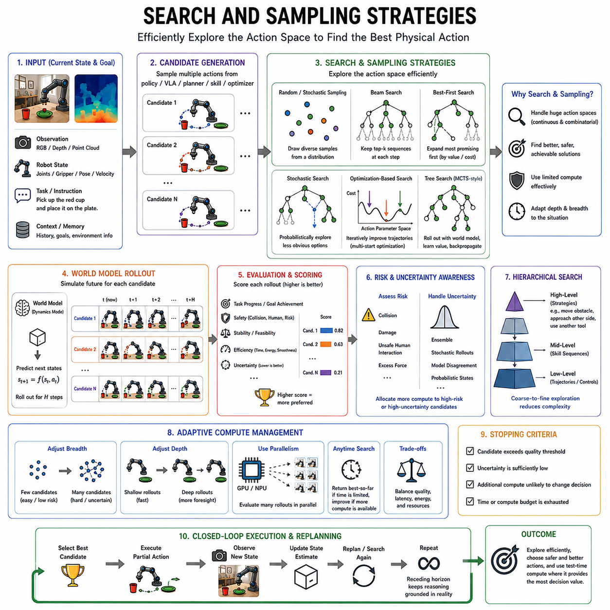{width="7.268055555555556in" height="7.268055555555556in"}

Search and sampling strategies determine how a Physical AI system explores alternative actions during test-time reasoning. Once candidate generation is possible, the robot must decide how broadly and deeply to explore the space of behaviors. Rather than evaluating every possible action, which is computationally impossible in realistic environments, search and sampling concentrate limited compute on alternatives that are likely to produce useful, safe, and achievable physical outcomes.

The search problem in robotics is difficult because action spaces can be extremely large. A manipulator may choose among continuous joint motions, grasp poses, contact points, and trajectories, while a mobile robot may consider many routes and velocities. Long-horizon tasks multiply these possibilities across time. Search strategies therefore provide structure for exploring this combinatorial space without explicitly enumerating every possible sequence.

Sampling offers a simple way to approximate this exploration. A learned policy, VLA model, diffusion policy, or trajectory generator can produce multiple actions from a probability distribution conditioned on the current observation and goal. Each sample represents one possible solution. By evaluating several samples rather than accepting a single output, the robot increases its opportunity to discover alternatives that better satisfy physical and task constraints.

Pure random sampling is rarely sufficient because most of the physical action space may contain poor or infeasible behaviors. Effective sampling should exploit information learned during training so that probability mass is concentrated around plausible actions. A pretrained robot policy effectively acts as a proposal distribution, guiding test-time computation toward regions of action space associated with successful behavior while still allowing exploration of alternative strategies.

Sampling diversity is important because repeatedly drawing nearly identical actions provides little additional information. Temperature adjustment, stochastic decoding, latent-variable sampling, different diffusion noise seeds, spatial perturbations, or diversity penalties can broaden the candidate set. The objective is not maximum randomness, but meaningful variation that represents different ways of solving the same physical problem while preserving sufficient feasibility.

Search differs from independent sampling by using information gathered during exploration to decide what should be examined next. A promising partial trajectory can be expanded further, while alternatives predicted to fail can be abandoned early. This creates an iterative process in which computation becomes increasingly concentrated on useful regions of the decision space, making search especially valuable when actions form long sequences with dependencies between steps.

Tree search provides a natural representation for sequential physical reasoning. The root corresponds to the current state, branches represent candidate actions, and subsequent nodes represent predicted future states. Each branch can be expanded through a world model to explore possible consequences. The robot can compare different paths through this tree and allocate additional computation to branches that appear promising, uncertain, or strategically important.

Breadth and depth create a fundamental search tradeoff. Broad search evaluates many different alternatives but may examine each only shallowly. Deep search follows fewer alternatives farther into the future, revealing delayed consequences but potentially missing better strategies elsewhere. Physical AI must balance these dimensions according to task structure, prediction reliability, available compute, and the amount of time remaining before an action is required.

Beam-like search offers a practical compromise by preserving several high-quality partial action sequences at each stage. Low-scoring branches are removed while promising alternatives continue to expand. This approach limits exponential growth while maintaining multiple hypotheses. In robot tasks, beam-style methods can preserve alternative manipulation strategies or routes until sufficient evidence exists to prefer one sequence over the others.

Best-first strategies instead prioritize whichever candidate currently appears most promising according to a value, cost, or utility estimate. The search does not expand all alternatives equally. Candidates with strong predicted task progress or low expected cost receive more computation, while weak candidates receive less. The effectiveness of this approach depends strongly on the quality of the scoring function used to guide exploration.

Stochastic search can be advantageous when model predictions are uncertain or when several distinct solutions may exist. Rather than always expanding the current highest-scoring candidate, the system retains some probability of exploring less obvious alternatives. This prevents early model errors from completely eliminating useful strategies and can help the robot discover solutions outside the dominant behavior represented by its policy.

Optimization-based search provides another approach for continuous robot actions. Instead of selecting among discrete branches, an initial trajectory can be iteratively modified to improve an objective. The objective may combine task progress, collision avoidance, smoothness, stability, energy, and execution time. Multiple initial trajectories can be optimized in parallel, reducing the risk that the system becomes trapped in one poor local solution.

World models make search substantially more useful by providing predicted state transitions without requiring physical execution. Candidate actions can be rolled forward in imagination, scored, and expanded according to their predicted outcomes. Search therefore operates over simulated futures rather than repeatedly experimenting with the real robot, allowing large numbers of possibilities to be considered before committing to potentially costly or irreversible physical actions.

Uncertainty should influence how search computation is distributed. When several branches have similar predicted values or world-model predictions disagree, deeper exploration may be justified. Conversely, when one candidate is clearly superior and predictions are confident, continued search may have little value. Search termination can therefore depend not only on a fixed compute limit but also on confidence in the current decision.

Risk can modify search priorities independently of expected reward. A candidate with high expected task success may still require additional investigation if failure could produce collision, damage, or unsafe human interaction. High-risk branches can receive more rollouts, stronger verification, or worst-case analysis. Search in Physical AI must therefore consider the severity of possible outcomes rather than optimizing only average predicted performance.

Hierarchical search helps manage long-horizon complexity by operating at different levels of abstraction. A high-level search may compare strategies such as moving an obstacle, approaching from another side, or selecting another tool. Once a strategy is chosen, lower-level search determines trajectories and control parameters. This reduces the branching factor and avoids searching directly over enormous sequences of low-level motor commands.

Search and sampling can also be combined. Sampling can first produce a diverse set of high-quality proposals from a learned policy, after which search expands or refines the most promising candidates. Alternatively, search can identify useful regions of the state-action space and sampling can explore variations within those regions. Learned priors and structured search therefore complement each other rather than representing mutually exclusive approaches.

Adaptive computation is essential because the optimal search strategy changes with the situation. Familiar low-risk states may require only a few samples or a shallow search. Novel, ambiguous, complex, or consequential situations can justify more candidates, greater search depth, additional world-model rollouts, and stronger verification. The reasoning system can dynamically modify these parameters according to uncertainty and available resources.

Stopping is itself an important reasoning decision. Search should terminate when a candidate exceeds an acceptable quality threshold, when additional computation is unlikely to change the decision, when uncertainty becomes sufficiently low, or when the available time or compute budget is exhausted. A robot that cannot decide when to stop thinking may perform worse than a simpler reactive system because physical opportunities continue to change during deliberation.

Real-time constraints make anytime search particularly attractive for robotics. An anytime method can maintain a valid current solution while using additional available computation to improve it. If an urgent action becomes necessary, the best solution found so far can be executed immediately. If more time remains, the system continues exploring. This creates a direct connection between reasoning quality and dynamically available test-time compute.

Closed-loop execution reduces the burden on search by allowing the robot to reconsider its decision after partial action. Instead of planning an entire task perfectly before moving, the robot can search over a manageable horizon, execute a safe portion, observe the resulting state, and search again. This repeated receding-horizon process keeps reasoning grounded in reality and limits the accumulation of world-model prediction errors.

Compute efficiency can also be improved through parallelism. Modern GPUs and NPUs can evaluate multiple sampled candidates or world-model trajectories simultaneously. Batched inference allows broader exploration without increasing latency proportionally to candidate count. However, memory, energy, and thermal constraints remain important, so parallel search must still operate within the overall computational budget of the embodied platform.

Search and sampling strategies ultimately determine how test-time compute is transformed into better physical decisions. Sampling creates behavioral diversity, search concentrates computation on promising possibilities, world models provide imagined consequences, and scoring and verification guide selection. Together they allow a robot to explore what it could do without physically attempting every alternative, making deliberate reasoning practical under real-world constraints.

The central objective is not exhaustive search but efficient allocation of reasoning effort. Physical AI should explore broadly enough to avoid premature commitment, deeply enough to recognize important future consequences, and selectively enough to satisfy latency and compute limits. By combining learned action priors, adaptive sampling, structured search, predictive rollouts, uncertainty, and closed-loop replanning, robots can use test-time computation where it provides the greatest decision value.

탐색 및 샘플링 전략(search and sampling strategies)은 물리 AI(Physical AI) 시스템이 테스트 타임 추론(test-time reasoning) 과정에서 대체 행동을 어떻게 탐색하는지를 결정한다. 후보 생성(candidate generation)이 가능해지면 로봇은 행동 공간을 얼마나 넓고 깊게 탐색할지를 결정해야 한다. 현실적인 환경에서 가능한 모든 행동을 평가하는 것은 계산적으로 불가능하므로, 탐색과 샘플링은 제한된 계산 자원을 유용하고 안전하며 실행 가능한 물리적 결과를 생성할 가능성이 높은 대안에 집중시킨다.

로봇에서 탐색 문제(search problem)가 어려운 이유는 행동 공간(action space)이 매우 클 수 있기 때문이다. 매니퓰레이터(manipulator)는 연속적인 관절 움직임, 파지 자세, 접촉 지점 및 궤적 가운데 선택해야 하며, 이동 로봇은 수많은 경로와 속도를 고려할 수 있다. 장기 작업(long-horizon task)에서는 이러한 가능성이 시간에 따라 곱해진다. 따라서 탐색 전략은 가능한 모든 시퀀스를 명시적으로 열거하지 않고도 이러한 조합적 공간(combinatorial space)을 탐색할 수 있는 구조를 제공한다.

샘플링(sampling)은 이러한 탐색을 근사하는 간단한 방법을 제공한다. 학습된 정책(learned policy), VLA 모델(Vision-Language-Action model), 확산 정책(diffusion policy) 또는 궤적 생성기(trajectory generator)는 현재 관측과 목표를 조건으로 하는 확률 분포에서 여러 행동을 생성할 수 있다. 각각의 샘플은 하나의 가능한 해결책을 나타낸다. 로봇은 하나의 출력만 받아들이는 대신 여러 샘플을 평가함으로써 물리적 제약과 작업 제약을 더 잘 만족하는 대안을 발견할 가능성을 높인다.

순수 무작위 샘플링(pure random sampling)은 물리적 행동 공간의 대부분이 품질이 낮거나 실행 불가능한 행동으로 구성될 수 있기 때문에 충분하지 않은 경우가 많다. 효과적인 샘플링은 학습 과정에서 획득한 정보를 활용하여 실행 가능성이 높은 행동 주변에 확률 질량(probability mass)을 집중시켜야 한다. 사전학습된 로봇 정책(pretrained robot policy)은 사실상 제안 분포(proposal distribution) 역할을 하여 테스트 타임 계산을 성공적인 행동과 연관된 행동 공간 영역으로 유도하면서도 대체 전략을 탐색할 수 있게 한다.

샘플링 다양성(sampling diversity)은 거의 동일한 행동을 반복적으로 생성하면 추가적인 정보를 거의 제공하지 못하기 때문에 중요하다. 온도 조절(temperature adjustment), 확률적 디코딩(stochastic decoding), 잠재 변수 샘플링(latent-variable sampling), 서로 다른 확산 노이즈 시드(diffusion noise seed), 공간적 섭동(spatial perturbation) 또는 다양성 페널티(diversity penalty)를 통해 후보 집합을 확대할 수 있다. 목표는 최대한 무작위적인 행동을 생성하는 것이 아니라 충분한 실행 가능성을 유지하면서 동일한 물리적 문제를 해결하는 서로 다른 방법을 나타내는 의미 있는 변화를 생성하는 것이다.

탐색(search)은 탐색 과정에서 얻어진 정보를 이용하여 다음에 무엇을 조사해야 하는지를 결정한다는 점에서 독립적인 샘플링과 다르다. 유망한 부분 궤적(partial trajectory)은 추가적으로 확장할 수 있는 반면, 실패할 것으로 예측되는 대안은 조기에 중단할 수 있다. 이는 계산 자원이 점차 의사결정 공간의 유용한 영역에 집중되는 반복적인 과정을 형성하며, 여러 단계의 행동 사이에 의존성이 존재하는 긴 시퀀스에서 특히 유용하다.

트리 탐색(tree search)은 순차적인 물리적 추론(sequential physical reasoning)을 자연스럽게 표현한다. 루트(root)는 현재 상태에 대응하고, 분기(branch)는 후보 행동을 나타내며, 이후의 노드(node)는 예측된 미래 상태를 나타낸다. 각각의 분기는 월드 모델(world model)을 통해 확장하여 가능한 결과를 탐색할 수 있다. 로봇은 트리를 따라 서로 다른 경로를 비교하고 유망하거나 불확실하거나 전략적으로 중요한 분기에 추가 계산을 할당할 수 있다.

너비(breadth)와 깊이(depth)는 탐색에서 근본적인 상충 관계(tradeoff)를 형성한다. 넓은 탐색은 많은 대안을 평가하지만 각각을 얕게 살펴볼 수밖에 없다. 깊은 탐색은 적은 수의 대안을 더 먼 미래까지 추적하여 지연된 결과를 파악할 수 있지만 다른 위치에 존재하는 더 좋은 전략을 놓칠 수 있다. 물리 AI는 작업 구조, 예측 신뢰성, 사용 가능한 계산 자원 및 행동이 필요한 시점까지 남은 시간에 따라 이 두 요소의 균형을 조절해야 한다.

빔 유사 탐색(beam-like search)은 각 단계에서 여러 개의 고품질 부분 행동 시퀀스를 유지함으로써 실용적인 절충안을 제공한다. 낮은 점수를 받은 분기는 제거하고 유망한 대안은 계속 확장한다. 이 방법은 여러 가설을 유지하면서 지수적 증가(exponential growth)를 제한한다. 로봇 작업에서는 충분한 근거가 확보되어 하나의 시퀀스를 선택할 수 있을 때까지 여러 조작 전략이나 대체 경로를 유지하는 데 활용할 수 있다.

최선 우선 전략(best-first strategy)은 가치(value), 비용(cost) 또는 효용(utility) 추정에 따라 현재 가장 유망해 보이는 후보를 우선적으로 탐색한다. 모든 대안을 동일하게 확장하지 않고, 높은 작업 진행도나 낮은 예상 비용을 가진 후보에 더 많은 계산을 할당하며 약한 후보에는 적은 계산을 사용한다. 이러한 방식의 효과는 탐색을 유도하는 점수 함수(scoring function)의 품질에 크게 의존한다.

확률적 탐색(stochastic search)은 모델 예측이 불확실하거나 서로 다른 여러 해결책이 존재할 가능성이 있을 때 유리할 수 있다. 시스템은 항상 현재 가장 높은 점수를 받은 후보만 확장하는 대신 덜 명확한 대안을 탐색할 가능성도 일정 수준 유지한다. 이를 통해 초기 모델 오류가 유용한 전략을 완전히 제거하는 것을 방지하고, 정책이 주로 표현하는 지배적인 행동 밖에 존재하는 해결책을 발견할 수 있다.

최적화 기반 탐색(optimization-based search)은 연속적인 로봇 행동을 처리하는 또 다른 접근법을 제공한다. 이산적인 분기 가운데 선택하는 대신 초기 궤적을 반복적으로 수정하여 목적 함수(objective)를 개선할 수 있다. 목적 함수는 작업 진행, 충돌 회피, 부드러운 움직임, 안정성, 에너지 및 실행 시간을 결합할 수 있다. 여러 초기 궤적을 병렬로 최적화하면 하나의 좋지 않은 국소 해(local solution)에 시스템이 갇힐 위험을 줄일 수 있다.

월드 모델은 실제 물리적 실행 없이 예측된 상태 전이(state transition)를 제공하여 탐색을 훨씬 더 유용하게 만든다. 후보 행동은 상상 속에서 미래로 롤아웃(rollout)되고, 점수화되며, 예측된 결과에 따라 추가적으로 확장될 수 있다. 따라서 탐색은 실제 로봇으로 반복적인 실험을 수행하는 대신 시뮬레이션된 미래(simulated future)를 대상으로 이루어지며, 비용이 높거나 되돌리기 어려운 물리적 행동을 실행하기 전에 많은 가능성을 검토할 수 있다.

불확실성(uncertainty)은 탐색 계산 자원이 어떻게 분배되는지에 영향을 주어야 한다. 여러 분기가 유사한 예측 가치를 가지거나 월드 모델의 예측이 서로 일치하지 않는 경우에는 더 깊은 탐색이 필요할 수 있다. 반대로 하나의 후보가 명확하게 우수하고 예측 신뢰도가 높다면 추가적인 탐색의 가치는 낮을 수 있다. 따라서 탐색 종료(search termination)는 고정된 계산 한계뿐 아니라 현재 의사결정에 대한 신뢰도를 기준으로 결정할 수 있다.

위험(risk)은 기대 보상(expected reward)과 독립적으로 탐색 우선순위를 변경할 수 있다. 예상 작업 성공률이 높은 후보라도 실패가 충돌, 손상 또는 위험한 인간과의 상호작용을 초래할 수 있다면 추가적인 검토가 필요하다. 고위험 분기에는 더 많은 롤아웃, 강화된 검증 또는 최악의 경우 분석(worst-case analysis)을 적용할 수 있다. 따라서 물리 AI의 탐색은 평균적인 예측 성능만 최적화하는 것이 아니라 가능한 결과의 심각성까지 고려해야 한다.

계층적 탐색(hierarchical search)은 서로 다른 추상화 수준(abstraction level)에서 동작하여 장기 작업의 복잡성을 관리한다. 고수준 탐색은 장애물을 이동하거나, 다른 방향에서 접근하거나, 다른 도구를 선택하는 등의 전략을 비교할 수 있다. 전략이 결정되면 저수준 탐색이 궤적과 제어 파라미터를 결정한다. 이러한 구조는 분기 계수(branching factor)를 줄이고 방대한 저수준 모터 명령 시퀀스를 직접 탐색하는 것을 방지한다.

탐색과 샘플링은 서로 결합될 수도 있다. 먼저 샘플링을 이용해 학습된 정책으로부터 다양하고 품질이 높은 제안(proposal)을 생성한 다음, 탐색을 통해 가장 유망한 후보를 확장하거나 개선할 수 있다. 반대로 탐색이 상태-행동 공간(state-action space)의 유용한 영역을 식별하고 샘플링이 그 영역 안에서 변형된 후보를 탐색할 수도 있다. 따라서 학습된 사전 지식(learned prior)과 구조화된 탐색(structured search)은 서로 배타적인 방법이 아니라 상호보완적인 방법이다.

상황에 따라 최적의 탐색 전략이 달라지므로 적응형 계산(adaptive computation)이 필수적이다. 익숙하고 위험이 낮은 상태에서는 몇 개의 샘플이나 얕은 탐색만으로 충분할 수 있다. 반면 새롭고 모호하며 복잡하거나 결과가 중요한 상황에서는 더 많은 후보, 더 깊은 탐색, 추가적인 월드 모델 롤아웃 및 강화된 검증이 필요할 수 있다. 추론 시스템은 불확실성과 사용 가능한 자원에 따라 이러한 파라미터를 동적으로 변경할 수 있다.

탐색 중단(stopping) 자체도 중요한 추론 결정이다. 후보가 허용 가능한 품질 임계값(quality threshold)을 초과하거나, 추가 계산이 현재 결정을 변경할 가능성이 낮거나, 불확실성이 충분히 감소하거나, 사용 가능한 시간 또는 계산 예산이 소진되면 탐색을 종료해야 한다. 언제 생각을 멈춰야 하는지를 결정하지 못하는 로봇은 숙고하는 동안 물리적 상황이 계속 변화하기 때문에 단순한 반응형 시스템보다 오히려 낮은 성능을 보일 수 있다.

실시간 제약(real-time constraint)은 애니타임 탐색(anytime search)을 로봇에 특히 적합하게 만든다. 애니타임 방법은 항상 실행 가능한 현재 해결책을 유지하면서 추가적인 계산 시간이 주어지면 이를 지속적으로 개선할 수 있다. 긴급한 행동이 필요해지면 지금까지 발견된 최선의 해결책을 즉시 실행할 수 있으며, 시간이 더 남아 있다면 탐색을 계속할 수 있다. 이는 추론 품질과 동적으로 사용 가능한 테스트 타임 컴퓨트(test-time compute)를 직접 연결한다.

폐루프 실행(closed-loop execution)은 로봇이 부분적인 행동 이후 의사결정을 다시 검토할 수 있게 하여 탐색 부담을 줄인다. 로봇은 움직이기 전에 전체 작업을 완벽하게 계획하는 대신 관리 가능한 범위만 탐색하고, 안전한 일부 행동을 실행하고, 그 결과 상태를 관측한 다음 다시 탐색할 수 있다. 이러한 반복적인 리시딩 호라이즌 과정(receding-horizon process)은 추론을 현실에 지속적으로 기반하게 하고 월드 모델의 예측 오류가 누적되는 것을 제한한다.

병렬 처리(parallelism)를 이용하면 계산 효율성도 향상시킬 수 있다. 최신 GPU와 NPU는 여러 샘플 후보 또는 월드 모델 궤적을 동시에 평가할 수 있다. 배치 추론(batched inference)을 사용하면 후보 수에 비례하여 지연시간이 증가하지 않으면서 더 넓은 탐색을 수행할 수 있다. 그러나 메모리, 에너지 및 열적 제약(thermal constraint)은 여전히 중요하므로 병렬 탐색 역시 체화 플랫폼(embodied platform)의 전체 계산 예산 안에서 수행되어야 한다.

궁극적으로 탐색 및 샘플링 전략은 테스트 타임 컴퓨트가 어떻게 더 나은 물리적 의사결정으로 전환되는지를 결정한다. 샘플링은 행동 다양성을 생성하고, 탐색은 유망한 가능성에 계산 자원을 집중하며, 월드 모델은 상상된 결과를 제공하고, 점수화와 검증은 최종 선택을 안내한다. 이들을 결합하면 로봇은 모든 대안을 실제로 시도하지 않고도 자신이 무엇을 할 수 있는지를 탐색할 수 있으며, 실제 세계의 제약 아래에서 신중한 추론을 실용적으로 수행할 수 있다.

핵심 목표는 완전 탐색(exhaustive search)이 아니라 추론 노력(reasoning effort)을 효율적으로 할당하는 것이다. 물리 AI는 너무 이른 결정을 피할 수 있을 만큼 넓게 탐색하고, 중요한 미래 결과를 파악할 수 있을 만큼 깊게 탐색하며, 지연시간과 계산 자원 한계를 만족할 수 있을 만큼 선택적으로 탐색해야 한다. 학습된 행동 사전 지식, 적응형 샘플링, 구조화된 탐색, 예측 롤아웃, 불확실성 및 폐루프 재계획을 결합함으로써 로봇은 가장 높은 의사결정 가치를 제공하는 영역에 테스트 타임 계산을 집중할 수 있다.

## 07.06. Self Verification and Reflection for Robots

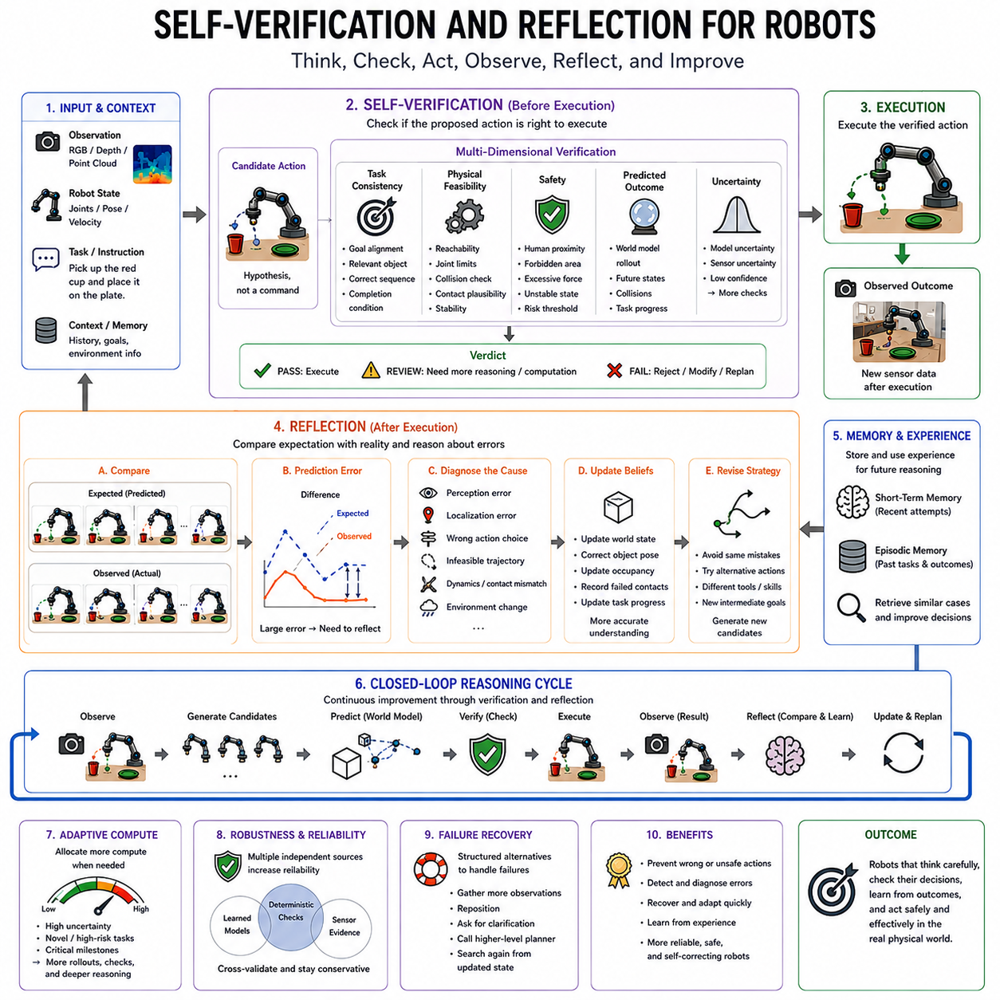{width="7.268055555555556in" height="7.268055555555556in"}

Self-verification and reflection enable a Physical AI system to examine its own proposed decisions and executed behavior instead of assuming that the first prediction is correct. Before acting, the robot can verify whether an action is consistent with the task, environment, physical constraints, and safety requirements. After acting, it can compare expected and observed outcomes, identify errors, and use the resulting evidence to revise its internal state and future decisions.

Self-verification introduces an explicit checking stage between action generation and physical execution. A candidate produced by a policy, VLA model, planner, or search process is treated as a hypothesis rather than an unquestioned command. The system asks whether the proposed action is feasible, relevant, safe, and likely to advance the task. This separation between generation and verification reduces dependence on the reliability of any single model output.

Task consistency is one important verification target. A robot may generate an action that is physically possible but inconsistent with the user instruction or current objective. Verification can compare the proposed action with the interpreted goal, target object, required sequence, and completion conditions. This prevents locally reasonable actions from being executed when they do not contribute to the intended task or accidentally contradict higher-level instructions.

Physical feasibility provides another verification layer. Before execution, the system can check whether the target is reachable, joint limits are respected, trajectories avoid collisions, contacts are mechanically plausible, and the robot remains dynamically stable. These checks can combine learned models with kinematics, geometry, dynamics, collision detection, and controller constraints, providing structured safeguards around actions generated by flexible foundation models.

Safety verification extends this process beyond task success. A candidate may be feasible and efficient but unacceptable because it approaches a person too closely, enters a forbidden area, applies excessive force, or creates an unstable configuration. Safety monitors can therefore impose hard constraints or risk thresholds that override task-oriented scores. In consequential physical environments, successful reasoning must include both what can be done and what should not be done.

World models can support verification by predicting the consequences of proposed actions before they occur. A candidate trajectory can be rolled forward to estimate future robot states, object motion, contacts, collisions, or task progress. Verification then evaluates not only the immediate command but also the predicted states created by that command. This is particularly valuable when an apparently safe action produces a dangerous or unrecoverable condition several steps later.

Verification can operate through multiple independent checks rather than a single score. One component may evaluate instruction alignment, another physical feasibility, another safety, and another expected task value. Agreement across several evaluators increases confidence, while disagreement becomes evidence that additional reasoning is required. Modular verification also makes failures easier to diagnose because the system can identify which constraint or assumption caused rejection.

Uncertainty should influence the strength of verification. High-confidence actions in familiar situations may require only lightweight checks, while novel objects, ambiguous scenes, uncertain contacts, or high-risk tasks justify deeper evaluation. The robot can increase world-model rollouts, use additional evaluators, sample alternative predictions, or invoke more detailed planning when confidence is low. Verification effort therefore becomes another adaptive test-time compute resource.

Self-verification is not guaranteed to be correct because the verifier itself may contain errors. A learned critic can share biases with the policy, a world model can predict incorrect dynamics, and geometric models can depend on inaccurate perception. Robust systems should therefore avoid treating one verifier as an absolute authority. Independent models, deterministic constraints, sensor evidence, uncertainty estimates, and conservative fallback behavior can provide complementary forms of evidence.

Reflection differs from pre-action verification because it occurs after execution has produced new information. The robot compares what it expected to happen with what actually happened. If a grasp was predicted to succeed but the object slipped, or a planned path was expected to remain open but became blocked, the discrepancy provides direct evidence that the previous state estimate, prediction, action, or assumption was incomplete or incorrect.

This comparison can be expressed through prediction error. Before execution, the system maintains an expected next state or range of possible outcomes. After execution, sensors provide the observed state. The difference between prediction and observation can update confidence and identify unexpected events. Large prediction errors may trigger replanning, additional perception, model reconsideration, or a transition from fast physical reasoning to slower and more deliberate reasoning.

Reflection should distinguish different causes of failure whenever possible. A task may fail because perception identified the wrong object, localization was inaccurate, the selected action was inappropriate, the trajectory was infeasible, contact dynamics differed from prediction, or the environment changed unexpectedly. Treating every failure as the same type of error limits recovery. Diagnostic reflection attempts to determine which component or assumption should be revised.

The first result of reflection is often an updated world state rather than a change to model parameters. The robot incorporates new sensor evidence, corrects object poses, updates occupancy, records failed contacts, and revises task progress. Candidate generation and planning can then operate from this corrected state. This form of online reflection is practical because it improves the next decision immediately without requiring expensive retraining during deployment.

Reflection also enables strategy revision. Repeating the same failed action may be inappropriate even after the state estimate has been corrected. The system can record that a particular grasp direction failed, that a route is blocked, or that an object behaves differently from expectation. New candidates can then emphasize alternative approaches, tools, skills, or intermediate goals. Reflection therefore converts failure into information that reshapes subsequent search.

Memory can extend reflection beyond the immediate control cycle. Short-term memory can retain recent attempts and prevent repetitive failures, while episodic memory can preserve useful experiences from previous tasks. When a similar situation occurs, the robot may retrieve prior outcomes and adjust candidate generation or verification accordingly. Reflection then contributes not only to immediate recovery but also to more informed future reasoning.

Long-horizon tasks especially benefit from reflective checkpoints. After completing a meaningful subgoal, the robot can verify whether the intended state was actually achieved before proceeding. A manipulation system may confirm that an object was securely placed, while a mobile robot may verify that it reached the correct region. Such checkpoints prevent unnoticed errors from propagating through many later steps and becoming increasingly difficult to recover from.

Self-verification and reflection naturally form a closed-loop reasoning cycle. The robot observes the environment, generates candidate actions, predicts consequences, verifies constraints, executes a selected action, observes the result, compares prediction with reality, updates its state, and generates new candidates. Reasoning is therefore distributed across the entire interaction rather than concentrated only before the first action.

The amount of reflection should also depend on cost and urgency. Continuous deep analysis after every motor command would consume excessive compute and introduce unnecessary latency. Routine actions may need only lightweight monitoring, whereas unexpected outcomes or critical milestones can trigger deeper reflection. This adaptive structure preserves fast control while reserving expensive reasoning for situations in which new evidence indicates that reconsideration has meaningful value.

Verification and reflection also improve failure recovery because they provide structured alternatives to blindly continuing or restarting the entire task. If verification rejects all candidates, the robot can gather more observations, reposition itself, ask for clarification, or invoke a higher-level planner. If reflection detects execution failure, the system can update the state and search again from the new situation rather than following an obsolete plan.

For generalist robots, these mechanisms provide an important complement to increasingly capable foundation models. Large models can generate broad and flexible behaviors, but physical deployment requires mechanisms for detecting when those behaviors are inappropriate. Verification constrains generated intelligence before action, while reflection grounds it after action. Together they connect flexible learned reasoning with the measurable consequences and constraints of the physical world.

Ultimately, self-verification and reflection transform robot intelligence from a sequence of confident predictions into a process of continuous hypothesis testing. The robot proposes what might work, checks whether it should be attempted, observes what actually happens, and revises its understanding when reality disagrees. Combined with candidate generation, world-model rollout, search, uncertainty estimation, and adaptive test-time compute, this cycle enables more reliable, recoverable, and self-correcting Physical AI.

자기 검증(self-verification)과 성찰(reflection)은 물리 AI(Physical AI) 시스템이 최초의 예측이 정확하다고 가정하는 대신, 스스로 제안한 의사결정과 실행된 행동을 점검할 수 있도록 한다. 로봇은 행동하기 전에 해당 행동이 작업, 환경, 물리적 제약 및 안전 요구사항과 일치하는지 검증할 수 있다. 행동 이후에는 예상 결과와 실제 관측 결과를 비교하고 오류를 식별하며, 그 결과로 얻어진 근거를 이용해 내부 상태와 이후 의사결정을 수정할 수 있다.

자기 검증(self-verification)은 행동 생성과 물리적 실행 사이에 명시적인 확인 단계(checking stage)를 도입한다. 정책(policy), VLA 모델(Vision-Language-Action model), 플래너(planner) 또는 탐색 과정(search process)이 생성한 후보는 의심 없이 따라야 하는 명령이 아니라 하나의 가설(hypothesis)로 취급된다. 시스템은 제안된 행동이 실행 가능하고, 작업과 관련되며, 안전하고, 작업을 진전시킬 가능성이 있는지를 확인한다. 이러한 생성과 검증의 분리는 하나의 모델 출력에 대한 의존성을 줄인다.

작업 일관성(task consistency)은 중요한 검증 대상 중 하나이다. 로봇은 물리적으로 실행 가능하지만 사용자 명령이나 현재 목표와 일치하지 않는 행동을 생성할 수 있다. 검증 과정에서는 제안된 행동을 해석된 목표, 대상 물체, 필요한 시퀀스 및 완료 조건과 비교할 수 있다. 이를 통해 국소적으로는 합리적인 행동이라도 의도된 작업에 기여하지 않거나 상위 수준의 명령과 충돌한다면 실행되는 것을 방지할 수 있다.

물리적 실행 가능성(physical feasibility)은 또 다른 검증 계층을 제공한다. 시스템은 실행 전에 목표에 도달할 수 있는지, 관절 한계(joint limit)를 준수하는지, 궤적이 충돌을 회피하는지, 접촉이 기계적으로 타당한지, 로봇이 동역학적으로 안정적인지를 확인할 수 있다. 이러한 검사는 학습된 모델과 운동학(kinematics), 기하학(geometry), 동역학(dynamics), 충돌 감지(collision detection), 제어기 제약(controller constraint)을 결합하여 유연한 파운데이션 모델(foundation model)이 생성한 행동에 구조화된 안전장치를 제공할 수 있다.

안전 검증(safety verification)은 이러한 과정을 작업 성공 여부를 넘어 확장한다. 후보 행동은 실행 가능하고 효율적이더라도 사람에게 지나치게 가까이 접근하거나, 금지된 영역에 진입하거나, 과도한 힘을 가하거나, 불안정한 구성을 만든다면 허용될 수 없다. 따라서 안전 모니터(safety monitor)는 작업 중심 점수보다 우선하는 강제 제약(hard constraint)이나 위험 임계값(risk threshold)을 적용할 수 있다. 중요한 물리적 환경에서 성공적인 추론은 무엇을 할 수 있는지뿐 아니라 무엇을 해서는 안 되는지도 포함해야 한다.

월드 모델(world model)은 제안된 행동이 실제로 발생하기 전에 그 결과를 예측하여 검증을 지원할 수 있다. 후보 궤적(candidate trajectory)을 미래로 롤아웃(rollout)하여 로봇의 미래 상태, 물체 움직임, 접촉, 충돌 또는 작업 진행도를 추정할 수 있다. 이후 검증 과정은 즉각적인 명령뿐 아니라 그 명령으로 인해 생성되는 예측 상태까지 평가한다. 이는 겉보기에는 안전한 행동이 몇 단계 후 위험하거나 복구할 수 없는 상태를 만드는 경우 특히 중요하다.

검증은 하나의 점수에 의존하는 대신 여러 독립적인 검사(independent check)를 통해 수행될 수 있다. 하나의 구성요소는 명령 정렬(instruction alignment)을 평가하고, 다른 구성요소는 물리적 실행 가능성을 평가하며, 또 다른 구성요소는 안전성이나 예상 작업 가치(expected task value)를 평가할 수 있다. 여러 평가기(evaluator)의 결과가 일치하면 신뢰도가 높아지지만, 불일치는 추가적인 추론이 필요하다는 근거가 된다. 모듈형 검증(modular verification)은 어떤 제약이나 가정 때문에 후보가 거부되었는지를 식별할 수 있어 실패 진단에도 유리하다.

불확실성(uncertainty)은 검증 강도에 영향을 주어야 한다. 익숙한 상황에서 신뢰도가 높은 행동은 가벼운 검사만 필요할 수 있지만, 새로운 물체, 모호한 장면, 불확실한 접촉 또는 위험도가 높은 작업은 더 깊은 평가를 요구한다. 로봇은 신뢰도가 낮을 때 월드 모델 롤아웃을 증가시키고, 추가 평가기를 사용하며, 대체 예측을 샘플링하거나, 더욱 상세한 계획을 호출할 수 있다. 따라서 검증 노력(verification effort) 역시 적응형 테스트 타임 컴퓨트(adaptive test-time compute)의 자원이 된다.

검증기(verifier) 자체에도 오류가 존재할 수 있기 때문에 자기 검증이 항상 정확한 것은 아니다. 학습된 비평 모델(learned critic)은 정책과 동일한 편향을 공유할 수 있고, 월드 모델은 잘못된 동역학을 예측할 수 있으며, 기하학적 모델은 부정확한 지각에 의존할 수 있다. 따라서 강건한 시스템(robust system)은 하나의 검증기를 절대적인 판단 기준으로 취급해서는 안 된다. 독립적인 모델, 결정론적 제약(deterministic constraint), 센서 근거, 불확실성 추정 및 보수적인 폴백 행동(conservative fallback behavior)이 상호보완적인 근거를 제공할 수 있다.

성찰(reflection)은 실행을 통해 새로운 정보가 생성된 이후에 이루어진다는 점에서 행동 이전 검증(pre-action verification)과 다르다. 로봇은 예상했던 결과와 실제로 발생한 결과를 비교한다. 파지가 성공할 것으로 예측했지만 물체가 미끄러졌거나, 계획된 경로가 계속 열려 있을 것으로 예상했지만 차단되었다면 이러한 불일치는 이전의 상태 추정, 예측, 행동 또는 가정이 불완전하거나 잘못되었다는 직접적인 근거를 제공한다.

이러한 비교는 예측 오류(prediction error)를 통해 표현할 수 있다. 실행 전에 시스템은 예상되는 다음 상태 또는 가능한 결과의 범위를 유지한다. 실행 이후에는 센서가 실제 관측 상태를 제공한다. 예측과 관측 사이의 차이는 신뢰도를 갱신하고 예상하지 못한 사건을 식별하는 데 활용할 수 있다. 큰 예측 오류는 재계획(replanning), 추가적인 지각, 모델 재검토 또는 빠른 물리적 추론(fast physical reasoning)에서 더 느리고 신중한 추론으로의 전환을 유발할 수 있다.

성찰은 가능한 경우 서로 다른 실패 원인을 구분해야 한다. 작업 실패는 지각(perception)이 잘못된 물체를 식별했거나, 위치 추정(localization)이 부정확했거나, 선택된 행동이 부적절했거나, 궤적이 실행 불가능했거나, 접촉 동역학(contact dynamics)이 예측과 달랐거나, 환경이 예상하지 못하게 변화했기 때문에 발생할 수 있다. 모든 실패를 동일한 유형의 오류로 처리하면 복구 능력이 제한된다. 진단적 성찰(diagnostic reflection)은 어떤 구성요소나 가정을 수정해야 하는지를 판단하려고 한다.

성찰의 첫 번째 결과는 모델 파라미터의 변경보다 세계 상태(world state)의 갱신인 경우가 많다. 로봇은 새로운 센서 근거를 통합하고, 물체 자세(object pose)를 수정하며, 점유 상태(occupancy)를 갱신하고, 실패한 접촉을 기록하며, 작업 진행 상태를 수정한다. 이후 후보 생성과 계획은 이렇게 수정된 상태에서 다시 수행될 수 있다. 이러한 온라인 성찰(online reflection)은 배포 과정에서 비용이 높은 재학습을 수행하지 않고도 즉시 다음 의사결정을 개선할 수 있기 때문에 실용적이다.

성찰은 전략 수정(strategy revision)도 가능하게 한다. 상태 추정이 수정되었다고 하더라도 동일하게 실패한 행동을 반복하는 것은 적절하지 않을 수 있다. 시스템은 특정 파지 방향이 실패했거나, 경로가 차단되었거나, 물체가 예상과 다르게 행동했다는 사실을 기록할 수 있다. 이후 새로운 후보는 다른 접근 방법, 도구, 스킬 또는 중간 목표(intermediate goal)를 강조할 수 있다. 따라서 성찰은 실패를 이후 탐색을 변화시키는 정보로 변환한다.

메모리(memory)는 성찰의 효과를 즉각적인 제어 주기보다 더 긴 시간으로 확장할 수 있다. 단기 메모리(short-term memory)는 최근 시도를 유지하여 동일한 실패가 반복되는 것을 방지하고, 에피소드 메모리(episodic memory)는 이전 작업에서 얻은 유용한 경험을 보존할 수 있다. 유사한 상황이 다시 발생하면 로봇은 이전 결과를 검색하여 후보 생성이나 검증을 조정할 수 있다. 이를 통해 성찰은 즉각적인 실패 복구뿐 아니라 미래의 더 나은 추론에도 기여한다.

장기 작업(long-horizon task)은 특히 성찰적 체크포인트(reflective checkpoint)의 이점을 얻는다. 의미 있는 하위 목표(subgoal)를 완료한 이후 로봇은 다음 단계로 진행하기 전에 의도한 상태가 실제로 달성되었는지를 검증할 수 있다. 조작 시스템은 물체가 안정적으로 배치되었는지를 확인할 수 있고, 이동 로봇은 올바른 영역에 도달했는지를 검증할 수 있다. 이러한 체크포인트는 발견되지 않은 오류가 이후 여러 단계로 전파되어 복구하기 어려워지는 것을 방지한다.

자기 검증과 성찰은 자연스럽게 폐루프 추론 주기(closed-loop reasoning cycle)를 형성한다. 로봇은 환경을 관측하고, 후보 행동을 생성하고, 결과를 예측하고, 제약조건을 검증하고, 선택된 행동을 실행한 후, 그 결과를 다시 관측한다. 이후 예측과 현실을 비교하고, 상태를 갱신하며, 새로운 후보를 생성한다. 따라서 추론은 최초 행동 이전에만 집중되는 것이 아니라 전체 상호작용 과정에 분산된다.

성찰의 양도 비용과 긴급성에 따라 달라져야 한다. 모든 모터 명령 이후 지속적으로 깊은 분석을 수행하면 과도한 계산 자원을 소비하고 불필요한 지연시간(latency)을 발생시킬 수 있다. 일상적인 행동은 가벼운 모니터링만 필요할 수 있지만, 예상하지 못한 결과나 중요한 마일스톤(critical milestone)은 더 깊은 성찰을 활성화할 수 있다. 이러한 적응형 구조는 빠른 제어를 유지하면서 새로운 근거가 재검토의 의미 있는 가치를 나타내는 상황에 고비용 추론을 집중시킨다.

검증과 성찰은 무작정 작업을 계속하거나 전체 작업을 처음부터 다시 시작하는 대신 구조화된 대안을 제공하기 때문에 실패 복구(failure recovery)도 개선한다. 검증 과정에서 모든 후보가 거부되면 로봇은 추가 관측을 수집하거나, 위치를 변경하거나, 명확한 지시를 요청하거나, 상위 수준 플래너(higher-level planner)를 호출할 수 있다. 성찰 과정에서 실행 실패가 탐지되면 오래된 계획을 계속 따르는 대신 상태를 갱신하고 새로운 상황에서 다시 탐색할 수 있다.

범용 로봇(generalist robot)에서 이러한 메커니즘은 점점 더 강력해지는 파운데이션 모델을 보완하는 중요한 역할을 한다. 대규모 모델은 광범위하고 유연한 행동을 생성할 수 있지만, 물리적 환경에 배포하려면 그러한 행동이 부적절한 시점을 탐지하는 메커니즘이 필요하다. 검증은 행동 이전에 생성된 지능을 제약하고, 성찰은 행동 이후에 이를 현실에 기반하게 한다. 두 메커니즘을 결합하면 유연한 학습 기반 추론을 물리적 세계의 측정 가능한 결과 및 제약과 연결할 수 있다.

궁극적으로 자기 검증과 성찰은 로봇 지능을 확신에 찬 예측의 연속에서 지속적인 가설 검증(continuous hypothesis testing) 과정으로 변화시킨다. 로봇은 무엇이 효과적일 수 있는지를 제안하고, 그것을 실제로 시도해야 하는지를 확인하며, 실제로 어떤 일이 발생했는지를 관측하고, 현실이 예측과 일치하지 않을 때 자신의 이해를 수정한다. 후보 생성, 월드 모델 롤아웃, 탐색, 불확실성 추정 및 적응형 테스트 타임 컴퓨트와 결합된 이러한 순환은 더욱 신뢰할 수 있고 복구 가능하며 스스로 수정할 수 있는 자기 교정형 물리 AI(self-correcting Physical AI)를 가능하게 한다.

## 07.07. Meta Reasoning and When to Think Longer

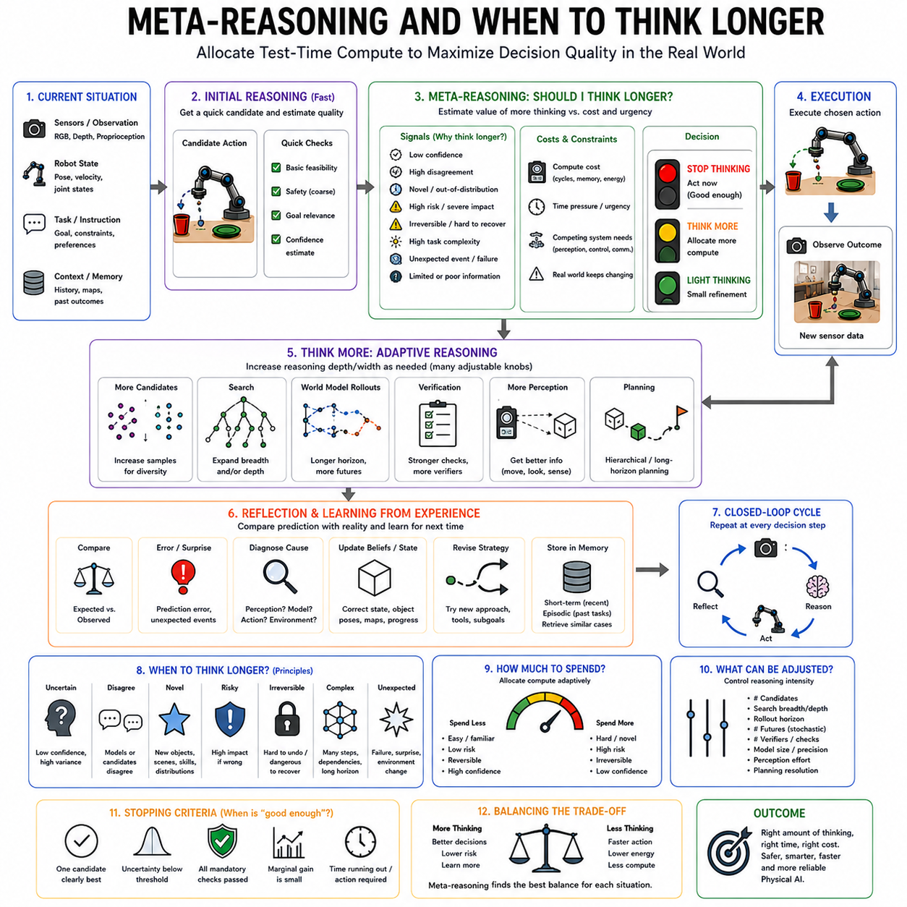{width="7.268055555555556in" height="7.268055555555556in"}

Meta-reasoning is the process by which a Physical AI system decides how much reasoning should be invested in a particular decision. Instead of applying the same computational effort to every situation, the robot evaluates whether additional thinking is likely to improve the outcome. This makes reasoning itself a controlled resource, allowing the system to trade decision quality against latency, energy, hardware capacity, and the urgency of physical action.

The central question of meta-reasoning is not simply what action should be taken, but whether the current decision is good enough to execute. A robot may already possess a plausible candidate action, yet additional sampling, planning, world-model rollout, or verification could reveal a safer or more effective alternative. Meta-reasoning estimates whether the expected benefit of further computation justifies its computational and temporal cost.

This distinction is especially important in Physical AI because the external world does not stop while the robot thinks. Objects continue moving, people change position, vehicles approach, and unstable configurations evolve. Additional reasoning can improve a decision, but excessive deliberation can make the information supporting that decision obsolete. The value of computation therefore depends on both reasoning quality and the time available before action becomes necessary.

Confidence provides one of the simplest signals for determining whether to think longer. When perception is clear, the task is familiar, and the policy strongly favors one feasible action, additional reasoning may provide little benefit. When confidence is low, however, the robot can increase candidate generation, extend search, invoke a world model, gather additional observations, or perform stronger verification before committing to physical execution.

Disagreement provides a richer signal than confidence from a single model. Multiple policies, sampled candidates, world-model predictions, or verification modules may produce different conclusions. Strong agreement suggests that additional computation is unlikely to change the decision, whereas substantial disagreement indicates unresolved uncertainty. Meta-reasoning can therefore use disagreement to determine when deeper evaluation or alternative hypotheses are required.

Novelty is another reason to increase reasoning effort. A robot may encounter an unfamiliar object, unusual terrain, a new tool, an unexpected spatial configuration, or behavior outside its training distribution. Even when a policy produces a confident response, confidence may be poorly calibrated under distribution shift. Novelty detection can therefore trigger slower reasoning, more conservative verification, additional sensing, or reliance on explicit physical constraints.

Risk changes the value of additional computation because not all mistakes have equal consequences. A minor navigation inefficiency may not justify extensive deliberation, while an action near a person, fragile object, hazardous machine, or unstable load may require careful evaluation. Meta-reasoning should consider both the probability of failure and its potential severity, assigning larger reasoning budgets to decisions whose errors would be difficult or costly to reverse.

Reversibility provides a related decision signal. If an action can easily be undone, the robot may act with limited deliberation and learn from the resulting observation. If an action is irreversible or creates a state from which recovery is difficult, deeper reasoning becomes more valuable. Cutting, releasing, dropping, entering constrained spaces, or making contact with delicate objects can therefore justify stronger prediction and verification than easily reversible movements.

Task complexity can also determine when longer thinking is appropriate. Simple actions with clear local objectives often benefit little from extensive planning. Long-horizon tasks involving multiple objects, intermediate goals, ordering constraints, or dependencies between actions may require deeper search. Meta-reasoning can increase planning horizon and rollout depth when immediate choices significantly influence the feasibility of later stages.

Unexpected events are strong triggers for additional reasoning. A failed grasp, blocked route, prediction error, sensor inconsistency, or unexpected human motion indicates that the system\'s previous assumptions may no longer be valid. Continuing with the original reasoning depth may simply repeat the mistake. Meta-reasoning can respond by switching from fast execution to slower analysis, updating the state estimate, generating new candidates, and reconsidering the strategy.

The value of thinking longer can be interpreted as the expected improvement produced by additional computation. One more rollout, candidate, search expansion, or verification step is useful only if it has a meaningful probability of changing the decision for the better. As reasoning progresses and alternatives become increasingly similar, the marginal value of computation usually decreases. This provides a principled basis for deciding when further thinking should stop.

Compute cost must be evaluated alongside expected improvement. Additional inference consumes accelerator cycles, memory bandwidth, battery energy, and thermal capacity. On a mobile robot, these resources may also be needed for perception, localization, mapping, communication, and control. Meta-reasoning therefore manages a shared embodied compute budget rather than treating reasoning resources as unlimited or independent from the rest of the robotic system.

Time pressure can impose a hard upper bound on deliberation. Collision avoidance, balance recovery, and dynamic interaction may require action within milliseconds or fractions of a second, leaving little opportunity for extensive search. Other decisions, such as selecting a manipulation strategy before approaching an object, may permit seconds of reasoning. The available decision horizon should therefore influence which reasoning mechanisms can realistically be activated.

Meta-reasoning can control several computational dimensions rather than merely choosing between thinking and acting. It can vary the number of sampled candidates, search breadth, search depth, world-model rollout horizon, number of stochastic futures, verifier count, model size, sensing effort, or planning resolution. This creates a continuous spectrum of reasoning intensity rather than a rigid distinction between fast and slow processing.

A practical architecture may begin with a low-cost reasoning stage and progressively escalate computation only when necessary. A direct policy first proposes an action, lightweight checks evaluate confidence and safety, and deeper reasoning is activated only if these checks reveal ambiguity or risk. More expensive stages may include diverse candidate sampling, world-model simulation, hierarchical planning, or multiple independent verification mechanisms.

This progressive strategy creates a computational cascade. Easy decisions exit early after inexpensive processing, while difficult decisions continue through increasingly powerful reasoning stages. Such cascades prevent routine behavior from consuming unnecessary resources while preserving the ability to address challenging cases. They also make test-time compute naturally adaptive because different physical situations terminate at different depths of the reasoning pipeline.

Meta-reasoning also determines when additional perception is more valuable than additional internal computation. If uncertainty arises because an object is occluded or its pose is poorly estimated, performing more world-model rollouts from the same uncertain state may provide limited value. The robot may instead move its camera, change viewpoint, approach carefully, or request another sensor measurement. Thinking longer can therefore include deciding to acquire better evidence.

Reflection provides feedback for improving future meta-reasoning decisions. If the robot repeatedly discovers that additional planning was unnecessary in a certain type of situation, it can reduce reasoning effort there. Conversely, failures following overly rapid decisions can indicate that more verification should have been used. Experience can therefore help calibrate the relationship between situation characteristics, reasoning expenditure, and actual task outcomes.

Memory can further support this process by storing previous reasoning episodes. When a similar situation occurs, the robot can retrieve whether fast execution previously succeeded, whether deeper search was necessary, or which uncertainty signals predicted failure. This allows meta-reasoning to become context-sensitive rather than relying entirely on generic thresholds and can reduce repeated computational effort across recurring tasks.

Stopping criteria are as important as escalation criteria. The system should stop reasoning when one candidate clearly dominates, uncertainty falls below an acceptable threshold, mandatory verification succeeds, additional search produces little improvement, or the remaining time requires action. Without effective stopping rules, a robot can waste compute searching for marginal improvements while the physical environment continues to evolve.

Closed-loop execution reduces the need for perfect reasoning before every action. When uncertainty remains but a safe and reversible partial action is available, the robot can execute it, observe the result, and reason again from a better-informed state. Meta-reasoning can therefore choose between spending computation internally and obtaining information through controlled interaction with the environment, balancing thought with physical experimentation.

Meta-reasoning ultimately acts as a supervisory layer over candidate generation, search, world-model rollout, verification, reflection, and control. It determines which reasoning mechanisms should be activated, how much compute they receive, and when their output is sufficient for execution. This supervisory role is essential for combining powerful foundation models with the strict timing and resource constraints of embodied robotic platforms.

The goal is not to make robots think as long as possible, but to make them think for as long as the decision deserves. Familiar, low-risk, reversible situations should generally receive little additional computation, while uncertain, novel, complex, high-risk, or irreversible decisions justify deeper reasoning. By estimating the value of further computation and balancing it against time and resource costs, meta-reasoning enables adaptive and efficient Physical AI.

In this sense, knowing when to think longer becomes a capability as important as reasoning itself. A robot that reasons deeply about every decision may be too slow, while one that always reacts immediately may be unreliable in unfamiliar situations. Effective Physical AI must continuously regulate its own cognitive effort, allocating test-time compute where additional reasoning has the greatest expected value and acting promptly when further deliberation is unlikely to help.

메타 추론(meta-reasoning)은 물리 AI(Physical AI) 시스템이 특정 의사결정에 얼마나 많은 추론 자원을 투입해야 하는지를 결정하는 과정이다. 로봇은 모든 상황에 동일한 계산 노력을 적용하는 대신, 추가적인 사고가 결과를 개선할 가능성이 있는지를 평가한다. 이를 통해 추론 자체가 제어 가능한 자원(controlled resource)이 되며, 시스템은 의사결정 품질과 지연시간(latency), 에너지, 하드웨어 용량, 물리적 행동의 긴급성 사이에서 균형을 조절할 수 있다.

메타 추론의 핵심 질문은 단순히 어떤 행동을 해야 하는지가 아니라 현재의 결정이 실행하기에 충분히 좋은가 하는 것이다. 로봇이 이미 그럴듯한 후보 행동(candidate action)을 가지고 있더라도 추가적인 샘플링, 계획, 월드 모델 롤아웃(world-model rollout) 또는 검증을 통해 더 안전하거나 효과적인 대안을 발견할 수 있다. 메타 추론은 추가 계산에서 얻을 수 있는 기대 이익(expected benefit)이 계산 및 시간 비용을 정당화하는지를 추정한다.

이러한 구분은 로봇이 생각하는 동안에도 외부 세계가 멈추지 않기 때문에 물리 AI에서 특히 중요하다. 물체는 계속 움직이고, 사람의 위치는 변하며, 차량은 접근하고, 불안정한 상태는 계속 변화한다. 추가 추론은 의사결정을 개선할 수 있지만 지나친 숙고(deliberation)는 해당 결정을 뒷받침하는 정보를 오래된 것으로 만들 수 있다. 따라서 계산의 가치는 추론 품질뿐 아니라 행동이 필요해지기 전까지 사용할 수 있는 시간에도 의존한다.

신뢰도(confidence)는 더 오래 생각해야 하는지를 결정하는 가장 간단한 신호 중 하나이다. 지각(perception)이 명확하고 작업이 익숙하며 정책(policy)이 하나의 실행 가능한 행동을 강하게 선호한다면 추가 추론의 이점은 크지 않을 수 있다. 반대로 신뢰도가 낮다면 로봇은 물리적 실행을 결정하기 전에 후보 생성을 증가시키고, 탐색을 확장하고, 월드 모델을 호출하고, 추가 관측을 수집하거나, 더 강력한 검증을 수행할 수 있다.

불일치(disagreement)는 하나의 모델에서 얻은 신뢰도보다 더 풍부한 신호를 제공한다. 여러 정책, 샘플링된 후보, 월드 모델 예측 또는 검증 모듈이 서로 다른 결론을 생성할 수 있다. 높은 일치도는 추가 계산이 결정을 변경할 가능성이 낮음을 나타내는 반면, 상당한 불일치는 해결되지 않은 불확실성이 존재함을 의미한다. 따라서 메타 추론은 불일치를 이용하여 더 깊은 평가나 대체 가설이 필요한 시점을 결정할 수 있다.

새로움(novelty)은 추론 노력을 증가시켜야 하는 또 다른 이유이다. 로봇은 익숙하지 않은 물체, 비정상적인 지형, 새로운 도구, 예상하지 못한 공간 구성 또는 학습 분포(training distribution)를 벗어난 행동을 마주할 수 있다. 정책이 높은 신뢰도의 응답을 생성하더라도 분포 변화(distribution shift)에서는 신뢰도가 제대로 보정되지 않을 수 있다. 따라서 새로움 탐지(novelty detection)는 더 느린 추론, 보수적인 검증, 추가 센싱 또는 명시적인 물리적 제약에 대한 의존을 활성화할 수 있다.

모든 실수가 동일한 결과를 초래하는 것은 아니기 때문에 위험(risk)은 추가 계산의 가치를 변화시킨다. 작은 내비게이션 비효율은 광범위한 숙고를 정당화하지 않을 수 있지만, 사람, 깨지기 쉬운 물체, 위험한 기계 또는 불안정한 하중 주변의 행동은 신중한 평가가 필요할 수 있다. 메타 추론은 실패 확률과 잠재적 심각성(severity)을 모두 고려하여 오류를 되돌리기 어렵거나 비용이 큰 의사결정에 더 많은 추론 예산(reasoning budget)을 할당해야 한다.

가역성(reversibility)은 이와 관련된 또 다른 의사결정 신호를 제공한다. 행동을 쉽게 되돌릴 수 있다면 로봇은 제한적인 숙고만 수행한 후 행동하고 그 결과 관측으로부터 학습할 수 있다. 반대로 행동이 비가역적(irreversible)이거나 복구하기 어려운 상태를 만든다면 더 깊은 추론의 가치가 높아진다. 절단, 해제, 떨어뜨리기, 제한된 공간으로 진입하기 또는 섬세한 물체와 접촉하기와 같은 행동은 쉽게 되돌릴 수 있는 움직임보다 강력한 예측과 검증을 요구할 수 있다.

작업 복잡성(task complexity) 역시 언제 더 오래 생각해야 하는지를 결정할 수 있다. 명확한 국소 목표(local objective)를 가진 단순한 행동은 광범위한 계획에서 얻는 이점이 크지 않은 경우가 많다. 여러 물체, 중간 목표(intermediate goal), 순서 제약(ordering constraint), 행동 사이의 의존성을 포함하는 장기 작업(long-horizon task)은 더 깊은 탐색을 요구할 수 있다. 메타 추론은 즉각적인 선택이 이후 단계의 실행 가능성에 큰 영향을 미칠 때 계획 범위(planning horizon)와 롤아웃 깊이(rollout depth)를 증가시킬 수 있다.

예상하지 못한 사건(unexpected event)은 추가 추론을 활성화하는 강력한 신호이다. 실패한 파지, 차단된 경로, 예측 오류(prediction error), 센서 불일치 또는 예상하지 못한 사람의 움직임은 시스템의 기존 가정이 더 이상 유효하지 않을 수 있음을 의미한다. 기존 추론 깊이를 그대로 유지하면 동일한 실수를 반복할 수 있다. 메타 추론은 빠른 실행에서 느린 분석으로 전환하고, 상태 추정을 갱신하고, 새로운 후보를 생성하며, 전략을 다시 검토함으로써 이러한 상황에 대응할 수 있다.

더 오래 생각하는 것의 가치는 추가 계산으로 발생하는 기대 개선(expected improvement)으로 해석할 수 있다. 한 번의 추가 롤아웃, 후보 생성, 탐색 확장 또는 검증 단계는 결정을 더 나은 방향으로 변경할 의미 있는 가능성이 있을 때만 유용하다. 추론이 진행되고 대안들이 점점 유사해질수록 계산의 한계 가치(marginal value)는 일반적으로 감소한다. 이는 추가적인 사고를 언제 중단해야 하는지를 결정하는 원칙적인 기준을 제공한다.

계산 비용(compute cost)은 기대 개선과 함께 평가되어야 한다. 추가 추론은 가속기 연산 자원, 메모리 대역폭(memory bandwidth), 배터리 에너지 및 열적 용량(thermal capacity)을 소비한다. 이동 로봇에서는 이러한 자원이 지각, 위치 추정(localization), 매핑(mapping), 통신 및 제어에도 필요할 수 있다. 따라서 메타 추론은 추론 자원을 무제한이거나 로봇 시스템의 다른 기능과 독립적인 것으로 취급하지 않고 공유되는 체화 계산 예산(embodied compute budget)을 관리한다.

시간 압박(time pressure)은 숙고에 사용할 수 있는 시간에 엄격한 상한을 설정할 수 있다. 충돌 회피, 균형 복구 및 동적 상호작용은 밀리초 또는 1초 미만의 시간 내에 행동해야 할 수 있으므로 광범위한 탐색을 수행할 기회가 거의 없다. 반면 물체에 접근하기 전에 조작 전략을 선택하는 것과 같은 결정에는 수초의 추론 시간이 허용될 수 있다. 따라서 사용 가능한 의사결정 시간 범위(decision horizon)는 실제로 활성화할 수 있는 추론 메커니즘에 영향을 주어야 한다.

메타 추론은 단순히 생각할 것인지 행동할 것인지를 선택하는 것이 아니라 여러 계산 차원(computational dimension)을 제어할 수 있다. 샘플링 후보 수, 탐색 너비(search breadth), 탐색 깊이(search depth), 월드 모델 롤아웃 범위, 확률적 미래(stochastic future)의 수, 검증기 수, 모델 크기, 센싱 노력 또는 계획 해상도(planning resolution)를 조절할 수 있다. 이를 통해 빠른 처리와 느린 처리로 엄격하게 구분하는 대신 연속적인 추론 강도(reasoning intensity)를 구성할 수 있다.

실용적인 아키텍처는 낮은 비용의 추론 단계에서 시작하여 필요한 경우에만 계산을 점진적으로 확대할 수 있다. 직접 정책(direct policy)이 먼저 행동을 제안하고, 경량 검사가 신뢰도와 안전성을 평가하며, 이러한 검사에서 모호성이나 위험이 발견될 때만 더 깊은 추론이 활성화된다. 비용이 높은 단계에는 다양한 후보 샘플링, 월드 모델 시뮬레이션, 계층적 계획(hierarchical planning) 또는 여러 독립적인 검증 메커니즘이 포함될 수 있다.

이러한 점진적 전략은 계산 캐스케이드(computational cascade)를 형성한다. 쉬운 의사결정은 저비용 처리 이후 조기에 종료되고, 어려운 의사결정은 점점 더 강력한 추론 단계를 거친다. 이러한 캐스케이드는 일상적인 행동이 불필요한 계산 자원을 소비하는 것을 방지하면서 어려운 상황을 처리할 수 있는 능력을 유지한다. 또한 서로 다른 물리적 상황이 추론 파이프라인(reasoning pipeline)의 서로 다른 깊이에서 종료되기 때문에 테스트 타임 컴퓨트(test-time compute)를 자연스럽게 적응형으로 만든다.

메타 추론은 추가적인 내부 계산보다 추가적인 지각(perception)이 더 가치 있는 시점도 결정한다. 물체가 가려져 있거나 자세 추정(pose estimation)이 부정확하기 때문에 불확실성이 발생한다면 동일하게 불확실한 상태에서 더 많은 월드 모델 롤아웃을 수행하는 것은 제한적인 가치만 제공할 수 있다. 로봇은 대신 카메라를 움직이거나, 관점을 변경하거나, 조심스럽게 접근하거나, 다른 센서 측정을 요청할 수 있다. 따라서 더 오래 생각한다는 것은 더 좋은 근거를 확보할지를 결정하는 과정도 포함한다.

성찰(reflection)은 미래의 메타 추론 결정을 개선하기 위한 피드백을 제공한다. 특정 유형의 상황에서 추가적인 계획이 반복적으로 불필요했다는 사실을 발견하면 로봇은 해당 상황에서 추론 노력을 줄일 수 있다. 반대로 지나치게 빠른 결정 이후 반복적인 실패가 발생한다면 더 많은 검증이 필요했음을 나타낼 수 있다. 따라서 경험은 상황 특성, 추론 자원 소비 및 실제 작업 결과 사이의 관계를 보정하는 데 도움을 줄 수 있다.

메모리(memory)는 이전의 추론 에피소드(reasoning episode)를 저장하여 이러한 과정을 더욱 지원할 수 있다. 유사한 상황이 다시 발생하면 로봇은 이전에 빠른 실행이 성공했는지, 더 깊은 탐색이 필요했는지, 또는 어떤 불확실성 신호가 실패를 예측했는지를 검색할 수 있다. 이를 통해 메타 추론은 일반적인 임계값에만 의존하지 않고 상황에 민감한(context-sensitive) 방식으로 동작할 수 있으며, 반복적인 작업에서 불필요한 계산을 줄일 수 있다.

중단 기준(stopping criteria)은 계산 확대 기준만큼 중요하다. 하나의 후보가 명확하게 우세하거나, 불확실성이 허용 가능한 임계값 아래로 감소하거나, 필수 검증이 성공하거나, 추가 탐색을 통해 거의 개선되지 않거나, 남은 시간 때문에 행동해야 하는 경우 시스템은 추론을 중단해야 한다. 효과적인 중단 규칙이 없다면 로봇은 물리적 환경이 계속 변화하는 동안 미미한 개선을 찾기 위해 계산 자원을 낭비할 수 있다.

폐루프 실행(closed-loop execution)은 모든 행동 전에 완벽한 추론을 수행해야 할 필요성을 줄인다. 불확실성이 남아 있더라도 안전하고 되돌릴 수 있는 부분 행동(partial action)이 존재한다면 로봇은 이를 실행하고 결과를 관측한 뒤 더 많은 정보를 확보한 상태에서 다시 추론할 수 있다. 따라서 메타 추론은 내부 계산에 자원을 더 사용할 것인지, 아니면 환경과의 통제된 상호작용을 통해 정보를 얻을 것인지를 선택하면서 사고와 물리적 실험 사이의 균형을 조절할 수 있다.

메타 추론은 궁극적으로 후보 생성, 탐색, 월드 모델 롤아웃, 검증, 성찰 및 제어를 감독하는 상위 계층(supervisory layer)으로 작동한다. 어떤 추론 메커니즘을 활성화해야 하는지, 각각에 얼마나 많은 계산 자원을 제공할지, 그리고 언제 그 결과가 실행하기에 충분한지를 결정한다. 이러한 감독 역할은 강력한 파운데이션 모델(foundation model)을 체화 로봇 플랫폼(embodied robotic platform)의 엄격한 시간 및 자원 제약과 결합하는 데 필수적이다.

목표는 로봇이 가능한 한 오래 생각하도록 만드는 것이 아니라 각각의 의사결정에 필요한 만큼 생각하도록 만드는 것이다. 익숙하고 위험이 낮으며 되돌릴 수 있는 상황에는 일반적으로 적은 추가 계산이 필요하지만, 불확실하고 새롭고 복잡하며 위험도가 높거나 비가역적인 결정에는 더 깊은 추론이 필요하다. 추가 계산의 가치를 추정하고 이를 시간 및 자원 비용과 비교함으로써 메타 추론은 적응적이고 효율적인 물리 AI를 가능하게 한다.

이러한 의미에서 언제 더 오래 생각해야 하는지를 아는 능력은 추론 자체만큼 중요한 능력이 된다. 모든 의사결정에 대해 깊게 추론하는 로봇은 지나치게 느릴 수 있고, 항상 즉각적으로 반응하는 로봇은 익숙하지 않은 상황에서 신뢰성이 떨어질 수 있다. 효과적인 물리 AI는 자신의 인지적 노력(cognitive effort)을 지속적으로 조절하여 추가 추론이 가장 높은 기대 가치를 제공하는 곳에 테스트 타임 컴퓨트를 할당하고, 추가 숙고가 도움이 될 가능성이 낮을 때는 신속하게 행동해야 한다.

## 07.08. Latent Reasoning vs Language Reasoning

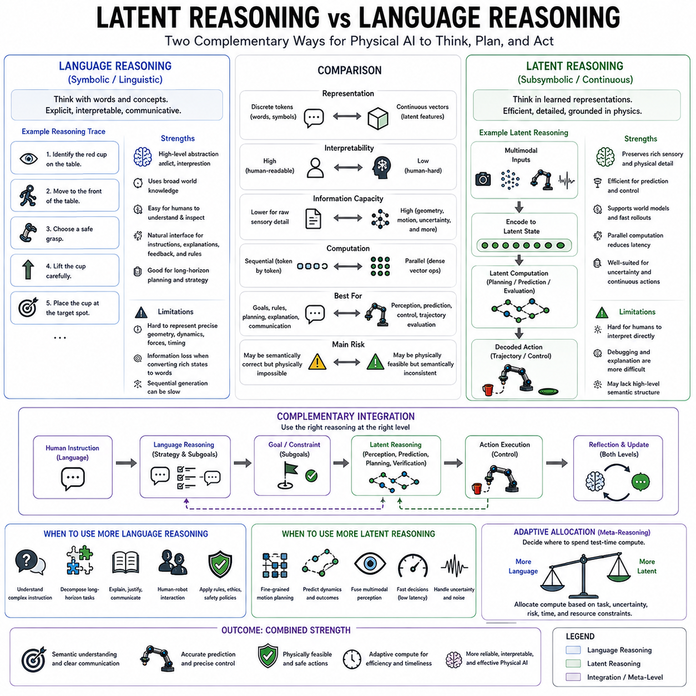{width="7.268055555555556in" height="7.268055555555556in"}

Latent reasoning and language reasoning represent two different ways a Physical AI system can organize computation before selecting an action. Language reasoning expresses intermediate decisions through discrete words or tokens, while latent reasoning performs much of the computation inside continuous learned representations. Both can support planning and problem solving, but their computational properties differ substantially when reasoning must ultimately control a physical system.

Language reasoning makes intermediate thought explicit in a symbolic or linguistic form. A robot may represent a task as statements such as identify the object, approach the table, choose a grasp, lift the object, and place it at the target. This representation is useful because humans can inspect it, foundation models can manipulate it, and complex goals can be decomposed into understandable semantic steps before they are converted into physical actions.

The strength of language reasoning is abstraction. Natural language can compress complicated scenes and objectives into high-level concepts such as obstacle, fragile object, safe route, failed grasp, or alternative strategy. A language-capable model can connect these concepts with broad knowledge acquired during pretraining, allowing the robot to reason about task structure, causal relationships, constraints, tools, and goals without representing every low-level physical detail explicitly.

Language also provides an effective interface between humans and robots. Instructions, explanations, corrections, preferences, and safety rules can be represented in a shared symbolic space. When a robot explains that it changed its route because the original path was blocked, its reasoning becomes easier to inspect. This interpretability is valuable for debugging, supervision, collaboration, and situations in which operators need to understand why a particular decision was made.

However, language is not a natural representation for every aspect of physical intelligence. Precise joint motion, contact forces, object geometry, balance, velocity, uncertainty, and high-frequency control are difficult to represent efficiently as sequences of words. Converting rich sensor states into language can discard information, while repeatedly generating language tokens introduces latency that may be unnecessary for decisions that can be represented directly in learned continuous features.

Latent reasoning addresses this limitation by allowing computation to occur within internal vector representations rather than requiring every intermediate step to be translated into language. Visual observations, proprioception, task context, memory, and action history can be encoded into latent states. Neural networks can then transform these states through multiple computational steps, preserving information that may be difficult or inefficient to verbalize.

A latent state can simultaneously represent geometry, object identity, spatial relationships, motion, uncertainty, affordances, and task relevance without assigning a separate linguistic description to every property. This high-dimensional representation can therefore retain details needed for physical prediction and control. For embodied systems receiving cameras, depth sensors, point clouds, tactile signals, and proprioception, such compression is particularly valuable.

World models commonly operate in latent space for similar reasons. Instead of predicting complete images or verbal descriptions of every future state, a latent dynamics model predicts how compact internal representations evolve under candidate actions. Multiple imagined futures can then be rolled forward and evaluated efficiently. Latent reasoning therefore provides a natural computational substrate for prediction, planning, and test-time action evaluation.

Latent reasoning can also reduce the sequential bottleneck associated with language generation. Autoregressive language reasoning typically produces tokens one after another, making long reasoning traces expensive. Neural computation over latent representations can exploit parallel matrix operations and fixed-depth transformations more efficiently. This is important for robots because reasoning must often fit within strict latency, energy, and accelerator constraints.

The disadvantage of latent reasoning is that its intermediate representations are difficult for humans to interpret directly. A latent vector may encode useful physical knowledge without providing an obvious explanation of why a candidate was selected. Diagnosing errors can therefore be harder than inspecting an explicit language plan. The robot may behave intelligently while offering limited visibility into the internal computational process that produced its decision.

Language reasoning has the opposite tradeoff. Its intermediate states are relatively interpretable, but linguistic explanations do not guarantee physical correctness. A language model can produce a coherent plan that ignores reachability, collision geometry, contact dynamics, or timing constraints. Physical execution therefore requires language-level reasoning to be grounded through perception, world models, geometric checks, motion planning, controllers, and other mechanisms that operate closer to physical state.

The distinction is also related to reasoning granularity. Language is well suited to high-level questions such as which object should be moved first, whether another tool is required, or whether the robot should ask for assistance. Latent reasoning is often better suited to fine-grained questions involving trajectory quality, visual correspondence, contact configuration, or continuous action prediction. Different abstraction levels therefore favor different representations.

A practical Physical AI architecture need not choose exclusively between the two approaches. Language reasoning can define goals, constraints, subgoals, and strategies, while latent reasoning evaluates physical realizations of those strategies. For example, a language model may decide to approach an object from the opposite side, while latent world-model rollouts compare possible trajectories and a controller executes the selected motion.

Information can move in both directions between these reasoning spaces. Language instructions can be encoded into latent representations that condition perception and action, while latent observations can be summarized into semantic concepts for high-level planning. If a predicted trajectory becomes unsafe, a latent verifier may signal failure to the language reasoning layer, which can then revise the strategy using concepts such as reposition, choose another grasp, or request assistance.

This hybrid organization creates a hierarchy in which symbolic and subsymbolic computation complement each other. Language provides compositional structure and communication, while latent representations provide compact physical grounding. The robot can reason linguistically when semantic decomposition is useful and remain in latent space when translating intermediate states into words would add computational cost without improving the physical decision.

Test-time compute can be allocated differently to the two reasoning modes. A difficult semantic task may justify longer language-level planning, while uncertain physical execution may justify additional latent rollouts, candidate trajectories, or predictive samples. Meta-reasoning can determine which representation currently contains the unresolved problem and direct additional computation toward that layer rather than uniformly increasing all reasoning.

Fast physical reasoning will often rely heavily on latent computation because reactive control must transform sensory states into actions with minimal delay. Slow reasoning can use language when the robot must reconsider goals, interpret unusual instructions, explain failure, or reorganize a long-horizon strategy. Slow reasoning does not necessarily mean language reasoning, however, because extensive search and world-model simulation can also occur entirely in latent space.

Self-verification can similarly combine both forms. Language-level verification can check whether a proposed strategy follows the instruction and respects semantic rules, while latent or structured verification checks reachability, collision, stability, and predicted dynamics. Agreement across these levels provides stronger evidence than either alone because a plan can be semantically correct but physically impossible, or physically feasible but inconsistent with the intended task.

Reflection can translate physical prediction errors into both latent updates and language-level explanations. After a failed grasp, the latent state may be updated with a corrected object pose or contact estimate, while the semantic layer records that the selected approach failed and another strategy is required. This allows immediate physical recovery while also supporting interpretable reasoning and memory across longer task sequences.

The balance between latent and language reasoning depends on robot embodiment, task type, computational resources, and interaction requirements. Systems performing high-frequency locomotion may rely primarily on latent computation, while service robots receiving complex human instructions may require substantial language reasoning. Generalist robots are likely to require both because they must combine rich human communication with precise real-world perception and action.

An important design principle is therefore to avoid forcing all intelligence through language simply because language models provide powerful reasoning capabilities. Physical intelligence contains information that may be naturally represented in spatial, temporal, geometric, dynamic, and sensorimotor latent spaces. Language should be used where abstraction and communication add value, while latent computation should preserve the continuous structure required for efficient physical prediction and control.

Ultimately, latent reasoning and language reasoning should be viewed as complementary computational substrates for Physical AI. Language helps robots express goals, decompose tasks, communicate decisions, and manipulate high-level concepts, while latent reasoning supports efficient multimodal integration, prediction, trajectory evaluation, and continuous control. Their integration enables reasoning that is both semantically meaningful and physically grounded.

The broader objective is to place each reasoning operation in the representation where it can be performed most effectively. A capable robot should not verbalize every physical calculation, nor should all of its strategic reasoning remain inaccessible inside latent vectors. By dynamically combining language abstraction with latent physical computation, Physical AI can use test-time reasoning more efficiently while preserving interpretability, responsiveness, and reliable connection to the real world.

잠재 추론(latent reasoning)과 언어 추론(language reasoning)은 물리 AI(Physical AI) 시스템이 행동을 선택하기 전에 계산을 구성할 수 있는 서로 다른 두 가지 방식을 나타낸다. 언어 추론은 중간 의사결정을 개별 단어나 토큰(token)을 통해 표현하는 반면, 잠재 추론은 대부분의 계산을 연속적인 학습 표현(continuous learned representation) 내부에서 수행한다. 두 방식 모두 계획과 문제 해결을 지원할 수 있지만, 추론이 궁극적으로 물리적 시스템을 제어해야 할 때 계산적 특성에는 상당한 차이가 있다.

언어 추론은 중간 사고(intermediate thought)를 기호적 또는 언어적 형태로 명시적으로 표현한다. 로봇은 작업을 물체 식별, 테이블 접근, 파지 선택, 물체 들어 올리기, 목표 위치에 배치와 같은 단계로 표현할 수 있다. 이러한 표현은 사람이 직접 확인할 수 있고, 파운데이션 모델(foundation model)이 이를 처리할 수 있으며, 복잡한 목표를 물리적 행동으로 변환하기 전에 이해하기 쉬운 의미적 단계(semantic step)로 분해할 수 있다는 점에서 유용하다.

언어 추론의 강점은 추상화(abstraction)에 있다. 자연어는 복잡한 장면과 목표를 장애물, 깨지기 쉬운 물체, 안전한 경로, 실패한 파지 또는 대체 전략과 같은 고수준 개념으로 압축할 수 있다. 언어 기능을 갖춘 모델은 이러한 개념을 사전학습(pretraining)을 통해 획득한 광범위한 지식과 연결하여 모든 저수준 물리적 세부사항을 명시적으로 표현하지 않고도 작업 구조, 인과관계, 제약조건, 도구 및 목표에 대해 추론할 수 있다.

언어는 사람과 로봇 사이의 효과적인 인터페이스도 제공한다. 명령, 설명, 수정 사항, 선호도 및 안전 규칙을 공유된 기호 공간(symbolic space)에서 표현할 수 있다. 로봇이 기존 경로가 차단되어 경로를 변경했다고 설명한다면 그 추론 과정을 더욱 쉽게 확인할 수 있다. 이러한 해석 가능성(interpretability)은 디버깅, 감독, 협업 및 운영자가 특정 의사결정이 이루어진 이유를 이해해야 하는 상황에서 중요하다.

그러나 언어가 물리적 지능(physical intelligence)의 모든 측면에 자연스러운 표현 방식인 것은 아니다. 정밀한 관절 움직임, 접촉력, 물체 기하학, 균형, 속도, 불확실성 및 고주파 제어(high-frequency control)는 단어의 시퀀스로 효율적으로 표현하기 어렵다. 풍부한 센서 상태를 언어로 변환하면 정보가 손실될 수 있으며, 언어 토큰을 반복적으로 생성하면 학습된 연속 특징(continuous feature)에서 직접 표현할 수 있는 의사결정에 불필요한 지연시간(latency)이 발생할 수 있다.

잠재 추론은 모든 중간 단계를 언어로 변환하지 않고 내부 벡터 표현(internal vector representation) 안에서 계산을 수행함으로써 이러한 한계를 해결한다. 시각적 관측, 고유수용감각(proprioception), 작업 문맥(task context), 메모리 및 행동 이력(action history)을 잠재 상태(latent state)로 인코딩할 수 있다. 이후 신경망은 이러한 상태를 여러 계산 단계를 통해 변환하면서 언어로 표현하기 어렵거나 비효율적인 정보를 유지할 수 있다.

잠재 상태는 각각의 속성에 별도의 언어적 설명을 할당하지 않고도 기하학, 물체 정체성, 공간 관계, 움직임, 불확실성, 어포던스(affordance) 및 작업 관련성을 동시에 표현할 수 있다. 따라서 이러한 고차원 표현(high-dimensional representation)은 물리적 예측과 제어에 필요한 세부정보를 유지할 수 있다. 카메라, 깊이 센서, 포인트 클라우드(point cloud), 촉각 신호 및 고유수용감각을 입력받는 체화 시스템(embodied system)에서는 이러한 압축이 특히 중요하다.

월드 모델(world model)도 유사한 이유로 잠재 공간(latent space)에서 동작하는 경우가 많다. 미래 상태마다 완전한 이미지나 언어적 설명을 예측하는 대신, 잠재 동역학 모델(latent dynamics model)은 후보 행동(candidate action)에 따라 압축된 내부 표현이 어떻게 변화하는지를 예측한다. 이후 여러 상상된 미래(imagined future)를 효율적으로 롤아웃하고 평가할 수 있다. 따라서 잠재 추론은 예측, 계획 및 테스트 타임 행동 평가(test-time action evaluation)를 위한 자연스러운 계산 기반을 제공한다.

잠재 추론은 언어 생성과 관련된 순차적 병목(sequential bottleneck)도 줄일 수 있다. 자기회귀 언어 추론(autoregressive language reasoning)은 일반적으로 토큰을 하나씩 순차적으로 생성하기 때문에 긴 추론 과정은 많은 비용을 요구한다. 잠재 표현에 대한 신경망 계산은 병렬 행렬 연산(parallel matrix operation)과 고정 깊이 변환(fixed-depth transformation)을 더욱 효율적으로 활용할 수 있다. 이는 로봇의 추론이 엄격한 지연시간, 에너지 및 가속기 제약 안에서 수행되어야 하는 경우 중요하다.

잠재 추론의 단점은 중간 표현을 사람이 직접 해석하기 어렵다는 것이다. 잠재 벡터(latent vector)는 유용한 물리적 지식을 인코딩하면서도 특정 후보가 왜 선택되었는지에 대한 명확한 설명을 제공하지 않을 수 있다. 따라서 명시적인 언어 계획(language plan)을 검토하는 것보다 오류를 진단하기 어려울 수 있다. 로봇은 지능적으로 행동하면서도 해당 의사결정을 만들어낸 내부 계산 과정에 대한 가시성(visibility)을 제한적으로 제공할 수 있다.

언어 추론은 이와 반대되는 상충 관계(tradeoff)를 가진다. 중간 상태를 상대적으로 쉽게 해석할 수 있지만, 언어적 설명이 물리적 정확성을 보장하지는 않는다. 언어 모델(language model)은 도달 가능성, 충돌 기하학(collision geometry), 접촉 동역학(contact dynamics) 또는 시간 제약을 무시하면서도 논리적으로 일관된 계획을 생성할 수 있다. 따라서 물리적 실행을 위해서는 언어 수준의 추론이 지각, 월드 모델, 기하학적 검사, 모션 계획(motion planning), 제어기 및 물리적 상태에 더 가까운 다른 메커니즘을 통해 그라운딩(grounding)되어야 한다.

이러한 구분은 추론 세분성(reasoning granularity)과도 관련된다. 언어는 어떤 물체를 먼저 이동해야 하는지, 다른 도구가 필요한지 또는 로봇이 도움을 요청해야 하는지와 같은 고수준 질문에 적합하다. 잠재 추론은 궤적 품질, 시각적 대응 관계, 접촉 구성 또는 연속적인 행동 예측과 관련된 세밀한 문제에 더 적합한 경우가 많다. 따라서 서로 다른 추상화 수준(abstraction level)은 서로 다른 표현 방식을 선호한다.

실용적인 물리 AI 아키텍처는 두 접근법 중 하나만을 선택할 필요가 없다. 언어 추론은 목표, 제약조건, 하위 목표(subgoal) 및 전략을 정의하고, 잠재 추론은 이러한 전략을 물리적으로 실현할 방법을 평가할 수 있다. 예를 들어 언어 모델은 물체의 반대편에서 접근하기로 결정하고, 잠재 월드 모델 롤아웃(latent world-model rollout)은 가능한 궤적을 비교하며, 제어기는 선택된 움직임을 실행할 수 있다.

정보는 이러한 두 추론 공간 사이에서 양방향으로 이동할 수 있다. 언어 명령은 지각과 행동을 조건화하는 잠재 표현으로 인코딩될 수 있으며, 잠재 관측(latent observation)은 고수준 계획을 위해 의미적 개념(semantic concept)으로 요약될 수 있다. 예측된 궤적이 위험해지면 잠재 검증기(latent verifier)가 언어 추론 계층에 실패 신호를 전달할 수 있으며, 언어 계층은 위치 변경, 다른 파지 선택 또는 도움 요청과 같은 개념을 이용하여 전략을 수정할 수 있다.

이러한 하이브리드 구성(hybrid organization)은 기호적 계산(symbolic computation)과 하위기호적 계산(subsymbolic computation)이 서로 보완하는 계층 구조를 형성한다. 언어는 조합적 구조(compositional structure)와 의사소통을 제공하고, 잠재 표현은 압축된 물리적 그라운딩(physical grounding)을 제공한다. 로봇은 의미적 분해가 유용할 때 언어적으로 추론하고, 중간 상태를 단어로 변환하는 것이 물리적 의사결정을 개선하지 않으면서 계산 비용만 증가시키는 경우 잠재 공간에 머무를 수 있다.

테스트 타임 컴퓨트(test-time compute)는 두 가지 추론 방식에 서로 다르게 할당될 수 있다. 어려운 의미적 작업에는 더 긴 언어 수준 계획이 필요할 수 있으며, 불확실한 물리적 실행에는 추가적인 잠재 롤아웃, 후보 궤적 또는 예측 샘플이 필요할 수 있다. 메타 추론(meta-reasoning)은 현재 해결되지 않은 문제가 어느 표현 계층에 존재하는지를 판단하고 모든 추론을 일괄적으로 증가시키는 대신 해당 계층에 추가 계산을 집중할 수 있다.

빠른 물리적 추론(fast physical reasoning)은 반응형 제어(reactive control)가 최소한의 지연으로 센서 상태를 행동으로 변환해야 하기 때문에 잠재 계산에 크게 의존하는 경우가 많다. 느린 추론(slow reasoning)은 로봇이 목표를 재검토하거나, 비정상적인 명령을 해석하거나, 실패를 설명하거나, 장기 전략을 재구성해야 할 때 언어를 사용할 수 있다. 그러나 광범위한 탐색과 월드 모델 시뮬레이션 역시 완전히 잠재 공간에서 수행될 수 있으므로 느린 추론이 반드시 언어 추론을 의미하는 것은 아니다.

자기 검증(self-verification) 역시 두 가지 형태를 결합할 수 있다. 언어 수준 검증(language-level verification)은 제안된 전략이 명령을 따르고 의미적 규칙을 준수하는지를 확인할 수 있으며, 잠재 또는 구조화된 검증(structured verification)은 도달 가능성, 충돌, 안정성 및 예측 동역학을 확인할 수 있다. 계획이 의미적으로는 올바르지만 물리적으로 불가능하거나, 물리적으로는 가능하지만 의도된 작업과 일치하지 않을 수 있기 때문에 이러한 수준 사이의 일치는 어느 하나만 사용하는 것보다 강력한 근거를 제공한다.

성찰(reflection)은 물리적 예측 오류를 잠재 상태 갱신과 언어 수준 설명 모두로 변환할 수 있다. 파지가 실패한 이후 잠재 상태에서는 수정된 물체 자세나 접촉 추정값이 갱신될 수 있으며, 의미 계층(semantic layer)에서는 선택된 접근 방법이 실패했으며 다른 전략이 필요하다는 사실을 기록할 수 있다. 이를 통해 즉각적인 물리적 복구를 수행하면서 동시에 해석 가능한 추론과 긴 작업 시퀀스에 걸친 메모리를 지원할 수 있다.

잠재 추론과 언어 추론 사이의 균형은 로봇의 체화(embodiment), 작업 유형, 계산 자원 및 상호작용 요구사항에 따라 달라진다. 고주파 보행(high-frequency locomotion)을 수행하는 시스템은 주로 잠재 계산에 의존할 수 있는 반면, 복잡한 인간 명령을 받아들이는 서비스 로봇은 상당한 수준의 언어 추론을 필요로 할 수 있다. 범용 로봇(generalist robot)은 풍부한 인간 의사소통과 정밀한 현실 세계의 지각 및 행동을 결합해야 하기 때문에 두 방식 모두를 필요로 할 가능성이 높다.

따라서 중요한 설계 원칙은 언어 모델이 강력한 추론 능력을 제공한다는 이유만으로 모든 지능을 언어를 통해 처리하도록 강제하지 않는 것이다. 물리적 지능에는 공간적, 시간적, 기하학적, 동역학적 및 감각운동 잠재 공간(sensorimotor latent space)에서 자연스럽게 표현될 수 있는 정보가 포함된다. 추상화와 의사소통이 가치를 제공하는 곳에서는 언어를 사용하고, 효율적인 물리적 예측과 제어에 필요한 연속적 구조를 보존해야 하는 곳에서는 잠재 계산을 사용해야 한다.

궁극적으로 잠재 추론과 언어 추론은 물리 AI를 위한 상호보완적인 계산 기반(computational substrate)으로 이해해야 한다. 언어는 로봇이 목표를 표현하고, 작업을 분해하고, 의사결정을 전달하며, 고수준 개념을 처리하도록 지원하는 반면, 잠재 추론은 효율적인 멀티모달 통합(multimodal integration), 예측, 궤적 평가 및 연속 제어를 지원한다. 이 두 방식을 통합하면 의미적으로 유의미하면서도 물리적 현실에 기반한 추론이 가능해진다.

더 넓은 관점에서의 목표는 각각의 추론 연산(reasoning operation)을 가장 효과적으로 수행할 수 있는 표현 공간에 배치하는 것이다. 유능한 로봇은 모든 물리적 계산을 언어로 표현할 필요가 없으며, 동시에 모든 전략적 추론을 사람이 접근할 수 없는 잠재 벡터 내부에만 유지해서도 안 된다. 언어적 추상화(language abstraction)와 잠재 물리 계산(latent physical computation)을 동적으로 결합함으로써 물리 AI는 해석 가능성, 반응성 및 현실 세계와의 신뢰성 높은 연결을 유지하면서 테스트 타임 추론(test-time reasoning)을 더욱 효율적으로 활용할 수 있다.

## 07.09. Compute Budget and Real Time Constraints

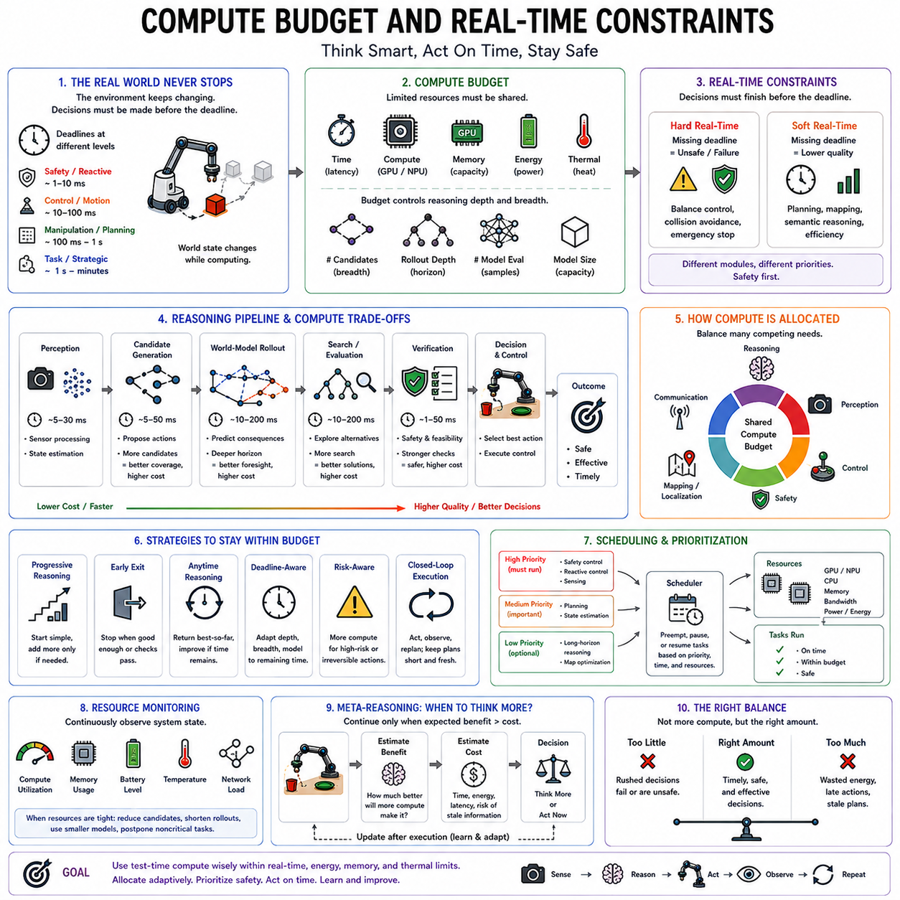{width="7.268055555555556in" height="7.268055555555556in"}

Compute budget and real-time constraints define how much reasoning a Physical AI system can perform before a physical decision must be executed. Unlike offline AI systems, robots operate while the environment continues to change, so computation has a deadline as well as a cost. Perception, planning, world-model rollout, verification, and control must therefore share limited processing resources while maintaining timely interaction with the physical world.

A compute budget represents the amount of computational capacity that can be allocated to a decision or control cycle. It may be expressed through available inference time, GPU or NPU utilization, memory, power consumption, number of model evaluations, candidate count, or rollout depth. Test-time reasoning must operate within this budget rather than assuming that additional computation can be increased indefinitely whenever a difficult problem appears.

Real-time constraints arise because useful actions must be produced before their deadlines. A collision-avoidance controller may need to respond within milliseconds, while manipulation planning may tolerate hundreds of milliseconds or several seconds. High-level task planning can sometimes use even longer horizons. Physical AI therefore contains multiple timing regimes, and the acceptable reasoning latency depends strongly on the level of control and the dynamics of the environment.

Hard real-time and soft real-time requirements should be distinguished. Under hard real-time constraints, missing a deadline can directly create unsafe or unstable behavior, as in balance control or emergency stopping. Under soft real-time constraints, delayed reasoning may reduce efficiency or task quality without immediately causing failure. Different reasoning modules can therefore be assigned different scheduling priorities according to the consequences of missing their deadlines.

The reasoning pipeline itself consumes time through several stages. Sensor processing produces an estimate of the current state, candidate generation proposes possible actions, world models predict their consequences, search explores alternatives, and verification checks safety and feasibility. Each additional stage can improve decision quality, but every stage also adds latency. System design must therefore consider end-to-end decision time rather than optimizing individual model accuracy in isolation.

Candidate count is one direct control over computational cost. Generating and evaluating more actions increases the chance of finding a strong solution but requires additional inference, memory, and scoring. A robot with a strict response deadline may evaluate only a few candidates, whereas a slower planning task can consider many alternatives. Candidate generation should therefore be dynamically matched to the time and compute available for the current decision.

Rollout depth creates a similar tradeoff. Deeper world-model rollouts allow the robot to anticipate consequences farther into the future, but prediction and evaluation costs increase with the planning horizon. Long rollouts may also accumulate model error. Under limited compute, a robot must decide whether resources are better spent exploring more candidates shallowly or evaluating fewer candidates more deeply.

Model size is another important dimension of the compute budget. Large foundation models may provide stronger semantic reasoning and broader generalization but require greater memory, energy, and inference time. Smaller policies or specialized models can provide faster responses for routine behavior. A practical system may therefore combine models of different capacities and invoke larger models only when simpler components cannot resolve the decision reliably.

Parallel computation can reduce effective latency when hardware resources are available. Multiple candidate actions, stochastic predictions, or world-model trajectories can be processed as a batch on GPUs or NPUs. This allows additional test-time compute without a proportional increase in wall-clock time. However, parallelism is limited by accelerator capacity, memory bandwidth, power consumption, and thermal constraints, especially on mobile robotic platforms.

Compute cannot be allocated to reasoning independently from other robotic functions. Perception, localization, mapping, communication, sensor fusion, control, and safety monitoring may run concurrently on the same processors. A reasoning module that consumes all accelerator resources could delay perception or control and reduce overall system reliability. Compute budgeting must therefore be performed at the level of the complete embodied system rather than for the reasoning model alone.

Energy is especially important for mobile robots because computation ultimately consumes battery capacity. Extensive world-model simulation or large-model inference may improve decisions but reduce operating time. High accelerator utilization also produces heat, which can trigger thermal throttling and lower sustained performance. Test-time reasoning should therefore consider energy and thermal budgets alongside conventional measures of latency and computational throughput.

Scheduling determines which computational tasks receive resources when multiple modules compete for execution. Safety-critical control should normally receive higher priority than optional deliberation. Background reasoning may be interrupted when urgent perception or control tasks appear. This requires an architecture in which expensive reasoning can yield resources gracefully rather than blocking the processes required to keep the robot stable and safe.

Anytime reasoning is useful under variable computational deadlines. An anytime algorithm maintains the best valid solution found so far and improves it when additional computation becomes available. If a deadline arrives unexpectedly, the robot can execute the current solution instead of waiting for reasoning to finish. This makes reasoning quality scale smoothly with available time and supports operation in environments where decision deadlines change dynamically.

Progressive reasoning provides a related strategy. The system begins with inexpensive computation and activates more costly stages only when necessary. A fast policy can first propose an action, lightweight verification can check obvious constraints, and deeper search or world-model simulation can follow if uncertainty remains. Easy decisions therefore consume little compute, while difficult cases receive larger budgets without forcing every control cycle through the most expensive pipeline.

Early-exit mechanisms can reduce unnecessary computation further. If one candidate clearly dominates, confidence is sufficiently high, and mandatory safety checks succeed, additional search can stop immediately. Conversely, when several candidates remain similar or verification detects uncertainty, the system can continue reasoning. Compute consumption becomes dependent on decision difficulty rather than being fixed in advance for every situation.

Deadline-aware reasoning explicitly incorporates remaining time into computation allocation. The robot can estimate how much time remains before an action must be issued and select reasoning operations that can realistically complete within that interval. As the deadline approaches, long rollouts or expensive models can be disabled, search can be narrowed, and the system can transition toward the best verified action currently available.

Risk-aware budgeting modifies this allocation according to the consequences of error. Routine, reversible actions may use minimal reasoning even when additional compute is technically available. High-risk or irreversible decisions can justify larger budgets, stronger verification, and more predictive rollouts. Compute allocation should therefore depend not only on task difficulty but also on how costly an incorrect decision would be in the physical environment.

Dynamic environments make stale information an important constraint. A plan computed from an old observation can become invalid while reasoning continues. Increasing computation does not necessarily improve decisions if the world changes faster than the reasoning process. Systems must therefore consider an information freshness horizon and may need to interrupt deliberation, acquire new observations, and restart or update planning when the estimated state becomes outdated.

Closed-loop control reduces the need to solve every decision with large compute budgets. Instead of generating a perfect long-horizon plan, the robot can reason over a shorter horizon, execute a safe portion of the action, observe the resulting state, and replan. Receding-horizon execution distributes computation across time and repeatedly anchors decisions to current sensory evidence, reducing both prediction error and the need for exhaustive initial planning.

Hierarchical architectures can assign different compute budgets to different temporal levels. Low-level controllers operate at high frequency with small and predictable computational costs, mid-level motion systems reason over moderate horizons, and high-level planners can use slower but more powerful models. Separating these timescales prevents expensive semantic reasoning from interfering with control loops that require deterministic and rapid responses.

Resource monitoring enables the reasoning system to adapt to changing hardware conditions. Available GPU capacity, memory pressure, battery state, processor temperature, communication load, and concurrent workloads can all affect how much computation is practical. A robot can reduce candidate counts, switch models, shorten rollouts, or postpone noncritical reasoning when resources become constrained, preserving essential functions under degraded conditions.

Meta-reasoning provides the supervisory mechanism for making these allocation decisions. It estimates whether another candidate, rollout, verification step, or larger model is likely to improve the decision enough to justify its cost. The reasoning process continues while the expected value of additional computation exceeds its latency and resource cost, and it terminates when further improvement becomes unlikely or the physical deadline requires action.

The most effective compute budget is therefore not necessarily the largest one. Excessive reasoning can waste energy, increase latency, interfere with control, and produce decisions based on stale observations. Insufficient reasoning can cause premature commitment and avoidable failures. Physical AI requires a balance in which computational effort scales with uncertainty, complexity, risk, reversibility, environmental dynamics, and available hardware resources.

Ultimately, compute budgeting transforms test-time reasoning from an unconstrained algorithmic capability into an operational component of embodied intelligence. Candidate generation, search, world-model rollout, verification, and reflection must all compete within real-time, energy, memory, and thermal limits. By combining adaptive allocation, prioritization, parallelism, early exits, anytime reasoning, and closed-loop execution, Physical AI can reason deeply when necessary while still acting within the deadlines imposed by the real world.

계산 예산(compute budget)과 실시간 제약(real-time constraints)은 물리 AI(Physical AI) 시스템이 물리적 의사결정을 실행하기 전에 얼마나 많은 추론을 수행할 수 있는지를 결정한다. 오프라인 AI 시스템과 달리 로봇이 작동하는 동안에도 환경은 계속 변화하므로 계산에는 비용뿐 아니라 마감시간(deadline)도 존재한다. 따라서 지각(perception), 계획(planning), 월드 모델 롤아웃(world-model rollout), 검증(verification), 제어(control)는 제한된 처리 자원을 공유하면서 물리적 세계와 적시에 상호작용해야 한다.

계산 예산(compute budget)은 하나의 의사결정 또는 제어 주기(control cycle)에 할당할 수 있는 계산 용량을 의미한다. 이는 사용 가능한 추론 시간(inference time), GPU 또는 NPU 활용률, 메모리, 전력 소비, 모델 평가 횟수, 후보 수(candidate count) 또는 롤아웃 깊이(rollout depth) 등으로 표현할 수 있다. 테스트 타임 추론(test-time reasoning)은 어려운 문제가 발생할 때마다 추가 계산을 무제한으로 증가시킬 수 있다고 가정하는 대신 이러한 예산 범위 안에서 동작해야 한다.

실시간 제약(real-time constraints)은 유용한 행동이 정해진 마감시간 이전에 생성되어야 하기 때문에 발생한다. 충돌 회피 제어기(collision-avoidance controller)는 수 밀리초 이내에 반응해야 할 수 있지만, 조작 계획(manipulation planning)은 수백 밀리초 또는 수초를 허용할 수 있다. 고수준 작업 계획(high-level task planning)은 때에 따라 더 긴 시간을 사용할 수 있다. 따라서 물리 AI에는 여러 시간 체계(timing regime)가 존재하며 허용 가능한 추론 지연시간은 제어 수준과 환경의 동역학에 크게 의존한다.

하드 실시간(hard real-time) 요구사항과 소프트 실시간(soft real-time) 요구사항은 구분되어야 한다. 하드 실시간 제약에서는 마감시간을 놓치는 것이 균형 제어나 비상 정지와 같이 직접적으로 위험하거나 불안정한 행동을 초래할 수 있다. 소프트 실시간 제약에서는 추론 지연이 즉각적인 실패를 일으키지는 않지만 효율성이나 작업 품질을 저하시킬 수 있다. 따라서 서로 다른 추론 모듈에는 마감시간을 놓쳤을 때의 결과에 따라 서로 다른 스케줄링 우선순위(scheduling priority)를 부여할 수 있다.

추론 파이프라인(reasoning pipeline) 자체도 여러 단계를 거치면서 시간을 소비한다. 센서 처리는 현재 상태를 추정하고, 후보 생성(candidate generation)은 가능한 행동을 제안하며, 월드 모델은 그 결과를 예측하고, 탐색(search)은 대안을 검토하며, 검증은 안전성과 실행 가능성을 확인한다. 각각의 추가 단계는 의사결정 품질을 향상시킬 수 있지만 동시에 지연시간을 증가시킨다. 따라서 시스템 설계에서는 개별 모델의 정확도만 독립적으로 최적화하는 대신 종단간 의사결정 시간(end-to-end decision time)을 고려해야 한다.

후보 수(candidate count)는 계산 비용을 직접적으로 제어하는 요소 중 하나이다. 더 많은 행동을 생성하고 평가하면 우수한 해결책을 발견할 가능성이 높아지지만 추가적인 추론, 메모리 및 점수화(scoring)가 필요하다. 엄격한 응답 마감시간을 가진 로봇은 소수의 후보만 평가할 수 있지만, 상대적으로 느린 계획 작업에서는 많은 대안을 검토할 수 있다. 따라서 후보 생성은 현재 의사결정에 사용할 수 있는 시간과 계산 자원에 동적으로 맞추어야 한다.

롤아웃 깊이(rollout depth)도 유사한 상충 관계(tradeoff)를 형성한다. 더 깊은 월드 모델 롤아웃은 로봇이 더 먼 미래의 결과를 예측할 수 있게 하지만 계획 범위(planning horizon)가 증가할수록 예측 및 평가 비용도 증가한다. 긴 롤아웃에서는 모델 오류가 누적될 수도 있다. 제한된 계산 자원 아래에서 로봇은 더 많은 후보를 얕게 탐색할 것인지, 더 적은 후보를 깊게 평가할 것인지 결정해야 한다.

모델 크기(model size)는 계산 예산의 또 다른 중요한 차원이다. 대규모 파운데이션 모델(foundation model)은 더 강력한 의미적 추론(semantic reasoning)과 폭넓은 일반화 능력을 제공할 수 있지만 더 많은 메모리, 에너지 및 추론 시간을 요구한다. 소형 정책(policy)이나 특화 모델(specialized model)은 일상적인 행동에 더 빠르게 반응할 수 있다. 따라서 실용적인 시스템은 서로 다른 용량의 모델을 결합하고 단순한 구성요소만으로 의사결정을 신뢰성 있게 해결할 수 없을 때에만 대형 모델을 호출할 수 있다.

하드웨어 자원을 사용할 수 있다면 병렬 계산(parallel computation)을 통해 실질적인 지연시간을 줄일 수 있다. 여러 후보 행동, 확률적 예측(stochastic prediction) 또는 월드 모델 궤적을 GPU나 NPU에서 하나의 배치(batch)로 처리할 수 있다. 이를 통해 실제 경과 시간(wall-clock time)을 후보 수에 비례하여 증가시키지 않으면서 추가적인 테스트 타임 컴퓨트를 사용할 수 있다. 그러나 특히 이동 로봇 플랫폼에서는 가속기 용량, 메모리 대역폭(memory bandwidth), 전력 소비 및 열적 제약(thermal constraint)으로 인해 병렬 처리에도 한계가 있다.

계산 자원은 다른 로봇 기능과 독립적으로 추론에 할당될 수 없다. 지각, 위치 추정(localization), 매핑(mapping), 통신, 센서 융합(sensor fusion), 제어 및 안전 모니터링이 동일한 프로세서에서 동시에 실행될 수 있다. 추론 모듈이 모든 가속기 자원을 소비하면 지각이나 제어가 지연되어 전체 시스템의 신뢰성이 저하될 수 있다. 따라서 계산 예산은 추론 모델만이 아니라 전체 체화 시스템(embodied system) 수준에서 관리되어야 한다.

계산은 궁극적으로 배터리 용량을 소비하기 때문에 에너지(energy)는 이동 로봇에서 특히 중요하다. 광범위한 월드 모델 시뮬레이션이나 대규모 모델 추론은 의사결정을 개선할 수 있지만 로봇의 운용 시간을 단축할 수 있다. 높은 가속기 활용률은 열을 발생시켜 열 스로틀링(thermal throttling)을 유발하고 지속적인 성능을 저하시킬 수도 있다. 따라서 테스트 타임 추론은 일반적인 지연시간과 계산 처리량뿐 아니라 에너지 및 열 예산(thermal budget)도 함께 고려해야 한다.

여러 모듈이 실행 자원을 놓고 경쟁할 때 스케줄링(scheduling)은 어떤 계산 작업에 자원을 우선적으로 제공할지를 결정한다. 안전에 중요한 제어(safety-critical control)는 일반적으로 선택적인 숙고(deliberation)보다 높은 우선순위를 가져야 한다. 긴급한 지각 또는 제어 작업이 발생하면 백그라운드 추론(background reasoning)을 중단할 수도 있다. 이를 위해서는 비용이 높은 추론이 로봇의 안정성과 안전을 유지하는 데 필요한 프로세스를 차단하지 않고 자연스럽게 자원을 양보할 수 있는 아키텍처가 필요하다.

애니타임 추론(anytime reasoning)은 계산 마감시간이 변동하는 상황에서 유용하다. 애니타임 알고리즘(anytime algorithm)은 현재까지 발견된 가장 우수한 유효 해결책을 항상 유지하면서 추가적인 계산 자원을 사용할 수 있을 때 이를 개선한다. 마감시간이 예상보다 빨리 도래하면 로봇은 추론이 완전히 끝날 때까지 기다리는 대신 현재 확보된 해결책을 실행할 수 있다. 이를 통해 추론 품질이 사용 가능한 시간에 따라 자연스럽게 확장되고 의사결정 마감시간이 동적으로 변화하는 환경에서도 동작할 수 있다.

점진적 추론(progressive reasoning)은 이와 관련된 전략을 제공한다. 시스템은 저비용 계산에서 시작하고 필요한 경우에만 더 높은 비용의 단계를 활성화한다. 빠른 정책(fast policy)이 먼저 행동을 제안하고, 경량 검증(lightweight verification)이 명백한 제약을 확인하며, 불확실성이 남아 있다면 더 깊은 탐색이나 월드 모델 시뮬레이션을 수행할 수 있다. 따라서 쉬운 의사결정에는 적은 계산 자원만 사용하고 어려운 경우에는 더 큰 예산을 할당할 수 있다.

조기 종료 메커니즘(early-exit mechanism)은 불필요한 계산을 더욱 줄일 수 있다. 하나의 후보가 명확하게 우세하고, 신뢰도가 충분히 높으며, 필수 안전 검증이 성공하면 추가 탐색을 즉시 중단할 수 있다. 반대로 여러 후보의 품질이 비슷하거나 검증 과정에서 불확실성이 탐지되면 추론을 계속할 수 있다. 이를 통해 계산 소비량은 모든 상황에 미리 고정되는 대신 의사결정 난이도에 따라 달라진다.

마감시간 인식 추론(deadline-aware reasoning)은 남은 시간을 계산 자원 할당에 명시적으로 반영한다. 로봇은 행동 명령을 출력하기 전에 얼마나 많은 시간이 남아 있는지를 추정하고, 그 시간 안에 현실적으로 완료할 수 있는 추론 연산을 선택할 수 있다. 마감시간이 가까워지면 긴 롤아웃이나 비용이 높은 모델을 비활성화하고, 탐색 범위를 축소하며, 현재 확보된 후보 중 가장 우수하게 검증된 행동으로 전환할 수 있다.

위험 인식 예산 할당(risk-aware budgeting)은 오류의 결과에 따라 계산 자원 할당을 변경한다. 일상적이고 되돌릴 수 있는 행동은 추가 계산 자원을 사용할 수 있더라도 최소한의 추론만 사용할 수 있다. 반면 위험도가 높거나 비가역적인 의사결정은 더 큰 계산 예산, 강화된 검증 및 더 많은 예측 롤아웃을 정당화할 수 있다. 따라서 계산 자원 할당은 작업 난이도뿐 아니라 물리적 환경에서 잘못된 결정이 초래하는 비용에도 의존해야 한다.

동적 환경(dynamic environment)에서는 오래된 정보(stale information)가 중요한 제약이 된다. 오래된 관측으로부터 계산된 계획은 추론이 계속되는 동안 무효화될 수 있다. 세계가 추론 과정보다 빠르게 변화한다면 계산을 증가시키는 것이 반드시 더 좋은 의사결정을 의미하지는 않는다. 따라서 시스템은 정보 신선도 범위(information freshness horizon)를 고려하고, 추정 상태가 오래되면 숙고를 중단하고 새로운 관측을 획득한 뒤 계획을 다시 시작하거나 갱신해야 할 수 있다.

폐루프 제어(closed-loop control)는 모든 의사결정을 큰 계산 예산으로 해결해야 할 필요성을 줄인다. 로봇은 완벽한 장기 계획을 한 번에 생성하는 대신 더 짧은 범위에서 추론하고, 안전한 일부 행동을 실행하고, 그 결과 상태를 관측한 다음 다시 계획할 수 있다. 리시딩 호라이즌 실행(receding-horizon execution)은 계산을 시간에 걸쳐 분산시키고 의사결정을 현재의 센서 근거에 반복적으로 연결하여 예측 오류와 초기의 완전 탐색 필요성을 모두 줄인다.

계층적 아키텍처(hierarchical architecture)는 서로 다른 시간 수준에 서로 다른 계산 예산을 할당할 수 있다. 저수준 제어기(low-level controller)는 작고 예측 가능한 계산 비용으로 높은 주파수에서 동작하고, 중간 수준 모션 시스템(mid-level motion system)은 중간 범위의 시간에 대해 추론하며, 고수준 플래너(high-level planner)는 더 느리지만 강력한 모델을 사용할 수 있다. 이러한 시간 규모의 분리는 비용이 높은 의미적 추론이 결정론적이고 빠른 응답이 필요한 제어 루프를 방해하는 것을 방지한다.

자원 모니터링(resource monitoring)은 변화하는 하드웨어 상태에 맞춰 추론 시스템을 적응시킬 수 있다. 사용 가능한 GPU 용량, 메모리 압력(memory pressure), 배터리 상태, 프로세서 온도, 통신 부하 및 동시에 실행되는 작업은 모두 현실적으로 사용할 수 있는 계산량에 영향을 준다. 자원이 제한되면 로봇은 후보 수를 줄이고, 모델을 전환하며, 롤아웃을 단축하거나, 중요하지 않은 추론을 연기하여 성능이 저하된 조건에서도 필수 기능을 유지할 수 있다.

메타 추론(meta-reasoning)은 이러한 자원 할당 결정을 수행하는 감독 메커니즘(supervisory mechanism)을 제공한다. 추가적인 후보, 롤아웃, 검증 단계 또는 더 큰 모델이 그 비용을 정당화할 만큼 의사결정을 개선할 가능성이 있는지를 추정한다. 추가 계산의 기대 가치(expected value)가 지연시간과 자원 비용을 초과하는 동안 추론은 계속되며, 더 이상의 개선 가능성이 낮아지거나 물리적 마감시간 때문에 행동해야 할 경우 추론을 종료한다.

따라서 가장 효과적인 계산 예산이 반드시 가장 큰 계산 예산을 의미하는 것은 아니다. 과도한 추론은 에너지를 낭비하고, 지연시간을 증가시키며, 제어를 방해하고, 오래된 관측에 기반한 의사결정을 생성할 수 있다. 반대로 불충분한 추론은 너무 이른 행동 결정(premature commitment)과 피할 수 있는 실패를 초래할 수 있다. 물리 AI에는 불확실성, 복잡성, 위험, 가역성, 환경 동역학 및 사용 가능한 하드웨어 자원에 따라 계산 노력을 조절하는 균형이 필요하다.

궁극적으로 계산 예산 관리는 테스트 타임 추론을 제약 없는 알고리즘적 능력에서 체화 지능(embodied intelligence)의 실제 운영 구성요소로 변화시킨다. 후보 생성, 탐색, 월드 모델 롤아웃, 검증 및 성찰(reflection)은 모두 실시간, 에너지, 메모리 및 열적 한계 안에서 자원을 공유해야 한다. 적응형 자원 할당(adaptive allocation), 우선순위화(prioritization), 병렬 처리, 조기 종료, 애니타임 추론 및 폐루프 실행을 결합함으로써 물리 AI는 필요한 상황에서는 깊이 추론하면서도 현실 세계가 요구하는 마감시간 안에 행동할 수 있다.

## 07.10. Uncertainty Aware Deliberation

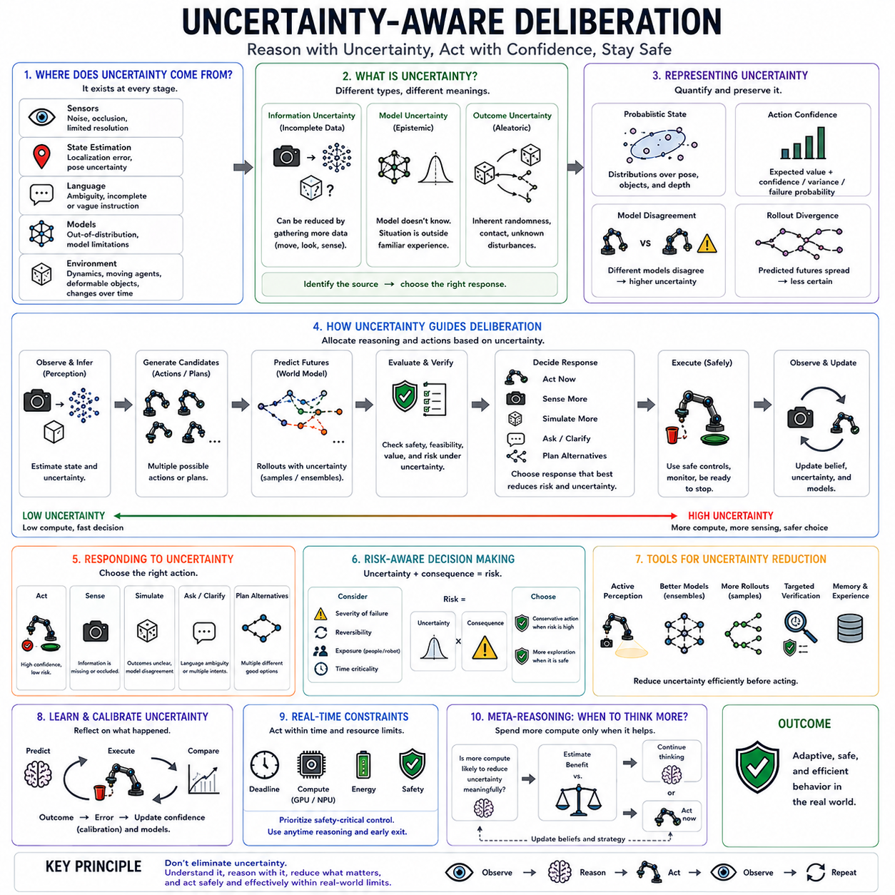{width="7.268055555555556in" height="7.268055555555556in"}

Uncertainty-aware deliberation enables a Physical AI system to adjust its reasoning according to how certain it is about the current state, predicted outcomes, and available actions. Rather than treating every model output as equally trustworthy, the robot estimates where uncertainty exists and uses that information to decide whether to act immediately, gather more evidence, generate alternatives, simulate possible futures, or spend additional test-time compute.

Uncertainty can originate at multiple stages of the perception-action pipeline. Sensors may be noisy, objects may be partially occluded, localization may be inaccurate, language instructions may be ambiguous, and learned models may encounter unfamiliar situations. Future physical outcomes can also be uncertain because of contact dynamics, moving agents, deformable objects, or environmental changes that cannot be predicted perfectly from the current observation.

A useful distinction can be made between uncertainty caused by incomplete information and uncertainty caused by limitations of the model. Incomplete observations may be reduced by acquiring another camera view, approaching an object, or using another sensor. Model uncertainty may instead indicate that the situation lies outside familiar experience. These cases require different responses, so estimating uncertainty alone is not sufficient; the robot should also reason about its likely source.

Perceptual uncertainty affects the reliability of the world state used for planning. An object detector may identify several possible objects, depth estimates may contain error, or an object pose may be represented by a probability distribution rather than a single value. If planning assumes that uncertain estimates are exact, small perceptual errors can become large execution failures. Deliberation should therefore preserve uncertainty rather than prematurely collapsing it into one interpretation.

Action uncertainty concerns whether a proposed behavior will execute as intended. A grasp pose may appear geometrically valid while its probability of stable contact remains uncertain. A navigation maneuver may be collision-free under the current map but depend on uncertain human motion. Candidate actions can therefore be associated not only with expected value but also with confidence, variance, failure probability, or other measures describing the reliability of their predicted outcomes.

World-model uncertainty is particularly important during predictive rollouts. A model may generate a plausible future without accurately representing how uncertain that future is. Repeated stochastic rollouts, model ensembles, probabilistic latent states, or disagreement between predictive models can provide evidence about prediction reliability. When imagined futures diverge significantly, the robot should treat the corresponding action as less certain even if its average predicted outcome appears attractive.

Uncertainty-aware deliberation uses these signals to regulate reasoning depth. When perception is clear, predictions agree, and one candidate strongly dominates, the robot may execute with minimal additional computation. When uncertainty rises, the system can increase candidate count, search depth, rollout samples, verification effort, or sensing. Test-time compute therefore becomes responsive to the quality of the available evidence rather than being fixed for every decision.

Additional sampling can reveal whether uncertainty represents several genuinely different solutions. If repeated action generation produces nearly identical candidates, the policy may strongly prefer one strategy. If samples produce different grasp directions, routes, or task decompositions, the decision remains ambiguous. The robot can then compare these alternatives using world models, physical constraints, learned value functions, or additional observations before committing to execution.

Model disagreement provides another practical uncertainty signal. Several independently trained models, critics, planners, or predictive heads can evaluate the same candidate. Agreement does not guarantee correctness, but strong disagreement indicates that the decision deserves additional attention. A robot can allocate more computation to disputed candidates while rapidly accepting actions for which independent evaluation mechanisms produce consistent conclusions.

Risk must be considered together with uncertainty. High uncertainty does not always require extensive deliberation if the possible consequences are harmless and easily reversible. Conversely, moderate uncertainty may justify substantial reasoning when failure could injure a person, damage equipment, destabilize the robot, or create an unrecoverable state. The relevant quantity is therefore not uncertainty alone, but uncertainty combined with the severity of possible outcomes.

This relationship motivates risk-sensitive action selection. Instead of maximizing only expected reward, the robot can penalize candidates with large outcome variance, significant failure probability, or severe worst-case consequences. A slightly slower trajectory may be preferred over a faster one if its predicted outcomes are consistently safe. Such behavior is especially important in human environments, industrial manipulation, autonomous mobility, and other safety-critical applications.

Uncertainty can also determine when the robot should gather information rather than continue internal reasoning. If an object is heavily occluded, performing hundreds of additional rollouts from the same uncertain observation may not resolve the problem. Moving the camera, changing viewpoint, touching the object carefully, or requesting clarification may reduce uncertainty more effectively. Deliberation can therefore select information-gathering actions as part of the decision process.

Active perception extends this principle by treating sensing as an action that can be planned. The robot may reposition itself specifically to improve depth estimation, reveal an occluded object, distinguish between similar targets, or observe a contact surface. The value of such an action comes from reducing uncertainty before a more consequential action is attempted. Perception and planning therefore become tightly coupled rather than operating as strictly separate stages.

Language uncertainty should also influence physical execution. Human instructions can contain ambiguous references, incomplete constraints, or goals that admit multiple interpretations. A language-capable robot should avoid converting uncertain semantic interpretations directly into irreversible physical behavior. It can preserve several hypotheses, inspect environmental context, ask for clarification when appropriate, or select a safe reversible action that provides additional evidence.

Uncertainty may increase as reasoning extends farther into the future. Even when the current state is well estimated, prediction errors accumulate through long world-model rollouts. A candidate that appears highly reliable one step ahead may have widely varying outcomes after many steps. Planning systems should therefore represent how confidence changes with rollout horizon and avoid treating distant predictions with the same certainty as immediate consequences.

Closed-loop execution provides a practical response to this growth of uncertainty. Instead of committing to a long predicted trajectory, the robot can execute only the first safe portion, observe the resulting state, update its uncertainty, and replan. This receding-horizon approach repeatedly replaces uncertain long-range predictions with new physical evidence and limits the accumulation of errors caused by imperfect world models.

Self-verification can use uncertainty to determine which checks deserve additional effort. A candidate with uncertain geometry may receive more collision and reachability analysis, while uncertain contact behavior may trigger additional dynamics prediction. Semantic ambiguity may require language-level verification. Verification therefore becomes targeted: computational resources are directed toward the specific dimensions of the decision that remain uncertain.

Reflection after execution provides an important mechanism for calibrating uncertainty estimates. If outcomes repeatedly differ from predictions even when the system reports high confidence, the confidence model is poorly calibrated. Conversely, excessive uncertainty in situations that consistently succeed can cause unnecessary deliberation. Comparing predicted confidence with observed outcomes allows the robot to improve how uncertainty is interpreted during future decisions.

Memory can preserve uncertainty-related experience across tasks. The robot may remember that a particular object type is difficult to grasp, that a reflective surface causes unreliable depth measurements, or that a certain environment produces localization errors. When similar conditions recur, these experiences can influence reasoning budgets and verification policies. Uncertainty estimation then becomes informed by accumulated embodied experience rather than only the current observation.

Meta-reasoning uses uncertainty as one of its primary signals for allocating computational effort. It can determine whether another rollout, candidate, sensor measurement, verifier, or planning step is likely to reduce uncertainty enough to improve the decision. When further computation provides little information, reasoning should stop. When uncertainty remains decision-critical and additional evidence can realistically resolve it, deeper deliberation becomes valuable.

Real-time constraints limit how much uncertainty can be resolved before action. In rapidly changing situations, the robot may need to choose the safest available action before uncertainty is fully eliminated. Conservative fallback policies, emergency behaviors, safety envelopes, or reduced-speed operation can provide acceptable responses when reasoning time expires. Uncertainty-aware intelligence therefore includes knowing how to act safely when complete certainty is impossible.

The objective is not to eliminate uncertainty, because uncertainty is unavoidable in real physical environments. Instead, the robot should represent it, identify where it comes from, estimate how much it matters, and determine whether it can be reduced at reasonable cost. This prevents both overconfidence, which can produce unsafe actions, and excessive hesitation, which can make the system unnecessarily slow or incapable of completing tasks.

Ultimately, uncertainty-aware deliberation transforms uncertainty from a hidden weakness into an explicit input to physical reasoning. Perception, candidate generation, world-model rollout, search, verification, active sensing, reflection, and meta-reasoning can all respond to confidence and disagreement. By spending additional test-time compute where uncertainty is consequential and acting efficiently where evidence is strong, Physical AI can achieve more adaptive, reliable, and safety-aware behavior.

불확실성 인식 숙고(uncertainty-aware deliberation)는 물리 AI(Physical AI) 시스템이 현재 상태, 예측된 결과 및 사용 가능한 행동에 대해 얼마나 확신하는지에 따라 추론 방식을 조정할 수 있도록 한다. 로봇은 모든 모델 출력을 동일하게 신뢰하는 대신 어디에 불확실성이 존재하는지를 추정하고, 이를 이용해 즉시 행동할지, 더 많은 근거를 수집할지, 대안을 생성할지, 가능한 미래를 시뮬레이션할지, 또는 추가적인 테스트 타임 컴퓨트(test-time compute)를 사용할지를 결정한다.

불확실성(uncertainty)은 지각-행동 파이프라인(perception-action pipeline)의 여러 단계에서 발생할 수 있다. 센서에는 잡음이 존재할 수 있고, 물체는 부분적으로 가려질 수 있으며, 위치 추정(localization)은 부정확할 수 있고, 언어 명령은 모호할 수 있으며, 학습된 모델은 익숙하지 않은 상황을 마주할 수 있다. 또한 접촉 동역학(contact dynamics), 움직이는 에이전트, 변형 가능한 물체(deformable object), 현재 관측만으로 완벽하게 예측할 수 없는 환경 변화 때문에 미래의 물리적 결과에도 불확실성이 존재할 수 있다.

불완전한 정보(incomplete information)에서 발생하는 불확실성과 모델의 한계에서 발생하는 불확실성을 구분하는 것이 유용하다. 불완전한 관측은 다른 카메라 시점을 확보하거나, 물체에 접근하거나, 다른 센서를 사용함으로써 줄일 수 있다. 반면 모델 불확실성(model uncertainty)은 현재 상황이 익숙한 경험의 범위를 벗어났음을 나타낼 수 있다. 이러한 경우에는 서로 다른 대응이 필요하므로 불확실성을 추정하는 것만으로는 충분하지 않으며, 로봇은 그 불확실성의 가능한 원인까지 추론해야 한다.

지각 불확실성(perceptual uncertainty)은 계획에 사용되는 세계 상태(world state)의 신뢰성에 영향을 준다. 물체 탐지기(object detector)는 여러 개의 가능한 물체를 식별할 수 있고, 깊이 추정(depth estimation)에는 오류가 포함될 수 있으며, 물체 자세(object pose)는 하나의 값이 아니라 확률 분포(probability distribution)로 표현될 수 있다. 계획 과정에서 이러한 불확실한 추정값을 정확한 값으로 가정하면 작은 지각 오류가 큰 실행 실패로 이어질 수 있다. 따라서 숙고 과정은 불확실성을 하나의 해석으로 성급하게 축소하지 않고 유지해야 한다.

행동 불확실성(action uncertainty)은 제안된 행동이 의도한 대로 실행될 것인지와 관련된다. 파지 자세(grasp pose)는 기하학적으로 유효해 보이더라도 안정적인 접촉이 이루어질 확률은 불확실할 수 있다. 내비게이션 동작은 현재 지도에서는 충돌이 없더라도 불확실한 사람의 움직임에 의존할 수 있다. 따라서 후보 행동(candidate action)은 기대 가치(expected value)뿐 아니라 신뢰도, 분산(variance), 실패 확률 또는 예측 결과의 신뢰성을 나타내는 다른 척도와 함께 평가될 수 있다.

월드 모델 불확실성(world-model uncertainty)은 예측 롤아웃(predictive rollout)에서 특히 중요하다. 모델은 그 미래가 얼마나 불확실한지를 정확하게 나타내지 않으면서도 그럴듯한 미래를 생성할 수 있다. 반복적인 확률적 롤아웃(stochastic rollout), 모델 앙상블(model ensemble), 확률적 잠재 상태(probabilistic latent state) 또는 예측 모델 사이의 불일치는 예측 신뢰성에 대한 근거를 제공할 수 있다. 상상된 미래들이 크게 달라진다면 평균적인 예측 결과가 매력적으로 보이더라도 로봇은 해당 행동을 더 불확실한 것으로 취급해야 한다.

불확실성 인식 숙고는 이러한 신호를 이용하여 추론 깊이(reasoning depth)를 조절한다. 지각이 명확하고, 예측 결과가 서로 일치하며, 하나의 후보가 명확하게 우세하다면 로봇은 최소한의 추가 계산만으로 행동을 실행할 수 있다. 불확실성이 증가하면 시스템은 후보 수, 탐색 깊이(search depth), 롤아웃 샘플 수, 검증 노력(verification effort) 또는 센싱을 증가시킬 수 있다. 따라서 테스트 타임 컴퓨트는 모든 의사결정에 고정되는 것이 아니라 사용 가능한 근거의 품질에 반응하여 조정된다.

추가적인 샘플링(sampling)은 불확실성이 실제로 서로 다른 여러 해결책을 의미하는지를 파악하는 데 도움을 줄 수 있다. 반복적인 행동 생성에서 거의 동일한 후보가 만들어진다면 정책(policy)이 하나의 전략을 강하게 선호할 수 있다. 반면 샘플마다 서로 다른 파지 방향, 경로 또는 작업 분해(task decomposition)가 생성된다면 의사결정은 여전히 모호하다. 로봇은 실행을 결정하기 전에 월드 모델, 물리적 제약, 학습된 가치 함수(value function) 또는 추가 관측을 이용하여 이러한 대안을 비교할 수 있다.

모델 불일치(model disagreement)는 또 다른 실용적인 불확실성 신호를 제공한다. 서로 독립적으로 학습된 여러 모델, 비평 모델(critic), 플래너(planner) 또는 예측 헤드(predictive head)가 동일한 후보를 평가할 수 있다. 결과가 일치한다고 해서 정확성이 보장되는 것은 아니지만, 큰 불일치는 해당 의사결정에 추가적인 주의가 필요함을 의미한다. 로봇은 독립적인 평가 메커니즘들이 일관된 결론을 생성하는 행동은 빠르게 받아들이고, 의견이 다른 후보에는 더 많은 계산 자원을 할당할 수 있다.

위험(risk)은 불확실성과 함께 고려되어야 한다. 가능한 결과가 무해하고 쉽게 되돌릴 수 있다면 높은 불확실성이 항상 광범위한 숙고를 요구하는 것은 아니다. 반대로 실패가 사람에게 상해를 입히거나, 장비를 손상시키거나, 로봇을 불안정하게 만들거나, 복구할 수 없는 상태를 생성할 수 있다면 중간 수준의 불확실성도 상당한 추론을 정당화할 수 있다. 따라서 중요한 것은 불확실성 자체가 아니라 불확실성과 가능한 결과의 심각성(severity)을 함께 고려하는 것이다.

이러한 관계는 위험 민감 행동 선택(risk-sensitive action selection)의 필요성을 제시한다. 로봇은 기대 보상(expected reward)만 최대화하는 대신 결과의 분산이 크거나, 실패 확률이 높거나, 최악의 경우 심각한 결과가 발생하는 후보에 페널티를 부여할 수 있다. 예측된 결과가 일관되게 안전하다면 조금 더 느린 궤적이 빠른 궤적보다 선호될 수 있다. 이러한 행동은 인간 환경, 산업용 조작, 자율 이동 및 기타 안전 중요 응용(safety-critical application)에서 특히 중요하다.

불확실성은 로봇이 내부 추론을 계속하기보다 정보를 수집해야 하는 시점을 결정할 수도 있다. 물체가 심하게 가려져 있다면 동일하게 불확실한 관측으로 수백 번의 추가 롤아웃을 수행하더라도 문제가 해결되지 않을 수 있다. 카메라를 이동하거나, 관점을 변경하거나, 물체를 조심스럽게 접촉하거나, 명확한 설명을 요청하는 것이 불확실성을 더 효과적으로 줄일 수 있다. 따라서 숙고는 정보 수집 행동(information-gathering action)을 의사결정 과정의 일부로 선택할 수 있다.

능동 지각(active perception)은 센싱을 계획할 수 있는 하나의 행동으로 취급함으로써 이러한 원리를 확장한다. 로봇은 깊이 추정을 개선하거나, 가려진 물체를 드러내거나, 유사한 대상들을 구분하거나, 접촉 표면을 관측하기 위해 의도적으로 자신의 위치를 변경할 수 있다. 이러한 행동의 가치는 더 중요한 행동을 시도하기 전에 불확실성을 감소시키는 데 있다. 따라서 지각과 계획은 엄격하게 분리된 단계로 동작하는 대신 긴밀하게 결합된다.

언어 불확실성(language uncertainty)도 물리적 실행에 영향을 주어야 한다. 인간의 명령에는 모호한 지시 대상, 불완전한 제약 또는 여러 방식으로 해석할 수 있는 목표가 포함될 수 있다. 언어 능력을 갖춘 로봇은 불확실한 의미적 해석(semantic interpretation)을 비가역적인 물리적 행동으로 직접 변환하지 않아야 한다. 대신 여러 가설을 유지하거나, 환경적 문맥을 확인하거나, 필요한 경우 명확한 설명을 요청하거나, 추가적인 근거를 제공할 수 있는 안전하고 되돌릴 수 있는 행동을 선택할 수 있다.

추론이 더 먼 미래까지 확장될수록 불확실성은 증가할 수 있다. 현재 상태가 정확하게 추정되더라도 긴 월드 모델 롤아웃을 거치는 동안 예측 오류가 누적된다. 한 단계 앞에서는 높은 신뢰성을 보이는 후보라도 여러 단계 이후에는 매우 다양한 결과를 가질 수 있다. 따라서 계획 시스템은 롤아웃 범위(rollout horizon)에 따라 신뢰도가 어떻게 변화하는지를 표현하고, 먼 미래의 예측을 즉각적인 결과와 동일한 확실성을 가진 것으로 취급하지 않아야 한다.

폐루프 실행(closed-loop execution)은 이러한 불확실성 증가에 대응하는 실용적인 방법을 제공한다. 로봇은 긴 예측 궤적 전체를 한 번에 실행하는 대신 첫 번째 안전한 부분만 실행하고, 결과 상태를 관측하고, 불확실성을 갱신한 다음 다시 계획할 수 있다. 이러한 리시딩 호라이즌 접근법(receding-horizon approach)은 불확실한 장거리 예측을 새로운 물리적 근거로 반복적으로 대체하고 불완전한 월드 모델에서 발생하는 오류 누적을 제한한다.

자기 검증(self-verification)은 불확실성을 이용하여 어떤 검사에 추가적인 노력을 투입해야 하는지를 결정할 수 있다. 기하학적 정보가 불확실한 후보에는 추가적인 충돌 및 도달 가능성 분석을 수행할 수 있고, 접촉 행동이 불확실하면 추가적인 동역학 예측을 활성화할 수 있다. 의미적 모호성은 언어 수준 검증(language-level verification)을 요구할 수 있다. 따라서 검증은 목표 지향적으로 수행되며, 계산 자원은 의사결정에서 실제로 불확실성이 남아 있는 특정 차원에 집중된다.

실행 이후의 성찰(reflection)은 불확실성 추정을 보정(calibration)하기 위한 중요한 메커니즘을 제공한다. 시스템이 높은 신뢰도를 보고했음에도 실제 결과가 반복적으로 예측과 다르다면 신뢰도 모델(confidence model)이 제대로 보정되지 않은 것이다. 반대로 지속적으로 성공하는 상황에서 지나치게 높은 불확실성을 나타내면 불필요한 숙고가 발생할 수 있다. 예측된 신뢰도와 실제 관측 결과를 비교함으로써 로봇은 미래 의사결정에서 불확실성을 해석하는 방식을 개선할 수 있다.

메모리(memory)는 여러 작업에 걸쳐 불확실성과 관련된 경험을 보존할 수 있다. 로봇은 특정 유형의 물체가 파지하기 어렵거나, 반사 표면이 신뢰할 수 없는 깊이 측정을 발생시키거나, 특정 환경에서 위치 추정 오류가 발생한다는 사실을 기억할 수 있다. 유사한 조건이 다시 발생하면 이러한 경험은 추론 예산(reasoning budget)과 검증 정책(verification policy)에 영향을 줄 수 있다. 따라서 불확실성 추정은 현재 관측뿐 아니라 축적된 체화 경험(embodied experience)의 도움도 받을 수 있다.

메타 추론(meta-reasoning)은 계산 노력을 할당하기 위한 주요 신호 중 하나로 불확실성을 사용한다. 추가적인 롤아웃, 후보, 센서 측정, 검증기(verifier) 또는 계획 단계가 의사결정을 개선할 만큼 불확실성을 줄일 가능성이 있는지를 판단할 수 있다. 추가 계산이 거의 새로운 정보를 제공하지 않는다면 추론을 중단해야 한다. 반대로 의사결정에 중요한 불확실성이 남아 있고 추가 근거를 통해 현실적으로 해결할 수 있다면 더 깊은 숙고가 가치가 있다.

실시간 제약(real-time constraints)은 행동 전에 해결할 수 있는 불확실성의 양을 제한한다. 빠르게 변화하는 상황에서는 불확실성을 완전히 제거하기 전에 로봇이 현재 사용 가능한 가장 안전한 행동을 선택해야 할 수 있다. 보수적인 폴백 정책(conservative fallback policy), 비상 행동(emergency behavior), 안전 영역(safety envelope) 또는 감속 운전(reduced-speed operation)은 추론 시간이 종료되었을 때 허용 가능한 대응을 제공할 수 있다. 따라서 불확실성 인식 지능은 완전한 확신이 불가능할 때 어떻게 안전하게 행동할지를 아는 것까지 포함한다.

목표는 불확실성을 제거하는 것이 아니다. 실제 물리적 환경에서 불확실성은 피할 수 없기 때문이다. 대신 로봇은 불확실성을 표현하고, 어디에서 발생하는지를 식별하며, 그것이 얼마나 중요한지를 추정하고, 합리적인 비용으로 줄일 수 있는지를 판단해야 한다. 이를 통해 안전하지 않은 행동으로 이어질 수 있는 과신(overconfidence)과 시스템을 불필요하게 느리게 만들거나 작업을 완료하지 못하게 만드는 과도한 주저(excessive hesitation)를 모두 방지할 수 있다.

궁극적으로 불확실성 인식 숙고는 불확실성을 숨겨진 약점에서 물리적 추론의 명시적인 입력으로 변화시킨다. 지각, 후보 생성, 월드 모델 롤아웃, 탐색, 검증, 능동 센싱(active sensing), 성찰 및 메타 추론은 모두 신뢰도와 불일치에 반응할 수 있다. 불확실성이 중요한 곳에는 추가적인 테스트 타임 컴퓨트를 사용하고 근거가 충분한 곳에서는 효율적으로 행동함으로써 물리 AI는 더욱 적응적이고 신뢰할 수 있으며 안전성을 인식하는 행동을 구현할 수 있다.

## 07.11. Physical Test Time Compute Controller [w/Code]

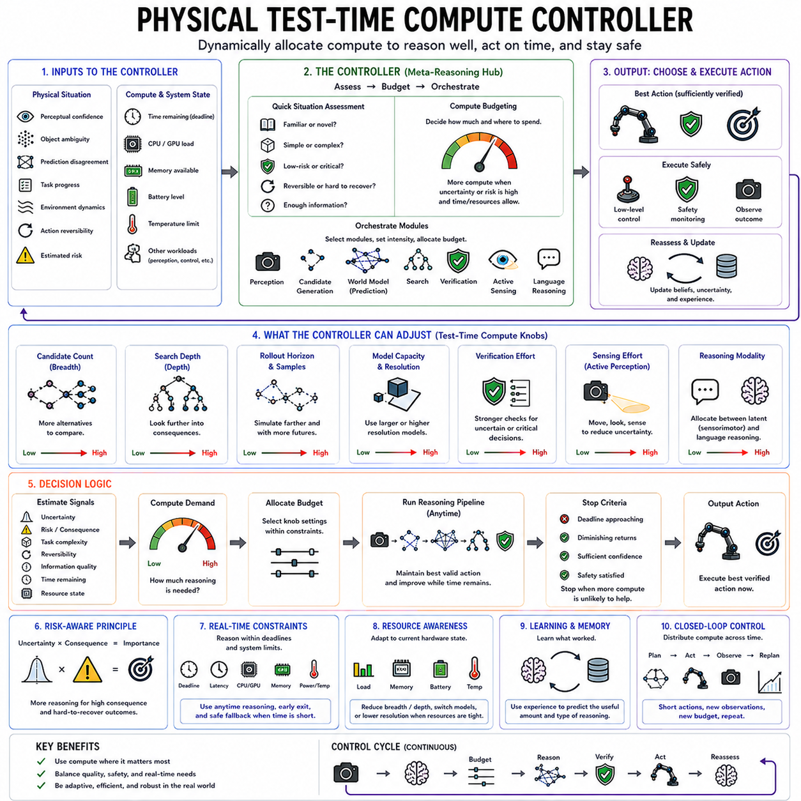{width="7.268055555555556in" height="7.268055555555556in"}

A Physical Test-Time Compute Controller is the supervisory mechanism that decides how much inference, search, prediction, verification, and sensing a robot should perform before committing to physical action. Rather than assigning a fixed reasoning procedure to every situation, the controller dynamically allocates computational effort according to uncertainty, risk, task complexity, available time, and hardware resources.

The controller operates above individual reasoning modules. Perception estimates the current world state, candidate generators propose actions, world models predict possible futures, search explores alternatives, and verifiers evaluate feasibility and safety. The compute controller does not replace these components. Instead, it determines which components should run, how intensively they should run, and when sufficient evidence exists to execute an action.

Its inputs combine information about both the physical situation and the computational system. Physical signals can include perceptual confidence, object ambiguity, prediction disagreement, task progress, environmental dynamics, action reversibility, and estimated risk. Computational signals include remaining decision time, processor utilization, available memory, battery state, thermal limits, and the latency expected from additional reasoning operations.

A useful initial stage is rapid situation assessment. The controller estimates whether the current decision is familiar or novel, simple or complex, low-risk or consequential, and reversible or difficult to recover from. It also evaluates whether existing observations provide sufficient information. These signals create a reasoning-demand estimate that determines whether the system can rely on fast execution or should activate more deliberate computation.

When reasoning demand is low, the controller can select a fast path. A learned policy or VLA model may generate one or several actions, lightweight physical and safety checks verify the preferred candidate, and execution begins immediately. Avoiding unnecessary world-model rollouts and deep search reduces latency and energy consumption while preserving responsive behavior for familiar and predictable situations.

When uncertainty or decision complexity increases, the controller can expand candidate generation. Additional action samples provide alternative grasps, trajectories, routes, or task strategies. Diversity can also be increased so that computation explores genuinely different solutions rather than repeatedly evaluating similar outputs. Candidate count therefore becomes a controllable test-time parameter rather than a fixed property of the policy.

The controller can independently adjust search breadth and search depth. Greater breadth compares more alternatives, while greater depth examines the longer-term consequences of selected alternatives. Under a limited budget, the controller must determine which dimension is more valuable. Ambiguous immediate choices may benefit from broader exploration, whereas decisions with delayed consequences may justify deeper reasoning over fewer candidate sequences.

World-model computation is another resource under controller supervision. The system can vary rollout horizon, number of stochastic futures, model resolution, or ensemble size. Short deterministic predictions may be sufficient for routine motion, while uncertain contact-rich manipulation may require several possible futures. The controller allocates predictive computation where simulated consequences are likely to change the action decision.

Verification intensity can also be scaled dynamically. Every candidate may receive mandatory safety checks, but additional verification can be concentrated on uncertain or consequential decisions. The controller may request more detailed collision analysis, reachability testing, dynamics evaluation, semantic consistency checks, or independent critics. This creates a layered verification architecture in which expensive checks are invoked only when their expected value is high.

The controller must distinguish uncertainty that can be reduced by thinking from uncertainty that requires new information. If several world-model rollouts disagree because the state is poorly observed, performing additional simulations may provide little benefit. The controller can instead trigger active perception, reposition a camera, acquire depth information, approach cautiously, or request clarification before resuming planning.

Risk provides an important multiplier for reasoning demand. A moderate level of uncertainty may be acceptable for a slow and reversible movement but unacceptable for an action near a person or fragile object. The controller can therefore combine uncertainty with consequence severity, reversibility, and exposure when determining compute allocation. High-risk decisions receive stronger prediction and verification even when the nominal task appears simple.

Real-time deadlines impose a boundary on all of these choices. The controller continuously considers how much time remains before an action must be issued. If sufficient time is available, it may expand search or perform additional rollouts. As the deadline approaches, expensive reasoning stages must be reduced or terminated, and the controller transitions toward the best sufficiently verified action currently available.

This creates an anytime reasoning structure. The system maintains a valid candidate while additional computation attempts to improve it. Reasoning quality can therefore increase with available time without making execution depend on completion of the entire reasoning process. If an unexpected event shortens the decision horizon, the controller can stop deliberation and immediately return the best safe solution obtained so far.

Hardware state must influence these decisions because theoretical compute availability differs from practical embodied compute availability. GPU or NPU load, memory pressure, battery level, processor temperature, and competing perception or localization workloads can reduce the resources available for deliberation. The controller can respond by reducing candidate counts, shortening rollouts, switching models, or lowering planning resolution.

Safety-critical processes should remain protected from discretionary reasoning. Low-level control, emergency stopping, collision monitoring, localization, and essential perception may require guaranteed computational capacity. The Physical Test-Time Compute Controller must therefore operate within a scheduling hierarchy that prevents large foundation-model inference or extensive simulation from starving processes required for immediate physical stability and safety.

Model selection provides another control dimension. Small specialized policies can handle routine decisions efficiently, while larger multimodal or reasoning models can be invoked for unfamiliar semantic problems. The controller can implement a model cascade in which inexpensive models are attempted first and expensive models are activated only when confidence, verification, or novelty signals indicate that additional capability is necessary.

Latent and language reasoning can also receive separate budgets. Continuous sensorimotor prediction may require additional latent computation, while ambiguous instructions or long-horizon task decomposition may require language-level reasoning. The controller can identify where the unresolved uncertainty resides and allocate compute to that representation rather than increasing every part of the reasoning architecture simultaneously.

The controller should continually estimate the value of additional computation. Another candidate, rollout, verifier, or reasoning step is worthwhile only if it has a meaningful probability of improving the physical decision. As alternatives converge and confidence increases, the marginal value of additional computation decreases. This provides a principled mechanism for stopping reasoning before unnecessary latency and energy consumption accumulate.

A conceptual control objective can therefore balance expected decision improvement against computational cost. The benefit side includes increased task success, reduced uncertainty, lower physical risk, and better future states. The cost side includes latency, energy, memory, thermal load, and opportunity cost imposed on other robot processes. Compute allocation becomes an optimization problem embedded within the broader action-selection problem.

Execution does not terminate the controller\'s role. Once an action begins, sensors provide evidence about whether reality matches the predicted outcome. Unexpected motion, failed contact, localization changes, or other prediction errors can immediately alter reasoning demand. The controller may interrupt the current plan, increase computation, request additional sensing, or activate a slower reasoning pathway when execution deviates significantly from expectation.

Closed-loop operation therefore allows computation to be distributed across physical interaction. Instead of spending a large budget predicting an entire long-horizon task, the controller can authorize a safe partial action, observe the resulting state, and allocate a new budget for the next decision. This reduces reliance on distant predictions and repeatedly grounds reasoning in current physical evidence.

Reflection can improve future compute allocation. The system can compare how much reasoning was used with whether that reasoning actually improved execution. If deep search repeatedly adds no value in a familiar context, future budgets can be reduced. If failures repeatedly follow shallow reasoning under particular conditions, the controller can learn that those conditions deserve earlier escalation.

Memory can preserve these relationships across episodes. Previous experiences can associate environmental situations, object types, tasks, or failure patterns with the amount and type of reasoning that proved useful. The controller can retrieve this experience when estimating reasoning demand, allowing test-time compute policies to become increasingly specialized to the robot\'s embodiment and operational environment.

A complete control cycle can therefore be viewed as observe, assess, budget, reason, verify, act, and reassess. Observation provides the physical state, assessment estimates uncertainty and risk, budgeting determines computational effort, reasoning generates and evaluates alternatives, verification protects execution, and new observations reveal whether the allocation and decision were appropriate. The cycle repeats continuously during embodied operation.

The Physical Test-Time Compute Controller ultimately transforms test-time compute from a static inference setting into an adaptive control variable. Candidate count, search depth, rollout horizon, verifier effort, model capacity, sensing, and reasoning modality can all be adjusted according to current conditions. Compute itself becomes part of the robot\'s decision policy rather than merely the hardware on which that policy executes.

The desired result is a robot that reacts quickly when the answer is obvious and reasons deeply when the situation deserves it. By coordinating uncertainty-aware deliberation, meta-reasoning, world-model prediction, self-verification, resource monitoring, and real-time deadlines, the controller enables Physical AI to spend computation where it produces the greatest physical value while preserving responsiveness, efficiency, and safety.

물리적 테스트 타임 컴퓨트 컨트롤러(Physical Test-Time Compute Controller)는 로봇이 물리적 행동을 실행하기 전에 얼마나 많은 추론, 탐색, 예측, 검증 및 센싱을 수행해야 하는지를 결정하는 감독 메커니즘(supervisory mechanism)이다. 모든 상황에 고정된 추론 절차를 적용하는 대신, 컨트롤러는 불확실성, 위험, 작업 복잡성, 사용 가능한 시간 및 하드웨어 자원에 따라 계산 노력을 동적으로 할당한다.

컨트롤러는 개별 추론 모듈보다 상위 계층에서 동작한다. 지각(perception)은 현재 세계 상태를 추정하고, 후보 생성기(candidate generator)는 행동을 제안하며, 월드 모델(world model)은 가능한 미래를 예측하고, 탐색(search)은 대안을 검토하며, 검증기(verifier)는 실행 가능성과 안전성을 평가한다. 컴퓨트 컨트롤러는 이러한 구성요소를 대체하지 않는다. 대신 어떤 구성요소를 실행할지, 얼마나 집중적으로 실행할지, 그리고 언제 행동을 실행하기에 충분한 근거가 확보되었는지를 결정한다.

컨트롤러의 입력은 물리적 상황과 계산 시스템에 관한 정보를 모두 결합한다. 물리적 신호에는 지각 신뢰도(perceptual confidence), 물체 모호성(object ambiguity), 예측 불일치(prediction disagreement), 작업 진행도, 환경 동역학, 행동 가역성(action reversibility) 및 추정 위험이 포함될 수 있다. 계산 신호에는 남은 의사결정 시간, 프로세서 활용률, 사용 가능한 메모리, 배터리 상태, 열적 한계(thermal limit) 및 추가 추론 연산에 예상되는 지연시간(latency)이 포함된다.

유용한 초기 단계는 빠른 상황 평가(rapid situation assessment)이다. 컨트롤러는 현재 의사결정이 익숙한지 새로운지, 단순한지 복잡한지, 위험이 낮은지 결과가 중대한지, 그리고 되돌릴 수 있는지 복구하기 어려운지를 추정한다. 또한 기존 관측이 충분한 정보를 제공하는지도 평가한다. 이러한 신호들은 시스템이 빠른 실행에 의존할 수 있는지 또는 더욱 신중한 계산을 활성화해야 하는지를 결정하는 추론 요구량 추정(reasoning-demand estimate)을 형성한다.

추론 요구량이 낮으면 컨트롤러는 빠른 경로(fast path)를 선택할 수 있다. 학습된 정책(learned policy)이나 VLA 모델(Vision-Language-Action model)이 하나 또는 여러 행동을 생성하고, 경량 물리 및 안전 검사(lightweight physical and safety check)가 선호되는 후보를 검증한 뒤 즉시 실행을 시작한다. 불필요한 월드 모델 롤아웃(world-model rollout)과 깊은 탐색을 피하면 익숙하고 예측 가능한 상황에서 반응성을 유지하면서 지연시간과 에너지 소비를 줄일 수 있다.

불확실성이나 의사결정 복잡성이 증가하면 컨트롤러는 후보 생성(candidate generation)을 확장할 수 있다. 추가적인 행동 샘플은 대체 파지, 궤적, 경로 또는 작업 전략을 제공한다. 또한 계산이 유사한 출력만 반복적으로 평가하는 대신 실제로 서로 다른 해결책을 탐색하도록 다양성을 증가시킬 수 있다. 따라서 후보 수(candidate count)는 정책의 고정된 속성이 아니라 제어 가능한 테스트 타임 파라미터(test-time parameter)가 된다.

컨트롤러는 탐색 너비(search breadth)와 탐색 깊이(search depth)를 독립적으로 조정할 수 있다. 더 넓은 탐색은 더 많은 대안을 비교하고, 더 깊은 탐색은 선택된 대안의 장기적인 결과를 검토한다. 제한된 예산에서는 어떤 차원에 자원을 투입하는 것이 더 가치 있는지를 결정해야 한다. 즉각적인 선택이 모호하다면 넓은 탐색이 유리할 수 있고, 지연된 결과가 중요한 결정에서는 더 적은 후보에 대해 깊은 추론을 수행하는 것이 적절할 수 있다.

월드 모델 계산 역시 컨트롤러의 감독을 받는 자원이다. 시스템은 롤아웃 범위(rollout horizon), 확률적 미래(stochastic future)의 수, 모델 해상도 또는 앙상블 크기(ensemble size)를 조절할 수 있다. 일상적인 움직임에는 짧은 결정론적 예측(deterministic prediction)으로 충분할 수 있지만, 불확실하고 접촉이 많은 조작(contact-rich manipulation)에는 여러 가능한 미래에 대한 평가가 필요할 수 있다. 컨트롤러는 시뮬레이션된 결과가 행동 결정을 변화시킬 가능성이 높은 곳에 예측 계산을 할당한다.

검증 강도(verification intensity) 역시 동적으로 조절할 수 있다. 모든 후보는 필수적인 안전 검사를 받을 수 있지만, 추가적인 검증은 불확실하거나 결과가 중대한 의사결정에 집중할 수 있다. 컨트롤러는 더욱 상세한 충돌 분석, 도달 가능성 검사(reachability testing), 동역학 평가, 의미적 일관성 검사(semantic consistency check) 또는 독립적인 비평 모델(critic)을 요청할 수 있다. 이를 통해 비용이 높은 검사는 기대 가치가 높은 경우에만 호출되는 계층형 검증 아키텍처(layered verification architecture)를 구성할 수 있다.

컨트롤러는 사고를 통해 줄일 수 있는 불확실성과 새로운 정보가 필요한 불확실성을 구분해야 한다. 세계 상태가 제대로 관측되지 않아 여러 월드 모델 롤아웃이 서로 다른 결과를 생성한다면 추가적인 시뮬레이션만 수행하는 것은 큰 도움이 되지 않을 수 있다. 이 경우 컨트롤러는 계획을 다시 수행하기 전에 능동 지각(active perception)을 활성화하거나, 카메라 위치를 변경하거나, 깊이 정보를 추가로 획득하거나, 조심스럽게 접근하거나, 명확한 설명을 요청할 수 있다.

위험(risk)은 추론 요구량을 증가시키는 중요한 승수(multiplier)로 작용한다. 중간 수준의 불확실성은 느리고 되돌릴 수 있는 움직임에서는 허용될 수 있지만, 사람이나 깨지기 쉬운 물체 주변에서 수행되는 행동에는 허용되지 않을 수 있다. 따라서 컨트롤러는 계산 자원을 할당할 때 불확실성을 결과의 심각성(consequence severity), 가역성 및 노출 정도(exposure)와 결합할 수 있다. 고위험 의사결정은 명목상 작업이 단순하더라도 더 강력한 예측과 검증을 적용받는다.

실시간 마감시간(real-time deadline)은 이러한 모든 선택에 경계를 설정한다. 컨트롤러는 행동 명령을 출력하기 전까지 남은 시간을 지속적으로 고려한다. 충분한 시간이 있다면 탐색을 확장하거나 추가적인 롤아웃을 수행할 수 있다. 마감시간이 가까워질수록 비용이 높은 추론 단계는 축소되거나 종료되어야 하며, 컨트롤러는 현재까지 확보된 후보 중 충분히 검증된 최선의 행동으로 전환한다.

이는 애니타임 추론 구조(anytime reasoning structure)를 형성한다. 시스템은 유효한 후보를 유지하면서 추가적인 계산을 통해 이를 지속적으로 개선하려고 한다. 따라서 추론 품질은 사용 가능한 시간에 따라 향상될 수 있으며, 실행이 전체 추론 과정의 완료 여부에 의존하지 않게 된다. 예상하지 못한 사건으로 의사결정 시간이 짧아지면 컨트롤러는 숙고를 중단하고 현재까지 확보된 가장 안전하고 우수한 해결책을 즉시 반환할 수 있다.

이론적으로 사용 가능한 계산량과 체화 시스템에서 실제로 사용할 수 있는 계산량은 다르기 때문에 하드웨어 상태도 이러한 결정에 영향을 주어야 한다. GPU 또는 NPU 부하, 메모리 압력(memory pressure), 배터리 수준, 프로세서 온도 및 동시에 실행되는 지각이나 위치 추정(localization) 작업은 숙고에 사용할 수 있는 자원을 감소시킬 수 있다. 컨트롤러는 후보 수 감소, 롤아웃 단축, 모델 전환 또는 계획 해상도(planning resolution) 축소를 통해 이에 대응할 수 있다.

안전 중요 프로세스(safety-critical process)는 선택적인 추론으로부터 보호되어야 한다. 저수준 제어(low-level control), 비상 정지, 충돌 모니터링, 위치 추정 및 필수 지각에는 보장된 계산 용량이 필요할 수 있다. 따라서 물리적 테스트 타임 컴퓨트 컨트롤러는 대규모 파운데이션 모델(large foundation model)의 추론이나 광범위한 시뮬레이션이 즉각적인 물리적 안정성과 안전을 유지하는 데 필요한 프로세스의 자원을 빼앗지 않도록 하는 스케줄링 계층(scheduling hierarchy) 안에서 동작해야 한다.

모델 선택(model selection)은 또 다른 제어 차원을 제공한다. 소형 특화 정책(specialized policy)은 일상적인 의사결정을 효율적으로 처리할 수 있고, 대규모 멀티모달 모델(multimodal model)이나 추론 모델(reasoning model)은 익숙하지 않은 의미적 문제에 호출될 수 있다. 컨트롤러는 저비용 모델을 먼저 사용하고, 신뢰도, 검증 또는 새로움 신호(novelty signal)가 추가적인 능력이 필요함을 나타낼 때만 고비용 모델을 활성화하는 모델 캐스케이드(model cascade)를 구현할 수 있다.

잠재 추론(latent reasoning)과 언어 추론(language reasoning)에도 서로 다른 계산 예산을 할당할 수 있다. 연속적인 감각운동 예측(sensorimotor prediction)에는 추가적인 잠재 계산이 필요할 수 있고, 모호한 명령이나 장기 작업 분해(long-horizon task decomposition)에는 언어 수준의 추론이 필요할 수 있다. 컨트롤러는 해결되지 않은 불확실성이 어느 표현 공간에 존재하는지를 식별하고 추론 아키텍처 전체의 계산량을 동시에 증가시키는 대신 해당 영역에 계산을 집중할 수 있다.

컨트롤러는 추가 계산의 가치(value of additional computation)를 지속적으로 추정해야 한다. 추가적인 후보, 롤아웃, 검증기 또는 추론 단계는 물리적 의사결정을 개선할 의미 있는 가능성이 있을 때만 가치가 있다. 대안들이 서로 수렴하고 신뢰도가 높아지면 추가 계산의 한계 가치(marginal value)는 감소한다. 이는 불필요한 지연시간과 에너지 소비가 누적되기 전에 추론을 중단할 수 있는 원칙적인 메커니즘을 제공한다.

따라서 개념적인 제어 목적(control objective)은 기대되는 의사결정 개선과 계산 비용 사이의 균형으로 표현할 수 있다. 이익 측면에는 작업 성공률 향상, 불확실성 감소, 물리적 위험 감소 및 더 나은 미래 상태가 포함된다. 비용 측면에는 지연시간, 에너지, 메모리, 열 부하(thermal load) 및 다른 로봇 프로세스에 부과되는 기회비용(opportunity cost)이 포함된다. 계산 자원 할당 자체가 더 넓은 행동 선택 문제 안에 포함된 하나의 최적화 문제가 된다.

행동 실행이 시작되더라도 컨트롤러의 역할은 종료되지 않는다. 행동이 시작되면 센서는 현실이 예측된 결과와 일치하는지에 대한 근거를 제공한다. 예상하지 못한 움직임, 접촉 실패, 위치 추정 변화 또는 기타 예측 오류는 즉시 추론 요구량을 변화시킬 수 있다. 실행 결과가 예상과 크게 달라지면 컨트롤러는 현재 계획을 중단하거나, 계산 자원을 증가시키거나, 추가 센싱을 요청하거나, 더 느린 추론 경로(slow reasoning pathway)를 활성화할 수 있다.

따라서 폐루프 동작(closed-loop operation)은 계산을 물리적 상호작용 과정 전체에 분산할 수 있게 한다. 컨트롤러는 전체 장기 작업을 예측하는 데 처음부터 큰 계산 예산을 사용하는 대신 안전한 부분 행동(partial action)을 허용하고, 그 결과 상태를 관측한 뒤 다음 의사결정에 새로운 계산 예산을 할당할 수 있다. 이는 먼 미래의 예측에 대한 의존도를 낮추고 추론을 현재의 물리적 근거에 반복적으로 연결한다.

성찰(reflection)은 미래의 계산 자원 할당을 개선할 수 있다. 시스템은 얼마나 많은 추론을 사용했는지와 그 추론이 실제로 실행 결과를 개선했는지를 비교할 수 있다. 익숙한 상황에서 깊은 탐색이 반복적으로 추가 가치를 제공하지 않는다면 이후의 계산 예산을 줄일 수 있다. 반대로 특정 조건에서 얕은 추론 이후 실패가 반복된다면 컨트롤러는 해당 조건에서 더 이른 계산 확대(escalation)가 필요하다는 것을 학습할 수 있다.

메모리(memory)는 이러한 관계를 여러 에피소드에 걸쳐 보존할 수 있다. 이전 경험은 특정 환경 상황, 물체 유형, 작업 또는 실패 패턴과 효과적이었던 추론의 양 및 유형을 연결할 수 있다. 컨트롤러는 추론 요구량을 추정할 때 이러한 경험을 검색하여 활용할 수 있으며, 이를 통해 테스트 타임 컴퓨트 정책(test-time compute policy)은 로봇의 체화 특성(embodiment)과 실제 운용 환경에 점차 특화될 수 있다.

따라서 완전한 제어 주기(control cycle)는 관측(observe), 평가(assess), 예산 할당(budget), 추론(reason), 검증(verify), 행동(act), 재평가(reassess)의 과정으로 볼 수 있다. 관측은 물리적 상태를 제공하고, 평가는 불확실성과 위험을 추정하며, 예산 할당은 계산 노력을 결정하고, 추론은 대안을 생성하고 평가하며, 검증은 실행을 보호한다. 이후 새로운 관측은 자원 할당과 의사결정이 적절했는지를 보여주며, 이러한 주기는 체화된 동작 과정에서 지속적으로 반복된다.

물리적 테스트 타임 컴퓨트 컨트롤러는 궁극적으로 테스트 타임 컴퓨트를 고정된 추론 설정에서 적응형 제어 변수(adaptive control variable)로 변화시킨다. 후보 수, 탐색 깊이, 롤아웃 범위, 검증 노력, 모델 용량, 센싱 및 추론 방식(reasoning modality)은 모두 현재 조건에 따라 조절될 수 있다. 계산 자체가 단순히 정책이 실행되는 하드웨어 자원이 아니라 로봇 의사결정 정책(robot decision policy)의 일부가 된다.

궁극적으로 목표는 답이 명확할 때는 빠르게 반응하고 상황이 요구할 때는 깊이 추론하는 로봇을 구현하는 것이다. 불확실성 인식 숙고(uncertainty-aware deliberation), 메타 추론(meta-reasoning), 월드 모델 예측, 자기 검증(self-verification), 자원 모니터링(resource monitoring) 및 실시간 마감시간을 통합적으로 조정함으로써 컨트롤러는 물리 AI가 가장 높은 물리적 가치를 제공하는 곳에 계산 자원을 집중하면서도 반응성, 효율성 및 안전성을 유지하도록 한다.
