**Volume 08. Robot Foundation Models and VLA**

# Chapter 08. Cross Embodiment Transfer

## 08.01. Why Cross Embodiment Transfer Matters

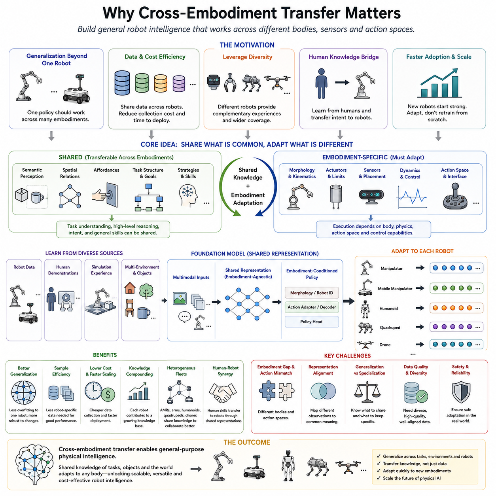{width="7.268055555555556in" height="7.268055555555556in"}

Cross-embodiment transfer is essential because robot intelligence must eventually generalize beyond the particular machine on which it was trained. A policy that works only with one manipulator, mobile base, humanoid, or quadruped remains tightly coupled to its hardware. Robot foundation models instead aim to capture reusable knowledge that can support many physical agents with different bodies, sensors, and action interfaces.

This requirement becomes increasingly important as robot learning moves toward large-scale foundation models. Training a powerful policy requires substantial amounts of demonstrations, interaction trajectories, simulation experience, and human supervision. If every robot must collect an independent dataset from scratch, the cost of scaling physical AI grows rapidly. Cross-embodiment transfer allows experience obtained from one platform to contribute to learning on another.

Unlike language or image models, robots interact with the world through physical bodies. Their morphology determines what they can observe, reach, manipulate, carry, and traverse. Two robots may understand the same instruction while requiring entirely different movements to accomplish it. Cross-embodiment learning therefore addresses a fundamental question: which parts of intelligent behavior can be shared across bodies, and which parts must remain specific to each embodiment?

Much of robot knowledge is potentially reusable. Understanding that a cup can be grasped, a drawer can be opened, an obstacle should be avoided, or an object must be transported toward a goal does not inherently belong to one robot. Semantic perception, spatial relationships, affordances, task structure, and high-level strategies can often be learned from diverse platforms and represented independently of their exact actuator configurations.

Physical execution, however, remains strongly embodiment-dependent. A humanoid may reach an object with coordinated torso and arm motion, while a mobile manipulator may reposition its base before extending its arm. A quadruped carrying a manipulator introduces another combination of locomotion and manipulation constraints. Transfer must therefore preserve shared task semantics while adapting execution to morphology, kinematics, dynamics, sensing, and control capabilities.

Cross-embodiment transfer also increases the value of heterogeneous robot datasets. Instead of viewing trajectories from different platforms as incompatible collections, a foundation-model approach can treat them as complementary observations of common physical concepts. Each robot contributes different interactions, environments, viewpoints, objects, and capabilities, potentially creating a broader learning distribution than any individual robot could generate by itself.

This diversity can improve generalization. A model trained only on one embodiment may accidentally learn correlations tied to that robot\'s camera placement, workspace, gripper geometry, or motion patterns. Exposure to multiple embodiments forces the model to identify more stable properties of tasks and environments. The resulting representation can become less dependent on superficial hardware characteristics and more closely aligned with transferable physical and semantic structure.

Cross-embodiment learning is particularly important for rare or expensive platforms. Collecting millions of real-world trajectories from every humanoid, industrial manipulator, quadruped, or specialized field robot may be economically or operationally impractical. Knowledge transferred from larger data pools can provide a strong initialization, after which a smaller amount of robot-specific data can adapt the model to the target embodiment and its operational constraints.

Human demonstrations provide an even larger potential source of transferable knowledge. Humans possess a very different embodiment from most robots, yet videos and demonstrations contain rich information about objects, interactions, task sequences, and physical outcomes. Cross-embodiment methods create a conceptual bridge through which models can learn behavioral intent from human activity while translating that knowledge into actions compatible with robotic bodies.

The same principle applies to robot-to-robot transfer. A manipulation skill learned from several industrial arms may provide useful task knowledge for a new manipulator with different dimensions or joint structures. Navigation experience collected by wheeled robots may contribute environmental understanding to other mobile platforms. Transfer does not imply copying motor commands directly; it means identifying reusable structure and adapting it to the capabilities of the receiving embodiment.

Cross-embodiment transfer also supports faster deployment of new robot hardware. When a new platform is introduced, rebuilding perception, reasoning, task knowledge, and control policies entirely from the beginning wastes previously accumulated experience. A reusable foundation model can preserve general knowledge while robot-specific adapters, embodiment representations, or fine-tuning procedures specialize the policy. This changes deployment from complete retraining toward targeted adaptation.

Such transfer is also central to heterogeneous robot fleets. Future physical AI systems may include AMRs, manipulators, humanoids, quadrupeds, drones, and specialized service robots operating within shared environments. These machines cannot necessarily execute identical actions, but they can share knowledge about objects, locations, hazards, tasks, and outcomes. Cross-embodiment representations provide a foundation for transferring experience across this diverse population.

A scalable architecture therefore needs both invariance and specialization. Shared representations should capture information that remains meaningful across embodiments, while embodiment-conditioned components describe morphology, kinematics, sensors, and available actions. The policy can reason about a common task in a shared representation space and then generate behavior that respects the physical structure and capabilities of the particular robot executing it.

This separation also clarifies why a universal robot policy does not necessarily mean identical low-level control for every robot. Universality can exist at the level of perception, reasoning, goals, skills, or latent actions while specialized controllers handle hardware-specific execution. A useful generalist model should know both what knowledge can be reused and when physical differences require adaptation rather than forcing incompatible robots into a single rigid action representation.

Cross-embodiment transfer ultimately changes the economics and scalability of robot learning. Data collected by one robot can become part of a growing shared knowledge base rather than remaining isolated within a single platform. As more embodiments contribute experience, the model can learn increasingly general representations of physical interaction, while new robots benefit from knowledge accumulated before they were introduced.

For robot foundation models and vision-language-action systems, this capability represents a major step toward general-purpose physical intelligence. A model that transfers across tasks but remains restricted to one body is only partially general. Cross-embodiment transfer extends generalization across hardware itself, enabling shared robot intelligence to survive changes in morphology while adapting its actions to the physical realities of each new embodiment.

교차 구현체 전이(Cross-Embodiment Transfer)는 로봇 지능이 궁극적으로 학습에 사용된 특정 기계를 넘어 일반화되어야 하기 때문에 중요하다. 하나의 매니퓰레이터(Manipulator), 이동 베이스(Mobile Base), 휴머노이드(Humanoid), 사족보행 로봇(Quadruped)에서만 동작하는 정책(Policy)은 하드웨어에 강하게 종속된다. 반면 로봇 파운데이션 모델(Robot Foundation Model)은 서로 다른 몸체, 센서, 행동 인터페이스(Action Interface)를 가진 다양한 물리적 에이전트(Physical Agent)를 지원할 수 있는 재사용 가능한 지식을 학습하는 것을 목표로 한다.

이러한 요구는 로봇 학습(Robot Learning)이 대규모 파운데이션 모델(Foundation Model)로 발전하면서 더욱 중요해진다. 강력한 정책을 학습하려면 방대한 시연 데이터(Demonstration), 상호작용 궤적(Interaction Trajectory), 시뮬레이션 경험(Simulation Experience), 인간 감독(Human Supervision)이 필요하다. 모든 로봇이 독립적인 데이터셋을 처음부터 수집해야 한다면 물리 인공지능(Physical AI)의 확장 비용은 급격히 증가한다. 교차 구현체 전이는 한 플랫폼에서 획득한 경험을 다른 플랫폼의 학습에도 활용할 수 있게 한다.

언어 모델(Language Model)이나 이미지 모델(Image Model)과 달리 로봇은 물리적 몸체를 통해 세계와 상호작용한다. 로봇의 형태학(Morphology)은 무엇을 관찰하고, 도달하고, 조작하고, 운반하고, 이동할 수 있는지를 결정한다. 두 로봇이 동일한 명령을 이해하더라도 이를 수행하기 위해서는 완전히 다른 움직임이 필요할 수 있다. 따라서 교차 구현체 학습(Cross-Embodiment Learning)은 지능적 행동의 어떤 부분을 서로 다른 몸체에서 공유할 수 있으며 어떤 부분을 각 구현체에 특화해야 하는가라는 근본적인 문제를 다룬다.

로봇 지식의 상당 부분은 잠재적으로 재사용할 수 있다. 컵을 잡을 수 있고, 서랍을 열 수 있으며, 장애물을 피해야 하고, 물체를 목표 위치로 운반해야 한다는 이해는 특정 로봇 하나에 본질적으로 종속되지 않는다. 의미적 인식(Semantic Perception), 공간적 관계(Spatial Relationship), 행동유도성(Affordance), 작업 구조(Task Structure), 상위 수준 전략(High-Level Strategy)은 서로 다른 플랫폼에서 학습되어 정확한 액추에이터 구성(Actuator Configuration)과 독립적으로 표현될 수 있다.

그러나 물리적 실행(Physical Execution)은 구현체에 강하게 의존한다. 휴머노이드(Humanoid)는 몸통과 팔의 협조 운동을 통해 물체에 접근할 수 있지만, 이동형 매니퓰레이터(Mobile Manipulator)는 팔을 뻗기 전에 이동 베이스의 위치를 조정해야 할 수 있다. 매니퓰레이터를 탑재한 사족보행 로봇(Quadruped)은 이동과 조작에 또 다른 제약조건을 가진다. 따라서 전이는 공유된 작업 의미(Task Semantics)를 유지하면서 실행을 형태학, 운동학(Kinematics), 동역학(Dynamics), 센싱(Sensing), 제어 능력(Control Capability)에 맞게 적응시켜야 한다.

교차 구현체 전이는 이질적인 로봇 데이터셋(Heterogeneous Robot Dataset)의 가치도 증가시킨다. 서로 다른 플랫폼에서 수집된 궤적을 호환되지 않는 데이터 집합으로 보는 대신, 파운데이션 모델 접근법(Foundation-Model Approach)은 이를 공통된 물리적 개념에 대한 상호 보완적인 관측으로 활용할 수 있다. 각각의 로봇은 서로 다른 상호작용, 환경, 시점, 물체, 능력에 대한 경험을 제공하며, 이를 통해 개별 로봇 하나가 생성할 수 있는 것보다 훨씬 넓은 학습 분포(Learning Distribution)를 구축할 수 있다.

이러한 다양성은 일반화(Generalization)를 향상시킬 수 있다. 하나의 구현체에서만 학습된 모델은 해당 로봇의 카메라 위치, 작업공간, 그리퍼 형상(Gripper Geometry), 운동 패턴과 관련된 우연한 상관관계를 학습할 수 있다. 여러 구현체에 노출되면 모델은 작업과 환경에서 더욱 안정적인 특성을 식별해야 한다. 그 결과 표현(Representation)은 피상적인 하드웨어 특성에 대한 의존성이 감소하고 전이 가능한 물리적·의미적 구조와 더욱 밀접하게 정렬될 수 있다.

교차 구현체 학습은 희귀하거나 비용이 높은 플랫폼에서 특히 중요하다. 모든 휴머노이드, 산업용 매니퓰레이터, 사족보행 로봇 또는 특수 현장 로봇에서 수백만 개의 실제 환경 궤적(Real-World Trajectory)을 수집하는 것은 경제적 또는 운영적으로 현실적이지 않을 수 있다. 더 큰 데이터 풀(Data Pool)에서 전이된 지식은 강력한 초기화(Initialization)를 제공할 수 있으며, 이후 상대적으로 적은 양의 로봇별 데이터를 이용해 모델을 대상 구현체와 운영 제약조건에 적응시킬 수 있다.

인간 시연(Human Demonstration)은 훨씬 더 큰 규모의 잠재적인 전이 지식 원천을 제공한다. 인간은 대부분의 로봇과 매우 다른 구현체를 가지지만, 영상과 시연에는 물체, 상호작용, 작업 순서, 물리적 결과에 대한 풍부한 정보가 포함되어 있다. 교차 구현체 방법(Cross-Embodiment Method)은 모델이 인간 행동으로부터 행동 의도(Behavioral Intent)를 학습하면서 그 지식을 로봇 몸체에 적합한 행동으로 변환할 수 있도록 하는 개념적 연결고리를 제공한다.

동일한 원리는 로봇 간 전이(Robot-to-Robot Transfer)에도 적용된다. 여러 산업용 로봇 팔에서 학습된 조작 기술은 크기나 관절 구조가 다른 새로운 매니퓰레이터에도 유용한 작업 지식을 제공할 수 있다. 바퀴형 로봇에서 수집된 주행 경험은 다른 이동 플랫폼의 환경 이해에 기여할 수 있다. 전이는 운동 명령을 직접 복사하는 것을 의미하지 않는다. 핵심은 재사용 가능한 구조를 식별하고 이를 지식을 전달받는 구현체의 능력에 맞게 적응시키는 것이다.

교차 구현체 전이는 새로운 로봇 하드웨어의 더욱 빠른 배포(Deployment)도 지원한다. 새로운 플랫폼이 도입될 때 인식, 추론, 작업 지식, 제어 정책을 모두 처음부터 다시 구축하는 것은 기존에 축적된 경험을 낭비하는 것이다. 재사용 가능한 파운데이션 모델은 일반 지식을 유지하면서 로봇별 어댑터(Robot-Specific Adapter), 구현체 표현(Embodiment Representation), 미세조정(Fine-Tuning) 절차를 통해 정책을 특화할 수 있다. 이는 배포 방식을 완전한 재학습에서 목표 지향적 적응(Targeted Adaptation)으로 변화시킨다.

이러한 전이는 이종 로봇 플릿(Heterogeneous Robot Fleet)에서도 핵심적인 역할을 한다. 미래의 물리 인공지능 시스템은 AMR(Autonomous Mobile Robot), 매니퓰레이터, 휴머노이드, 사족보행 로봇, 드론(Drone), 특수 서비스 로봇이 동일한 환경에서 함께 운영되는 형태가 될 수 있다. 이러한 기계들은 동일한 행동을 실행할 수는 없지만 물체, 위치, 위험요소, 작업, 결과에 관한 지식을 공유할 수 있다. 교차 구현체 표현(Cross-Embodiment Representation)은 이러한 다양한 로봇 집단 사이에서 경험을 전이하기 위한 기반을 제공한다.

확장 가능한 아키텍처(Scalable Architecture)는 따라서 불변성(Invariance)과 특화(Specialization)를 모두 필요로 한다. 공유 표현(Shared Representation)은 서로 다른 구현체에서도 의미가 유지되는 정보를 포착해야 하며, 구현체 조건화 구성요소(Embodiment-Conditioned Component)는 형태학, 운동학, 센서, 사용 가능한 행동을 표현해야 한다. 정책은 공유 표현 공간(Shared Representation Space)에서 공통 작업을 추론한 다음, 실제 작업을 수행하는 특정 로봇의 물리적 구조와 능력을 고려하여 행동을 생성할 수 있다.

이러한 분리는 범용 로봇 정책(Universal Robot Policy)이 모든 로봇에서 동일한 저수준 제어(Low-Level Control)를 의미하지 않는 이유도 명확하게 보여준다. 범용성(Universality)은 인식, 추론, 목표, 기술(Skill), 잠재 행동(Latent Action) 수준에서 존재할 수 있으며, 특화된 제어기(Specialized Controller)가 하드웨어별 실행을 담당할 수 있다. 유용한 제너럴리스트 모델(Generalist Model)은 어떤 지식을 재사용할 수 있는지뿐만 아니라 물리적 차이 때문에 적응이 필요한 시점도 이해해야 하며, 서로 호환되지 않는 로봇을 하나의 경직된 행동 표현으로 강제해서는 안 된다.

교차 구현체 전이는 궁극적으로 로봇 학습의 경제성과 확장성(Scalability)을 변화시킨다. 하나의 로봇이 수집한 데이터는 특정 플랫폼 내부에 고립되는 대신 지속적으로 성장하는 공유 지식 기반(Shared Knowledge Base)의 일부가 될 수 있다. 더 많은 구현체가 경험을 제공할수록 모델은 물리적 상호작용에 대한 더욱 일반적인 표현을 학습할 수 있으며, 새롭게 도입되는 로봇은 자신이 등장하기 이전부터 축적된 지식의 혜택을 받을 수 있다.

로봇 파운데이션 모델(Robot Foundation Model)과 비전-언어-행동 시스템(Vision-Language-Action System)에서 이러한 능력은 범용 물리 지능(General-Purpose Physical Intelligence)으로 발전하기 위한 중요한 단계이다. 작업 간 전이는 가능하지만 하나의 몸체에만 제한되는 모델은 부분적으로만 일반화된 것이다. 교차 구현체 전이는 일반화의 범위를 하드웨어 자체까지 확장함으로써 공유된 로봇 지능이 형태학의 변화에도 유지되면서 각각의 새로운 구현체가 가진 물리적 현실에 맞게 행동을 적응할 수 있도록 한다.

## 08.02. Embodiment Gap and Action Space Mismatch

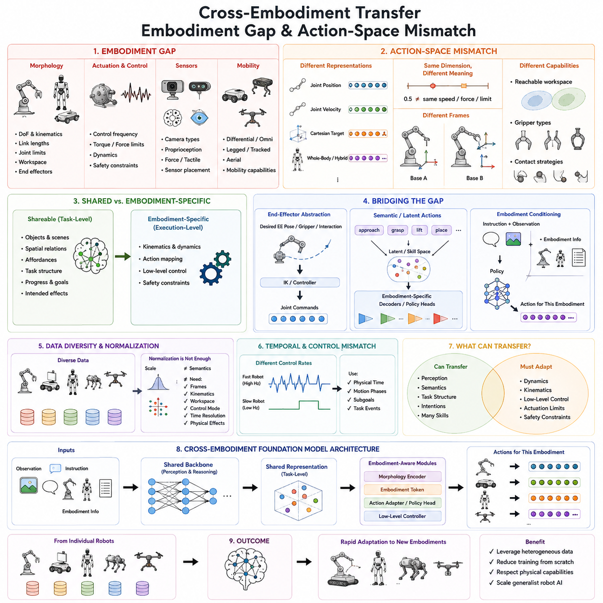{width="7.268055555555556in" height="7.268055555555556in"}

Cross-embodiment transfer becomes difficult when robots that perform conceptually similar tasks possess fundamentally different bodies, sensors, actuators, and control interfaces. A manipulation policy trained on one robot may understand the semantic goal of reaching, grasping, or placing, yet its learned motor commands can be meaningless for another embodiment. This difference between transferable task knowledge and embodiment-dependent execution forms the embodiment gap.

The embodiment gap includes more than visible differences in robot shape. Two manipulators may have different numbers of joints, link lengths, joint limits, payload capacities, gripper mechanisms, control frequencies, and reachable workspaces. Mobile robots introduce additional variation through differential, omnidirectional, legged, tracked, or aerial locomotion. Consequently, identical high-level intentions can require substantially different physical behaviors.

Action-space mismatch is one of the most direct manifestations of this problem. A seven-degree-of-freedom arm may represent actions as joint positions or joint velocities, while another platform may accept Cartesian end-effector targets. A humanoid can additionally require coordinated whole-body commands, and a mobile manipulator must combine navigation with manipulation. Raw action vectors therefore cannot generally be exchanged between embodiments without transformation.

Even when two robots use action vectors of equal dimensionality, their commands may not have equivalent physical meaning. A normalized joint velocity of 0.5 can correspond to different angular velocities, accelerations, forces, or safety limits. Coordinate systems may also differ between robots. Cross-embodiment learning must therefore distinguish numerical similarity from functional equivalence and relate actions to their physical consequences.

Morphology further changes how actions interact with the environment. Different arm lengths alter reachable regions, different grippers change feasible grasp configurations, and different bases determine how a robot can approach an object. The same semantic instruction, such as placing an object on a shelf, may consequently produce different trajectories, intermediate poses, contact strategies, and recovery behaviors depending on the embodiment performing the task.

Sensor configurations create another component of the embodiment gap. One robot may observe the workspace through a fixed RGB camera, another through wrist-mounted RGB-D sensors, and another through multiple cameras combined with proprioception and force sensing. Although these systems observe the same environment, their raw observations differ significantly. Transfer therefore requires representations that preserve task-relevant meaning while reducing dependence on embodiment-specific sensing geometry.

A useful strategy is to separate task-level representations from low-level embodiment-specific control. Shared representations can encode objects, goals, spatial relationships, affordances, task progress, and intended effects. An embodiment-specific controller can then translate these abstract intentions into feasible motor commands. This decomposition allows transferable knowledge to remain common while preserving specialized execution mechanisms for each robot morphology and control system.

End-effector representations provide one possible bridge between heterogeneous manipulators. Instead of directly predicting individual joint commands, a shared policy may describe desired changes in end-effector position, orientation, gripper state, or interaction objective. Robot-specific inverse kinematics and control modules can convert these commands into joint-level behavior. However, this approach remains limited when robots differ substantially in workspace, dexterity, contact capability, or available effectors.

Another approach is to represent actions through semantic skills or latent actions. Commands such as approach, grasp, lift, transport, align, and release describe behavioral intent without specifying every actuator movement. A learned latent action representation can similarly capture common behavioral structure across demonstrations from heterogeneous robots. Each embodiment then requires a decoder or policy head that maps the shared representation into commands compatible with its own physical interface.

Embodiment conditioning offers a complementary solution by explicitly informing the model about the robot executing the task. The policy may receive descriptors of morphology, joint configuration, kinematics, sensors, actuator limits, or robot identity together with observations and instructions. Rather than assuming that one action mapping applies universally, the model learns how behavior should change as a function of the embodiment while preserving shared task knowledge.

Training data must expose the model to enough embodiment diversity for these mechanisms to become useful. A dataset dominated by one robot can encourage the policy to associate successful behavior with that platform\'s particular geometry and action conventions. Mixing trajectories from manipulators, mobile manipulators, humanoids, and other platforms encourages the model to identify patterns that remain stable across bodies while learning which details must remain embodiment-specific.

Data normalization alone cannot solve cross-embodiment mismatch. Scaling joint positions or velocities into common numerical ranges makes optimization easier, but it does not guarantee equivalent semantics. More robust mappings consider coordinate frames, kinematic structure, reachable workspace, control mode, temporal resolution, and physical effects. The objective is not merely to standardize numbers but to establish representations in which comparable actions produce comparable task-level consequences.

Temporal mismatch must also be considered. Robots can operate at different control frequencies, mechanical response times, and motion speeds. A short action chunk for a fast manipulator may represent a different physical interval from the same number of action steps on a slower platform. Cross-embodiment policies therefore benefit from representations based on physical time, motion phases, subgoals, or task events rather than assuming identical discrete control timelines.

The embodiment gap ultimately cannot be eliminated because physical differences are real and often useful. Cross-embodiment transfer should instead determine which knowledge should be invariant and which must remain embodiment-dependent. Semantic perception, task structure, object relationships, and many behavioral intentions can often be shared, whereas detailed dynamics, kinematics, actuator commands, and safety constraints usually require adaptation to the target platform.

Successful cross-embodiment foundation models therefore combine shared representations with explicit mechanisms for physical specialization. Perception and reasoning can operate in a broadly common semantic space, while morphology encoders, embodiment tokens, action adapters, policy heads, or low-level controllers translate decisions into feasible behavior. This architecture turns embodiment diversity from an incompatible collection of action spaces into a structured transfer problem.

Closing the embodiment gap is essential for scaling robot foundation models beyond individual hardware platforms. Without it, every new robot requires extensive platform-specific training, limiting the value of large heterogeneous datasets. With effective action abstraction and embodiment-aware adaptation, experience collected from many robots can contribute to a shared policy foundation while still respecting the physical capabilities and constraints of each machine.

교차 구현체 전이(Cross-Embodiment Transfer)는 개념적으로 유사한 작업을 수행하는 로봇들이 근본적으로 서로 다른 몸체, 센서, 액추에이터(Actuator), 제어 인터페이스(Control Interface)를 가질 때 어려워진다. 하나의 로봇에서 학습된 조작 정책(Manipulation Policy)은 도달, 파지, 배치와 같은 의미적 목표(Semantic Goal)를 이해할 수 있지만, 학습된 운동 명령(Motor Command)은 다른 구현체(Embodiment)에서는 의미가 없을 수 있다. 이처럼 전이 가능한 작업 지식과 구현체 의존적 실행 사이의 차이가 구현체 격차(Embodiment Gap)를 형성한다.

구현체 격차(Embodiment Gap)는 단순히 눈에 보이는 로봇 형상의 차이만을 의미하지 않는다. 두 매니퓰레이터(Manipulator)는 관절 수, 링크 길이, 관절 한계, 가반하중, 그리퍼(Gripper) 메커니즘, 제어 주파수, 도달 가능 작업공간(Reachable Workspace)이 서로 다를 수 있다. 이동 로봇은 차동구동(Differential Drive), 전방향구동(Omnidirectional Drive), 다족보행(Legged Locomotion), 궤도형(Tracked), 비행형(Aerial) 이동 방식으로 인해 추가적인 차이가 발생한다. 따라서 동일한 상위 수준 의도(High-Level Intention)라도 상당히 다른 물리적 행동이 필요할 수 있다.

행동 공간 불일치(Action-Space Mismatch)는 이러한 문제를 가장 직접적으로 보여주는 현상 중 하나이다. 7자유도(Seven-Degree-of-Freedom) 로봇 팔은 행동을 관절 위치(Joint Position)나 관절 속도(Joint Velocity)로 표현할 수 있지만, 다른 플랫폼은 데카르트 좌표계(Cartesian) 기반 말단장치(End-Effector) 목표값을 사용할 수 있다. 휴머노이드(Humanoid)는 전신 협조 명령(Whole-Body Command)이 추가로 필요할 수 있으며, 이동형 매니퓰레이터(Mobile Manipulator)는 이동과 조작을 결합해야 한다. 따라서 원시 행동 벡터(Raw Action Vector)는 일반적으로 변환 없이 서로 다른 구현체 사이에서 직접 교환할 수 없다.

두 로봇이 동일한 차원의 행동 벡터(Action Vector)를 사용하더라도 명령이 동일한 물리적 의미를 갖는 것은 아니다. 정규화된 관절 속도(Normalized Joint Velocity) 0.5는 로봇마다 서로 다른 각속도, 가속도, 힘 또는 안전 한계를 의미할 수 있다. 로봇 간 좌표계(Coordinate System) 역시 다를 수 있다. 따라서 교차 구현체 학습(Cross-Embodiment Learning)은 수치적 유사성과 기능적 동등성(Functional Equivalence)을 구분하고 행동을 실제 물리적 결과와 연결해야 한다.

형태학(Morphology)은 행동이 환경과 상호작용하는 방식도 변화시킨다. 서로 다른 팔 길이는 도달 가능한 영역을 변화시키고, 서로 다른 그리퍼(Gripper)는 가능한 파지 형태를 변화시키며, 서로 다른 이동 베이스(Mobile Base)는 로봇이 물체에 접근할 수 있는 방식을 결정한다. 따라서 물체를 선반에 놓는 것과 같은 동일한 의미적 명령(Semantic Instruction)도 작업을 수행하는 구현체에 따라 서로 다른 궤적, 중간 자세, 접촉 전략(Contact Strategy), 실패 복구 행동(Recovery Behavior)을 만들어낼 수 있다.

센서 구성(Sensor Configuration)은 구현체 격차(Embodiment Gap)를 형성하는 또 다른 요소이다. 한 로봇은 고정형 RGB 카메라를 통해 작업공간을 관찰하고, 다른 로봇은 손목 장착형 RGB-D 센서를 사용할 수 있으며, 또 다른 로봇은 여러 카메라와 고유수용감각(Proprioception), 힘 감지(Force Sensing)를 결합할 수 있다. 이 시스템들이 동일한 환경을 관찰하더라도 원시 관측값(Raw Observation)은 크게 다르다. 따라서 전이를 위해서는 작업과 관련된 의미를 유지하면서 구현체별 센싱 기하구조(Sensing Geometry)에 대한 의존성을 줄이는 표현이 필요하다.

유용한 전략 중 하나는 작업 수준 표현(Task-Level Representation)을 저수준 구현체별 제어(Low-Level Embodiment-Specific Control)와 분리하는 것이다. 공유 표현(Shared Representation)은 물체, 목표, 공간적 관계, 행동유도성(Affordance), 작업 진행 상태, 의도된 효과를 인코딩(Encoding)할 수 있다. 이후 구현체별 제어기(Embodiment-Specific Controller)가 이러한 추상적 의도를 실행 가능한 운동 명령으로 변환한다. 이러한 분해는 전이 가능한 지식을 공유하면서 각 로봇의 형태와 제어 시스템에 특화된 실행 메커니즘을 유지할 수 있게 한다.

말단장치 표현(End-Effector Representation)은 이질적인 매니퓰레이터(Heterogeneous Manipulator) 사이를 연결하는 하나의 방법을 제공한다. 개별 관절 명령을 직접 예측하는 대신 공유 정책(Shared Policy)은 원하는 말단장치의 위치, 방향, 그리퍼 상태 또는 상호작용 목표의 변화를 표현할 수 있다. 이후 로봇별 역기구학(Inverse Kinematics)과 제어 모듈(Control Module)이 이러한 명령을 관절 수준 행동으로 변환한다. 그러나 로봇의 작업공간, 민첩성(Dexterity), 접촉 능력 또는 사용 가능한 말단장치가 크게 다르면 이 접근법 역시 한계를 가진다.

또 다른 접근법은 행동을 의미적 기술(Semantic Skill)이나 잠재 행동(Latent Action)을 통해 표현하는 것이다. 접근, 파지, 들어 올리기, 운반, 정렬, 놓기와 같은 명령은 모든 액추에이터의 움직임을 직접 지정하지 않고 행동 의도(Behavioral Intent)를 표현한다. 학습된 잠재 행동 표현(Latent Action Representation) 역시 서로 다른 로봇에서 수집된 시연 데이터 사이의 공통 행동 구조를 포착할 수 있다. 이후 각 구현체에는 공유 표현을 자신의 물리적 인터페이스에 적합한 명령으로 변환하는 디코더(Decoder) 또는 정책 헤드(Policy Head)가 필요하다.

구현체 조건화(Embodiment Conditioning)는 작업을 수행하는 로봇에 대한 정보를 모델에 명시적으로 제공함으로써 이를 보완한다. 정책은 관측과 명령뿐 아니라 형태, 관절 구성, 운동학(Kinematics), 센서, 액추에이터 한계 또는 로봇 식별자(Robot Identity)에 대한 설명자를 입력받을 수 있다. 하나의 행동 매핑(Action Mapping)이 모든 로봇에 보편적으로 적용된다고 가정하는 대신, 모델은 공유된 작업 지식을 유지하면서 구현체에 따라 행동이 어떻게 변화해야 하는지를 학습한다.

학습 데이터(Training Data)는 이러한 메커니즘이 효과적으로 작동할 수 있도록 충분한 구현체 다양성(Embodiment Diversity)을 포함해야 한다. 특정 로봇의 데이터가 지나치게 많은 데이터셋(Dataset)은 정책이 성공적인 행동을 해당 플랫폼의 특정 기하구조와 행동 규칙에 연결하도록 만들 수 있다. 매니퓰레이터, 이동형 매니퓰레이터, 휴머노이드 및 기타 플랫폼의 궤적을 혼합하면 모델이 서로 다른 몸체에서도 유지되는 패턴을 식별하는 동시에 어떤 세부 요소가 구현체별로 유지되어야 하는지를 학습하도록 유도할 수 있다.

데이터 정규화(Data Normalization)만으로는 교차 구현체 불일치(Cross-Embodiment Mismatch)를 해결할 수 없다. 관절 위치나 속도를 공통된 수치 범위로 조정하면 최적화는 쉬워지지만 의미적 동등성이 보장되지는 않는다. 보다 강건한 매핑(Robust Mapping)은 좌표계, 운동학적 구조, 도달 가능한 작업공간, 제어 방식, 시간 해상도(Temporal Resolution), 물리적 효과를 함께 고려한다. 목표는 단순히 숫자를 표준화하는 것이 아니라 비교 가능한 행동이 비교 가능한 작업 수준의 결과를 만들어내는 표현을 구축하는 것이다.

시간적 불일치(Temporal Mismatch) 역시 고려해야 한다. 로봇은 서로 다른 제어 주파수, 기계적 응답 시간, 운동 속도로 동작할 수 있다. 빠른 매니퓰레이터에서 짧은 행동 청크(Action Chunk)는 느린 플랫폼에서 동일한 수의 행동 단계가 나타내는 물리적 시간과 다를 수 있다. 따라서 교차 구현체 정책(Cross-Embodiment Policy)은 동일한 이산 제어 시간축을 가정하기보다 물리적 시간, 동작 단계(Motion Phase), 하위 목표(Subgoal), 작업 이벤트(Task Event)에 기반한 표현을 활용하는 것이 유리하다.

구현체 격차(Embodiment Gap)는 물리적 차이가 실제로 존재하며 때로는 유용하기 때문에 완전히 제거할 수 없다. 대신 교차 구현체 전이(Cross-Embodiment Transfer)는 어떤 지식이 불변적(Invariant)이어야 하고 어떤 지식이 구현체 의존적이어야 하는지를 결정해야 한다. 의미적 인식(Semantic Perception), 작업 구조, 물체 관계, 많은 행동 의도는 공유할 수 있지만, 세부 동역학(Dynamics), 운동학(Kinematics), 액추에이터 명령, 안전 제약조건(Safety Constraint)은 일반적으로 대상 플랫폼에 맞는 적응이 필요하다.

성공적인 교차 구현체 파운데이션 모델(Cross-Embodiment Foundation Model)은 따라서 공유 표현과 물리적 특화를 위한 명시적 메커니즘을 결합한다. 인식과 추론은 광범위하게 공유되는 의미 공간(Semantic Space)에서 수행할 수 있으며, 형태 인코더(Morphology Encoder), 구현체 토큰(Embodiment Token), 행동 어댑터(Action Adapter), 정책 헤드(Policy Head), 저수준 제어기(Low-Level Controller)는 의사결정을 실행 가능한 행동으로 변환한다. 이러한 아키텍처는 구현체 다양성을 서로 호환되지 않는 행동 공간들의 집합이 아니라 구조화된 전이 문제(Structured Transfer Problem)로 전환한다.

구현체 격차(Embodiment Gap)를 줄이는 것은 로봇 파운데이션 모델(Robot Foundation Model)을 개별 하드웨어 플랫폼을 넘어 확장하기 위해 필수적이다. 이를 해결하지 못하면 새로운 로봇마다 대규모 플랫폼별 학습이 필요하여 이질적인 대규모 데이터셋의 가치를 충분히 활용하기 어렵다. 효과적인 행동 추상화(Action Abstraction)와 구현체 인식 적응(Embodiment-Aware Adaptation)을 활용하면 여러 로봇에서 수집된 경험을 공유 정책 기반(Shared Policy Foundation)에 통합하면서도 각 로봇의 물리적 능력과 제약조건을 유지할 수 있다.

## 08.03. Shared Perceptual and Semantic Representations

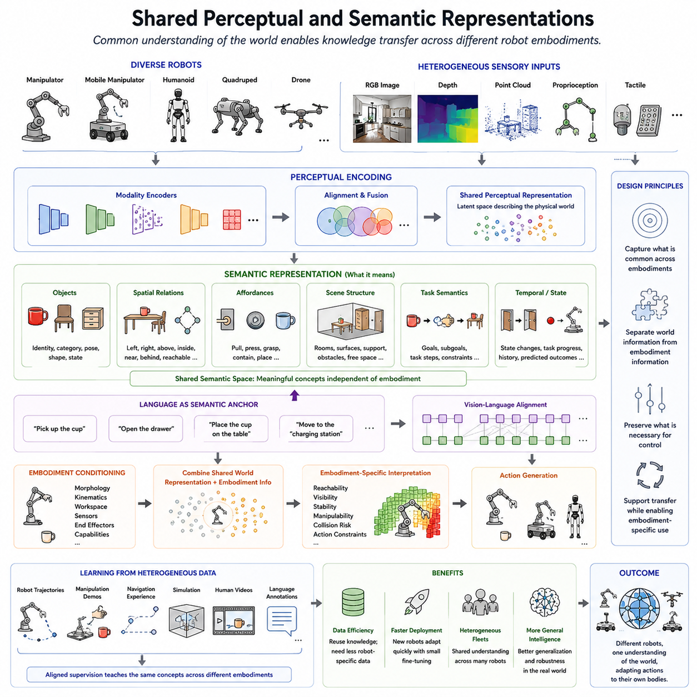{width="7.268055555555556in" height="7.268055555555556in"}

Shared perceptual and semantic representations provide the common informational foundation that allows knowledge to transfer between robots with different embodiments. Although robots may use different cameras, sensor placements, manipulators, locomotion systems, and action interfaces, they often encounter the same objects, environments, spatial relationships, and task concepts. A shared representation attempts to encode these common properties independently of the hardware that produced the observation.

Perceptual representations transform raw sensory inputs into structured features that are useful for reasoning and action. RGB images, depth measurements, point clouds, proprioception, tactile signals, and other observations can differ substantially between platforms. Rather than requiring every robot to reason directly from its own raw sensor format, foundation models can map heterogeneous observations into latent spaces containing more comparable descriptions of the surrounding physical world.

The objective is not to make every sensor observation numerically identical. Different viewpoints and sensing modalities naturally contain different information. Instead, shared perceptual learning seeks invariance at the level relevant to behavior. Observations of the same cup from a wrist camera, head camera, or mobile robot camera should preserve common information about object identity, approximate geometry, location, state, and potential interaction even when their pixels differ substantially.

Semantic representations extend this abstraction beyond appearance. They describe what entities mean and how they relate to tasks. A model may represent an object as a container, a surface as a placement region, a handle as something that can be pulled, or an open passage as traversable space. Such concepts can remain meaningful across manipulators, humanoids, mobile robots, and other embodiments even when the physical procedures required to interact with them differ.

Language provides a particularly useful semantic anchor because instructions can describe goals without specifying the exact body that must execute them. Expressions such as "pick up the cup," "open the drawer," or "move to the charging station" describe desired outcomes that can apply to multiple robots. Vision-language representations can align observations with these concepts, creating a shared semantic space between perception, instructions, objects, relationships, and task goals.

Spatial representations are equally important for cross-embodiment transfer. Concepts such as left, right, above, inside, behind, near, reachable, occupied, and free describe relationships within the environment rather than commands for specific actuators. A robot can reason about these relationships before determining how its own morphology should respond. Shared spatial abstractions therefore help separate understanding of the world from embodiment-specific motion generation.

Affordances provide a bridge between perception and physical interaction. Instead of representing only what an object is, an affordance-aware model represents what interactions may be possible. A handle may afford pulling, a button pressing, a container grasping, and a free surface placement. These opportunities can be shared semantically across robots, while the exact pose, contact configuration, force, trajectory, and actuator commands remain dependent on the executing embodiment.

Object-centric representations can further improve transfer by organizing perception around persistent entities rather than platform-specific image patterns. Objects can be associated with attributes such as category, pose, geometry, state, relationships, and interaction possibilities. If different robots map their observations into compatible object-level representations, experience collected by one embodiment can provide useful knowledge to another even when camera configurations and observation spaces are different.

Scene-level representations complement object-centric models by capturing the broader structure of the environment. A robot may need to understand that a cup is on a table, the table is beside a cabinet, the cabinet contains a drawer, and the path toward it is partially blocked. Representing these relationships as structured scene information creates a more transferable description than relying exclusively on embodiment-specific sensory features.

Temporal representations are also necessary because physical tasks unfold through changes in state. Opening a drawer transforms closed into open, grasping transforms an object from free to held, and navigation changes the robot's relation to its destination. Shared representations should therefore encode not only static observations but also task progress, state transitions, interaction history, and predicted consequences that remain interpretable across different embodiments.

Multimodal foundation models can integrate these layers into a unified representation. Visual features provide appearance and geometry, language provides semantic structure and task intent, proprioception provides information about the robot itself, and interaction data connects observations with physical outcomes. Cross-embodiment learning benefits when these modalities are aligned around common concepts rather than treated as isolated streams tied to individual robot platforms.

A critical design principle is separating world information from embodiment information without completely disconnecting them. The shared representation may describe an object, goal, spatial relationship, or affordance in a relatively embodiment-agnostic form. Additional embodiment-conditioned features can then describe whether the current robot can reach the object, which end effector it possesses, what workspace is available, and which actions can physically realize the intended interaction.

This separation prevents excessive invariance from removing information required for control. Reachability, visibility, stability, collision risk, and manipulability can depend on morphology and sensor configuration. A useful shared representation therefore does not ignore embodiment. Instead, it maintains a common semantic description of the world while allowing robot-specific information to modify how that description is interpreted for action selection and execution.

Training such representations requires heterogeneous data containing common concepts observed through different embodiments. Robot trajectories, manipulation demonstrations, navigation experience, simulation, human videos, and language annotations can provide complementary supervision. When aligned successfully, the model learns that visually different observations and mechanically different interactions may correspond to the same object, goal, skill, state transition, or physical outcome.

Shared representations also improve data efficiency because semantic knowledge does not need to be relearned independently for every robot. A new platform can inherit knowledge about objects, environments, task structures, and interaction concepts while concentrating its limited adaptation data on morphology-specific execution. This division is particularly valuable when real-world robot data is expensive and new embodiments have relatively small datasets.

For robot foundation models, shared perceptual and semantic representations ultimately form the interface between universal knowledge and embodiment-specific behavior. They allow heterogeneous robots to understand a common physical world through compatible concepts while preserving specialized mechanisms for action. This shared representational layer is therefore a central prerequisite for scalable cross-embodiment transfer and, ultimately, more universal robot policies.

공유 지각 및 의미 표현(Shared Perceptual and Semantic Representations)은 서로 다른 구현체(Embodiment)를 가진 로봇 사이에서 지식을 전이할 수 있도록 하는 공통 정보 기반을 제공한다. 로봇마다 서로 다른 카메라, 센서 배치, 매니퓰레이터(Manipulator), 이동 시스템(Locomotion System), 행동 인터페이스(Action Interface)를 사용할 수 있지만 동일한 물체, 환경, 공간적 관계, 작업 개념을 접하는 경우가 많다. 공유 표현(Shared Representation)은 이러한 공통 속성을 관측을 생성한 특정 하드웨어와 독립적으로 인코딩(Encoding)하려고 한다.

지각 표현(Perceptual Representation)은 원시 감각 입력(Raw Sensory Input)을 추론과 행동에 유용한 구조화된 특징(Structured Feature)으로 변환한다. RGB 이미지, 깊이 측정(Depth Measurement), 포인트 클라우드(Point Cloud), 고유수용감각(Proprioception), 촉각 신호(Tactile Signal) 등의 관측은 플랫폼에 따라 크게 달라질 수 있다. 모든 로봇이 자신의 원시 센서 형식에서 직접 추론하도록 하는 대신, 파운데이션 모델(Foundation Model)은 이질적인 관측을 주변 물리 세계에 대한 비교 가능한 설명을 포함하는 잠재 공간(Latent Space)으로 매핑할 수 있다.

목표는 모든 센서 관측을 수치적으로 동일하게 만드는 것이 아니다. 서로 다른 시점(Viewpoint)과 센싱 모달리티(Sensing Modality)는 본질적으로 서로 다른 정보를 포함한다. 대신 공유 지각 학습(Shared Perceptual Learning)은 행동과 관련된 수준에서 불변성(Invariance)을 확보하려 한다. 손목 카메라, 헤드 카메라 또는 이동 로봇 카메라에서 동일한 컵을 관찰한다면 픽셀이 크게 다르더라도 물체 정체성, 대략적인 형상, 위치, 상태, 잠재적 상호작용에 관한 공통 정보는 유지되어야 한다.

의미 표현(Semantic Representation)은 이러한 추상화를 외형을 넘어 확장한다. 의미 표현은 개체(Entity)가 무엇을 의미하며 작업과 어떻게 연관되는지를 설명한다. 모델은 어떤 물체를 용기(Container)로, 표면을 배치 영역(Placement Region)으로, 손잡이를 당길 수 있는 대상으로, 열린 통로를 이동 가능한 공간(Traversable Space)으로 표현할 수 있다. 이러한 개념은 실제 상호작용을 수행하는 물리적 절차가 서로 다르더라도 매니퓰레이터, 휴머노이드(Humanoid), 이동 로봇 등 다양한 구현체에서 공통된 의미를 유지할 수 있다.

언어(Language)는 명령이 정확한 실행 몸체를 지정하지 않고도 목표를 설명할 수 있기 때문에 특히 유용한 의미적 기준점(Semantic Anchor)을 제공한다. "컵을 집어라", "서랍을 열어라", "충전소로 이동하라"와 같은 표현은 여러 로봇에 적용할 수 있는 원하는 결과를 설명한다. 비전-언어 표현(Vision-Language Representation)은 관측을 이러한 개념과 정렬하여 지각, 명령, 물체, 관계, 작업 목표 사이에 공유 의미 공간(Shared Semantic Space)을 구축할 수 있다.

공간 표현(Spatial Representation) 역시 교차 구현체 전이(Cross-Embodiment Transfer)에서 중요하다. 왼쪽, 오른쪽, 위쪽, 내부, 뒤쪽, 가까움, 도달 가능, 점유됨, 비어 있음과 같은 개념은 특정 액추에이터(Actuator)를 위한 명령이 아니라 환경 내부의 관계를 설명한다. 로봇은 자신의 형태학(Morphology)이 어떻게 대응해야 하는지를 결정하기 전에 이러한 관계를 추론할 수 있다. 따라서 공유 공간 추상화(Shared Spatial Abstraction)는 세계에 대한 이해와 구현체별 운동 생성(Embodiment-Specific Motion Generation)을 분리하는 데 도움을 준다.

행동유도성(Affordance)은 지각과 물리적 상호작용 사이의 연결고리를 제공한다. 행동유도성 인식 모델(Affordance-Aware Model)은 단순히 물체가 무엇인지만 표현하는 것이 아니라 어떤 상호작용이 가능한지도 표현한다. 손잡이는 당기기, 버튼은 누르기, 용기는 파지하기, 빈 표면은 물체 놓기와 연결될 수 있다. 이러한 상호작용 가능성은 로봇 사이에서 의미적으로 공유할 수 있지만 정확한 자세, 접촉 구성(Contact Configuration), 힘, 궤적, 액추에이터 명령은 실행하는 구현체에 따라 달라진다.

객체 중심 표현(Object-Centric Representation)은 플랫폼별 이미지 패턴보다 지속적으로 존재하는 개체를 중심으로 지각을 구성함으로써 전이를 더욱 향상시킬 수 있다. 물체에는 범주(Category), 자세(Pose), 형상(Geometry), 상태, 관계, 상호작용 가능성과 같은 속성을 연결할 수 있다. 서로 다른 로봇이 자신의 관측을 호환 가능한 객체 수준 표현(Object-Level Representation)으로 매핑할 수 있다면 카메라 구성과 관측 공간이 달라도 한 구현체가 수집한 경험을 다른 구현체가 활용할 수 있다.

장면 수준 표현(Scene-Level Representation)은 환경의 보다 광범위한 구조를 포착하여 객체 중심 모델을 보완한다. 로봇은 컵이 테이블 위에 있고, 테이블이 캐비닛 옆에 있으며, 캐비닛에는 서랍이 있고, 그곳으로 향하는 경로가 부분적으로 차단되어 있다는 사실을 이해해야 할 수 있다. 이러한 관계를 구조화된 장면 정보(Structured Scene Information)로 표현하면 구현체별 감각 특징에만 의존하는 것보다 전이 가능성이 높은 환경 설명을 구축할 수 있다.

물리적 작업은 상태 변화(State Change)를 통해 진행되기 때문에 시간적 표현(Temporal Representation)도 필요하다. 서랍을 여는 행동은 닫힘 상태를 열림 상태로 변화시키고, 파지는 물체를 자유 상태에서 잡힌 상태로 변화시키며, 이동은 로봇과 목적지 사이의 관계를 변화시킨다. 따라서 공유 표현은 정적인 관측뿐만 아니라 서로 다른 구현체에서도 해석 가능한 작업 진행 상태, 상태 전이(State Transition), 상호작용 이력(Interaction History), 예측 결과(Predicted Consequence)를 인코딩해야 한다.

멀티모달 파운데이션 모델(Multimodal Foundation Model)은 이러한 여러 계층을 하나의 통합된 표현으로 결합할 수 있다. 시각 특징(Visual Feature)은 외형과 형상을 제공하고, 언어는 의미 구조와 작업 의도를 제공하며, 고유수용감각은 로봇 자체에 대한 정보를 제공하고, 상호작용 데이터(Interaction Data)는 관측과 물리적 결과를 연결한다. 교차 구현체 학습(Cross-Embodiment Learning)은 이러한 모달리티를 개별 로봇 플랫폼에 종속된 독립적인 정보 흐름으로 처리하기보다 공통 개념을 중심으로 정렬할 때 효과가 높아진다.

핵심 설계 원칙(Critical Design Principle)은 세계 정보(World Information)와 구현체 정보(Embodiment Information)를 완전히 분리하지 않으면서도 서로 구분하는 것이다. 공유 표현은 물체, 목표, 공간적 관계 또는 행동유도성을 비교적 구현체 독립적(Embodiment-Agnostic) 형태로 설명할 수 있다. 이후 추가적인 구현체 조건화 특징(Embodiment-Conditioned Feature)은 현재 로봇이 물체에 도달할 수 있는지, 어떤 말단장치(End Effector)를 가지고 있는지, 어떤 작업공간을 사용할 수 있는지, 어떤 행동을 물리적으로 수행할 수 있는지를 설명할 수 있다.

이러한 분리는 과도한 불변성(Excessive Invariance)으로 인해 제어에 필요한 정보가 제거되는 것을 방지한다. 도달 가능성(Reachability), 가시성(Visibility), 안정성(Stability), 충돌 위험(Collision Risk), 조작성(Manipulability)은 형태학과 센서 구성에 따라 달라질 수 있다. 따라서 유용한 공유 표현은 구현체를 무시하지 않는다. 대신 세계에 대한 공통된 의미적 설명을 유지하면서 로봇별 정보가 행동 선택(Action Selection)과 실행을 위해 해당 설명을 해석하는 방식을 조정할 수 있도록 한다.

이러한 표현을 학습하려면 서로 다른 구현체를 통해 관찰된 공통 개념을 포함하는 이질적인 데이터(Heterogeneous Data)가 필요하다. 로봇 궤적(Robot Trajectory), 조작 시연(Manipulation Demonstration), 주행 경험(Navigation Experience), 시뮬레이션(Simulation), 인간 영상(Human Video), 언어 주석(Language Annotation)은 상호 보완적인 감독 정보(Supervision)를 제공할 수 있다. 성공적으로 정렬되면 모델은 시각적으로 다른 관측과 기계적으로 다른 상호작용이 동일한 물체, 목표, 기술(Skill), 상태 전이 또는 물리적 결과에 대응할 수 있음을 학습한다.

공유 표현은 의미 지식을 각 로봇마다 독립적으로 다시 학습할 필요성을 줄이기 때문에 데이터 효율성(Data Efficiency)도 향상시킨다. 새로운 플랫폼은 물체, 환경, 작업 구조, 상호작용 개념에 관한 기존 지식을 상속하면서 제한된 적응 데이터(Adaptation Data)를 형태학별 실행(Morphology-Specific Execution)을 학습하는 데 집중할 수 있다. 이러한 역할 분리는 실제 로봇 데이터의 수집 비용이 높고 새로운 구현체의 데이터셋 규모가 상대적으로 작을 때 특히 중요하다.

로봇 파운데이션 모델(Robot Foundation Model)에서 공유 지각 및 의미 표현은 궁극적으로 범용 지식(Universal Knowledge)과 구현체별 행동(Embodiment-Specific Behavior)을 연결하는 인터페이스 역할을 한다. 이를 통해 이질적인 로봇들은 호환 가능한 개념을 사용하여 공통된 물리 세계를 이해하면서도 행동을 위한 특화된 메커니즘을 유지할 수 있다. 따라서 이러한 공유 표현 계층(Shared Representation Layer)은 확장 가능한 교차 구현체 전이와 궁극적으로 더욱 범용적인 로봇 정책(Universal Robot Policy)을 구현하기 위한 핵심적인 전제조건이다.

## 08.04. Embodiment Conditioned Representations

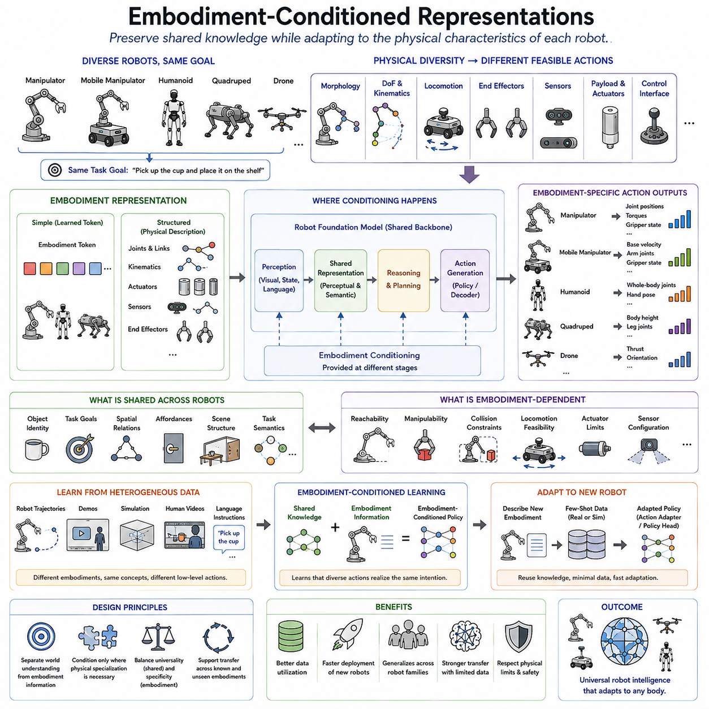{width="7.268055555555556in" height="7.268055555555556in"}

Embodiment-conditioned representations allow a robot foundation model to preserve shared knowledge while explicitly accounting for the physical characteristics of the robot executing a task. Instead of assuming that one internal representation should produce identical behavior across all platforms, the model conditions perception, reasoning, or action generation on information describing the current embodiment. This makes shared intelligence compatible with heterogeneous robot bodies.

The need for embodiment conditioning follows directly from the physical diversity of robots. A manipulator, mobile manipulator, humanoid, quadruped, and drone may observe similar environments and understand the same semantic goal, yet their feasible actions differ substantially. Morphology, degrees of freedom, workspace, locomotion mechanism, end effectors, sensors, payload, and control interfaces determine how each platform can physically realize an intended behavior.

An embodiment representation encodes these characteristics in a form that can influence the model. At the simplest level, it may be a learned robot identifier or embodiment token associated with a particular platform. More structured approaches can encode joint configurations, link geometry, kinematic chains, actuator properties, sensor arrangements, end-effector types, control modes, and other descriptors that explain how the robot interacts with its environment.

A learned embodiment token is attractive because it is compact and easy to integrate into transformer-based architectures. The token can be inserted alongside visual, language, state, and action tokens, allowing attention mechanisms to condition intermediate representations on robot identity. However, a pure identity token may memorize known platforms rather than understanding their physical structure, limiting generalization when an entirely new embodiment is introduced.

Structured morphology information provides a stronger basis for transfer. A model can represent the robot as joints and links connected through a kinematic graph, with features describing joint type, range, link dimensions, and connectivity. Graph-based or sequence-based encoders can transform this structure into an embodiment embedding. Robots with partially similar morphology may then obtain related representations even when their exact hardware configurations are different.

Kinematic information is especially important because it determines how actuator changes produce motion in physical space. Joint limits, degrees of freedom, reachable workspace, and end-effector configuration constrain which task-level goals can be executed. Conditioning on these properties allows a policy to distinguish between understanding that an object should be grasped and determining whether the current robot can reach an appropriate grasp pose.

Dynamics and actuator characteristics can also be incorporated when behavior depends on forces, acceleration, stability, or contact. Two robots with similar kinematic structures may possess very different payload limits, torque capabilities, compliance, or response times. Embodiment-conditioned representations can expose these differences to the policy so that task reasoning is translated into actions compatible with the physical capabilities of the actual platform.

Sensor configuration forms another important part of embodiment information. Camera position, field of view, depth sensing, proprioception, force sensing, and tactile sensing determine what information is available to the policy. Conditioning the representation on sensor geometry and modality can help the model interpret observations correctly, distinguishing changes in the environment from differences caused simply by where and how a particular robot senses the world.

Embodiment conditioning can occur at several stages of a robot foundation model. Robot information may be fused with perceptual features, inserted into a shared multimodal transformer, supplied to the policy decoder, or used only by specialized action heads. Early conditioning allows embodiment to influence perception and reasoning, while later conditioning preserves a more embodiment-agnostic shared representation before specializing the final action generation process.

The appropriate conditioning strategy depends on which information should be shared. Semantic concepts such as object identity, task goals, spatial relationships, and many affordances should remain relatively stable across robots. Reachability, manipulability, collision constraints, locomotion feasibility, and actuator commands are more strongly embodiment-dependent. A well-designed architecture allows shared representations to remain reusable while introducing embodiment information where physical specialization becomes necessary.

This principle can be expressed as shared knowledge plus embodiment context. The shared model may understand that a cup must be moved from a table to a shelf, while embodiment context describes how the current robot can accomplish that goal. A fixed manipulator might reach directly, a mobile manipulator might reposition its base, and a humanoid might coordinate its torso and arm. The task meaning remains common while execution changes with the body.

Embodiment-conditioned action generation is particularly useful when training on heterogeneous robot datasets. Demonstrations from different platforms can share observations, language instructions, task labels, or semantic outcomes while containing incompatible low-level actions. By conditioning the policy on robot information, the model can learn that different action sequences correspond to the same higher-level intention rather than treating those demonstrations as contradictory training examples.

Such representations also support embodiment-specific decoders and policy heads. A shared backbone can produce task-level features, after which specialized modules translate them into joint positions, velocities, Cartesian commands, locomotion targets, gripper states, or other action formats. The embodiment representation can select, parameterize, or modulate these modules, creating a practical interface between universal reasoning and hardware-specific control.

For new robots, the objective is to avoid learning an entirely new policy from scratch. If the embodiment can be described through morphology, kinematics, sensors, and action capabilities, the existing foundation model may reuse knowledge learned from related platforms. A limited amount of target-robot data can then calibrate the representation, action adapter, or policy head, enabling few-shot adaptation rather than complete retraining.

Generalization to unseen embodiments remains a major challenge. Models may overfit to robot identities represented in their training data, especially when embodiment descriptors are weak or datasets contain only a few platform families. Effective conditioning therefore requires diverse training embodiments and representations that capture meaningful physical structure. The model should learn relationships between bodies and behaviors rather than merely associate each robot name with a memorized controller.

Embodiment-conditioned representations ultimately provide the mechanism through which cross-embodiment foundation models balance universality with physical specialization. Shared perception, semantics, reasoning, and task knowledge can form a common intelligence layer, while embodiment information determines how that intelligence is grounded in a particular body. This combination is a key step toward robot policies that transfer across hardware without ignoring the physical realities that make each robot different.

구현체 조건화 표현(Embodiment-Conditioned Representation)은 로봇 파운데이션 모델(Robot Foundation Model)이 공유 지식을 유지하면서 작업을 수행하는 로봇의 물리적 특성을 명시적으로 고려할 수 있도록 한다. 하나의 내부 표현이 모든 플랫폼에서 동일한 행동을 생성해야 한다고 가정하는 대신, 모델은 현재 구현체(Embodiment)를 설명하는 정보를 기반으로 지각, 추론 또는 행동 생성을 조건화(Conditioning)한다. 이를 통해 공유 지능(Shared Intelligence)을 서로 다른 로봇 몸체와 호환할 수 있다.

구현체 조건화(Embodiment Conditioning)의 필요성은 로봇의 물리적 다양성에서 직접적으로 발생한다. 매니퓰레이터(Manipulator), 이동형 매니퓰레이터(Mobile Manipulator), 휴머노이드(Humanoid), 사족보행 로봇(Quadruped), 드론(Drone)은 유사한 환경을 관찰하고 동일한 의미적 목표(Semantic Goal)를 이해할 수 있지만 실행 가능한 행동은 크게 다르다. 형태학(Morphology), 자유도(Degrees of Freedom), 작업공간(Workspace), 이동 메커니즘(Locomotion Mechanism), 말단장치(End Effector), 센서, 가반하중(Payload), 제어 인터페이스(Control Interface)는 각 플랫폼이 의도된 행동을 물리적으로 어떻게 구현할 수 있는지를 결정한다.

구현체 표현(Embodiment Representation)은 이러한 특성을 모델에 영향을 줄 수 있는 형태로 인코딩(Encoding)한다. 가장 단순한 수준에서는 특정 플랫폼과 연결된 학습된 로봇 식별자(Robot Identifier) 또는 구현체 토큰(Embodiment Token)을 사용할 수 있다. 보다 구조화된 접근법은 관절 구성, 링크 형상(Link Geometry), 운동학적 체인(Kinematic Chain), 액추에이터 특성, 센서 배치, 말단장치 유형, 제어 방식과 같이 로봇이 환경과 상호작용하는 방식을 설명하는 정보를 인코딩할 수 있다.

학습된 구현체 토큰(Learned Embodiment Token)은 간결하며 트랜스포머 기반 아키텍처(Transformer-Based Architecture)에 쉽게 통합할 수 있다는 장점이 있다. 이 토큰을 시각, 언어, 상태, 행동 토큰과 함께 입력하면 어텐션 메커니즘(Attention Mechanism)이 로봇 식별 정보를 기반으로 중간 표현을 조건화할 수 있다. 그러나 단순한 식별 토큰만 사용하면 모델이 물리적 구조를 이해하기보다 알려진 플랫폼을 암기할 수 있어 완전히 새로운 구현체가 등장했을 때 일반화(Generalization)가 제한될 수 있다.

구조화된 형태학 정보(Structured Morphology Information)는 전이를 위한 더욱 강력한 기반을 제공한다. 모델은 로봇을 운동학적 그래프(Kinematic Graph)를 통해 연결된 관절과 링크로 표현하고, 관절 유형, 동작 범위, 링크 크기, 연결 구조 등의 특징을 포함할 수 있다. 그래프 기반(Graph-Based) 또는 시퀀스 기반(Sequence-Based) 인코더는 이러한 구조를 구현체 임베딩(Embodiment Embedding)으로 변환할 수 있다. 이를 통해 정확한 하드웨어 구성이 다르더라도 부분적으로 유사한 형태를 가진 로봇들이 서로 연관된 표현을 가질 수 있다.

운동학 정보(Kinematic Information)는 액추에이터의 변화가 물리 공간의 운동으로 어떻게 변환되는지를 결정하기 때문에 특히 중요하다. 관절 한계(Joint Limit), 자유도, 도달 가능 작업공간(Reachable Workspace), 말단장치 구성은 어떤 작업 수준 목표(Task-Level Goal)를 실행할 수 있는지를 제한한다. 이러한 특성을 조건으로 제공하면 정책(Policy)은 물체를 파지해야 한다는 사실을 이해하는 것과 현재 로봇이 적절한 파지 자세(Grasp Pose)에 실제로 도달할 수 있는지를 판단하는 것을 구분할 수 있다.

행동이 힘, 가속도, 안정성 또는 접촉에 의존하는 경우에는 동역학(Dynamics)과 액추에이터 특성도 포함할 수 있다. 유사한 운동학적 구조를 가진 두 로봇이라도 가반하중, 토크 능력(Torque Capability), 순응성(Compliance), 응답 시간(Response Time)은 크게 다를 수 있다. 구현체 조건화 표현은 이러한 차이를 정책에 제공함으로써 작업 추론(Task Reasoning)이 실제 플랫폼의 물리적 능력에 적합한 행동으로 변환되도록 한다.

센서 구성(Sensor Configuration)은 구현체 정보의 또 다른 중요한 부분을 형성한다. 카메라 위치, 시야각(Field of View), 깊이 센싱(Depth Sensing), 고유수용감각(Proprioception), 힘 감지(Force Sensing), 촉각 감지(Tactile Sensing)는 정책이 이용할 수 있는 정보를 결정한다. 센서 기하구조(Sensor Geometry)와 모달리티(Modality)를 기반으로 표현을 조건화하면 모델은 환경 자체의 변화와 특정 로봇이 세계를 감지하는 위치 및 방식 때문에 발생하는 차이를 구별하여 관측을 올바르게 해석할 수 있다.

구현체 조건화는 로봇 파운데이션 모델의 여러 단계에서 수행될 수 있다. 로봇 정보는 지각 특징(Perceptual Feature)과 융합하거나 공유 멀티모달 트랜스포머(Shared Multimodal Transformer)에 입력하거나 정책 디코더(Policy Decoder)에 제공하거나 특화된 행동 헤드(Action Head)에서만 사용할 수 있다. 초기 조건화(Early Conditioning)는 구현체가 지각과 추론에 영향을 주도록 하며, 후기 조건화(Late Conditioning)는 최종 행동 생성 과정을 특화하기 전에 보다 구현체 독립적인 공유 표현을 유지할 수 있게 한다.

적절한 조건화 전략(Conditioning Strategy)은 어떤 정보를 공유해야 하는지에 따라 달라진다. 물체 정체성, 작업 목표, 공간적 관계, 다양한 행동유도성(Affordance)과 같은 의미적 개념은 로봇이 달라도 비교적 안정적으로 유지되어야 한다. 반면 도달 가능성(Reachability), 조작성(Manipulability), 충돌 제약조건(Collision Constraint), 이동 가능성(Locomotion Feasibility), 액추에이터 명령은 구현체에 더욱 강하게 의존한다. 잘 설계된 아키텍처는 공유 표현을 재사용 가능하게 유지하면서 물리적 특화가 필요한 지점에 구현체 정보를 도입한다.

이러한 원리는 공유 지식(Shared Knowledge)과 구현체 맥락(Embodiment Context)의 결합으로 표현할 수 있다. 공유 모델은 컵을 테이블에서 선반으로 이동해야 한다는 사실을 이해하고, 구현체 맥락은 현재 로봇이 그 목표를 어떻게 달성할 수 있는지를 설명한다. 고정형 매니퓰레이터는 직접 팔을 뻗을 수 있고, 이동형 매니퓰레이터는 베이스 위치를 변경해야 하며, 휴머노이드는 몸통과 팔을 협조시킬 수 있다. 작업의 의미는 공유되지만 실행 방법은 몸체에 따라 달라진다.

구현체 조건화 행동 생성(Embodiment-Conditioned Action Generation)은 이질적인 로봇 데이터셋(Heterogeneous Robot Dataset)을 학습할 때 특히 유용하다. 서로 다른 플랫폼의 시연은 관측, 언어 명령, 작업 레이블(Task Label), 의미적 결과를 공유할 수 있지만 저수준 행동(Low-Level Action)은 서로 호환되지 않을 수 있다. 정책을 로봇 정보에 따라 조건화하면 모델은 서로 다른 행동 시퀀스(Action Sequence)를 모순되는 학습 사례로 처리하는 대신 동일한 상위 수준 의도(High-Level Intention)에 대응하는 행동으로 학습할 수 있다.

이러한 표현은 구현체별 디코더(Embodiment-Specific Decoder)와 정책 헤드(Policy Head)도 지원한다. 공유 백본(Shared Backbone)이 작업 수준 특징을 생성하면 특화된 모듈이 이를 관절 위치, 속도, 데카르트 명령(Cartesian Command), 이동 목표(Locomotion Target), 그리퍼 상태(Gripper State) 등의 행동 형식으로 변환할 수 있다. 구현체 표현은 이러한 모듈을 선택하거나 파라미터화(Parameterization) 또는 조절(Modulation)함으로써 범용 추론(Universal Reasoning)과 하드웨어별 제어(Hardware-Specific Control)를 연결하는 실용적인 인터페이스를 형성한다.

새로운 로봇에서는 완전히 새로운 정책을 처음부터 학습하지 않는 것이 목표이다. 형태학, 운동학, 센서, 행동 능력을 통해 구현체를 설명할 수 있다면 기존 파운데이션 모델은 관련 플랫폼에서 학습한 지식을 재사용할 수 있다. 이후 제한된 양의 대상 로봇 데이터(Target-Robot Data)를 사용하여 구현체 표현, 행동 어댑터(Action Adapter), 정책 헤드를 보정할 수 있으며, 이를 통해 완전한 재학습 대신 소수 샷 적응(Few-Shot Adaptation)이 가능해진다.

보지 못한 구현체(Unseen Embodiment)에 대한 일반화는 여전히 중요한 과제이다. 특히 구현체 설명자가 충분하지 않거나 데이터셋이 소수의 플랫폼 계열만 포함한다면 모델은 학습 데이터에 존재하는 로봇 식별 정보에 과적합(Overfitting)될 수 있다. 따라서 효과적인 조건화를 위해서는 다양한 학습 구현체와 의미 있는 물리적 구조를 포착하는 표현이 필요하다. 모델은 단순히 각각의 로봇 이름을 암기된 제어기와 연결하는 것이 아니라 몸체와 행동 사이의 관계를 학습해야 한다.

구현체 조건화 표현은 궁극적으로 교차 구현체 파운데이션 모델(Cross-Embodiment Foundation Model)이 범용성(Universality)과 물리적 특화(Physical Specialization) 사이에서 균형을 이루게 하는 핵심 메커니즘이다. 공유된 지각, 의미론(Semantics), 추론, 작업 지식은 공통 지능 계층(Common Intelligence Layer)을 형성할 수 있으며, 구현체 정보는 이러한 지능이 특정 몸체에 어떻게 물리적으로 연결되는지를 결정한다. 이러한 결합은 각 로봇을 서로 다르게 만드는 물리적 현실을 무시하지 않으면서 다양한 하드웨어로 전이할 수 있는 로봇 정책을 구축하기 위한 핵심 단계이다.

## 08.05. Morphology and Kinematics Encoding

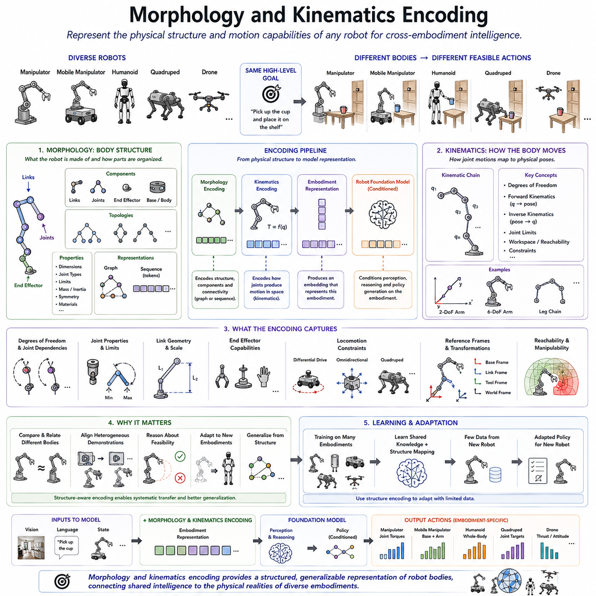{width="7.268055555555556in" height="7.268055555555556in"}

Morphology and kinematics encoding gives a cross-embodiment robot model an explicit description of the physical structure through which intelligence must act. Robot bodies differ in joint count, link geometry, topology, end effectors, locomotion mechanisms, and reachable workspace. Encoding these properties allows a foundation model to reason about similarities and differences between embodiments rather than treating every robot as an unrelated platform.

Morphology describes the organization and physical composition of a robot body. For a manipulator, this includes links, revolute or prismatic joints, branching structures, and the attached end effector. A humanoid adds arms, legs, torso, hands, and coordinated whole-body structure, while a quadruped contains repeated leg chains. Mobile manipulators additionally combine a locomotion base with one or more manipulation mechanisms.

A useful morphology representation must capture structure rather than merely robot identity. Assigning each platform a learned identifier can distinguish known robots, but it provides little information about why two robots behave similarly. Encoding joints, links, connectivity, dimensions, and functional components exposes relationships between bodies, enabling a model to recognize structural patterns that may transfer to robots not explicitly encountered during training.

Kinematics complements morphology by describing how the body can move. A kinematic chain specifies how joints connect links and how joint configurations determine the position and orientation of downstream components. Forward kinematics maps joint states into physical poses, while inverse kinematics relates desired end-effector poses to feasible joint configurations. These relationships define the geometric possibilities available to the robot.

Degrees of freedom are particularly important because they determine the dimensionality and flexibility of motion. A six-axis industrial arm, seven-degree-of-freedom collaborative manipulator, humanoid arm, and mobile manipulator can achieve similar end-effector objectives through different internal configurations. Encoding degrees of freedom and joint dependencies helps the model distinguish a shared task-space intention from the embodiment-specific motions required to realize it.

Joint properties provide additional structural information. Each joint can be represented by its type, axis, position, velocity, motion range, and relationship to neighboring links. Limits are important because geometrically imaginable motions may not be physically reachable. By incorporating joint constraints into the representation, a policy can reason not only about desired movement but also about whether candidate configurations are compatible with the robot\'s mechanical structure.

Link geometry determines the scale and shape of the reachable workspace. Two manipulators with identical joint topology can behave differently if their link lengths differ substantially. Longer links may reach distant objects but introduce different collision constraints, while compact arms may operate effectively in confined spaces. Encoding link dimensions therefore helps connect abstract task goals with the spatial capabilities of the particular embodiment.

Robot morphology can naturally be represented as a graph. Joints and links become nodes or edges, while connectivity describes the kinematic topology. Graph neural networks or graph-aware transformers can process this structure without requiring every robot to contain the same number of components. Such representations are attractive for cross-embodiment learning because variable robot structures can be mapped into a common embedding framework.

Sequence-based encoding provides another practical approach. Joints, links, sensors, and end effectors can be converted into tokens containing structural and geometric attributes and processed by a transformer. Positional or relational information can describe parent-child connections within the kinematic chain. This approach integrates naturally with vision, language, state, and action tokens already used by multimodal robot foundation models.

Repeated structures provide valuable regularities for representation learning. The legs of a quadruped, fingers of a dexterous hand, or symmetric limbs of a humanoid share structural patterns even though their positions and functions are not completely identical. A morphology encoder can exploit these repetitions to learn reusable representations of joints, limbs, and local kinematic chains instead of memorizing an entire robot as a single indivisible object.

End effectors require explicit representation because they determine how a robot physically interacts with objects. Parallel grippers, suction devices, dexterous hands, tools, and specialized mechanisms provide different contact and manipulation capabilities. Two arms with similar kinematics may therefore require different strategies for the same task. Encoding the end effector helps the model connect object affordances with physically available interaction mechanisms.

Mobile embodiments extend kinematic encoding beyond articulated arms. Differential-drive bases, omnidirectional platforms, legged systems, and aerial robots possess different motion constraints. A differential-drive robot cannot instantaneously move sideways, while an omnidirectional platform can. A quadruped must coordinate contacts and body stability. Representing these locomotion constraints is necessary when a shared model must translate spatial goals into embodiment-feasible motion.

Reference frames are another critical element. Joint states, end-effector poses, camera observations, and task targets may be expressed relative to different coordinate systems. Morphology-aware representations should preserve transformations between base, link, sensor, tool, and world frames. Consistent geometric encoding allows the model to compare interactions across robots without incorrectly interpreting differences in coordinate convention as differences in task meaning.

Morphology and kinematics encoding also supports reachability and manipulability reasoning. A shared semantic representation may indicate that an object should be grasped, but the embodiment representation determines whether the target lies inside the robot\'s workspace and whether a suitable configuration exists. The policy can then choose to reach directly, reposition a mobile base, modify the grasp pose, or determine that the requested interaction is infeasible.

For heterogeneous training data, structural encoding helps align demonstrations that use incompatible action spaces. Instead of learning isolated mappings for every robot, the model can associate actions with the body components that generated them. Similar local motions or task-space effects can then be recognized across different kinematic structures. This provides a stronger basis for transfer than normalizing unrelated joint vectors into superficially similar numerical ranges.

Encoding physical structure is especially valuable when adapting to an unseen robot. If a new embodiment can be described through its joint-link topology, dimensions, motion limits, end effectors, and locomotion structure, the foundation model receives meaningful information before collecting extensive demonstrations. Experience from structurally related robots can provide an initialization, while limited target data calibrates the remaining embodiment-specific behavior.

Morphology and kinematics encoding therefore acts as a physical interface between shared robot intelligence and diverse hardware. Semantic knowledge can describe what should happen, while structural representations describe what the current body can physically do and how it can do it. By representing robots through their underlying mechanical organization rather than only their identities, cross-embodiment models gain a foundation for more systematic transfer, adaptation, and generalization.

형태학 및 운동학 인코딩(Morphology and Kinematics Encoding)은 교차 구현체(Cross-Embodiment) 로봇 모델이 지능을 실제 행동으로 구현하는 물리적 구조를 명시적으로 이해할 수 있도록 한다. 로봇의 몸체는 관절 수, 링크 형상(Link Geometry), 위상 구조(Topology), 말단장치(End Effector), 이동 메커니즘(Locomotion Mechanism), 도달 가능 작업공간(Reachable Workspace)에서 서로 다르다. 이러한 특성을 인코딩하면 파운데이션 모델(Foundation Model)이 모든 로봇을 서로 무관한 플랫폼으로 취급하는 대신 구현체 사이의 유사성과 차이를 추론할 수 있다.

형태학(Morphology)은 로봇 몸체의 구성과 물리적 조직을 설명한다. 매니퓰레이터(Manipulator)의 경우 링크, 회전 관절(Revolute Joint) 또는 직동 관절(Prismatic Joint), 분기 구조(Branching Structure), 장착된 말단장치 등이 포함된다. 휴머노이드(Humanoid)는 팔, 다리, 몸통, 손과 협조된 전신 구조(Whole-Body Structure)를 추가로 가지며, 사족보행 로봇(Quadruped)은 반복되는 다리 체인(Leg Chain)을 가진다. 이동형 매니퓰레이터(Mobile Manipulator)는 이동 베이스와 하나 이상의 조작 메커니즘을 결합한다.

유용한 형태학 표현(Morphology Representation)은 단순히 로봇의 식별 정보가 아니라 구조 자체를 포착해야 한다. 각 플랫폼에 학습된 식별자(Learned Identifier)를 부여하면 이미 알려진 로봇들을 구별할 수 있지만 두 로봇이 왜 유사하게 행동하는지에 대한 정보는 거의 제공하지 못한다. 관절, 링크, 연결 관계, 크기, 기능적 구성요소를 인코딩하면 몸체 사이의 관계를 명시할 수 있으며, 이를 통해 모델은 학습 과정에서 직접 경험하지 않은 로봇에도 전이할 수 있는 구조적 패턴을 인식할 수 있다.

운동학(Kinematics)은 몸체가 어떻게 움직일 수 있는지를 설명함으로써 형태학을 보완한다. 운동학적 체인(Kinematic Chain)은 관절이 링크를 어떻게 연결하는지, 그리고 관절 구성이 하위 구성요소의 위치와 방향을 어떻게 결정하는지를 정의한다. 순기구학(Forward Kinematics)은 관절 상태를 물리적 자세(Pose)로 변환하며, 역기구학(Inverse Kinematics)은 원하는 말단장치 자세와 실행 가능한 관절 구성 사이의 관계를 설명한다. 이러한 관계는 로봇이 사용할 수 있는 기하학적 움직임의 가능성을 결정한다.

자유도(Degrees of Freedom)는 움직임의 차원과 유연성을 결정하기 때문에 특히 중요하다. 6축 산업용 로봇 팔, 7자유도 협동 매니퓰레이터(Collaborative Manipulator), 휴머노이드 팔, 이동형 매니퓰레이터는 서로 다른 내부 구성을 통해 유사한 말단장치 목표를 달성할 수 있다. 자유도와 관절 간 의존성(Joint Dependency)을 인코딩하면 모델이 공유된 작업 공간 의도(Task-Space Intention)와 이를 실현하기 위해 필요한 구현체별 움직임을 구분하는 데 도움이 된다.

관절 특성(Joint Property)은 추가적인 구조 정보를 제공한다. 각 관절은 유형, 축(Axis), 위치, 속도, 운동 범위(Motion Range), 인접 링크와의 관계를 통해 표현할 수 있다. 기하학적으로 상상할 수 있는 움직임이라도 물리적으로 도달할 수 없는 경우가 있기 때문에 관절 한계(Joint Limit)는 중요하다. 관절 제약조건을 표현에 포함하면 정책(Policy)은 원하는 움직임뿐만 아니라 후보 관절 구성이 로봇의 기계적 구조와 호환되는지도 추론할 수 있다.

링크 형상(Link Geometry)은 도달 가능 작업공간의 크기와 형태를 결정한다. 동일한 관절 위상 구조(Joint Topology)를 가진 두 매니퓰레이터도 링크 길이가 크게 다르면 서로 다른 행동 특성을 보일 수 있다. 긴 링크는 먼 곳의 물체에 도달할 수 있지만 다른 충돌 제약조건(Collision Constraint)을 발생시킬 수 있으며, 짧고 컴팩트한 로봇 팔은 제한된 공간에서 효과적으로 작동할 수 있다. 따라서 링크 크기를 인코딩하면 추상적인 작업 목표를 특정 구현체의 공간적 능력과 연결할 수 있다.

로봇 형태학은 자연스럽게 그래프(Graph)로 표현할 수 있다. 관절과 링크를 노드(Node) 또는 엣지(Edge)로 표현하고 연결 관계를 통해 운동학적 위상 구조를 기술할 수 있다. 그래프 신경망(Graph Neural Network)이나 그래프 인식 트랜스포머(Graph-Aware Transformer)는 모든 로봇이 동일한 수의 구성요소를 가져야 한다는 가정 없이 이러한 구조를 처리할 수 있다. 가변적인 로봇 구조를 공통 임베딩 프레임워크(Common Embedding Framework)로 매핑할 수 있기 때문에 이러한 표현은 교차 구현체 학습에 적합하다.

시퀀스 기반 인코딩(Sequence-Based Encoding)은 또 다른 실용적인 접근법을 제공한다. 관절, 링크, 센서, 말단장치를 구조적·기하학적 속성을 포함하는 토큰(Token)으로 변환한 후 트랜스포머(Transformer)로 처리할 수 있다. 위치 정보(Positional Information) 또는 관계 정보(Relational Information)를 이용하여 운동학적 체인 내부의 부모-자식 연결(Parent-Child Connection)을 설명할 수 있다. 이러한 방식은 멀티모달 로봇 파운데이션 모델(Multimodal Robot Foundation Model)에서 사용하는 비전, 언어, 상태, 행동 토큰과 자연스럽게 통합된다.

반복 구조(Repeated Structure)는 표현 학습(Representation Learning)에 유용한 규칙성을 제공한다. 사족보행 로봇의 다리, 다지 손(Dexterous Hand)의 손가락, 휴머노이드의 대칭적인 팔다리는 위치와 기능이 완전히 동일하지 않더라도 공통된 구조적 패턴을 가진다. 형태학 인코더(Morphology Encoder)는 로봇 전체를 하나의 분리할 수 없는 객체로 암기하는 대신 이러한 반복 구조를 활용하여 관절, 팔다리, 국소 운동학적 체인(Local Kinematic Chain)에 대한 재사용 가능한 표현을 학습할 수 있다.

말단장치(End Effector)는 로봇이 물체와 물리적으로 상호작용하는 방식을 결정하기 때문에 명시적으로 표현할 필요가 있다. 평행 그리퍼(Parallel Gripper), 흡착 장치(Suction Device), 다지 손, 도구, 특수 메커니즘은 서로 다른 접촉 및 조작 능력을 제공한다. 따라서 운동학적 구조가 유사한 두 로봇이라도 동일한 작업에 서로 다른 전략이 필요할 수 있다. 말단장치를 인코딩하면 모델이 물체의 행동유도성(Affordance)을 실제로 사용할 수 있는 상호작용 메커니즘과 연결할 수 있다.

이동형 구현체(Mobile Embodiment)는 운동학 인코딩을 관절형 로봇 팔을 넘어 확장한다. 차동구동(Differential Drive) 베이스, 전방향 플랫폼(Omnidirectional Platform), 다족보행 시스템(Legged System), 비행 로봇(Aerial Robot)은 서로 다른 운동 제약조건을 가진다. 차동구동 로봇은 즉시 측면으로 이동할 수 없지만 전방향 플랫폼은 가능하다. 사족보행 로봇은 접촉과 몸체 안정성을 함께 조정해야 한다. 공유 모델이 공간적 목표를 구현체가 실행 가능한 움직임으로 변환하려면 이러한 이동 제약조건을 표현해야 한다.

기준 좌표계(Reference Frame)는 또 다른 핵심 요소이다. 관절 상태, 말단장치 자세, 카메라 관측, 작업 목표는 서로 다른 좌표계(Coordinate System)를 기준으로 표현될 수 있다. 형태학 인식 표현(Morphology-Aware Representation)은 베이스(Base), 링크, 센서, 도구(Tool), 세계 좌표계(World Frame) 사이의 변환 관계를 유지해야 한다. 일관된 기하학적 인코딩(Geometric Encoding)은 좌표계 표현 방식의 차이를 작업 의미의 차이로 잘못 해석하지 않고 서로 다른 로봇의 상호작용을 비교할 수 있게 한다.

형태학 및 운동학 인코딩은 도달 가능성(Reachability)과 조작성(Manipulability)에 대한 추론도 지원한다. 공유 의미 표현(Shared Semantic Representation)은 특정 물체를 파지해야 한다는 사실을 나타낼 수 있지만, 구현체 표현은 해당 목표가 로봇의 작업공간 안에 존재하는지와 적절한 관절 구성이 가능한지를 결정한다. 이에 따라 정책은 직접 팔을 뻗거나, 이동 베이스의 위치를 변경하거나, 파지 자세를 수정하거나, 요청된 상호작용이 실행 불가능하다고 판단할 수 있다.

이질적인 학습 데이터(Heterogeneous Training Data)에서는 구조적 인코딩이 서로 호환되지 않는 행동 공간(Action Space)을 사용하는 시연을 정렬하는 데 도움을 준다. 모든 로봇에 대해 서로 독립적인 매핑을 학습하는 대신 모델은 행동을 해당 행동을 생성한 몸체 구성요소와 연결할 수 있다. 그러면 서로 다른 운동학적 구조에서도 유사한 국소 움직임이나 작업 공간 효과(Task-Space Effect)를 인식할 수 있다. 이는 서로 무관한 관절 벡터를 표면적으로 비슷한 수치 범위로 정규화(Normalization)하는 것보다 강력한 전이 기반을 제공한다.

물리적 구조를 인코딩하는 것은 이전에 보지 못한 로봇(Unseen Robot)에 적응할 때 특히 중요하다. 새로운 구현체를 관절-링크 위상 구조(Joint-Link Topology), 크기, 운동 한계, 말단장치, 이동 구조를 통해 설명할 수 있다면 파운데이션 모델은 대규모 시연을 수집하기 전부터 의미 있는 정보를 제공받을 수 있다. 구조적으로 유사한 로봇에서 축적된 경험을 초기화(Initialization)에 활용하고 제한된 대상 로봇 데이터(Target-Robot Data)를 통해 나머지 구현체별 행동을 보정할 수 있다.

따라서 형태학 및 운동학 인코딩은 공유 로봇 지능(Shared Robot Intelligence)과 다양한 하드웨어를 연결하는 물리적 인터페이스(Physical Interface) 역할을 한다. 의미적 지식(Semantic Knowledge)은 무엇이 일어나야 하는지를 설명하고, 구조적 표현(Structural Representation)은 현재 몸체가 물리적으로 무엇을 할 수 있으며 그것을 어떻게 수행할 수 있는지를 설명한다. 로봇을 단순한 식별자가 아니라 근본적인 기계적 구조(Mechanical Organization)를 통해 표현함으로써 교차 구현체 모델은 보다 체계적인 전이(Transfer), 적응(Adaptation), 일반화(Generalization)를 위한 기반을 확보할 수 있다.

## 08.06. Shared vs Embodiment Specific Action Spaces

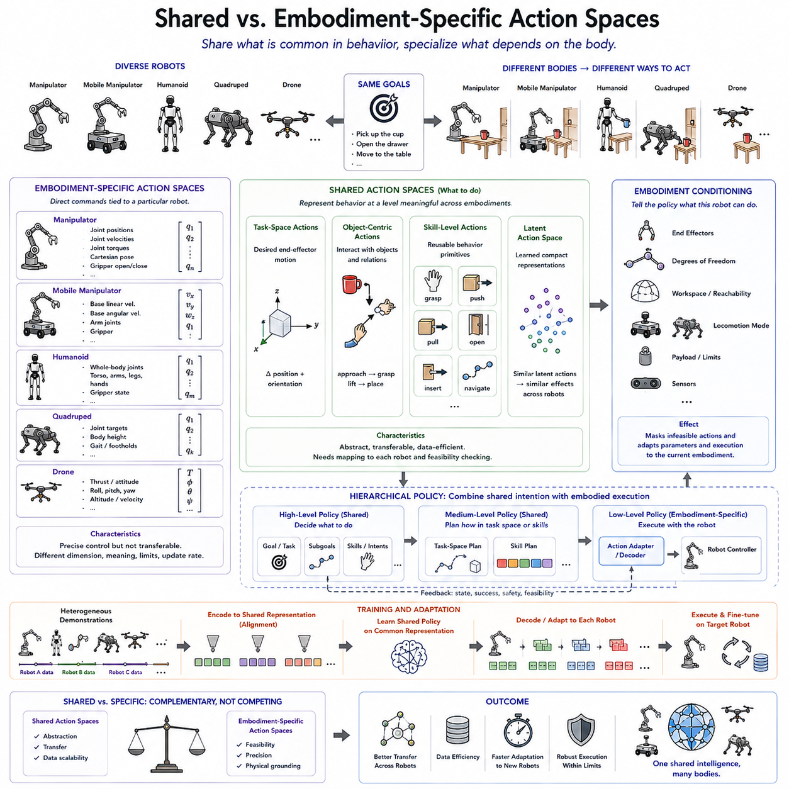{width="7.268055555555556in" height="7.268055555555556in"}

A central problem in cross-embodiment learning is deciding which parts of robot action should be shared across platforms and which must remain specific to individual bodies. Robots can pursue common goals while possessing fundamentally different actuators, degrees of freedom, control modes, and motion constraints. A scalable robot foundation model therefore needs action representations that preserve transferable behavioral meaning without assuming identical hardware interfaces.

An embodiment-specific action space directly represents commands accepted by a particular robot. For a manipulator, actions may consist of joint positions, velocities, torques, Cartesian end-effector poses, and gripper commands. A mobile robot may use linear and angular velocity, while a humanoid may require coordinated whole-body joint targets. These representations provide precise control but are naturally coupled to the hardware that defines them.

This coupling creates difficulties when combining data from heterogeneous robots. A seven-dimensional joint command from one arm does not necessarily correspond to a seven-dimensional command from another arm, even if their numerical ranges appear similar. Joint ordering, axes, limits, link geometry, controller semantics, and update frequency may all differ. Treating such vectors as equivalent can introduce misleading correspondences into cross-robot learning.

Shared action spaces attempt to represent behavior at a level that remains meaningful across multiple embodiments. Instead of encoding individual actuator commands, they may describe task-space displacement, desired end-effector motion, object interaction, behavioral skills, subgoals, or intended physical effects. The shared representation captures what the robot is trying to accomplish, while embodiment-specific mechanisms determine how that intention should be physically executed.

Task-space actions provide one useful form of sharing for manipulators. A desired change in end-effector position and orientation can apply to several arms even when their joint structures differ. Each robot can translate the shared task-space command through inverse kinematics and its own controller. This abstraction reduces dependence on joint dimensionality, although differences in reachability, dexterity, collision constraints, and end effectors still require embodiment-aware interpretation.

Object-centric actions move the abstraction closer to the task itself. Rather than requesting a specific arm displacement, a policy can represent an intended interaction such as approaching a cup, grasping its handle, lifting it, or placing it on a target surface. Such actions describe changes involving objects and relationships in the world. They can therefore remain meaningful across robots whose motor implementations differ substantially.

Skill-level representations provide an even higher form of action abstraction. Behaviors such as grasp, push, pull, navigate, align, open, insert, or place can function as shared action concepts. A generalist policy may select one of these skills and provide parameters describing its target or desired outcome. Robot-specific skill controllers then realize the selected behavior using the morphology, sensors, and actuators available on each embodiment.

Latent action spaces offer a learned alternative to manually defined shared actions. A model can discover compact representations that capture recurring patterns of behavior across heterogeneous demonstrations. Ideally, nearby latent actions correspond to similar task-level effects even when the underlying motor trajectories come from different robots. Embodiment-specific decoders can then transform the shared latent representation into executable commands for each platform.

However, a completely universal action space is difficult to construct because not every behavior has an equivalent realization on every robot. A manipulator can grasp an object that a navigation-only AMR cannot manipulate, while a drone can change altitude in ways unavailable to ground robots. Shared action representations must therefore account for capability differences rather than assuming that every action token or latent skill is valid for every embodiment.

Capability masks or embodiment conditioning can address this limitation. The policy can receive information describing available end effectors, locomotion modes, degrees of freedom, workspace, payload, and other physical constraints. This information determines which shared actions are feasible and how they should be parameterized. The same shared action vocabulary can consequently produce different valid subsets and execution strategies for different robots.

Hierarchical policies naturally combine shared and embodiment-specific action spaces. A high-level policy can reason in terms of goals, subgoals, semantic skills, or desired state transitions that generalize across robots. A lower-level policy then converts those decisions into platform-specific trajectories and control commands. This hierarchy separates transferable decision making from mechanical execution while allowing feedback between the two levels when an intended action is infeasible.

Action adapters provide another practical interface between shared models and heterogeneous hardware. A common policy backbone can generate shared action features, while a lightweight adapter maps them into the command representation required by a particular robot. When a new platform is introduced, much of the foundation model can remain unchanged, and adaptation can focus on learning the mapping between the shared action representation and the new robot\'s controller.

The reverse mapping is also important during training. Demonstrations collected from different robots begin in embodiment-specific action spaces and must be mapped into a representation that exposes common behavioral structure. Encoders can transform joint trajectories, Cartesian motions, gripper commands, or locomotion signals into shared actions or latent skills. Training then becomes an alignment problem between heterogeneous physical executions and common task-level meaning.

Temporal abstraction further affects whether action spaces can be shared. Robots operate at different control frequencies and mechanical speeds, making individual time-step commands difficult to compare. Action chunks, motion primitives, skills, and subgoal transitions represent behavior over longer intervals and can reduce sensitivity to control rate. The shared representation can describe the intended temporal behavior while each embodiment determines the detailed execution timing.

Shared action spaces should nevertheless retain enough information for closed-loop control. Excessive abstraction can remove geometric or dynamic details required to respond to contact, obstacles, uncertainty, and execution errors. A useful architecture therefore supports multiple levels of action representation, from semantic goals and skills through task-space commands to embodiment-specific motor control, with feedback allowing higher levels to revise decisions when physical execution deviates from expectations.

The balance between sharing and specialization depends on robot similarity. Two industrial manipulators may share Cartesian actions with relatively small adaptation, whereas transfer between a humanoid and a mobile manipulator may require more abstract skills. Transfer between a manipulator and a drone may share task semantics but very little low-level action structure. The appropriate shared space therefore depends on the physical and functional overlap among embodiments.

For large heterogeneous datasets, this layered view prevents incompatible action formats from fragmenting learning into isolated robot-specific models. Common task semantics, skills, object interactions, and desired effects can contribute to a shared policy backbone, while specialized decoders preserve the precision required by individual platforms. Data from many robots can consequently strengthen common representations without forcing artificial equivalence between fundamentally different actuators.

Shared and embodiment-specific action spaces should therefore be viewed as complementary rather than competing alternatives. Shared spaces provide abstraction, transfer, and data scalability, while embodiment-specific spaces provide feasibility, precision, and physical grounding. Connecting them through conditioning, hierarchical policies, latent actions, and adapters enables robot foundation models to reuse behavioral knowledge while respecting the unique capabilities and constraints of each body.

교차 구현체 학습(Cross-Embodiment Learning)의 핵심 문제 중 하나는 로봇 행동의 어떤 부분을 여러 플랫폼에서 공유하고 어떤 부분을 개별 몸체에 특화해야 하는지를 결정하는 것이다. 로봇들은 공통된 목표를 추구하면서도 근본적으로 서로 다른 액추에이터(Actuator), 자유도(Degrees of Freedom), 제어 방식(Control Mode), 운동 제약조건(Motion Constraint)을 가질 수 있다. 따라서 확장 가능한 로봇 파운데이션 모델(Robot Foundation Model)은 동일한 하드웨어 인터페이스를 가정하지 않으면서 전이 가능한 행동 의미를 유지하는 행동 표현(Action Representation)을 필요로 한다.

구현체별 행동 공간(Embodiment-Specific Action Space)은 특정 로봇이 직접 받아들이는 명령을 표현한다. 매니퓰레이터(Manipulator)의 행동은 관절 위치, 속도, 토크(Torque), 데카르트 말단장치 자세(Cartesian End-Effector Pose), 그리퍼 명령(Gripper Command)으로 구성될 수 있다. 이동 로봇은 선속도와 각속도를 사용할 수 있으며, 휴머노이드(Humanoid)는 협조된 전신 관절 목표(Whole-Body Joint Target)가 필요할 수 있다. 이러한 표현은 정밀한 제어를 제공하지만 이를 정의하는 하드웨어에 본질적으로 결합되어 있다.

이러한 결합은 이질적인 로봇의 데이터를 통합할 때 어려움을 발생시킨다. 한 로봇 팔의 7차원 관절 명령은 수치 범위가 유사하더라도 다른 로봇 팔의 7차원 명령과 반드시 대응하는 것은 아니다. 관절 순서, 축, 한계, 링크 형상(Link Geometry), 제어기 의미(Controller Semantics), 갱신 주파수(Update Frequency)가 모두 다를 수 있다. 이러한 벡터를 동일한 것으로 처리하면 교차 로봇 학습(Cross-Robot Learning)에 잘못된 대응 관계가 도입될 수 있다.

공유 행동 공간(Shared Action Space)은 여러 구현체에서 의미를 유지할 수 있는 수준으로 행동을 표현하려 한다. 개별 액추에이터 명령을 인코딩하는 대신 작업 공간 변위(Task-Space Displacement), 원하는 말단장치 운동, 물체 상호작용(Object Interaction), 행동 기술(Behavioral Skill), 하위 목표(Subgoal), 의도된 물리적 효과(Intended Physical Effect)를 표현할 수 있다. 공유 표현은 로봇이 무엇을 달성하려 하는지를 포착하고, 구현체별 메커니즘이 그 의도를 물리적으로 어떻게 실행할지를 결정한다.

작업 공간 행동(Task-Space Action)은 매니퓰레이터 사이에서 공유하기에 유용한 표현 방식 중 하나이다. 원하는 말단장치의 위치와 방향 변화는 관절 구조가 서로 다른 여러 로봇 팔에도 적용할 수 있다. 각 로봇은 역기구학(Inverse Kinematics)과 자체 제어기를 이용하여 공유 작업 공간 명령을 변환할 수 있다. 이러한 추상화는 관절 차원에 대한 의존성을 줄이지만 도달 가능성(Reachability), 민첩성(Dexterity), 충돌 제약조건, 말단장치의 차이는 여전히 구현체 인식 해석(Embodiment-Aware Interpretation)을 필요로 한다.

객체 중심 행동(Object-Centric Action)은 추상화 수준을 실제 작업에 더욱 가깝게 이동시킨다. 정책(Policy)은 특정 로봇 팔의 변위를 요청하는 대신 컵에 접근하기, 손잡이를 파지하기, 들어 올리기, 목표 표면에 놓기와 같은 의도된 상호작용을 표현할 수 있다. 이러한 행동은 세계 안에서 물체와 관계에 발생해야 하는 변화를 설명한다. 따라서 운동 구현 방식이 크게 다른 로봇에서도 공통된 의미를 유지할 수 있다.

기술 수준 표현(Skill-Level Representation)은 더욱 높은 수준의 행동 추상화를 제공한다. 파지(Grasp), 밀기(Push), 당기기(Pull), 이동(Navigate), 정렬(Align), 열기(Open), 삽입(Insert), 배치(Place)와 같은 행동은 공유 행동 개념으로 기능할 수 있다. 제너럴리스트 정책(Generalist Policy)은 이러한 기술 중 하나를 선택하고 목표나 원하는 결과를 설명하는 파라미터를 제공할 수 있다. 이후 로봇별 기술 제어기(Skill Controller)가 각 구현체가 가진 형태학(Morphology), 센서, 액추에이터를 이용하여 선택된 행동을 실행한다.

잠재 행동 공간(Latent Action Space)은 수동으로 정의된 공유 행동을 대신하는 학습 기반 접근법을 제공한다. 모델은 이질적인 시연(Heterogeneous Demonstration)에서 반복적으로 나타나는 행동 패턴을 포착하는 압축된 표현을 발견할 수 있다. 이상적으로는 기반 운동 궤적이 서로 다른 로봇에서 생성되더라도 가까운 잠재 행동(Latent Action)이 유사한 작업 수준 효과(Task-Level Effect)에 대응한다. 이후 구현체별 디코더(Embodiment-Specific Decoder)가 공유 잠재 표현을 각 플랫폼에서 실행 가능한 명령으로 변환할 수 있다.

그러나 모든 행동이 모든 로봇에서 동등하게 구현될 수 있는 것은 아니기 때문에 완전히 범용적인 행동 공간(Universal Action Space)을 구축하기는 어렵다. 매니퓰레이터는 물체를 파지할 수 있지만 주행 기능만 가진 AMR(Autonomous Mobile Robot)은 물체를 조작할 수 없으며, 드론(Drone)은 지상 로봇이 수행할 수 없는 고도 변경을 수행할 수 있다. 따라서 공유 행동 표현은 모든 행동 토큰(Action Token)이나 잠재 기술(Latent Skill)이 모든 구현체에서 유효하다고 가정하기보다 능력의 차이를 고려해야 한다.

능력 마스크(Capability Mask) 또는 구현체 조건화(Embodiment Conditioning)를 통해 이러한 한계를 해결할 수 있다. 정책은 사용 가능한 말단장치, 이동 방식, 자유도, 작업공간, 가반하중(Payload) 등의 물리적 제약조건을 설명하는 정보를 입력받을 수 있다. 이러한 정보는 어떤 공유 행동이 실행 가능한지와 어떻게 파라미터화해야 하는지를 결정한다. 따라서 동일한 공유 행동 어휘(Shared Action Vocabulary)라도 로봇에 따라 서로 다른 유효 행동 집합과 실행 전략을 생성할 수 있다.

계층적 정책(Hierarchical Policy)은 공유 행동 공간과 구현체별 행동 공간을 자연스럽게 결합한다. 상위 수준 정책(High-Level Policy)은 로봇 간에 일반화할 수 있는 목표, 하위 목표, 의미적 기술(Semantic Skill), 원하는 상태 전이(State Transition)를 기반으로 추론할 수 있다. 이후 저수준 정책(Low-Level Policy)은 이러한 결정을 플랫폼별 궤적과 제어 명령으로 변환한다. 이러한 계층 구조는 전이 가능한 의사결정과 기계적 실행을 분리하면서 의도된 행동이 실행 불가능한 경우 두 수준 사이에서 피드백이 이루어지도록 한다.

행동 어댑터(Action Adapter)는 공유 모델과 이질적인 하드웨어를 연결하는 또 다른 실용적인 인터페이스를 제공한다. 공통 정책 백본(Common Policy Backbone)이 공유 행동 특징을 생성하면 경량 어댑터(Lightweight Adapter)가 이를 특정 로봇이 요구하는 명령 표현으로 매핑할 수 있다. 새로운 플랫폼이 도입될 경우 파운데이션 모델의 대부분은 변경하지 않고 공유 행동 표현과 새로운 로봇의 제어기 사이의 매핑을 학습하는 데 적응 과정을 집중할 수 있다.

학습 과정에서는 반대 방향의 매핑도 중요하다. 서로 다른 로봇에서 수집된 시연은 구현체별 행동 공간에서 시작하기 때문에 공통된 행동 구조를 드러내는 표현으로 변환되어야 한다. 인코더(Encoder)는 관절 궤적, 데카르트 운동, 그리퍼 명령, 이동 신호를 공유 행동 또는 잠재 기술로 변환할 수 있다. 따라서 학습은 이질적인 물리적 실행(Heterogeneous Physical Execution)과 공통된 작업 수준 의미(Common Task-Level Meaning) 사이의 정렬 문제(Alignment Problem)가 된다.

시간적 추상화(Temporal Abstraction) 역시 행동 공간의 공유 가능성에 영향을 미친다. 로봇은 서로 다른 제어 주파수와 기계적 속도로 동작하기 때문에 개별 시간 단계(Time Step)의 명령을 직접 비교하기 어렵다. 행동 청크(Action Chunk), 운동 프리미티브(Motion Primitive), 기술, 하위 목표 전이는 더 긴 시간 구간의 행동을 표현하여 제어 주파수에 대한 민감도를 줄일 수 있다. 공유 표현은 의도된 시간적 행동을 설명하고 각 구현체는 세부적인 실행 타이밍을 결정할 수 있다.

그러나 공유 행동 공간은 폐루프 제어(Closed-Loop Control)에 필요한 충분한 정보를 유지해야 한다. 지나친 추상화는 접촉, 장애물, 불확실성, 실행 오류에 대응하는 데 필요한 기하학적 또는 동역학적 세부 정보를 제거할 수 있다. 따라서 유용한 아키텍처는 의미적 목표와 기술에서 작업 공간 명령을 거쳐 구현체별 모터 제어(Motor Control)에 이르는 여러 수준의 행동 표현을 지원해야 하며, 물리적 실행이 예상에서 벗어나면 상위 수준이 결정을 수정할 수 있도록 피드백을 제공해야 한다.

공유와 특화 사이의 균형은 로봇 간 유사성에 따라 달라진다. 두 산업용 매니퓰레이터는 비교적 적은 적응만으로 데카르트 행동(Cartesian Action)을 공유할 수 있지만, 휴머노이드와 이동형 매니퓰레이터 사이의 전이는 보다 추상적인 기술을 필요로 할 수 있다. 매니퓰레이터와 드론 사이에서는 작업 의미(Task Semantics)는 공유할 수 있지만 저수준 행동 구조는 거의 공유하지 못할 수 있다. 따라서 적절한 공유 공간은 구현체 사이의 물리적·기능적 공통성에 따라 결정되어야 한다.

대규모 이질적 데이터셋(Heterogeneous Dataset)에서 이러한 계층적 관점은 서로 호환되지 않는 행동 형식으로 인해 학습이 고립된 로봇별 모델로 분리되는 것을 방지한다. 공통 작업 의미, 기술, 물체 상호작용, 원하는 효과는 공유 정책 백본(Shared Policy Backbone)의 학습에 기여하고, 특화된 디코더는 개별 플랫폼에 필요한 정밀도를 유지한다. 결과적으로 여러 로봇의 데이터는 근본적으로 다른 액추에이터 사이에 인위적인 동등성을 강제하지 않으면서 공통 표현을 강화할 수 있다.

따라서 공유 행동 공간(Shared Action Space)과 구현체별 행동 공간(Embodiment-Specific Action Space)은 서로 경쟁하는 대안이 아니라 상호 보완적인 요소로 이해해야 한다. 공유 공간은 추상화, 전이(Transfer), 데이터 확장성(Data Scalability)을 제공하고, 구현체별 공간은 실행 가능성(Feasibility), 정밀성(Precision), 물리적 기반화(Physical Grounding)를 제공한다. 조건화, 계층적 정책, 잠재 행동, 어댑터를 통해 두 공간을 연결하면 로봇 파운데이션 모델은 각 몸체의 고유한 능력과 제약조건을 존중하면서 행동 지식을 재사용할 수 있다.

## 08.07. Cross Robot Data Mixture

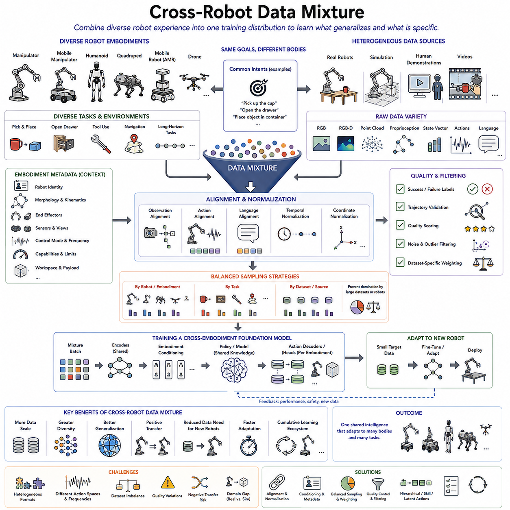{width="7.268055555555556in" height="7.268055555555556in"}

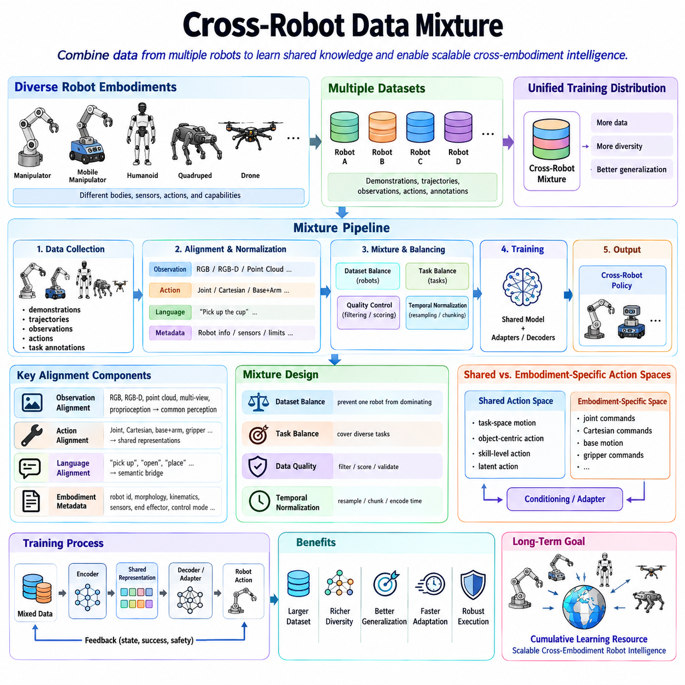{width="7.268055555555556in" height="7.268055555555556in"}

Cross-robot data mixture is the process of combining demonstrations, trajectories, observations, actions, and task annotations collected from multiple robot embodiments into a unified training distribution. Rather than treating each robot dataset as an isolated resource, cross-embodiment learning uses their combined experience to train models that capture knowledge shared across platforms while retaining information needed for robot-specific execution.

The motivation for mixing robot data is fundamentally one of scale. Individual robots usually generate much smaller datasets than those available for language or vision foundation models because physical data collection is expensive, slow, and operationally demanding. Combining datasets from many laboratories, robot families, tasks, and environments increases the amount and diversity of experience available to a robot foundation model without requiring one platform to collect everything independently.

A cross-robot mixture may include industrial manipulators, collaborative arms, mobile manipulators, humanoids, quadrupeds, and other embodied systems. These platforms can contribute experience involving manipulation, navigation, locomotion, object interaction, tool use, and long-horizon tasks. The resulting dataset covers a broader distribution of physical situations than any single robot is likely to encounter, creating a stronger basis for generalization.

However, robot datasets cannot simply be concatenated and treated as if they were generated by identical systems. Different robots use different observation formats, camera configurations, state vectors, action dimensions, control frequencies, coordinate conventions, and task definitions. Cross-robot data mixture therefore requires normalization and representation mechanisms that expose common structure while preserving embodiment information necessary to interpret each trajectory correctly.

Observation alignment is one important component of this process. Some datasets may provide RGB images, others RGB-D observations or point clouds, and others multiple camera views combined with proprioception. Shared visual or multimodal encoders can map these heterogeneous observations into compatible perceptual representations. The objective is not to make raw measurements identical, but to extract common information about objects, scenes, spatial relationships, and task state.

Action alignment is generally more difficult because actions are directly tied to robot hardware. One manipulator may record joint velocities, another Cartesian end-effector deltas, and a mobile manipulator may combine base motion with arm and gripper commands. A useful mixture must preserve these distinctions while mapping actions toward shared task-space, skill-level, object-centric, or latent representations whenever meaningful cross-robot correspondence exists.

Language can provide a valuable alignment layer across heterogeneous datasets. Instructions such as "pick up the cup," "open the drawer," or "place the object in the container" can describe common task intent even when different robots execute the instructions through different trajectories. Language-conditioned training therefore provides a semantic bridge between mechanically incompatible demonstrations and helps organize them around shared goals rather than platform-specific motor commands.

Embodiment metadata is equally important when mixing datasets. Each trajectory can be associated with information describing robot identity, morphology, kinematic structure, sensors, end effectors, control mode, and available capabilities. The model can use this context to understand why two demonstrations with similar semantic goals contain different observations and actions. Without embodiment information, genuine physical differences may appear as inconsistent or contradictory training examples.

Dataset balance strongly influences what a cross-robot model learns. If one large dataset or robot family dominates the mixture, the model may optimize primarily for that embodiment and treat smaller datasets as statistical exceptions. Sampling strategies can therefore adjust the probability of selecting data from particular robots, tasks, or datasets. The goal is not necessarily equal sampling, but a mixture that prevents scale alone from determining which embodiments shape the representation.

Task balance creates a similar challenge. Large datasets may contain enormous numbers of simple pick-and-place demonstrations while complex tool-use, navigation, or long-horizon tasks appear much less frequently. Uncontrolled mixing can bias the model toward common behaviors and weaken learning of rare capabilities. Mixture design must therefore consider task diversity together with robot diversity so that the resulting model learns a broad behavioral repertoire rather than merely the most frequent motions.

Data quality also varies across sources. Demonstrations can differ in success rate, operator skill, sensor quality, calibration accuracy, temporal synchronization, annotation consistency, and control smoothness. Larger mixtures are not automatically better if noisy or poorly aligned trajectories dominate training. Filtering, quality scoring, success labels, trajectory validation, and dataset-specific weighting can help prevent low-quality experience from overwhelming useful transferable patterns.

Temporal normalization is necessary because robots operate at different frequencies and speeds. A demonstration recorded at 10 Hz cannot be interpreted identically to one recorded at 50 Hz simply because both contain the same number of action steps. Resampling, action chunking, physical-time encoding, or skill-level segmentation can create more comparable temporal representations while preserving the actual dynamics and control requirements of each platform.

Cross-robot mixtures can also combine real-world and simulated experience. Simulation provides large amounts of controllable and inexpensive interaction data, while real robots provide the sensing noise, contact complexity, calibration errors, and operational constraints of physical environments. Mixing both sources can broaden coverage, but the model must distinguish domain differences so that synthetic regularities do not become mistaken for universally valid physical behavior.

Human demonstrations and videos can further expand the mixture when representations are sufficiently abstract. Human actions cannot usually be mapped directly onto robot joint commands, but they provide rich information about task sequences, object affordances, interaction intent, and state transitions. When combined with robot trajectories through semantic or latent representations, human data can contribute knowledge that would be prohibitively expensive to reproduce entirely through robotic demonstrations.

A successful mixture should encourage positive transfer, in which experience from one robot improves performance on another. Negative transfer can occur when incompatible action conventions, sensor biases, or platform-specific behaviors are incorrectly treated as shared structure. Embodiment conditioning, capability-aware representations, specialized action heads, and dataset-aware sampling help the model determine which information should transfer and which information should remain local to a particular robot family.

Cross-robot pretraining changes the role of data collected for a new robot. Instead of serving as the complete foundation for learning, target-robot data can specialize a model that already understands many objects, tasks, environments, and interaction patterns. Fine-tuning or lightweight adaptation can focus on the new embodiment\'s morphology, sensing, dynamics, and action interface. This can substantially reduce the amount of platform-specific data required for useful deployment.

The long-term importance of cross-robot data mixture lies in converting fragmented robot experience into a cumulative learning resource. Every new embodiment can contribute observations and behaviors to a shared training ecosystem while benefiting from experience gathered by previous robots. With appropriate alignment, balancing, conditioning, and quality control, heterogeneous datasets become more than a collection of incompatible trajectories: they become the data foundation for scalable cross-embodiment robot intelligence.

교차 로봇 데이터 혼합(Cross-Robot Data Mixture)은 여러 로봇 구현체(Robot Embodiment)에서 수집된 시연(Demonstration), 궤적(Trajectory), 관측(Observation), 행동(Action), 작업 주석(Task Annotation)을 하나의 통합된 학습 분포(Training Distribution)로 결합하는 과정이다. 교차 구현체 학습(Cross-Embodiment Learning)은 각각의 로봇 데이터셋을 독립된 자원으로 취급하는 대신, 여러 플랫폼의 경험을 결합하여 로봇별 실행에 필요한 정보를 유지하면서 플랫폼 간에 공유되는 지식을 포착하는 모델을 학습한다.

로봇 데이터를 혼합하는 근본적인 이유는 규모(Scale)를 확보하기 위해서이다. 물리적 데이터 수집은 비용이 높고 느리며 운영상의 부담이 크기 때문에 개별 로봇이 생성하는 데이터셋은 일반적으로 언어 또는 비전 파운데이션 모델(Foundation Model)에 사용되는 데이터보다 훨씬 작다. 여러 연구기관, 로봇 계열, 작업, 환경에서 생성된 데이터셋을 결합하면 하나의 플랫폼이 모든 데이터를 독립적으로 수집하지 않고도 로봇 파운데이션 모델(Robot Foundation Model)이 활용할 수 있는 경험의 양과 다양성을 확대할 수 있다.

교차 로봇 혼합(Cross-Robot Mixture)에는 산업용 매니퓰레이터(Industrial Manipulator), 협동 로봇 팔(Collaborative Arm), 이동형 매니퓰레이터(Mobile Manipulator), 휴머노이드(Humanoid), 사족보행 로봇(Quadruped) 및 기타 구현형 시스템(Embodied System)이 포함될 수 있다. 이러한 플랫폼은 조작, 주행, 이동, 물체 상호작용, 도구 사용, 장기 작업(Long-Horizon Task)에 관한 경험을 제공할 수 있다. 결과적으로 생성되는 데이터셋은 하나의 로봇이 경험하기 어려운 폭넓은 물리적 상황을 포함하며 일반화를 위한 더욱 강력한 기반을 제공한다.

그러나 로봇 데이터셋을 단순히 연결한 후 동일한 시스템에서 생성된 것처럼 취급할 수는 없다. 서로 다른 로봇은 서로 다른 관측 형식, 카메라 구성, 상태 벡터(State Vector), 행동 차원(Action Dimension), 제어 주파수(Control Frequency), 좌표계 규칙(Coordinate Convention), 작업 정의를 사용한다. 따라서 교차 로봇 데이터 혼합에는 각각의 궤적을 올바르게 해석하는 데 필요한 구현체 정보를 유지하면서 공통 구조를 드러낼 수 있는 정규화(Normalization)와 표현 메커니즘(Representation Mechanism)이 필요하다.

관측 정렬(Observation Alignment)은 이러한 과정의 중요한 구성요소이다. 일부 데이터셋은 RGB 이미지를 제공하고, 다른 데이터셋은 RGB-D 관측 또는 포인트 클라우드(Point Cloud)를 제공하며, 또 다른 데이터셋은 여러 카메라 시점과 고유수용감각(Proprioception)을 결합할 수 있다. 공유 비전 또는 멀티모달 인코더(Shared Visual or Multimodal Encoder)는 이러한 이질적인 관측을 호환 가능한 지각 표현(Perceptual Representation)으로 매핑할 수 있다. 목표는 원시 측정값을 동일하게 만드는 것이 아니라 물체, 장면, 공간 관계, 작업 상태에 대한 공통 정보를 추출하는 것이다.

행동 정렬(Action Alignment)은 행동이 로봇 하드웨어에 직접적으로 연결되기 때문에 일반적으로 더욱 어렵다. 하나의 매니퓰레이터는 관절 속도(Joint Velocity)를 기록하고, 다른 로봇은 데카르트 말단장치 변화량(Cartesian End-Effector Delta)을 사용하며, 이동형 매니퓰레이터는 베이스 이동과 로봇 팔 및 그리퍼 명령을 결합할 수 있다. 유용한 데이터 혼합은 이러한 차이를 유지하면서 의미 있는 교차 로봇 대응 관계가 존재하는 경우 행동을 공유 작업 공간(Task Space), 기술 수준(Skill-Level), 객체 중심(Object-Centric) 또는 잠재 표현(Latent Representation)으로 매핑해야 한다.

언어(Language)는 이질적인 데이터셋 사이에서 유용한 정렬 계층(Alignment Layer)을 제공할 수 있다. "컵을 집어라", "서랍을 열어라", "물체를 용기에 넣어라"와 같은 명령은 서로 다른 로봇이 서로 다른 궤적을 통해 실행하더라도 공통된 작업 의도(Task Intent)를 설명할 수 있다. 따라서 언어 조건화 학습(Language-Conditioned Training)은 기계적으로 호환되지 않는 시연 사이에 의미적 연결고리를 제공하며, 플랫폼별 모터 명령보다 공유된 목표를 중심으로 데이터를 구성하는 데 도움을 준다.

데이터셋을 혼합할 때 구현체 메타데이터(Embodiment Metadata) 역시 중요하다. 각각의 궤적에는 로봇 식별 정보, 형태학(Morphology), 운동학적 구조(Kinematic Structure), 센서, 말단장치(End Effector), 제어 방식(Control Mode), 사용 가능한 능력(Capability)을 설명하는 정보를 연결할 수 있다. 모델은 이러한 맥락을 이용하여 의미적으로 유사한 목표를 가진 두 시연이 왜 서로 다른 관측과 행동을 포함하는지를 이해할 수 있다. 구현체 정보가 없다면 실제 물리적 차이가 일관되지 않거나 모순된 학습 사례처럼 나타날 수 있다.

데이터셋 균형(Dataset Balance)은 교차 로봇 모델이 무엇을 학습하는지에 큰 영향을 준다. 하나의 대규모 데이터셋이나 특정 로봇 계열이 혼합 데이터의 대부분을 차지하면 모델은 주로 해당 구현체에 최적화되고 작은 데이터셋을 통계적인 예외로 취급할 수 있다. 따라서 샘플링 전략(Sampling Strategy)을 통해 특정 로봇, 작업 또는 데이터셋에서 데이터를 선택하는 확률을 조절할 수 있다. 목표는 반드시 동일한 비율로 샘플링하는 것이 아니라 단순한 데이터 규모만으로 어떤 구현체가 표현 학습을 지배하지 않도록 혼합 비율을 설계하는 것이다.

작업 균형(Task Balance) 역시 유사한 문제를 발생시킨다. 대규모 데이터셋에는 단순한 픽앤플레이스(Pick-and-Place) 시연이 매우 많이 포함될 수 있지만 복잡한 도구 사용, 주행, 장기 작업은 훨씬 적게 나타날 수 있다. 제어되지 않은 데이터 혼합은 모델을 빈번한 행동에 편향시키고 희귀한 능력의 학습을 약화시킬 수 있다. 따라서 혼합 설계(Mixture Design)는 로봇 다양성과 함께 작업 다양성을 고려하여 모델이 가장 빈번한 움직임만이 아니라 폭넓은 행동 레퍼토리(Behavioral Repertoire)를 학습하도록 해야 한다.

데이터 품질(Data Quality) 역시 데이터 출처마다 달라질 수 있다. 시연은 성공률, 작업자의 숙련도, 센서 품질, 보정 정확도(Calibration Accuracy), 시간 동기화(Temporal Synchronization), 주석 일관성(Annotation Consistency), 제어 부드러움(Control Smoothness)에서 차이가 날 수 있다. 잡음이 많거나 정렬이 불량한 궤적이 학습을 지배한다면 데이터 혼합 규모가 커지는 것만으로 성능이 향상되지는 않는다. 필터링, 품질 점수(Quality Scoring), 성공 레이블(Success Label), 궤적 검증(Trajectory Validation), 데이터셋별 가중치 부여를 통해 낮은 품질의 경험이 유용한 전이 패턴을 압도하는 것을 방지할 수 있다.

로봇마다 서로 다른 주파수와 속도로 동작하기 때문에 시간 정규화(Temporal Normalization)도 필요하다. 10Hz로 기록된 시연과 50Hz로 기록된 시연은 동일한 수의 행동 단계를 포함하더라도 같은 방식으로 해석할 수 없다. 리샘플링(Resampling), 행동 청크(Action Chunking), 물리 시간 인코딩(Physical-Time Encoding), 기술 수준 분할(Skill-Level Segmentation)을 사용하면 각 플랫폼의 실제 동역학과 제어 요구조건을 유지하면서 더욱 비교 가능한 시간 표현(Temporal Representation)을 생성할 수 있다.

교차 로봇 혼합은 실제 환경(Real-World)과 시뮬레이션(Simulation)의 경험도 결합할 수 있다. 시뮬레이션은 제어 가능하고 저렴한 대규모 상호작용 데이터를 제공하며, 실제 로봇은 센서 잡음, 복잡한 접촉, 보정 오차, 실제 운영 제약조건을 제공한다. 두 데이터 소스를 혼합하면 학습 범위를 확대할 수 있지만 모델은 도메인 차이(Domain Difference)를 구별해야 하며, 시뮬레이션에서 나타나는 규칙성을 보편적으로 유효한 물리적 행동으로 잘못 해석하지 않아야 한다.

표현이 충분히 추상화되어 있다면 인간 시연(Human Demonstration)과 영상도 데이터 혼합을 더욱 확장할 수 있다. 인간의 행동은 일반적으로 로봇 관절 명령으로 직접 매핑할 수 없지만 작업 순서, 물체의 행동유도성(Affordance), 상호작용 의도(Interaction Intent), 상태 전이(State Transition)에 대한 풍부한 정보를 제공한다. 의미적 표현 또는 잠재 표현을 통해 로봇 궤적과 결합하면 인간 데이터는 전적으로 로봇 시연으로 재현하기에는 지나치게 많은 비용이 필요한 지식을 제공할 수 있다.

성공적인 데이터 혼합은 하나의 로봇에서 얻은 경험이 다른 로봇의 성능을 향상시키는 긍정적 전이(Positive Transfer)를 촉진해야 한다. 반대로 서로 호환되지 않는 행동 규칙, 센서 편향(Sensor Bias), 플랫폼별 행동을 잘못된 공유 구조로 처리하면 부정적 전이(Negative Transfer)가 발생할 수 있다. 구현체 조건화(Embodiment Conditioning), 능력 인식 표현(Capability-Aware Representation), 특화된 행동 헤드(Specialized Action Head), 데이터셋 인식 샘플링(Dataset-Aware Sampling)은 어떤 정보를 전이하고 어떤 정보를 특정 로봇 계열에 유지해야 하는지를 모델이 구분하도록 돕는다.

교차 로봇 사전학습(Cross-Robot Pretraining)은 새로운 로봇을 위해 수집되는 데이터의 역할도 변화시킨다. 대상 로봇 데이터(Target-Robot Data)가 전체 학습의 기반이 되는 대신, 이미 다양한 물체, 작업, 환경, 상호작용 패턴을 이해하는 모델을 특화하는 데 사용할 수 있다. 미세조정(Fine-Tuning)이나 경량 적응(Lightweight Adaptation)은 새로운 구현체의 형태학, 센싱, 동역학, 행동 인터페이스에 집중할 수 있다. 이를 통해 실제 배포에 필요한 플랫폼별 데이터의 양을 크게 줄일 수 있다.

교차 로봇 데이터 혼합의 장기적인 중요성은 분산되어 있던 로봇 경험을 누적 가능한 학습 자원(Cumulative Learning Resource)으로 전환하는 데 있다. 새로운 구현체는 이전 로봇들이 수집한 경험의 혜택을 받으면서 자신의 관측과 행동을 공유 학습 생태계(Shared Training Ecosystem)에 추가할 수 있다. 적절한 정렬, 균형 조정, 조건화, 품질 관리가 이루어진다면 이질적인 데이터셋은 더 이상 서로 호환되지 않는 궤적의 집합이 아니라 확장 가능한 교차 구현체 로봇 지능(Scalable Cross-Embodiment Robot Intelligence)을 구축하기 위한 데이터 기반이 된다.

## 08.08. Human to Robot Transfer

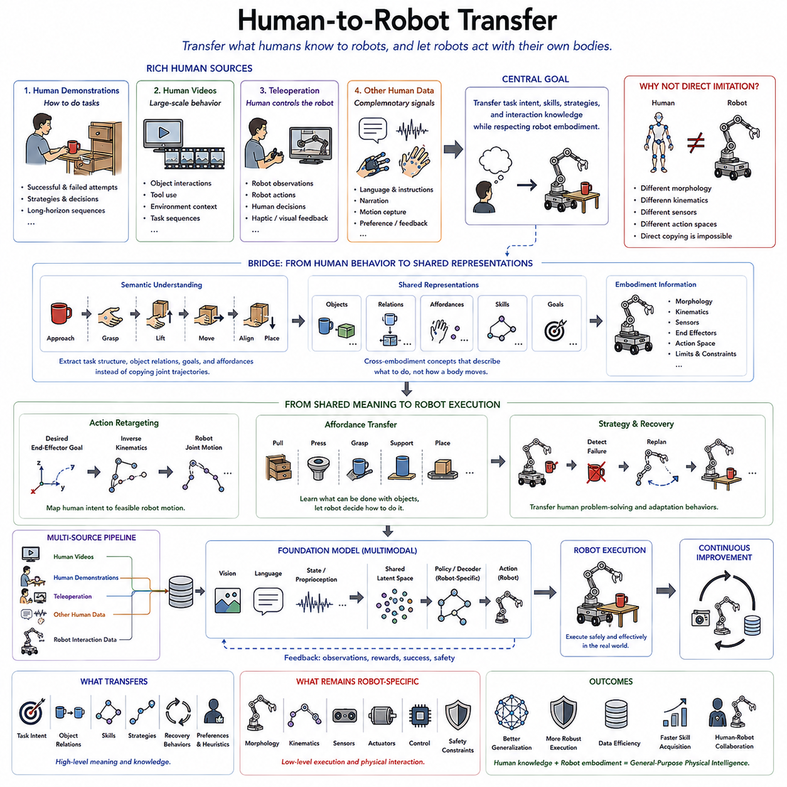{width="7.268055555555556in" height="7.268055555555556in"}

Human-to-robot transfer uses human demonstrations, videos, teleoperation, and interaction data as sources of knowledge for learning robotic behavior. Humans possess a highly different morphology from most robots, so direct transfer of human motor commands is generally impossible. The central objective is therefore to transfer task intent, object relationships, skills, strategies, and physical interaction patterns while allowing the robot to generate actions compatible with its own embodiment.

Human demonstrations provide information that is difficult to obtain from robot-only datasets. A person can demonstrate how to grasp an object, open a drawer, use a tool, recover from an unsuccessful attempt, or complete a long sequence of actions. Such demonstrations contain not only successful movements but also contextual decisions, interaction strategies, and temporal structure. These properties can provide valuable supervision for robot foundation models when they are represented at an appropriate abstraction level.

The embodiment difference between humans and robots makes direct imitation challenging. Human arms, hands, vision systems, body proportions, joint ranges, and control mechanisms differ substantially from robotic manipulators, humanoids, mobile robots, and quadrupeds. A human hand trajectory therefore cannot simply be copied into a robot joint trajectory. Human-to-robot transfer must separate transferable behavioral meaning from embodiment-specific motor execution.

Semantic representations provide one important bridge. A human demonstration can be interpreted as a sequence of concepts such as approach, grasp, lift, move, align, and place. These concepts can be associated with objects, spatial relationships, goals, and affordances rather than with individual human joint coordinates. A robot can then reconstruct the demonstrated behavior using its own morphology and action space while preserving the intended task structure.

Human video is particularly valuable because it can provide large-scale behavioral coverage without requiring physical robot operation. Videos contain information about object interactions, tool use, environmental context, human strategies, and task sequences. Vision-language models can extract semantic and temporal representations from these observations, creating a potential knowledge source that complements smaller but more precise robot demonstration datasets.

However, video alone does not directly reveal every physical variable required for robot control. Camera observations may hide forces, contact states, precise three-dimensional geometry, joint torques, or detailed hand configurations. A human demonstration may therefore be highly informative at the semantic level while remaining incomplete at the motor level. Robot learning systems must infer useful structure without assuming that visual observations contain all information necessary for direct action reproduction.

Teleoperation provides a stronger bridge between human expertise and robot actions because the human controls the robot while performing the task. The resulting data naturally contains robot-specific observations and actions while preserving human decision making. Depending on the interface, position, velocity, or force commands can be mapped into the robot, and synchronized visual or haptic feedback can capture the interaction. This makes teleoperation an important source of high-quality imitation-learning data.

A useful human-to-robot pipeline can therefore combine several levels of information. Human videos can provide broad semantic and behavioral knowledge, demonstrations can provide task structure, teleoperation can provide embodiment-grounded actions, and robot interaction data can provide physical feedback. These sources do not need to be treated as equivalent. Instead, each can contribute the type of information it captures most effectively to a shared representation and training process.

Action retargeting is required when human motion is explicitly transferred to a robot. Human poses or trajectories must be transformed through geometric and kinematic mappings that account for differences in body proportions, degrees of freedom, joint limits, and end effectors. For example, a human hand reaching toward an object may be converted into a robot end-effector target, after which inverse kinematics and robot-specific control determine feasible joint motion. The goal is functional equivalence rather than identical motion.

Affordance transfer provides another important mechanism. Humans naturally interact with objects according to their affordances: handles can be pulled, buttons can be pressed, containers can be grasped, and surfaces can support placement. A robot can learn these interaction opportunities from human behavior without copying the exact human movement. The transferred knowledge describes what can be done with an object, while the robot determines how its own body can perform the interaction.

Human demonstrations can also transfer recovery strategies and behavioral preferences. A person may recognize that a grasp has failed, reposition the hand, change the approach angle, or use another strategy. These decisions contain information about closed-loop adaptation that may be absent from scripted robot trajectories. Learning such behavior can help robot policies become more robust because they acquire not only nominal task execution but also ways to respond when the physical world differs from expectations.

The scale of human data can complement the limited scale of real robot data. Robot demonstrations require hardware, safety supervision, maintenance, operators, and physical environments, whereas human videos and demonstrations can be collected at much larger scale. A foundation model can therefore use human data to establish broad semantic and behavioral priors and use robot data to ground those priors in actual sensors, dynamics, action spaces, and safety constraints.

Cross-embodiment representations are essential for combining these sources. Human observations can be mapped into shared representations describing objects, scenes, spatial relations, task goals, affordances, and skills. Robot-specific embodiment information can then determine how these concepts should be executed. This follows the broader principle of sharing higher-level concepts while adapting low-level execution to each body.

The most effective human-to-robot transfer is therefore not simple imitation of human motion. It is a structured transfer from human experience to robot-executable behavior. Semantic understanding, task decomposition, interaction knowledge, strategies, and skills can be shared, while morphology, kinematics, sensors, actuators, and low-level control remain embodiment-specific. This separation allows human knowledge to become a scalable source of supervision for general robot intelligence.

Ultimately, human-to-robot transfer creates a bridge between the enormous behavioral knowledge available from humans and the physical execution capabilities of robots. Human demonstrations can teach robots what actions mean and how tasks are structured, while robot-specific learning determines how those intentions can be realized safely and effectively. Combined with multimodal foundation models, teleoperation, imitation learning, and embodiment-aware representations, this approach can substantially expand the data foundation for general-purpose physical intelligence.

인간-로봇 전이(Human-to-Robot Transfer)는 인간 시연(Human Demonstration), 영상(Video), 원격조작(Teleoperation), 상호작용 데이터(Interaction Data)를 로봇 행동 학습을 위한 지식의 원천으로 활용한다. 인간은 대부분의 로봇과 매우 다른 형태학(Morphology)을 가지기 때문에 인간의 운동 명령을 직접 전이하는 것은 일반적으로 불가능하다. 따라서 핵심 목표는 작업 의도(Task Intent), 물체 관계(Object Relationship), 기술(Skill), 전략(Strategy), 물리적 상호작용 패턴을 로봇 자신의 구현체(Embodiment)에 맞는 행동으로 생성하면서 전이하는 것이다.

인간 시연은 로봇만으로 구성된 데이터셋에서 얻기 어려운 정보를 제공한다. 사람은 물체를 파지하고, 서랍을 열고, 도구를 사용하고, 실패한 시도에서 복구하거나, 여러 행동으로 구성된 장기 작업(Long Sequence)을 수행하는 방법을 시연할 수 있다. 이러한 시연에는 성공적인 움직임뿐만 아니라 상황에 따른 의사결정, 상호작용 전략, 시간적 구조(Temporal Structure)도 포함된다. 이러한 특성은 적절한 추상화 수준에서 표현될 경우 로봇 파운데이션 모델(Robot Foundation Model)에 유용한 감독 정보(Supervision)를 제공할 수 있다.

인간과 로봇 사이의 구현체 차이는 직접 모방(Direct Imitation)을 어렵게 만든다. 인간의 팔, 손, 시각 시스템, 신체 비율, 관절 범위, 제어 메커니즘은 로봇 매니퓰레이터(Robotic Manipulator), 휴머노이드(Humanoid), 이동 로봇(Mobile Robot), 사족보행 로봇(Quadruped)과 크게 다르다. 따라서 인간의 손 궤적(Hand Trajectory)을 로봇의 관절 궤적(Joint Trajectory)으로 단순히 복사할 수 없다. 인간-로봇 전이는 전이 가능한 행동 의미(Behavioral Meaning)와 구현체별 운동 실행(Motor Execution)을 분리해야 한다.

의미 표현(Semantic Representation)은 이러한 연결을 제공하는 중요한 방법이다. 인간의 시연은 접근(Approach), 파지(Grasp), 들어 올리기(Lift), 이동(Move), 정렬(Align), 배치(Place)와 같은 개념의 연속으로 해석할 수 있다. 이러한 개념은 개별 인간 관절 좌표가 아니라 물체, 공간적 관계, 목표, 행동유도성(Affordance)과 연결될 수 있다. 이후 로봇은 자신의 형태학과 행동 공간(Action Space)을 사용하여 시연된 행동을 재구성하면서 의도된 작업 구조(Task Structure)를 유지할 수 있다.

인간 영상(Human Video)은 로봇을 직접 물리적으로 작동시키지 않고도 대규모 행동 범위(Behavioral Coverage)를 확보할 수 있기 때문에 특히 가치가 있다. 영상에는 물체 상호작용, 도구 사용, 환경 맥락, 인간의 전략, 작업 순서에 대한 정보가 포함된다. 비전-언어 모델(Vision-Language Model)은 이러한 관측으로부터 의미적·시간적 표현(Semantic and Temporal Representation)을 추출하여, 규모는 작지만 더욱 정밀한 로봇 시연 데이터셋을 보완하는 지식 원천으로 활용할 수 있다.

그러나 영상만으로는 로봇 제어에 필요한 모든 물리적 변수를 직접 확인할 수 없다. 카메라 관측에서는 힘, 접촉 상태(Contact State), 정확한 3차원 형상, 관절 토크, 세부적인 손 구성(Hand Configuration)이 가려질 수 있다. 따라서 인간 시연은 의미적 수준에서는 매우 유용한 정보를 제공하면서도 운동 수준에서는 불완전할 수 있다. 로봇 학습 시스템은 영상 관측에 직접적인 행동 재현에 필요한 모든 정보가 포함되어 있다고 가정하지 않고 유용한 구조를 추론해야 한다.

원격조작(Teleoperation)은 인간의 전문성과 로봇 행동 사이에 더욱 강력한 연결을 제공한다. 사람이 작업을 수행하면서 로봇을 직접 제어하기 때문에 생성되는 데이터에는 로봇의 구현체에 특화된 관측과 행동이 자연스럽게 포함되면서도 인간의 의사결정이 유지된다. 인터페이스에 따라 위치, 속도 또는 힘 명령을 로봇에 전달할 수 있으며, 동기화된 시각 또는 햅틱 피드백(Haptic Feedback)을 통해 상호작용을 기록할 수 있다. 따라서 원격조작은 고품질 모방학습 데이터(Imitation-Learning Data)의 중요한 원천이 된다.

유용한 인간-로봇 전이 파이프라인(Human-to-Robot Transfer Pipeline)은 여러 수준의 정보를 결합할 수 있다. 인간 영상은 광범위한 의미 및 행동 지식을 제공하고, 시연은 작업 구조를 제공하며, 원격조작은 구현체에 기반한 행동을 제공하고, 로봇 상호작용 데이터는 물리적 피드백을 제공할 수 있다. 이러한 데이터 원천을 서로 동일한 것으로 취급할 필요는 없다. 각각이 가장 효과적으로 포착할 수 있는 유형의 정보를 공유 표현(Shared Representation)과 학습 과정에 기여하도록 구성할 수 있다.

인간의 움직임을 로봇으로 직접 전이할 때는 행동 재타기팅(Action Retargeting)이 필요하다. 인간의 자세 또는 궤적은 신체 비율, 자유도, 관절 한계, 말단장치(End Effector)의 차이를 고려하는 기하학적·운동학적 매핑(Geometric and Kinematic Mapping)을 통해 변환해야 한다. 예를 들어 인간의 손이 물체를 향해 접근하는 궤적은 로봇의 말단장치 목표값으로 변환할 수 있으며, 이후 역기구학(Inverse Kinematics)과 로봇별 제어기가 실행 가능한 관절 운동을 결정한다. 목표는 동일한 움직임이 아니라 기능적 동등성(Functional Equivalence)을 확보하는 것이다.

행동유도성 전이(Affordance Transfer)는 또 다른 중요한 메커니즘이다. 인간은 자연스럽게 물체의 행동유도성에 따라 상호작용한다. 손잡이는 당길 수 있고, 버튼은 누를 수 있으며, 용기는 파지할 수 있고, 표면은 물체를 지지할 수 있다. 로봇은 인간의 정확한 움직임을 복사하지 않고도 인간 행동으로부터 이러한 상호작용 가능성을 학습할 수 있다. 전이되는 지식은 물체로 무엇을 할 수 있는지를 설명하고, 로봇은 자신의 몸체를 이용하여 그 상호작용을 어떻게 수행할지를 결정한다.

인간 시연은 복구 전략(Recovery Strategy)과 행동 선호(Behavioral Preference)도 전이할 수 있다. 사람은 파지가 실패했다는 것을 인식하고 손의 위치를 변경하거나, 접근 각도를 바꾸거나, 다른 전략을 사용할 수 있다. 이러한 의사결정에는 스크립트화된 로봇 궤적에는 존재하지 않을 수 있는 폐루프 적응(Closed-Loop Adaptation)에 대한 정보가 포함된다. 이러한 행동을 학습하면 로봇 정책이 더욱 강건해질 수 있다. 이는 정상적인 작업 수행뿐만 아니라 실제 물리 세계가 예상과 다를 때 대응하는 방법까지 학습하기 때문이다.

인간 데이터의 규모는 제한된 실제 로봇 데이터의 규모를 보완할 수 있다. 로봇 시연은 하드웨어, 안전 감독, 유지보수, 작업자, 물리적 환경을 필요로 하는 반면 인간 영상과 시연은 훨씬 더 큰 규모로 수집할 수 있다. 따라서 파운데이션 모델은 인간 데이터를 이용하여 광범위한 의미적·행동적 사전 지식(Semantic and Behavioral Prior)을 형성하고, 로봇 데이터는 이러한 지식을 실제 센서, 동역학(Dynamics), 행동 공간, 안전 제약조건(Safety Constraint)에 연결하는 데 사용할 수 있다.

교차 구현체 표현(Cross-Embodiment Representation)은 이러한 데이터 원천을 결합하는 데 필수적이다. 인간 관측은 물체, 장면, 공간적 관계, 작업 목표, 행동유도성, 기술을 설명하는 공유 표현으로 매핑할 수 있다. 이후 로봇별 구현체 정보가 이러한 개념을 어떻게 실행해야 하는지를 결정할 수 있다. 이는 상위 수준 개념을 공유하면서 저수준 실행을 각 로봇의 몸체에 맞게 적응시킨다는 더 넓은 원칙을 따른다.

가장 효과적인 인간-로봇 전이는 인간의 움직임을 단순히 모방하는 것이 아니다. 그것은 인간의 경험을 로봇이 실행할 수 있는 행동으로 구조화하여 전이하는 과정이다. 의미적 이해, 작업 분해(Task Decomposition), 상호작용 지식, 전략, 기술은 공유할 수 있지만 형태학, 운동학, 센서, 액추에이터, 저수준 제어는 구현체에 특화된 상태로 유지된다. 이러한 분리를 통해 인간의 지식은 범용 로봇 지능(General Robot Intelligence)을 위한 확장 가능한 감독 정보의 원천이 될 수 있다.

궁극적으로 인간-로봇 전이는 인간에게 축적된 방대한 행동 지식과 로봇의 물리적 실행 능력을 연결하는 다리를 만든다. 인간 시연은 로봇에게 행동이 무엇을 의미하는지와 작업이 어떻게 구성되는지를 가르칠 수 있으며, 로봇별 학습은 그러한 의도를 어떻게 안전하고 효과적으로 실현할 수 있는지를 결정한다. 멀티모달 파운데이션 모델(Multimodal Foundation Model), 원격조작, 모방학습(Imitation Learning), 구현체 인식 표현(Embodiment-Aware Representation)을 결합하면 이러한 접근법은 범용 물리 지능(General-Purpose Physical Intelligence)을 위한 데이터 기반을 크게 확장할 수 있다.

## 08.09. Robot to Robot Policy Transfer

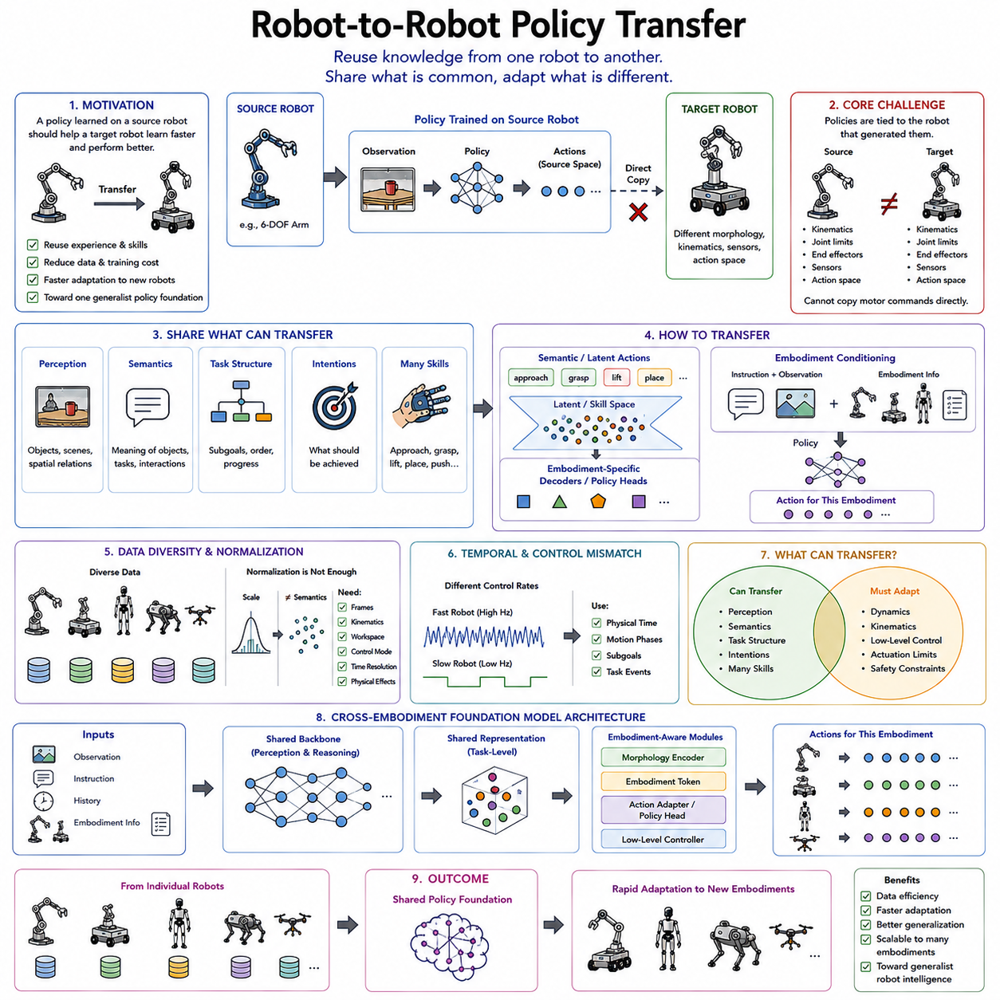{width="7.268055555555556in" height="7.268055555555556in"}

Robot-to-robot policy transfer uses a policy learned on one robot to initialize, guide, or improve policy learning on another robot. The two robots may have different morphologies, kinematics, sensors, action spaces, and control interfaces, but they can still share task-level knowledge such as perception, semantics, task structure, intentions, and many reusable skills. The objective is therefore not to copy motor commands directly, but to reuse behavioral knowledge while adapting execution to the target embodiment.

The main challenge is that a policy is normally entangled with the robot on which it was trained. A policy that maps observations directly to joint commands may work well for the source robot but become meaningless when applied to a robot with different degrees of freedom, joint limits, link lengths, workspace, or end effectors. Even robots with similar numbers of joints can assign different meanings to equivalent action dimensions. Effective transfer must therefore identify which parts of the learned policy represent general knowledge and which parts encode source-specific execution.

Shared representations provide the first major bridge between source and target robots. Perception can be organized around common objects, scenes, spatial relationships, affordances, task structures, progress, goals, and intended physical effects. These representations describe what the robot should understand or accomplish rather than the exact movements of the source robot. A target robot can reuse this task-level knowledge while generating its own feasible actions according to its morphology, kinematics, sensors, and control capabilities.

Semantic or latent actions provide another transfer mechanism. Instead of transferring source joint trajectories directly, a policy can represent actions as higher-level concepts such as approach, grasp, lift, place, push, or align. These actions can be encoded into a shared latent or skill space and then decoded through embodiment-specific policy heads. This allows different robots to express similar intentions through different low-level trajectories, preserving behavioral correspondence without requiring identical action dimensions.

Embodiment conditioning makes the transfer process aware of the physical characteristics of the target robot. The policy can receive information about morphology, kinematics, sensors, end effectors, action space, limits, and constraints together with the observation and task instruction. The same shared policy can therefore interpret an identical goal differently depending on the robot that must execute it. Embodiment information effectively determines which actions are feasible and how shared behavioral representations should be translated into physical commands.

End-effector abstraction is particularly useful for transferring manipulation policies. A source policy may imply that an object should be grasped at a particular location, but the target robot may have different arm geometry or a different gripper. Instead of copying the source joint trajectory, the transferable representation can specify a desired end-effector pose, gripper state, or interaction objective. Inverse kinematics and the target robot\'s controller can then convert this intention into feasible joint commands.

Robot-to-robot transfer also depends on appropriate data alignment. Heterogeneous demonstrations from multiple robots should be encoded into representations that expose common behavioral structure. The source robot\'s trajectories can contribute knowledge about task execution, while target-robot data provides information about how that knowledge must be realized on the new platform. Training can therefore follow a progression from heterogeneous demonstrations to shared representation, shared policy learning, robot-specific decoding or adaptation, and execution with further fine-tuning.

Normalization alone is not sufficient for this process. Differences in numerical scale do not necessarily correspond to differences in meaning. Proper alignment may require consistent reference frames, kinematic information, workspace descriptions, control modes, temporal resolution, and physical effects. A normalized action value from one robot cannot automatically be interpreted as the same speed, force, or physical consequence on another robot. Policy transfer therefore requires semantic and physical alignment rather than simple numerical normalization.

Temporal and control mismatches create an additional transfer problem. Source and target robots may operate at different control rates, action frequencies, mechanical speeds, and response times. A trajectory recorded at a high frequency should not simply be replayed at the target robot\'s control rate. Physical time, motion phases, subgoals, and task events provide more transferable temporal abstractions. These allow the target robot to preserve the intended progression of the task while determining its own detailed execution timing.

The distinction between transferable and embodiment-specific knowledge is central to successful policy transfer. Perception, semantics, task structure, intentions, and many skills can often be shared, while dynamics, kinematics, low-level control, actuation limits, and safety constraints must generally be adapted. The boundary is not absolute because some skills depend strongly on physical properties. Nevertheless, this division provides a practical principle: transfer what describes the task and adapt what determines how the target body physically performs it.

A cross-embodiment foundation model can implement this principle through a shared backbone followed by embodiment-aware modules. Inputs can include observations, instructions, history, and embodiment information. A shared backbone performs common perception and reasoning before producing a task-level representation. Morphology encoders, embodiment tokens, action adapters, policy heads, and low-level controllers can then specialize the representation for the target robot and produce actions appropriate to its physical capabilities.

Robot-to-robot transfer can operate at several levels of adaptation. A closely related robot may require only a lightweight action adapter or policy-head adjustment. A substantially different embodiment may require stronger conditioning, additional target-robot data, or partial policy fine-tuning. The more physical structure differs between source and target, the more important it becomes to retain a shared task-level representation while adapting the execution layers rather than attempting direct policy transplantation.

The ultimate benefit is a shared policy foundation that can accumulate knowledge across individual robots and support rapid adaptation to new embodiments. Instead of training every robot from scratch, experience collected by one robot becomes useful prior knowledge for others. With shared representations, embodiment conditioning, normalized or latent actions, appropriate temporal abstraction, and robot-specific decoders, robot-to-robot policy transfer can improve data efficiency, accelerate adaptation, and move toward a single generalist policy foundation capable of operating across many different robot bodies.

로봇 간 정책 전이(Robot-to-Robot Policy Transfer)는 한 로봇에서 학습된 정책(Policy)을 다른 로봇의 정책 학습을 초기화하거나, 유도하거나, 향상시키는 데 활용하는 방법이다. 두 로봇은 형태학(Morphology), 운동학(Kinematics), 센서, 행동 공간(Action Space), 제어 인터페이스(Control Interface)가 서로 다를 수 있지만, 지각(Perception), 의미론(Semantics), 작업 구조(Task Structure), 의도(Intent), 재사용 가능한 여러 기술(Skill)과 같은 작업 수준 지식(Task-Level Knowledge)은 공유할 수 있다. 따라서 목표는 모터 명령(Motor Command)을 직접 복사하는 것이 아니라 행동 지식을 재사용하면서 실행을 대상 구현체(Target Embodiment)에 맞게 적응시키는 것이다.

주요 과제는 정책이 일반적으로 학습된 로봇과 강하게 결합되어 있다는 점이다. 관측을 직접 관절 명령(Joint Command)으로 매핑하는 정책은 원래 로봇에서는 잘 작동할 수 있지만 자유도, 관절 한계, 링크 길이, 작업공간(Workspace), 말단장치(End Effector)가 다른 로봇에 적용하면 의미가 없어질 수 있다. 심지어 관절 수가 비슷한 로봇이라도 동일한 행동 차원(Action Dimension)에 서로 다른 의미를 부여할 수 있다. 따라서 효과적인 전이를 위해서는 학습된 정책 중 일반적인 지식을 나타내는 부분과 소스 로봇에 특화된 실행을 나타내는 부분을 구분해야 한다.

공유 표현(Shared Representation)은 소스 로봇과 대상 로봇을 연결하는 첫 번째 주요 수단이다. 지각은 공통된 물체, 장면, 공간적 관계, 행동유도성(Affordance), 작업 구조, 진행 상태, 목표, 의도된 물리적 효과(Intended Physical Effect)를 중심으로 구성할 수 있다. 이러한 표현은 소스 로봇의 정확한 움직임이 아니라 로봇이 무엇을 이해하고 무엇을 달성해야 하는지를 설명한다. 대상 로봇은 이러한 작업 수준 지식을 재사용하면서 자신의 형태학, 운동학, 센서, 제어 능력에 따라 실행 가능한 행동을 생성할 수 있다.

의미적 행동(Semantic Action) 또는 잠재 행동(Latent Action)은 또 다른 전이 메커니즘을 제공한다. 소스 로봇의 관절 궤적(Joint Trajectory)을 직접 전이하는 대신 정책은 접근(Approach), 파지(Grasp), 들어 올리기(Lift), 배치(Place), 밀기(Push), 정렬(Align)과 같은 상위 수준 개념으로 행동을 표현할 수 있다. 이러한 행동은 공유 잠재 공간(Shared Latent Space)이나 기술 공간(Skill Space)으로 인코딩한 다음 구현체별 정책 헤드(Embodiment-Specific Policy Head)를 통해 디코딩할 수 있다. 이를 통해 서로 다른 로봇이 서로 다른 저수준 궤적(Low-Level Trajectory)을 사용하면서도 유사한 의도를 표현할 수 있으며, 동일한 행동 차원을 요구하지 않고 행동 대응 관계를 유지할 수 있다.

구현체 조건화(Embodiment Conditioning)는 전이 과정을 대상 로봇의 물리적 특성을 인식하도록 만든다. 정책은 관측과 작업 명령(Task Instruction)과 함께 형태학, 운동학, 센서, 말단장치, 행동 공간, 한계 및 제약조건에 관한 정보를 입력받을 수 있다. 따라서 동일한 공유 정책이라도 실제 실행해야 하는 로봇에 따라 동일한 목표를 다르게 해석할 수 있다. 구현체 정보는 어떤 행동이 실행 가능한지를 결정하고 공유 행동 표현을 물리적 명령으로 어떻게 변환해야 하는지를 결정한다.

말단장치 추상화(End-Effector Abstraction)는 조작 정책(Manipulation Policy)을 전이하는 데 특히 유용하다. 소스 정책은 특정 위치에서 물체를 파지해야 한다는 것을 의미할 수 있지만 대상 로봇은 다른 팔 형상이나 다른 그리퍼를 가질 수 있다. 소스 관절 궤적을 복사하는 대신 전이 가능한 표현은 원하는 말단장치 자세, 그리퍼 상태 또는 상호작용 목표(Interaction Objective)를 지정할 수 있다. 이후 역기구학(Inverse Kinematics)과 대상 로봇의 제어기가 이러한 의도를 실행 가능한 관절 명령으로 변환할 수 있다.

로봇 간 전이는 적절한 데이터 정렬(Data Alignment)에도 의존한다. 여러 로봇에서 수집된 이질적인 시연(Heterogeneous Demonstration)은 공통된 행동 구조를 드러내는 표현으로 인코딩되어야 한다. 소스 로봇의 궤적은 작업 실행에 관한 지식을 제공하고, 대상 로봇 데이터는 해당 지식을 새로운 플랫폼에서 어떻게 구현해야 하는지를 제공한다. 따라서 학습 과정은 이질적인 시연에서 공유 표현(Shared Representation), 공유 정책 학습(Shared Policy Learning), 로봇별 디코딩 또는 적응(Robot-Specific Decoding or Adaptation), 그리고 추가적인 미세조정(Fine-Tuning)을 포함한 실행으로 진행될 수 있다.

단순한 정규화(Normalization)만으로는 충분하지 않다. 수치적인 크기의 차이가 반드시 의미의 차이에 대응하는 것은 아니다. 적절한 정렬에는 일관된 기준 좌표계(Reference Frame), 운동학 정보, 작업공간 설명, 제어 방식, 시간 해상도(Temporal Resolution), 물리적 효과(Physical Effect)가 필요할 수 있다. 한 로봇의 정규화된 행동 값이 다른 로봇에서 동일한 속도, 힘 또는 물리적 결과를 의미한다고 자동으로 가정할 수 없다. 따라서 정책 전이에는 단순한 수치 정규화가 아니라 의미적·물리적 정렬(Semantic and Physical Alignment)이 필요하다.

시간적 차이와 제어 차이(Control Mismatch)도 추가적인 전이 문제를 만든다. 소스 로봇과 대상 로봇은 서로 다른 제어 주파수, 행동 빈도, 기계적 속도, 응답 시간을 가질 수 있다. 높은 주파수에서 기록된 궤적을 대상 로봇의 제어 주파수에 단순히 재생해서는 안 된다. 물리적 시간(Physical Time), 운동 단계(Motion Phase), 하위 목표(Subgoal), 작업 이벤트(Task Event)는 더욱 전이하기 쉬운 시간적 추상화(Temporal Abstraction)를 제공한다. 이를 통해 대상 로봇은 작업의 의도된 진행을 유지하면서 세부적인 실행 타이밍은 스스로 결정할 수 있다.

전이 가능한 지식과 구현체별 지식의 구분은 성공적인 정책 전이의 핵심이다. 지각, 의미론, 작업 구조, 의도, 여러 기술은 일반적으로 공유할 수 있지만 동역학(Dynamics), 운동학, 저수준 제어, 구동 한계(Actuation Limit), 안전 제약조건(Safety Constraint)은 일반적으로 적응이 필요하다. 이러한 경계가 절대적인 것은 아니며 일부 기술은 물리적 특성에 강하게 의존한다. 그럼에도 이러한 구분은 실용적인 원칙을 제공한다. 즉, 작업을 설명하는 지식은 전이하고 대상 로봇이 물리적으로 수행하는 방식을 결정하는 지식은 적응시키는 것이다.

교차 구현체 파운데이션 모델(Cross-Embodiment Foundation Model)은 공유 백본(Shared Backbone)과 구현체 인식 모듈(Embodiment-Aware Module)을 통해 이러한 원칙을 구현할 수 있다. 입력에는 관측, 명령, 이력(History), 구현체 정보가 포함될 수 있다. 공유 백본은 공통적인 지각과 추론을 수행한 후 작업 수준 표현(Task-Level Representation)을 생성한다. 이후 형태학 인코더(Morphology Encoder), 구현체 토큰(Embodiment Token), 행동 어댑터(Action Adapter), 정책 헤드(Policy Head), 저수준 제어기(Low-Level Controller)가 해당 표현을 대상 로봇에 맞게 특화하고 물리적 능력에 적합한 행동을 생성할 수 있다.

로봇 간 전이는 여러 수준의 적응으로 수행될 수 있다. 서로 밀접하게 관련된 로봇이라면 경량 행동 어댑터(Lightweight Action Adapter)나 정책 헤드 조정만 필요할 수 있다. 서로 상당히 다른 구현체라면 더욱 강한 조건화, 추가적인 대상 로봇 데이터 또는 정책의 일부 미세조정이 필요할 수 있다. 소스와 대상의 물리적 구조가 많이 다를수록 공유된 작업 수준 표현을 유지하면서 실행 계층(Execution Layer)을 적응시키는 것이 중요해지며, 정책 전체를 직접 이식하려는 접근은 적합하지 않게 된다.

궁극적인 이점은 개별 로봇 사이에서 지식을 축적하고 새로운 구현체에 신속하게 적응할 수 있는 공유 정책 기반(Shared Policy Foundation)을 구축하는 것이다. 모든 로봇을 처음부터 학습시키는 대신 하나의 로봇이 수집한 경험이 다른 로봇을 위한 사전 지식(Prior Knowledge)이 될 수 있다. 공유 표현, 구현체 조건화, 정규화 또는 잠재 행동, 적절한 시간적 추상화, 로봇별 디코더(Robot-Specific Decoder)를 결합하면 로봇 간 정책 전이는 데이터 효율성(Data Efficiency)을 향상시키고 적응을 가속화하며, 다양한 로봇 몸체에서 작동할 수 있는 하나의 제너럴리스트 정책 기반(Generalist Policy Foundation)을 향한 발전을 가능하게 한다.

## 08.10. Zero Shot and Few Shot Embodiment Adaptation

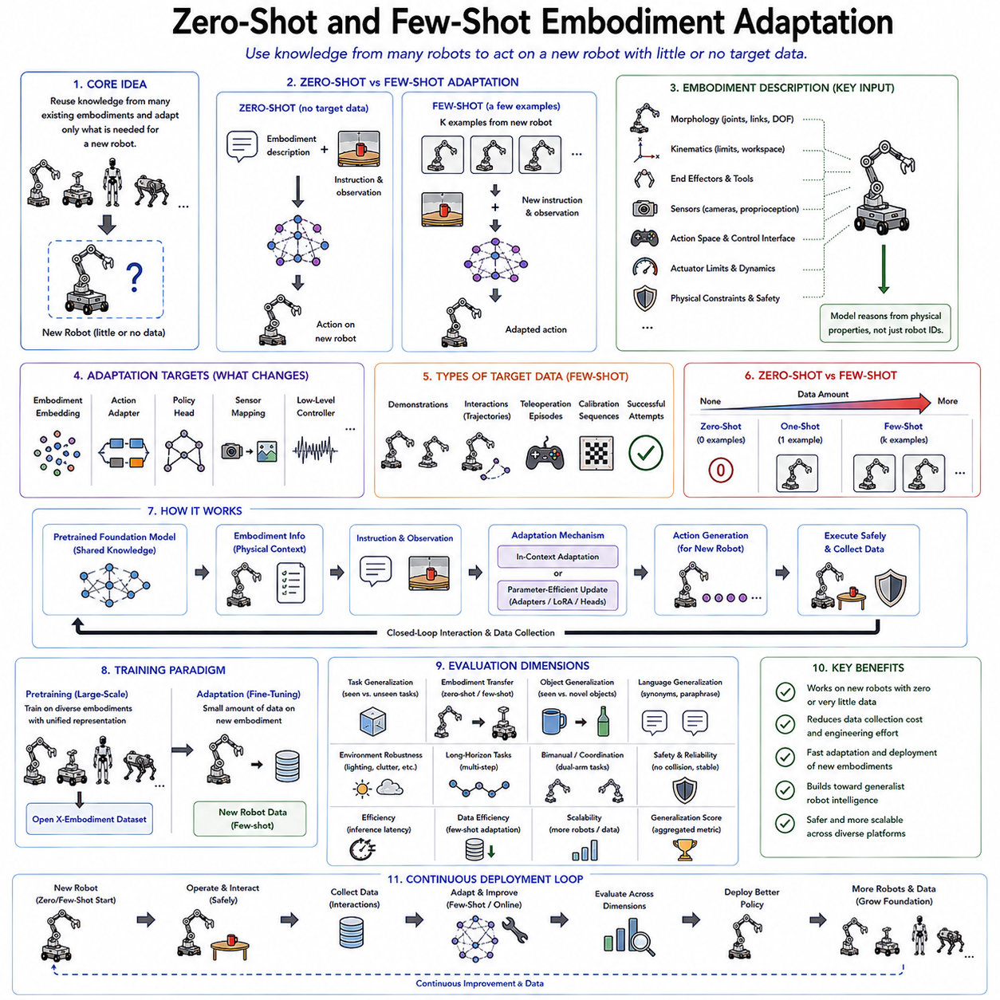{width="7.268055555555556in" height="7.268055555555556in"}

Zero-shot and few-shot embodiment adaptation addresses how a robot foundation model can operate on a new robot body when little or no target-specific training data is available. The central idea is to reuse knowledge learned from many existing embodiments while adapting only the parts required by the new robot. This is especially important because collecting large-scale demonstrations for every new robot is expensive. Zero-shot adaptation seeks useful behavior without target examples, whereas few-shot adaptation uses a small number of demonstrations or interactions to calibrate the model.

Zero-shot embodiment adaptation is the stronger form of transfer because the target robot is introduced without providing task demonstrations from that specific embodiment. The model must infer how to act from information such as morphology, kinematics, sensors, end effectors, action space, and physical constraints. If the foundation model has learned sufficiently general representations, it can combine this embodiment description with its existing knowledge of objects, tasks, and skills to generate plausible actions for the new platform.

A zero-shot system therefore depends heavily on the quality of its embodiment representation. A simple robot identifier is usually insufficient for an unseen robot because the model has no learned association for that identity. More useful information describes the physical structure directly, such as joint types, link geometry, degrees of freedom, reachable workspace, sensor configuration, actuator limits, and available interaction mechanisms. The model can then reason from physical properties rather than relying only on memorized robot-specific policies.

Zero-shot transfer is most realistic when the target robot is sufficiently related to embodiments represented during pretraining. A new seven-degree-of-freedom arm may share many structural and functional properties with other articulated manipulators, while a completely different aerial robot may require much more abstract transfer. The more overlap exists in morphology, sensing, action semantics, and task capabilities, the more likely a shared representation can support useful behavior without target-specific examples.

Few-shot embodiment adaptation relaxes the zero-shot requirement by providing a small amount of target-robot data. These examples can be demonstrations, short interaction trajectories, teleoperation episodes, calibration sequences, or successful task attempts. The objective is not to relearn the entire policy but to use the limited data to identify the relationship between the shared policy representation and the physical behavior of the new embodiment.

Few-shot adaptation can target several different components. A small dataset may calibrate an embodiment embedding, train an action adapter, adjust a policy head, estimate sensor mappings, or refine a low-level controller. It can also provide examples of how a shared skill such as grasping, pushing, or placing is realized by the new robot. This modular approach allows most of the pretrained foundation model to remain fixed while only the embodiment-specific components are updated.

The amount and type of target data determine the adaptation strategy. Zero-shot adaptation uses no target demonstrations, one-shot adaptation uses a single example, and few-shot adaptation uses a small set of examples. More examples generally provide more information about the target embodiment, but the purpose of few-shot learning is to reach useful performance with far less data than conventional training. The key evaluation is therefore not simply final accuracy but how quickly performance improves as target data increases.

Few-shot learning can be implemented through in-context adaptation as well as parameter updates. A model may receive several target-robot demonstrations together with the current instruction and infer the appropriate behavior without changing its parameters. Alternatively, lightweight fine-tuning, adapters, LoRA, or specialized policy heads can use the same examples to modify a small portion of the model. These approaches provide different tradeoffs between adaptation speed, memory cost, stability, and generalization.

Meta-learning provides a principled way to prepare a model for rapid embodiment adaptation. Instead of training only to perform individual tasks, the model can be exposed to many related embodiments during meta-training. The objective is to learn an initialization or representation that can adapt quickly when a new embodiment is encountered. In this setting, the support examples represent the small amount of target-robot information available during adaptation, while separate evaluation data measures whether the resulting policy generalizes beyond those examples.

The distinction between support data and evaluation data is important for measuring true few-shot adaptation. If the model is evaluated only on the demonstrations used for adaptation, it may simply memorize those examples. A stronger evaluation tests new scenes, objects, task instances, or trajectories after adaptation. This measures whether the model has learned the underlying relationship between the embodiment and the task rather than reproducing the limited examples.

Sensor and calibration differences can dominate few-shot adaptation even when robot morphology is similar. Camera position, intrinsic parameters, extrinsic transforms, depth characteristics, frame conventions, and proprioceptive signals may differ between platforms. A small amount of target data can help align these observations with the representation learned during pretraining. Without proper calibration, the model may interpret systematic sensor differences as changes in the physical environment.

Kinematics and control interfaces require similar adaptation. A new robot may have different joint limits, link lengths, coordinate frames, controller latency, action scaling, or actuator response. Few-shot trajectories can reveal how abstract actions map to the target robot\'s actual behavior. The adaptation process can therefore learn an action-space transformation or embodiment-specific decoder rather than forcing the shared policy to predict the target robot\'s commands directly.

The quality of the few-shot examples is often more important than their raw quantity. A small set of diverse, successful, well-calibrated demonstrations can provide more useful information than many repetitive examples. Examples should expose important variations in task configuration, object position, approach direction, and robot state when possible. This allows the model to infer transferable relationships instead of memorizing a narrow sequence of motions.

Safety constraints are particularly important during embodiment adaptation. A new robot may have unknown collision boundaries, unstable configurations, actuator limitations, or unexpected delays. Few-shot adaptation should therefore not rely solely on unconstrained trial-and-error. Simulation, safety controllers, conservative action bounds, uncertainty estimation, and supervised demonstrations can reduce the risk of unsafe exploration while the model learns the target embodiment.

Zero-shot and few-shot adaptation can also form a continuous deployment strategy. A foundation model may initially operate zero-shot using its existing embodiment knowledge, collect a small number of safe interactions, and then perform few-shot adaptation. Additional experience can subsequently support more extensive fine-tuning or online learning. This creates a progression from prior knowledge to small-data adaptation and eventually to continual improvement rather than requiring a complete training cycle before deployment.

Evaluation should measure more than whether the robot can complete one demonstrated task. Important dimensions include zero-shot performance, few-shot learning curves, adaptation speed, final performance after adaptation, robustness to disturbances, retention of previously learned capabilities, and safety. Cross-embodiment evaluation should also test unseen robots and changed sensor, size, payload, or dynamic conditions to determine whether adaptation captures general physical structure.

The long-term objective is a robot foundation model that treats new embodiments as adaptation problems rather than independent learning problems. Large-scale pretraining provides shared perception, semantics, task knowledge, and reusable skills. Embodiment information provides the physical context, while zero-shot inference or a small amount of target data bridges the remaining gap. This architecture can reduce data collection requirements, accelerate deployment, and make generalist robot intelligence more scalable across diverse physical platforms.

제로샷 및 소수샷 구현체 적응(Zero-Shot and Few-Shot Embodiment Adaptation)은 로봇 파운데이션 모델(Robot Foundation Model)이 대상 로봇에 특화된 학습 데이터가 거의 없거나 전혀 없는 상황에서 새로운 로봇 몸체에서 작동할 수 있도록 하는 방법이다. 핵심 아이디어는 여러 기존 구현체에서 학습한 지식을 재사용하면서 새로운 로봇에 필요한 부분만 적응시키는 것이다. 모든 새로운 로봇에 대해 대규모 시연 데이터를 수집하는 것은 비용이 매우 높기 때문에 이러한 접근법이 특히 중요하다. 제로샷 적응(Zero-Shot Adaptation)은 대상 로봇의 예제 없이 유용한 행동을 수행하는 것을 목표로 하며, 소수샷 적응(Few-Shot Adaptation)은 적은 수의 시연 또는 상호작용을 사용하여 모델을 보정한다.

제로샷 구현체 적응(Zero-Shot Embodiment Adaptation)은 특정 구현체에서 수집된 작업 시연을 제공하지 않고 새로운 로봇을 도입하기 때문에 더욱 강력한 형태의 전이이다. 모델은 형태학(Morphology), 운동학(Kinematics), 센서, 말단장치(End Effector), 행동 공간(Action Space), 물리적 제약조건과 같은 정보를 기반으로 어떻게 행동해야 하는지를 추론해야 한다. 파운데이션 모델이 충분히 일반적인 표현을 학습했다면 이러한 구현체 설명을 물체, 작업, 기술(Skill)에 대한 기존 지식과 결합하여 새로운 플랫폼에 적합한 행동을 생성할 수 있다.

따라서 제로샷 시스템은 구현체 표현(Embodiment Representation)의 품질에 크게 의존한다. 단순한 로봇 식별자(Robot Identifier)는 보지 못한 로봇(Unseen Robot)에 일반적으로 충분하지 않다. 모델은 해당 식별자에 대한 학습된 연관 관계를 가지고 있지 않기 때문이다. 보다 유용한 정보는 관절 유형, 링크 형상(Link Geometry), 자유도(Degrees of Freedom), 도달 가능 작업공간(Reachable Workspace), 센서 구성, 액추에이터 한계(Actuator Limit), 사용 가능한 상호작용 메커니즘과 같이 물리적 구조를 직접 설명한다. 그러면 모델은 단순히 암기된 로봇별 정책에 의존하지 않고 물리적 특성을 기반으로 추론할 수 있다.

제로샷 전이(Zero-Shot Transfer)는 대상 로봇이 사전학습(Pretraining)에 포함된 구현체와 충분히 관련되어 있을 때 가장 현실적이다. 새로운 7자유도 팔은 다른 관절형 매니퓰레이터와 많은 구조적·기능적 특성을 공유할 수 있지만, 완전히 다른 비행 로봇은 훨씬 더 추상적인 전이를 필요로 할 수 있다. 형태학, 센싱, 행동 의미(Action Semantics), 작업 능력에서 공통점이 많을수록 공유 표현(Shared Representation)이 대상 로봇의 예제 없이도 유용한 행동을 지원할 가능성이 높아진다.

소수샷 구현체 적응(Few-Shot Embodiment Adaptation)은 소량의 대상 로봇 데이터를 제공함으로써 제로샷의 요구사항을 완화한다. 이러한 데이터는 시연, 짧은 상호작용 궤적(Interaction Trajectory), 원격조작(Teleoperation) 에피소드, 보정 시퀀스(Calibration Sequence), 성공적인 작업 시도 등으로 구성될 수 있다. 목표는 전체 정책을 다시 학습하는 것이 아니라 제한된 데이터를 사용하여 공유 정책 표현(Shared Policy Representation)과 새로운 구현체의 물리적 행동 사이의 관계를 파악하는 것이다.

소수샷 적응은 여러 구성요소를 대상으로 수행할 수 있다. 소규모 데이터셋은 구현체 임베딩(Embodiment Embedding)을 보정하거나, 행동 어댑터(Action Adapter)를 학습하거나, 정책 헤드(Policy Head)를 조정하거나, 센서 매핑(Sensor Mapping)을 추정하거나, 저수준 제어기(Low-Level Controller)를 개선하는 데 사용할 수 있다. 또한 파지, 밀기, 배치와 같은 공유 기술(Shared Skill)이 새로운 로봇에서 어떻게 구현되는지에 대한 예제를 제공할 수도 있다. 이러한 모듈 방식은 사전학습된 파운데이션 모델의 대부분을 고정한 상태에서 구현체에 특화된 구성요소만 업데이트할 수 있도록 한다.

대상 데이터의 양과 유형은 적응 전략을 결정한다. 제로샷 적응은 대상 로봇의 시연 데이터를 사용하지 않고, 원샷 적응(One-Shot Adaptation)은 하나의 예제를 사용하며, 소수샷 적응은 소수의 예제를 사용한다. 일반적으로 예제가 많아질수록 대상 구현체에 관한 정보가 증가하지만, 소수샷 학습의 목적은 기존 학습보다 훨씬 적은 데이터로 유용한 성능에 도달하는 것이다. 따라서 핵심 평가는 단순한 최종 정확도가 아니라 대상 데이터가 증가함에 따라 얼마나 빠르게 성능이 향상되는지를 측정하는 것이다.

소수샷 학습(Few-Shot Learning)은 파라미터 업데이트(Parameter Update)뿐만 아니라 컨텍스트 내 적응(In-Context Adaptation)을 통해서도 구현할 수 있다. 모델은 여러 대상 로봇 시연과 현재 명령을 함께 입력받고 파라미터를 변경하지 않은 상태에서 적절한 행동을 추론할 수 있다. 또는 경량 미세조정(Lightweight Fine-Tuning), 어댑터(Adapter), LoRA, 특화된 정책 헤드가 동일한 예제를 사용하여 모델의 일부를 수정할 수 있다. 이러한 접근법은 적응 속도, 메모리 비용, 안정성, 일반화 사이에서 서로 다른 절충점을 제공한다.

메타학습(Meta-Learning)은 신속한 구현체 적응을 준비하는 체계적인 방법을 제공한다. 모델은 개별 작업을 수행하도록 학습하는 데 그치지 않고 메타학습 과정에서 다양한 관련 구현체에 노출될 수 있다. 목표는 새로운 구현체를 만났을 때 빠르게 적응할 수 있는 초기화(Initialization) 또는 표현을 학습하는 것이다. 이 과정에서 지원 예제(Support Example)는 적응 과정에서 사용할 수 있는 소량의 대상 로봇 정보를 나타내며, 별도의 평가 데이터는 생성된 정책이 이러한 예제 외부에서도 일반화되는지를 측정한다.

진정한 소수샷 적응을 측정하려면 지원 데이터(Support Data)와 평가 데이터(Evaluation Data)를 구분하는 것이 중요하다. 적응에 사용한 시연에서만 모델을 평가하면 모델이 단순히 해당 예제를 암기했을 가능성이 있다. 보다 강력한 평가는 적응 이후 새로운 장면, 물체, 작업 사례 또는 궤적에서 성능을 테스트한다. 이를 통해 모델이 제한된 예제를 재현한 것이 아니라 구현체와 작업 사이의 근본적인 관계를 학습했는지를 측정할 수 있다.

형태학이 유사한 경우에도 센서와 보정 차이가 소수샷 적응을 지배할 수 있다. 카메라 위치, 내부 파라미터(Intrinsic Parameter), 외부 변환(Extrinsic Transform), 깊이 특성, 좌표계 규칙(Frame Convention), 고유수용감각(Proprioceptive Signal)은 플랫폼마다 다를 수 있다. 소량의 대상 데이터는 이러한 관측을 사전학습 과정에서 학습된 표현과 정렬하는 데 도움을 줄 수 있다. 적절한 보정이 이루어지지 않으면 모델은 체계적인 센서 차이를 물리적 환경의 변화로 잘못 해석할 수 있다.

운동학과 제어 인터페이스도 유사한 적응을 필요로 한다. 새로운 로봇은 서로 다른 관절 한계, 링크 길이, 좌표계, 제어기 지연(Controller Latency), 행동 스케일링(Action Scaling), 액추에이터 응답을 가질 수 있다. 소수샷 궤적은 추상적인 행동이 대상 로봇의 실제 행동으로 어떻게 변환되는지를 보여줄 수 있다. 따라서 적응 과정은 공유 정책이 대상 로봇의 명령을 직접 예측하도록 강제하기보다 행동 공간 변환(Action-Space Transformation) 또는 구현체별 디코더(Embodiment-Specific Decoder)를 학습할 수 있다.

소수샷 예제의 품질은 원시적인 데이터 양보다 더 중요할 때가 많다. 소수의 다양하고 성공적이며 정확하게 보정된 시연은 반복적인 많은 예제보다 더 유용한 정보를 제공할 수 있다. 가능한 경우 예제는 작업 구성, 물체 위치, 접근 방향, 로봇 상태에서 중요한 변화를 포함해야 한다. 이를 통해 모델은 좁은 움직임의 연속을 암기하는 대신 전이 가능한 관계를 추론할 수 있다.

안전 제약조건(Safety Constraint)은 구현체 적응에서 특히 중요하다. 새로운 로봇은 알려지지 않은 충돌 경계, 불안정한 구성, 액추에이터 한계 또는 예상하지 못한 지연을 가질 수 있다. 따라서 소수샷 적응은 제한되지 않은 시행착오(Trial-and-Error)에만 의존해서는 안 된다. 시뮬레이션(Simulation), 안전 제어기(Safety Controller), 보수적인 행동 범위(Conservative Action Bound), 불확실성 추정(Uncertainty Estimation), 감독된 시연(Supervised Demonstration)은 모델이 새로운 구현체를 학습하는 동안 위험한 탐색의 가능성을 줄일 수 있다.

제로샷과 소수샷 적응은 연속적인 배포 전략(Deployment Strategy)을 형성할 수도 있다. 파운데이션 모델은 처음에는 기존 구현체 지식을 사용하여 제로샷으로 작동하고, 소수의 안전한 상호작용을 수집한 후 소수샷 적응을 수행할 수 있다. 이후 추가적인 경험은 더욱 광범위한 미세조정이나 온라인 학습(Online Learning)에 활용될 수 있다. 이를 통해 배포 전에 전체 학습 주기를 완료해야 하는 방식이 아니라 사전 지식에서 소규모 데이터 적응, 그리고 지속적인 개선(Continual Improvement)으로 이어지는 발전 과정을 구축할 수 있다.

평가는 로봇이 하나의 시연된 작업을 수행할 수 있는지만을 측정해서는 안 된다. 중요한 평가 요소에는 제로샷 성능, 소수샷 학습 곡선(Few-Shot Learning Curve), 적응 속도(Adaptation Speed), 적응 후 최종 성능, 외란(Disturbance)에 대한 강건성(Robustness), 기존에 학습한 능력의 유지(Retention), 안전성이 포함된다. 교차 구현체 평가는 보지 못한 로봇과 변화된 센서, 크기, 가반하중(Payload), 동역학 조건에서도 수행되어야 하며, 이를 통해 적응 과정이 일반적인 물리적 구조를 학습했는지를 확인할 수 있다.

장기적인 목표는 새로운 구현체를 독립적인 학습 문제가 아니라 적응 문제로 처리하는 로봇 파운데이션 모델을 구축하는 것이다. 대규모 사전학습은 공유 지각, 의미론(Semantics), 작업 지식, 재사용 가능한 기술을 제공한다. 구현체 정보는 물리적 맥락을 제공하며, 제로샷 추론 또는 소량의 대상 데이터를 통해 남아 있는 차이를 연결할 수 있다. 이러한 아키텍처는 데이터 수집 요구량을 줄이고, 배포를 가속화하며, 다양한 물리적 플랫폼으로 범용 로봇 지능(Generalist Robot Intelligence)을 확장할 수 있도록 한다.

## 08.11. Toward Universal Robot Policies

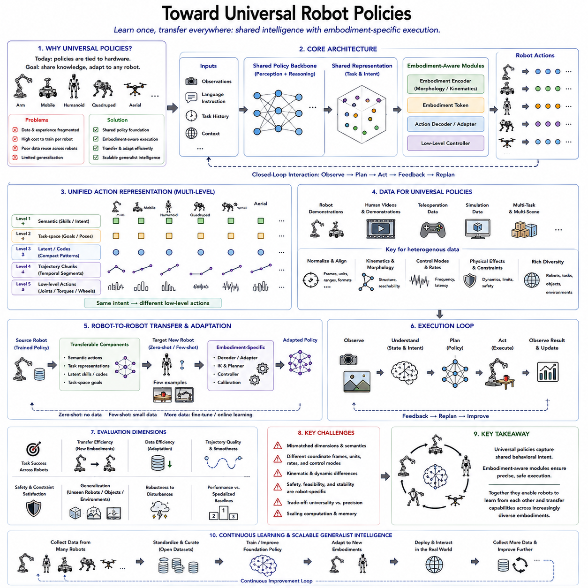{width="7.268055555555556in" height="7.268055555555556in"}

A universal robot policy aims to learn behavioral knowledge that can operate across many different robot embodiments rather than being permanently tied to one robot body. The central idea is to separate what robots should understand and accomplish from how a particular robot physically executes the behavior. Perception, semantics, task structure, intentions, and reusable skills can form a shared policy foundation, while morphology, kinematics, dynamics, action spaces, and safety constraints remain embodiment-aware.

The need for universal policies arises because robot intelligence is often fragmented by hardware. A manipulator, mobile robot, humanoid, quadruped, and aerial robot may perform related tasks but use fundamentally different sensors, actuators, control interfaces, and action representations. Training an independent policy for every platform wastes data and prevents experience collected by one robot from benefiting others. A universal policy instead seeks to turn heterogeneous robot experience into a cumulative source of transferable physical knowledge.

The key architectural principle is shared intelligence with embodiment-specific execution. A common policy backbone can process observations, language instructions, task history, and contextual information to construct a shared representation of the environment and intended behavior. This representation should capture objects, spatial relationships, goals, task progress, affordances, and skills without assuming a particular robot body. Embodiment-aware modules then transform this shared knowledge into actions that are physically valid for the current platform.

Universal policies require an action representation that is sufficiently abstract to cross embodiment boundaries but sufficiently precise to support physical execution. Semantic actions such as approach, grasp, lift, transport, place, open, and navigate can describe common behavioral intent. Task-space targets and object-relative goals can provide additional geometric information, while latent actions or learned codes can capture recurring behavioral patterns. The policy can therefore operate across several abstraction levels instead of forcing every robot into one identical low-level action vector.

A hierarchical action structure provides a practical path toward universality. At the highest level, the policy represents skills and intentions. At the task-space level, it specifies goals such as poses, displacements, or object-relative targets. Latent representations can compress recurring behavioral patterns, while trajectory chunks describe meaningful temporal segments. Finally, embodiment-specific controllers convert these representations into joint positions, velocities, torques, wheel commands, or other low-level actions. This layered structure preserves transferability while retaining physical precision.

Embodiment information remains essential even in a universal policy. The model must know the morphology, kinematic structure, joint and link parameters, sensors, end effectors, actuator capabilities, action interface, and physical limits of the robot executing the task. This information can be provided through an embodiment token, morphology encoder, kinematic graph, structured robot description, or learned embedding. The purpose is not to abandon universality, but to allow a common policy to understand how the same behavioral intention must be realized by different bodies.

Universal policies also depend on heterogeneous data mixtures. Training data can combine demonstrations from industrial manipulators, collaborative arms, mobile manipulators, humanoids, quadrupeds, and other platforms. These datasets may contain manipulation, navigation, transportation, inspection, assembly, tool use, and long-horizon tasks. The mixture exposes the model to diverse physical situations and prevents the learned policy from becoming excessively specialized to a single robot family or environment.

However, heterogeneous data cannot simply be concatenated without alignment. Observations may use different sensors and camera configurations, while actions may have different dimensions, units, coordinate frames, control rates, and semantics. Normalization is therefore necessary but not sufficient. Effective universal policy learning requires alignment of reference frames, kinematics, workspaces, control modes, temporal resolution, and physical effects so that apparently similar numerical values do not become misleading behavioral correspondences.

Human data can further expand the foundation of a universal policy. Human videos and demonstrations provide large-scale information about object interactions, task sequences, affordances, strategies, and behavioral intent. Robot demonstrations provide precise embodiment-grounded actions, while teleoperation connects human decision making with robot-specific execution. Combining these sources allows the model to learn broad behavioral knowledge from humans while using robotic data to ground that knowledge in physical control.

Robot-to-robot transfer provides another route toward universality. A policy learned from one robot can become prior knowledge for another when the transferable components are represented independently of the source hardware. Shared semantic actions, task representations, latent skills, and task-space goals can be transferred, while the target robot uses its own embodiment-conditioned decoder, planner, inverse kinematics, and controller. The resulting process transforms policy transfer from direct motor imitation into structured behavioral adaptation.

Zero-shot and few-shot adaptation extend this principle to new embodiments. In the zero-shot case, the model receives no target-specific demonstrations and must infer behavior from the robot\'s physical description and previously learned knowledge. Few-shot adaptation adds a small number of demonstrations, calibration sequences, or interaction trajectories to specialize the shared policy. This allows a new robot to benefit from accumulated knowledge without requiring a complete policy to be trained from scratch.

A truly universal policy must also operate through a closed-loop interaction process. The robot observes the environment, interprets the task and current state, generates or selects an action, executes it, and observes the resulting change. If execution differs from prediction, the policy must update its state estimate, replan, or modify the next action. Universal intelligence therefore cannot be defined only by a static mapping from observation to action; it requires continual interaction between perception, prediction, planning, execution, and feedback.

Universality must also be evaluated against the risk of excessive abstraction. A policy may transfer successfully at the semantic level while producing poor or unsafe physical behavior. Different robots have different dynamics, reachability, stability, collision constraints, actuator limits, and safety requirements. Universal policies therefore need embodiment-specific modules and safety mechanisms that preserve the physical feasibility of execution. The goal is not identical behavior across robots, but equivalent task-level capability under different physical constraints.

Evaluation should measure whether a policy genuinely generalizes across embodiments rather than simply memorizing robot identities. Important dimensions include task success across different robots, transfer efficiency to new embodiments, data efficiency during adaptation, trajectory quality and smoothness, safety and constraint satisfaction, and performance relative to specialized policies. Strong evaluation should include unseen robot configurations, new objects, new environments, and changed physical conditions so that generalization is tested beyond the training distribution.

The long-term objective is a shared policy foundation that continuously accumulates knowledge from increasingly diverse robots. Individual robots contribute new observations, tasks, skills, and physical experiences to the common foundation, while new embodiments inherit previously learned knowledge and require progressively less target-specific training. The resulting system moves from isolated robot policies toward a scalable generalist architecture in which universal behavioral representations and embodiment-specific execution work together. This is the central pathway toward universal robot policies capable of transferring capabilities across increasingly diverse physical platforms.

범용 로봇 정책(Universal Robot Policy)은 하나의 로봇 몸체에 영구적으로 결합된 것이 아니라 다양한 로봇 구현체(Robot Embodiment)에서 작동할 수 있는 행동 지식(Behavioral Knowledge)을 학습하는 것을 목표로 한다. 핵심 아이디어는 로봇이 무엇을 이해하고 달성해야 하는지와 특정 로봇이 그 행동을 물리적으로 어떻게 실행하는지를 분리하는 것이다. 지각(Perception), 의미론(Semantics), 작업 구조(Task Structure), 의도(Intent), 재사용 가능한 기술(Skill)은 공유 정책 기반(Shared Policy Foundation)을 형성할 수 있으며, 형태학(Morphology), 운동학(Kinematics), 동역학(Dynamics), 행동 공간(Action Space), 안전 제약조건(Safety Constraint)은 구현체를 인식하는 방식으로 유지된다.

범용 정책(Universal Policy)의 필요성은 로봇 지능이 하드웨어에 의해 분리되어 있는 현실에서 발생한다. 매니퓰레이터(Manipulator), 이동 로봇(Mobile Robot), 휴머노이드(Humanoid), 사족보행 로봇(Quadruped), 비행 로봇(Aerial Robot)은 서로 관련된 작업을 수행할 수 있지만 근본적으로 서로 다른 센서, 액추에이터, 제어 인터페이스(Control Interface), 행동 표현(Action Representation)을 사용한다. 모든 플랫폼마다 독립적인 정책을 학습하면 데이터가 낭비되고 한 로봇이 수집한 경험이 다른 로봇에 활용되지 못한다. 범용 정책은 이러한 이질적인 로봇 경험을 서로 전이 가능한 물리적 지식(Transferable Physical Knowledge)의 누적 자원으로 전환하려 한다.

핵심 아키텍처 원칙은 공유 지능(Shared Intelligence)과 구현체별 실행(Embodiment-Specific Execution)의 결합이다. 공통 정책 백본(Common Policy Backbone)은 관측, 언어 명령(Language Instruction), 작업 이력(Task History), 맥락 정보를 처리하여 환경과 의도된 행동에 대한 공유 표현을 구축할 수 있다. 이러한 표현은 특정 로봇 몸체를 가정하지 않고 물체, 공간적 관계, 목표, 작업 진행, 행동유도성(Affordance), 기술을 포착해야 한다. 이후 구현체 인식 모듈(Embodiment-Aware Module)이 이러한 공유 지식을 현재 플랫폼에서 물리적으로 유효한 행동으로 변환한다.

범용 정책은 구현체의 경계를 넘어 전이할 수 있을 만큼 추상적이면서도 물리적 실행을 지원할 만큼 정밀한 행동 표현을 필요로 한다. 접근(Approach), 파지(Grasp), 들어 올리기(Lift), 운반(Transport), 배치(Place), 열기(Open), 이동(Navigate)과 같은 의미적 행동(Semantic Action)은 공통된 행동 의도를 설명할 수 있다. 작업 공간 목표(Task-Space Target)와 객체 상대 목표(Object-Relative Goal)는 추가적인 기하학적 정보를 제공할 수 있으며, 잠재 행동(Latent Action)이나 학습된 코드(Learned Code)는 반복적으로 나타나는 행동 패턴을 포착할 수 있다. 따라서 정책은 모든 로봇을 하나의 동일한 저수준 행동 벡터로 강제하는 대신 여러 추상화 수준에서 작동할 수 있다.

계층적 행동 구조(Hierarchical Action Structure)는 범용성을 구현하는 실용적인 방법을 제공한다. 가장 높은 수준에서 정책은 기술과 의도를 표현한다. 작업 공간 수준에서는 자세(Pose), 변위(Displacement), 객체 상대 목표와 같은 목표를 지정한다. 잠재 표현은 반복적인 행동 패턴을 압축할 수 있으며, 궤적 청크(Trajectory Chunk)는 의미 있는 시간 구간을 표현한다. 마지막으로 구현체별 제어기(Embodiment-Specific Controller)는 이러한 표현을 관절 위치, 속도, 토크, 휠 명령(Wheel Command) 또는 기타 저수준 행동으로 변환한다. 이러한 계층 구조는 전이 가능성을 유지하면서도 물리적 실행에 필요한 정밀성을 보존한다.

범용 정책에서도 구현체 정보(Embodiment Information)는 필수적이다. 모델은 작업을 수행하는 로봇의 형태학, 운동학적 구조, 관절 및 링크 파라미터, 센서, 말단장치(End Effector), 액추에이터 능력, 행동 인터페이스(Action Interface), 물리적 한계를 알아야 한다. 이러한 정보는 구현체 토큰(Embodiment Token), 형태학 인코더(Morphology Encoder), 운동학 그래프(Kinematic Graph), 구조화된 로봇 설명(Structured Robot Description), 학습된 임베딩(Learned Embedding) 등을 통해 제공할 수 있다. 목적은 범용성을 포기하는 것이 아니라, 동일한 행동 의도가 서로 다른 몸체에서 어떻게 구현되어야 하는지를 공통 정책이 이해할 수 있도록 하는 것이다.

범용 정책은 이질적인 데이터 혼합(Heterogeneous Data Mixture)에도 의존한다. 학습 데이터에는 산업용 매니퓰레이터, 협동 로봇 팔(Collaborative Arm), 이동형 매니퓰레이터(Mobile Manipulator), 휴머노이드, 사족보행 로봇 및 기타 플랫폼의 시연을 결합할 수 있다. 이러한 데이터셋에는 조작, 이동, 운반, 검사, 조립, 도구 사용, 장기 작업(Long-Horizon Task) 등이 포함될 수 있다. 이러한 혼합은 모델을 다양한 물리적 상황에 노출시키며, 학습된 정책이 특정 로봇 계열이나 환경에 지나치게 특화되는 것을 방지한다.

그러나 이질적인 데이터는 단순히 연결하여 정렬 없이 사용할 수 없다. 관측은 서로 다른 센서와 카메라 구성을 사용할 수 있으며, 행동은 서로 다른 차원, 단위, 좌표계, 제어 주기(Control Rate), 의미를 가질 수 있다. 따라서 정규화(Normalization)는 필요하지만 충분하지 않다. 효과적인 범용 정책 학습을 위해서는 기준 좌표계, 운동학, 작업공간, 제어 방식, 시간 해상도(Temporal Resolution), 물리적 효과를 정렬해야 한다. 그래야 겉보기에는 유사한 수치가 잘못된 행동 대응 관계로 해석되는 것을 방지할 수 있다.

인간 데이터(Human Data)는 범용 정책의 기반을 더욱 확장할 수 있다. 인간 영상과 시연은 물체 상호작용, 작업 순서, 행동유도성, 전략, 행동 의도에 관한 대규모 정보를 제공한다. 로봇 시연은 정밀한 구현체 기반 행동(Embodiment-Grounded Action)을 제공하며, 원격조작(Teleoperation)은 인간의 의사결정과 로봇별 실행을 연결한다. 이러한 데이터 원천을 결합하면 모델은 인간으로부터 광범위한 행동 지식을 학습하면서 로봇 데이터를 통해 해당 지식을 실제 물리적 제어에 연결할 수 있다.

로봇 간 전이(Robot-to-Robot Transfer)는 범용성을 확보하는 또 다른 경로를 제공한다. 하나의 로봇에서 학습된 정책은 전이 가능한 구성요소가 원래 하드웨어와 독립적으로 표현될 경우 다른 로봇을 위한 사전 지식(Prior Knowledge)이 될 수 있다. 공유 의미적 행동, 작업 표현, 잠재 기술, 작업 공간 목표는 전이할 수 있으며, 대상 로봇은 자체 구현체 조건화 디코더(Embodiment-Conditioned Decoder), 플래너(Planner), 역기구학(Inverse Kinematics), 제어기를 사용한다. 이를 통해 정책 전이는 직접적인 모터 모방에서 구조화된 행동 적응(Structured Behavioral Adaptation)으로 전환된다.

제로샷 및 소수샷 적응(Zero-Shot and Few-Shot Adaptation)은 이러한 원칙을 새로운 구현체까지 확장한다. 제로샷 상황에서는 대상 로봇의 특화된 시연이 제공되지 않으며 모델은 로봇의 물리적 설명과 기존 학습 지식을 기반으로 행동을 추론해야 한다. 소수샷 적응에서는 소수의 시연, 보정 시퀀스(Calibration Sequence), 상호작용 궤적을 추가하여 공유 정책을 특화한다. 이를 통해 새로운 로봇은 전체 정책을 처음부터 학습하지 않고도 이미 축적된 지식을 활용할 수 있다.

진정한 범용 정책은 폐루프 상호작용 과정(Closed-Loop Interaction Process)을 통해서도 작동해야 한다. 로봇은 환경을 관측하고, 작업과 현재 상태를 해석하고, 행동을 생성하거나 선택하고, 이를 실행한 후 결과로 발생한 변화를 다시 관측한다. 실행 결과가 예측과 다르면 정책은 상태 추정(State Estimate)을 업데이트하고, 계획을 다시 수립하거나 다음 행동을 수정해야 한다. 따라서 범용 지능은 관측에서 행동으로 이어지는 정적인 매핑만으로 정의될 수 없으며, 지각, 예측, 계획, 실행, 피드백 사이의 지속적인 상호작용을 필요로 한다.

범용성은 지나친 추상화의 위험에 대해서도 평가되어야 한다. 정책이 의미적 수준에서는 성공적으로 전이되더라도 물리적으로 부정확하거나 안전하지 않은 행동을 생성할 수 있다. 서로 다른 로봇은 서로 다른 동역학, 도달 가능성, 안정성, 충돌 제약조건, 액추에이터 한계, 안전 요구사항을 가진다. 따라서 범용 정책에는 물리적 실행 가능성을 보존하는 구현체별 모듈과 안전 메커니즘이 필요하다. 목표는 모든 로봇에서 동일한 행동을 생성하는 것이 아니라 서로 다른 물리적 제약조건 아래에서도 동일한 작업 수준의 능력(Task-Level Capability)을 달성하는 것이다.

평가는 정책이 단순히 로봇 식별자를 암기하는 것이 아니라 실제로 구현체 간 일반화하는지를 측정해야 한다. 중요한 평가 요소에는 서로 다른 로봇에서의 작업 성공률, 새로운 구현체로의 전이 효율, 적응 과정의 데이터 효율성, 궤적 품질과 부드러움, 안전성 및 제약조건 만족도, 특화 정책과 비교한 성능이 포함된다. 강력한 평가는 보지 못한 로봇 구성, 새로운 물체, 새로운 환경, 변화된 물리적 조건을 포함해야 하며, 학습 분포를 넘어선 일반화(Generalization)가 실제로 이루어지는지를 확인해야 한다.

장기적인 목표는 점점 더 다양한 로봇으로부터 지식을 지속적으로 축적하는 공유 정책 기반(Shared Policy Foundation)을 구축하는 것이다. 각각의 로봇은 새로운 관측, 작업, 기술, 물리적 경험을 공통 기반에 기여하고, 새로운 구현체는 이미 학습된 지식을 상속받아 점점 더 적은 대상 특화 학습(Target-Specific Training)만 필요로 하게 된다. 이렇게 구축된 시스템은 고립된 로봇 정책에서 확장 가능한 제너럴리스트 아키텍처(Generalist Architecture)로 발전하며, 범용 행동 표현(Universal Behavioral Representation)과 구현체별 실행이 함께 작동하게 된다. 이것이 점점 더 다양한 물리적 플랫폼으로 능력을 전이할 수 있는 범용 로봇 정책(Universal Robot Policy)을 향한 핵심적인 경로이다.

## 08.12. Cross Embodiment Adaptation [w/Code]

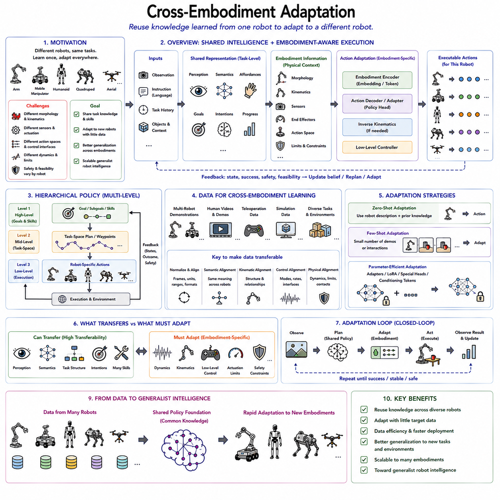{width="7.268055555555556in" height="7.268055555555556in"}

Cross-embodiment adaptation enables a robot foundation model to reuse knowledge learned from one or more robot bodies while adjusting its behavior to the physical characteristics of a different embodiment. The central principle is to preserve information that describes the task, world, and behavioral intent while adapting information that depends on morphology, kinematics, sensors, actuators, and control interfaces. This turns adaptation from complete retraining into a structured transfer process.

The embodiment gap arises because robots that perform the same task may have fundamentally different physical structures. A robotic arm, mobile manipulator, humanoid, quadruped, or aerial robot can all interpret an instruction such as "move the object," yet their feasible motions and control signals are not interchangeable. Cross-embodiment adaptation therefore requires a representation that captures common task meaning while explicitly providing the physical context needed by the target robot.

A shared representation provides the foundation for this process. Observations, language instructions, task history, objects, spatial relationships, affordances, goals, and task progress can be encoded into a common representation that is relatively independent of the robot body. This representation allows knowledge learned from heterogeneous demonstrations to become reusable. The target robot can then interpret the shared information through its own morphology and action capabilities.

Embodiment information must be provided alongside the shared representation. Relevant information includes morphology, kinematic structure, joint and link properties, sensor layout, end effectors, action space, actuator limits, size, payload, and other physical constraints. An embodiment token, morphology encoder, structured robot description, or kinematic representation can provide this context. The model can therefore distinguish what should remain shared from what must change for the target platform.

Action adaptation forms the critical interface between shared knowledge and physical execution. A shared policy may produce semantic actions such as approach, grasp, lift, place, push, or align, or it may generate task-space goals and latent skill representations. An embodiment-specific decoder or action adapter then converts these intentions into commands appropriate for the target robot. This prevents the model from incorrectly assuming that identical task intentions require identical motor commands.

A hierarchical policy is particularly effective because different levels of behavior have different degrees of transferability. A high-level policy can determine the goal, subgoals, and skills that should be performed. A medium-level policy can plan in task space or through reusable skills. A low-level policy can execute the resulting plan through an embodiment-specific action adapter, inverse kinematics, and robot controller. Feedback on state, success, safety, and feasibility can flow upward so that higher levels can revise their decisions.

Cross-embodiment adaptation also depends on heterogeneous demonstrations. Data from multiple robots can be encoded into a shared representation and used to learn common behavioral structure. Robot A, Robot B, and Robot C may generate different trajectories for the same task, but alignment can reveal common task intent and interaction patterns. The model can learn a shared policy from this common representation and subsequently decode or adapt it for a new target robot.

Normalization alone is not sufficient for cross-embodiment adaptation. Differences in numerical scale do not guarantee that actions have the same meaning. Proper alignment may require consistent coordinate frames, kinematic relationships, workspaces, control modes, temporal resolution, and physical effects. The adaptation process must therefore align semantics and physical consequences rather than simply rescaling action vectors from different robots.

The relationship between shared and embodiment-specific action spaces should be treated as complementary. Shared action spaces provide abstraction, transferability, and data scalability, while embodiment-specific action spaces provide feasibility, precision, and physical grounding. The objective is not to eliminate robot-specific control but to place it beneath a reusable layer of behavioral knowledge. This separation allows one shared policy to support many different physical bodies.

Adaptation can occur through several mechanisms depending on the amount of target data and the difference between source and target embodiments. In zero-shot adaptation, the model uses only the target robot description and existing knowledge. Few-shot adaptation adds a small number of demonstrations or interaction trajectories. Parameter-efficient methods such as adapters, LoRA, specialized policy heads, or conditioning tokens can modify only a limited portion of the model while preserving the shared foundation.

A practical adaptation loop begins with a pretrained foundation model and embodiment information, followed by an instruction and current observation. The model produces an action through the shared policy and embodiment-aware modules, after which the target robot executes it safely. The resulting interaction provides new data about the target embodiment. This feedback can be used for calibration, adaptation, and refinement, creating a closed-loop process in which the policy progressively becomes better suited to the new robot.

Evaluation must determine whether adaptation produces genuine cross-embodiment transfer rather than memorization. Important dimensions include task generalization, embodiment transfer, object generalization, language generalization, environment robustness, long-horizon performance, coordination, safety, efficiency, and data efficiency. Zero-shot and few-shot learning curves are particularly important because a strong adaptation method should achieve useful performance with substantially less target-specific data than training a new policy from scratch.

Cross-embodiment adaptation can fail when the source and target robots are too different or when the transferred prior is inappropriate. Differences in morphology, kinematics, dynamics, actuation limits, sensing, contact behavior, and safety constraints can make apparently useful knowledge harmful. Negative transfer should therefore be detected through similarity checks, uncertainty estimation, feasibility analysis, and selective adaptation. A system should know when to reuse knowledge, when to modify it, and when to reset or discard it.

The long-term objective is continual adaptation after deployment. A new robot can begin with zero-shot or few-shot knowledge, operate under safety constraints, collect successful and unsuccessful interactions, and use these experiences to refine its embodiment-specific components. As more robots contribute data, the shared foundation becomes richer while each new embodiment requires less training. This creates a continuous cycle of transfer, adaptation, evaluation, deployment, and further learning.

Cross-embodiment adaptation ultimately provides the mechanism for turning heterogeneous robot experience into scalable generalist intelligence. The shared foundation captures perception, semantics, task structure, intentions, and reusable skills, while embodiment-aware modules preserve morphology, kinematics, dynamics, low-level control, and safety constraints. The result is not one identical controller for every robot, but one shared intelligence capable of adapting its execution to many different bodies.

교차 구현체 적응(Cross-Embodiment Adaptation)은 로봇 파운데이션 모델(Robot Foundation Model)이 하나 이상의 로봇 몸체에서 학습한 지식을 재사용하면서 다른 구현체(Embodiment)의 물리적 특성에 맞게 행동을 조정할 수 있도록 한다. 핵심 원리는 작업, 세계, 행동 의도를 설명하는 정보는 유지하면서 형태학(Morphology), 운동학(Kinematics), 센서, 액추에이터, 제어 인터페이스(Control Interface)에 의존하는 정보는 적응시키는 것이다. 이를 통해 적응을 완전한 재학습이 아니라 구조화된 전이 과정으로 전환할 수 있다.

구현체 간 격차(Embodiment Gap)는 동일한 작업을 수행하는 로봇이라도 근본적으로 서로 다른 물리적 구조를 가질 수 있기 때문에 발생한다. 로봇 팔(Robotic Arm), 이동형 매니퓰레이터(Mobile Manipulator), 휴머노이드(Humanoid), 사족보행 로봇(Quadruped), 비행 로봇(Aerial Robot)은 모두 "물체를 이동시켜라"와 같은 명령을 이해할 수 있지만 실행 가능한 움직임과 제어 신호는 서로 호환되지 않는다. 따라서 교차 구현체 적응은 공통된 작업 의미(Task Meaning)를 포착하면서도 대상 로봇에 필요한 물리적 맥락을 명시적으로 제공하는 표현을 필요로 한다.

공유 표현(Shared Representation)은 이러한 과정의 기반을 제공한다. 관측(Observation), 언어 명령(Language Instruction), 작업 이력(Task History), 물체, 공간적 관계, 행동유도성(Affordance), 목표, 작업 진행 상태를 로봇 몸체와 비교적 독립적인 공통 표현으로 인코딩할 수 있다. 이러한 표현을 통해 이질적인 시연(Heterogeneous Demonstration)에서 학습된 지식을 재사용할 수 있게 된다. 이후 대상 로봇은 자신의 형태학과 행동 능력(Action Capability)을 통해 공유 정보를 해석할 수 있다.

공유 표현과 함께 구현체 정보(Embodiment Information)가 제공되어야 한다. 관련 정보에는 형태학, 운동학적 구조(Kinematic Structure), 관절 및 링크 특성, 센서 배치, 말단장치(End Effector), 행동 공간(Action Space), 액추에이터 한계, 크기, 가반하중(Payload), 기타 물리적 제약조건이 포함된다. 구현체 토큰(Embodiment Token), 형태학 인코더(Morphology Encoder), 구조화된 로봇 설명(Structured Robot Description), 운동학 표현(Kinematic Representation)을 통해 이러한 맥락을 제공할 수 있다. 이를 통해 모델은 어떤 정보를 공유해야 하고 어떤 정보를 대상 플랫폼에 맞게 변경해야 하는지를 구분할 수 있다.

행동 적응(Action Adaptation)은 공유 지식과 물리적 실행 사이의 핵심 인터페이스를 형성한다. 공유 정책(Shared Policy)은 접근(Approach), 파지(Grasp), 들어 올리기(Lift), 배치(Place), 밀기(Push), 정렬(Align)과 같은 의미적 행동(Semantic Action)을 생성하거나 작업 공간 목표(Task-Space Goal)와 잠재 기술 표현(Latent Skill Representation)을 생성할 수 있다. 이후 구현체별 디코더(Embodiment-Specific Decoder) 또는 행동 어댑터(Action Adapter)가 이러한 의도를 대상 로봇에 적합한 명령으로 변환한다. 이를 통해 동일한 작업 의도가 반드시 동일한 모터 명령을 필요로 한다고 잘못 가정하는 것을 방지할 수 있다.

계층적 정책(Hierarchical Policy)은 서로 다른 행동 수준이 서로 다른 정도의 전이 가능성을 가지기 때문에 특히 효과적이다. 상위 수준 정책(High-Level Policy)은 수행해야 할 목표, 하위 목표, 기술을 결정할 수 있다. 중간 수준 정책(Mid-Level Policy)은 작업 공간이나 재사용 가능한 기술을 통해 계획을 수립할 수 있다. 저수준 정책(Low-Level Policy)은 구현체별 행동 어댑터, 역기구학(Inverse Kinematics), 로봇 제어기를 통해 결과를 실행한다. 상태, 성공 여부, 안전성, 실행 가능성에 관한 피드백은 상위 수준으로 전달되어 상위 수준의 의사결정을 수정할 수 있다.

교차 구현체 적응은 이질적인 시연에도 의존한다. 여러 로봇에서 수집된 데이터는 공유 표현으로 인코딩되어 공통 행동 구조를 학습하는 데 사용될 수 있다. 로봇 A, 로봇 B, 로봇 C는 동일한 작업에 대해 서로 다른 궤적을 생성할 수 있지만, 정렬(Alignment)을 통해 공통된 작업 의도와 상호작용 패턴을 발견할 수 있다. 모델은 이러한 공통 표현을 기반으로 공유 정책을 학습하고 이후 새로운 대상 로봇에 맞게 디코딩하거나 적응할 수 있다.

정규화(Normalization)만으로는 교차 구현체 적응을 충분히 수행할 수 없다. 수치적 스케일의 차이가 행동의 의미가 동일하다는 것을 보장하지 않기 때문이다. 적절한 정렬을 위해서는 일관된 좌표계, 운동학적 관계, 작업공간, 제어 방식(Control Mode), 시간 해상도(Temporal Resolution), 물리적 효과(Physical Effect)가 필요할 수 있다. 따라서 적응 과정은 단순히 행동 벡터의 크기를 재조정하는 것이 아니라 의미와 물리적 결과를 함께 정렬해야 한다.

공유 행동 공간(Shared Action Space)과 구현체별 행동 공간(Embodiment-Specific Action Space)의 관계는 상호 보완적인 것으로 보아야 한다. 공유 행동 공간은 추상화, 전이 가능성(Transferability), 데이터 확장성(Data Scalability)을 제공하고, 구현체별 행동 공간은 실행 가능성(Feasibility), 정밀성(Precision), 물리적 기반화(Physical Grounding)를 제공한다. 목표는 로봇별 제어를 제거하는 것이 아니라 이를 재사용 가능한 행동 지식 계층 아래에 배치하는 것이다. 이러한 분리를 통해 하나의 공유 정책이 다양한 물리적 몸체를 지원할 수 있다.

적응은 대상 데이터의 양과 소스 및 대상 구현체 사이의 차이에 따라 여러 방식으로 수행할 수 있다. 제로샷 적응(Zero-Shot Adaptation)에서는 모델이 대상 로봇의 설명과 기존 지식만 사용한다. 소수샷 적응(Few-Shot Adaptation)에서는 소수의 시연 또는 상호작용 궤적을 추가한다. 어댑터(Adapter), LoRA, 특화된 정책 헤드(Specialized Policy Head), 조건화 토큰(Conditioning Token)과 같은 파라미터 효율적 방법(Parameter-Efficient Method)은 공유 기반을 유지하면서 모델의 제한된 부분만 수정할 수 있도록 한다.

실용적인 적응 루프(Adaptation Loop)는 사전학습된 파운데이션 모델과 구현체 정보에서 시작하며, 이후 명령과 현재 관측이 입력된다. 모델은 공유 정책과 구현체 인식 모듈(Embodiment-Aware Module)을 통해 행동을 생성하고, 대상 로봇은 이를 안전하게 실행한다. 그 결과 발생하는 상호작용은 대상 구현체에 대한 새로운 데이터를 제공한다. 이러한 피드백은 보정(Calibration), 적응, 개선(Refinement)에 사용될 수 있으며, 정책이 새로운 로봇에 점진적으로 적합해지는 폐루프 과정(Closed-Loop Process)을 형성한다.

평가는 적응이 단순한 암기가 아니라 실제 교차 구현체 전이를 만들어내는지를 판단해야 한다. 중요한 평가 요소에는 작업 일반화(Task Generalization), 구현체 전이, 객체 일반화(Object Generalization), 언어 일반화(Language Generalization), 환경 강건성(Environment Robustness), 장기 작업 성능(Long-Horizon Performance), 협조성(Coordination), 안전성, 효율성, 데이터 효율성(Data Efficiency)이 포함된다. 특히 제로샷 및 소수샷 학습 곡선(Few-Shot Learning Curve)이 중요하다. 강력한 적응 방법은 새로운 정책을 처음부터 학습하는 것보다 훨씬 적은 대상 로봇 데이터로 유용한 성능에 도달해야 한다.

교차 구현체 적응은 소스와 대상 로봇이 지나치게 다르거나 전이된 사전 지식(Prior)이 적절하지 않을 때 실패할 수 있다. 형태학, 운동학, 동역학, 구동 한계(Actuation Limit), 센싱, 접촉 행동(Contact Behavior), 안전 제약조건의 차이는 겉보기에는 유용한 지식도 잘못된 행동으로 만들 수 있다. 따라서 유사성 검사(Similarity Check), 불확실성 추정(Uncertainty Estimation), 실행 가능성 분석(Feasibility Analysis), 선택적 적응(Selective Adaptation)을 통해 부정적 전이(Negative Transfer)를 감지해야 한다. 시스템은 언제 지식을 재사용하고, 언제 수정하며, 언제 해당 지식을 초기화하거나 폐기해야 하는지를 판단할 수 있어야 한다.

장기적인 목표는 배포 이후에도 지속적으로 적응하는 것이다. 새로운 로봇은 제로샷 또는 소수샷 지식으로 시작하여 안전 제약조건 아래에서 작동하고, 성공 및 실패 상호작용을 수집하며, 이러한 경험을 구현체별 구성요소에 반영할 수 있다. 더 많은 로봇이 데이터를 제공할수록 공유 기반은 더욱 풍부해지고 새로운 구현체마다 필요한 학습량은 감소한다. 이를 통해 전이, 적응, 평가, 배포, 추가 학습이 지속적으로 반복되는 순환 구조를 구축할 수 있다.

궁극적으로 교차 구현체 적응은 이질적인 로봇 경험을 확장 가능한 제너럴리스트 지능(Scalable Generalist Intelligence)으로 전환하는 메커니즘을 제공한다. 공유 기반(Shared Foundation)은 지각, 의미론, 작업 구조, 의도, 재사용 가능한 기술을 포착하고, 구현체 인식 모듈은 형태학, 운동학, 동역학, 저수준 제어, 안전 제약조건을 유지한다. 결과적으로 모든 로봇에 동일한 제어기를 적용하는 것이 아니라, 하나의 공유 지능이 다양한 로봇 몸체에 맞게 실행 방식을 적응시킬 수 있는 구조가 만들어진다.
