**Volume 08. Robot Foundation Models and VLA**


# Chapter 09. Fine Tuning and Adaptation

##  

## 09.01. Why Robot Foundation Models Need Adaptation

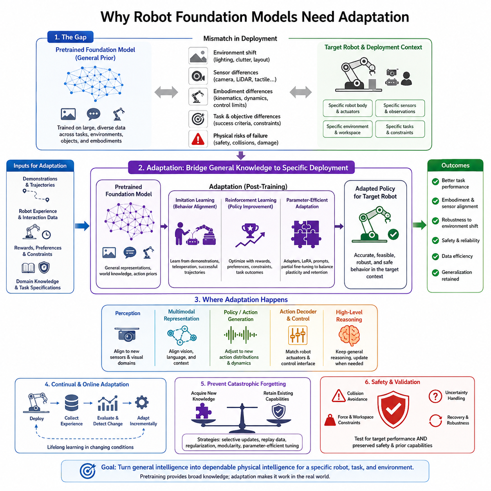{width="7.268055555555556in" height="7.268055555555556in"}

Robot foundation models are trained to capture reusable knowledge across many tasks, environments, objects, and embodiments, but pretraining alone cannot guarantee reliable performance in every deployment. A foundation model learns broad statistical regularities from its training distribution, whereas an operational robot encounters a particular body, sensor configuration, workspace, task definition, and set of physical constraints. Adaptation connects this broad prior knowledge to the conditions under which the robot must actually act.

The need for adaptation follows directly from the difference between digital prediction and physical action. Errors produced by a language or vision model may result in an incorrect answer, but errors produced by a robot policy can cause collisions, dropped objects, damaged equipment, or unsafe interactions with people. A pretrained robot foundation model therefore must be calibrated not only for semantic correctness but also for geometric accuracy, dynamic feasibility, timing, contact behavior, and operational safety.

Robot datasets inevitably represent only a limited sample of the physical world. Even very large mixtures contain biases toward particular laboratories, camera viewpoints, manipulators, grippers, objects, demonstrations, and task distributions. Deployment introduces observations that may differ in lighting, clutter, object appearance, sensor noise, floor conditions, workspace geometry, or human behavior. Adaptation allows the model to preserve transferable knowledge while correcting these distribution differences using data that better represents the target domain.

Embodiment creates another fundamental source of mismatch. A policy trained across multiple robots may understand that an object should be grasped and moved, yet the exact realization of that intention depends on link lengths, joint limits, actuator dynamics, end-effectors, payload limits, control frequency, and reachable workspace. Mobile robots, manipulators, humanoids, and quadrupeds can share semantic concepts while requiring very different motor commands. Robot-specific adaptation converts general competence into physically executable behavior.

Sensors also make apparently similar robots different learning systems. Cameras vary in field of view, mounting pose, resolution, exposure, latency, and calibration, while depth sensors, LiDAR, tactile sensors, force-torque sensors, and proprioceptive interfaces produce different observation structures. A pretrained representation can remain useful across these configurations, but the mapping from perception to action may shift substantially. Environment- and platform-specific adaptation helps align the model with the observations available on the deployed machine.

Tasks themselves introduce another adaptation dimension. Foundation models are valuable because one pretrained backbone can support many downstream behaviors, but individual applications often impose precise definitions of success. A warehouse robot may prioritize throughput and collision avoidance, while an inspection robot may prioritize positioning accuracy and repeatability. A household manipulator may need flexible interaction with unfamiliar objects. Task-specific adaptation reshapes a general behavioral prior around the objectives, tolerances, and constraints that matter in a particular application.

Adaptation is especially important because physical tasks often depend on details that are poorly expressed through language alone. Instructions such as "pick up the cup" describe semantic intent but do not specify the exact grasp pose, approach trajectory, contact force, collision-free motion, or recovery behavior required in a particular scene. A pretrained Vision-Language-Action model can supply a strong prior over possible behavior, while adaptation grounds that prior in demonstrations, trajectories, rewards, corrections, or interaction data collected from the target system.

The objective is therefore not simply to make a pretrained model more specialized. Effective adaptation should retain broadly useful representations while changing only what is necessary for the target robot or environment. Excessive specialization can destroy capabilities acquired during pretraining, while insufficient adaptation leaves important domain mismatches unresolved. This creates a central engineering tradeoff between plasticity and knowledge retention that motivates careful choices among full fine-tuning, parameter-efficient methods, adapters, prompts, and other post-training mechanisms.

Data efficiency is particularly important in robotics because collecting physical experience is expensive. Robot trajectories consume operator time, equipment availability, energy, and laboratory resources, and unsuccessful exploration can damage hardware. Unlike internet-scale text or image collection, millions of new physical demonstrations cannot always be acquired cheaply. Foundation models shift the starting point from learning a task from scratch to adapting an existing representation, making few-shot and low-data adaptation strategically important for practical robot deployment.

Adaptation can also occur at several levels of the model. Perceptual components may be adjusted to recognize a new visual domain, multimodal representations may be aligned with new instructions or sensors, and policy components may be tuned for new action distributions. Action decoders can be adapted to embodiment-specific control interfaces, while higher-level reasoning modules may remain largely shared. This modular perspective makes it possible to preserve general knowledge while modifying the parts most strongly affected by the deployment domain.

Imitation-based post-training provides one route for this transition. Demonstrations collected from human operators, teleoperation systems, scripted controllers, or successful robot executions can teach the pretrained model how desired behavior should appear on the target platform. Because the model already contains transferable visual, semantic, and behavioral representations, relatively small amounts of high-quality target data may produce meaningful improvements. The value of demonstrations therefore depends not only on their quantity but also on coverage, consistency, and relevance.

Reinforcement learning offers a complementary mechanism when desired behavior can be evaluated through rewards, preferences, constraints, or measurable task outcomes. Instead of reproducing demonstrations exactly, the robot can improve policies according to success, efficiency, robustness, or safety objectives. In practice, reinforcement-based post-training can build on imitation-pretrained behavior so that exploration begins from a competent policy rather than from random actions, reducing both physical risk and the amount of interaction required.

Deployment conditions can continue changing after initial adaptation. Tools wear, camera calibration drifts, payloads vary, environments are rearranged, new objects appear, and users introduce tasks that were not represented during initial training. This motivates continual and online adaptation, in which the robot incorporates new experience throughout its operational lifetime. Such learning must be controlled carefully because rapid adaptation to recent data can degrade older capabilities or amplify erroneous behavior observed during operation.

Catastrophic forgetting therefore becomes a major concern for robot foundation models. A model tuned aggressively for one factory, robot, or manipulation skill may lose competence on tasks that were previously reliable. Adaptation methods must balance acquisition of new knowledge with preservation of general capabilities through strategies such as selective parameter updates, replay data, regularization, modular components, or parameter-efficient tuning. The goal is cumulative competence rather than repeated replacement of one specialization by another.

Safety further distinguishes robotic adaptation from conventional model customization. An adapted policy cannot be accepted merely because its average task score improves. Changes must be evaluated for regressions in collision avoidance, force limits, workspace constraints, recovery behavior, uncertainty handling, and other safety-relevant properties. Adaptation therefore belongs inside a broader validation process in which updated models are tested against both target-task improvements and a preserved suite of previously verified behaviors.

For these reasons, adaptation should be understood as the operational bridge between general-purpose robot intelligence and dependable physical deployment. Pretraining provides reusable perception, language grounding, action priors, and broad task knowledge; adaptation transforms those capabilities for a specific task, environment, embodiment, and operating regime. The following fine-tuning and adaptation methods address different versions of this same problem: how to specialize a powerful robot foundation model without unnecessarily sacrificing its generality.

로봇 파운데이션 모델(Robot Foundation Model)은 다양한 작업, 환경, 객체, 임바디먼트(Embodiment)에 걸쳐 재사용 가능한 지식을 학습하도록 훈련되지만, 사전학습(Pretraining)만으로 모든 실제 배치(Deployment) 환경에서 신뢰할 수 있는 성능을 보장할 수는 없다. 파운데이션 모델(Foundation Model)은 학습 분포(Training Distribution)의 광범위한 통계적 규칙성을 학습하는 반면, 실제 로봇은 특정한 신체 구조, 센서 구성, 작업 공간, 작업 정의, 물리적 제약조건을 마주한다. 적응(Adaptation)은 이러한 광범위한 사전 지식(Prior Knowledge)을 로봇이 실제로 행동해야 하는 구체적인 조건과 연결한다.

적응(Adaptation)의 필요성은 디지털 예측(Digital Prediction)과 물리적 행동(Physical Action)의 차이에서 직접적으로 발생한다. 언어 모델(Language Model)이나 비전 모델(Vision Model)의 오류는 잘못된 답변으로 끝날 수 있지만, 로봇 정책(Robot Policy)의 오류는 충돌, 물체 낙하, 장비 손상 또는 사람과의 위험한 상호작용을 초래할 수 있다. 따라서 사전학습된 로봇 파운데이션 모델은 의미적 정확성(Semantic Correctness)뿐만 아니라 기하학적 정확성(Geometric Accuracy), 동역학적 실행 가능성(Dynamic Feasibility), 타이밍(Timing), 접촉 행동(Contact Behavior), 운영 안전성(Operational Safety)에 맞게 조정되어야 한다.

로봇 데이터셋(Robot Dataset)은 필연적으로 물리적 세계의 제한된 일부만을 표현한다. 매우 대규모의 데이터 혼합(Data Mixture)조차도 특정 연구실, 카메라 시점, 매니퓰레이터(Manipulator), 그리퍼(Gripper), 객체, 시연(Demonstration), 작업 분포(Task Distribution)에 편향될 수 있다. 실제 배치에서는 조명, 혼잡도, 객체 외형, 센서 노이즈, 바닥 상태, 작업 공간의 기하 구조, 사람의 행동 등이 학습 환경과 달라질 수 있다. 적응은 전이 가능한 지식(Transferable Knowledge)을 유지하면서 목표 도메인(Target Domain)을 더 잘 나타내는 데이터를 이용하여 이러한 분포 차이(Distribution Difference)를 보정한다.

임바디먼트(Embodiment)는 또 다른 근본적인 불일치의 원인이 된다. 여러 로봇으로 학습된 정책은 객체를 잡아 이동해야 한다는 의미를 이해할 수 있지만, 그 의도를 실제 행동으로 구현하는 방법은 링크 길이(Link Length), 관절 제한(Joint Limit), 액추에이터 동역학(Actuator Dynamics), 엔드 이펙터(End-Effector), 페이로드 제한(Payload Limit), 제어 주기(Control Frequency), 도달 가능 작업 공간(Reachable Workspace)에 따라 달라진다. 모바일 로봇(Mobile Robot), 매니퓰레이터, 휴머노이드(Humanoid), 4족 로봇(Quadruped)은 의미적 개념을 공유하면서도 서로 다른 운동 명령을 필요로 한다. 로봇별 적응(Robot-Specific Adaptation)은 일반적인 능력을 물리적으로 실행 가능한 행동으로 변환한다.

센서(Sensor)의 차이 역시 겉보기에 유사한 로봇을 서로 다른 학습 시스템으로 만든다. 카메라는 시야각(Field of View), 장착 자세, 해상도, 노출, 지연시간(Latency), 캘리브레이션(Calibration)이 서로 다르며, 깊이 센서(Depth Sensor), 라이다(LiDAR), 촉각 센서(Tactile Sensor), 힘-토크 센서(Force-Torque Sensor), 고유수용성 인터페이스(Proprioceptive Interface)는 서로 다른 관측 구조(Observation Structure)를 생성한다. 사전학습된 표현(Pretrained Representation)은 이러한 구성에서도 유용할 수 있지만, 인지(Perception)에서 행동(Action)으로의 매핑은 크게 달라질 수 있다. 환경 및 플랫폼별 적응은 모델을 실제 로봇에서 사용할 수 있는 관측 정보와 정렬한다.

작업(Task) 자체도 또 다른 적응 차원을 제공한다. 파운데이션 모델은 하나의 사전학습된 백본(Pretrained Backbone)이 여러 다운스트림 행동(Downstream Behavior)을 지원할 수 있기 때문에 가치가 있지만, 개별 응용 분야에서는 성공에 대한 정확한 정의가 요구된다. 물류창고 로봇은 처리량(Throughput)과 충돌 회피(Collision Avoidance)를 우선할 수 있고, 검사 로봇은 위치 정확도(Positioning Accuracy)와 반복성(Repeatability)을 중시할 수 있다. 가정용 매니퓰레이터는 익숙하지 않은 객체와 유연하게 상호작용해야 한다. 작업별 적응(Task-Specific Adaptation)은 특정 응용 분야에서 중요한 목표, 허용오차(Tolerance), 제약조건을 중심으로 일반적인 행동 사전분포(Behavioral Prior)를 재구성한다.

물리적 작업은 언어만으로 충분히 표현하기 어려운 세부사항에 의존하기 때문에 적응은 특히 중요하다. "컵을 집어라"와 같은 명령은 의미적 의도(Semantic Intent)를 설명하지만 특정 장면에서 필요한 정확한 파지 자세(Grasp Pose), 접근 궤적(Approach Trajectory), 접촉력(Contact Force), 충돌 없는 움직임(Collision-Free Motion), 실패 복구 행동(Recovery Behavior)을 지정하지는 않는다. 사전학습된 비전-언어-행동 모델(Vision-Language-Action Model)은 가능한 행동에 대한 강력한 사전분포를 제공하며, 적응은 목표 시스템에서 수집된 시연, 궤적(Trajectory), 보상(Reward), 수정(Correction), 상호작용 데이터(Interaction Data)를 통해 이를 실제 물리 환경에 기반하도록 만든다.

따라서 적응의 목적은 단순히 사전학습된 모델을 더욱 전문화하는 것이 아니다. 효과적인 적응은 광범위하게 유용한 표현을 유지하면서 목표 로봇이나 환경에 필요한 부분만 변경해야 한다. 지나친 전문화는 사전학습 과정에서 획득한 능력을 손상시킬 수 있는 반면, 불충분한 적응은 중요한 도메인 불일치(Domain Mismatch)를 해결하지 못한다. 이는 가소성(Plasticity)과 지식 유지(Knowledge Retention) 사이의 핵심적인 공학적 절충관계(Tradeoff)를 형성하며, 전체 미세조정(Full Fine-Tuning), 파라미터 효율적 방법(Parameter-Efficient Method), 어댑터(Adapter), 프롬프트(Prompt) 및 다양한 사후학습(Post-Training) 기법의 선택을 필요하게 한다.

데이터 효율성(Data Efficiency)은 로봇 분야에서 특히 중요하다. 물리적 경험을 수집하려면 작업자의 시간, 장비 가용성, 에너지, 실험실 자원이 필요하며, 실패한 탐색(Exploration)은 하드웨어를 손상시킬 수도 있다. 인터넷 규모의 텍스트나 이미지 데이터와 달리 수백만 개의 새로운 물리적 시연을 저비용으로 수집하기는 어렵다. 파운데이션 모델은 작업을 처음부터 학습하는 방식에서 기존 표현을 적응시키는 방식으로 출발점을 이동시키며, 이에 따라 퓨샷 적응(Few-Shot Adaptation)과 저데이터 적응(Low-Data Adaptation)이 실제 로봇 배치에서 전략적으로 중요해진다.

적응은 모델의 여러 수준에서도 수행될 수 있다. 인지 구성요소(Perceptual Component)는 새로운 시각적 도메인을 인식하도록 조정할 수 있고, 멀티모달 표현(Multimodal Representation)은 새로운 명령이나 센서와 정렬할 수 있으며, 정책 구성요소(Policy Component)는 새로운 행동 분포에 맞게 조정할 수 있다. 행동 디코더(Action Decoder)는 임바디먼트별 제어 인터페이스에 적응시키면서 상위 수준 추론 모듈(Reasoning Module)은 대부분 공유된 상태로 유지할 수도 있다. 이러한 모듈식 관점(Modular Perspective)은 일반 지식을 보존하면서 실제 배치 도메인의 영향을 가장 크게 받는 부분만 수정할 수 있도록 한다.

모방 기반 사후학습(Imitation-Based Post-Training)은 이러한 전환을 위한 하나의 방법을 제공한다. 인간 작업자, 원격조작 시스템(Teleoperation System), 스크립트 기반 제어기(Scripted Controller), 성공적인 로봇 실행에서 수집된 시연은 사전학습 모델에 목표 플랫폼에서 바람직한 행동이 어떻게 나타나야 하는지를 가르칠 수 있다. 모델이 이미 전이 가능한 시각적·의미적·행동적 표현을 가지고 있기 때문에 상대적으로 적은 양의 고품질 목표 데이터만으로도 의미 있는 성능 향상을 얻을 수 있다. 따라서 시연 데이터의 가치는 양뿐만 아니라 적용 범위(Coverage), 일관성(Consistency), 관련성(Relevance)에 의해 결정된다.

강화학습(Reinforcement Learning)은 원하는 행동을 보상, 선호도(Preference), 제약조건 또는 측정 가능한 작업 결과를 통해 평가할 수 있을 때 상호보완적인 적응 방법을 제공한다. 로봇은 시연을 정확하게 복제하는 대신 성공률, 효율성, 강건성(Robustness), 안전성 등의 목표에 따라 정책을 개선할 수 있다. 실제로 강화학습 기반 사후학습(RL-Based Post-Training)은 모방학습으로 사전학습된 행동을 기반으로 수행될 수 있으며, 무작위 행동이 아닌 이미 일정 수준의 능력을 갖춘 정책에서 탐색을 시작함으로써 물리적 위험과 필요한 상호작용의 양을 모두 줄일 수 있다.

초기 적응 이후에도 실제 배치 조건은 계속 변화할 수 있다. 도구는 마모되고, 카메라 캘리브레이션은 변화하며, 페이로드가 달라지고, 환경이 재배치되며, 새로운 객체가 등장하고, 사용자는 초기 학습에 포함되지 않았던 작업을 요구한다. 이러한 변화는 로봇이 운영 수명 전체에 걸쳐 새로운 경험을 통합하는 지속학습 및 온라인 적응(Continual and Online Adaptation)의 필요성을 만든다. 그러나 최근 데이터에 대한 지나치게 빠른 적응은 기존 능력을 저하시키거나 운영 중 관찰된 잘못된 행동을 증폭시킬 수 있으므로 이러한 학습은 신중하게 제어되어야 한다.

따라서 치명적 망각(Catastrophic Forgetting)은 로봇 파운데이션 모델의 중요한 문제가 된다. 특정 공장, 로봇 또는 조작 기술에 지나치게 강하게 미세조정된 모델은 이전에 안정적으로 수행했던 작업에 대한 능력을 잃을 수 있다. 적응 방법은 선택적 파라미터 업데이트(Selective Parameter Update), 리플레이 데이터(Replay Data), 정규화(Regularization), 모듈식 구성요소(Modular Component), 파라미터 효율적 미세조정(Parameter-Efficient Fine-Tuning) 등을 통해 새로운 지식의 획득과 일반 능력의 보존 사이에서 균형을 유지해야 한다. 목표는 하나의 전문화된 능력을 다른 능력으로 반복해서 대체하는 것이 아니라 누적되는 능력(Cumulative Competence)을 구축하는 것이다.

안전성(Safety)은 로봇 적응을 일반적인 모델 맞춤화(Model Customization)와 더욱 명확하게 구분한다. 적응된 정책은 평균 작업 점수(Average Task Score)가 향상되었다는 이유만으로 적용되어서는 안 된다. 변경된 모델은 충돌 회피, 힘 제한(Force Limit), 작업 공간 제약, 복구 행동, 불확실성 처리(Uncertainty Handling) 및 기타 안전 관련 속성에서 성능 퇴행(Regression)이 발생하지 않았는지 평가되어야 한다. 따라서 적응은 업데이트된 모델의 목표 작업 성능 향상뿐만 아니라 기존에 검증된 행동의 보존 여부까지 함께 시험하는 광범위한 검증 프로세스(Validation Process)에 포함되어야 한다.

이러한 이유로 적응(Adaptation)은 범용 로봇 지능(General-Purpose Robot Intelligence)과 신뢰할 수 있는 물리적 배치(Physical Deployment)를 연결하는 운영적 가교(Operational Bridge)로 이해해야 한다. 사전학습은 재사용 가능한 인지, 언어 기반 정렬(Language Grounding), 행동 사전분포(Action Prior), 광범위한 작업 지식을 제공하고, 적응은 이러한 능력을 특정 작업, 환경, 임바디먼트, 운영 조건에 맞게 변환한다. 이후의 미세조정 및 적응 방법들은 결국 하나의 공통된 문제, 즉 강력한 로봇 파운데이션 모델의 범용성을 불필요하게 희생하지 않으면서 어떻게 효과적으로 전문화할 것인가를 해결하기 위한 서로 다른 접근법이다.

##  

## 09.02. Full Fine Tuning vs Parameter Efficient Adaptation

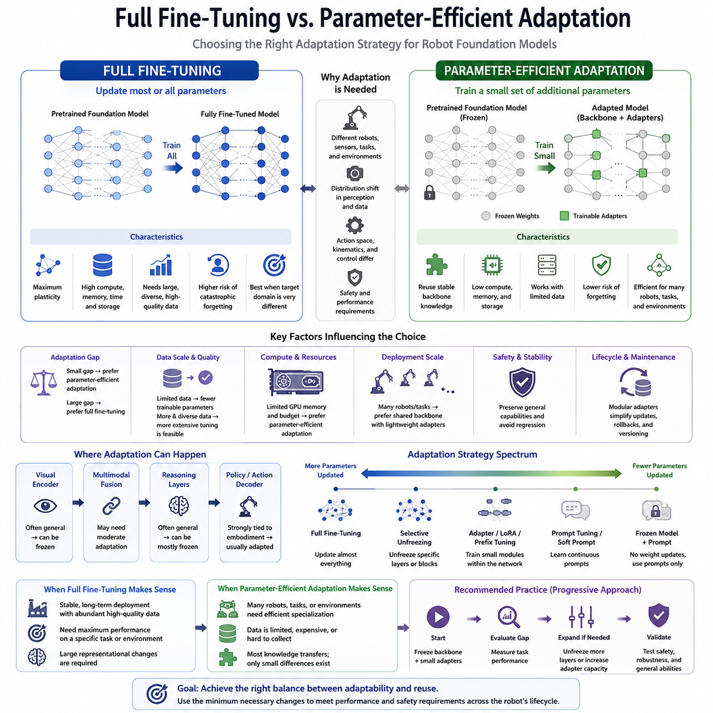{width="7.268055555555556in" height="7.268055555555556in"}

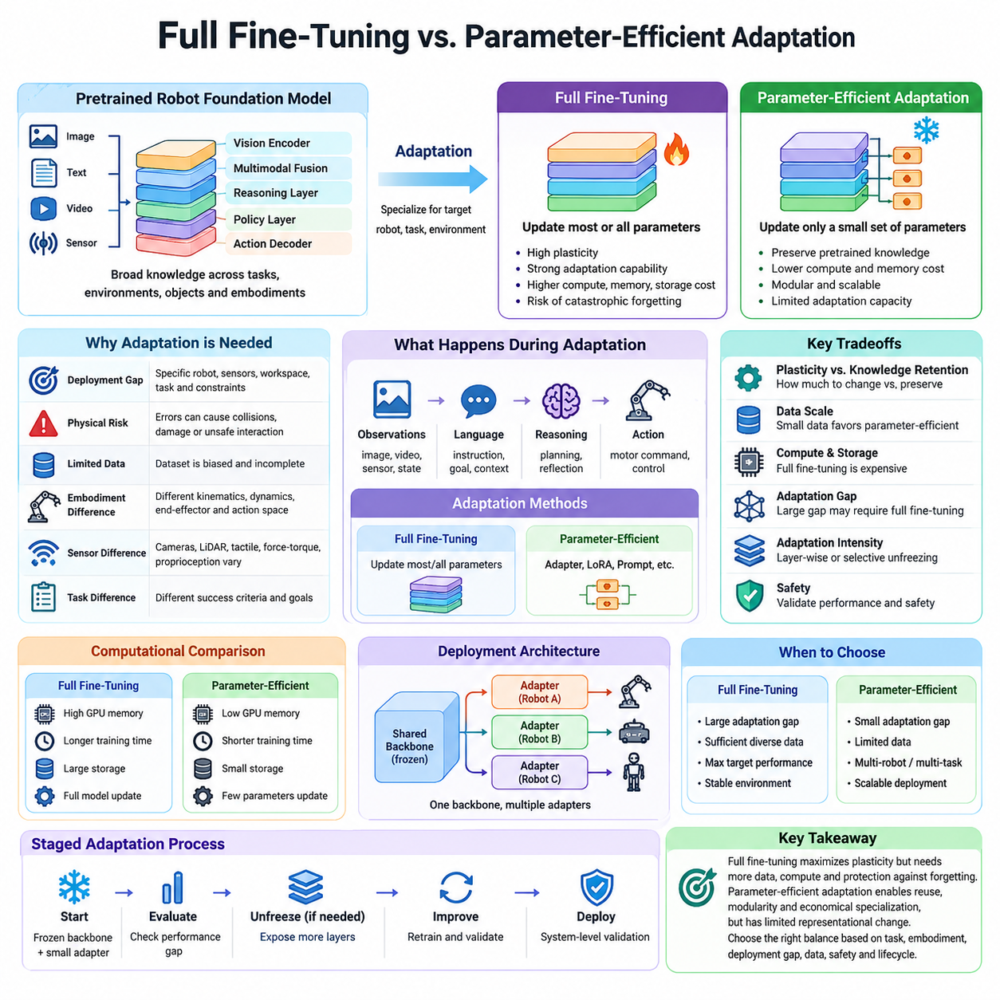{width="7.268055555555556in" height="7.268055555555556in"}

Full fine-tuning and parameter-efficient adaptation represent two fundamentally different strategies for specializing a pretrained robot foundation model. Full fine-tuning updates most or all model parameters using target-domain data, allowing extensive modification of the learned representation. Parameter-efficient adaptation instead freezes most pretrained weights and introduces or modifies only a comparatively small set of parameters needed for the new robot, task, environment, or behavior.

Full fine-tuning provides the greatest degree of model plasticity because optimization can reshape representations throughout the network. Perception features, multimodal associations, reasoning layers, policy representations, and action generation mechanisms can all move toward the target distribution. This flexibility can be valuable when the deployment domain differs substantially from pretraining or when sufficient high-quality robot data is available to support extensive parameter updates.

The same flexibility also makes full fine-tuning computationally demanding. Training requires gradients and optimizer states for a large portion of the model, substantially increasing GPU memory, computation, storage, and training time. For large Vision-Language-Action models, these costs can become particularly significant. Maintaining separate fully fine-tuned copies for many robot platforms or tasks also multiplies storage and model-management requirements across a deployment fleet.

Robot data availability further complicates full fine-tuning. Large foundation models may contain billions of parameters, while a target robot application may provide only thousands or tens of thousands of useful trajectories. Updating the entire model with a comparatively small specialized dataset can lead to overfitting or unstable changes to broadly useful representations. Consequently, full fine-tuning is most attractive when target data is sufficiently diverse, representative, and carefully curated.

Another important concern is catastrophic forgetting. The pretrained model may contain useful knowledge about objects, scenes, language, spatial relationships, manipulation strategies, and behaviors acquired from diverse datasets. Aggressive optimization toward one narrow task can distort these representations and reduce performance on capabilities that were previously reliable. Full fine-tuning therefore often requires careful learning rates, regularization, data mixing, replay, and regression evaluation to preserve general competence.

Parameter-efficient adaptation addresses this problem by limiting the number of trainable parameters. Instead of modifying the entire foundation model, most pretrained weights remain frozen while small trainable components encode the required specialization. These components may be inserted into selected network layers or attached to existing representations. The resulting architecture treats the pretrained model as a stable shared backbone while adaptation parameters capture differences associated with particular downstream conditions.

This separation is especially attractive for robotics because many deployment variations do not require relearning the entire model. Two robots may share visual semantics, language understanding, object concepts, and high-level task knowledge while differing primarily in kinematics, sensors, action distributions, or operational constraints. Parameter-efficient adaptation can preserve common representations and concentrate learning capacity on the smaller subset of relationships that actually changes between deployments.

The computational advantages can be substantial. Training fewer parameters generally reduces gradient memory, optimizer-state memory, checkpoint size, and communication requirements during distributed training. Adaptation modules can also be stored independently of the large shared backbone. Instead of maintaining complete model copies for every task or robot, a system can maintain one foundation model together with multiple compact adaptation states that are selected according to the current deployment context.

This structure naturally supports multi-robot and multi-task systems. A shared pretrained backbone may provide common perception, language grounding, reasoning, and behavioral knowledge, while separate parameter-efficient modules specialize the model for a warehouse manipulator, mobile manipulator, humanoid, or other embodiment. The same principle can distinguish environments or tasks, allowing deployment-specific specialization without duplicating the complete foundation model for every configuration.

Parameter efficiency, however, does not automatically imply better adaptation. Restricting trainable capacity also restricts how much the model can change. If the target distribution is radically different from pretraining, a small adaptation module may not provide enough representational flexibility. Significant differences in perception, embodiment, task structure, dynamics, or action semantics may require modifications across deeper portions of the network that cannot be captured effectively through a narrowly constrained parameter update.

The practical choice is therefore determined partly by the magnitude and location of the adaptation gap. When the pretrained model already possesses relevant representations and the target task primarily requires behavioral alignment or modest domain specialization, parameter-efficient adaptation can be highly effective. When the foundation model lacks important target-domain knowledge or must undergo a substantial representational transformation, broader fine-tuning may offer greater capacity to learn the required changes.

Data scale also changes the tradeoff. With limited robot demonstrations, restricting the number of trainable parameters can act as a useful structural constraint, reducing the tendency to overwrite broadly learned representations. As the quantity and diversity of target-domain data increase, updating larger portions of the network becomes more feasible. Adaptation strategy should therefore be considered jointly with available data rather than selected solely according to computational convenience.

Different parts of a robot foundation model may also require different adaptation intensity. A general visual encoder may transfer effectively and remain frozen, while multimodal fusion layers require moderate adjustment and an action decoder requires stronger robot-specific training. This suggests a continuum rather than a strict binary choice between full fine-tuning and parameter-efficient adaptation. Selective unfreezing can expose particular layers while preserving stable representations elsewhere.

The distinction is especially important for Vision-Language-Action architectures because their components operate at different levels of abstraction. Language and semantic representations may generalize across many embodiments, whereas continuous motor commands are strongly tied to robot geometry and control conventions. Efficient adaptation can therefore concentrate changes near policy or action interfaces while retaining higher-level representations, reducing the risk that embodiment-specific training unnecessarily alters general semantic knowledge.

Operational deployment adds another advantage to parameter-efficient methods: version management. A shared backbone can be validated as a relatively stable foundation, while smaller adaptation components are trained, tested, updated, and rolled back independently. This modularity can simplify maintaining different robot configurations and allows engineers to identify which specialization changed when performance regresses. Nevertheless, every combined backbone-and-adapter configuration still requires system-level validation before physical deployment.

Full fine-tuning remains important when maximum target performance outweighs computational and maintenance costs. A specialized industrial robot operating for years in a stable environment may justify extensive optimization if sufficient representative data exists. Conversely, a general-purpose fleet expected to support many tasks, environments, and embodiments benefits strongly from reusable backbones and lightweight adaptation modules. The preferred strategy therefore depends on whether specialization or scalable reuse dominates the deployment objective.

In practice, adaptation can progress from conservative to increasingly extensive modification. Engineers may begin with a frozen backbone and a small trainable adaptation mechanism, evaluate the remaining performance gap, and expose additional layers only when necessary. Such staged adaptation provides a way to control compute cost and forgetting while testing whether deeper changes genuinely improve physical behavior rather than simply increasing training complexity.

Ultimately, full fine-tuning and parameter-efficient adaptation should be viewed as complementary points on an adaptation spectrum. Full fine-tuning maximizes plasticity but demands more data, compute, storage, and protection against forgetting. Parameter-efficient adaptation emphasizes reuse, modularity, and economical specialization but limits the degree of representational change. Robot foundation model engineering requires selecting the appropriate balance according to the task, embodiment, deployment gap, available data, safety requirements, and lifecycle of the robotic system.

전체 미세조정(Full Fine-Tuning)과 파라미터 효율적 적응(Parameter-Efficient Adaptation)은 사전학습된 로봇 파운데이션 모델(Robot Foundation Model)을 전문화하는 근본적으로 다른 두 가지 전략이다. 전체 미세조정은 목표 도메인(Target Domain) 데이터를 사용하여 모델 파라미터의 대부분 또는 전체를 업데이트함으로써 학습된 표현을 광범위하게 변경한다. 반면 파라미터 효율적 적응은 대부분의 사전학습 가중치(Pretrained Weight)를 고정하고 새로운 로봇, 작업, 환경 또는 행동에 필요한 비교적 적은 수의 파라미터만 추가하거나 수정한다.

전체 미세조정은 네트워크 전체에서 최적화(Optimization)가 표현을 재구성할 수 있기 때문에 가장 높은 수준의 모델 가소성(Model Plasticity)을 제공한다. 인지 특징(Perception Feature), 멀티모달 연관관계(Multimodal Association), 추론 계층(Reasoning Layer), 정책 표현(Policy Representation), 행동 생성 메커니즘(Action Generation Mechanism)을 모두 목표 분포(Target Distribution)에 맞게 조정할 수 있다. 이러한 유연성은 실제 배치 도메인이 사전학습 환경과 크게 다르거나 광범위한 파라미터 업데이트를 지원할 만큼 충분한 고품질 로봇 데이터가 존재할 때 유용하다.

그러나 동일한 유연성으로 인해 전체 미세조정은 많은 계산 자원을 요구한다. 학습 과정에서 모델의 상당 부분에 대한 그래디언트(Gradient)와 옵티마이저 상태(Optimizer State)를 유지해야 하므로 GPU 메모리, 연산량, 저장공간, 학습 시간이 크게 증가한다. 대규모 비전-언어-행동 모델(Vision-Language-Action Model)에서는 이러한 비용이 특히 커질 수 있다. 여러 로봇 플랫폼이나 작업을 위해 각각 완전히 미세조정된 모델을 유지하면 전체 배치 플릿(Deployment Fleet)의 저장공간과 모델 관리 비용도 증가한다.

로봇 데이터의 가용성(Data Availability)은 전체 미세조정을 더욱 어렵게 만든다. 대규모 파운데이션 모델은 수십억 개의 파라미터를 포함할 수 있지만, 특정 로봇 응용 분야에서 확보할 수 있는 유용한 궤적(Trajectory)은 수천 개 또는 수만 개에 불과할 수 있다. 상대적으로 작은 전문 데이터셋으로 전체 모델을 업데이트하면 과적합(Overfitting)이 발생하거나 광범위하게 유용한 표현이 불안정하게 변할 수 있다. 따라서 전체 미세조정은 목표 데이터가 충분히 다양하고 대표성을 가지며 신중하게 큐레이션(Curation)되어 있을 때 가장 효과적이다.

또 다른 중요한 문제는 치명적 망각(Catastrophic Forgetting)이다. 사전학습된 모델에는 다양한 데이터셋으로부터 획득한 객체, 장면, 언어, 공간 관계, 조작 전략, 행동에 대한 유용한 지식이 포함될 수 있다. 하나의 좁은 작업에 지나치게 강하게 최적화하면 이러한 표현이 왜곡되고 이전에 안정적이었던 능력의 성능이 저하될 수 있다. 따라서 전체 미세조정에는 일반적인 능력을 보존하기 위한 신중한 학습률(Learning Rate), 정규화(Regularization), 데이터 혼합(Data Mixing), 리플레이(Replay), 회귀 평가(Regression Evaluation)가 필요한 경우가 많다.

파라미터 효율적 적응(Parameter-Efficient Adaptation)은 학습 가능한 파라미터(Trainable Parameter)의 수를 제한함으로써 이러한 문제에 대응한다. 전체 파운데이션 모델을 수정하는 대신 대부분의 사전학습 가중치를 고정하고, 작은 학습 가능 구성요소를 이용하여 필요한 전문화를 표현한다. 이러한 구성요소는 특정 네트워크 계층에 삽입되거나 기존 표현에 연결될 수 있다. 결과적으로 사전학습 모델은 안정적인 공유 백본(Shared Backbone)으로 유지되고, 적응 파라미터가 특정 다운스트림 조건(Downstream Condition)에 따른 차이를 학습한다.

이러한 분리는 많은 실제 배치 변형이 전체 모델의 재학습을 필요로 하지 않는 로봇 분야에서 특히 유용하다. 두 로봇은 시각적 의미(Visual Semantics), 언어 이해(Language Understanding), 객체 개념, 상위 수준 작업 지식을 공유하면서도 운동학(Kinematics), 센서, 행동 분포(Action Distribution), 운영 제약조건에서만 차이를 보일 수 있다. 파라미터 효율적 적응은 공통 표현을 보존하면서 실제 배치 환경에서 달라지는 상대적으로 작은 관계 집합에 학습 능력을 집중할 수 있다.

계산 효율 측면의 장점도 상당하다. 더 적은 파라미터를 학습하면 일반적으로 그래디언트 메모리(Gradient Memory), 옵티마이저 상태 메모리, 체크포인트(Checkpoint) 크기, 분산학습(Distributed Training) 과정의 통신 요구량을 줄일 수 있다. 적응 모듈(Adaptation Module)은 대규모 공유 백본과 독립적으로 저장할 수도 있다. 각 작업이나 로봇마다 전체 모델을 별도로 유지하는 대신 하나의 파운데이션 모델과 여러 개의 작은 적응 상태(Adaptation State)를 유지하고 현재 배치 상황에 따라 선택적으로 사용할 수 있다.

이러한 구조는 다중 로봇(Multi-Robot) 및 다중 작업(Multi-Task) 시스템을 자연스럽게 지원한다. 공유된 사전학습 백본은 공통적인 인지, 언어 기반 정렬(Language Grounding), 추론, 행동 지식을 제공하고, 개별 파라미터 효율적 모듈은 물류창고 매니퓰레이터, 모바일 매니퓰레이터(Mobile Manipulator), 휴머노이드(Humanoid) 또는 다른 임바디먼트(Embodiment)에 맞게 모델을 전문화할 수 있다. 동일한 원리를 환경이나 작업에도 적용함으로써 각 구성마다 전체 파운데이션 모델을 복제하지 않고 배치별 전문화를 구현할 수 있다.

그러나 파라미터 효율성이 자동으로 더 우수한 적응을 의미하지는 않는다. 학습 가능한 용량을 제한하면 모델이 변화할 수 있는 정도 역시 제한된다. 목표 분포가 사전학습 분포와 근본적으로 다르다면 작은 적응 모듈만으로는 충분한 표현 유연성(Representational Flexibility)을 확보하지 못할 수 있다. 인지, 임바디먼트, 작업 구조, 동역학(Dynamics), 행동 의미(Action Semantics)가 크게 다른 경우 제한적인 파라미터 업데이트만으로는 효과적으로 표현할 수 없는 네트워크 심층부의 변화가 필요할 수 있다.

따라서 실제 선택은 적응 격차(Adaptation Gap)의 크기와 위치에 의해 부분적으로 결정된다. 사전학습 모델이 이미 관련된 표현을 가지고 있고 목표 작업에서 주로 행동 정렬(Behavioral Alignment)이나 비교적 작은 도메인 전문화가 필요한 경우 파라미터 효율적 적응은 매우 효과적일 수 있다. 반대로 파운데이션 모델에 중요한 목표 도메인 지식이 부족하거나 상당한 수준의 표현 변환(Representational Transformation)이 필요하다면 더 광범위한 미세조정이 필요한 변화를 학습하는 데 더 높은 능력을 제공할 수 있다.

데이터 규모(Data Scale) 역시 이러한 절충관계에 영향을 준다. 로봇 시연(Robot Demonstration)이 제한된 상황에서는 학습 가능한 파라미터 수를 제한하는 것이 유용한 구조적 제약(Structural Constraint)으로 작용하여 광범위하게 학습된 표현을 덮어쓰는 경향을 줄일 수 있다. 목표 도메인 데이터의 양과 다양성이 증가하면 네트워크의 더 많은 부분을 업데이트하는 것이 현실적으로 가능해진다. 따라서 적응 전략은 계산 편의성만으로 선택하는 것이 아니라 사용 가능한 데이터와 함께 고려해야 한다.

로봇 파운데이션 모델의 서로 다른 부분에는 서로 다른 수준의 적응 강도(Adaptation Intensity)가 필요할 수도 있다. 일반적인 비전 인코더(Vision Encoder)는 효과적으로 전이되어 고정된 상태로 유지할 수 있는 반면, 멀티모달 융합 계층(Multimodal Fusion Layer)은 중간 수준의 조정이 필요하고 행동 디코더(Action Decoder)는 보다 강한 로봇별 학습을 요구할 수 있다. 이는 전체 미세조정과 파라미터 효율적 적응을 엄격한 이분법으로 구분하기보다 하나의 연속체(Continuum)로 이해해야 함을 의미한다. 선택적 동결 해제(Selective Unfreezing)를 통해 특정 계층만 학습하면서 다른 부분의 안정적인 표현을 보존할 수 있다.

이러한 구분은 비전-언어-행동 아키텍처(Vision-Language-Action Architecture)에서 특히 중요하다. 각 구성요소가 서로 다른 추상화 수준(Level of Abstraction)에서 작동하기 때문이다. 언어 및 의미 표현(Semantic Representation)은 다양한 임바디먼트에서 일반화될 수 있지만, 연속적인 모터 명령(Continuous Motor Command)은 로봇의 기하 구조와 제어 규약(Control Convention)에 강하게 의존한다. 따라서 효율적인 적응은 상위 수준의 표현을 유지하면서 정책 또는 행동 인터페이스 주변에 변화를 집중하여 임바디먼트별 학습이 일반적인 의미 지식을 불필요하게 변경할 위험을 줄일 수 있다.

운영 배치(Operational Deployment)에서는 파라미터 효율적 방법이 버전 관리(Version Management) 측면에서도 장점을 제공한다. 공유 백본은 비교적 안정적인 기반으로 검증할 수 있으며, 작은 적응 구성요소는 독립적으로 학습, 시험, 업데이트, 롤백(Rollback)할 수 있다. 이러한 모듈성(Modularity)은 서로 다른 로봇 구성을 유지하는 작업을 단순화하고 성능 저하가 발생했을 때 어떤 전문화 구성요소가 변경되었는지를 엔지니어가 식별하기 쉽게 한다. 다만 모든 백본과 어댑터(Backbone-and-Adapter) 조합은 실제 물리적 배치 이전에 시스템 수준 검증(System-Level Validation)을 거쳐야 한다.

목표 환경에서 최대 성능을 확보하는 것이 계산 및 유지관리 비용보다 중요한 경우 전체 미세조정은 여전히 중요한 선택이다. 안정된 환경에서 장기간 운영되는 전문 산업용 로봇은 충분한 대표 데이터가 존재한다면 광범위한 최적화를 수행할 가치가 있다. 반대로 다양한 작업, 환경, 임바디먼트를 지원해야 하는 범용 로봇 플릿(General-Purpose Robot Fleet)은 재사용 가능한 백본과 경량 적응 모듈(Lightweight Adaptation Module)로부터 더 큰 이점을 얻는다. 따라서 어떤 전략을 선택할지는 전문화(Specialization)와 확장 가능한 재사용(Scalable Reuse) 중 어느 목표가 실제 배치에서 더 중요한지에 따라 달라진다.

실제 적응 과정은 보수적인 변경에서 점차 광범위한 변경으로 진행할 수 있다. 엔지니어는 고정된 백본과 작은 학습 가능 적응 메커니즘으로 시작하여 남아 있는 성능 격차(Performance Gap)를 평가하고, 필요한 경우에만 추가 계층의 동결을 해제할 수 있다. 이러한 단계적 적응(Staged Adaptation)은 계산 비용과 망각을 제어하면서 더 깊은 수준의 변경이 단순히 학습 복잡성만 증가시키는 것이 아니라 실제 물리적 행동을 실질적으로 개선하는지 검증할 수 있는 방법을 제공한다.

궁극적으로 전체 미세조정(Full Fine-Tuning)과 파라미터 효율적 적응(Parameter-Efficient Adaptation)은 적응 스펙트럼(Adaptation Spectrum)의 상호보완적인 두 지점으로 이해해야 한다. 전체 미세조정은 최대의 가소성을 제공하지만 더 많은 데이터, 연산 자원, 저장공간과 치명적 망각에 대한 보호를 요구한다. 파라미터 효율적 적응은 재사용성, 모듈성, 경제적인 전문화를 강조하지만 표현을 변경할 수 있는 정도에는 제한이 있다. 로봇 파운데이션 모델 엔지니어링에서는 작업, 임바디먼트, 배치 격차, 사용 가능한 데이터, 안전 요구사항, 로봇 시스템의 생애주기(Lifecycle)를 고려하여 두 접근법 사이의 적절한 균형을 선택해야 한다.

##  

## 09.03. LoRA Adapters and Prompt Based Adaptation

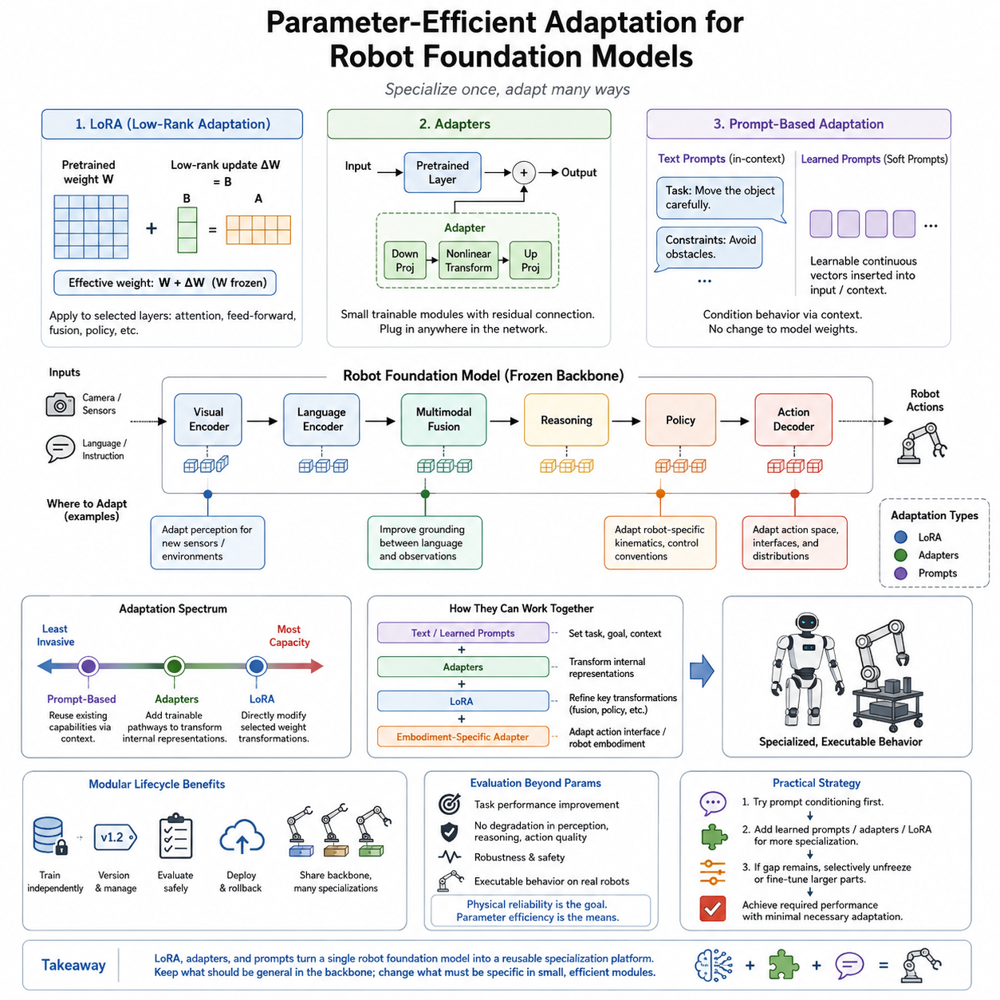{width="7.268055555555556in" height="7.268055555555556in"}

LoRA, adapters, and prompt-based adaptation provide practical mechanisms for specializing robot foundation models without updating every parameter in a large pretrained network. They belong to parameter-efficient adaptation because most of the original model remains fixed while a relatively small trainable component changes the model's behavior. This separation is particularly valuable in robotics, where one foundation model may need to support many tasks, environments, and robot embodiments.

Low-Rank Adaptation, commonly called LoRA, is based on the observation that useful changes to a large pretrained model can often be represented within a much lower-dimensional parameter space than the original weight matrices. Instead of directly modifying a large weight matrix, LoRA keeps the pretrained matrix frozen and learns a low-rank update through two smaller matrices. Their product approximates the weight modification required for the target domain while greatly reducing the number of trainable parameters.

Conceptually, if a pretrained transformation uses a weight matrix W, full fine-tuning learns changes directly across W. LoRA instead represents the adaptation as an additional update ΔW that is factorized into low-rank matrices. The effective transformation becomes W + ΔW while W itself remains unchanged. Because the rank of the update can be much smaller than the dimensions of W, the adaptation can capture useful specialization with substantially fewer trainable values.

For robot foundation models, LoRA can be applied selectively to attention projections, feed-forward layers, multimodal fusion components, policy representations, or other transformations. This flexibility allows engineers to choose where adaptation capacity should be concentrated. A visual-language representation that already generalizes well may require little modification, while layers connecting multimodal reasoning to robot actions may receive stronger adaptation because they are more closely coupled to the target task or embodiment.

Adapters use a related but structurally different principle. Rather than expressing changes as low-rank modifications of existing weight matrices, adapter methods introduce small trainable modules into or alongside the pretrained network. A typical adapter compresses a hidden representation into a lower-dimensional space, transforms it, and projects it back to the original dimension. Residual connections allow the pretrained information flow to remain available while the adapter learns task- or domain-specific corrections.

This modular organization is attractive for robotics because adapters can represent distinct specializations while sharing the same frozen backbone. A single robot foundation model might use one adapter for manipulation, another for navigation, and another for inspection. Different adapters could also correspond to particular robots, sensor configurations, factories, or end-effectors. The large shared model stores general knowledge, while compact modules encode differences that should not require an entirely separate foundation model.

LoRA and adapters therefore provide an efficient way to organize multi-task and multi-embodiment deployment. Instead of storing several complete fine-tuned models, a robotic system can maintain one validated backbone and a library of relatively small adaptation states. Selecting a new task or robot configuration can then involve loading the appropriate adaptation component. This reduces storage duplication and provides a clearer separation between general pretrained capability and deployment-specific specialization.

Prompt-based adaptation moves specialization even further away from direct modification of the foundation model. At the simplest level, a model can be conditioned through natural-language instructions describing the task, goal, constraints, environment, or desired behavior. A sufficiently capable multimodal model may alter its behavior according to this context without changing its parameters. This form of adaptation resembles in-context control because specialization is expressed through information supplied at inference time.

Prompt adaptation can also use learned representations rather than only human-readable text. Soft prompts or learned prompt tokens introduce trainable continuous vectors into the model's input or intermediate context. These vectors can encode task-specific information while the underlying foundation model remains frozen. Because only a small prompt representation is optimized, this approach can require far fewer trainable parameters than conventional fine-tuning while still steering the model toward a particular downstream behavior.

In robotics, prompts can describe more than semantic task identity. They may represent goals, object categories, operational modes, environmental context, or behavioral constraints. An instruction such as moving an object carefully can condition high-level behavior, while learned prompts may encode information that is difficult to express explicitly in natural language. Prompt-based mechanisms are therefore useful when a pretrained model already possesses the required capabilities but needs contextual guidance about which behavior should be activated.

However, prompt-based adaptation has important limitations for physical control. A prompt can effectively select or bias knowledge already represented by the model, but it may be insufficient when the target robot requires genuinely new motor mappings, sensor interpretations, or dynamic relationships. A different manipulator geometry or action interface may require changes inside the policy or action-generation pathway. In such cases, LoRA, adapters, or stronger fine-tuning mechanisms can provide greater representational capacity.

The three approaches therefore occupy different positions in the adaptation spectrum. Prompt-based methods make minimal changes and emphasize reuse of existing capabilities. Adapters introduce dedicated trainable pathways that can transform internal representations. LoRA directly modifies the effective behavior of selected pretrained transformations through low-rank updates. None of these mechanisms is universally superior; their usefulness depends on how much the target behavior differs from what the pretrained model already knows.

Their placement within the architecture is as important as the adaptation mechanism itself. Robot foundation models commonly contain visual encoding, language processing, multimodal fusion, reasoning, policy, and action-generation components. Adaptation near perception may address new sensors or visual environments, whereas adaptation near multimodal fusion may improve grounding between instructions and observations. Adaptation near policy and action layers can address robot-specific kinematics, control conventions, or action distributions.

Parameter-efficient methods can also be combined. A system might use textual prompts to specify a task, a learned prompt to encode environmental context, LoRA to adapt multimodal or policy transformations, and an embodiment-specific adapter near the action decoder. Such combinations create a layered adaptation architecture in which different mechanisms address different forms of mismatch. The objective is not to maximize the number of adaptation modules but to place sufficient trainable capacity where the deployment gap actually occurs.

This modularity provides important lifecycle advantages. Adaptation components can be trained, versioned, evaluated, distributed, and rolled back independently from the large foundation backbone. When a new robot or task is introduced, engineers may only need to produce a new LoRA state, adapter, or learned prompt rather than retraining and distributing the complete model. A fleet can consequently share a common foundation while maintaining controlled specialization across heterogeneous operational configurations.

Small adaptation modules also reduce, but do not eliminate, the risk of catastrophic forgetting. Because most pretrained parameters remain frozen, broad knowledge is less likely to be overwritten directly. Nevertheless, an adaptation module can still alter model behavior enough to degrade previously reliable capabilities when activated. Evaluation must therefore examine not only improvement on the target task but also unintended regressions in perception, reasoning, action quality, robustness, and safety.

For physical systems, adaptation must ultimately be judged by executable behavior rather than parameter count alone. A compact LoRA module is not useful merely because it is computationally efficient, and a prompt is not sufficient merely because it produces semantically plausible reasoning. The adapted model must generate actions compatible with the robot's geometry, dynamics, timing, sensors, control interfaces, workspace constraints, and safety requirements. Parameter efficiency is valuable only when physical reliability is preserved.

A practical strategy is to begin with the least invasive mechanism capable of solving the adaptation problem. Prompt conditioning can be tested when the required behavior may already exist within the pretrained model. Learned prompts, adapters, or LoRA can then introduce progressively greater specialization while preserving most of the backbone. If these mechanisms cannot close the deployment gap, selective unfreezing or broader fine-tuning can expose additional model capacity for adaptation.

LoRA, adapters, and prompt-based adaptation thus transform a large robot foundation model from a monolithic artifact into a reusable platform for specialization. The backbone provides shared perception, semantic knowledge, reasoning, and behavioral priors, while lightweight adaptation mechanisms configure those capabilities for particular robots and tasks. This architecture supports scalable robot learning by separating what should remain general from what must change for each physical deployment.

LoRA(로라), 어댑터(adapters), 프롬프트 기반 적응(prompt-based adaptation)은 대규모 사전학습 네트워크의 모든 파라미터를 업데이트하지 않고도 로봇 파운데이션 모델(robot foundation model)을 특정 목적에 맞게 전문화할 수 있는 실용적인 방법을 제공한다. 이들은 파라미터 효율적 적응(parameter-efficient adaptation)에 속하며, 대부분의 원래 모델은 고정한 상태에서 상대적으로 작은 학습 가능 구성요소를 변경하여 모델의 동작을 조정한다. 이러한 분리는 하나의 파운데이션 모델이 다양한 작업, 환경, 로봇 구현체(embodiment)를 지원해야 하는 로보틱스에서 특히 중요하다.

저랭크 적응(Low-Rank Adaptation), 일반적으로 LoRA라고 부르는 방법은 대규모 사전학습 모델에 필요한 유용한 변화가 원래 가중치 행렬보다 훨씬 낮은 차원의 파라미터 공간으로 표현될 수 있다는 관찰에 기반한다. 대규모 가중치 행렬을 직접 수정하는 대신 LoRA는 사전학습된 행렬을 동결하고 두 개의 더 작은 행렬을 통해 저랭크 업데이트(low-rank update)를 학습한다. 두 행렬의 곱은 대상 도메인에 필요한 가중치 변화를 근사하면서 학습해야 하는 파라미터의 수를 크게 줄인다.

개념적으로 사전학습된 변환이 가중치 행렬 W를 사용한다면, 전체 파인튜닝(full fine-tuning)은 W 전체에 걸쳐 직접적인 변화를 학습한다. 반면 LoRA는 적응을 ΔW라는 추가 업데이트로 표현하고, 이를 저랭크 행렬들로 분해한다. 결과적으로 유효한 변환은 W + ΔW가 되지만 W 자체는 변경되지 않는다. 업데이트의 랭크(rank)가 W의 차원보다 훨씬 작을 수 있기 때문에 적응은 훨씬 적은 학습 가능 값으로도 유용한 전문화를 표현할 수 있다.

로봇 파운데이션 모델에서는 LoRA를 어텐션 프로젝션(attention projections), 피드포워드 계층(feed-forward layers), 멀티모달 융합 구성요소(multimodal fusion components), 정책 표현(policy representations) 또는 기타 변환에 선택적으로 적용할 수 있다. 이러한 유연성은 엔지니어가 적응 능력을 어느 부분에 집중할 것인지 선택할 수 있도록 한다. 이미 높은 일반화 성능을 가진 시각-언어 표현(vision-language representation)은 작은 수정만 필요할 수 있지만, 멀티모달 추론을 로봇 행동으로 연결하는 계층은 대상 작업이나 로봇 구현체와 더욱 밀접하게 연결되어 있기 때문에 더 강한 적응이 필요할 수 있다.

어댑터(adapters)는 관련된 원리를 사용하지만 구조적으로는 다른 방식이다. 기존 가중치 행렬을 저랭크 방식으로 수정하는 대신, 어댑터 방식은 사전학습된 네트워크 내부 또는 그와 함께 작은 학습 가능 모듈을 추가한다. 일반적인 어댑터는 은닉 표현(hidden representation)을 더 낮은 차원의 공간으로 압축하고, 이를 변환한 다음 다시 원래 차원으로 투영한다. 잔차 연결(residual connections)을 사용하면 사전학습된 정보 흐름을 계속 사용할 수 있는 동시에 어댑터는 작업 또는 도메인에 특화된 보정을 학습할 수 있다.

이러한 모듈식 구성은 동일한 동결된 백본(frozen backbone)을 공유하면서 서로 다른 전문화를 표현할 수 있기 때문에 로보틱스에 매력적이다. 하나의 로봇 파운데이션 모델이 조작(manipulation)용 어댑터, 내비게이션(navigation)용 어댑터, 검사(inspection)용 어댑터를 각각 사용할 수 있다. 서로 다른 어댑터는 특정 로봇, 센서 구성, 공장 또는 엔드 이펙터(end-effector)에 대응할 수도 있다. 대규모 공유 모델은 일반적인 지식을 저장하고, 소형 모듈은 완전히 별도의 파운데이션 모델을 필요로 하지 않아도 되는 차이를 표현한다.

따라서 LoRA와 어댑터는 멀티태스크(multi-task) 및 멀티-임바디먼트(multi-embodiment) 배포를 효율적으로 구성하는 방법을 제공한다. 여러 개의 완전한 파인튜닝 모델을 저장하는 대신 로봇 시스템은 하나의 검증된 백본과 상대적으로 작은 적응 상태(adaptation states) 라이브러리를 유지할 수 있다. 새로운 작업이나 로봇 구성을 선택할 때 적절한 적응 구성요소를 불러오면 된다. 이를 통해 저장 공간의 중복을 줄이고, 일반적인 사전학습 능력과 배포 환경에 특화된 전문화를 더욱 명확하게 분리할 수 있다.

프롬프트 기반 적응(prompt-based adaptation)은 파운데이션 모델 자체를 직접 수정하는 것에서 더욱 멀어진 방식으로 전문화를 수행한다. 가장 단순한 수준에서는 작업, 목표, 제약조건, 환경 또는 원하는 행동을 설명하는 자연어 지시문을 통해 모델을 조건화할 수 있다. 충분히 강력한 멀티모달 모델은 파라미터를 변경하지 않고도 이러한 문맥에 따라 행동을 변화시킬 수 있다. 이러한 적응 방식은 추론 시점에 제공되는 정보로 전문화를 표현한다는 점에서 인컨텍스트 제어(in-context control)와 유사하다.

프롬프트 적응은 사람이 읽을 수 있는 텍스트만 사용하는 것이 아니라 학습된 표현(learned representations)을 사용할 수도 있다. 소프트 프롬프트(soft prompts) 또는 학습된 프롬프트 토큰(learned prompt tokens)은 모델의 입력이나 중간 문맥에 학습 가능한 연속 벡터(continuous vectors)를 추가한다. 이러한 벡터는 작업에 특화된 정보를 인코딩하면서 기본 파운데이션 모델은 동결된 상태로 유지할 수 있다. 최적화되는 것이 작은 프롬프트 표현이기 때문에 이 방법은 기존 파인튜닝보다 훨씬 적은 학습 파라미터를 필요로 하면서도 특정 다운스트림 행동(downstream behavior)으로 모델을 유도할 수 있다.

로보틱스에서 프롬프트는 단순한 의미적 작업 정체성(semantic task identity) 이상의 정보를 설명할 수 있다. 목표, 객체 범주, 운용 모드, 환경 문맥 또는 행동 제약조건 등을 표현할 수 있다. 예를 들어 객체를 조심스럽게 이동하라는 지시는 상위 수준의 행동을 조건화할 수 있으며, 학습된 프롬프트는 자연어로 명확하게 표현하기 어려운 정보를 인코딩할 수 있다. 따라서 프롬프트 기반 메커니즘은 사전학습된 모델이 이미 필요한 능력을 갖고 있지만 어떤 행동을 활성화해야 하는지에 대한 문맥적 지침이 필요한 경우 유용하다.

그러나 프롬프트 기반 적응은 물리적 제어(physical control)에서 중요한 한계를 가진다. 프롬프트는 모델이 이미 표현하고 있는 지식을 선택하거나 편향시키는 데 효과적일 수 있지만, 대상 로봇에 완전히 새로운 모터 매핑(motor mappings), 센서 해석(sensor interpretations) 또는 동적 관계(dynamic relationships)가 필요한 경우에는 충분하지 않을 수 있다. 서로 다른 매니퓰레이터 형상(manipulator geometry)이나 행동 인터페이스(action interface)는 정책(policy) 또는 행동 생성 경로(action-generation pathway) 내부의 변경을 요구할 수 있다. 이러한 경우 LoRA, 어댑터 또는 더 강력한 파인튜닝 메커니즘이 더 큰 표현 능력을 제공할 수 있다.

따라서 세 가지 접근법은 적응 스펙트럼(adaptation spectrum)에서 서로 다른 위치를 차지한다. 프롬프트 기반 방법은 최소한의 변경을 수행하면서 기존 능력의 재사용을 강조한다. 어댑터는 내부 표현을 변환할 수 있는 전용 학습 경로(trainable pathways)를 추가한다. LoRA는 저랭크 업데이트를 통해 선택된 사전학습 변환의 유효한 동작을 직접 수정한다. 어느 하나가 항상 우월한 것은 아니며, 그 유용성은 대상 행동이 사전학습 모델이 이미 알고 있는 것과 얼마나 다른지에 따라 달라진다.

이들이 아키텍처에서 배치되는 위치는 적응 메커니즘 자체만큼 중요하다. 로봇 파운데이션 모델은 일반적으로 시각 인코딩(visual encoding), 언어 처리(language processing), 멀티모달 융합(multimodal fusion), 추론(reasoning), 정책(policy), 행동 생성(action generation) 구성요소를 포함한다. 지각(perception) 근처의 적응은 새로운 센서나 시각적 환경을 처리할 수 있으며, 멀티모달 융합 근처의 적응은 지시와 관측 사이의 그라운딩(grounding)을 향상시킬 수 있다. 정책 및 행동 계층 근처의 적응은 로봇 특화 운동학(robot-specific kinematics), 제어 규약(control conventions) 또는 행동 분포(action distributions)를 처리할 수 있다.

파라미터 효율적 방법(parameter-efficient methods)은 서로 결합할 수도 있다. 시스템은 텍스트 프롬프트를 사용하여 작업을 지정하고, 학습된 프롬프트를 사용하여 환경 문맥을 인코딩하며, LoRA를 사용하여 멀티모달 또는 정책 변환을 적응시키고, 행동 디코더(action decoder) 근처에 구현체 특화 어댑터(embodiment-specific adapter)를 사용할 수 있다. 이러한 조합은 서로 다른 종류의 불일치(mismatch)를 각각 처리하는 계층적 적응 아키텍처(layered adaptation architecture)를 만든다. 목표는 적응 모듈의 수를 최대화하는 것이 아니라 실제 배포 간극(deployment gap)이 발생하는 위치에 충분한 학습 능력을 배치하는 것이다.

이러한 모듈성(modularity)은 모델 수명주기(lifecycle)에서도 중요한 장점을 제공한다. 적응 구성요소는 대규모 파운데이션 백본과 독립적으로 학습, 버전 관리, 평가, 배포 및 롤백할 수 있다. 새로운 로봇이나 작업이 추가될 때 엔지니어는 전체 모델을 다시 학습하고 배포하는 대신 새로운 LoRA 상태, 어댑터 또는 학습된 프롬프트만 생성하면 될 수 있다. 따라서 로봇 플릿(fleet)은 하나의 공통 파운데이션을 공유하면서 서로 다른 운용 구성에 대해 통제된 전문화를 유지할 수 있다.

소형 적응 모듈은 파국적 망각(catastrophic forgetting)의 위험을 줄일 수 있지만 완전히 제거하지는 않는다. 대부분의 사전학습 파라미터가 동결되어 있기 때문에 일반적인 지식이 직접 덮어쓰일 가능성은 낮아진다. 그러나 적응 모듈이 활성화되었을 때 모델의 행동을 충분히 변화시켜 이전에 안정적으로 수행하던 능력을 저하시킬 수 있다. 따라서 평가는 대상 작업의 성능 향상뿐만 아니라 지각, 추론, 행동 품질, 강건성(robustness), 안전성(safety)에서 발생하는 의도하지 않은 성능 저하도 함께 검토해야 한다.

물리 시스템에서 적응은 궁극적으로 파라미터 수가 아니라 실행 가능한 행동(executable behavior)을 기준으로 평가되어야 한다. 소형 LoRA 모듈이 계산 효율적이라는 이유만으로 유용한 것은 아니며, 프롬프트가 의미적으로 타당한 추론을 생성한다는 이유만으로 충분한 것도 아니다. 적응된 모델은 로봇의 형상(geometry), 동역학(dynamics), 시간 특성(timing), 센서, 제어 인터페이스, 작업공간 제약조건(workspace constraints) 및 안전 요구사항과 호환되는 행동을 생성해야 한다. 파라미터 효율성은 물리적 신뢰성(physical reliability)이 유지될 때에만 가치가 있다.

실용적인 전략은 적응 문제를 해결할 수 있는 가장 비침습적인 메커니즘(least invasive mechanism)부터 시작하는 것이다. 필요한 행동이 이미 사전학습 모델 내부에 존재할 가능성이 있다면 먼저 프롬프트 조건화(prompt conditioning)를 시험할 수 있다. 이후 대부분의 백본을 유지하면서 학습된 프롬프트, 어댑터 또는 LoRA를 통해 점진적으로 더 강한 전문화를 추가할 수 있다. 이러한 메커니즘으로도 배포 간극을 충분히 줄이지 못한다면 선택적 파라미터 동결 해제(selective unfreezing) 또는 더 광범위한 파인튜닝을 통해 추가적인 모델 용량을 적응에 사용할 수 있다.

LoRA, 어댑터, 프롬프트 기반 적응은 대규모 로봇 파운데이션 모델을 단일한 모놀리식 산출물(monolithic artifact)에서 재사용 가능한 전문화 플랫폼으로 변화시킨다. 백본은 공유된 지각, 의미 지식, 추론 및 행동 사전지식(behavioral priors)을 제공하고, 경량 적응 메커니즘은 이러한 능력을 특정 로봇과 작업에 맞게 구성한다. 이러한 아키텍처는 무엇을 일반적으로 유지해야 하는지와 각각의 물리적 배포를 위해 무엇을 변경해야 하는지를 분리함으로써 확장 가능한 로봇 학습(scalable robot learning)을 지원한다.

##  

## 09.04. Task Specific Fine Tuning

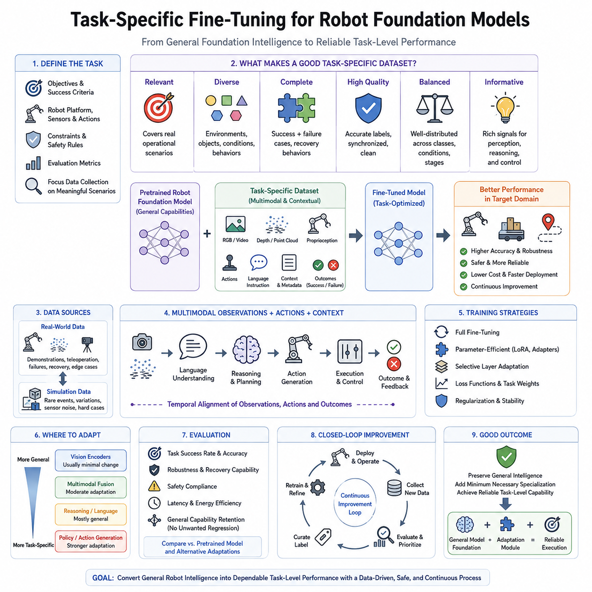{width="7.268055555555556in" height="7.268055555555556in"}

Task-specific fine-tuning adapts a pretrained robot foundation model to perform a particular task more accurately and reliably while preserving as much of its general capability as possible. The central idea is to start from broad knowledge learned across tasks, environments, objects, and embodiments, then specialize the model using data that directly represents the target operation. This creates a bridge between general-purpose robotic intelligence and the specific requirements of real deployment.

The need for task-specific fine-tuning arises because a general robot foundation model rarely matches every deployment condition perfectly. A target application may impose different success criteria, object configurations, workspace constraints, sensor characteristics, action requirements, or safety rules. Fine-tuning reduces this deployment gap by teaching the model how general perception, reasoning, and action capabilities should be expressed for a particular task rather than replacing the entire foundation model with a task-specific system.

The quality of task-specific data is therefore central to the adaptation process. Useful data should represent real operational scenarios and include sufficient diversity in environments, objects, conditions, behaviors, and task outcomes. Successful demonstrations are important, but failure cases, recovery behaviors, boundary conditions, and unusual situations are equally valuable because they teach the model how to respond when execution does not follow the expected trajectory. High-quality, synchronized, clean, and balanced data can improve adaptation efficiency while reducing unnecessary training.

Task definition should precede data collection and training. The target objective and success criteria need to be explicit, together with the robot platform, sensors, available actions, operating constraints, safety requirements, and evaluation metrics. Data collection can then focus on situations that are genuinely informative for the target behavior. This prevents large amounts of irrelevant experience from dominating training and makes the resulting dataset more closely aligned with the physical requirements of the deployment environment.

Task-specific fine-tuning generally uses multimodal observations rather than a single input modality. RGB images, depth, video, proprioceptive state, robot actions, language instructions, environmental context, timestamps, calibration information, and task outcomes can all contribute to the learning process. Aligning these signals is particularly important because the model must connect what the robot sees and understands with what it actually does. Temporal synchronization allows observations, decisions, actions, and resulting outcomes to form coherent training trajectories.

For a vision-language-action model, fine-tuning can specialize several forms of capability simultaneously. The model may learn to recognize task-relevant objects and spatial relationships, ground language instructions in the current scene, understand operational constraints, generate appropriate robot motions, and recover from execution errors. Task-specific data can therefore modify the relationship between perception, language, reasoning, and action rather than simply improving recognition accuracy. The objective is a policy that performs the complete task reliably in its intended physical context.

The training strategy should be selected according to the size of the adaptation gap, available data, computational resources, and required deployment scale. Full fine-tuning updates most or all model parameters and provides strong adaptation capacity when substantial representational changes are necessary. However, it requires greater compute, memory, storage, and training resources. Parameter-efficient methods such as LoRA and adapters can be preferable when most pretrained knowledge remains useful and only a relatively small task-specific change is required.

Task-specific fine-tuning should also consider the location of adaptation within the model. Visual encoders often contain broadly reusable knowledge and may require limited modification, while multimodal fusion may need moderate adaptation to improve grounding between instructions and observations. Reasoning layers can often remain largely general, whereas policy and action-generation components are more closely connected to the target task. When the task requires specific motion patterns, action distributions, or control conventions, greater adaptation near these downstream components may be appropriate.

Simulation and real-world data can complement each other during task-specific fine-tuning. Simulation can efficiently generate variations, rare events, sensor noise, and difficult edge cases that are expensive or unsafe to collect on physical robots. Real-world demonstrations provide the physical characteristics that simulation may fail to reproduce completely. Combining these sources can expand behavioral coverage, but the resulting dataset must remain consistent with the actual deployment conditions so that improvements in training translate into reliable physical behavior.

Evaluation must measure more than training loss or task accuracy. A task-specific model should be compared with the original pretrained model and alternative adaptation strategies using task success rate, precision, robustness, recovery capability, safety compliance, inference latency, energy efficiency, and long-term stability where appropriate. Testing should also examine whether specialization causes unwanted degradation in general perception, reasoning, or previously reliable behaviors. The adapted model is successful only when improved task performance is achieved without unacceptable regression.

The fine-tuned model should ultimately enter a closed development and deployment loop rather than being treated as a finished artifact. Real robots generate new experience during operation, including successful executions, failures, recovery attempts, and previously unseen conditions. These experiences can be logged, evaluated, prioritized, curated, and added to the task-specific dataset for subsequent refinement. This creates a continuous improvement cycle in which deployment experience progressively improves the model while maintaining controlled validation and safety gates.

The practical objective of task-specific fine-tuning is therefore not simply to make a robot better at one benchmark or one narrow behavior. It is to preserve the reusable intelligence of a robot foundation model while introducing the minimum additional specialization required for dependable physical execution. A well-designed process connects task definition, high-quality multimodal data, controlled fine-tuning, simulation and real-world evaluation, safety validation, and continuous feedback. In this form, fine-tuning becomes the mechanism that converts general robotic intelligence into reliable task-level capability.

작업 특화 파인튜닝(task-specific fine-tuning)은 사전학습된 로봇 파운데이션 모델(robot foundation model)이 특정 작업을 더욱 정확하고 안정적으로 수행하도록 적응시키면서, 가능한 한 많은 범용 능력(general capability)을 보존하는 방법이다. 핵심 아이디어는 다양한 작업, 환경, 객체, 로봇 구현체(embodiment)를 통해 학습된 광범위한 지식에서 출발하여, 대상 작업을 직접 나타내는 데이터로 모델을 전문화하는 것이다. 이를 통해 범용 로봇 지능과 실제 배포에 필요한 특정 요구사항 사이의 간극을 연결할 수 있다.

작업 특화 파인튜닝이 필요한 이유는 범용 로봇 파운데이션 모델이 모든 배포 조건과 완벽하게 일치하는 경우가 거의 없기 때문이다. 특정 응용에서는 서로 다른 성공 기준, 객체 구성, 작업공간 제약, 센서 특성, 행동 요구사항 또는 안전 규칙이 적용될 수 있다. 파인튜닝은 전체 파운데이션 모델을 작업 전용 시스템으로 교체하는 것이 아니라, 일반적인 지각, 추론, 행동 능력이 특정 작업에 맞게 표현되는 방식을 학습시켜 이러한 배포 간극(deployment gap)을 줄인다.

따라서 작업 특화 데이터의 품질은 적응 과정의 핵심이 된다. 유용한 데이터는 실제 운용 상황을 나타내야 하며, 환경, 객체, 조건, 행동 및 작업 결과에서 충분한 다양성을 포함해야 한다. 성공적인 시연(successful demonstrations)도 중요하지만 실패 사례, 복구 행동(recovery behaviors), 경계 조건(boundary conditions), 비정상적인 상황 역시 중요하다. 이러한 데이터는 예상한 실행 궤적대로 진행되지 않을 때 모델이 어떻게 대응해야 하는지를 학습시키기 때문이다. 고품질의 동기화된(synchronized), 정제된(clean), 균형 잡힌 데이터는 적응 효율을 높이는 동시에 불필요한 학습을 줄일 수 있다.

데이터 수집과 학습에 앞서 작업 정의(task definition)가 이루어져야 한다. 대상 목표와 성공 기준을 명확하게 정의하고, 로봇 플랫폼, 센서, 사용 가능한 행동, 운용 제약조건, 안전 요구사항 및 평가 지표를 함께 설정해야 한다. 이후 데이터 수집은 실제 대상 행동에 유용한 상황에 집중할 수 있다. 이를 통해 관련성이 낮은 대량의 경험이 학습을 지배하는 것을 방지하고, 결과 데이터셋이 실제 배포 환경의 물리적 요구사항에 더욱 밀접하게 맞도록 할 수 있다.

작업 특화 파인튜닝은 일반적으로 단일 입력 모달리티(input modality)가 아니라 멀티모달 관측(multimodal observations)을 사용한다. RGB 이미지, 깊이(depth), 비디오, 고유수용감각 상태(proprioceptive state), 로봇 행동, 언어 지시, 환경 문맥, 타임스탬프, 캘리브레이션 정보 및 작업 결과가 모두 학습 과정에 기여할 수 있다. 이러한 신호들을 정렬하는 것은 특히 중요하다. 모델이 로봇이 무엇을 보고 이해하는지와 실제로 무엇을 수행하는지를 연결해야 하기 때문이다. 시간적 동기화(temporal synchronization)를 통해 관측, 의사결정, 행동 및 그 결과가 일관된 학습 궤적(training trajectories)을 형성할 수 있다.

비전-언어-행동 모델(vision-language-action model)의 경우 파인튜닝은 여러 종류의 능력을 동시에 전문화할 수 있다. 모델은 작업과 관련된 객체 및 공간적 관계를 인식하고, 언어 지시를 현재 장면에 연결하며, 운용 제약을 이해하고, 적절한 로봇 동작을 생성하고, 실행 오류로부터 복구하는 방법을 학습할 수 있다. 따라서 작업 특화 데이터는 단순히 인식 정확도를 향상시키는 것이 아니라 지각, 언어, 추론 및 행동 사이의 관계를 변화시킬 수 있다. 목표는 대상 물리적 환경에서 전체 작업을 안정적으로 수행하는 정책(policy)을 만드는 것이다.

학습 전략은 적응 간극의 크기, 사용 가능한 데이터, 계산 자원 및 필요한 배포 규모에 따라 선택해야 한다. 전체 파인튜닝(full fine-tuning)은 모델의 대부분 또는 전체 파라미터를 업데이트하며, 상당한 표현 변화가 필요한 경우 강력한 적응 능력을 제공한다. 그러나 더 많은 연산, 메모리, 저장 공간 및 학습 자원을 필요로 한다. LoRA와 어댑터(adapters) 같은 파라미터 효율적 방법(parameter-efficient methods)은 대부분의 사전학습 지식이 여전히 유용하고 상대적으로 작은 작업 특화 변경만 필요한 경우 더 적합할 수 있다.

작업 특화 파인튜닝에서는 모델 내부의 어느 위치를 적응시킬 것인지도 고려해야 한다. 시각 인코더(visual encoder)는 폭넓게 재사용할 수 있는 지식을 포함하는 경우가 많기 때문에 제한적인 수정만 필요할 수 있다. 반면 멀티모달 융합(multimodal fusion)은 지시와 관측 사이의 그라운딩(grounding)을 향상시키기 위해 중간 수준의 적응이 필요할 수 있다. 추론 계층(reasoning layers)은 대부분 범용적으로 유지할 수 있지만, 정책(policy) 및 행동 생성(action generation) 구성요소는 대상 작업과 더욱 밀접하게 연결된다. 작업에 특정한 동작 패턴, 행동 분포 또는 제어 규약(control conventions)이 필요한 경우 이러한 하위 구성요소에 더 강한 적응을 적용하는 것이 적절할 수 있다.

시뮬레이션(simulation)과 실제 환경 데이터(real-world data)는 작업 특화 파인튜닝 과정에서 서로 보완적으로 사용할 수 있다. 시뮬레이션은 물리적 로봇에서 수집하기 어렵거나 비용과 위험이 큰 다양한 상황, 희귀 사건, 센서 노이즈 및 어려운 엣지 케이스(edge cases)를 효율적으로 생성할 수 있다. 실제 환경의 시연 데이터는 시뮬레이션이 완전히 재현하기 어려운 물리적 특성을 제공한다. 이러한 데이터 소스를 결합하면 행동 범위를 확장할 수 있지만, 학습 데이터가 실제 배포 조건과 일관성을 유지하도록 관리해야 학습 과정에서의 성능 향상이 안정적인 물리적 행동으로 이어질 수 있다.

평가는 학습 손실(training loss)이나 작업 정확도(task accuracy) 이상의 것을 측정해야 한다. 작업 특화 모델은 원래의 사전학습 모델 및 다른 적응 전략과 비교하여 작업 성공률(task success rate), 정밀도(precision), 강건성(robustness), 복구 능력(recovery capability), 안전 규정 준수(safety compliance), 추론 지연시간(inference latency), 에너지 효율(energy efficiency) 및 필요한 경우 장기 안정성(long-term stability)을 평가해야 한다. 또한 전문화 과정에서 일반적인 지각, 추론 또는 기존에 안정적으로 수행되던 행동이 원치 않게 저하되지 않는지도 확인해야 한다. 적응된 모델은 허용할 수 없는 성능 저하 없이 대상 작업의 성능을 향상시킬 때 비로소 성공했다고 볼 수 있다.

파인튜닝된 모델은 완성된 산출물(finished artifact)로 취급하기보다 폐쇄형 개발 및 배포 루프(closed development and deployment loop)에 포함해야 한다. 실제 로봇은 운용 과정에서 성공적인 실행, 실패, 복구 시도 및 이전에 경험하지 못한 조건을 포함한 새로운 경험을 생성한다. 이러한 경험은 기록하고, 평가하고, 우선순위를 지정하고, 정제한 후 작업 특화 데이터셋에 추가하여 다음 단계의 모델 개선에 사용할 수 있다. 이를 통해 배포 과정에서 얻은 경험이 통제된 검증 및 안전 게이트(safety gates)를 거치면서 모델을 지속적으로 개선하는 순환 구조를 만들 수 있다.

작업 특화 파인튜닝의 실질적인 목표는 단순히 하나의 벤치마크나 좁은 범위의 행동에서 로봇의 성능을 높이는 것이 아니다. 그 목표는 로봇 파운데이션 모델이 가진 재사용 가능한 지능을 보존하면서 신뢰할 수 있는 물리적 실행을 위해 필요한 최소한의 전문화를 추가하는 것이다. 잘 설계된 과정은 작업 정의, 고품질 멀티모달 데이터, 통제된 파인튜닝, 시뮬레이션 및 실제 환경 평가, 안전 검증, 지속적인 피드백을 연결한다. 이러한 형태에서 파인튜닝은 범용 로봇 지능을 신뢰할 수 있는 작업 수준 능력(task-level capability)으로 전환하는 핵심 메커니즘이 된다.

##  

## 09.05. Environment Specific Adaptation

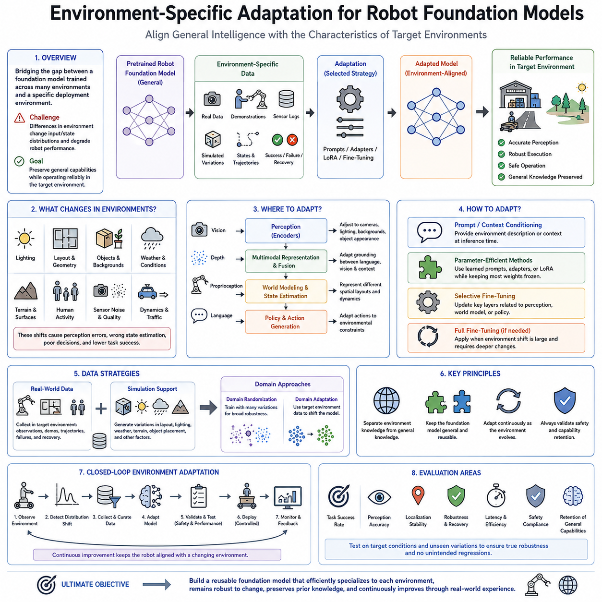{width="7.268055555555556in" height="7.268055555555556in"}

Environment-specific adaptation addresses the gap between a robot foundation model trained across many environments and the particular conditions in which a robot must operate. Even when the robot, task, and action interface remain unchanged, differences in lighting, layout, terrain, object distribution, background appearance, temperature, weather, human activity, or workspace organization can shift the input and state distributions. Adaptation therefore teaches the model how to preserve its general capabilities while interpreting and acting reliably under the characteristics of a target environment.

A foundation model may have strong general representations, but deployment environments often contain conditions that are underrepresented in pretraining data. A warehouse may have a different shelf arrangement, a factory may introduce new fixtures, and an outdoor robot may encounter rain, dust, vegetation, shadows, or changing terrain. Service robots may face continuously changing furniture and human activity. These differences can cause perception errors, incorrect state estimation, inappropriate action selection, or reduced task success even when the underlying task itself has not changed.

Environment-specific adaptation begins by identifying the environmental factors that actually affect robot behavior. These factors can include visual appearance, illumination, geometry, spatial layout, object density, surface properties, terrain characteristics, sensor noise, motion patterns, human behavior, and environmental dynamics. The objective is not to adapt to every observed variation independently, but to determine which environmental changes create meaningful distribution shifts and which can be handled by the existing general model without additional training.

Environmental adaptation can operate at several levels of a robot foundation model. Perception components may need adjustment when cameras, lighting conditions, backgrounds, or object appearances differ from pretraining. Multimodal representations may require adaptation when the relationship between language, visual observations, and environmental context changes. World modeling and state estimation may need to represent different spatial structures or dynamics, while policy and action generation may require modification when environmental constraints change how actions should be executed.

The adaptation process should use data that captures the target environment rather than simply increasing the overall size of the training dataset. Real-world observations, demonstrations, interaction trajectories, sensor recordings, environmental states, successful executions, failures, and recovery behaviors can provide valuable information. Simulation can complement these sources by generating controlled variations in layout, lighting, object placement, weather, terrain, and other environmental parameters. The most useful dataset represents the conditions that the deployed robot is actually expected to encounter.

Domain randomization and domain adaptation provide complementary strategies for reducing environmental mismatch. Domain randomization exposes the model to many variations during training so that it learns representations that are less dependent on any single environment. Domain adaptation instead uses information from a particular target environment to modify the model toward its observed distribution. A practical system can combine both approaches by developing broad robustness during pretraining or simulation and then applying targeted adaptation using limited data from the actual deployment environment.

Environment-specific adaptation does not necessarily require updating the entire foundation model. If the environmental difference is relatively small, prompts or contextual conditioning may provide sufficient information to guide behavior. Learned prompts, adapters, or LoRA can introduce additional specialization while keeping most of the pretrained backbone frozen. When the environmental shift substantially changes perception, representations, or policy behavior, selective fine-tuning or full fine-tuning may become necessary. The appropriate strategy depends on the magnitude of the distribution shift and the amount of new information that must be learned.

An important principle is to separate environmental knowledge from general knowledge whenever possible. The foundation model should continue to retain broad semantic understanding, physical knowledge, reasoning ability, and reusable behavioral priors. Environment-specific modules can instead encode information such as a particular factory layout, warehouse configuration, building structure, terrain distribution, lighting characteristics, or recurring operational patterns. This modular separation allows the same foundation model to support multiple environments without maintaining an entirely independent model for every deployment.

Environment adaptation should also account for temporal change. A deployment environment is rarely completely static. Furniture can move, shelves can be rearranged, production lines can change, weather can vary, and people can alter traffic patterns. Consequently, adaptation may need to operate as a continuing process rather than a single offline training event. New observations can be collected during operation, evaluated for meaningful distribution changes, and incorporated into subsequent model updates while preserving previously validated capabilities.

Safety is especially important because environmental adaptation can modify robot behavior in unexpected ways. A model that performs well in a new environment may nevertheless develop regressions in collision avoidance, workspace constraints, recovery behavior, or interaction with people. Adaptation should therefore be evaluated against both target-environment performance and previously established safety requirements. Simulation, controlled real-world testing, monitoring, regression evaluation, and rollback mechanisms provide safeguards before a newly adapted model is deployed broadly.

The effectiveness of environment-specific adaptation should be measured across more than task success alone. Evaluation can examine perception accuracy, localization stability, policy performance, robustness to environmental variation, recovery from unexpected conditions, latency, energy consumption, safety compliance, and retention of general capabilities. Testing should include both familiar target conditions and variations that were not explicitly included in the adaptation dataset. The goal is to ensure that the model has learned environmental robustness rather than simply memorizing a narrow set of observations.

A useful deployment architecture can therefore follow a closed loop of environment observation, distribution-shift detection, data collection, adaptation, validation, deployment, and monitoring. The robot observes the environment and identifies conditions that differ from its learned prior. Relevant experiences are collected and curated, an adaptation component is trained or updated, and the resulting model is evaluated before controlled deployment. Operational feedback then provides new evidence for the next adaptation cycle, allowing the system to improve as environmental conditions evolve.

Environment-specific adaptation ultimately transforms a general robot foundation model into a system that can operate reliably within particular physical contexts. Pretraining supplies broad knowledge and transferable capabilities, while adaptation aligns those capabilities with the visual, spatial, dynamic, and operational characteristics of a target environment. The objective is not to create a separate intelligence for every location, but to develop a reusable foundation that can efficiently specialize, remain robust to change, preserve prior knowledge, and continuously improve through real-world experience.

환경 특화 적응(environment-specific adaptation)은 다양한 환경에서 학습된 로봇 파운데이션 모델(robot foundation model)과 로봇이 실제로 작동해야 하는 특정 환경 사이의 간극을 해결한다. 로봇, 작업, 행동 인터페이스(action interface)가 동일하게 유지되더라도 조명, 배치, 지형, 객체 분포, 배경의 외관, 온도, 날씨, 사람의 활동 또는 작업공간 구성의 차이는 입력 및 상태 분포를 변화시킬 수 있다. 따라서 적응은 모델의 범용 능력(general capabilities)을 유지하면서 대상 환경의 특성에 맞게 안정적으로 해석하고 행동하도록 학습시키는 과정이다.

파운데이션 모델은 강력한 범용 표현(general representations)을 가지고 있을 수 있지만, 실제 배포 환경에는 사전학습 데이터에 충분히 포함되지 않은 조건이 존재하는 경우가 많다. 창고는 다른 선반 배치를 가질 수 있고, 공장에는 새로운 설비가 추가될 수 있으며, 실외 로봇은 비, 먼지, 식생, 그림자 또는 변화하는 지형을 경험할 수 있다. 서비스 로봇은 지속적으로 변화하는 가구 배치와 사람의 활동에 직면할 수 있다. 이러한 차이는 기본적인 작업 자체가 변하지 않았더라도 지각 오류, 잘못된 상태 추정, 부적절한 행동 선택 또는 작업 성공률 저하를 일으킬 수 있다.

환경 특화 적응은 먼저 로봇의 행동에 실제로 영향을 미치는 환경 요인을 식별하는 것에서 시작한다. 이러한 요인에는 시각적 외관, 조명, 기하학적 구조, 공간 배치, 객체 밀도, 표면 특성, 지형 특성, 센서 노이즈, 이동 패턴, 사람의 행동 및 환경의 동적 특성이 포함될 수 있다. 목표는 관찰되는 모든 변화를 개별적으로 적응시키는 것이 아니라, 어떤 환경 변화가 의미 있는 분포 변화(distribution shift)를 발생시키는지와 기존의 범용 모델이 추가 학습 없이 처리할 수 있는 변화를 구분하는 것이다.

환경 적응은 로봇 파운데이션 모델의 여러 수준에서 수행될 수 있다. 지각 구성요소(perception components)는 카메라, 조명 조건, 배경 또는 객체 외관이 사전학습 환경과 다를 경우 조정이 필요할 수 있다. 멀티모달 표현(multimodal representations)은 언어, 시각적 관측 및 환경 문맥(environmental context) 사이의 관계가 변화할 때 적응이 필요할 수 있다. 월드 모델링(world modeling)과 상태 추정(state estimation)은 서로 다른 공간 구조나 동역학을 표현해야 할 수 있으며, 정책(policy) 및 행동 생성(action generation)은 환경적 제약이 변화할 때 수정이 필요할 수 있다.

적응 과정에서는 단순히 전체 학습 데이터셋의 크기를 증가시키는 것이 아니라 대상 환경의 특성을 포착하는 데이터를 사용해야 한다. 실제 환경의 관측, 시연, 상호작용 궤적(interaction trajectories), 센서 기록, 환경 상태, 성공적인 실행, 실패 및 복구 행동(recovery behaviors)은 중요한 정보를 제공할 수 있다. 시뮬레이션(simulation)은 레이아웃, 조명, 객체 배치, 날씨, 지형 및 기타 환경 파라미터의 통제된 변화를 생성함으로써 이러한 데이터를 보완할 수 있다. 가장 유용한 데이터셋은 실제 배포 로봇이 직면할 것으로 예상되는 조건을 직접적으로 표현한다.

도메인 랜덤화(domain randomization)와 도메인 적응(domain adaptation)은 환경 불일치를 줄이기 위한 상호 보완적인 전략을 제공한다. 도메인 랜덤화는 학습 과정에서 다양한 변화를 모델에 노출하여 특정 환경 하나에 지나치게 의존하지 않는 표현을 학습하도록 한다. 반면 도메인 적응은 특정 대상 환경에서 얻은 정보를 사용하여 모델을 관찰된 분포에 맞게 조정한다. 실용적인 시스템에서는 두 접근법을 결합할 수 있다. 사전학습이나 시뮬레이션 단계에서 광범위한 강건성을 확보한 후, 실제 배포 환경에서 제한된 데이터를 사용하여 집중적인 적응을 수행하는 방식이다.

환경 특화 적응은 반드시 전체 파운데이션 모델을 업데이트할 필요는 없다. 환경 차이가 비교적 작다면 프롬프트(prompt)나 문맥 조건화(contextual conditioning)만으로 행동을 유도하는 데 충분할 수 있다. 학습된 프롬프트(learned prompts), 어댑터(adapters) 또는 LoRA를 사용하면 사전학습된 백본(backbone)의 대부분을 동결한 상태에서 추가적인 전문화를 도입할 수 있다. 환경 변화가 지각, 표현 또는 정책 행동을 크게 변화시키는 경우에는 선택적 파인튜닝(selective fine-tuning)이나 전체 파인튜닝(full fine-tuning)이 필요할 수 있다. 적절한 전략은 분포 변화의 크기와 새롭게 학습해야 하는 정보의 양에 따라 결정된다.

중요한 원칙 중 하나는 가능한 경우 환경 특화 지식과 범용 지식을 분리하는 것이다. 파운데이션 모델은 광범위한 의미적 이해(semantic understanding), 물리적 지식(physical knowledge), 추론 능력(reasoning ability) 및 재사용 가능한 행동 사전지식(behavioral priors)을 계속 유지해야 한다. 반면 환경 특화 모듈(environment-specific modules)은 특정 공장 레이아웃, 창고 구성, 건물 구조, 지형 분포, 조명 특성 또는 반복적인 운용 패턴과 같은 정보를 저장할 수 있다. 이러한 모듈식 분리를 통해 모든 배포 환경마다 완전히 독립적인 모델을 유지하지 않고도 하나의 파운데이션 모델이 여러 환경을 지원할 수 있다.

환경 적응은 시간에 따른 변화(temporal change)도 고려해야 한다. 실제 배포 환경은 완전히 정적인 경우가 거의 없다. 가구가 이동할 수 있고, 선반이 재배치될 수 있으며, 생산 라인이 변경되고, 날씨가 변하고, 사람의 이동 패턴도 달라질 수 있다. 따라서 적응은 한 번의 오프라인 학습 이벤트라기보다 지속적인 과정으로 운영될 필요가 있다. 운용 중 새로운 관측을 수집하고 의미 있는 분포 변화를 평가한 다음, 기존에 검증된 능력을 유지하면서 이후의 모델 업데이트에 반영할 수 있다.

안전성(safety)은 환경 적응에서 특히 중요하다. 새로운 환경에서 높은 성능을 보이는 모델이라도 충돌 회피, 작업공간 제약, 복구 행동 또는 사람과의 상호작용에서 예상하지 못한 성능 저하를 일으킬 수 있다. 따라서 적응은 대상 환경에서의 성능뿐만 아니라 기존에 확립된 안전 요구사항을 기준으로도 평가해야 한다. 시뮬레이션, 통제된 실제 환경 테스트, 모니터링, 회귀 평가(regression evaluation) 및 롤백 메커니즘(rollback mechanisms)은 새롭게 적응된 모델을 광범위하게 배포하기 전에 필요한 보호 수단을 제공한다.

환경 특화 적응의 효과는 단순한 작업 성공률 이상의 항목을 통해 측정해야 한다. 평가는 지각 정확도(perception accuracy), 위치 추정 안정성(localization stability), 정책 성능(policy performance), 환경 변화에 대한 강건성(robustness), 예상하지 못한 조건에서의 복구 능력(recovery capability), 지연시간(latency), 에너지 소비(energy consumption), 안전 규정 준수(safety compliance) 및 범용 능력의 유지(retention of general capabilities)를 포함할 수 있다. 평가에는 명시적으로 적응 데이터셋에 포함되지 않았던 변화와 익숙한 대상 환경 조건을 모두 포함해야 한다. 목표는 모델이 제한된 관측을 단순히 암기한 것이 아니라 환경적 강건성을 실제로 학습했는지 확인하는 것이다.

유용한 배포 아키텍처는 환경 관측(environment observation), 분포 변화 감지(distribution-shift detection), 데이터 수집, 적응, 검증, 배포 및 모니터링으로 이어지는 폐쇄 루프(closed loop)를 구성할 수 있다. 로봇은 환경을 관찰하고 학습된 사전지식(learned prior)과 다른 조건을 식별한다. 관련 경험을 수집하고 정제한 후 적응 구성요소(adaptation component)를 학습하거나 업데이트하고, 결과 모델을 평가한 다음 통제된 방식으로 배포한다. 운용 과정에서 얻은 피드백은 다음 적응 사이클을 위한 새로운 증거를 제공하여 환경 조건이 변화함에 따라 시스템이 지속적으로 개선될 수 있도록 한다.

환경 특화 적응은 궁극적으로 범용 로봇 파운데이션 모델을 특정 물리적 환경에서 안정적으로 작동할 수 있는 시스템으로 변화시킨다. 사전학습(pretraining)은 광범위한 지식과 전이 가능한 능력을 제공하고, 적응(adaptation)은 이러한 능력을 대상 환경의 시각적, 공간적, 동적 및 운용적 특성에 맞게 정렬한다. 목표는 각 장소마다 별도의 지능을 만드는 것이 아니라, 효율적으로 전문화하고 변화에 강건하게 대응하며 기존 지식을 보존하고 실제 환경 경험을 통해 지속적으로 개선될 수 있는 재사용 가능한 파운데이션(reusable foundation)을 구축하는 것이다.

##  

## 09.06. Robot Specific and Embodiment Specific Adaptation

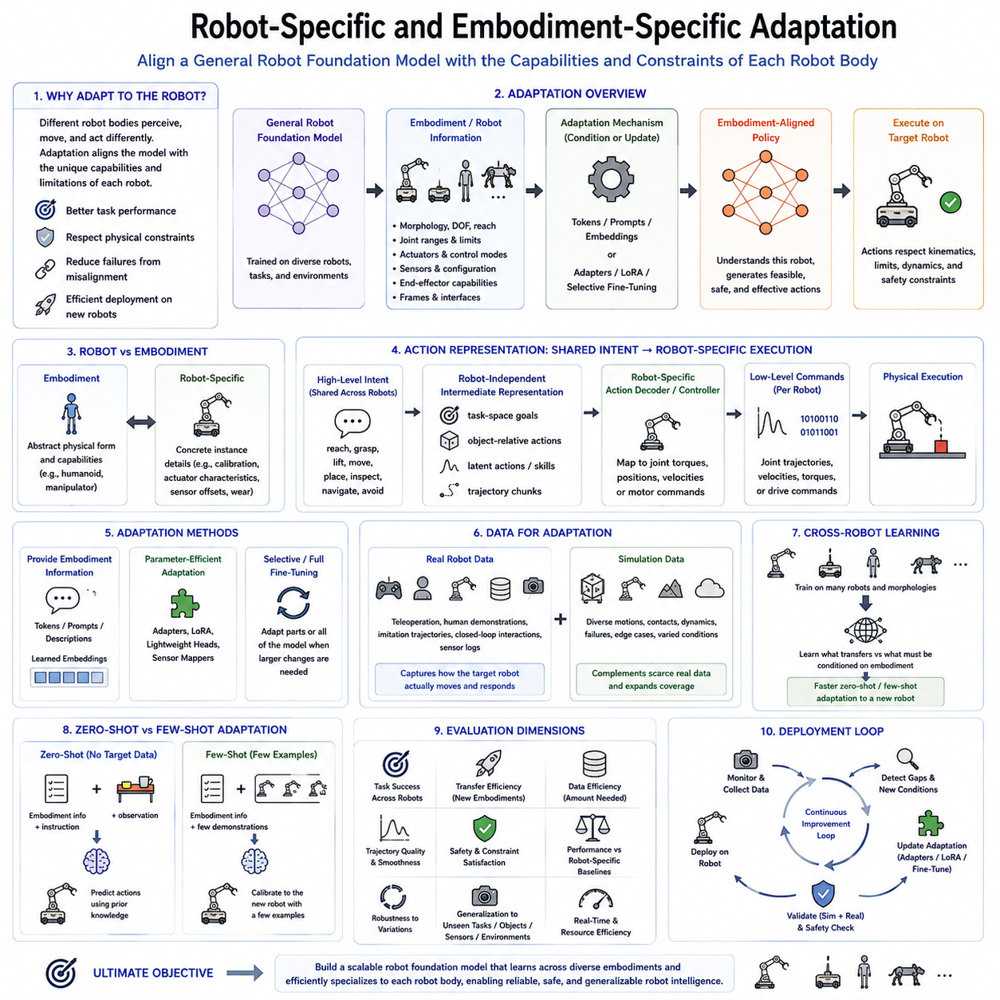{width="7.268055555555556in" height="7.268055555555556in"}

Robot-specific and embodiment-specific adaptation customizes a general robot foundation model to the particular hardware platform, kinematic structure, sensors, actuators, control interface, and physical constraints of a specific robot embodiment. Even when the task and environment remain similar, differences in morphology, degrees of freedom, reach, payload, joint limits, sensor placement, observation coverage, and actuation dynamics can change what the robot can perceive, how it can move, and how it should execute actions. Embodiment-specific adaptation aligns the model's representations, reasoning, and policies with the unique capabilities and limitations of a specific robot body.

The core goal is to preserve the broad intelligence learned during pretraining while specializing the model to use a particular body effectively and reliably. A humanoid, mobile manipulator, quadruped, and fixed-base arm operate under different kinematics and dynamics, so the same policy output does not have the same meaning across bodies. Adaptation teaches the model how to interpret observations from the robot's sensors, reason about reachable states, and generate actions that respect joint, velocity, torque, and safety constraints. This improves task performance and reduces failures caused by poor model-robot alignment.

Robot-specific adaptation is closely related to embodiment adaptation, but it can operate at a more concrete level. An embodiment describes the general physical form and capabilities of a robot, while robot-specific adaptation may account for the exact hardware instance, calibration state, actuator characteristics, sensor offsets, controller behavior, or mechanical wear of one particular robot. Two robots with the same nominal morphology can therefore require different adaptations. The foundation model provides shared knowledge, while robot-specific components capture the physical details that determine how that knowledge can be executed.

Embodiment information can be provided explicitly to the model rather than forcing the model to infer the robot's identity from observations alone. Tokens, prompts, or learned embeddings can describe morphology, degrees of freedom, joint ranges, actuator type, end-effector capabilities, sensor configuration, coordinate frames, and control interfaces. This allows the model to condition its predictions on the physical body. A robot identifier by itself is less informative than a structured representation of what the robot can perceive and physically accomplish.

Adaptation can also modify internal model components through parameter-efficient methods. LoRA, adapters, lightweight policy heads, action decoders, or sensor-mapping modules can specialize selected portions of the model while keeping most of the foundation backbone frozen. Perception may require adaptation to a different camera or sensor configuration, while policy and action-generation layers may need stronger changes to account for different kinematics and control conventions. This modular approach separates general intelligence from embodiment-specific execution knowledge.

A critical distinction is between shared intent and embodiment-specific action. High-level concepts such as reaching, grasping, lifting, transporting, placing, inspecting, navigating, and avoiding obstacles can often be represented in a form that transfers across robots. The low-level commands required to realize those intentions, however, depend on the robot. A manipulator may require joint trajectories, a mobile robot may require velocity commands, and a humanoid may require coordinated multi-joint motor actions. Embodiment adaptation therefore acts as a bridge between shared behavioral intent and executable robot-specific control.

The action representation should preserve this separation whenever possible. Semantic intentions can be transformed into task-space goals, latent action representations, trajectory chunks, or other intermediate forms before being converted into low-level commands. Cartesian trajectories, object-relative actions, reusable skills, and task-level intentions can provide more robot-independent representations than raw joint commands. The final decoder or controller can then translate the shared representation into commands that respect the target robot's coordinate system, units, action dimensions, rates, and control modes.

Adaptation data should come from the target robot or from experiences that accurately represent its physical behavior. Real-world teleoperation, human demonstrations, imitation trajectories, closed-loop interactions, and sensor logs provide direct evidence about how the robot actually moves and responds. Simulation can supplement scarce physical data by generating diverse motions, contact patterns, dynamic behaviors, failures, and edge cases. The most valuable dataset is not necessarily the largest one; it should cover feasible actions, normal operating conditions, important variations, and failure modes specific to the target embodiment.

Cross-robot datasets can make embodiment adaptation substantially more efficient. Training on diverse manipulators, mobile robots, humanoids, quadrupeds, and other platforms exposes the foundation model to different morphologies and action spaces before it encounters a new robot. The model can learn which relationships are broadly transferable and which must be conditioned on the embodiment. This creates an embodiment-invariant knowledge base that can later be specialized using a relatively small amount of target-robot data, supporting zero-shot or few-shot adaptation when the representation is sufficiently general.

Zero-shot and few-shot adaptation represent different points on this spectrum. In zero-shot adaptation, the model receives embodiment information such as morphology, kinematics, sensors, limits, and control interfaces without requiring target-robot demonstrations. It attempts to generate appropriate actions from its existing knowledge. Few-shot adaptation adds a small number of examples from the new robot, allowing the model to calibrate its predictions to the actual hardware. A practical pipeline can therefore begin with embodiment description, combine it with instructions and observations, apply contextual or parameter-efficient adaptation, and then refine behavior through closed-loop interaction.

Evaluation must determine whether adaptation improves execution without sacrificing general capabilities. Important measures include task success across robots, transfer efficiency to new embodiments, the amount of data required for adaptation, trajectory quality and smoothness, safety and constraint satisfaction, and performance relative to specialized robot-specific baselines. Testing should also examine unseen tasks, objects, environments, sensor configurations, payloads, and morphological variations. A successful adaptation should not merely memorize a few demonstrations; it should produce robust behavior that remains valid across meaningful variations of the target embodiment.

The resulting architecture is best understood as a combination of shared foundation intelligence and embodiment-specific execution. The foundation model retains semantic perception, world and task knowledge, spatial and temporal reasoning, and transferable skills, while embodiment-specific modules account for morphology, kinematics, actuators, sensors, dynamics, action spaces, and control interfaces. This separation allows heterogeneous robots to contribute experience to a common knowledge base while still executing actions through their own physical capabilities. The long-term objective is a scalable robot foundation model that learns across diverse bodies and efficiently specializes when deployed on a new one.

로봇 특화 적응(robot-specific adaptation)과 구현체 특화 적응(embodiment-specific adaptation)은 범용 로봇 파운데이션 모델(robot foundation model)을 특정 로봇 구현체(embodiment)의 하드웨어 플랫폼, 운동학적 구조(kinematic structure), 센서, 액추에이터, 제어 인터페이스(control interface) 및 물리적 제약조건에 맞게 조정하는 과정이다. 작업과 환경이 유사하게 유지되더라도 형태(morphology), 자유도(degrees of freedom), 도달 거리(reach), 페이로드(payload), 관절 한계(joint limits), 센서 배치(sensor placement), 관측 범위(observation coverage) 및 구동 동역학(actuation dynamics)의 차이는 로봇이 무엇을 인식할 수 있는지, 어떻게 움직일 수 있는지, 그리고 어떻게 행동을 실행해야 하는지를 변화시킬 수 있다. 구현체 특화 적응은 모델의 표현(representations), 추론(reasoning) 및 정책(policy)을 특정 로봇 본체의 고유한 능력과 한계에 맞추는 역할을 한다.

핵심 목표는 사전학습(pretraining) 과정에서 학습된 광범위한 지능을 보존하면서 특정 로봇 본체를 효과적이고 안정적으로 사용할 수 있도록 모델을 전문화하는 것이다. 휴머노이드(humanoid), 모바일 매니퓰레이터(mobile manipulator), 사족보행 로봇(quadruped), 고정형 로봇 팔(fixed-base arm)은 서로 다른 운동학과 동역학에서 작동하기 때문에 동일한 정책 출력(policy output)이 서로 다른 로봇에서 동일한 의미를 갖지 않는다. 적응은 로봇 센서에서 얻은 관측을 해석하고, 도달 가능한 상태(reachable states)를 추론하며, 관절 한계, 속도 한계, 토크 한계 및 안전 제약조건을 준수하는 행동을 생성하는 방법을 모델에게 학습시킨다. 이를 통해 작업 성능을 향상시키고 모델과 로봇 사이의 정렬 부족(poor model-robot alignment)으로 발생하는 실패를 줄일 수 있다.

로봇 특화 적응(robot-specific adaptation)은 구현체 적응(embodiment adaptation)과 밀접하게 관련되어 있지만 보다 구체적인 수준에서 작동할 수 있다. 구현체(embodiment)는 로봇의 일반적인 물리적 형태와 능력을 설명하는 반면, 로봇 특화 적응은 특정 로봇의 실제 하드웨어 구성, 캘리브레이션 상태(calibration state), 액추에이터 특성, 센서 오프셋(sensor offsets), 컨트롤러 동작 또는 기계적 마모(mechanical wear)까지 고려할 수 있다. 따라서 동일한 명목상의 형태를 가진 두 로봇도 서로 다른 적응을 필요로 할 수 있다. 파운데이션 모델은 공유되는 지식을 제공하고, 로봇 특화 구성요소는 해당 지식이 실제로 어떻게 실행될 수 있는지를 결정하는 물리적 세부사항을 표현한다.

구현체 정보는 모델이 관측만으로 로봇의 정체성을 추론하도록 하는 대신 명시적으로 제공할 수 있다. 토큰(tokens), 프롬프트(prompts) 또는 학습된 임베딩(learned embeddings)을 통해 형태, 자유도, 관절 범위, 액추에이터 유형, 엔드 이펙터 능력(end-effector capabilities), 센서 구성, 좌표계(coordinate frames) 및 제어 인터페이스를 설명할 수 있다. 이를 통해 모델은 자신의 예측을 로봇 본체에 맞게 조건화(condition)할 수 있다. 단순한 로봇 식별자(robot identifier)만 제공하는 것보다 로봇이 무엇을 인식할 수 있고 실제로 무엇을 수행할 수 있는지를 구조화하여 표현하는 것이 더욱 유용하다.

적응은 파라미터 효율적 방법(parameter-efficient methods)을 통해 모델 내부의 특정 구성요소를 수정하는 방식으로도 수행할 수 있다. LoRA, 어댑터(adapters), 경량 정책 헤드(lightweight policy heads), 행동 디코더(action decoders) 또는 센서 매핑 모듈(sensor-mapping modules)을 사용하면 파운데이션 백본의 대부분을 동결한 상태에서 모델의 선택된 부분을 전문화할 수 있다. 지각(perception)은 다른 카메라나 센서 구성을 처리하기 위한 적응이 필요할 수 있으며, 정책 및 행동 생성 계층은 서로 다른 운동학과 제어 규약(control conventions)을 반영하기 위해 더 강한 변경이 필요할 수 있다. 이러한 모듈식 접근법은 범용 지능과 구현체 특화 실행 지식을 분리한다.

중요한 구분은 공유되는 의도(shared intent)와 구현체 특화 행동(embodiment-specific action) 사이에 있다. 도달하기(reaching), 잡기(grasping), 들어 올리기(lifting), 운반하기(transporting), 배치하기(placing), 검사하기(inspecting), 이동하기(navigating), 장애물 피하기(avoiding obstacles)와 같은 상위 수준의 개념은 서로 다른 로봇에 전이될 수 있는 형태로 표현할 수 있는 경우가 많다. 그러나 이러한 의도를 실제로 구현하는 데 필요한 하위 수준 명령은 로봇에 따라 달라진다. 매니퓰레이터는 관절 궤적(joint trajectories)을 필요로 할 수 있고, 이동 로봇은 속도 명령(velocity commands)을 사용할 수 있으며, 휴머노이드는 여러 관절 모터의 협응된 동작을 필요로 할 수 있다. 따라서 구현체 적응은 공유되는 행동 의도와 실행 가능한 로봇 특화 제어 사이를 연결하는 역할을 한다.

가능한 경우 행동 표현(action representation)은 이러한 분리를 유지해야 한다. 의미적 의도(semantic intentions)는 저수준 명령으로 변환되기 전에 작업공간 목표(task-space goals), 잠재 행동 표현(latent action representations), 궤적 청크(trajectory chunks) 또는 다른 중간 표현으로 변환될 수 있다. 카테시안 궤적(Cartesian trajectories), 객체 기준 행동(object-relative actions), 재사용 가능한 스킬(reusable skills) 및 작업 수준 의도(task-level intentions)는 원시 관절 명령(raw joint commands)보다 로봇 독립적인 표현을 제공할 수 있다. 이후 최종 디코더(decoder) 또는 컨트롤러(controller)가 이러한 공유 표현을 대상 로봇의 좌표계, 단위, 행동 차원, 주기 및 제어 모드에 맞는 명령으로 변환할 수 있다.

적응 데이터는 대상 로봇에서 직접 수집하거나 대상 로봇의 물리적 동작을 정확하게 표현하는 경험으로부터 확보해야 한다. 실제 환경의 원격조작(teleoperation), 인간 시연(human demonstrations), 모방 궤적(imitation trajectories), 폐루프 상호작용(closed-loop interactions) 및 센서 로그(sensor logs)는 로봇이 실제로 어떻게 움직이고 반응하는지에 대한 직접적인 증거를 제공한다. 시뮬레이션(simulation)은 물리적 환경에서 수집하기 어려운 다양한 동작, 접촉 패턴, 동적 행동, 실패 및 엣지 케이스(edge cases)를 생성하여 제한적인 실제 데이터를 보완할 수 있다. 가장 가치 있는 데이터셋은 반드시 가장 큰 데이터셋일 필요는 없으며, 실행 가능한 행동, 정상 운용 조건, 중요한 변화 및 대상 구현체의 실패 모드를 충분히 포함해야 한다.

로봇 간 데이터셋(cross-robot datasets)은 구현체 적응의 효율성을 크게 높일 수 있다. 다양한 매니퓰레이터, 이동 로봇, 휴머노이드, 사족보행 로봇 및 기타 플랫폼을 대상으로 학습하면 새로운 로봇을 만나기 전에 파운데이션 모델이 다양한 형태와 행동 공간(action spaces)에 노출될 수 있다. 이를 통해 모델은 어떤 관계가 광범위하게 전이될 수 있는지와 어떤 관계가 구현체에 따라 조건화되어야 하는지를 학습할 수 있다. 이러한 방식은 구현체 불변 지식 기반(embodiment-invariant knowledge base)을 형성하고, 이후 상대적으로 적은 양의 대상 로봇 데이터만으로 전문화할 수 있도록 하여 표현이 충분히 일반적인 경우 제로샷(zero-shot) 또는 퓨샷(few-shot) 적응을 지원한다.

제로샷 적응(zero-shot adaptation)과 퓨샷 적응(few-shot adaptation)은 이러한 스펙트럼에서 서로 다른 위치를 차지한다. 제로샷 적응에서는 형태, 운동학, 센서, 한계 및 제어 인터페이스와 같은 구현체 정보를 모델에 제공하지만 대상 로봇의 시연 데이터는 필요하지 않다. 모델은 기존 지식을 이용하여 적절한 행동을 생성하려고 한다. 퓨샷 적응에서는 새로운 로봇에서 수집한 소수의 사례를 추가하여 모델이 실제 하드웨어에 맞게 예측을 보정할 수 있도록 한다. 따라서 실용적인 파이프라인은 구현체 설명에서 시작하여 지시와 관측을 결합하고, 문맥 기반 또는 파라미터 효율적 적응을 적용한 다음, 폐루프 상호작용을 통해 행동을 정교화하는 방식으로 구성할 수 있다.

평가는 적응이 범용 능력을 희생하지 않으면서 실행 성능을 향상시키는지를 판단해야 한다. 중요한 평가 지표에는 여러 로봇에서의 작업 성공률, 새로운 구현체로의 전이 효율, 적응에 필요한 데이터의 양, 궤적의 품질과 부드러움(trajectory quality and smoothness), 안전성 및 제약조건 만족도, 그리고 특화된 로봇 전용 기준 모델(robot-specific baselines)과 비교한 성능이 포함된다. 또한 학습 과정에서 직접 경험하지 않은 작업, 객체, 환경, 센서 구성, 페이로드 및 형태적 변화에 대해서도 테스트해야 한다. 성공적인 적응은 단순히 소수의 시연 데이터를 암기하는 것이 아니라 대상 구현체의 의미 있는 변화에 대해서도 안정적인 행동을 생성해야 한다.

결과적으로 가장 바람직한 아키텍처는 공유되는 파운데이션 지능(shared foundation intelligence)과 구현체 특화 실행(embodiment-specific execution)의 결합으로 이해할 수 있다. 파운데이션 모델은 의미적 지각(semantic perception), 월드 및 작업 지식(world and task knowledge), 공간적·시간적 추론(spatial and temporal reasoning) 및 전이 가능한 스킬(transferable skills)을 유지하고, 구현체 특화 모듈은 형태, 운동학, 액추에이터, 센서, 동역학, 행동 공간 및 제어 인터페이스를 처리한다. 이러한 분리를 통해 서로 다른 로봇들이 경험을 하나의 공통 지식 기반에 기여하면서도 각자의 물리적 능력에 맞는 행동을 실행할 수 있다. 장기적인 목표는 다양한 로봇 본체에서 학습하고 새로운 로봇에 배포될 때 효율적으로 전문화할 수 있는 확장 가능한 로봇 파운데이션 모델(scalable robot foundation model)을 구축하는 것이다.

##  

## 09.07. Few Shot and Low Data Adaptation

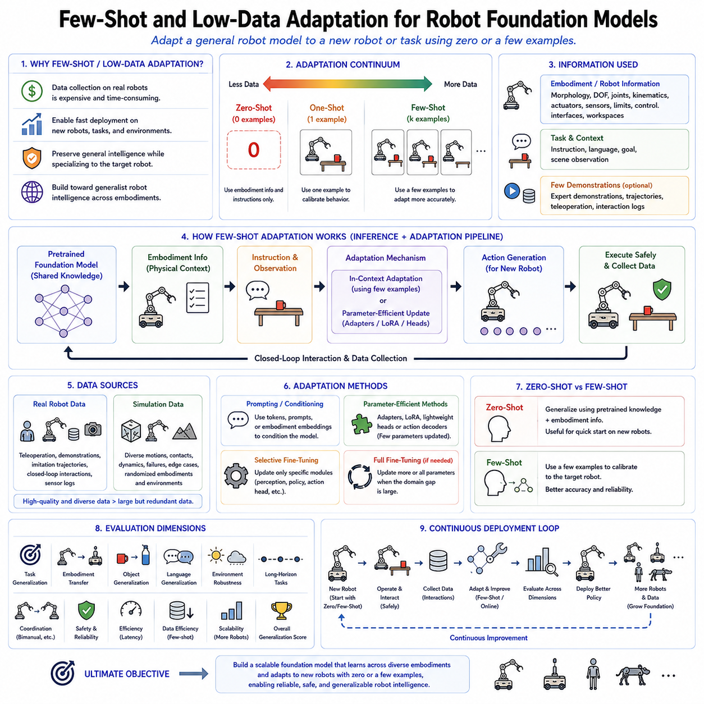{width="7.268055555555556in" height="7.268055555555556in"}

Robot-specific and embodiment-specific adaptation customizes a general robot foundation model to the particular physical body on which it must operate. Even when two robots perform the same task in the same environment, differences in morphology, degrees of freedom, kinematics, sensors, actuators, control interfaces, payload, workspace, and dynamic behavior can make the same model output produce very different physical results. Adaptation therefore connects shared foundation intelligence with the actual capabilities and constraints of the target robot, allowing a common model to become useful across heterogeneous platforms.

The central challenge is that a robot foundation model learns broad concepts and behaviors, while physical execution is strongly dependent on embodiment. A humanoid, industrial manipulator, mobile manipulator, quadruped, or autonomous vehicle has a different relationship between observation, action, and physical consequence. The model must understand not only what the task means, but also what the particular robot can physically reach, manipulate, support, sense, and control. Effective adaptation therefore preserves transferable knowledge while specializing the execution pathway for the target embodiment.

Embodiment information can be treated as an explicit input to the model. A useful description may include morphology, degrees of freedom, joint ranges, workspace, kinematics, end-effectors, sensors, actuator characteristics, control modes, coordinate frames, action spaces, and physical safety limits. Instead of representing a robot only through an arbitrary identifier, the model can receive structured information describing its actual capabilities. This allows the same foundation model to condition its predictions on different physical bodies and reason about what actions are feasible for each one.

The distinction between embodiment-specific and robot-specific information is also important. Embodiment-specific information describes properties shared by a class of robots, such as the general structure of a quadruped or a six-degree-of-freedom manipulator. Robot-specific information describes the particular hardware instance, including calibration, sensor offsets, actuator response, controller behavior, communication delays, mechanical tolerances, and wear. Two robots with nominally identical designs can therefore require different adaptation because their real physical behavior is not perfectly identical.

A useful architecture separates shared intelligence from embodiment-specific execution. Semantic concepts, task goals, spatial relationships, temporal reasoning, physical knowledge, and high-level skills can often be shared across robots. Morphology, kinematics, actuator limits, sensor characteristics, action dimensions, and low-level motor control generally need stronger embodiment conditioning. This separation allows the foundation model to retain broad knowledge while an adaptation layer translates shared representations into actions that are executable by the target robot.

The action representation provides an important bridge between these two levels. High-level intentions such as reach, grasp, push, transport, inspect, navigate, and avoid can often remain robot-independent. These intentions can be represented through task-space goals, object-relative actions, latent skills, trajectory chunks, or other intermediate representations. A robot-specific decoder or controller can then convert them into joint positions, velocities, torques, wheel commands, or other low-level actions. This approach reduces the need to relearn the meaning of the task whenever the physical platform changes.

Robot-specific adaptation can be implemented through several mechanisms. Explicit prompts or embodiment tokens can provide physical context directly at inference time. Learned embodiment embeddings can encode recurring physical characteristics in a compact representation. Parameter-efficient methods such as LoRA, adapters, lightweight policy heads, and sensor-mapping modules can modify only selected portions of the model while keeping most of the foundation backbone frozen. Selective or full fine-tuning becomes appropriate when the difference between the pretrained model and the target robot is large enough to require deeper changes.

The data used for adaptation should reflect how the target robot actually behaves. Real-world teleoperation, human demonstrations, imitation trajectories, closed-loop interactions, and sensor logs provide direct information about the robot\'s physical response. These data can reveal effects that are difficult to infer from specifications alone, including compliance, backlash, latency, controller behavior, contact dynamics, wheel slip, and actuator limitations. High-quality demonstrations are more valuable than large amounts of redundant data because the objective is to expose the model to informative relationships between observations, actions, and physical outcomes.

Simulation can substantially increase the efficiency of robot-specific adaptation. High-fidelity simulation can generate diverse motions, contacts, dynamic conditions, failures, and edge cases without repeatedly risking physical hardware. Morphology and dynamics can also be randomized so that the model encounters variations in size, mass, joint structure, sensors, actuator properties, and other physical parameters. Real-world data then grounds the learned behavior in the actual robot. The combination of simulation and real experience helps the model distinguish general physical relationships from properties that must be calibrated to a particular robot.

Cross-robot learning provides an important foundation for efficient adaptation. Instead of training a model exclusively on one robot, pretraining can expose it to many robots, morphologies, action spaces, tasks, and environments. The model can then learn which concepts transfer naturally and which relationships must be conditioned on embodiment. Diverse robot data can create an embodiment-invariant knowledge base containing reusable perception, semantics, reasoning, and skills, while adaptation layers learn how those capabilities should be expressed by a new physical platform.

This framework enables zero-shot and few-shot embodiment adaptation. In zero-shot adaptation, the model receives embodiment information together with instructions and observations and attempts to generate actions using its existing knowledge without target-robot demonstrations. Few-shot adaptation adds a small number of examples from the new robot, allowing the model to calibrate its behavior to the actual hardware. The difference is therefore not whether the model has general knowledge, but how much target-specific evidence is required to translate that knowledge into reliable physical execution.

Few-shot adaptation is particularly valuable because collecting large robot datasets is expensive, slow, and often difficult to reproduce for every new hardware platform. A small number of carefully selected demonstrations can provide information about the relationship between the model\'s general capabilities and the target robot\'s specific execution characteristics. Useful examples should include normal operation, meaningful variations, recovery behavior, and safety constraints rather than simply repeating the same successful trajectory. Diverse and informative demonstrations are generally more valuable than a large but redundant dataset.

Evaluation must determine whether the adapted model genuinely transfers knowledge rather than memorizing demonstrations. Task success should be measured across both familiar and unseen tasks, while embodiment transfer should be tested on new robots and physical configurations. Additional dimensions include object and language generalization, robustness to environmental variation, long-horizon task completion, coordination, safety and reliability, inference efficiency, data efficiency, scalability, and overall generalization. Evaluation should also compare the adapted model with specialized robot-specific baselines to determine whether the foundation-model approach provides a meaningful advantage.

Engineering details can strongly influence adaptation quality even when the underlying model architecture is unchanged. Sensor calibration, coordinate-frame consistency, kinematic accuracy, actuator latency, communication delay, controller design, synchronization precision, demonstration quality, and embodiment similarity can determine whether learned policies transfer successfully. Safety constraints must remain explicit throughout the process, because adaptation should never allow a learned policy to exceed physical limits or override collision avoidance, emergency-stop mechanisms, or other established safety requirements.

Robot-specific adaptation should ultimately be treated as a closed-loop deployment process rather than a one-time training step. A new robot can begin with zero-shot or few-shot adaptation, operate under controlled conditions, collect interaction data, identify performance gaps, update its adaptation components, and undergo simulation, real-world, and safety validation before broader deployment. Experience from multiple robots can then return to the shared foundation-data loop, improving future adaptation. This creates a scalable pathway in which every new robot becomes both a deployment target and a potential source of knowledge for the next generation of robot foundation models.

The long-term objective is not to create a completely independent model for every robot. It is to build a reusable foundation that learns broadly across embodiments and specializes efficiently when confronted with a new physical body. Shared intelligence should capture what can be transferred, while embodiment-specific adaptation should capture what must change for execution. With this separation, robot foundation models can reduce data and engineering costs, accelerate deployment across heterogeneous platforms, support zero-shot and few-shot transfer, and ultimately provide safer, more reliable, and more generalizable physical intelligence.

로봇 특화 적응(robot-specific adaptation)과 구현체 특화 적응(embodiment-specific adaptation)은 범용 로봇 파운데이션 모델(general robot foundation model)을 실제로 작동해야 하는 특정 로봇의 물리적 본체에 맞게 조정하는 과정이다. 두 로봇이 동일한 환경에서 동일한 작업을 수행하더라도 형태(morphology), 자유도(degrees of freedom), 운동학(kinematics), 센서, 액추에이터, 제어 인터페이스(control interfaces), 페이로드(payload), 작업공간(workspace) 및 동적 행동(dynamic behavior)의 차이로 인해 동일한 모델 출력이 전혀 다른 물리적 결과를 만들 수 있다. 따라서 적응은 공유되는 파운데이션 지능(foundation intelligence)과 대상 로봇의 실제 능력 및 제약조건을 연결하여, 하나의 공통 모델이 서로 다른 로봇 플랫폼에서 활용될 수 있도록 한다.

핵심적인 문제는 로봇 파운데이션 모델이 광범위한 개념과 행동을 학습하는 반면, 실제 물리적 실행은 구현체(embodiment)에 크게 의존한다는 점이다. 휴머노이드(humanoid), 산업용 매니퓰레이터(industrial manipulator), 모바일 매니퓰레이터(mobile manipulator), 사족보행 로봇(quadruped), 자율주행 차량(autonomous vehicle)은 관측(observation), 행동(action), 물리적 결과(physical consequence) 사이에서 서로 다른 관계를 가진다. 모델은 작업의 의미뿐만 아니라 특정 로봇이 물리적으로 어디까지 도달할 수 있고, 무엇을 조작하고, 무엇을 지지하며, 무엇을 감지하고, 무엇을 제어할 수 있는지도 이해해야 한다. 따라서 효과적인 적응은 전이 가능한 지식(transferable knowledge)을 보존하면서 대상 구현체의 실행 경로(execution pathway)를 전문화한다.

구현체 정보(embodiment information)는 모델에 명시적인 입력으로 제공할 수 있다. 유용한 설명에는 형태, 자유도, 관절 범위, 작업공간, 운동학, 엔드 이펙터(end-effector), 센서, 액추에이터 특성, 제어 모드, 좌표계(coordinate frames), 행동 공간(action spaces) 및 물리적 안전 한계가 포함될 수 있다. 로봇을 단순히 임의의 식별자(identifier)로 표현하는 대신 실제 능력을 설명하는 구조화된 정보를 모델에 제공할 수 있다. 이를 통해 하나의 파운데이션 모델이 서로 다른 물리적 본체에 맞춰 예측을 조건화(condition)하고 각 로봇에서 어떤 행동이 가능한지 추론할 수 있다.

구현체 특화 정보와 로봇 특화 정보의 차이를 구분하는 것도 중요하다. 구현체 특화 정보는 사족보행 로봇이나 6자유도 매니퓰레이터와 같이 특정 로봇 종류가 공유하는 일반적인 특성을 설명한다. 반면 로봇 특화 정보는 캘리브레이션(calibration), 센서 오프셋(sensor offsets), 액추에이터 응답, 컨트롤러 동작, 통신 지연, 기계적 공차(mechanical tolerances), 마모(wear) 등을 포함하는 특정 하드웨어 인스턴스의 특성을 설명한다. 따라서 명목상 동일한 설계를 가진 두 로봇이라도 실제 물리적 동작이 완전히 동일하지 않기 때문에 서로 다른 적응이 필요할 수 있다.

유용한 아키텍처는 공유 지능(shared intelligence)과 구현체 특화 실행(embodiment-specific execution)을 분리한다. 의미적 개념(semantic concepts), 작업 목표(task goals), 공간적 관계(spatial relationships), 시간적 추론(temporal reasoning), 물리적 지식(physical knowledge) 및 상위 수준 스킬(high-level skills)은 여러 로봇에서 공유할 수 있는 경우가 많다. 반면 형태, 운동학, 액추에이터 한계, 센서 특성, 행동 차원(action dimensions) 및 저수준 모터 제어(low-level motor control)는 일반적으로 더 강한 구현체 조건화(embodiment conditioning)가 필요하다. 이러한 분리를 통해 파운데이션 모델은 광범위한 지식을 유지하면서 적응 계층(adaptation layer)이 공유 표현을 대상 로봇이 실행할 수 있는 행동으로 변환할 수 있다.

행동 표현(action representation)은 이 두 수준 사이를 연결하는 중요한 역할을 한다. 도달하기(reach), 잡기(grasp), 밀기(push), 운반하기(transport), 검사하기(inspect), 이동하기(navigate), 회피하기(avoid)와 같은 상위 수준 의도는 로봇에 독립적인 형태로 유지할 수 있는 경우가 많다. 이러한 의도는 작업공간 목표(task-space goals), 객체 기준 행동(object-relative actions), 잠재 스킬(latent skills), 궤적 청크(trajectory chunks) 또는 기타 중간 표현(intermediate representations)으로 나타낼 수 있다. 이후 로봇 특화 디코더(decoder) 또는 컨트롤러(controller)가 이를 관절 위치, 속도, 토크, 휠 명령 또는 기타 저수준 행동으로 변환할 수 있다. 이러한 접근법은 물리적 플랫폼이 변경될 때마다 작업의 의미를 다시 학습해야 하는 필요성을 줄인다.

로봇 특화 적응은 여러 가지 메커니즘을 통해 구현할 수 있다. 명시적인 프롬프트(prompts) 또는 구현체 토큰(embodiment tokens)은 추론 시점에 물리적 문맥을 직접 제공할 수 있다. 학습된 구현체 임베딩(learned embodiment embeddings)은 반복적으로 나타나는 물리적 특성을 압축된 표현으로 인코딩할 수 있다. LoRA, 어댑터(adapters), 경량 정책 헤드(lightweight policy heads), 센서 매핑 모듈(sensor-mapping modules)과 같은 파라미터 효율적 방법(parameter-efficient methods)은 대부분의 파운데이션 백본을 동결한 상태에서 모델의 선택된 부분만 수정할 수 있다. 사전학습 모델과 대상 로봇 사이의 차이가 충분히 큰 경우에는 선택적 파인튜닝(selective fine-tuning) 또는 전체 파인튜닝(full fine-tuning)이 더 깊은 변화를 위해 사용될 수 있다.

적응에 사용되는 데이터는 대상 로봇이 실제로 어떻게 행동하는지를 반영해야 한다. 실제 환경의 원격조작(teleoperation), 인간 시연(human demonstrations), 모방 궤적(imitation trajectories), 폐루프 상호작용(closed-loop interactions) 및 센서 로그(sensor logs)는 로봇의 물리적 반응에 대한 직접적인 정보를 제공한다. 이러한 데이터는 로봇의 사양만으로 추론하기 어려운 순응성(compliance), 백래시(backlash), 지연시간(latency), 컨트롤러 동작, 접촉 동역학(contact dynamics), 휠 슬립(wheel slip) 및 액추에이터 한계(actuator limitations) 등의 영향을 드러낼 수 있다. 많은 양의 중복 데이터보다 고품질 데이터가 더 중요하며, 목표는 관측, 행동, 물리적 결과 사이의 유용한 관계를 모델에 노출시키는 것이다.

시뮬레이션(simulation)은 로봇 특화 적응의 효율성을 크게 높일 수 있다. 고충실도 시뮬레이션(high-fidelity simulation)은 실제 하드웨어를 반복적으로 위험에 노출시키지 않고도 다양한 동작, 접촉, 동적 조건, 실패 및 엣지 케이스(edge cases)를 생성할 수 있다. 형태와 동역학을 랜덤화하여 모델이 크기, 질량, 관절 구조, 센서, 액추에이터 특성 및 기타 물리적 파라미터의 변화를 경험하도록 할 수도 있다. 실제 환경 데이터는 이후 학습된 행동을 실제 로봇에 맞게 정렬한다. 시뮬레이션과 실제 경험을 결합하면 모델이 일반적인 물리적 관계와 특정 로봇에 맞게 보정해야 하는 특성을 구분하는 데 도움이 된다.

로봇 간 학습(cross-robot learning)은 효율적인 적응을 위한 중요한 기반을 제공한다. 하나의 로봇만을 대상으로 모델을 학습하는 대신, 사전학습 과정에서 다양한 로봇, 형태, 행동 공간, 작업 및 환경을 경험하도록 할 수 있다. 이를 통해 모델은 어떤 개념이 자연스럽게 전이되는지와 어떤 관계가 구현체에 따라 조건화되어야 하는지를 학습할 수 있다. 다양한 로봇 데이터는 재사용 가능한 지각, 의미론, 추론 및 스킬을 포함하는 구현체 불변 지식 기반(embodiment-invariant knowledge base)을 형성할 수 있으며, 적응 계층은 이러한 능력이 새로운 물리적 플랫폼에서 어떻게 표현되어야 하는지를 학습한다.

이러한 프레임워크는 제로샷(zero-shot) 및 퓨샷 구현체 적응(few-shot embodiment adaptation)을 가능하게 한다. 제로샷 적응에서는 모델에 구현체 정보와 지시문 및 관측을 제공하고, 대상 로봇의 시연 데이터 없이 기존 지식을 사용하여 행동을 생성하도록 한다. 퓨샷 적응에서는 새로운 로봇에서 수집한 소수의 사례를 추가하여 모델이 실제 하드웨어에 맞게 행동을 보정할 수 있도록 한다. 따라서 두 방식의 차이는 모델이 범용 지식을 가지고 있는지 여부가 아니라, 그 지식을 안정적인 물리적 실행으로 변환하기 위해 얼마나 많은 대상 로봇 특화 증거(target-specific evidence)가 필요한지에 있다.

퓨샷 적응은 특히 중요하다. 새로운 하드웨어 플랫폼마다 대규모 로봇 데이터셋을 수집하는 것은 비용과 시간이 많이 들고 반복하기 어렵기 때문이다. 신중하게 선택된 소수의 시연만으로도 모델의 범용 능력과 대상 로봇의 구체적인 실행 특성 사이의 관계에 대한 정보를 제공할 수 있다. 유용한 사례에는 정상적인 운용, 의미 있는 변화, 복구 행동(recovery behavior) 및 안전 제약조건이 포함되어야 하며, 동일한 성공 궤적을 단순히 반복해서는 안 된다. 다양하고 정보량이 높은 시연이 크지만 중복적인 데이터셋보다 일반적으로 더 가치가 있다.

평가는 적응된 모델이 시연을 단순히 암기하는 것이 아니라 지식을 실제로 전이하는지를 확인해야 한다. 작업 성공률은 익숙한 작업과 새로운 작업 모두에서 측정해야 하며, 구현체 전이는 새로운 로봇과 물리적 구성에서 테스트해야 한다. 추가적인 평가 항목에는 객체 및 언어 일반화(object and language generalization), 환경 변화에 대한 강건성(robustness), 장기 작업 수행(long-horizon task completion), 협응(coordination), 안전성과 신뢰성, 추론 효율(inference efficiency), 데이터 효율(data efficiency), 확장성(scalability) 및 전반적인 일반화 성능이 포함된다. 또한 적응된 모델을 특화된 로봇 전용 기준 모델과 비교하여 파운데이션 모델 접근법이 실질적인 이점을 제공하는지 확인해야 한다.

기본적인 모델 아키텍처가 동일하더라도 엔지니어링 세부사항은 적응 품질에 큰 영향을 미칠 수 있다. 센서 캘리브레이션(sensor calibration), 좌표계 일관성(coordinate-frame consistency), 운동학적 정확도(kinematic accuracy), 액추에이터 지연시간, 통신 지연, 컨트롤러 설계, 동기화 정밀도, 시연 데이터 품질 및 구현체 간 유사성(embodiment similarity)은 학습된 정책이 성공적으로 전이될 수 있는지를 결정할 수 있다. 안전 제약조건은 전체 과정에서 명시적으로 유지되어야 한다. 적응된 정책이 물리적 한계를 초과하거나 충돌 회피, 비상 정지(emergency-stop) 메커니즘 또는 기존의 다른 안전 요구사항을 무시해서는 안 되기 때문이다.

로봇 특화 적응은 궁극적으로 일회성 학습 단계가 아니라 폐루프 배포 과정(closed-loop deployment process)으로 다루어야 한다. 새로운 로봇은 제로샷 또는 퓨샷 적응으로 시작하고, 통제된 조건에서 작동하며, 상호작용 데이터를 수집하고, 성능 간극(performance gaps)을 식별하고, 적응 구성요소를 업데이트한 다음, 더 광범위한 배포에 앞서 시뮬레이션, 실제 환경 및 안전 검증을 수행할 수 있다. 여러 로봇에서 얻은 경험은 다시 공유 파운데이션 데이터 루프(shared foundation-data loop)로 돌아가 향후 적응을 개선할 수 있다. 이를 통해 새로운 로봇 하나하나가 단순한 배포 대상이 아니라 차세대 로봇 파운데이션 모델을 위한 지식의 잠재적인 원천이 되는 확장 가능한 경로를 만들 수 있다.

장기적인 목표는 모든 로봇마다 완전히 독립적인 모델을 만드는 것이 아니다. 목표는 다양한 구현체에서 광범위하게 학습하고 새로운 물리적 본체를 만났을 때 효율적으로 전문화할 수 있는 재사용 가능한 파운데이션(reusable foundation)을 구축하는 것이다. 공유 지능(shared intelligence)은 전이할 수 있는 것을 학습하고, 구현체 특화 적응은 실제 실행을 위해 변경해야 하는 것을 학습한다. 이러한 분리를 통해 로봇 파운데이션 모델은 데이터와 엔지니어링 비용을 줄이고, 서로 다른 플랫폼으로의 배포를 가속하며, 제로샷 및 퓨샷 전이를 지원하고, 궁극적으로 더욱 안전하고 신뢰할 수 있으며 일반화 가능한 물리적 지능(physical intelligence)을 제공할 수 있다.

##  

## 09.08. Imitation Based Post Training

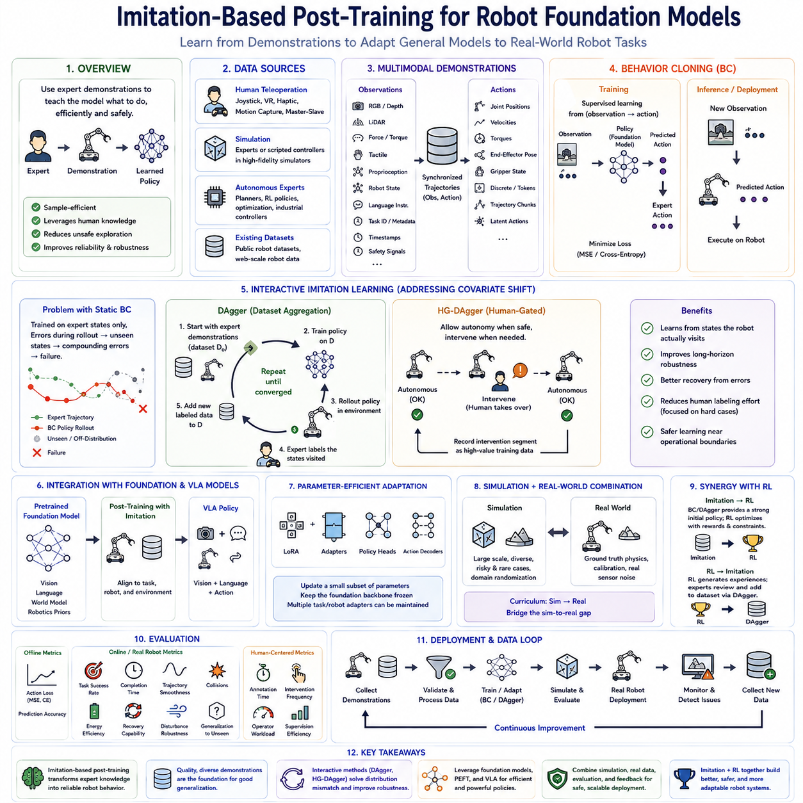{width="7.268055555555556in" height="7.268055555555556in"}

Imitation-based post-training adapts a pretrained robot foundation model by learning from demonstrations of desired behavior rather than relying exclusively on autonomous exploration or reward optimization. The central idea is to use expert trajectories to connect observations with appropriate actions, allowing a general model to acquire reliable task-specific behavior efficiently. This is particularly valuable for physical AI because collecting large amounts of autonomous trial-and-error experience can be expensive, slow, and potentially unsafe. Imitation therefore provides a direct path from human or expert knowledge to executable robot policies.

Behavior Cloning (BC) is the most direct form of imitation-based post-training. It converts policy learning into a supervised learning problem in which demonstrations contain paired observations and actions. The model learns a mapping from the observed state to the action selected by the expert, and after training it predicts actions directly from new observations. Unlike reinforcement learning, the robot does not need to discover useful behavior through extensive exploration. Every demonstration contributes directly to parameter optimization, making Behavior Cloning highly sample-efficient and attractive when unsafe or ineffective exploration should be avoided.

The quality of demonstrations establishes a fundamental limit on imitation-based post-training. If demonstrations contain only ideal trajectories, the resulting policy primarily learns nominal behavior and may have little knowledge of how to recover from mistakes. Expert data should therefore contain meaningful variations in objects, environments, viewpoints, task execution, and operating conditions. Successful trajectories are important, but recovery behaviors, partial failures, difficult states, and boundary conditions can be equally valuable because they teach the policy how to respond when execution deviates from the expected path.

A demonstration can contain considerably more information than a sequence of motor commands. A modern robot dataset may synchronize RGB or depth images, LiDAR, force-torque measurements, tactile observations, joint positions and velocities, end-effector poses, gripper states, proprioception, localization estimates, language instructions, task identifiers, timestamps, environmental metadata, and safety signals. Such multimodal trajectories allow the foundation model to learn relationships among perception, language, robot state, action, and outcome. Correct synchronization and calibration are essential because temporal misalignment can cause the model to associate an action with the wrong observation or physical state.

Expert demonstrations can be collected through several mechanisms. Human teleoperation is widely used because experienced operators can perform tasks naturally while the system records observations and actions. Joysticks, virtual-reality controllers, haptic interfaces, exoskeletons, motion-capture systems, and master-slave robots provide different trade-offs in precision, latency, ergonomics, and operator workload. Simulation provides another important source by allowing experts or scripted controllers to generate trajectories without risking physical hardware. Autonomous policies, planners, optimization systems, and existing industrial controllers can also act as expert sources whose behavior is later distilled into a more efficient learned policy.

The post-training objective can be expressed as learning a policy that approximates expert behavior under the relevant observation and task conditions. For a simple supervised formulation, the model minimizes the difference between predicted and demonstrated actions across the dataset. Depending on the robot and policy architecture, actions may be continuous motor commands, discrete action tokens, trajectory segments, action chunks, or latent representations. Vision-language-action models can additionally condition the policy on natural-language instructions, allowing the learned behavior to connect semantic task descriptions with physical actions rather than treating every behavior as an isolated motor sequence.

Static Behavior Cloning has an important weakness known as covariate shift or distribution mismatch. During training, the model primarily observes states visited by the expert. During deployment, however, even a small prediction error can cause the robot to enter a state that was not present in the demonstration dataset. The policy must then act in an unfamiliar situation, and its new error can move it even farther from the expert trajectory. This compounding-error problem becomes increasingly severe in long-horizon tasks, making high training accuracy insufficient as evidence of reliable autonomous behavior.

Interactive imitation learning addresses this limitation by allowing demonstrations to be collected from states generated by the learner itself. Dataset Aggregation (DAgger) begins with conventional expert demonstrations and trains an initial policy. The learned policy then executes the task, while an expert observes the states it visits and supplies the action that should have been taken. These newly labeled state-action pairs are added to the original dataset, and the policy is retrained. Repeating this cycle gradually shifts the training distribution toward the states that the robot actually encounters during autonomous execution, improving recovery and long-horizon robustness.

HG-DAgger extends this idea by introducing human-gated intervention. The robot is allowed to operate autonomously while its behavior remains acceptable, but the human supervisor takes control when failure becomes likely. The intervention segment is then recorded as valuable training data. This concentrates human effort on difficult states rather than repeatedly labeling easy behavior that the policy already performs correctly. It also provides a safety mechanism because the learner can experience challenging situations near operational boundaries without being allowed to proceed into potentially dangerous failures.

Imitation-based post-training integrates naturally with modern robot foundation models and Vision-Language-Action (VLA) systems. Large pretrained perception models can provide strong visual representations, allowing imitation learning to focus more on decision-making and physical grounding instead of relearning perception from scratch. VLA models can additionally incorporate language explanations, task descriptions, and human corrections alongside physical demonstrations. The resulting training signal is richer than simple action matching because it can connect visual context, linguistic intent, robot state, desired behavior, and physical outcomes within a unified policy-learning framework.

Parameter-efficient adaptation can reduce the cost of imitation-based post-training. Instead of modifying the entire foundation model, adapters, LoRA modules, lightweight policy heads, or action decoders can specialize selected components while preserving most of the pretrained backbone. This is useful when the foundation model already contains general visual, linguistic, spatial, and behavioral knowledge and only needs to align that knowledge with a particular task, robot, or environment. Multiple adaptation states can then be maintained for different deployment configurations without storing a separate complete model for every specialization.

Simulation and real-world demonstrations should often be combined rather than treated as competing sources. Early imitation training can use high-fidelity simulation to generate large and diverse trajectories, including difficult contacts, failures, sensor noise, and unusual configurations. As the policy becomes more capable, training and evaluation can transition toward physical robots. Domain randomization, digital twins, and realistic sensor simulation can reduce the sim-to-real gap, while real demonstrations provide evidence about mechanical behavior that simulation may not reproduce accurately. This creates a practical curriculum from scalable synthetic experience to physically grounded behavior.

Imitation-based post-training can also serve as the starting point for reinforcement learning rather than being an alternative to it. Behavior Cloning or DAgger can first produce a policy that performs basic tasks safely and efficiently. Reinforcement learning can then optimize the policy using rewards, preferences, constraints, or task outcomes and discover behaviors that were not explicitly demonstrated. Conversely, reinforcement learning can generate autonomous experiences that are later reviewed by experts and incorporated through interactive imitation learning. The two approaches can therefore form a mutually reinforcing cycle between expert knowledge and autonomous improvement.

Evaluation must extend beyond offline prediction accuracy. Mean Squared Error or similar losses can measure how closely predicted actions match demonstrations, but they do not necessarily predict closed-loop task performance. Real-robot evaluation should examine task success rate, completion time, trajectory smoothness, collision frequency, energy efficiency, recovery capability, robustness to disturbances, intervention frequency, and generalization to unseen conditions. Interactive methods additionally require human-centered measures such as annotation time, intervention workload, operator fatigue, and supervision efficiency because human participation is part of the learning system.

Deployment requires imitation-based post-training to become part of a broader data-centric development loop. Demonstrations should be recorded, synchronized, validated, versioned, and filtered before training. Policies should then be evaluated in simulation and on controlled physical trials before production deployment. Runtime monitoring can detect distribution shifts, safety violations, and recurring failure modes, while newly collected experiences can be used for subsequent retraining. Demonstration management, automated training pipelines, policy validation, simulation, deployment monitoring, and model versioning therefore become important parts of the overall MLOps process.

The long-term role of imitation-based post-training is to transform broad foundation-model knowledge into reliable physical behavior without discarding the capabilities learned during pretraining. Large-scale robot datasets and modern VLA architectures extend imitation learning beyond narrow task-specific policies toward models that can generalize across tasks, environments, and embodiments. Nevertheless, demonstration quality, distribution mismatch, safety, and generalization remain fundamental challenges. A strong post-training strategy therefore combines high-quality demonstrations, interactive correction, simulation, parameter-efficient adaptation, careful evaluation, and continuous deployment feedback to produce robot policies that are reliable, adaptable, and suitable for real-world Physical AI systems.

모방 기반 사후학습(imitation-based post-training)은 자율적인 탐색이나 보상 최적화(reward optimization)에만 의존하지 않고, 원하는 행동을 보여주는 시연(demonstrations)으로부터 학습하여 사전학습된 로봇 파운데이션 모델(robot foundation model)을 적응시키는 방법이다. 핵심 아이디어는 전문가의 궤적(expert trajectories)을 사용하여 관측(observations)과 적절한 행동(actions)을 연결하고, 이를 통해 범용 모델이 특정 작업에 필요한 안정적인 행동을 효율적으로 습득하도록 하는 것이다. 이는 대규모 자율 시행착오 경험을 수집하는 것이 비용과 시간이 많이 들고 안전하지 않을 수 있는 물리적 AI(Physical AI)에서 특히 중요하다. 모방학습은 따라서 인간 또는 전문가의 지식을 실행 가능한 로봇 정책(robot policy)으로 직접 전환하는 경로를 제공한다.

행동 복제(Behavior Cloning, BC)는 모방 기반 사후학습의 가장 직접적인 형태이다. 이는 시연 데이터에 관측과 행동의 쌍이 포함되어 있는 지도학습(supervised learning) 문제로 정책 학습(policy learning)을 변환한다. 모델은 전문가가 선택한 행동을 관측된 상태에서 예측하는 매핑(mapping)을 학습하고, 학습이 완료되면 새로운 관측으로부터 직접 행동을 예측한다. 강화학습(reinforcement learning)과 달리 로봇은 광범위한 탐색을 통해 유용한 행동을 스스로 발견할 필요가 없다. 각각의 시연이 파라미터 최적화에 직접 기여하기 때문에 행동 복제는 높은 샘플 효율성(sample efficiency)을 제공하며, 안전하지 않거나 비효율적인 탐색을 피해야 하는 경우 매력적인 방법이 된다.

시연 데이터의 품질은 모방 기반 사후학습의 근본적인 한계를 결정한다. 시연이 이상적인 궤적(ideal trajectories)만 포함한다면 결과 정책은 주로 정상적인 행동(nominal behavior)을 학습하게 되며, 오류로부터 복구하는 방법에 대한 지식은 부족할 수 있다. 따라서 전문가 데이터는 객체, 환경, 관점, 작업 실행 및 운용 조건에서 의미 있는 변화를 포함해야 한다. 성공적인 궤적도 중요하지만 복구 행동(recovery behaviors), 부분적인 실패(partial failures), 어려운 상태(difficult states) 및 경계 조건(boundary conditions) 역시 중요하다. 이러한 데이터는 실행이 예상된 경로에서 벗어났을 때 정책이 어떻게 대응해야 하는지를 학습시키기 때문이다.

하나의 시연은 단순한 모터 명령(motor commands)의 연속보다 훨씬 많은 정보를 포함할 수 있다. 현대적인 로봇 데이터셋은 RGB 또는 깊이 이미지, LiDAR, 힘-토크 측정(force-torque measurements), 촉각 관측(tactile observations), 관절 위치와 속도, 엔드 이펙터 자세(end-effector poses), 그리퍼 상태, 고유수용감각(proprioception), 위치 추정값(localization estimates), 언어 지시(language instructions), 작업 식별자(task identifiers), 타임스탬프, 환경 메타데이터(environmental metadata) 및 안전 신호(safety signals)를 동기화할 수 있다. 이러한 멀티모달 궤적(multimodal trajectories)은 파운데이션 모델이 지각, 언어, 로봇 상태, 행동 및 결과 사이의 관계를 학습할 수 있도록 한다. 정확한 동기화와 캘리브레이션(calibration)은 특히 중요하다. 시간적 불일치(temporal misalignment)가 발생하면 모델이 행동을 잘못된 관측이나 물리적 상태와 연결할 수 있기 때문이다.

전문가 시연(expert demonstrations)은 여러 가지 방법으로 수집할 수 있다. 인간 원격조작(human teleoperation)은 숙련된 작업자가 자연스럽게 작업을 수행하면서 관측과 행동을 동시에 기록할 수 있기 때문에 널리 사용된다. 조이스틱, 가상현실 컨트롤러(virtual-reality controllers), 햅틱 인터페이스(haptic interfaces), 외골격(exoskeletons), 모션 캡처 시스템(motion-capture systems) 및 마스터-슬레이브 로봇(master-slave robots)은 정밀도, 지연시간, 인체공학적 특성 및 작업자 부담 측면에서 서로 다른 장단점을 제공한다. 시뮬레이션(simulation)은 물리적 하드웨어에 위험을 주지 않고 전문가 또는 스크립트 기반 컨트롤러(scripted controllers)가 궤적을 생성할 수 있도록 하여 또 다른 중요한 데이터 소스를 제공한다. 자율 정책(autonomous policies), 플래너(planners), 최적화 시스템 및 기존 산업용 컨트롤러도 전문가의 역할을 수행할 수 있으며, 이후 그 행동을 보다 효율적인 학습 정책으로 증류(distillation)할 수 있다.

사후학습의 목적은 관련된 관측과 작업 조건에서 전문가의 행동을 근사하는 정책을 학습하는 것으로 표현할 수 있다. 단순한 지도학습 형태에서는 모델이 예측한 행동과 데이터셋의 시연 행동 사이의 차이를 최소화한다. 로봇과 정책 아키텍처에 따라 행동은 연속적인 모터 명령, 이산적인 행동 토큰(action tokens), 궤적 구간(trajectory segments), 행동 청크(action chunks) 또는 잠재 표현(latent representations)으로 나타낼 수 있다. 비전-언어-행동 모델(vision-language-action models)은 자연어 지시를 추가로 활용하여 정책을 조건화할 수 있으며, 이를 통해 학습된 행동이 단순히 서로 독립적인 모터 시퀀스로 존재하는 것이 아니라 의미적 작업 설명과 물리적 행동을 연결하도록 할 수 있다.

정적인 행동 복제(static Behavior Cloning)는 공변량 이동(covariate shift) 또는 분포 불일치(distribution mismatch)라는 중요한 약점을 가진다. 학습 과정에서 모델은 주로 전문가가 방문한 상태를 관찰한다. 그러나 실제 배포에서는 작은 예측 오류 하나만으로도 로봇이 시연 데이터셋에 존재하지 않는 상태에 진입할 수 있다. 그러면 정책은 익숙하지 않은 상황에서 행동해야 하고, 새로운 오류가 로봇을 전문가 궤적에서 더욱 멀어지게 만들 수 있다. 이러한 누적 오류(compounding-error) 문제는 장기 작업(long-horizon tasks)에서 더욱 심각해지기 때문에 높은 학습 정확도만으로 안정적인 자율 행동을 보장할 수 없다.

상호작용형 모방학습(interactive imitation learning)은 학습된 정책 자체가 생성한 상태에서 시연을 수집함으로써 이러한 한계를 해결한다. 데이터셋 집계(Dataset Aggregation, DAgger)는 기존 전문가 시연으로 시작하여 초기 정책을 학습한다. 이후 학습된 정책이 작업을 수행하면 전문가가 로봇이 방문한 상태를 관찰하고, 해당 상태에서 실제로 수행했어야 하는 행동을 제공한다. 새롭게 라벨링된 상태-행동 쌍(state-action pairs)은 기존 데이터셋에 추가되고 정책은 다시 학습된다. 이 과정을 반복하면 학습 분포가 로봇이 실제 자율 실행 과정에서 경험하는 상태에 점진적으로 가까워지며, 복구 능력과 장기 작업 강건성이 향상된다.

HG-DAgger는 인간 개입을 허용하는 방식으로 이러한 개념을 확장한다. 로봇은 행동이 허용 가능한 수준을 유지하는 동안 자율적으로 작동하지만, 실패 가능성이 높아지면 인간 감독자가 제어권을 가져온다. 이후 개입 구간(intervention segment)은 가치 있는 학습 데이터로 기록된다. 이를 통해 정책이 이미 정확하게 수행하는 쉬운 행동을 반복적으로 라벨링하는 대신 어려운 상태에 인간의 노력을 집중할 수 있다. 또한 학습자가 위험한 실패로 진행하는 것을 허용하지 않으면서 운용 경계에 가까운 어려운 상황을 경험하도록 하기 때문에 안전 메커니즘(safety mechanism)으로도 기능한다.

모방 기반 사후학습은 현대적인 로봇 파운데이션 모델 및 비전-언어-행동(Vision-Language-Action, VLA) 시스템과 자연스럽게 통합될 수 있다. 대규모 사전학습 지각 모델(pretrained perception models)은 강력한 시각 표현(visual representations)을 제공할 수 있기 때문에 모방학습은 지각을 처음부터 다시 학습하기보다 의사결정(decision-making)과 물리적 그라운딩(physical grounding)에 더 집중할 수 있다. VLA 모델은 물리적 시연과 함께 언어적 설명, 작업 설명 및 인간의 교정(human corrections)을 추가로 통합할 수 있다. 결과적으로 학습 신호는 단순한 행동 일치(action matching)를 넘어 시각적 문맥, 언어적 의도, 로봇 상태, 원하는 행동 및 물리적 결과를 하나의 통합된 정책학습 프레임워크 안에서 연결할 수 있다.

파라미터 효율적 적응(parameter-efficient adaptation)은 모방 기반 사후학습의 비용을 줄일 수 있다. 전체 파운데이션 모델을 수정하는 대신 어댑터(adapters), LoRA 모듈, 경량 정책 헤드(lightweight policy heads) 또는 행동 디코더(action decoders)를 사용하여 대부분의 사전학습된 백본을 보존하면서 선택된 구성요소만 전문화할 수 있다. 이는 파운데이션 모델이 이미 일반적인 시각, 언어, 공간 및 행동 지식을 가지고 있고 특정 작업, 로봇 또는 환경에 맞게 이러한 지식을 정렬하기만 하면 되는 경우 특히 유용하다. 이후 서로 다른 배포 구성에 대해 여러 적응 상태(adaptation states)를 유지할 수 있으며, 각각의 전문화를 위해 완전히 별도의 모델을 저장할 필요성을 줄일 수 있다.

시뮬레이션과 실제 환경의 시연 데이터는 서로 경쟁하는 데이터 소스로 취급하기보다 함께 사용하는 것이 바람직한 경우가 많다. 초기 모방학습에서는 고충실도 시뮬레이션(high-fidelity simulation)을 사용하여 대규모의 다양한 궤적을 생성할 수 있으며, 어려운 접촉, 실패, 센서 노이즈 및 비정상적인 구성도 포함할 수 있다. 정책의 능력이 향상되면 학습과 평가를 실제 로봇으로 점진적으로 전환할 수 있다. 도메인 랜덤화(domain randomization), 디지털 트윈(digital twins) 및 현실적인 센서 시뮬레이션은 시뮬레이션-현실 간극(sim-to-real gap)을 줄일 수 있으며, 실제 시연은 시뮬레이션이 정확하게 재현하지 못할 수 있는 기계적 동작에 대한 정보를 제공한다. 이를 통해 확장 가능한 합성 경험(scalable synthetic experience)에서 물리적으로 검증된 행동으로 이어지는 실용적인 학습 커리큘럼을 구성할 수 있다.

모방 기반 사후학습은 강화학습(reinforcement learning)의 대안이라기보다 강화학습을 시작하기 위한 기반으로도 활용할 수 있다. 행동 복제 또는 DAgger를 통해 먼저 기본적인 작업을 안전하고 효율적으로 수행하는 정책을 만들 수 있다. 이후 강화학습은 보상(rewards), 선호(preferences), 제약조건(constraints) 또는 작업 결과(task outcomes)를 사용하여 정책을 추가로 최적화하고 명시적으로 시연되지 않았던 행동을 발견할 수 있다. 반대로 강화학습은 자율적인 경험을 생성하고, 이후 전문가가 이를 검토하여 상호작용형 모방학습을 통해 다시 학습 데이터에 포함할 수도 있다. 따라서 두 접근법은 전문가 지식과 자율적 개선 사이에서 서로를 강화하는 순환 구조를 형성할 수 있다.

평가는 오프라인 예측 정확도(offline prediction accuracy)를 넘어야 한다. 평균제곱오차(Mean Squared Error, MSE)와 같은 손실은 예측된 행동이 시연 행동과 얼마나 유사한지를 측정할 수 있지만, 반드시 폐루프 작업 성능(closed-loop task performance)을 예측하는 것은 아니다. 실제 로봇 평가는 작업 성공률, 완료 시간, 궤적의 부드러움(trajectory smoothness), 충돌 빈도, 에너지 효율, 복구 능력, 외란에 대한 강건성(robustness to disturbances), 인간 개입 빈도 및 보지 못한 조건에 대한 일반화 성능을 검토해야 한다. 상호작용형 방법에서는 인간 참여 자체가 학습 시스템의 일부이므로 라벨링 시간, 개입 부담, 작업자 피로 및 감독 효율성과 같은 인간 중심 지표(human-centered measures)도 함께 고려해야 한다.

배포 단계에서는 모방 기반 사후학습을 보다 광범위한 데이터 중심 개발 루프(data-centric development loop)의 일부로 구성해야 한다. 시연 데이터는 학습에 사용하기 전에 기록되고, 동기화되고, 검증되고, 버전 관리(versioning)되며, 필터링되어야 한다. 이후 정책은 실제 배포에 앞서 시뮬레이션과 통제된 실제 로봇 시험을 통해 평가되어야 한다. 런타임 모니터링(runtime monitoring)은 분포 변화(distribution shifts), 안전 위반(safety violations) 및 반복적인 실패 모드를 감지할 수 있으며, 새롭게 수집된 경험은 후속 재학습에 활용할 수 있다. 따라서 시연 데이터 관리, 자동화된 학습 파이프라인, 정책 검증, 시뮬레이션, 배포 모니터링 및 모델 버전 관리는 전체 MLOps 프로세스의 중요한 구성요소가 된다.

모방 기반 사후학습의 장기적인 역할은 사전학습 과정에서 습득한 능력을 버리지 않으면서 광범위한 파운데이션 모델 지식을 신뢰할 수 있는 물리적 행동으로 전환하는 것이다. 대규모 로봇 데이터셋과 최신 비전-언어-행동(VLA) 아키텍처는 모방학습을 좁은 작업 전용 정책에서 벗어나 다양한 작업, 환경 및 구현체(embodiments)에 일반화할 수 있는 모델로 확장한다. 그러나 시연 데이터의 품질, 분포 불일치, 안전성 및 일반화는 여전히 근본적인 과제로 남아 있다. 따라서 강력한 사후학습 전략은 고품질 시연, 상호작용형 교정, 시뮬레이션, 파라미터 효율적 적응, 신중한 평가 및 지속적인 배포 피드백을 결합하여 신뢰할 수 있고 적응 가능하며 실제 환경의 물리적 AI 시스템에 적합한 로봇 정책을 구축해야 한다.

##  

## 09.09. RL Based Post Training

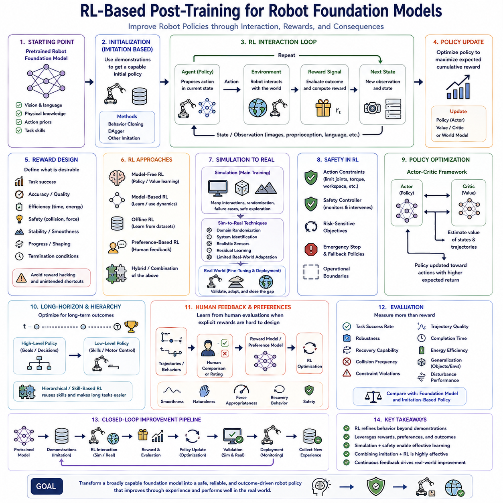{width="7.268055555555556in" height="7.268055555555556in"}

Reinforcement learning based post-training extends a pretrained robot foundation model by optimizing its behavior through interaction, rewards, preferences, constraints, and task outcomes. Instead of only imitating previously observed demonstrations, the model can improve by evaluating the consequences of its actions and changing its policy toward behaviors that produce better long-term results. This makes reinforcement learning particularly valuable when demonstrations provide a strong starting point but do not contain every successful strategy, recovery behavior, or physical interaction required for reliable deployment.

A pretrained robot foundation model provides an important initialization for reinforcement learning. Its visual representations, language understanding, physical knowledge, action priors, and existing task skills can substantially reduce the exploration burden compared with training a policy from random initialization. The reinforcement learning stage therefore focuses on improving the parts of behavior that matter for the target task rather than rediscovering basic perception and control capabilities. This combination can make post-training more data-efficient while retaining the broad knowledge acquired during large-scale pretraining.

The central mechanism is the reward signal, which defines what constitutes desirable behavior. Rewards can represent task completion, object placement accuracy, trajectory quality, energy consumption, collision avoidance, stability, time efficiency, or other operational objectives. In physical robotics, however, a single scalar reward is often insufficient to represent the full requirements of safe behavior. Practical systems may therefore combine task rewards with safety constraints, penalties, preferences, demonstrations, progress measures, and explicit termination conditions. The resulting objective should encourage useful behavior without creating incentives for unsafe shortcuts or unintended strategies.

Reward design is one of the most important challenges in robot reinforcement learning. If a reward is too sparse, the robot may rarely receive useful feedback and exploration can become inefficient. If the reward is too dense or heavily engineered, the model may learn to optimize the numerical signal rather than the intended task. This creates the possibility of reward hacking, in which the robot discovers an action sequence that produces high measured reward while violating the actual purpose of the task. Good reward design therefore requires a clear connection between measurable signals, physical objectives, safety requirements, and the behavior that humans actually consider successful.

Reinforcement learning can operate in several forms depending on where experience comes from and how the policy is optimized. Model-free reinforcement learning learns policy or value functions directly from observed interactions, while model-based reinforcement learning uses a learned or known dynamics model to predict possible future outcomes. Offline reinforcement learning can learn from previously collected robot trajectories without requiring continuous online exploration. Preference-based reinforcement learning can use human evaluations or comparisons to construct a learning signal when desirable behavior is difficult to express with an explicit numerical reward. These approaches can also be combined within a single post-training system.

A particularly practical strategy is to initialize reinforcement learning from imitation learning. Behavior Cloning, DAgger, or other demonstration-based methods can first produce a policy that already performs the basic task. Reinforcement learning can then improve this policy by exploring alternative behaviors, optimizing long-term outcomes, and learning from failures or successes that were not explicitly represented in the demonstrations. This creates a progression from supervised imitation toward outcome-based optimization. The pretrained foundation model supplies general knowledge, imitation provides a reliable behavioral prior, and reinforcement learning refines the policy through consequences.

Robot reinforcement learning must also account for the fact that physical interaction is costly and potentially dangerous. Exploration that is acceptable in a software environment may be unacceptable when a real robot can collide with people, damage equipment, drop objects, or exceed actuator limits. For this reason, simulation is often used as the primary environment for early reinforcement learning. High-fidelity simulation can provide large numbers of interactions, randomized conditions, failures, and recovery opportunities while protecting physical hardware. Real-world reinforcement learning can then be introduced gradually under controlled conditions, safety limits, and fallback controllers.

The transition from simulation to physical robots creates the sim-to-real problem. A policy that achieves high reward in simulation may depend on dynamics, friction, sensor characteristics, timing, or contact behavior that differs from the real system. Domain randomization can expose the policy to a range of physical parameters during training so that it becomes less sensitive to any single simulated configuration. System identification, realistic sensor simulation, residual learning, and limited real-world adaptation can further reduce the gap. The objective is not to reproduce every physical detail perfectly but to ensure that the learned policy captures relationships that remain valid after deployment.

Safety should be treated as part of the reinforcement learning architecture rather than as an afterthought. Action constraints can restrict joint positions, velocities, torques, forces, workspace boundaries, collision distances, or operating temperatures. A separate safety controller can monitor policy outputs and intervene before an unsafe command reaches the hardware. Risk-sensitive objectives can additionally penalize uncertain or dangerous states. In high-consequence applications, reinforcement learning should therefore operate inside a layered control structure in which learned behavior is supervised by deterministic safety mechanisms, emergency stops, recovery policies, and predefined operational boundaries.

The policy optimization process can also use value functions and critics to estimate the long-term consequences of actions. The policy, often called the actor, proposes actions while a value or critic model estimates how desirable the resulting states and trajectories are. Actor-critic methods use this evaluation to update the policy toward actions with better expected outcomes. Other approaches may optimize action distributions directly, compare candidate trajectories, or use model-based rollouts to evaluate possible futures before execution. The choice of algorithm depends on the action space, horizon, data availability, simulation capability, and stability requirements of the robot.

Long-horizon robotic tasks make reinforcement learning especially valuable because immediate action quality does not always correspond to eventual task success. A locally efficient movement may create a difficult state later, while a seemingly conservative action may enable a more reliable sequence of future behaviors. Reinforcement learning can optimize these delayed consequences by assigning value to future states and outcomes. Hierarchical or skill-based reinforcement learning can further divide complex tasks into reusable subgoals, allowing the system to optimize high-level decisions separately from lower-level motor execution and making long sequences easier to learn.

Preference-based and human-feedback reinforcement learning can provide another path when explicit rewards are difficult to engineer. Humans can compare alternative robot behaviors, rate trajectories, identify unsafe actions, or indicate which outcome is preferable. These judgments can be transformed into a reward model or preference objective that guides policy optimization. This is especially useful for qualities such as smoothness, natural interaction, appropriate force, task elegance, or acceptable recovery behavior, which may be difficult to encode through simple numerical rules. Human feedback can therefore complement physical task rewards and safety constraints.

Reinforcement learning should also be evaluated against the original foundation model and the imitation-based policy rather than only against its own training reward. Important measures include task success rate, robustness, recovery capability, collision frequency, constraint violations, trajectory quality, completion time, energy efficiency, generalization to unseen objects and environments, and performance under disturbances. The evaluation should also determine whether reinforcement learning has degraded general capabilities that were present before post-training. A policy that achieves a higher reward but becomes less predictable, less safe, or less transferable may represent a poor adaptation despite apparent optimization success.

A robust RL-based post-training pipeline therefore forms a closed loop connecting pretrained knowledge, demonstrations, interaction, reward evaluation, policy updates, simulation, physical validation, and deployment monitoring. The pretrained model provides the initial capability, demonstrations can establish a safe behavioral prior, reinforcement learning explores and improves the policy, and evaluation determines whether the resulting behavior is genuinely better. New deployment experiences can reveal failure modes and previously unseen conditions, which can then be incorporated into subsequent training. This creates a continuous improvement process rather than treating post-training as a single optimization event.

The long-term purpose of RL-based post-training is not simply to maximize a numerical reward. It is to transform a broadly capable robot foundation model into a policy that performs useful tasks more effectively, learns from consequences, handles failures, respects physical constraints, and improves through experience. The strongest approach combines pretrained general knowledge, imitation-based initialization, carefully designed rewards and preferences, safe exploration, simulation, real-world validation, and continuous feedback. In this form, reinforcement learning becomes a powerful final adaptation layer that connects general robot intelligence with reliable outcome-driven physical behavior.

강화학습 기반 사후학습(reinforcement learning based post-training)은 상호작용(interaction), 보상(rewards), 선호(preferences), 제약조건(constraints) 및 작업 결과(task outcomes)를 통해 사전학습된 로봇 파운데이션 모델(robot foundation model)의 행동을 최적화한다. 이전에 관찰된 시연을 단순히 모방하는 것에 그치지 않고, 모델은 자신의 행동이 만들어낸 결과를 평가하고 더 나은 장기적 결과를 생성하는 방향으로 정책(policy)을 변화시키면서 성능을 향상시킬 수 있다. 이러한 특성은 시연 데이터가 강력한 출발점을 제공하지만, 안정적인 배포에 필요한 모든 성공 전략, 복구 행동(recovery behaviors) 또는 물리적 상호작용을 포함하지 못하는 경우 특히 중요하다.

사전학습된 로봇 파운데이션 모델은 강화학습을 위한 중요한 초기화(initialization)를 제공한다. 모델이 이미 보유한 시각적 표현(visual representations), 언어 이해(language understanding), 물리적 지식(physical knowledge), 행동 사전지식(action priors) 및 기존 작업 스킬(task skills)은 무작위 초기화(random initialization)에서 정책을 학습하는 것보다 탐색 부담(exploration burden)을 크게 줄일 수 있다. 따라서 강화학습 단계는 대규모 사전학습을 통해 이미 확보한 기본적인 지각 및 제어 능력을 다시 발견하는 대신, 대상 작업에서 중요한 행동을 개선하는 데 집중할 수 있다. 이러한 결합은 광범위한 사전학습 지식을 유지하면서 사후학습을 더욱 데이터 효율적(data-efficient)으로 만들 수 있다.

핵심 메커니즘은 어떤 행동이 바람직한지를 정의하는 보상 신호(reward signal)이다. 보상은 작업 완료, 객체 배치 정확도, 궤적 품질(trajectory quality), 에너지 소비, 충돌 회피, 안정성, 시간 효율성 또는 기타 운용 목표를 나타낼 수 있다. 그러나 물리적 로보틱스에서는 하나의 스칼라 보상(scalar reward)만으로 안전한 행동에 필요한 모든 요구사항을 표현하기 어려운 경우가 많다. 따라서 실제 시스템에서는 작업 보상과 함께 안전 제약조건(safety constraints), 페널티(penalties), 선호(preferences), 시연(demonstrations), 진행도 지표(progress measures) 및 명시적인 종료 조건(termination conditions)을 결합할 수 있다. 이렇게 구성된 목적함수는 유용한 행동을 장려하면서도 안전하지 않은 지름길이나 의도하지 않은 전략을 유도하지 않아야 한다.

보상 설계(reward design)는 로봇 강화학습에서 가장 중요한 과제 중 하나이다. 보상이 너무 희소(sparse)하면 로봇이 유용한 피드백을 거의 받지 못하여 탐색이 비효율적일 수 있다. 반대로 보상이 지나치게 조밀하거나 과도하게 설계되면 모델이 의도된 작업 자체가 아니라 수치적 신호를 최적화하는 방법을 학습할 수 있다. 이 경우 보상 해킹(reward hacking)이 발생할 수 있으며, 로봇은 실제 작업의 목적을 위반하면서도 측정된 보상을 높이는 행동 순서를 발견할 수 있다. 따라서 좋은 보상 설계는 측정 가능한 신호, 물리적 목표, 안전 요구사항 및 사람이 실제로 성공이라고 판단하는 행동 사이에 명확한 연결을 필요로 한다.

강화학습은 경험이 어디에서 생성되고 정책이 어떻게 최적화되는지에 따라 여러 형태로 수행될 수 있다. 모델 프리 강화학습(model-free reinforcement learning)은 관측된 상호작용으로부터 정책 또는 가치 함수(value functions)를 직접 학습하는 반면, 모델 기반 강화학습(model-based reinforcement learning)은 알려진 또는 학습된 동역학 모델(dynamics model)을 사용하여 가능한 미래 결과를 예측한다. 오프라인 강화학습(offline reinforcement learning)은 지속적인 온라인 탐색을 요구하지 않고 이미 수집된 로봇 궤적에서 학습할 수 있다. 선호 기반 강화학습(preference-based reinforcement learning)은 바람직한 행동을 명시적인 수치 보상으로 표현하기 어려운 경우 인간의 평가 또는 비교를 학습 신호로 사용할 수 있다. 이러한 접근법들은 하나의 사후학습 시스템 안에서 서로 결합될 수도 있다.

특히 실용적인 전략은 모방학습(imitation learning)으로 강화학습을 초기화하는 것이다. 행동 복제(Behavior Cloning, BC), DAgger 또는 다른 시연 기반 방법을 사용하여 먼저 기본 작업을 이미 수행할 수 있는 정책을 만들 수 있다. 이후 강화학습은 대안적인 행동을 탐색하고, 장기적인 결과를 최적화하며, 시연 데이터에 명시적으로 포함되지 않았던 실패와 성공으로부터 학습함으로써 이 정책을 개선할 수 있다. 이는 지도학습 기반 모방에서 결과 기반 최적화(outcome-based optimization)로 이어지는 발전 과정을 만든다. 사전학습된 파운데이션 모델은 범용 지식을 제공하고, 모방학습은 안정적인 행동 사전지식(behavioral prior)을 제공하며, 강화학습은 결과를 통해 정책을 정교화한다.

로봇 강화학습은 물리적 상호작용이 비용이 많이 들고 잠재적으로 위험하다는 사실도 고려해야 한다. 소프트웨어 환경에서 허용되는 탐색이 실제 로봇에서는 허용되지 않을 수 있다. 실제 로봇은 사람과 충돌하거나, 장비를 손상시키거나, 객체를 떨어뜨리거나, 액추에이터 한계를 초과할 수 있기 때문이다. 이러한 이유로 시뮬레이션(simulation)은 초기 강화학습을 위한 주요 환경으로 자주 사용된다. 고충실도 시뮬레이션(high-fidelity simulation)은 물리적 하드웨어를 보호하면서 대량의 상호작용, 랜덤화된 조건, 실패 및 복구 기회를 제공할 수 있다. 이후 통제된 조건, 안전 한계(safety limits) 및 폴백 컨트롤러(fallback controllers)를 적용하여 실제 환경의 강화학습을 점진적으로 도입할 수 있다.

시뮬레이션에서 실제 로봇으로 전환하는 과정은 시뮬레이션-현실 간극(sim-to-real problem)을 발생시킨다. 시뮬레이션에서 높은 보상을 달성한 정책이 실제 시스템과 다른 동역학, 마찰, 센서 특성, 시간 특성 또는 접촉 행동(contact behavior)에 의존할 수 있기 때문이다. 도메인 랜덤화(domain randomization)는 학습 과정에서 다양한 물리적 파라미터에 정책을 노출하여 특정한 하나의 시뮬레이션 구성에 대한 민감도를 낮출 수 있다. 시스템 식별(system identification), 현실적인 센서 시뮬레이션, 잔차 학습(residual learning) 및 제한적인 실제 환경 적응(real-world adaptation)을 통해 이러한 간극을 추가로 줄일 수 있다. 목표는 모든 물리적 세부사항을 완벽하게 재현하는 것이 아니라, 배포 이후에도 유효하게 유지되는 관계를 학습하는 것이다.

안전성(safety)은 강화학습 아키텍처의 일부로 다루어야 하며 사후적인 고려사항으로 취급해서는 안 된다. 행동 제약조건(action constraints)은 관절 위치, 속도, 토크, 힘, 작업공간 경계, 충돌 거리, 운용 온도 등을 제한할 수 있다. 별도의 안전 컨트롤러(safety controller)는 정책 출력을 감시하고 안전하지 않은 명령이 하드웨어에 전달되기 전에 개입할 수 있다. 위험 민감 목적함수(risk-sensitive objectives)는 불확실하거나 위험한 상태에 추가적인 페널티를 부여할 수도 있다. 따라서 높은 위험성을 가진 응용에서는 강화학습이 계층형 제어 구조(layered control structure) 내부에서 작동해야 하며, 학습된 행동은 결정론적 안전 메커니즘(deterministic safety mechanisms), 비상 정지(emergency stops), 복구 정책(recovery policies) 및 사전에 정의된 운용 경계에 의해 감독되어야 한다.

정책 최적화 과정은 행동의 장기적 결과를 추정하기 위해 가치 함수와 크리틱(critic)을 사용할 수도 있다. 일반적으로 액터(actor)라고 부르는 정책은 행동을 제안하고, 가치 모델 또는 크리틱은 그 결과로 발생하는 상태와 궤적이 얼마나 바람직한지를 평가한다. 액터-크리틱(actor-critic) 방법은 이러한 평가를 사용하여 더 나은 기대 결과(expected outcomes)를 생성할 가능성이 높은 행동 방향으로 정책을 업데이트한다. 다른 접근법에서는 행동 분포(action distributions)를 직접 최적화하거나, 후보 궤적(candidate trajectories)을 비교하거나, 실행 전에 가능한 미래를 평가하기 위해 모델 기반 롤아웃(model-based rollouts)을 사용할 수 있다. 알고리즘의 선택은 행동 공간, 시간 범위(horizon), 데이터 가용성, 시뮬레이션 능력 및 로봇의 안정성 요구사항에 따라 결정된다.

장기 작업(long-horizon robotic tasks)에서는 즉각적인 행동의 품질이 최종 작업 성공과 항상 일치하지 않기 때문에 강화학습이 특히 중요하다. 현재 시점에서 효율적인 움직임이 이후에 어려운 상태를 만들 수도 있고, 겉보기에는 보수적인 행동이 향후 더욱 안정적인 행동의 연속을 가능하게 할 수도 있다. 강화학습은 미래의 상태와 결과에 가치를 부여함으로써 이러한 지연된 결과(delayed consequences)를 최적화할 수 있다. 계층형 강화학습(hierarchical reinforcement learning) 또는 스킬 기반 강화학습(skill-based reinforcement learning)은 복잡한 작업을 재사용 가능한 하위 목표로 나눌 수 있으며, 이를 통해 상위 수준 의사결정과 하위 수준 모터 실행을 분리하여 최적화하고 긴 행동 순서를 더욱 쉽게 학습할 수 있다.

선호 기반 강화학습(preference-based reinforcement learning)과 인간 피드백 기반 강화학습(human-feedback reinforcement learning)은 명시적인 보상을 설계하기 어려운 경우 또 다른 방법을 제공한다. 사람은 서로 다른 로봇 행동을 비교하거나, 궤적을 평가하거나, 안전하지 않은 행동을 식별하거나, 어떤 결과가 더 바람직한지를 표시할 수 있다. 이러한 판단은 보상 모델(reward model) 또는 선호 목적함수(preference objective)로 변환되어 정책 최적화를 유도할 수 있다. 이는 부드러움(smoothness), 자연스러운 상호작용(natural interaction), 적절한 힘(force), 작업의 완성도 또는 허용 가능한 복구 행동과 같이 단순한 수치 규칙으로 표현하기 어려운 특성을 학습하는 데 특히 유용하다. 따라서 인간 피드백은 물리적 작업 보상 및 안전 제약조건을 보완할 수 있다.

강화학습은 자체 학습 보상뿐만 아니라 원래의 파운데이션 모델과 모방 기반 정책(imitation-based policy)을 기준으로 평가해야 한다. 중요한 평가 지표에는 작업 성공률, 강건성(robustness), 복구 능력, 충돌 빈도, 제약조건 위반, 궤적 품질, 완료 시간, 에너지 효율, 보지 못한 객체 및 환경에 대한 일반화 성능, 외란이 존재하는 상황에서의 성능이 포함된다. 또한 강화학습이 사후학습 이전에 존재했던 범용 능력을 저하시켰는지도 확인해야 한다. 더 높은 보상을 달성했지만 예측 가능성, 안전성 또는 전이 가능성이 낮아진 정책은 최적화에는 성공한 것처럼 보이더라도 실제로는 좋지 않은 적응일 수 있다.

강건한 강화학습 기반 사후학습 파이프라인(robust RL-based post-training pipeline)은 사전학습 지식, 시연 데이터, 상호작용, 보상 평가, 정책 업데이트, 시뮬레이션, 실제 환경 검증 및 배포 모니터링을 연결하는 폐루프(closed loop)를 구성한다. 사전학습 모델은 초기 능력을 제공하고, 시연은 안전한 행동 사전지식을 형성하며, 강화학습은 정책을 탐색하고 개선하고, 평가는 결과 행동이 실제로 더 나은지를 판단한다. 새로운 배포 경험은 실패 모드와 이전에 경험하지 못한 조건을 드러낼 수 있으며, 이러한 경험은 이후 학습에 다시 포함될 수 있다. 이를 통해 사후학습을 하나의 일회성 최적화 과정이 아니라 지속적인 개선 과정으로 만들 수 있다.

강화학습 기반 사후학습의 장기적인 목적은 단순히 수치적인 보상을 최대화하는 것이 아니다. 그 목적은 광범위한 능력을 가진 로봇 파운데이션 모델을 더욱 효과적으로 작업을 수행하고, 결과를 통해 학습하며, 실패를 처리하고, 물리적 제약조건을 준수하고, 경험을 통해 지속적으로 개선되는 정책으로 전환하는 것이다. 가장 강력한 접근법은 사전학습된 범용 지식, 모방 기반 초기화, 신중하게 설계된 보상과 선호, 안전한 탐색, 시뮬레이션, 실제 환경 검증 및 지속적인 피드백을 결합한다. 이러한 형태에서 강화학습은 범용 로봇 지능과 신뢰할 수 있는 결과 중심의 물리적 행동(outcome-driven physical behavior)을 연결하는 강력한 최종 적응 계층(final adaptation layer)이 된다.

##  

## 09.10. Continual and Online Adaptation

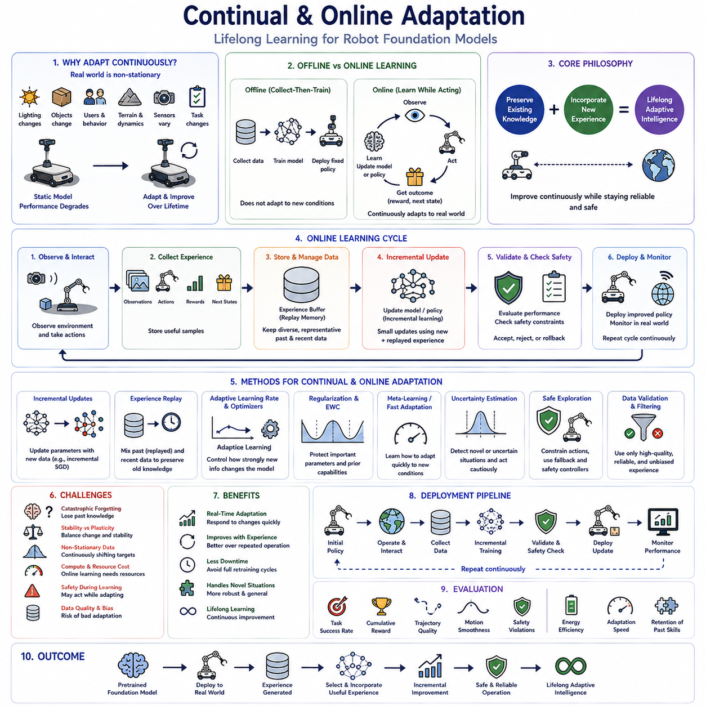{width="7.268055555555556in" height="7.268055555555556in"}

Continual and online adaptation enables a robot foundation model to keep improving after deployment rather than remaining fixed after an initial training cycle. Real-world environments continuously change in objects, users, lighting, sensor conditions, dynamics, tasks, and interaction patterns. A static model can therefore become progressively less effective as the distribution of observations changes. Continual adaptation treats deployment not as the end of learning, but as the beginning of a lifelong learning process in which new experience is incorporated while previously acquired capabilities are preserved.

Offline learning normally follows a collect-then-train pattern in which data is gathered first, the model is trained, and the resulting policy is deployed as a relatively fixed system. Online learning instead allows the robot to learn while acting. The robot observes its environment, performs actions, receives new observations and outcomes, and uses these experiences to refine its internal models or policy. This distinction becomes important when the operating environment is non-stationary because the data distribution encountered after deployment may differ substantially from the distribution used during initial training.

The central philosophy is lifelong adaptation without requiring complete retraining whenever the environment changes. A robot should continuously incorporate useful experience, refine its internal representations, and improve its behavior while retaining previously learned knowledge. Adaptation may occur at multiple levels, including perception, localization, planning, manipulation, control, and reasoning. The objective is therefore to transform a static foundation model into an adaptive intelligent system that can evolve with its environment while maintaining a stable core of general capabilities.

Distribution shift is a fundamental reason for continual adaptation. Changes in lighting, object appearance, workspace layout, sensor characteristics, user behavior, terrain, friction, payload, or task requirements can cause the deployment distribution to differ from the training distribution. A model that performed well under the original distribution may gradually lose accuracy or reliability under the new one. Online learning provides a mechanism for detecting these changes and updating the model so that its representations and policies remain aligned with the conditions actually encountered by the robot.

A practical online learning cycle begins with observation and interaction. The robot observes the environment, collects new experience such as observations, actions, rewards, and subsequent states, and stores useful samples in an experience buffer. The system then performs incremental model updates, evaluates the resulting performance, and deploys the improved policy when validation criteria are satisfied. This process repeats continuously, creating a closed loop from real-world experience to model refinement. The essential principle is that deployment experience becomes a source of new training information rather than remaining unused operational data.

Incremental learning can use relatively small updates instead of repeatedly retraining the entire foundation model. Incremental stochastic gradient descent can update parameters as new samples arrive, while experience replay can preserve representative samples from earlier experience and mix them with recent data during training. Adaptive learning-rate strategies can control how strongly new information changes the model, and meta-learning or continual-learning methods can help the system learn how to adapt rapidly. These approaches provide different mechanisms for balancing responsiveness to new conditions with stability of previously learned behavior.

Continual adaptation introduces several difficult challenges. Catastrophic forgetting can occur when learning new information causes the model to lose previously reliable capabilities. Stability and plasticity must therefore be balanced so that the model can change without becoming unstable. Non-stationary data can create continuously changing learning targets, while online computation increases resource requirements. Safety during learning is also critical because the robot may modify its behavior while operating. Data quality and bias present additional risks because poorly selected new experiences can cause the model to adapt toward undesirable or unrepresentative behavior.

Several mechanisms can mitigate these problems. Regularization and methods such as Elastic Weight Consolidation can protect important parameters associated with previously learned capabilities. Replay buffers can retain representative past experiences so that new training does not focus exclusively on recent data. Adaptive optimizers can control update behavior, while uncertainty estimation can help identify novel situations where the model should be cautious. Safe exploration can constrain online actions, and data validation and filtering can prevent poor-quality or unsafe experiences from entering the learning process. Together, these mechanisms make continual adaptation more controlled and reliable.

The benefits of continual and online adaptation extend beyond immediate performance improvement. A robot can respond to environmental changes in real time, improve its behavior through repeated operation, reduce the need for complete retraining, and handle novel situations more effectively. Continuous learning can also reduce downtime associated with collecting large datasets and rebuilding a complete model. These properties are particularly valuable for warehouse AMRs, mobile navigation systems, industrial manipulators, agricultural robots, service robots, and humanoid systems that must operate for long periods under changing physical conditions.

A practical deployment pipeline begins with an initial policy and proceeds through operation, interaction, data collection, experience storage, incremental training, validation, safety checking, and deployment of the updated policy. Monitoring then continues after deployment, allowing the system to repeat the cycle whenever meaningful new experience becomes available. Validation should occur before an updated policy is broadly released, and the system should maintain the ability to reject, roll back, or replace an update that produces unacceptable behavior. This makes continual adaptation an engineered lifecycle rather than uncontrolled self-modification.

Evaluation should measure both adaptation quality and operational safety. Important metrics include task success rate, cumulative reward, trajectory similarity or quality, motion smoothness, safety violations, energy efficiency, and adaptation speed. The system should also be evaluated on how rapidly it reaches a desired performance level after a distribution change and whether it retains previously validated capabilities. A successful continual-learning system is therefore not simply one that improves its latest task performance; it must demonstrate useful adaptation while remaining robust, safe, and consistent with earlier operational requirements.

The long-term outcome is a robot that continually learns and adapts while operating in dynamic environments. Deployment generates experience, experience is evaluated and selectively incorporated, the model is incrementally refined, and the updated policy returns to operation. This creates a continuous learning cycle in which the robot can improve performance over its lifetime rather than depending on periodic complete retraining. When combined with replay, regularization, uncertainty estimation, safe exploration, validation, and monitoring, continual and online adaptation provides a practical foundation for lifelong robot intelligence that remains responsive to change without sacrificing previously established capabilities.

지속적 적응(continual adaptation)과 온라인 적응(online adaptation)은 로봇 파운데이션 모델(robot foundation model)이 초기 학습 과정이 끝난 후 고정된 상태로 남아 있는 것이 아니라 배포 이후에도 지속적으로 개선될 수 있도록 한다. 실제 환경은 객체, 사용자, 조명, 센서 조건, 동역학, 작업 및 상호작용 패턴이 계속 변화한다. 따라서 정적인 모델(static model)은 관측 분포가 변화함에 따라 점차 효과가 감소할 수 있다. 지속적 적응은 배포를 학습의 종료가 아니라 평생 학습(lifelong learning)이 시작되는 시점으로 보고, 기존에 습득한 능력을 보존하면서 새로운 경험을 지속적으로 통합하는 과정으로 다룬다.

오프라인 학습(offline learning)은 일반적으로 먼저 데이터를 수집하고, 모델을 학습한 다음, 결과 정책(policy)을 비교적 고정된 시스템으로 배포하는 수집-학습(collect-then-train) 방식으로 이루어진다. 반면 온라인 학습(online learning)은 로봇이 행동하는 과정에서 학습할 수 있도록 한다. 로봇은 환경을 관찰하고 행동을 수행하며, 새로운 관측과 결과를 얻고, 이러한 경험을 이용하여 내부 모델이나 정책을 개선한다. 이러한 차이는 운용 환경이 비정상적(non-stationary)인 경우 특히 중요하다. 배포 이후 로봇이 경험하는 데이터 분포가 초기 학습에 사용된 분포와 크게 달라질 수 있기 때문이다.

핵심 철학은 환경이 변화할 때마다 전체 모델을 처음부터 다시 학습하지 않고 평생 동안 적응하는 것이다. 로봇은 유용한 경험을 지속적으로 통합하고, 내부 표현(internal representations)을 개선하며, 이전에 습득한 지식을 유지하면서 행동을 향상시켜야 한다. 적응은 지각(perception), 위치 추정(localization), 계획(planning), 조작(manipulation), 제어(control) 및 추론(reasoning)과 같은 여러 수준에서 이루어질 수 있다. 따라서 목표는 정적인 파운데이션 모델을 환경과 함께 진화하면서도 범용 능력의 안정적인 핵심을 유지할 수 있는 적응형 지능 시스템(adaptive intelligent system)으로 변화시키는 것이다.

분포 변화(distribution shift)는 지속적 적응이 필요한 근본적인 이유이다. 조명, 객체 외관, 작업공간 배치, 센서 특성, 사용자 행동, 지형, 마찰, 페이로드 또는 작업 요구사항의 변화는 배포 환경의 분포를 학습 분포와 다르게 만들 수 있다. 초기 분포에서 높은 성능을 보였던 모델도 새로운 환경에서는 정확도나 신뢰성이 점차 저하될 수 있다. 온라인 학습은 이러한 변화를 감지하고 실제 로봇이 경험하는 조건에 맞게 모델의 표현과 정책을 업데이트할 수 있는 메커니즘을 제공한다.

실용적인 온라인 학습 사이클은 관측과 상호작용에서 시작한다. 로봇은 환경을 관찰하고 관측, 행동, 보상 및 이후 상태와 같은 새로운 경험을 수집하여 경험 버퍼(experience buffer)에 유용한 샘플을 저장한다. 이후 시스템은 점진적인 모델 업데이트(incremental model updates)를 수행하고, 결과적인 성능을 평가하며, 검증 기준을 만족할 경우 개선된 정책을 배포한다. 이러한 과정은 지속적으로 반복되며 실제 환경의 경험에서 모델 개선으로 이어지는 폐루프(closed loop)를 형성한다. 핵심 원칙은 배포 경험이 단순히 사용되지 않는 운용 데이터로 남는 것이 아니라 새로운 학습 정보의 원천이 되는 것이다.

점진적 학습(incremental learning)은 전체 파운데이션 모델을 반복적으로 재학습하는 대신 상대적으로 작은 업데이트를 사용할 수 있다. 점진적 확률적 경사하강법(incremental stochastic gradient descent)은 새로운 샘플이 들어올 때 파라미터를 업데이트할 수 있으며, 경험 재생(experience replay)은 과거 경험에서 대표적인 샘플을 보존하고 최근 데이터와 함께 학습하도록 할 수 있다. 적응형 학습률(adaptive learning-rate) 전략은 새로운 정보가 모델을 얼마나 강하게 변화시키는지를 조절할 수 있으며, 메타학습(meta-learning) 또는 지속학습(continual-learning) 방법은 시스템이 빠르게 적응하는 방법을 학습하도록 지원할 수 있다. 이러한 접근법은 새로운 조건에 대한 반응성과 기존에 학습된 행동의 안정성 사이에서 균형을 유지하기 위한 서로 다른 메커니즘을 제공한다.

지속적 적응은 여러 가지 어려운 문제를 발생시킨다. 새로운 정보를 학습하는 과정에서 모델이 이전에 안정적으로 수행하던 능력을 잃어버리는 파국적 망각(catastrophic forgetting)이 발생할 수 있다. 따라서 모델이 불안정해지지 않으면서 변화할 수 있도록 안정성(stability)과 가소성(plasticity) 사이의 균형을 유지해야 한다. 비정상 데이터(non-stationary data)는 지속적으로 변화하는 학습 목표를 만들 수 있으며, 온라인 연산은 추가적인 계산 자원을 요구한다. 학습 중 안전성(safety)도 매우 중요하다. 로봇이 작동하는 동안 자신의 행동을 수정할 수 있기 때문이다. 또한 데이터 품질과 편향(bias)도 위험 요소가 될 수 있다. 잘못 선택된 새로운 경험이 모델을 바람직하지 않거나 대표성이 부족한 행동 방향으로 적응시킬 수 있기 때문이다.

이러한 문제를 완화하기 위해 여러 가지 메커니즘을 사용할 수 있다. 정규화(regularization)와 Elastic Weight Consolidation(EWC)과 같은 방법은 기존에 학습된 능력과 관련된 중요한 파라미터를 보호할 수 있다. 리플레이 버퍼(replay buffers)는 과거의 대표적인 경험을 유지하여 새로운 학습이 최근 데이터에만 집중하지 않도록 할 수 있다. 적응형 옵티마이저(adaptive optimizers)는 업데이트의 동작을 조절할 수 있으며, 불확실성 추정(uncertainty estimation)은 모델이 주의를 기울여야 하는 새로운 상황을 식별하는 데 도움을 줄 수 있다. 안전한 탐색(safe exploration)은 온라인 행동을 제한할 수 있고, 데이터 검증 및 필터링(data validation and filtering)은 품질이 낮거나 안전하지 않은 경험이 학습 과정에 포함되는 것을 방지할 수 있다. 이러한 메커니즘을 함께 사용하면 지속적 적응을 더욱 통제 가능하고 신뢰할 수 있는 방식으로 구현할 수 있다.

지속적 적응과 온라인 적응의 장점은 단순한 즉각적인 성능 향상을 넘어선다. 로봇은 환경 변화에 실시간으로 대응하고, 반복적인 운용을 통해 행동을 개선하며, 전체 재학습의 필요성을 줄이고, 새로운 상황을 더욱 효과적으로 처리할 수 있다. 지속적인 학습은 대규모 데이터셋을 수집하고 전체 모델을 다시 구축하는 과정에서 발생하는 다운타임(downtime)도 줄일 수 있다. 이러한 특성은 변화하는 물리적 조건에서 장시간 작동해야 하는 창고 AMR, 모바일 내비게이션 시스템, 산업용 매니퓰레이터, 농업용 로봇, 서비스 로봇 및 휴머노이드 시스템에 특히 유용하다.

실용적인 배포 파이프라인은 초기 정책(initial policy)에서 시작하여 운용, 상호작용, 데이터 수집, 경험 저장, 점진적 학습, 검증, 안전 점검 및 업데이트된 정책의 배포로 이어진다. 이후에도 모니터링을 지속하여 의미 있는 새로운 경험이 발생할 때마다 시스템이 이 사이클을 반복할 수 있도록 한다. 업데이트된 정책은 광범위하게 배포하기 전에 검증되어야 하며, 허용할 수 없는 행동을 발생시키는 업데이트를 거부하거나 롤백(rollback)하거나 기존 정책으로 교체할 수 있는 기능을 유지해야 한다. 이를 통해 지속적 적응을 통제되지 않은 자기 수정(self-modification)이 아니라 체계적으로 설계된 수명주기(lifecycle)로 만들 수 있다.

평가는 적응 품질과 운용 안전성을 모두 측정해야 한다. 중요한 지표에는 작업 성공률(task success rate), 누적 보상(cumulative reward), 궤적의 유사성 또는 품질(trajectory similarity or quality), 동작의 부드러움(motion smoothness), 안전 위반(safety violations), 에너지 효율(energy efficiency) 및 적응 속도(adaptation speed)가 포함된다. 또한 분포 변화가 발생한 이후 원하는 성능 수준에 얼마나 빠르게 도달하는지와 기존에 검증된 능력을 유지하는지도 평가해야 한다. 따라서 성공적인 지속학습 시스템은 최신 작업의 성능만 향상시키는 시스템이 아니라, 유용한 적응을 수행하면서도 강건성, 안전성 및 기존 운용 요구사항과의 일관성을 유지하는 시스템이어야 한다.

장기적인 결과는 동적인 환경에서 작동하면서 지속적으로 학습하고 적응하는 로봇이다. 배포는 새로운 경험을 생성하고, 경험은 평가되어 선택적으로 학습에 포함되며, 모델은 점진적으로 정교화되고, 업데이트된 정책은 다시 운용 환경으로 돌아간다. 이러한 지속적인 학습 사이클을 통해 로봇은 주기적인 전체 재학습에 의존하지 않고 수명 전체에 걸쳐 성능을 향상시킬 수 있다. 리플레이, 정규화, 불확실성 추정, 안전한 탐색, 검증 및 모니터링을 결합하면 지속적 적응과 온라인 적응은 기존에 확립된 능력을 희생하지 않으면서 변화에 대응할 수 있는 평생 로봇 지능(lifelong robot intelligence)을 위한 실용적인 기반을 제공한다.

##  

## 09.11. Catastrophic Forgetting and Knowledge Retention

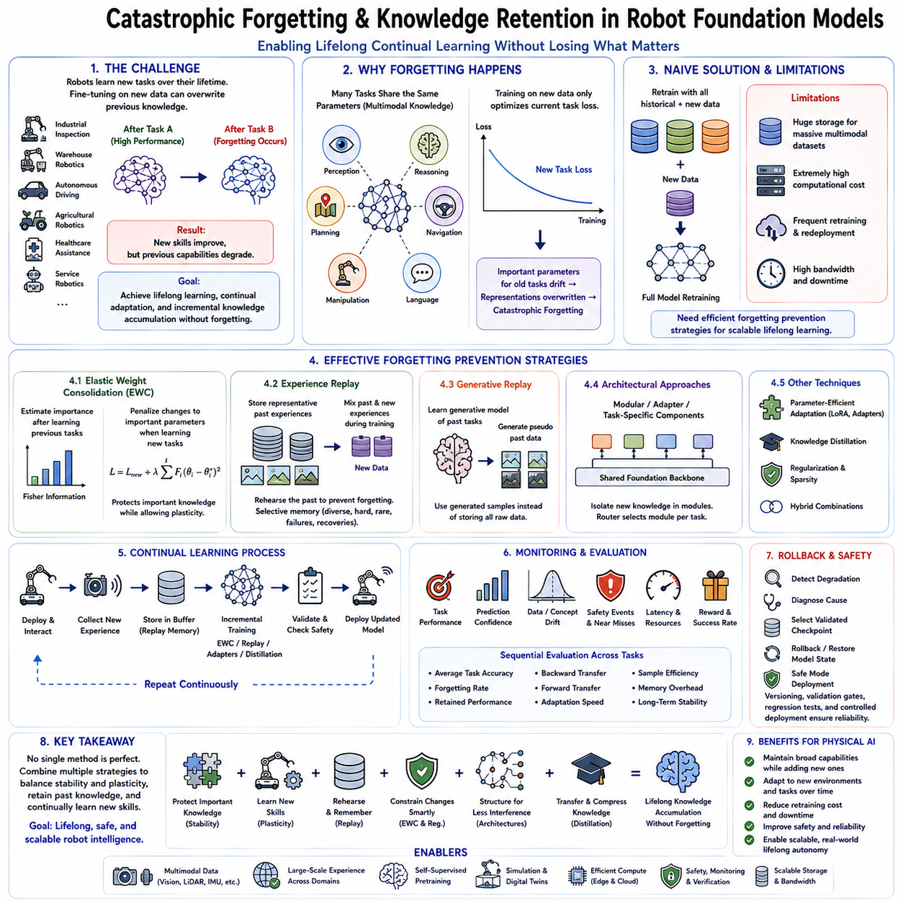{width="7.268055555555556in" height="7.268055555555556in"}

Catastrophic forgetting is a central challenge in continual learning for robot foundation models because robots are expected to acquire new capabilities throughout their operational lifetime while retaining previously learned knowledge. A robot may first learn industrial inspection, then navigation, manipulation, or human interaction, with each new task introducing additional data and optimization objectives. If the model is simply fine-tuned on the newest task, parameters that support earlier capabilities can be modified or overwritten. The result is improved performance on the new task accompanied by degradation on previously reliable behaviors.

The underlying problem arises because modern neural networks use shared parameters to represent knowledge from many tasks and modalities. Perception, reasoning, planning, navigation, manipulation, and language may all depend on overlapping internal representations. When training is performed only on new data, gradient updates primarily optimize the current task loss. Parameters that were important for earlier tasks can therefore drift, causing previously useful representations to be overwritten. Interference between sequential tasks becomes especially problematic when the new task requires changes in parameters that were also important for old capabilities.

A naive solution is to retrain the complete model using all historical data together with the new data. In principle, this can preserve access to earlier knowledge because old examples remain available during optimization. In practice, however, robot foundation models may involve enormous multimodal datasets containing images, videos, sensor streams, trajectories, language instructions, and interaction records. Storing and repeatedly processing the entire history creates substantial computational, storage, bandwidth, and deployment costs. Frequent full retraining also increases downtime and makes lifelong adaptation difficult to scale.

The fundamental objective is therefore to balance stability and plasticity. Stability means preserving knowledge that remains useful, while plasticity means allowing the model to learn new tasks and adapt to changing conditions. Excessive stability can prevent useful learning, whereas excessive plasticity can cause old capabilities to disappear. A successful continual-learning system must determine which knowledge should be protected, which parameters can change, and which new information should be incorporated. The desired outcome is incremental knowledge accumulation rather than a repeated cycle of learning one task while forgetting another.

Elastic Weight Consolidation (EWC) provides one important mechanism for controlling this trade-off. After learning an earlier task, the system estimates the importance of individual parameters, commonly using Fisher Information. Parameters judged important for previous knowledge receive stronger protection during subsequent training. When the model learns a new task, changes to these parameters are penalized, while less important parameters remain more freely adaptable. In this way, EWC does not completely freeze the model; instead, it creates an importance-aware constraint that allows plasticity where it is less harmful.

The EWC objective combines the loss of the new task with a regularization term that penalizes changes to important parameters. Conceptually, it can be written as (L = L_{new} + \\lambda \\sum_i F_i(\\theta_i-\\theta_i\^\*)\^2), where (L_{new}) represents the current task loss, (F_i) represents the estimated importance of parameter (i), (\\theta_i\^\*) is the parameter value associated with the previous task, and (\\lambda) controls the strength of protection. This formulation encourages the model to learn the new task while remaining close to parameter configurations that supported important previous capabilities.

Replay-based continual learning provides a complementary solution by preserving a limited collection of past experiences and periodically rehearsing them during training. Instead of retaining the complete historical dataset, the system maintains a replay buffer containing representative multimodal observations, actions, trajectories, failures, recoveries, language instructions, or expert demonstrations. New data are combined with sampled historical experiences to form mixed training batches. The resulting gradients therefore reflect both current and previous tasks, reducing the tendency for new learning to completely dominate the optimization process.

The effectiveness of replay depends strongly on what is retained in memory. A limited buffer cannot store every historical experience, so sample selection becomes an important design problem. The system should favor experiences that are representative, informative, difficult, rare, or important for previously validated behaviors. Failures and recovery trajectories can be particularly valuable because they capture situations that a purely successful dataset may not represent. Replay memory therefore becomes more than a storage mechanism; it functions as a selective memory system that determines which parts of the robot\'s past remain available for future learning.

Generative replay offers another way to reduce storage requirements. Instead of keeping large quantities of historical raw data, a generative model can learn representations of earlier tasks and later produce pseudo-experiences resembling those previous distributions. These generated samples can be mixed with new data during subsequent training. The approach can reduce the need to store every historical observation, although the quality of the generated experiences becomes critical. If the generative model fails to preserve important characteristics of previous tasks, the replay process may reproduce incomplete or distorted knowledge rather than truly protecting it.

Architectural approaches provide a different strategy by reducing direct interference between tasks. Modular architectures can assign different adapters, subnetworks, or task-specific components to different capabilities while preserving shared foundation components. A router can select appropriate modules according to the current task or context, allowing new capabilities to be added without modifying every existing component. Progressive architectures can similarly expand model capacity as new tasks arrive. The main advantage is reduced parameter interference, although memory and computational requirements can grow as the number of modules increases.

Parameter isolation and parameter-efficient adaptation can further reduce forgetting risk. LoRA, adapters, prompt-based methods, and related approaches update only a small portion of the overall model while leaving most pretrained parameters unchanged. Because the foundation backbone remains largely frozen, broad knowledge is less likely to be overwritten directly. However, this does not eliminate forgetting completely because an adaptation module can still change the model\'s effective behavior. Evaluation must therefore verify that specialization for a new task does not introduce regressions in perception, reasoning, action quality, robustness, or safety.

Knowledge distillation provides another retention mechanism by transferring previously learned behavior from an older model into the updated model. The previous model can act as a teacher while the continually adapted model learns new information, with an additional objective encouraging the new model to maintain compatible outputs or representations on earlier knowledge. This allows the system to retain useful behavior without necessarily storing all historical data. Distillation can therefore complement replay and regularization, particularly when the original model contains valuable knowledge that should remain stable during adaptation.

Hybrid approaches can combine several forgetting-prevention mechanisms because each addresses a different weakness. EWC protects important parameters, replay preserves representative historical experiences, and parameter-efficient methods reduce the number of parameters exposed to new-task updates. Together they can provide stronger retention and adaptation than relying on a single technique. A practical robot foundation model may therefore use a mostly frozen backbone, lightweight task adapters, a carefully managed replay buffer, and importance-aware regularization, creating multiple layers of protection against unwanted knowledge loss.

For robot systems, forgetting must be monitored through operational behavior rather than training loss alone. Important signals include task performance, prediction confidence, data or concept drift, safety events and near misses, latency, resource consumption, reward, and success rate. A model can appear to improve on the newest task while quietly degrading its ability to navigate, manipulate objects, perceive scenes, or interact safely. Continuous evaluation across previously validated tasks is therefore necessary to detect these regressions before they become operational failures.

Sequential evaluation is especially important for measuring knowledge retention. After learning tasks (T_1, T_2, \\ldots, T_n), the model should be evaluated not only on the newest task but across the entire sequence. Useful metrics include average task accuracy, forgetting rate, retained performance, backward transfer, forward transfer, adaptation speed, sample efficiency, memory overhead, computational cost, and long-term stability. This evaluation distinguishes genuine continual learning from simple specialization, because a system that becomes better at (T_n) while losing performance on (T_1) through (T_{n-1}) has not achieved reliable lifelong learning.

Rollback is an essential operational safeguard when continual adaptation produces unacceptable degradation. The system should detect performance deterioration, diagnose the likely cause, select a previously validated checkpoint, restore the model or adaptation state, and continue operation in a safe mode. This prevents a newly learned policy from permanently replacing a more reliable version simply because the update was automatically accepted. Versioned models, validation gates, regression testing, and controlled deployment therefore provide an important bridge between continual learning research and dependable physical robot operation.

Catastrophic forgetting is ultimately not solved by a single algorithm but by treating knowledge retention as a system-level requirement. Replay, EWC, generative replay, modular architectures, parameter isolation, knowledge distillation, and hybrid strategies provide complementary mechanisms for protecting previously learned capabilities while allowing new knowledge to enter the model. The broader goal is a robot foundation model that can continuously accumulate useful experience without repeatedly sacrificing earlier competence. Such a system can support lifelong learning, scalable adaptation, and progressively more capable robots while maintaining the reliability and safety required for real-world Physical AI.

파국적 망각(catastrophic forgetting)은 지속학습(continual learning)에서 로봇 파운데이션 모델(robot foundation model)이 직면하는 핵심적인 문제이다. 로봇은 운용 수명(operation lifetime) 동안 새로운 능력을 지속적으로 습득하면서도 이전에 학습한 지식을 유지해야 하기 때문이다. 예를 들어 로봇이 먼저 산업 검사(industrial inspection)를 학습한 다음 이동(navigation), 조작(manipulation) 또는 인간 상호작용(human interaction)을 학습할 수 있으며, 각각의 새로운 작업은 추가적인 데이터와 최적화 목표를 제공한다. 만약 모델을 최신 작업의 데이터만으로 단순히 파인튜닝한다면 이전 능력을 지원하던 파라미터가 수정되거나 덮어써질 수 있다. 그 결과 새로운 작업에서는 성능이 향상되지만 이전에 안정적으로 수행하던 행동에서는 성능이 저하될 수 있다.

근본적인 문제는 현대의 신경망(neural networks)이 여러 작업과 모달리티(modalities)의 지식을 공유된 파라미터를 사용하여 표현한다는 데서 발생한다. 지각(perception), 추론(reasoning), 계획(planning), 내비게이션(navigation), 조작(manipulation) 및 언어(language)는 서로 중첩되는 내부 표현(internal representations)에 의존할 수 있다. 새로운 데이터만을 사용하여 학습하면 경사 업데이트(gradient updates)는 주로 현재 작업의 손실 함수(task loss)를 최적화한다. 따라서 이전 작업에서 중요했던 파라미터가 변화하면서 기존에 유용했던 표현이 덮어써질 수 있다. 순차적으로 학습하는 작업들 사이의 간섭(interference)은 새로운 작업이 이전 능력에도 중요했던 파라미터의 변경을 요구할 때 특히 심각해진다.

가장 단순한 해결책은 모든 과거 데이터와 새로운 데이터를 함께 사용하여 전체 모델을 다시 학습하는 것이다. 원칙적으로 이는 이전 데이터가 최적화 과정에 계속 포함되기 때문에 기존 지식에 대한 접근을 유지할 수 있다. 그러나 로봇 파운데이션 모델은 이미지, 비디오, 센서 스트림, 궤적, 언어 지시 및 상호작용 기록으로 구성된 방대한 멀티모달 데이터셋을 사용할 수 있다. 전체 학습 이력을 저장하고 반복적으로 처리하는 것은 상당한 연산, 저장 공간, 대역폭 및 배포 비용을 발생시킨다. 빈번한 전체 재학습(full retraining)은 다운타임(downtime)을 증가시키며 평생 적응(lifelong adaptation)을 확장하기 어렵게 만든다.

따라서 근본적인 목표는 안정성(stability)과 가소성(plasticity)의 균형을 유지하는 것이다. 안정성은 계속 유용한 지식을 보존하는 것을 의미하며, 가소성은 모델이 새로운 작업을 학습하고 변화하는 조건에 적응할 수 있도록 하는 것을 의미한다. 지나친 안정성은 유용한 학습을 방해할 수 있고, 지나친 가소성은 기존 능력이 사라지는 결과를 초래할 수 있다. 성공적인 지속학습 시스템은 어떤 지식을 보호해야 하는지, 어떤 파라미터를 변경할 수 있는지, 그리고 어떤 새로운 정보를 통합해야 하는지를 결정해야 한다. 목표는 한 작업을 학습하면서 다른 작업을 잊어버리는 반복적인 과정이 아니라, 지식이 점진적으로 축적되는 구조를 만드는 것이다.

Elastic Weight Consolidation(EWC)은 이러한 균형을 조절하기 위한 중요한 메커니즘을 제공한다. 이전 작업을 학습한 후 시스템은 일반적으로 Fisher Information을 사용하여 개별 파라미터의 중요도를 추정한다. 이전 지식에 중요하다고 판단된 파라미터는 이후 학습 과정에서 더 강하게 보호된다. 모델이 새로운 작업을 학습할 때 이러한 파라미터의 변경에는 더 큰 페널티가 부여되고, 상대적으로 중요하지 않은 파라미터는 더욱 자유롭게 적응할 수 있다. 따라서 EWC는 모델을 완전히 동결하는 것이 아니라, 변경으로 인한 영향이 상대적으로 적은 부분에서는 가소성을 허용하면서 중요한 지식을 보호하는 중요도 기반 제약(importance-aware constraint)을 형성한다.

EWC의 목적함수(objective)는 새로운 작업의 손실과 중요한 파라미터의 변경을 제한하는 정규화 항(regularization term)을 결합한다. 개념적으로는 (L = L_{new} + \\lambda \\sum_i F_i(\\theta_i-\\theta_i\^\*)\^2)로 표현할 수 있다. 여기서 (L_{new})은 현재 작업의 손실, (F_i)는 파라미터 (i)의 추정 중요도, (\\theta_i\^\*)는 이전 작업과 관련된 파라미터 값이며, (\\lambda)는 보호 강도를 조절한다. 이 구조는 모델이 새로운 작업을 학습하면서도 이전의 중요한 능력을 지원했던 파라미터 구성으로부터 지나치게 멀어지지 않도록 한다.

리플레이 기반 지속학습(replay-based continual learning)은 과거 경험의 일부를 보존하고 학습 과정에서 주기적으로 재사용함으로써 상호 보완적인 해결책을 제공한다. 전체 과거 데이터셋을 유지하는 대신 시스템은 대표적인 멀티모달 관측, 행동, 궤적, 실패, 복구 행동, 언어 지시 또는 전문가 시연을 포함하는 리플레이 버퍼(replay buffer)를 유지한다. 새로운 데이터는 샘플링된 과거 경험과 결합되어 혼합 학습 배치(mixed training batches)를 구성한다. 이에 따라 학습 과정에서 생성되는 경사(gradient)는 현재 작업뿐만 아니라 이전 작업도 반영하게 되며, 새로운 학습이 최적화 과정을 완전히 지배하는 현상을 줄일 수 있다.

리플레이의 효과는 어떤 데이터를 기억에 남기는가에 크게 의존한다. 제한된 버퍼에는 모든 과거 경험을 저장할 수 없기 때문에 샘플 선택(sample selection)이 중요한 설계 문제가 된다. 시스템은 대표적이고, 정보량이 높으며, 어렵거나, 희귀하거나, 이전에 검증된 행동에 중요한 경험을 우선적으로 보존해야 한다. 실패와 복구 궤적(recovery trajectories)은 특히 가치가 높을 수 있다. 순수하게 성공적인 데이터셋에는 포함되지 않을 수 있는 상황을 표현하기 때문이다. 따라서 리플레이 메모리는 단순한 저장 장치가 아니라, 향후 학습에서 로봇의 과거 경험 중 어떤 부분을 계속 활용할 수 있는지를 결정하는 선택적 기억 시스템(selective memory system)으로 기능한다.

생성형 리플레이(generative replay)는 저장 공간 요구사항을 줄이는 또 다른 방법을 제공한다. 대량의 과거 원시 데이터를 보존하는 대신 생성 모델(generative model)이 이전 작업의 표현을 학습하고 이후 과거 분포와 유사한 의사 경험(pseudo-experiences)을 생성하도록 할 수 있다. 이러한 생성 샘플은 이후 학습 과정에서 새로운 데이터와 함께 사용할 수 있다. 이 방법은 모든 과거 관측을 저장해야 하는 필요성을 줄일 수 있지만, 생성된 경험의 품질이 매우 중요하다. 생성 모델이 이전 작업의 중요한 특성을 보존하지 못한다면 리플레이 과정은 과거 지식을 실제로 보호하기보다 불완전하거나 왜곡된 지식을 재생산할 수 있다.

아키텍처 기반 접근법(architectural approaches)은 작업 간 직접적인 간섭을 줄이는 다른 전략을 제공한다. 모듈식 아키텍처(modular architectures)는 서로 다른 능력에 서로 다른 어댑터, 서브네트워크 또는 작업 특화 구성요소를 할당하면서 공유되는 파운데이션 구성요소는 보존할 수 있다. 라우터(router)는 현재 작업이나 문맥에 따라 적절한 모듈을 선택할 수 있으며, 이를 통해 기존 구성요소 전체를 수정하지 않고 새로운 능력을 추가할 수 있다. 프로그레시브 아키텍처(progressive architectures) 역시 새로운 작업이 추가될 때 모델 용량을 확장할 수 있다. 주요 장점은 파라미터 간 간섭을 줄일 수 있다는 것이지만, 모듈의 수가 증가하면서 메모리와 연산 요구량도 증가할 수 있다.

파라미터 격리(parameter isolation)와 파라미터 효율적 적응(parameter-efficient adaptation)은 망각 위험을 더욱 줄일 수 있다. LoRA, 어댑터(adapters), 프롬프트 기반 방법(prompt-based methods) 및 관련 접근법은 전체 모델 중 작은 부분만 업데이트하고 대부분의 사전학습된 모델을 변경하지 않은 상태로 유지한다. 파운데이션 백본(foundation backbone)이 대부분 동결되어 있기 때문에 범용 지식이 직접적으로 덮어써질 가능성이 감소한다. 그러나 이것이 망각을 완전히 제거하는 것은 아니다. 적응 모듈(adaptation module)의 변경도 모델의 실제 행동에 영향을 줄 수 있기 때문이다. 따라서 새로운 작업에 대한 전문화가 지각, 추론, 행동 품질, 강건성 또는 안전성의 저하를 발생시키지 않는지 반드시 평가해야 한다.

지식 증류(knowledge distillation)는 이전에 학습된 행동을 기존 모델에서 업데이트된 모델로 전달함으로써 지식을 유지하는 또 다른 방법을 제공한다. 이전 모델은 교사 모델(teacher) 역할을 하고, 지속적으로 적응하는 새로운 모델은 새로운 정보를 학습하면서 이전 지식과 호환되는 출력 또는 표현을 유지하도록 추가적인 목적함수를 적용할 수 있다. 이를 통해 모든 과거 데이터를 저장하지 않고도 유용한 행동을 유지할 수 있다. 따라서 지식 증류는 특히 새로운 적응 과정에서도 원래 모델이 가진 중요한 지식을 안정적으로 유지해야 하는 경우 리플레이 및 정규화와 함께 사용할 수 있다.

하이브리드 접근법(hybrid approaches)은 여러 망각 방지 메커니즘을 결합할 수 있다. 각각의 방법이 서로 다른 약점을 해결하기 때문이다. EWC는 중요한 파라미터를 보호하고, 리플레이는 대표적인 과거 경험을 보존하며, 파라미터 효율적 방법은 새로운 작업 업데이트에 노출되는 파라미터의 수를 줄인다. 이들을 함께 사용하면 하나의 기법에만 의존하는 것보다 더 강력한 지식 보존과 적응을 제공할 수 있다. 실용적인 로봇 파운데이션 모델은 대부분 동결된 백본, 경량 작업 어댑터, 신중하게 관리되는 리플레이 버퍼 및 중요도 기반 정규화를 함께 사용하여 원치 않는 지식 손실에 대한 다중 보호 계층을 구성할 수 있다.

로봇 시스템에서는 망각을 학습 손실만으로 판단해서는 안 되며 실제 운용 행동을 통해 모니터링해야 한다. 중요한 신호에는 작업 성능, 예측 신뢰도(prediction confidence), 데이터 또는 개념 변화(data or concept drift), 안전 사건과 니어 미스(near misses), 지연시간, 자원 사용량, 보상 및 성공률이 포함된다. 모델이 최신 작업에서는 성능이 향상되는 것처럼 보이면서도 내비게이션, 객체 조작, 장면 지각 또는 안전한 상호작용 능력을 조용히 잃어버릴 수 있다. 따라서 이러한 성능 저하를 실제 운용 실패로 발전하기 전에 발견하기 위해 이전에 검증된 작업 전반에 걸친 지속적인 평가가 필요하다.

지식 보존을 측정하기 위해서는 순차적 평가(sequential evaluation)가 특히 중요하다. (T_1, T_2, \\ldots, T_n)의 작업을 순차적으로 학습한 후 모델은 최신 작업뿐만 아니라 전체 작업 순서에 대해 평가되어야 한다. 유용한 지표에는 평균 작업 정확도(average task accuracy), 망각률(forgetting rate), 유지 성능(retained performance), 후방 전이(backward transfer), 전방 전이(forward transfer), 적응 속도(adaptation speed), 샘플 효율성(sample efficiency), 메모리 오버헤드(memory overhead), 연산 비용 및 장기 안정성(long-term stability)이 포함된다. 이러한 평가는 단순한 전문화와 실제 지속학습을 구분한다. (T_n)에서는 성능이 향상되지만 (T_1)부터 (T_{n-1})까지의 성능이 저하된다면 신뢰할 수 있는 평생학습(lifelong learning)을 달성했다고 볼 수 없기 때문이다.

지속적 적응으로 인해 허용할 수 없는 성능 저하가 발생할 경우 롤백(rollback)은 필수적인 운용 안전장치이다. 시스템은 성능 저하를 감지하고, 가능한 원인을 진단하며, 이전에 검증된 체크포인트(checkpoint)를 선택하고, 모델 또는 적응 상태(adaptation state)를 복원한 후 안전 모드(safe mode)에서 운용을 계속할 수 있어야 한다. 이를 통해 자동으로 승인된 새로운 업데이트가 기존의 더 안정적인 버전을 영구적으로 대체하는 상황을 방지할 수 있다. 따라서 버전이 관리되는 모델, 검증 게이트(validation gates), 회귀 테스트(regression testing) 및 통제된 배포(controlled deployment)는 지속학습 연구와 신뢰할 수 있는 실제 로봇 운용 사이를 연결하는 중요한 기반이 된다.

파국적 망각은 궁극적으로 하나의 알고리즘만으로 해결되는 문제가 아니라 지식 보존을 시스템 수준의 요구사항(system-level requirement)으로 다루어야 하는 문제이다. 리플레이, EWC, 생성형 리플레이, 모듈식 아키텍처, 파라미터 격리, 지식 증류 및 하이브리드 전략은 새로운 지식이 모델에 들어올 수 있도록 하면서 기존에 학습된 능력을 보호하는 상호 보완적인 메커니즘을 제공한다. 더 큰 목표는 새로운 경험을 지속적으로 축적하면서도 이전의 능력을 반복적으로 희생하지 않는 로봇 파운데이션 모델을 구축하는 것이다. 이러한 시스템은 평생학습, 확장 가능한 적응 및 점진적으로 더 높은 능력을 갖춘 로봇을 지원하면서도 실제 환경의 물리적 AI(Physical AI)에 요구되는 신뢰성과 안전성을 유지할 수 있다.

##  

## 09.12. Safe Adaptation and Regression Testing

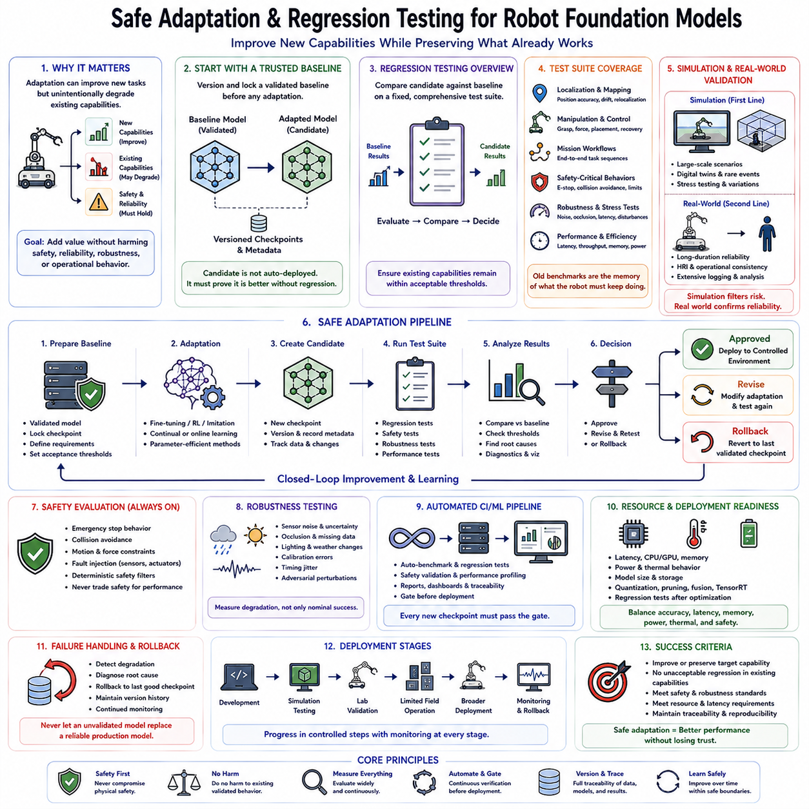{width="7.268055555555556in" height="7.268055555555556in"}

Safe adaptation is essential because a robot foundation model can improve its performance on a new task while unintentionally degrading capabilities that were already validated. Adaptation changes the behavior of a model, and in physical AI even a small change can affect perception, planning, localization, manipulation, collision avoidance, timing, or recovery. The purpose of safe adaptation is therefore not simply to obtain higher performance, but to introduce useful new capabilities while preserving previously established safety, reliability, robustness, and operational behavior.

A safe adaptation process begins with a known and validated baseline model. The original foundation model and its approved checkpoint should be versioned before any fine-tuning, reinforcement learning, imitation learning, or continual-learning update is applied. The new model should then be treated as a candidate rather than an automatic replacement. Its performance must be compared against the baseline using the same datasets, scenarios, metrics, and operational requirements. This establishes a controlled reference point and makes it possible to determine whether an observed improvement is accompanied by an unacceptable regression elsewhere.

Regression testing is the mechanism used to detect such unintended degradation. A regression test suite contains previously validated scenarios that represent important capabilities, historical failures, safety-critical behaviors, and representative operational workflows. After adaptation, the candidate model is executed against this fixed suite and its results are compared with the baseline. The purpose is not merely to confirm that the new task works, but to verify that existing capabilities remain within acceptable thresholds. Historical benchmarks therefore become a persistent memory of what the robot must continue to do correctly.

The regression suite should cover multiple dimensions of robot behavior. Localization challenges can test whether the adapted model still maintains reliable spatial understanding, while manipulation sequences can verify grasping, placement, force control, and recovery. Mission workflows can evaluate longer sequences in which several capabilities interact. Safety tests can examine emergency-stop behavior, collision avoidance, motion constraints, and safe manipulation. Threshold comparison then determines whether changes in success rate, latency, robustness, or safety remain within predefined acceptance limits.

Simulation provides a controlled environment in which candidate adaptations can be evaluated before exposing physical robots to potentially unsafe behavior. Large-scale scenarios, digital twins, varied environmental conditions, and stress-testing configurations can be executed repeatedly with controlled parameters. Simulation also makes it possible to reproduce rare or dangerous situations that would be expensive or unsafe to generate repeatedly on real hardware. Candidate models that fail important simulated tests can therefore be filtered before progressing to real-world validation, reducing unnecessary risk.

Real-world validation remains necessary because simulation cannot perfectly reproduce physical reality. Field experiments must examine long-duration reliability, human-robot interaction, operational consistency, sensor behavior, mechanical effects, and real execution timing. Extensive logging should record observations, actions, system states, failures, recovery behavior, and performance metrics so that successful and unsuccessful outcomes can be analyzed. The objective is not simply to demonstrate that the adapted model can complete a task once, but to establish that it behaves consistently under realistic operating conditions.

Safety evaluation must remain independent from task-performance optimization. Emergency-stop behavior, collision avoidance, motion constraints, safe manipulation, fault injection, and sensor or actuator failure should be explicitly tested. A model that achieves higher task success but violates physical safety constraints cannot be considered a successful adaptation. Safety evaluation should therefore determine whether the robot remains within predefined limits under both normal and abnormal conditions and whether deterministic protection mechanisms can prevent unsafe model outputs from reaching the physical system.

Robustness testing examines how the adapted model behaves when the input or operating conditions deviate from those used during training. Sensor noise, uncertainty, occlusion, missing data, lighting and weather changes, calibration errors, timing jitter, and adversarial perturbations can expose weaknesses that are invisible in ordinary benchmark tests. The objective is to measure degradation rather than only nominal performance. A robust adaptation should degrade gradually and predictably under disturbances rather than suddenly producing unsafe or uncontrolled behavior.

Interpretability and diagnostics help determine why a regression occurred. Attention visualization, feature analysis, error clustering, trajectory inspection, confidence calibration, and failure categorization can reveal whether the adaptation modified the model in an undesirable way. For example, a reduction in manipulation success may originate from perception changes, altered multimodal grounding, unstable action generation, or an interaction between components. Understanding the cause allows engineers to modify the appropriate adaptation component instead of responding with indiscriminate additional training.

Automated CI/ML pipelines can transform regression testing from an occasional manual activity into continuous verification. Whenever a new checkpoint is produced, automated benchmarking can execute standard evaluation suites, regression tests, safety validation, performance comparisons, and resource profiling. Reports and dashboards can preserve the results and provide traceability across model versions. This approach is particularly important for continual and online adaptation because updates may occur frequently. Automated verification creates a consistent gate between model modification and deployment rather than allowing every new checkpoint to reach a robot automatically.

Resource efficiency must also be included in safe adaptation because a model can preserve task accuracy while becoming operationally unsuitable. Inference latency, GPU and CPU utilization, memory and storage requirements, thermal behavior, and power consumption can change after adaptation. Optimization methods such as quantization, pruning, operator fusion, or TensorRT-based acceleration may alter numerical behavior and therefore require their own regression tests. For an edge robot, deployment readiness depends on achieving the required balance among accuracy, latency, memory, power, thermal stability, and safety rather than optimizing a single metric.

When a candidate model fails validation, the system should not simply discard the information or continue deployment. The failure should be analyzed to identify whether the cause lies in the new data, adaptation method, model architecture, reward function, sensor processing, system integration, or deployment environment. The candidate can then be modified and retested, or the system can return to a previously validated checkpoint. Versioning, validation gates, regression tests, and controlled deployment provide the operational safeguards necessary to prevent a temporary experimental model from becoming the production model unintentionally.

The final deployment decision should integrate technical performance, safety compliance, robustness analysis, operational efficiency, and maintainability and traceability. Approval should require evidence that the adapted model improves or preserves the intended capability while introducing no unacceptable regression in previously validated behavior. The deployment process should therefore move through controlled stages such as development, simulation, laboratory validation, limited field operation, and broader deployment, with monitoring and rollback available throughout the process. This creates a disciplined path from experimental adaptation to trustworthy physical operation.

Safe adaptation ultimately forms a closed-loop engineering process: establish a validated baseline, apply an adaptation, create a new checkpoint, evaluate the candidate, run regression and safety tests, validate in simulation and the real world, compare against historical performance, and either approve, revise, or roll back the model. The purpose is to ensure that learning remains compatible with reliability. A robot foundation model should become more capable through adaptation without becoming less predictable, less robust, or less safe. In this sense, regression testing is not a final administrative check but a continuous protection mechanism for lifelong physical AI.

안전한 적응(safe adaptation)은 로봇 파운데이션 모델(robot foundation model)이 새로운 작업에서 성능을 향상시키면서도 이미 검증된 능력을 의도하지 않게 저하시키지 않도록 하기 때문에 필수적이다. 적응 과정은 모델의 행동을 변화시키며, 물리적 AI(Physical AI)에서는 작은 변화만으로도 지각(perception), 계획(planning), 위치 추정(localization), 조작(manipulation), 충돌 회피(collision avoidance), 타이밍(timing) 또는 복구 행동(recovery)에 영향을 줄 수 있다. 따라서 안전한 적응의 목적은 단순히 더 높은 성능을 얻는 것이 아니라, 기존에 확립된 안전성(safety), 신뢰성(reliability), 강건성(robustness) 및 운용 행동(operational behavior)을 유지하면서 유용한 새로운 능력을 추가하는 것이다.

안전한 적응 과정은 이미 검증된 기준 모델(baseline model)에서 시작한다. 원래의 파운데이션 모델과 승인된 체크포인트(approved checkpoint)는 파인튜닝(fine-tuning), 강화학습(reinforcement learning), 모방학습(imitation learning) 또는 지속학습(continual-learning) 업데이트를 적용하기 전에 버전 관리(versioning)되어야 한다. 이후 새로운 모델은 자동으로 교체되는 모델이 아니라 후보 모델(candidate)로 취급해야 한다. 후보 모델의 성능은 동일한 데이터셋, 시나리오, 평가 지표 및 운용 요구사항을 사용하여 기준 모델과 비교해야 한다. 이를 통해 통제된 기준점을 확보하고, 특정 영역의 성능 향상이 다른 영역에서 허용할 수 없는 회귀(regression)를 동반하는지를 판단할 수 있다.

회귀 테스트(regression testing)는 이러한 의도하지 않은 성능 저하를 탐지하기 위한 메커니즘이다. 회귀 테스트 스위트(regression test suite)는 중요한 능력, 과거에 발생했던 실패, 안전이 중요한 행동 및 대표적인 운용 워크플로를 나타내는 이전에 검증된 시나리오들로 구성된다. 적응 이후 후보 모델은 고정된 테스트 스위트에서 실행되고 그 결과를 기준 모델과 비교한다. 목적은 새로운 작업이 작동하는지를 확인하는 데 그치지 않고 기존 능력이 허용 가능한 임계값(acceptable thresholds) 내에서 유지되는지를 검증하는 것이다. 따라서 과거의 벤치마크(historical benchmarks)는 로봇이 앞으로도 계속 올바르게 수행해야 하는 행동에 대한 지속적인 기억(persistent memory)의 역할을 한다.

회귀 테스트 스위트는 로봇 행동의 여러 측면을 다루어야 한다. 위치 추정 문제(localization challenges)는 적응된 모델이 안정적인 공간 이해(spatial understanding)를 계속 유지하는지를 검증할 수 있으며, 조작 시퀀스(manipulation sequences)는 잡기(grasping), 배치(placement), 힘 제어(force control) 및 복구(recovery)를 검증할 수 있다. 미션 워크플로(mission workflows)는 여러 능력이 결합된 장기적인 시퀀스를 평가할 수 있다. 안전 테스트(safety tests)는 비상 정지(emergency-stop) 행동, 충돌 회피, 동작 제약조건(motion constraints) 및 안전한 조작을 검사할 수 있다. 이후 임계값 비교(threshold comparison)를 통해 성공률, 지연시간, 강건성 또는 안전성의 변화가 사전에 정의된 허용 범위 내에 있는지를 판단한다.

시뮬레이션(simulation)은 실제 로봇을 잠재적으로 위험한 행동에 노출시키기 전에 후보 적응 모델을 평가할 수 있는 통제된 환경을 제공한다. 대규모 시나리오, 디지털 트윈(digital twins), 다양한 환경 조건 및 스트레스 테스트 구성(stress-testing configurations)을 통제된 파라미터로 반복 실행할 수 있다. 또한 실제 하드웨어에서 반복적으로 생성하기에는 비용이 많이 들거나 위험한 희귀하거나 위험한 상황을 시뮬레이션에서 재현할 수 있다. 따라서 중요한 시뮬레이션 테스트를 통과하지 못한 후보 모델은 실제 환경 검증으로 넘어가기 전에 필터링할 수 있으며, 이를 통해 불필요한 위험을 줄일 수 있다.

실제 환경 검증(real-world validation)은 여전히 필요하다. 시뮬레이션이 물리적 현실을 완벽하게 재현할 수 없기 때문이다. 현장 실험(field experiments)은 장시간 신뢰성(long-duration reliability), 인간-로봇 상호작용(human-robot interaction), 운용 일관성(operational consistency), 센서 동작, 기계적 영향 및 실제 실행 타이밍을 검증해야 한다. 관측, 행동, 시스템 상태, 실패, 복구 행동 및 성능 지표를 기록하는 광범위한 로깅(logging)을 수행하여 성공 및 실패 결과를 분석할 수 있어야 한다. 목적은 적응된 모델이 작업을 한 번 수행할 수 있음을 보여주는 것이 아니라 현실적인 운용 조건에서 일관되게 행동한다는 것을 입증하는 것이다.

안전 평가는 작업 성능 최적화(task-performance optimization)와 독립적으로 유지되어야 한다. 비상 정지 행동, 충돌 회피, 동작 제약조건, 안전한 조작, 결함 주입(fault injection) 및 센서 또는 액추에이터 고장(sensor or actuator failure)을 명시적으로 테스트해야 한다. 작업 성공률은 높아졌지만 물리적 안전 제약조건을 위반하는 모델은 성공적인 적응이라고 볼 수 없다. 따라서 안전 평가는 정상 조건과 비정상 조건 모두에서 로봇이 사전에 정의된 한계 내에서 작동하는지, 그리고 결정론적 보호 메커니즘(deterministic protection mechanisms)이 안전하지 않은 모델 출력을 실제 시스템에 전달하기 전에 차단할 수 있는지를 확인해야 한다.

강건성 테스트(robustness testing)는 학습에 사용된 조건과 실제 입력 또는 운용 조건이 달라졌을 때 적응된 모델이 어떻게 행동하는지를 평가한다. 센서 노이즈(sensor noise), 불확실성(uncertainty), 가림(occlusion), 데이터 누락(missing data), 조명 및 날씨 변화, 캘리브레이션 오류(calibration errors), 타이밍 지터(timing jitter) 및 적대적 교란(adversarial perturbations)은 일반적인 벤치마크 테스트에서는 드러나지 않는 약점을 노출할 수 있다. 목적은 정상적인 성능만을 측정하는 것이 아니라 성능이 얼마나 저하되는지를 측정하는 것이다. 강건한 적응은 외란이 발생했을 때 갑작스럽게 안전하지 않거나 통제되지 않은 행동을 생성하는 대신 점진적이고 예측 가능한 방식으로 성능이 저하되어야 한다.

해석 가능성(interpretability)과 진단(diagnostics)은 회귀가 발생한 이유를 파악하는 데 도움을 준다. 어텐션 시각화(attention visualization), 특징 분석(feature analysis), 오류 클러스터링(error clustering), 궤적 검사(trajectory inspection), 신뢰도 보정(confidence calibration) 및 실패 분류(failure categorization)를 통해 적응 과정이 모델을 바람직하지 않은 방향으로 변경했는지를 확인할 수 있다. 예를 들어 조작 성공률이 감소한 원인이 지각 변화, 멀티모달 그라운딩(multimodal grounding)의 변화, 불안정한 행동 생성 또는 여러 구성요소 사이의 상호작용 때문일 수 있다. 원인을 이해하면 무차별적인 추가 학습을 수행하는 대신 적절한 적응 구성요소를 수정할 수 있다.

자동화된 CI/ML 파이프라인(CI/ML pipelines)은 회귀 테스트를 간헐적인 수작업 활동에서 지속적인 검증(continuous verification)으로 전환할 수 있다. 새로운 체크포인트가 생성될 때마다 자동화된 벤치마킹을 통해 표준 평가 스위트, 회귀 테스트, 안전 검증, 성능 비교 및 자원 프로파일링(resource profiling)을 실행할 수 있다. 보고서와 대시보드는 결과를 보존하고 모델 버전 간 추적성(traceability)을 제공할 수 있다. 이는 업데이트가 빈번하게 발생할 수 있는 지속적 적응(continual adaptation)과 온라인 적응(online adaptation)에서 특히 중요하다. 자동화된 검증은 모든 새로운 체크포인트가 자동으로 로봇에 배포되는 것을 방지하고, 모델 변경과 배포 사이에 일관된 승인 게이트를 제공한다.

자원 효율성(resource efficiency) 역시 안전한 적응에 포함되어야 한다. 모델이 작업 정확도를 유지하면서도 실제 운용에 부적합한 상태가 될 수 있기 때문이다. 적응 이후 추론 지연시간(inference latency), GPU 및 CPU 사용률, 메모리 및 저장공간 요구량, 열적 동작(thermal behavior) 및 전력 소비(power consumption)가 변화할 수 있다. 양자화(quantization), 가지치기(pruning), 연산자 융합(operator fusion) 또는 TensorRT 기반 가속과 같은 최적화 방법은 수치적 동작을 변경할 수 있으므로 별도의 회귀 테스트가 필요하다. 엣지 로봇(edge robot)의 배포 준비 상태는 하나의 지표만을 최적화하는 것이 아니라 정확도, 지연시간, 메모리, 전력, 열적 안정성 및 안전성 사이에서 요구되는 균형을 달성하는지에 따라 결정된다.

후보 모델이 검증에 실패했을 때 시스템은 단순히 해당 정보를 버리거나 계속 배포해서는 안 된다. 실패 원인이 새로운 데이터, 적응 방법, 모델 아키텍처, 보상 함수(reward function), 센서 처리(sensor processing), 시스템 통합(system integration) 또는 배포 환경(deployment environment) 중 어디에 있는지를 분석해야 한다. 이후 후보 모델을 수정하고 다시 테스트하거나, 이전에 검증된 체크포인트로 돌아갈 수 있다. 버전 관리, 검증 게이트, 회귀 테스트 및 통제된 배포는 일시적인 실험용 모델이 의도하지 않게 운영 모델이 되는 것을 방지하는 데 필요한 운용 안전장치를 제공한다.

최종 배포 결정은 기술적 성능, 안전 규정 준수(safety compliance), 강건성 분석, 운용 효율성 및 유지보수성과 추적 가능성(maintainability and traceability)을 종합해야 한다. 승인은 적응된 모델이 의도된 능력을 향상시키거나 유지하면서 이전에 검증된 행동에서 허용할 수 없는 회귀를 발생시키지 않는다는 증거를 요구해야 한다. 따라서 배포 과정은 개발(development), 시뮬레이션, 실험실 검증(laboratory validation), 제한된 현장 운용(limited field operation) 및 광범위한 배포(broader deployment)와 같은 통제된 단계를 거쳐야 하며, 전체 과정에서 모니터링과 롤백(rollback)이 가능해야 한다. 이를 통해 실험적인 적응에서 신뢰할 수 있는 물리적 운용(trustworthy physical operation)으로 이어지는 체계적인 경로를 구축할 수 있다.

안전한 적응은 궁극적으로 폐루프 엔지니어링 프로세스(closed-loop engineering process)를 구성한다. 즉, 검증된 기준 모델을 설정하고, 적응을 적용하며, 새로운 체크포인트를 생성하고, 후보 모델을 평가하고, 회귀 및 안전 테스트를 수행하고, 시뮬레이션과 실제 환경에서 검증한 다음, 과거 성능과 비교하여 모델을 승인하거나 수정하거나 롤백하는 과정이다. 목적은 학습이 신뢰성과 양립할 수 있도록 하는 것이다. 로봇 파운데이션 모델은 적응을 통해 더욱 높은 능력을 갖추면서도 예측 가능성, 강건성 또는 안전성을 잃어서는 안 된다. 이러한 관점에서 회귀 테스트는 단순한 최종 행정 절차가 아니라 평생 물리적 AI(lifelong Physical AI)를 보호하는 지속적인 안전 메커니즘(continuous protection mechanism)이다.

##  

## 09.13. PEFT for Robot Foundation Models [w/Code]

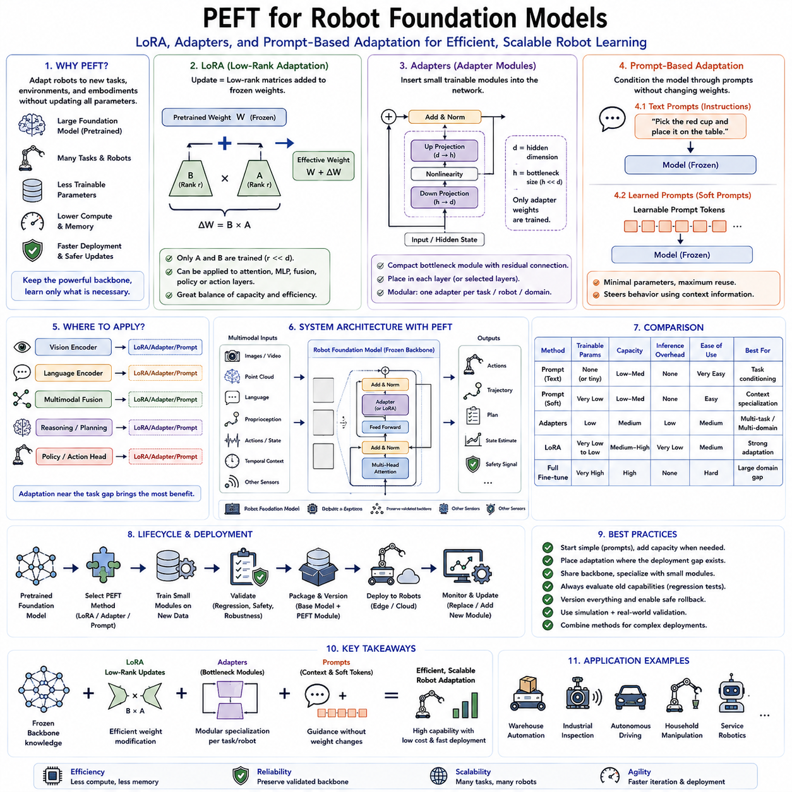{width="7.268055555555556in" height="7.268055555555556in"}

LoRA, adapters, and prompt-based adaptation provide practical mechanisms for specializing robot foundation models without updating every parameter in a large pretrained network. They belong to parameter-efficient adaptation because most of the original model remains fixed while a relatively small trainable component changes the model's behavior. This separation is particularly valuable in robotics, where one foundation model may need to support many tasks, environments, and robot embodiments.

Low-Rank Adaptation, commonly called LoRA, is based on the observation that useful changes to a large pretrained model can often be represented within a much lower-dimensional parameter space than the original weight matrices. Instead of directly modifying a large weight matrix, LoRA keeps the pretrained matrix frozen and learns a low-rank update through two smaller matrices. Their product approximates the weight modification required for the target domain while greatly reducing the number of trainable parameters.

Conceptually, if a pretrained transformation uses a weight matrix W, full fine-tuning learns changes directly across W. LoRA instead represents the adaptation as an additional update ΔW that is factorized into low-rank matrices. The effective transformation becomes W + ΔW while W itself remains unchanged. Because the rank of the update can be much smaller than the dimensions of W, the adaptation can capture useful specialization with substantially fewer trainable values.

For robot foundation models, LoRA can be applied selectively to attention projections, feed-forward layers, multimodal fusion components, policy representations, or other transformations. This flexibility allows engineers to choose where adaptation capacity should be concentrated. A visual-language representation that already generalizes well may require little modification, while layers connecting multimodal reasoning to robot actions may receive stronger adaptation because they are more closely coupled to the target task or embodiment.

Adapters use a related but structurally different principle. Rather than expressing changes as low-rank modifications of existing weight matrices, adapter methods introduce small trainable modules into or alongside the pretrained network. A typical adapter compresses a hidden representation into a lower-dimensional space, transforms it, and projects it back to the original dimension. Residual connections allow the pretrained information flow to remain available while the adapter learns task- or domain-specific corrections.

This modular organization is attractive for robotics because adapters can represent distinct specializations while sharing the same frozen backbone. A single robot foundation model might use one adapter for manipulation, another for navigation, and another for inspection. Different adapters could also correspond to particular robots, sensor configurations, factories, or end-effectors. The large shared model stores general knowledge, while compact modules encode differences that should not require an entirely separate foundation model.

LoRA and adapters therefore provide an efficient way to organize multi-task and multi-embodiment deployment. Instead of storing several complete fine-tuned models, a robotic system can maintain one validated backbone and a library of relatively small adaptation states. Selecting a new task or robot configuration can then involve loading the appropriate adaptation component. This reduces storage duplication and provides a clearer separation between general pretrained capability and deployment-specific specialization.

Prompt-based adaptation moves specialization even further away from direct modification of the foundation model. At the simplest level, a model can be conditioned through natural-language instructions describing the task, goal, constraints, environment, or desired behavior. A sufficiently capable multimodal model may alter its behavior according to this context without changing its parameters. This form of adaptation resembles in-context control because specialization is expressed through information supplied at inference time.

Prompt adaptation can also use learned representations rather than only human-readable text. Soft prompts or learned prompt tokens introduce trainable continuous vectors into the model's input or intermediate context. These vectors can encode task-specific information while the underlying foundation model remains frozen. Because only a small prompt representation is optimized, this approach can require far fewer trainable parameters than conventional fine-tuning while still steering the model toward a particular downstream behavior.

In robotics, prompts can describe more than semantic task identity. They may represent goals, object categories, operational modes, environmental context, or behavioral constraints. An instruction such as moving an object carefully can condition high-level behavior, while learned prompts may encode information that is difficult to express explicitly in natural language. Prompt-based mechanisms are therefore useful when a pretrained model already possesses the required capabilities but needs contextual guidance about which behavior should be activated.

However, prompt-based adaptation has important limitations for physical control. A prompt can effectively select or bias knowledge already represented by the model, but it may be insufficient when the target robot requires genuinely new motor mappings, sensor interpretations, or dynamic relationships. A different manipulator geometry or action interface may require changes inside the policy or action-generation pathway. In such cases, LoRA, adapters, or stronger fine-tuning mechanisms can provide greater representational capacity.

The three approaches therefore occupy different positions in the adaptation spectrum. Prompt-based methods make minimal changes and emphasize reuse of existing capabilities. Adapters introduce dedicated trainable pathways that can transform internal representations. LoRA directly modifies the effective behavior of selected pretrained transformations through low-rank updates. None of these mechanisms is universally superior; their usefulness depends on how much the target behavior differs from what the pretrained model already knows.

Their placement within the architecture is as important as the adaptation mechanism itself. Robot foundation models commonly contain visual encoding, language processing, multimodal fusion, reasoning, policy, and action-generation components. Adaptation near perception may address new sensors or visual environments, whereas adaptation near multimodal fusion may improve grounding between instructions and observations. Adaptation near policy and action layers can address robot-specific kinematics, control conventions, or action distributions.

Parameter-efficient methods can also be combined. A system might use textual prompts to specify a task, a learned prompt to encode environmental context, LoRA to adapt multimodal or policy transformations, and an embodiment-specific adapter near the action decoder. Such combinations create a layered adaptation architecture in which different mechanisms address different forms of mismatch. The objective is not to maximize the number of adaptation modules but to place sufficient trainable capacity where the deployment gap actually occurs.

This modularity provides important lifecycle advantages. Adaptation components can be trained, versioned, evaluated, distributed, and rolled back independently from the large foundation backbone. When a new robot or task is introduced, engineers may only need to produce a new LoRA state, adapter, or learned prompt rather than retraining and distributing the complete model. A fleet can consequently share a common foundation while maintaining controlled specialization across heterogeneous operational configurations.

Small adaptation modules also reduce, but do not eliminate, the risk of catastrophic forgetting. Because most pretrained parameters remain frozen, broad knowledge is less likely to be overwritten directly. Nevertheless, an adaptation module can still alter model behavior enough to degrade previously reliable capabilities when activated. Evaluation must therefore examine not only improvement on the target task but also unintended regressions in perception, reasoning, action quality, robustness, and safety.

For physical systems, adaptation must ultimately be judged by executable behavior rather than parameter count alone. A compact LoRA module is not useful merely because it is computationally efficient, and a prompt is not sufficient merely because it produces semantically plausible reasoning. The adapted model must generate actions compatible with the robot's geometry, dynamics, timing, sensors, control interfaces, workspace constraints, and safety requirements. Parameter efficiency is valuable only when physical reliability is preserved.

A practical strategy is to begin with the least invasive mechanism capable of solving the adaptation problem. Prompt conditioning can be tested when the required behavior may already exist within the pretrained model. Learned prompts, adapters, or LoRA can then introduce progressively greater specialization while preserving most of the backbone. If these mechanisms cannot close the deployment gap, selective unfreezing or broader fine-tuning can expose additional model capacity for adaptation.

LoRA, adapters, and prompt-based adaptation thus transform a large robot foundation model from a monolithic artifact into a reusable platform for specialization. The backbone provides shared perception, semantic knowledge, reasoning, and behavioral priors, while lightweight adaptation mechanisms configure those capabilities for particular robots and tasks. This architecture supports scalable robot learning by separating what should remain general from what must change for each physical deployment.

LoRA, 어댑터(adapters) 및 프롬프트 기반 적응(prompt-based adaptation)은 대규모 사전학습 네트워크의 모든 파라미터를 업데이트하지 않고도 로봇 파운데이션 모델(robot foundation models)을 전문화할 수 있는 실용적인 방법을 제공한다. 이들은 파라미터 효율적 적응(parameter-efficient adaptation)에 속하며, 대부분의 원래 모델은 고정된 상태로 유지하면서 상대적으로 작은 학습 가능한 구성요소를 변경하여 모델의 행동을 조정한다. 이러한 분리는 하나의 파운데이션 모델이 여러 작업, 환경 및 로봇 구현체(embodiments)를 지원해야 하는 로보틱스에서 특히 중요하다.

저랭크 적응(Low-Rank Adaptation, LoRA)은 대규모 사전학습 모델에 유용한 변화가 원래의 가중치 행렬보다 훨씬 낮은 차원의 파라미터 공간에서도 표현될 수 있다는 관찰에 기반한다. 대규모 가중치 행렬을 직접 수정하는 대신 LoRA는 사전학습된 행렬을 동결하고 두 개의 더 작은 행렬을 통해 저랭크 업데이트(low-rank update)를 학습한다. 이 두 행렬의 곱은 대상 도메인에 필요한 가중치 변경을 근사하면서 학습해야 하는 파라미터 수를 크게 줄인다.

개념적으로 사전학습된 변환이 가중치 행렬 (W)를 사용한다면, 전체 파인튜닝(full fine-tuning)은 (W) 전체에 걸쳐 직접적인 변경을 학습한다. 반면 LoRA는 적응을 (\\Delta W)라는 추가적인 업데이트로 표현하고, 이를 저랭크 행렬들로 분해한다. 이에 따라 실제 변환은 (W + \\Delta W)가 되지만 (W) 자체는 변경되지 않는다. 업데이트의 랭크(rank)가 (W)의 차원보다 훨씬 작을 수 있기 때문에, 적은 수의 학습 가능한 값만으로도 대상 작업에 필요한 유용한 전문화를 표현할 수 있다.

로봇 파운데이션 모델에서는 LoRA를 어텐션 프로젝션(attention projections), 피드포워드 계층(feed-forward layers), 멀티모달 융합 구성요소(multimodal fusion components), 정책 표현(policy representations) 또는 기타 변환 계층에 선택적으로 적용할 수 있다. 이러한 유연성은 엔지니어가 적응 능력을 어디에 집중시킬 것인지를 선택할 수 있도록 한다. 이미 충분한 일반화 성능을 갖춘 시각-언어 표현(visual-language representation)은 적은 수정만 필요할 수 있지만, 멀티모달 추론을 로봇 행동과 연결하는 계층은 대상 작업이나 구현체와 더욱 밀접하게 연결되어 있기 때문에 더 강한 적응이 필요할 수 있다.

어댑터(adapters)는 관련된 원리를 사용하지만 구조적으로는 다른 방식으로 동작한다. 기존 가중치 행렬을 저랭크 방식으로 수정하는 대신, 어댑터 방법은 사전학습된 네트워크 내부 또는 그 주변에 작은 학습 가능한 모듈을 추가한다. 일반적인 어댑터는 은닉 표현(hidden representation)을 낮은 차원의 공간으로 압축하고, 이를 변환한 다음 다시 원래 차원으로 투영한다. 잔차 연결(residual connections)은 사전학습된 정보 흐름을 계속 사용할 수 있도록 하면서 어댑터가 작업 또는 도메인 특화 보정(task- or domain-specific corrections)을 학습하도록 한다.

이러한 모듈식 구성은 로보틱스에서 특히 매력적이다. 하나의 고정된 백본을 공유하면서 어댑터를 통해 서로 다른 전문화를 표현할 수 있기 때문이다. 하나의 로봇 파운데이션 모델이 조작(manipulation)을 위한 어댑터, 내비게이션(navigation)을 위한 어댑터, 검사를 위한 어댑터를 각각 사용할 수 있다. 서로 다른 어댑터는 특정 로봇, 센서 구성, 공장 환경 또는 엔드 이펙터(end-effectors)에 대응할 수도 있다. 대규모 공유 모델은 범용 지식을 저장하고, 소형 모듈은 완전히 별도의 파운데이션 모델을 필요로 하지 않는 차이점을 표현한다.

따라서 LoRA와 어댑터는 멀티태스크(multi-task) 및 멀티-구현체(multi-embodiment) 배포를 효율적으로 구성할 수 있는 방법을 제공한다. 여러 개의 완전한 파인튜닝 모델을 저장하는 대신 로봇 시스템은 하나의 검증된 백본과 상대적으로 작은 여러 적응 상태(adaptation states)의 라이브러리를 유지할 수 있다. 새로운 작업이나 로봇 구성을 선택할 때 적절한 적응 구성요소를 불러오는 방식으로 대응할 수 있다. 이를 통해 저장 공간의 중복을 줄이고 범용 사전학습 능력과 배포 환경에 특화된 전문화를 명확하게 분리할 수 있다.

프롬프트 기반 적응(prompt-based adaptation)은 파운데이션 모델 자체를 직접 수정하는 방식에서 더욱 멀어져 전문화를 수행한다. 가장 단순한 형태에서는 작업, 목표, 제약조건, 환경 또는 원하는 행동을 설명하는 자연어 지시를 통해 모델을 조건화(conditioning)할 수 있다. 충분한 능력을 가진 멀티모달 모델은 파라미터를 변경하지 않고도 이러한 문맥에 따라 행동을 변화시킬 수 있다. 이러한 형태의 적응은 추론 시점(inference time)에 제공되는 정보를 통해 전문화를 표현한다는 점에서 문맥 내 제어(in-context control)와 유사하다.

프롬프트 기반 적응은 사람이 읽을 수 있는 텍스트만이 아니라 학습된 표현을 사용할 수도 있다. 소프트 프롬프트(soft prompts) 또는 학습된 프롬프트 토큰(learned prompt tokens)은 모델의 입력이나 중간 문맥(intermediate context)에 학습 가능한 연속 벡터(continuous vectors)를 추가한다. 이러한 벡터는 작업 특화 정보를 인코딩하면서 기본 파운데이션 모델은 동결된 상태로 유지할 수 있다. 매우 적은 수의 파라미터만 최적화하기 때문에 기존의 파인튜닝보다 훨씬 적은 학습 파라미터로도 특정 다운스트림 행동(downstream behavior)을 유도할 수 있다.

로보틱스에서 프롬프트는 단순히 작업의 의미적 정체성(semantic task identity)만을 설명하는 것이 아니다. 목표, 객체 범주, 운용 모드, 환경적 문맥 또는 행동 제약조건을 표현할 수도 있다. 예를 들어 객체를 조심스럽게 이동하라는 지시는 상위 수준의 행동을 조건화할 수 있으며, 학습된 프롬프트는 자연어로 명확하게 표현하기 어려운 정보를 인코딩할 수 있다. 따라서 프롬프트 기반 메커니즘은 사전학습된 모델이 이미 필요한 능력을 가지고 있지만 어떤 행동을 활성화해야 하는지에 대한 문맥적 안내가 필요한 경우 유용하다.

그러나 프롬프트 기반 적응은 물리적 제어(physical control)에서 중요한 한계를 가진다. 프롬프트는 모델 내부에 이미 표현된 지식을 선택하거나 편향시키는 데 효과적일 수 있지만, 대상 로봇이 새로운 모터 매핑(motor mappings), 센서 해석(sensor interpretations) 또는 동역학적 관계(dynamic relationships)를 실제로 새롭게 학습해야 하는 경우에는 충분하지 않을 수 있다. 서로 다른 매니퓰레이터 형상(manipulator geometry)이나 행동 인터페이스(action interface)는 정책 또는 행동 생성 경로(action-generation pathway) 내부의 변경을 요구할 수 있다. 이러한 경우 LoRA, 어댑터 또는 보다 강력한 파인튜닝 방법이 더 큰 표현 능력을 제공할 수 있다.

따라서 세 가지 접근법은 적응 스펙트럼(adaptation spectrum)에서 서로 다른 위치를 차지한다. 프롬프트 기반 방법은 가장 적은 변경을 수행하며 기존 능력의 재사용을 강조한다. 어댑터는 내부 표현을 변환할 수 있는 전용 학습 경로(trainable pathways)를 추가한다. LoRA는 선택된 사전학습 변환에 저랭크 업데이트를 적용하여 효과적인 행동을 직접 변경한다. 어느 하나의 방법이 항상 우월한 것은 아니며, 유용성은 대상 행동이 사전학습 모델이 이미 알고 있는 내용과 얼마나 다른지에 따라 달라진다.

이들이 아키텍처에서 어디에 배치되는지는 적응 메커니즘 자체만큼 중요하다. 로봇 파운데이션 모델은 일반적으로 시각 인코딩(visual encoding), 언어 처리(language processing), 멀티모달 융합(multimodal fusion), 추론(reasoning), 정책(policy) 및 행동 생성(action generation) 구성요소를 포함한다. 지각 부분에 가까운 적응은 새로운 센서나 시각적 환경에 대응할 수 있고, 멀티모달 융합에 가까운 적응은 지시와 관측 사이의 그라운딩(grounding)을 향상시킬 수 있다. 정책 및 행동 계층에 가까운 적응은 로봇의 특정 운동학(kinematics), 제어 방식(control conventions) 또는 행동 분포(action distributions)에 대응할 수 있다.

파라미터 효율적 방법(parameter-efficient methods)은 서로 결합할 수도 있다. 하나의 시스템이 텍스트 프롬프트를 사용하여 작업을 지정하고, 학습된 프롬프트를 사용하여 환경적 문맥을 인코딩하며, LoRA를 사용하여 멀티모달 또는 정책 변환을 적응시키고, 행동 디코더(action decoder) 주변에는 구현체 특화 어댑터(embodiment-specific adapter)를 사용할 수 있다. 이러한 조합은 서로 다른 유형의 불일치(mismatch)를 서로 다른 메커니즘이 처리하는 계층형 적응 아키텍처(layered adaptation architecture)를 구성한다. 목적은 적응 모듈의 수를 최대화하는 것이 아니라 실제 배포 간극(deployment gap)이 발생하는 위치에 충분한 학습 능력을 배치하는 것이다.

이러한 모듈성(modularity)은 모델의 수명주기(lifecycle)에서도 중요한 장점을 제공한다. 적응 구성요소는 대규모 파운데이션 백본과 독립적으로 학습되고, 버전 관리되며, 평가되고, 배포되고, 롤백될 수 있다. 새로운 로봇이나 작업이 도입될 때 엔지니어는 전체 모델을 다시 학습하고 배포하는 대신 새로운 LoRA 상태, 어댑터 또는 학습된 프롬프트만 생성하면 될 수 있다. 따라서 하나의 공통 파운데이션 모델을 로봇 플릿 전체에서 공유하면서도 서로 다른 운용 구성에 대해 통제된 전문화를 유지할 수 있다.

소형 적응 모듈(small adaptation modules)은 파국적 망각(catastrophic forgetting)의 위험을 줄일 수 있지만 완전히 제거하지는 못한다. 대부분의 사전학습 파라미터가 동결되어 있기 때문에 범용 지식이 직접적으로 덮어써질 가능성은 낮아진다. 그러나 적응 모듈이 활성화되었을 때 기존의 안정적인 능력을 저하시킬 정도로 모델의 행동을 변경할 수 있다. 따라서 평가는 대상 작업의 성능 향상뿐만 아니라 지각, 추론, 행동 품질, 강건성 및 안전성에서 발생하는 의도하지 않은 회귀(regressions)도 검토해야 한다.

물리적 시스템에서는 궁극적으로 파라미터 수만이 아니라 실행 가능한 행동(executable behavior)을 기준으로 적응을 평가해야 한다. 소형 LoRA 모듈이 계산 효율적이라는 이유만으로 유용한 것은 아니며, 프롬프트가 의미적으로 타당한 추론을 생성한다는 이유만으로 충분한 것도 아니다. 적응된 모델은 로봇의 형상, 동역학, 타이밍, 센서, 제어 인터페이스, 작업공간 제약조건 및 안전 요구사항에 적합한 행동을 생성해야 한다. 파라미터 효율성은 물리적 신뢰성(physical reliability)이 유지될 때에만 가치가 있다.

실용적인 전략은 적응 문제를 해결할 수 있는 가장 비침습적인 메커니즘(least invasive mechanism)부터 시작하는 것이다. 필요한 행동이 사전학습 모델 내부에 이미 존재할 가능성이 있다면 먼저 프롬프트 조건화(prompt conditioning)를 시험할 수 있다. 이후 학습된 프롬프트, 어댑터 또는 LoRA를 통해 점진적으로 더 강한 전문화를 수행하면서 대부분의 백본을 유지할 수 있다. 이러한 방법으로 배포 환경과의 간극을 충분히 줄일 수 없다면 선택적 파라미터 동결 해제(selective unfreezing) 또는 보다 광범위한 파인튜닝을 통해 추가적인 모델 용량을 적응에 활용할 수 있다.

LoRA, 어댑터 및 프롬프트 기반 적응은 대규모 로봇 파운데이션 모델을 하나의 거대한 단일 모델(monolithic artifact)에서 재사용 가능한 전문화 플랫폼(reusable platform for specialization)으로 변화시킨다. 백본은 공유되는 지각, 의미 지식, 추론 및 행동 사전지식(behavioral priors)을 제공하고, 경량 적응 메커니즘(lightweight adaptation mechanisms)은 이러한 능력을 특정 로봇과 작업에 맞게 구성한다. 이러한 아키텍처는 범용으로 유지해야 하는 것과 각각의 물리적 배포 환경에 따라 변경해야 하는 것을 분리함으로써 확장 가능한 로봇 학습(scalable robot learning)을 지원한다.
