**Volume 08. Robot Foundation Models and VLA**

# Chapter 10. Edge Deployment of Foundation Models

## 10.01. Why Robot Foundation Models Must Run at the Edge

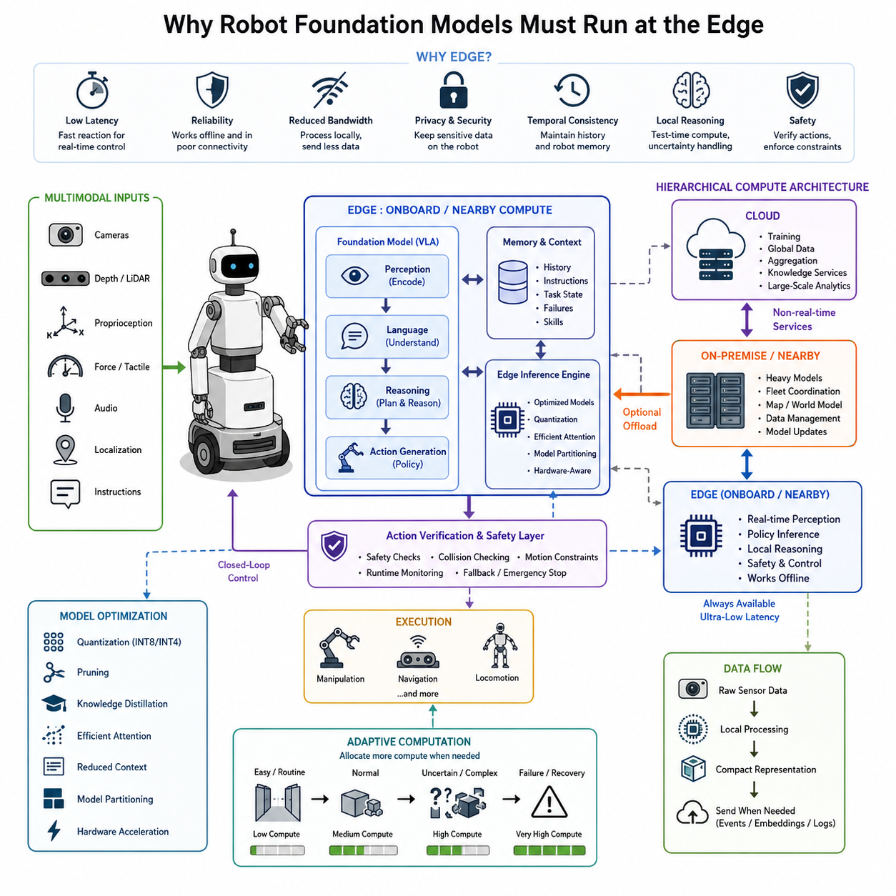{width="7.268055555555556in" height="7.268055555555556in"}

Robot foundation models transform perception, language, reasoning, and learned physical skills into actions that affect the real world. Unlike cloud-oriented AI systems that can tolerate noticeable response delays, robots operate inside continuously changing environments. Their models must therefore execute close to sensors and actuators, making edge deployment a fundamental architectural requirement rather than merely an optimization choice.

A robot continuously receives camera images, depth measurements, proprioceptive signals, force information, localization estimates, and task instructions. These observations may change within milliseconds as people move, objects slip, or the robot changes configuration. Sending every observation to a remote server before deciding what to do introduces communication latency into the perception-action loop and reduces the robot\'s ability to react immediately.

Edge execution shortens this loop by placing inference directly on the robot or on a nearby computing platform. Sensor observations can be encoded, fused, interpreted, and converted into actions without traversing an external network. This is particularly important for Vision-Language-Action models, where multimodal context must ultimately produce physical commands that remain synchronized with the current state of the environment.

Latency is not only a performance metric in robotics; it can influence stability and safety. A delayed digital response may inconvenience a software user, but a delayed physical response can allow a mobile robot to approach an obstacle, a manipulator to continue an unsafe trajectory, or a humanoid to lose balance. Predictable local inference therefore provides an important foundation for responsive closed-loop behavior.

Network connectivity is inherently less reliable than onboard computation. Robots may operate inside factories with wireless interference, warehouses with coverage gaps, underground facilities, remote agricultural environments, disaster zones, or other locations where external communication cannot be guaranteed. A foundation model that depends completely on continuous cloud access can lose essential intelligence precisely when autonomous behavior is most necessary.

Running the core robot model at the edge enables offline autonomy. Perception, task interpretation, local reasoning, action generation, and recovery behaviors can continue during temporary or prolonged communication loss. Connectivity then becomes an enhancement rather than a prerequisite. Cloud or on-premise infrastructure can still provide large-scale services, while the robot retains sufficient local intelligence to perform essential functions independently.

Edge deployment also reduces the bandwidth required by multimodal robot systems. High-resolution cameras, depth sensors, LiDAR, microphones, tactile arrays, and temporal histories can generate large continuous data streams. Transmitting all raw observations to centralized infrastructure is expensive and often unnecessary. Local models can transform these signals into compact semantic representations, events, embeddings, trajectories, or selected records before external communication.

Privacy and data governance provide another strong reason for local execution. Service robots, healthcare systems, industrial robots, and mobile manipulators may observe people, proprietary equipment, production processes, documents, or restricted environments. Processing sensitive observations locally reduces the need to transmit raw data outside the operational site and allows organizations to apply stricter policies concerning storage, retention, access, and external exposure.

Robot foundation models also require temporal consistency. A policy often depends not only on the current image but on previous observations, instructions, actions, failures, and intermediate task states. Maintaining this context locally avoids repeated transfer of large histories and makes persistent robot memory more closely coupled to ongoing control. This becomes increasingly important for long-horizon tasks involving many sequential interactions.

The edge is also the natural location for uncertainty-aware decision making and physical test-time reasoning. A robot may generate several candidate actions, predict their consequences, compare alternatives, or invoke additional computation when uncertainty is high. Such reasoning must operate within a bounded physical decision window. Local compute allows the system to allocate additional inference effort without making every deliberative step dependent on network round trips.

Safety architecture further favors edge intelligence. Foundation-model outputs should normally operate alongside deterministic safety mechanisms, runtime monitors, motion constraints, collision checking, and fallback controllers. Keeping these components near the robot makes it possible to verify proposed actions before execution and rapidly override unsafe behavior. The foundation model can provide general intelligence while lower-level safety mechanisms maintain strict control authority.

Edge deployment does not imply that every component of a large foundation model must always execute entirely onboard. Robot architectures can distribute computation according to urgency, model size, connectivity, and available resources. Fast perception and action generation may remain local, while computationally expensive semantic analysis, fleet learning, model updates, historical analytics, or non-time-critical planning can be assigned to nearby on-premise servers or cloud infrastructure.

This creates a hierarchical compute architecture in which edge, on-premise, and cloud resources serve different temporal scales. The robot handles immediate physical interaction, nearby infrastructure can coordinate fleets or execute heavier models, and cloud systems can support training, global data aggregation, and large-scale knowledge services. The essential principle is that loss or degradation of higher layers should not immediately remove the robot\'s basic ability to perceive and act.

The challenge is that foundation models were originally developed in computing environments with abundant memory, accelerators, cooling, and electrical power. Robots instead impose strict limits on GPU or NPU capacity, memory bandwidth, thermal dissipation, battery consumption, and physical size. Deploying large multimodal models therefore requires systematic optimization rather than simply transferring a server model onto an embedded computer.

Techniques such as quantization, pruning, knowledge distillation, efficient attention, reduced context processing, model partitioning, and adaptive inference make this transition possible. Smaller representations can reduce memory and computational cost, while hardware-aware execution can place different workloads on CPUs, GPUs, NPUs, or dedicated accelerators. These methods seek to preserve the capabilities that matter for physical tasks while fitting inference into a realistic robot compute budget.

Adaptive computation is particularly valuable because robot workloads are not uniformly difficult. Routine navigation through an empty corridor may require only lightweight perception and policy inference, whereas an unfamiliar object, ambiguous instruction, manipulation failure, or uncertain scene may justify substantially more computation. Edge systems can dynamically allocate reasoning effort according to task complexity, uncertainty, and available latency.

The practical objective is therefore not to reproduce data-center-scale intelligence unchanged inside every robot. It is to identify the minimum local intelligence required for safe, responsive, and useful autonomy, then connect that capability to larger computational resources when beneficial. The robot should remain operational under degraded connectivity while exploiting external compute when additional knowledge, coordination, or reasoning provides meaningful value.

Edge deployment ultimately changes robot foundation models from remote AI services into embodied computational systems. Their intelligence becomes tightly coupled with sensors, memory, control, power, timing, and safety mechanisms. For Physical AI, this coupling is essential: intelligence must be available where physical consequences occur, at the timescale at which the world changes, and with sufficient independence to continue acting when external infrastructure is unavailable.

로봇 파운데이션 모델(Robot Foundation Model)은 지각(Perception), 언어(Language), 추론(Reasoning), 학습된 물리적 기술(Physical Skill)을 현실 세계에 영향을 미치는 행동(Action)으로 변환한다. 눈에 띄는 응답 지연을 어느 정도 허용할 수 있는 클라우드 중심 인공지능(Cloud-Oriented AI)과 달리, 로봇은 지속적으로 변화하는 환경에서 동작한다. 따라서 모델은 센서(Sensor)와 액추에이터(Actuator)에 가까운 위치에서 실행되어야 하며, 엣지 배포(Edge Deployment)는 단순한 최적화가 아니라 기본적인 아키텍처 요구사항(Architectural Requirement)이 된다.

로봇은 카메라 영상(Camera Image), 깊이 측정(Depth Measurement), 고유수용성 신호(Proprioceptive Signal), 힘 정보(Force Information), 위치 추정(Localization Estimate), 작업 명령(Task Instruction)을 지속적으로 입력받는다. 사람의 이동, 물체의 미끄러짐, 로봇 자세 변화에 따라 이러한 관측(Observation)은 수 밀리초 내에도 달라질 수 있다. 모든 관측을 원격 서버(Remote Server)로 전송한 뒤 행동을 결정하면 지각-행동 루프(Perception-Action Loop)에 통신 지연이 추가되어 즉각적인 대응 능력이 저하된다.

엣지 실행(Edge Execution)은 추론(Inference)을 로봇 자체 또는 인접한 컴퓨팅 플랫폼(Computing Platform)에 배치하여 이러한 루프를 단축한다. 센서 관측은 외부 네트워크를 거치지 않고 인코딩(Encoding), 융합(Fusion), 해석(Interpretation)되어 행동으로 변환될 수 있다. 이는 다중모달 문맥(Multimodal Context)을 현재 환경 상태와 동기화된 물리적 명령으로 변환해야 하는 비전-언어-행동 모델(Vision-Language-Action Model, VLA)에서 특히 중요하다.

지연시간(Latency)은 로보틱스(Robotics)에서 단순한 성능 지표가 아니라 안정성과 안전성에 영향을 줄 수 있는 요소다. 디지털 시스템의 응답 지연은 사용자에게 불편을 주는 정도에 그칠 수 있지만, 물리적 시스템의 지연은 이동 로봇이 장애물에 계속 접근하거나 매니퓰레이터(Manipulator)가 위험한 궤적을 유지하거나 휴머노이드(Humanoid)가 균형을 잃게 만들 수 있다. 따라서 예측 가능한 로컬 추론(Local Inference)은 반응성 높은 폐루프 동작(Closed-Loop Behavior)의 중요한 기반이다.

네트워크 연결(Network Connectivity)은 본질적으로 온보드 컴퓨팅(Onboard Computing)보다 신뢰성이 낮을 수 있다. 로봇은 무선 간섭이 발생하는 공장, 통신 음영 지역이 존재하는 창고, 지하 시설, 원격 농업 환경, 재난 지역 등 외부 통신을 보장하기 어려운 장소에서 작동할 수 있다. 지속적인 클라우드 접속(Cloud Access)에 완전히 의존하는 파운데이션 모델은 자율 행동(Autonomous Behavior)이 가장 필요한 순간에 핵심 지능을 잃을 위험이 있다.

핵심 로봇 모델(Core Robot Model)을 엣지에서 실행하면 오프라인 자율성(Offline Autonomy)을 확보할 수 있다. 일시적 또는 장기적인 통신 단절 상황에서도 지각, 작업 해석(Task Interpretation), 로컬 추론(Local Reasoning), 행동 생성(Action Generation), 복구 행동(Recovery Behavior)을 지속할 수 있다. 이때 연결성은 필수 조건이 아니라 기능을 확장하는 수단이 되며, 클라우드(Cloud)나 온프레미스(On-Premise) 인프라가 대규모 서비스를 담당하더라도 로봇은 독립적으로 핵심 기능을 수행할 수 있다.

엣지 배포는 다중모달 로봇 시스템(Multimodal Robot System)에 필요한 통신 대역폭(Bandwidth)도 줄인다. 고해상도 카메라, 깊이 센서(Depth Sensor), 라이다(LiDAR), 마이크, 촉각 배열(Tactile Array), 시간적 이력(Temporal History)은 지속적으로 대규모 데이터를 생성할 수 있다. 모든 원시 관측(Raw Observation)을 중앙 인프라로 전송하는 대신 로컬 모델이 이를 압축된 의미 표현(Semantic Representation), 이벤트(Event), 임베딩(Embedding), 궤적(Trajectory), 선별된 기록으로 변환할 수 있다.

개인정보 보호(Privacy)와 데이터 거버넌스(Data Governance)도 로컬 실행이 필요한 중요한 이유다. 서비스 로봇(Service Robot), 의료 시스템(Healthcare System), 산업용 로봇(Industrial Robot), 모바일 매니퓰레이터(Mobile Manipulator)는 사람, 독점 장비, 생산 공정, 문서 또는 제한된 환경을 관측할 수 있다. 민감한 관측 데이터를 로컬에서 처리하면 외부 전송 필요성을 줄이고 저장(Storage), 보존(Retention), 접근(Access), 외부 노출(External Exposure)에 대한 보다 엄격한 정책을 적용할 수 있다.

로봇 파운데이션 모델에는 시간적 일관성(Temporal Consistency)도 필요하다. 정책(Policy)은 현재 영상뿐만 아니라 이전 관측, 명령, 행동, 실패, 중간 작업 상태(Intermediate Task State)에 의존할 수 있다. 이러한 문맥(Context)을 로컬에서 유지하면 대규모 이력을 반복적으로 전송할 필요가 없으며, 지속적인 로봇 메모리(Persistent Robot Memory)를 현재의 제어 과정과 더욱 긴밀하게 결합할 수 있다. 이는 다수의 연속적인 상호작용이 필요한 장기 작업(Long-Horizon Task)에서 더욱 중요하다.

엣지는 불확실성 인식 의사결정(Uncertainty-Aware Decision Making)과 물리적 테스트 타임 추론(Physical Test-Time Reasoning)을 수행하기에도 자연스러운 위치다. 로봇은 여러 후보 행동(Candidate Action)을 생성하고 결과를 예측하며 대안을 비교하거나 불확실성이 높을 때 추가 연산을 수행할 수 있다. 이러한 추론은 제한된 물리적 의사결정 시간 내에서 수행되어야 하므로 로컬 컴퓨팅(Local Computing)을 통해 네트워크 왕복(Network Round Trip)에 의존하지 않고 추가 추론 자원을 배분할 수 있어야 한다.

안전 아키텍처(Safety Architecture) 역시 엣지 지능(Edge Intelligence)의 필요성을 강화한다. 파운데이션 모델의 출력은 일반적으로 결정론적 안전 메커니즘(Deterministic Safety Mechanism), 런타임 모니터(Runtime Monitor), 동작 제약(Motion Constraint), 충돌 검사(Collision Checking), 폴백 제어기(Fallback Controller)와 함께 작동해야 한다. 이러한 요소를 로봇 가까이에 배치하면 실행 전에 제안된 행동을 검증하고 위험한 동작을 신속하게 차단할 수 있다.

엣지 배포가 대규모 파운데이션 모델의 모든 구성 요소를 항상 로봇 내부에서 실행해야 한다는 의미는 아니다. 로봇 아키텍처(Robot Architecture)는 긴급성, 모델 크기, 연결 상태, 사용 가능한 자원에 따라 연산을 분산할 수 있다. 빠른 지각과 행동 생성은 로컬에서 수행하고, 계산량이 큰 의미 분석(Semantic Analysis), 플릿 학습(Fleet Learning), 모델 업데이트(Model Update), 이력 분석(Historical Analytics), 비실시간 계획은 온프레미스 서버나 클라우드 인프라에 할당할 수 있다.

이를 통해 엣지(Edge), 온프레미스(On-Premise), 클라우드(Cloud)가 서로 다른 시간적 규모(Temporal Scale)를 담당하는 계층형 컴퓨팅 아키텍처(Hierarchical Compute Architecture)를 구성할 수 있다. 로봇은 즉각적인 물리적 상호작용을 처리하고, 인접 인프라는 플릿 조정(Fleet Coordination)이나 대규모 모델을 실행하며, 클라우드는 학습(Training), 전역 데이터 집계(Global Data Aggregation), 대규모 지식 서비스를 지원한다. 핵심 원칙은 상위 계층이 중단되더라도 로봇의 기본적인 지각과 행동 능력이 즉시 사라지지 않아야 한다는 것이다.

문제는 파운데이션 모델이 본래 풍부한 메모리(Memory), 가속기(Accelerator), 냉각(Cooling), 전력을 사용할 수 있는 컴퓨팅 환경을 중심으로 발전했다는 점이다. 반면 로봇은 그래픽 처리 장치(GPU)나 신경망 처리 장치(NPU)의 성능, 메모리 대역폭(Memory Bandwidth), 열 방출(Thermal Dissipation), 배터리 소비(Battery Consumption), 물리적 크기에 엄격한 제약을 받는다. 따라서 대규모 다중모달 모델을 배포하려면 서버 모델을 임베디드 컴퓨터(Embedded Computer)에 단순히 옮기는 것이 아니라 체계적인 최적화가 필요하다.

양자화(Quantization), 가지치기(Pruning), 지식 증류(Knowledge Distillation), 효율적 어텐션(Efficient Attention), 문맥 처리 축소(Reduced Context Processing), 모델 분할(Model Partitioning), 적응형 추론(Adaptive Inference) 등의 기술은 이러한 전환을 가능하게 한다. 더 작은 표현은 메모리와 계산 비용을 줄일 수 있으며, 하드웨어 인식 실행(Hardware-Aware Execution)을 통해 서로 다른 워크로드를 CPU, GPU, NPU 또는 전용 가속기(Dedicated Accelerator)에 적절히 배치할 수 있다.

로봇의 작업 난이도는 항상 동일하지 않기 때문에 적응형 연산(Adaptive Computation)은 특히 중요하다. 장애물이 없는 복도에서의 일상적인 주행은 경량 지각과 정책 추론만으로 충분할 수 있지만, 낯선 물체, 모호한 명령, 조작 실패, 불확실한 장면에서는 훨씬 많은 연산이 필요할 수 있다. 엣지 시스템은 작업 복잡도(Task Complexity), 불확실성(Uncertainty), 허용 가능한 지연시간에 따라 추론에 사용하는 계산량을 동적으로 조절할 수 있다.

실질적인 목표는 데이터센터 규모의 지능(Data-Center-Scale Intelligence)을 모든 로봇 내부에 그대로 재현하는 것이 아니다. 안전하고 반응성이 높으며 유용한 자율성(Autonomy)을 보장하기 위해 필요한 최소 로컬 지능(Minimum Local Intelligence)을 식별하고, 필요할 때 더 큰 컴퓨팅 자원과 연결하는 것이다. 로봇은 연결성이 저하된 상황에서도 작동해야 하며, 추가 지식, 협업, 추론이 실질적인 가치를 제공할 때 외부 연산 자원을 활용할 수 있어야 한다.

궁극적으로 엣지 배포는 로봇 파운데이션 모델을 원격 인공지능 서비스(Remote AI Service)에서 체화된 컴퓨팅 시스템(Embodied Computational System)으로 변화시킨다. 로봇의 지능은 센서, 메모리, 제어(Control), 전력(Power), 타이밍(Timing), 안전 메커니즘과 긴밀하게 결합된다. 피지컬 AI(Physical AI)에서 이러한 결합은 필수적이며, 지능은 물리적 결과가 발생하는 위치에서 현실 세계가 변화하는 시간 규모에 맞추어 제공되고 외부 인프라가 사용할 수 없는 상황에서도 행동을 지속할 수 있을 만큼 독립적이어야 한다.

## 10.02. Compute Memory Latency and Power Constraints

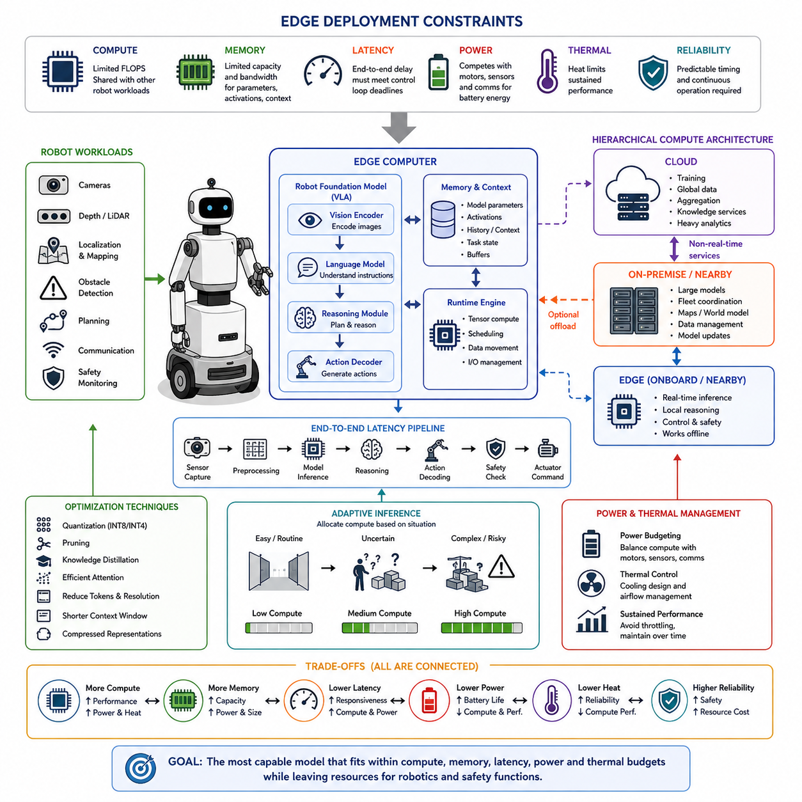{width="7.268055555555556in" height="7.268055555555556in"}

Deploying robot foundation models at the edge requires balancing intelligence against strict physical resource limits. Large Vision-Language-Action models may demand billions of operations, substantial memory, and high-bandwidth data movement, while robots operate with embedded computers constrained by size, weight, power, cooling, and battery capacity. Edge deployment therefore becomes a system-level optimization problem rather than a simple model inference task.

Compute capacity determines how much of a robot foundation model can execute within the required control interval. Vision encoders, language components, multimodal fusion layers, reasoning modules, and action decoders may compete for the same accelerator resources. Increasing model size can improve representation capacity, but it also increases arithmetic operations and execution time, creating tension between model capability and real-time physical responsiveness.

Robot workloads are especially demanding because inference rarely occurs in isolation. The onboard computer may simultaneously process camera streams, depth sensing, localization, mapping, obstacle detection, motion planning, communication, and safety monitoring. Foundation-model inference must coexist with these workloads without starving critical control processes. Effective deployment therefore requires compute budgeting across the entire robotic software stack rather than considering model throughput alone.

Memory capacity is another fundamental constraint. Model parameters, intermediate activations, image features, temporal context, attention states, action histories, and runtime buffers all occupy memory during inference. Multimodal models can require particularly large working sets because visual tokens and historical observations expand the active context. A model that technically fits in storage may still exceed available runtime memory when processing realistic robot observations.

Memory bandwidth can become as important as memory capacity. Modern neural networks repeatedly move parameters, activations, and cached states between memory and compute units. If the processor waits for data, additional arithmetic capability provides limited benefit. Edge accelerators must therefore be evaluated not only by peak operations per second but also by how efficiently they move model data through the memory hierarchy during realistic inference workloads.

Temporal context creates additional memory pressure in robot foundation models. A robot may need previous images, instructions, actions, task states, failures, and interaction history to understand what is happening now. Retaining all previous information indefinitely is impractical. Edge systems must selectively preserve useful context through compact representations, bounded history windows, state summaries, embeddings, or structured memory while discarding redundant information.

Latency defines how quickly observations can influence physical actions. End-to-end latency includes sensor acquisition, preprocessing, model inference, reasoning, action decoding, safety verification, communication between software components, and command delivery to actuators. Optimizing only neural-network inference can therefore be misleading. A robot must satisfy the latency requirement of the complete perception-reasoning-action pipeline under realistic operating conditions.

Different robotic functions also operate at different temporal scales. Low-level motor control may require very fast deterministic updates, while semantic perception and VLA inference can operate more slowly. High-level task planning may tolerate even longer intervals. A practical architecture therefore separates control loops according to their timing requirements instead of forcing one large foundation model to directly execute every function at a single frequency.

Latency variability can be as problematic as average latency. A model that usually responds quickly but occasionally experiences large delays may produce unpredictable robot behavior. Memory contention, thermal throttling, dynamic workloads, cache misses, or concurrent processes can create such timing variations. Robotics therefore requires attention to worst-case behavior, latency distributions, and deadline reliability rather than relying exclusively on average inference benchmarks.

Power consumption introduces another constraint because computation ultimately competes with mobility and actuation for limited energy. GPUs, NPUs, CPUs, cameras, LiDAR, communication systems, motors, and auxiliary electronics may all draw from the same battery. Increasing inference performance by operating accelerators at maximum power can shorten mission duration, increase battery requirements, and reduce the energy available for physical work.

The relationship between compute and power is especially important for mobile robots. A stationary server can draw substantial electrical power and rely on large cooling systems, but an autonomous robot must carry its energy source and thermal solution. Every increase in compute power can affect battery mass, enclosure design, cooling requirements, operating time, and payload capacity. AI architecture and mechanical architecture therefore become tightly interconnected.

Thermal constraints further limit sustained model performance. High computational loads generate heat that must be removed from compact enclosures that may operate in factories, outdoors, or poorly ventilated environments. When cooling capacity is insufficient, processors may reduce clock frequency through thermal throttling. A model that achieves excellent short-duration benchmark performance may consequently fail to maintain the same throughput during long autonomous missions.

This makes sustained performance more meaningful than peak performance for many robot applications. Deployment evaluation should examine whether the computing platform can maintain required inference rates while perception, planning, and control workloads operate concurrently over extended periods. Power draw, temperature, clock behavior, memory utilization, and latency should therefore be measured together rather than treated as independent specifications.

Model optimization provides several mechanisms for reducing these resource demands. Quantization lowers numerical precision and can reduce parameter storage, memory traffic, and computational cost. Pruning removes unnecessary model components, while knowledge distillation transfers useful behavior into smaller models. Efficient attention, reduced token counts, compressed visual representations, and shorter context windows can further reduce memory and compute requirements.

Optimization must nevertheless preserve task-relevant capability. Excessive compression may reduce visual understanding, language grounding, spatial reasoning, manipulation accuracy, or robustness to unfamiliar situations. Robot foundation models therefore require task-aware optimization in which resource savings are evaluated against physical performance. The smallest model is not necessarily the best model if compression causes failures that increase retries, recovery actions, or safety interventions.

Adaptive inference offers a more flexible approach than applying the same computational budget to every situation. Routine observations may be processed with smaller models, fewer tokens, reduced resolution, or early exits, while uncertain or difficult situations trigger additional layers, higher-resolution perception, larger models, or more reasoning iterations. Compute becomes a dynamically allocated resource that responds to the complexity of the physical environment.

Heterogeneous computing can further improve efficiency by assigning workloads to specialized processors. CPUs may handle orchestration and deterministic logic, GPUs can accelerate large tensor operations, and NPUs or dedicated accelerators may execute optimized neural-network components at lower power. Effective scheduling across these processors can increase throughput while preventing a single compute device from becoming a bottleneck for the entire robotic system.

The key deployment problem is therefore multi-dimensional. Compute capacity, memory capacity, memory bandwidth, latency, power, and thermal behavior cannot be optimized independently because improvements in one dimension often create costs in another. Increasing model size consumes more memory and compute; increasing accelerator frequency raises power and heat; reducing precision saves resources but may affect model quality. Edge design requires explicit tradeoffs among these competing objectives.

A practical robot foundation model should ultimately be designed around a deployment budget that reflects the physical system in which it operates. Model capability must fit within available compute, memory, latency, energy, and thermal envelopes while leaving sufficient resources for conventional robotics and safety functions. Successful edge intelligence is therefore not defined by the largest model a robot can execute, but by the most capable model it can execute reliably, continuously, and safely.

로봇 파운데이션 모델(Robot Foundation Model)을 엣지(Edge)에 배포하려면 지능의 성능과 엄격한 물리적 자원 한계 사이에서 균형을 맞춰야 한다. 대규모 비전-언어-행동 모델(Vision-Language-Action Model, VLA)은 수십억 회의 연산, 상당한 메모리(Memory), 높은 대역폭의 데이터 이동을 요구할 수 있지만, 로봇은 크기, 무게, 전력, 냉각, 배터리 용량이 제한된 임베디드 컴퓨터(Embedded Computer)에서 동작한다. 따라서 엣지 배포(Edge Deployment)는 단순한 모델 추론 문제가 아니라 시스템 수준 최적화(System-Level Optimization) 문제가 된다.

연산 능력(Compute Capacity)은 로봇 파운데이션 모델의 어느 정도를 요구되는 제어 주기(Control Interval) 안에서 실행할 수 있는지를 결정한다. 비전 인코더(Vision Encoder), 언어 구성 요소(Language Component), 다중모달 융합 계층(Multimodal Fusion Layer), 추론 모듈(Reasoning Module), 행동 디코더(Action Decoder)는 동일한 가속기 자원을 두고 경쟁할 수 있다. 모델 크기를 증가시키면 표현 능력은 향상될 수 있지만 연산량과 실행시간도 증가하여 모델 능력과 실시간 물리적 반응성 사이에 긴장 관계가 발생한다.

로봇의 워크로드(Workload)는 모델 추론이 단독으로 실행되는 경우가 드물기 때문에 특히 까다롭다. 온보드 컴퓨터(Onboard Computer)는 카메라 스트림, 깊이 센싱(Depth Sensing), 위치 추정(Localization), 매핑(Mapping), 장애물 탐지(Obstacle Detection), 동작 계획(Motion Planning), 통신, 안전 모니터링(Safety Monitoring)을 동시에 처리할 수 있다. 따라서 파운데이션 모델 추론은 중요한 제어 프로세스의 자원을 고갈시키지 않으면서 이러한 작업들과 공존해야 하며, 전체 로봇 소프트웨어 스택(Robotic Software Stack)에 대한 연산 예산(Compute Budgeting)이 필요하다.

메모리 용량(Memory Capacity)도 기본적인 제약 조건이다. 모델 파라미터(Model Parameter), 중간 활성값(Intermediate Activation), 이미지 특징(Image Feature), 시간적 문맥(Temporal Context), 어텐션 상태(Attention State), 행동 이력(Action History), 런타임 버퍼(Runtime Buffer)는 모두 추론 과정에서 메모리를 사용한다. 다중모달 모델(Multimodal Model)은 시각 토큰(Visual Token)과 과거 관측이 활성 문맥을 확대하기 때문에 특히 큰 작업 메모리(Working Set)를 요구할 수 있다. 저장 공간에는 들어가는 모델이라도 실제 로봇 관측을 처리할 때 런타임 메모리를 초과할 수 있다.

메모리 대역폭(Memory Bandwidth)은 메모리 용량만큼 중요한 제약이 될 수 있다. 현대 신경망은 파라미터, 활성값, 캐시 상태(Cached State)를 메모리와 연산 장치 사이에서 반복적으로 이동시킨다. 프로세서가 데이터를 기다려야 한다면 추가적인 산술 연산 능력은 제한적인 효과만 제공한다. 따라서 엣지 가속기(Edge Accelerator)는 초당 최대 연산량뿐 아니라 실제 추론 워크로드에서 모델 데이터를 메모리 계층(Memory Hierarchy)을 통해 얼마나 효율적으로 이동시키는지를 함께 평가해야 한다.

시간적 문맥(Temporal Context)은 로봇 파운데이션 모델의 메모리 부담을 더욱 증가시킨다. 로봇은 현재 상황을 이해하기 위해 이전 이미지, 명령, 행동, 작업 상태, 실패, 상호작용 이력(Interaction History)을 필요로 할 수 있다. 모든 과거 정보를 무기한 보존하는 것은 현실적이지 않다. 따라서 엣지 시스템은 압축된 표현(Compact Representation), 제한된 이력 윈도(Bounded History Window), 상태 요약(State Summary), 임베딩(Embedding), 구조화된 메모리(Structured Memory)를 활용해 유용한 문맥만 선택적으로 유지하고 중복 정보는 제거해야 한다.

지연시간(Latency)은 관측이 얼마나 빠르게 물리적 행동에 영향을 미칠 수 있는지를 결정한다. 종단간 지연시간(End-to-End Latency)은 센서 데이터 획득, 전처리(Preprocessing), 모델 추론, 추론 과정, 행동 디코딩(Action Decoding), 안전 검증(Safety Verification), 소프트웨어 구성 요소 간 통신, 액추에이터(Actuator)로의 명령 전달을 모두 포함한다. 따라서 신경망 추론만 최적화하는 것은 실제 성능을 잘못 평가할 수 있으며, 전체 지각-추론-행동 파이프라인(Perception-Reasoning-Action Pipeline)의 지연 요구사항을 만족해야 한다.

로봇의 서로 다른 기능은 서로 다른 시간 규모(Temporal Scale)에서 동작한다. 저수준 모터 제어(Low-Level Motor Control)는 매우 빠르고 결정론적인 업데이트를 요구할 수 있지만, 의미적 지각(Semantic Perception)과 VLA 추론은 상대적으로 느린 주기로 실행될 수 있다. 고수준 작업 계획(High-Level Task Planning)은 더 긴 처리 시간을 허용할 수 있다. 따라서 하나의 대규모 파운데이션 모델이 모든 기능을 동일한 주기로 직접 실행하도록 하기보다 각 제어 루프(Control Loop)를 시간 요구사항에 따라 분리하는 것이 현실적이다.

지연시간의 변동성(Latency Variability)은 평균 지연시간만큼 문제가 될 수 있다. 대부분 빠르게 응답하지만 간헐적으로 큰 지연이 발생하는 모델은 예측하기 어려운 로봇 동작을 만들 수 있다. 메모리 경합(Memory Contention), 열 스로틀링(Thermal Throttling), 동적 워크로드(Dynamic Workload), 캐시 미스(Cache Miss), 동시 실행 프로세스 등이 이러한 시간 변동을 유발할 수 있다. 따라서 로보틱스에서는 평균 추론 벤치마크뿐 아니라 최악 조건의 동작(Worst-Case Behavior), 지연시간 분포(Latency Distribution), 데드라인 신뢰성(Deadline Reliability)을 고려해야 한다.

전력 소비(Power Consumption)는 연산이 궁극적으로 제한된 에너지를 이동성과 구동에 필요한 에너지와 공유하기 때문에 또 다른 중요한 제약이 된다. GPU, NPU, CPU, 카메라, 라이다(LiDAR), 통신 시스템, 모터, 보조 전자장치는 모두 동일한 배터리에서 전력을 공급받을 수 있다. 가속기를 최대 전력으로 동작시켜 추론 성능을 높이면 임무 지속시간(Mission Duration)이 단축되고 배터리 요구량이 증가하며 실제 물리적 작업에 사용할 수 있는 에너지가 감소할 수 있다.

연산과 전력의 관계는 모바일 로봇(Mobile Robot)에서 특히 중요하다. 고정형 서버는 상당한 전력을 사용하면서 대규모 냉각 시스템에 의존할 수 있지만, 자율 로봇(Autonomous Robot)은 에너지원과 열 관리 장치를 직접 운반해야 한다. 연산 전력의 증가는 배터리 질량, 인클로저 설계(Enclosure Design), 냉각 요구사항, 작동시간, 탑재 능력(Payload Capacity)에 영향을 줄 수 있다. 따라서 인공지능 아키텍처(AI Architecture)와 기계 아키텍처(Mechanical Architecture)는 긴밀하게 연결된다.

열 제약(Thermal Constraint)은 지속적인 모델 성능을 추가로 제한한다. 높은 연산 부하는 열을 발생시키며, 이 열은 공장, 실외 또는 환기가 충분하지 않은 환경에서 작동할 수 있는 소형 인클로저에서 제거되어야 한다. 냉각 능력이 부족하면 프로세서는 열 스로틀링(Thermal Throttling)을 통해 클럭 주파수(Clock Frequency)를 낮출 수 있다. 따라서 단기간 벤치마크에서 뛰어난 성능을 보인 모델이라도 장시간 자율 임무에서는 동일한 처리량을 유지하지 못할 수 있다.

이러한 이유로 많은 로봇 응용에서는 최고 성능(Peak Performance)보다 지속 성능(Sustained Performance)이 더욱 의미가 있다. 배포 평가는 지각, 계획, 제어 워크로드가 장시간 동시에 동작하는 동안 컴퓨팅 플랫폼이 필요한 추론 속도를 유지할 수 있는지를 확인해야 한다. 따라서 전력 소비, 온도, 클럭 동작, 메모리 사용량, 지연시간을 서로 독립적인 사양으로 취급하지 말고 함께 측정해야 한다.

모델 최적화(Model Optimization)는 이러한 자원 요구를 감소시키는 여러 방법을 제공한다. 양자화(Quantization)는 수치 정밀도를 낮춰 파라미터 저장 공간, 메모리 트래픽(Memory Traffic), 연산 비용을 줄일 수 있다. 가지치기(Pruning)는 불필요한 모델 구성 요소를 제거하고, 지식 증류(Knowledge Distillation)는 유용한 동작을 더 작은 모델로 전달한다. 효율적 어텐션(Efficient Attention), 토큰 수 감소, 압축된 시각 표현(Compressed Visual Representation), 짧은 문맥 윈도(Context Window)도 메모리와 연산 요구량을 줄일 수 있다.

그러나 최적화는 작업에 필요한 능력(Task-Relevant Capability)을 보존해야 한다. 지나친 압축은 시각적 이해(Visual Understanding), 언어 그라운딩(Language Grounding), 공간 추론(Spatial Reasoning), 조작 정확도(Manipulation Accuracy), 익숙하지 않은 상황에 대한 강건성(Robustness)을 저하시킬 수 있다. 따라서 로봇 파운데이션 모델에는 자원 절감 효과와 물리적 작업 성능을 함께 평가하는 작업 인식 최적화(Task-Aware Optimization)가 필요하다. 압축으로 실패, 재시도, 복구 행동, 안전 개입이 증가한다면 가장 작은 모델이 반드시 최상의 모델인 것은 아니다.

적응형 추론(Adaptive Inference)은 모든 상황에 동일한 연산 예산을 적용하는 것보다 유연한 접근법을 제공한다. 일상적인 관측은 더 작은 모델, 적은 토큰, 낮은 해상도 또는 조기 종료(Early Exit)를 사용해 처리할 수 있고, 불확실하거나 어려운 상황에서는 추가 계층, 고해상도 지각, 더 큰 모델 또는 더 많은 추론 반복을 활성화할 수 있다. 이를 통해 연산 자원은 물리적 환경의 복잡도에 따라 동적으로 할당되는 자원이 된다.

이기종 컴퓨팅(Heterogeneous Computing)은 워크로드를 전문화된 프로세서에 할당하여 효율성을 더욱 높일 수 있다. CPU는 오케스트레이션(Orchestration)과 결정론적 로직(Deterministic Logic)을 처리하고, GPU는 대규모 텐서 연산(Tensor Operation)을 가속하며, NPU 또는 전용 가속기는 최적화된 신경망 구성 요소를 낮은 전력으로 실행할 수 있다. 이러한 프로세서 사이에서 효과적인 스케줄링(Scheduling)을 수행하면 특정 연산 장치가 전체 로봇 시스템의 병목(Bottleneck)이 되는 것을 방지하면서 처리량을 높일 수 있다.

따라서 핵심 배포 문제는 다차원적(Multi-Dimensional)이다. 연산 능력, 메모리 용량, 메모리 대역폭, 지연시간, 전력, 열 특성은 한 요소의 개선이 다른 요소에 비용을 발생시키기 때문에 서로 독립적으로 최적화할 수 없다. 모델 크기를 늘리면 메모리와 연산량이 증가하고, 가속기 주파수를 높이면 전력 소비와 발열이 증가하며, 정밀도를 낮추면 자원을 절약할 수 있지만 모델 품질에 영향을 줄 수 있다. 따라서 엣지 설계에는 이러한 상충 관계(Tradeoff)를 명시적으로 고려해야 한다.

실용적인 로봇 파운데이션 모델은 궁극적으로 실제 물리 시스템을 반영하는 배포 예산(Deployment Budget)을 중심으로 설계되어야 한다. 모델 능력은 사용 가능한 연산, 메모리, 지연시간, 에너지, 열 한계 범위 안에 들어와야 하며 기존 로보틱스 기능과 안전 기능을 위한 충분한 자원도 남겨야 한다. 성공적인 엣지 지능(Edge Intelligence)은 로봇이 실행할 수 있는 가장 큰 모델이 아니라, 로봇이 신뢰성 있게 지속적으로 그리고 안전하게 실행할 수 있는 가장 높은 능력의 모델로 정의되어야 한다.

## 10.03. Model Profiling and Deployment Budgeting

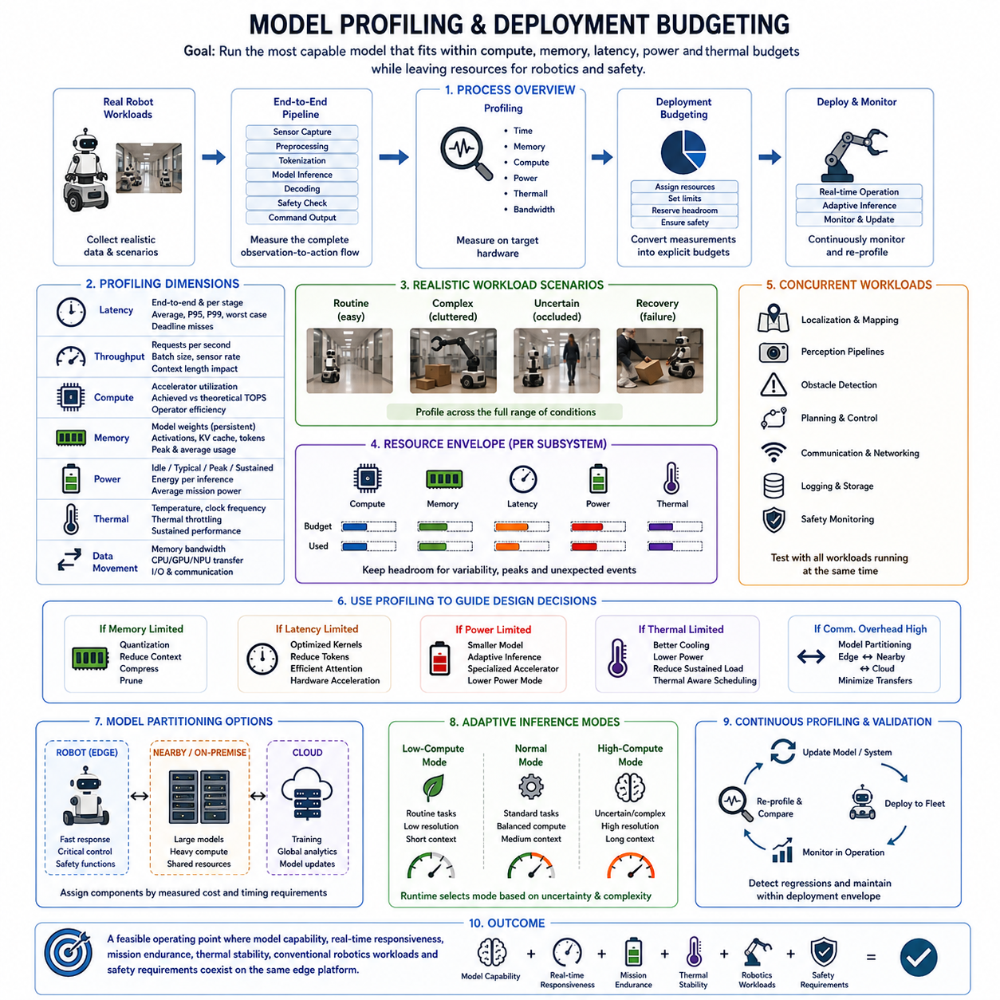{width="7.268055555555556in" height="7.268055555555556in"}

Profiling is the process of measuring how a robot foundation model actually behaves on its target hardware before deployment. Parameter count alone cannot predict whether a Vision-Language-Action model will operate effectively on a robot. Engineers must measure execution time, memory consumption, accelerator utilization, data movement, power draw, and thermal behavior using realistic observations and workloads representative of physical operation.

A deployment budget converts robot-level requirements into explicit computational limits. Instead of asking whether a model can technically run on an edge device, the design process asks how much compute, memory, latency, power, and thermal capacity can safely be assigned to it. The remaining resources must support perception pipelines, localization, mapping, communication, conventional control, operating-system services, and safety-critical functions.

Profiling should begin with the complete inference pipeline rather than an isolated neural network. Camera acquisition, image preprocessing, tokenization, multimodal encoding, context preparation, model execution, action decoding, safety validation, and command generation all consume time and resources. Measuring only the core model can underestimate end-to-end latency and hide bottlenecks that appear when the entire robot software stack operates concurrently.

Model-level profiling identifies where computational cost is concentrated. Vision encoders may dominate processing for high-resolution observations, while transformer layers can consume substantial compute and memory during multimodal reasoning. Action decoders may be relatively small but still require predictable execution timing. Layer-by-layer measurements help reveal which components should be quantized, compressed, accelerated, cached, partitioned, or redesigned for edge execution.

Memory profiling must distinguish several forms of consumption. Model weights occupy persistent device memory, while activations, temporary tensors, attention states, KV caches, image tokens, context histories, and runtime workspaces create additional dynamic demand. Peak memory is particularly important because temporary allocations during one processing stage can exceed the average usage and cause allocation failures even when the nominal model size appears acceptable.

Context length should be treated as a deployment variable rather than only a modeling choice. Robot foundation models may accumulate images, language instructions, previous actions, task states, and interaction histories over time. Longer context can improve temporal understanding but increases memory use and attention computation. Profiling different context configurations helps determine how much historical information can be retained within the available deployment envelope.

Latency profiling should measure both typical and worst-case behavior. Average inference time can conceal occasional stalls caused by memory pressure, asynchronous sensor processing, operating-system scheduling, thermal throttling, or competing workloads. Physical systems require predictable response times, so useful measurements include latency distributions, high-percentile latency, deadline misses, and the time required for the complete observation-to-action cycle.

Throughput and latency must also be distinguished. A system may process many observations per second when requests are batched, yet still respond too slowly to an individual robot observation. Server-oriented optimization often emphasizes throughput, whereas physical control frequently depends on low single-request latency. Robot deployment profiling should therefore reproduce the batch sizes, sensor frequencies, context lengths, and execution patterns expected during real operation.

Compute profiling should examine actual accelerator utilization instead of relying only on theoretical TOPS or FLOPS. Some model operations may efficiently saturate a GPU or NPU, while others remain limited by memory bandwidth, synchronization, unsupported operators, or CPU preprocessing. Hardware specifications provide an upper bound, but profiling reveals how much of that theoretical capability the deployed model can actually use.

Power profiling connects AI execution directly to mission endurance. Measurements should capture idle power, normal inference consumption, short computational peaks, and sustained high-load operation. The foundation model shares battery energy with sensors, communication devices, actuators, cooling systems, and other electronics. A deployment budget must therefore consider energy per inference and average mission power rather than accelerator power in isolation.

Thermal profiling determines whether performance can be sustained over time. Edge hardware may initially execute a model at the desired rate but gradually reduce frequency as temperature rises. Long-duration tests can reveal thermal throttling that short benchmarks miss. Profiling should consequently track temperature, clock frequency, power consumption, and inference latency together until the system reaches a representative steady operating condition.

Realistic workload scenarios are essential because resource consumption changes with task complexity. Navigation through a simple environment may produce different visual token counts and reasoning demands from cluttered manipulation or failure recovery. Profiling should include routine, complex, uncertain, and recovery situations so that the deployment budget reflects the range of conditions the robot is expected to encounter rather than one favorable benchmark.

Concurrent workload profiling is equally important. During real operation, foundation-model inference competes with localization, mapping, obstacle detection, video processing, logging, networking, and safety monitoring. A model that meets its latency target when tested alone may fail when these processes execute simultaneously. Deployment qualification should therefore reproduce realistic resource contention across CPU, GPU, NPU, memory, storage, and communication interfaces.

The profiling results can be converted into a resource envelope for each major subsystem. The foundation model receives a defined share of accelerator time, device memory, system memory, power, and latency, while critical robotics functions receive protected capacity. Reserving headroom prevents normal fluctuations from exhausting the platform and provides capacity for transient workloads, recovery behaviors, software updates, or unexpected environmental complexity.

Deployment budgeting should include safety margins rather than targeting one hundred percent resource utilization. Running continuously near maximum memory, compute, power, or thermal limits leaves little tolerance for workload variation. Practical systems maintain reserve capacity so that occasional increases in perception complexity or reasoning demand do not immediately produce missed deadlines, out-of-memory failures, overheating, or degraded control performance.

Profiling also provides the evidence needed to choose optimization techniques. If memory capacity is the primary bottleneck, quantization or reduced context may be most valuable. If inference latency dominates, optimized kernels, reduced tokens, efficient attention, or hardware acceleration may help. If sustained power is excessive, smaller models, adaptive inference, or specialized accelerators may provide better results than simply increasing compute performance.

Deployment budgeting can also guide model partitioning. Components requiring immediate physical response should remain on the robot, while larger or less time-sensitive workloads may execute on nearby on-premise infrastructure. Profiling quantifies the cost of each partition and exposes communication overhead. This allows edge, nearby compute, and cloud resources to be assigned according to measured timing requirements instead of architectural assumptions.

Adaptive inference requires multiple deployment budgets rather than one fixed operating point. A robot may use a low-compute mode for routine situations, a normal mode for standard tasks, and a higher-compute mode when uncertainty or task complexity increases. Profiling each mode establishes its latency, memory, energy, and thermal cost, allowing a runtime controller to select additional computation without violating physical operating constraints.

Model profiling should continue after initial deployment because software and operating conditions evolve. New model versions, sensor configurations, drivers, inference runtimes, context policies, or background services can change resource behavior. Maintaining repeatable profiling tests makes it possible to detect performance regressions and verify that an updated robot foundation model still satisfies the original deployment envelope before fleet-wide release.

Ultimately, profiling and deployment budgeting connect model intelligence to physical engineering constraints. Profiling reveals what the model actually consumes, while budgeting defines what the robot can reliably provide. Their intersection determines a feasible operating point where model capability, real-time responsiveness, mission endurance, thermal stability, conventional robotics workloads, and safety requirements can coexist on the same edge platform.

프로파일링(Profiling)은 배포 전에 로봇 파운데이션 모델(Robot Foundation Model)이 목표 하드웨어(Target Hardware)에서 실제로 어떻게 동작하는지를 측정하는 과정이다. 파라미터 수(Parameter Count)만으로는 비전-언어-행동 모델(Vision-Language-Action Model, VLA)이 로봇에서 효과적으로 동작할 수 있는지 판단할 수 없다. 엔지니어는 실제 물리적 운용을 대표하는 관측과 워크로드(Workload)를 사용하여 실행시간, 메모리 소비, 가속기 활용률, 데이터 이동, 전력 소비, 열 특성을 측정해야 한다.

배포 예산(Deployment Budget)은 로봇 수준의 요구사항을 명확한 컴퓨팅 자원 한계로 변환한다. 단순히 모델이 엣지 장치(Edge Device)에서 기술적으로 실행 가능한지를 묻는 것이 아니라, 연산, 메모리, 지연시간, 전력, 열 용량 중 얼마를 모델에 안전하게 할당할 수 있는지를 판단한다. 나머지 자원은 지각 파이프라인(Perception Pipeline), 위치 추정(Localization), 매핑(Mapping), 통신, 기존 제어, 운영체제 서비스, 안전 필수 기능(Safety-Critical Function)을 지원해야 한다.

프로파일링은 개별 신경망(Neural Network)이 아니라 전체 추론 파이프라인(Inference Pipeline)에서 시작해야 한다. 카메라 데이터 획득, 이미지 전처리(Preprocessing), 토큰화(Tokenization), 다중모달 인코딩(Multimodal Encoding), 문맥 준비(Context Preparation), 모델 실행, 행동 디코딩(Action Decoding), 안전 검증(Safety Validation), 명령 생성은 모두 시간과 자원을 소비한다. 핵심 모델만 측정하면 종단간 지연시간(End-to-End Latency)을 과소평가하고 전체 로봇 소프트웨어 스택이 동시에 실행될 때 나타나는 병목을 놓칠 수 있다.

모델 수준 프로파일링(Model-Level Profiling)은 계산 비용이 어디에 집중되는지를 식별한다. 고해상도 관측에서는 비전 인코더(Vision Encoder)가 처리 비용의 상당 부분을 차지할 수 있으며, 트랜스포머 계층(Transformer Layer)은 다중모달 추론 과정에서 많은 연산과 메모리를 소비할 수 있다. 행동 디코더(Action Decoder)는 상대적으로 작더라도 예측 가능한 실행시간이 필요하다. 계층별 측정을 통해 양자화, 압축, 가속, 캐싱(Caching), 분할 또는 재설계가 필요한 구성 요소를 파악할 수 있다.

메모리 프로파일링(Memory Profiling)은 여러 형태의 메모리 소비를 구분해야 한다. 모델 가중치(Model Weight)는 지속적으로 장치 메모리를 차지하지만, 활성값(Activation), 임시 텐서(Temporary Tensor), 어텐션 상태(Attention State), KV 캐시(KV Cache), 이미지 토큰(Image Token), 문맥 이력(Context History), 런타임 작업 공간(Runtime Workspace)은 추가적인 동적 메모리를 요구한다. 특히 최대 메모리 사용량(Peak Memory Usage)은 일시적 할당량이 평균 사용량을 초과하여 모델의 명목상 크기가 허용 범위에 있어도 할당 실패를 일으킬 수 있기 때문에 중요하다.

문맥 길이(Context Length)는 단순한 모델링 선택이 아니라 배포 변수(Deployment Variable)로 취급해야 한다. 로봇 파운데이션 모델은 시간이 지남에 따라 이미지, 언어 명령, 이전 행동, 작업 상태, 상호작용 이력을 축적할 수 있다. 긴 문맥은 시간적 이해(Temporal Understanding)를 향상시킬 수 있지만 메모리 사용량과 어텐션 연산을 증가시킨다. 서로 다른 문맥 구성을 프로파일링하면 사용 가능한 배포 한계(Deployment Envelope) 안에서 얼마나 많은 과거 정보를 유지할 수 있는지 결정할 수 있다.

지연시간 프로파일링(Latency Profiling)은 일반적인 상황과 최악 조건의 동작을 모두 측정해야 한다. 평균 추론시간은 메모리 압박, 비동기 센서 처리, 운영체제 스케줄링(Operating-System Scheduling), 열 스로틀링(Thermal Throttling), 경쟁 워크로드 때문에 발생하는 간헐적인 지연을 숨길 수 있다. 물리적 시스템은 예측 가능한 응답시간을 요구하므로 지연시간 분포(Latency Distribution), 상위 백분위 지연시간(High-Percentile Latency), 데드라인 미준수(Deadline Miss), 전체 관측-행동 주기(Observation-to-Action Cycle)에 필요한 시간을 함께 측정해야 한다.

처리량(Throughput)과 지연시간(Latency)도 구분해야 한다. 요청을 배치 처리(Batching)할 때 초당 많은 관측을 처리할 수 있는 시스템이라도 개별 로봇 관측에 대한 응답은 지나치게 느릴 수 있다. 서버 중심 최적화(Server-Oriented Optimization)는 일반적으로 처리량을 강조하지만 물리적 제어는 낮은 단일 요청 지연시간(Single-Request Latency)에 의존하는 경우가 많다. 따라서 로봇 배포 프로파일링은 실제 운용에서 예상되는 배치 크기, 센서 주파수, 문맥 길이, 실행 패턴을 재현해야 한다.

연산 프로파일링(Compute Profiling)은 이론적인 TOPS 또는 FLOPS에만 의존하지 않고 실제 가속기 활용률(Accelerator Utilization)을 조사해야 한다. 일부 모델 연산은 GPU나 NPU를 효율적으로 활용하지만, 다른 연산은 메모리 대역폭(Memory Bandwidth), 동기화(Synchronization), 지원되지 않는 연산자(Unsupported Operator), CPU 전처리 등에 의해 제한될 수 있다. 하드웨어 사양은 성능의 이론적 상한을 제공하지만 프로파일링은 배포된 모델이 그 성능을 실제로 얼마나 활용하는지를 보여준다.

전력 프로파일링(Power Profiling)은 인공지능 실행을 임무 지속시간(Mission Endurance)과 직접 연결한다. 측정에는 유휴 전력(Idle Power), 일반적인 추론 소비전력, 단기 연산 피크(Computational Peak), 지속적인 고부하 동작이 포함되어야 한다. 파운데이션 모델은 센서, 통신 장치, 액추에이터(Actuator), 냉각 시스템, 기타 전자장치와 배터리 에너지를 공유한다. 따라서 배포 예산은 가속기의 전력만이 아니라 추론당 에너지(Energy per Inference)와 평균 임무 전력(Average Mission Power)을 고려해야 한다.

열 프로파일링(Thermal Profiling)은 성능을 장시간 지속할 수 있는지를 결정한다. 엣지 하드웨어는 처음에는 원하는 속도로 모델을 실행할 수 있지만 온도가 상승하면 점차 동작 주파수를 낮출 수 있다. 장시간 테스트(Long-Duration Test)는 짧은 벤치마크가 발견하지 못하는 열 스로틀링을 확인할 수 있다. 따라서 시스템이 실제 운용을 대표하는 정상 상태(Steady Operating Condition)에 도달할 때까지 온도, 클럭 주파수, 전력 소비, 추론 지연시간을 함께 추적해야 한다.

현실적인 워크로드 시나리오(Workload Scenario)는 작업 복잡도에 따라 자원 소비가 달라지기 때문에 필수적이다. 단순한 환경에서의 주행은 복잡한 물체가 존재하는 조작 작업이나 실패 복구(Failure Recovery)와 비교하여 서로 다른 시각 토큰 수와 추론 요구량을 발생시킬 수 있다. 따라서 프로파일링에는 일상적, 복잡한, 불확실한, 복구 상황을 포함하여 유리한 단일 벤치마크가 아니라 로봇이 실제로 경험할 수 있는 다양한 조건을 배포 예산에 반영해야 한다.

동시 워크로드 프로파일링(Concurrent Workload Profiling)도 마찬가지로 중요하다. 실제 운용 중 파운데이션 모델 추론은 위치 추정, 매핑, 장애물 탐지, 영상 처리, 로깅(Logging), 네트워킹(Networking), 안전 모니터링과 자원을 공유한다. 단독 테스트에서 지연시간 목표를 만족하는 모델도 이러한 프로세스가 동시에 실행되면 실패할 수 있다. 따라서 배포 검증(Deployment Qualification)은 CPU, GPU, NPU, 메모리, 저장장치, 통신 인터페이스에서 실제적인 자원 경합(Resource Contention)을 재현해야 한다.

프로파일링 결과는 주요 하위 시스템별 자원 한계(Resource Envelope)로 변환할 수 있다. 파운데이션 모델에는 가속기 시간, 장치 메모리, 시스템 메모리, 전력, 지연시간의 명확한 할당량을 부여하고 중요한 로보틱스 기능에는 보호된 용량을 확보한다. 여유 자원(Headroom)을 확보하면 일반적인 변동이 플랫폼 자원을 고갈시키는 것을 방지하고 일시적인 워크로드, 복구 행동, 소프트웨어 업데이트, 예상하지 못한 환경 복잡성에 대응할 수 있다.

배포 예산에는 자원 활용률을 100퍼센트까지 사용하는 대신 안전 여유(Safety Margin)를 포함해야 한다. 최대 메모리, 연산, 전력 또는 열 한계에 지속적으로 가까운 상태로 운용하면 워크로드 변화에 대응할 여지가 거의 없다. 실용적인 시스템은 지각 복잡도나 추론 요구량이 일시적으로 증가하더라도 즉시 데드라인 미준수, 메모리 부족(Out-of-Memory), 과열 또는 제어 성능 저하가 발생하지 않도록 예비 용량(Reserve Capacity)을 유지한다.

프로파일링은 어떤 최적화 기법(Optimization Technique)을 선택할 것인지 결정하는 근거도 제공한다. 메모리 용량이 주요 병목이라면 양자화(Quantization)나 문맥 축소가 효과적일 수 있다. 추론 지연시간이 문제라면 최적화된 커널(Optimized Kernel), 토큰 감소, 효율적 어텐션(Efficient Attention), 하드웨어 가속(Hardware Acceleration)이 도움이 될 수 있다. 지속 전력이 지나치게 높다면 단순히 연산 성능을 높이는 것보다 소형 모델, 적응형 추론(Adaptive Inference), 전용 가속기를 사용하는 것이 더 효과적일 수 있다.

배포 예산은 모델 분할(Model Partitioning)을 결정하는 데에도 활용할 수 있다. 즉각적인 물리적 반응이 필요한 구성 요소는 로봇 내부에 유지하고, 규모가 크거나 시간 민감도가 낮은 워크로드는 인접한 온프레미스 인프라(On-Premise Infrastructure)에서 실행할 수 있다. 프로파일링은 각 분할 방식의 비용과 통신 오버헤드(Communication Overhead)를 정량화한다. 이를 통해 가정이 아니라 측정된 시간 요구사항에 따라 엣지, 인접 컴퓨팅, 클라우드 자원을 배치할 수 있다.

적응형 추론(Adaptive Inference)에는 하나의 고정된 운용점이 아니라 여러 개의 배포 예산이 필요하다. 로봇은 일상적인 상황에서는 저연산 모드(Low-Compute Mode), 일반 작업에서는 표준 모드(Normal Mode), 불확실성이나 작업 복잡도가 증가하면 고연산 모드(High-Compute Mode)를 사용할 수 있다. 각 모드의 지연시간, 메모리, 에너지, 열 비용을 프로파일링하면 런타임 제어기(Runtime Controller)가 물리적 운용 제약을 위반하지 않으면서 필요한 추가 연산을 선택할 수 있다.

소프트웨어와 운용 조건은 지속적으로 변화하기 때문에 모델 프로파일링은 최초 배포 이후에도 계속되어야 한다. 새로운 모델 버전, 센서 구성, 드라이버(Driver), 추론 런타임(Inference Runtime), 문맥 정책(Context Policy), 백그라운드 서비스(Background Service)는 자원 사용 특성을 변화시킬 수 있다. 반복 가능한 프로파일링 테스트를 유지하면 성능 회귀(Performance Regression)를 탐지하고 업데이트된 로봇 파운데이션 모델이 플릿 전체에 배포되기 전에 기존 배포 한계를 계속 만족하는지 검증할 수 있다.

궁극적으로 프로파일링과 배포 예산 수립(Deployment Budgeting)은 모델 지능(Model Intelligence)을 물리적 엔지니어링 제약(Physical Engineering Constraint)과 연결한다. 프로파일링은 모델이 실제로 소비하는 자원을 보여주고, 배포 예산은 로봇이 신뢰성 있게 제공할 수 있는 자원을 정의한다. 이 둘이 교차하는 지점에서 모델 능력, 실시간 반응성, 임무 지속시간, 열 안정성(Thermal Stability), 기존 로보틱스 워크로드, 안전 요구사항이 동일한 엣지 플랫폼에서 공존할 수 있는 현실적인 운용점(Feasible Operating Point)이 결정된다.

## 10.04. Quantization for Robot Foundation Models

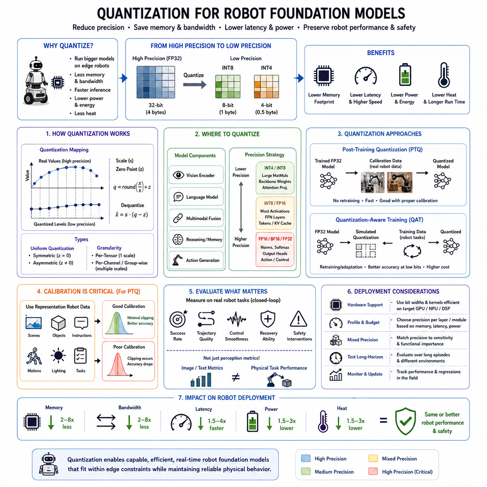{width="7.268055555555556in" height="7.268055555555556in"}

Quantization reduces the numerical precision used to represent and compute the parameters, activations, and intermediate states of robot foundation models. Instead of storing every value in high-precision formats such as FP32, a deployed model may use FP16, BF16, INT8, INT4, or mixed-precision representations. This reduction can substantially decrease memory use, data movement, inference cost, and energy consumption on edge hardware.

Robot foundation models are strong candidates for quantization because their deployment environments impose strict compute and memory constraints. Vision encoders, language models, multimodal fusion layers, and action-generation modules may collectively contain billions of parameters. Keeping all of these parameters at high precision can exceed onboard accelerator memory or consume excessive memory bandwidth, making real-time VLM and VLA inference difficult on mobile robotic platforms.

The memory benefit can be significant. A parameter represented with 32 bits requires four bytes, while an 8-bit representation requires approximately one byte and a 4-bit representation approximately half a byte before accounting for quantization metadata. Reducing parameter precision therefore allows larger models to fit into limited accelerator memory and can leave more capacity for visual tokens, KV caches, temporal context, perception buffers, and other robotic workloads.

Quantization can also improve inference speed because fewer bits need to move through the memory hierarchy. Large transformer models frequently become constrained not only by arithmetic operations but by the transfer of weights and activations between memory and compute units. Lower-precision representations reduce this traffic, potentially allowing accelerators to process model layers faster when suitable low-precision kernels and hardware instructions are available.

Power efficiency is another important advantage for robotics. Moving and processing lower-precision values can require less energy than repeatedly operating on high-precision data. This matters on battery-powered robots where AI computation competes with motors, sensors, communication devices, and cooling systems for limited energy. Quantization can therefore contribute not only to faster inference but also to longer autonomous operation and reduced thermal load.

Quantization works by mapping values from a relatively precise numerical space into a smaller set of representable levels. A scale factor and, in some schemes, a zero point define the relationship between the original values and their quantized representation. During computation, optimized kernels operate directly on these lower-precision values or efficiently reconstruct the numerical behavior required by subsequent model operations.

Uniform quantization divides a numerical range into regularly spaced levels and is relatively simple to implement. Symmetric quantization commonly centers the representation around zero, while asymmetric quantization can shift the representable range using a zero point. The appropriate scheme depends on the statistical distribution of model values, hardware capabilities, inference runtime, and sensitivity of individual components to numerical approximation.

Granularity also affects quantization quality and overhead. Per-tensor quantization applies one scale to an entire tensor and is computationally simple, but it may represent diverse value distributions poorly. Per-channel or group-wise quantization uses different scales for smaller subsets of parameters. This usually improves numerical fidelity, especially at very low bit widths, although it introduces additional metadata and implementation complexity.

Post-training quantization applies quantization after the model has already been trained. It is attractive for robot foundation models because it does not necessarily require expensive retraining of the original large model. Weight-only quantization may compress model parameters while retaining higher-precision activations, whereas weight-and-activation quantization can provide greater runtime efficiency when the deployment accelerator efficiently supports low-precision computation.

Calibration is important when activation values are quantized. Representative robot observations are passed through the model to estimate useful numerical ranges for different layers. Calibration data should reflect realistic cameras, environments, objects, instructions, motion states, and task conditions. Poor calibration can cause important activation values to be clipped or represented inaccurately, leading to degradation that may not appear in generic language or vision benchmarks.

Quantization-aware training introduces simulated quantization effects during training or adaptation so that the model learns to tolerate reduced numerical precision. This approach can recover accuracy when aggressive post-training quantization causes excessive degradation. However, it requires additional training resources and a suitable dataset, making it more expensive than simple post-training conversion for very large robot foundation models.

Not every part of a robot foundation model is equally tolerant of low precision. Large matrix multiplications in transformer blocks may quantize effectively, while normalization layers, output projections, attention calculations, small control heads, or numerically sensitive components may require higher precision. Mixed-precision quantization preserves selected operations at FP16 or another format while aggressively compressing components that tolerate INT8 or INT4 representations.

Vision components introduce additional considerations. Robot observations may contain subtle geometric relationships, small obstacles, grasp boundaries, depth cues, or low-contrast objects that influence physical action. Quantization that causes only a small reduction in conventional image metrics may still change downstream manipulation or navigation behavior. Evaluation must therefore measure physical task performance rather than relying exclusively on generic perception accuracy.

Action-generation components require similar care because numerical errors can propagate into physical commands. Small changes in predicted joint positions, velocities, end-effector poses, or action probabilities may accumulate over long trajectories. Quantization should therefore be evaluated across complete closed-loop episodes, including success rate, trajectory quality, control smoothness, recovery behavior, and safety interventions rather than only comparing individual model outputs.

Temporal models create another challenge because approximation errors may interact with history and memory. A VLA model can repeatedly condition future actions on previous observations and generated actions. Small quantization errors that appear harmless in one inference step may influence later states through closed-loop interaction. Long-horizon robotic evaluation is therefore essential when deciding how aggressively recurrent context, attention caches, or action-related components can be quantized.

Hardware support ultimately determines whether theoretical compression becomes practical acceleration. An INT4 model does not automatically run faster than an INT8 or FP16 model if the target GPU, NPU, inference engine, or kernel library lacks efficient INT4 execution. Deployment decisions should therefore be based on measured latency, memory bandwidth, power, and sustained performance on the actual edge platform rather than bit width alone.

Quantization should consequently be integrated with model profiling and deployment budgeting. Engineers can first identify memory, latency, power, or thermal bottlenecks and then determine which tensors and modules should use lower precision. Layer sensitivity analysis can compare alternative bit widths, while deployment profiling verifies whether the resulting model actually produces meaningful improvements under concurrent robotic workloads.

A practical strategy often combines multiple precision levels rather than forcing the entire model into one format. Large language and multimodal backbone weights may use INT8 or INT4, sensitive activations may remain at higher precision, and safety-critical or action-related modules can retain additional numerical fidelity. Such mixed-precision design allows compression to follow the functional importance and numerical sensitivity of each component.

The objective of quantization is therefore not simply to minimize the number of bits used by a robot foundation model. The goal is to reduce memory footprint, bandwidth demand, latency, energy consumption, and thermal pressure while preserving the perception, reasoning, language grounding, and action quality required for reliable physical behavior. Successful quantization creates a model that is smaller and more efficient without making the robot meaningfully less capable or less safe.

양자화(Quantization)는 로봇 파운데이션 모델(Robot Foundation Model)의 파라미터(Parameter), 활성값(Activation), 중간 상태(Intermediate State)를 표현하고 계산하는 데 사용되는 수치 정밀도(Numerical Precision)를 낮추는 기술이다. 모든 값을 FP32와 같은 고정밀 형식으로 저장하는 대신, 배포 모델은 FP16, BF16, INT8, INT4 또는 혼합 정밀도 표현(Mixed-Precision Representation)을 사용할 수 있다. 이를 통해 엣지 하드웨어(Edge Hardware)의 메모리 사용량, 데이터 이동량, 추론 비용, 에너지 소비를 크게 줄일 수 있다.

로봇 파운데이션 모델은 배포 환경에서 엄격한 연산 및 메모리 제약을 받기 때문에 양자화에 특히 적합하다. 비전 인코더(Vision Encoder), 언어 모델(Language Model), 다중모달 융합 계층(Multimodal Fusion Layer), 행동 생성 모듈(Action-Generation Module)은 전체적으로 수십억 개의 파라미터를 포함할 수 있다. 모든 파라미터를 높은 정밀도로 유지하면 온보드 가속기 메모리를 초과하거나 과도한 메모리 대역폭을 소비하여 모바일 로봇 플랫폼에서 실시간 VLM 및 VLA 추론을 어렵게 만들 수 있다.

메모리 절감 효과는 상당할 수 있다. 32비트로 표현되는 하나의 파라미터는 4바이트를 필요로 하지만, 8비트 표현은 약 1바이트, 4비트 표현은 양자화 메타데이터(Quantization Metadata)를 제외하면 약 0.5바이트를 필요로 한다. 따라서 파라미터 정밀도를 낮추면 제한된 가속기 메모리에 더 큰 모델을 탑재할 수 있으며 시각 토큰(Visual Token), KV 캐시(KV Cache), 시간적 문맥(Temporal Context), 지각 버퍼(Perception Buffer), 기타 로보틱스 워크로드를 위한 추가 메모리를 확보할 수 있다.

양자화는 메모리 계층(Memory Hierarchy)을 통해 이동해야 하는 비트 수를 줄여 추론 속도도 향상시킬 수 있다. 대규모 트랜스포머 모델(Transformer Model)은 산술 연산량뿐 아니라 가중치와 활성값을 메모리와 연산 장치 사이에서 전송하는 과정에서 병목이 발생하는 경우가 많다. 저정밀 표현(Low-Precision Representation)은 이러한 데이터 이동을 감소시키며, 적절한 저정밀 커널(Low-Precision Kernel)과 하드웨어 명령이 지원될 경우 가속기가 모델 계층을 더욱 빠르게 처리할 수 있게 한다.

전력 효율(Power Efficiency)은 로보틱스에서 양자화가 제공하는 또 다른 중요한 장점이다. 저정밀 값을 이동하고 처리하는 데에는 고정밀 데이터를 반복적으로 처리하는 것보다 적은 에너지가 필요할 수 있다. 이는 AI 연산이 모터, 센서, 통신 장치, 냉각 시스템과 제한된 에너지를 공유하는 배터리 구동 로봇에서 중요하다. 따라서 양자화는 추론 속도를 높이는 것뿐 아니라 자율 운용시간을 연장하고 열 부하(Thermal Load)를 줄이는 데에도 기여할 수 있다.

양자화는 상대적으로 정밀한 수치 공간의 값을 더 적은 수의 표현 가능한 단계(Representable Level)로 매핑하는 방식으로 동작한다. 스케일 팩터(Scale Factor)와 일부 방식에서 사용되는 영점(Zero Point)은 원래 값과 양자화 표현 사이의 관계를 정의한다. 연산 과정에서는 최적화된 커널이 이러한 저정밀 값을 직접 처리하거나 이후 모델 연산에 필요한 수치적 동작을 효율적으로 복원한다.

균일 양자화(Uniform Quantization)는 수치 범위를 일정한 간격의 단계로 나누며 비교적 구현하기 쉽다. 대칭 양자화(Symmetric Quantization)는 일반적으로 표현 범위를 0을 중심으로 배치하고, 비대칭 양자화(Asymmetric Quantization)는 영점을 사용하여 표현 범위를 이동시킬 수 있다. 적절한 방식은 모델 값의 통계적 분포, 하드웨어 기능, 추론 런타임(Inference Runtime), 개별 구성 요소가 수치적 근사에 얼마나 민감한지에 따라 결정된다.

양자화 세분성(Quantization Granularity)도 품질과 오버헤드에 영향을 준다. 텐서별 양자화(Per-Tensor Quantization)는 전체 텐서에 하나의 스케일을 적용하므로 계산이 단순하지만 다양한 값의 분포를 충분히 표현하지 못할 수 있다. 채널별 양자화(Per-Channel Quantization) 또는 그룹별 양자화(Group-Wise Quantization)는 더 작은 파라미터 집합마다 서로 다른 스케일을 적용한다. 이는 특히 매우 낮은 비트 폭(Bit Width)에서 수치 충실도(Numerical Fidelity)를 향상시키지만 추가적인 메타데이터와 구현 복잡성을 발생시킨다.

학습 후 양자화(Post-Training Quantization, PTQ)는 모델 학습이 완료된 후 양자화를 적용한다. 원래의 대규모 모델을 반드시 다시 학습하지 않아도 되기 때문에 로봇 파운데이션 모델에 매력적인 방법이다. 가중치 전용 양자화(Weight-Only Quantization)는 활성값을 높은 정밀도로 유지하면서 모델 파라미터를 압축할 수 있으며, 가중치-활성값 양자화(Weight-and-Activation Quantization)는 배포 가속기가 저정밀 연산을 효율적으로 지원할 경우 더 높은 런타임 효율을 제공할 수 있다.

활성값을 양자화할 때는 캘리브레이션(Calibration)이 중요하다. 대표적인 로봇 관측 데이터를 모델에 입력하여 서로 다른 계층에 적합한 수치 범위를 추정한다. 캘리브레이션 데이터는 실제 카메라 영상, 환경, 물체, 명령, 동작 상태, 작업 조건을 반영해야 한다. 부적절한 캘리브레이션은 중요한 활성값을 클리핑(Clipping)하거나 부정확하게 표현하여 일반적인 언어 또는 비전 벤치마크에서는 발견되지 않는 성능 저하를 일으킬 수 있다.

양자화 인식 학습(Quantization-Aware Training, QAT)은 학습 또는 적응 과정에서 양자화 효과를 모사하여 모델이 낮은 수치 정밀도에 적응하도록 한다. 공격적인 학습 후 양자화가 지나친 성능 저하를 발생시키는 경우 이러한 접근법을 통해 정확도를 회복할 수 있다. 그러나 추가적인 학습 자원과 적절한 데이터셋이 필요하기 때문에 매우 큰 로봇 파운데이션 모델에서는 단순한 학습 후 변환보다 비용이 많이 든다.

로봇 파운데이션 모델의 모든 구성 요소가 낮은 정밀도를 동일하게 허용하는 것은 아니다. 트랜스포머 블록(Transformer Block)의 대규모 행렬 곱셈(Matrix Multiplication)은 효과적으로 양자화될 수 있지만, 정규화 계층(Normalization Layer), 출력 투영(Output Projection), 어텐션 계산(Attention Calculation), 소형 제어 헤드(Control Head), 수치적으로 민감한 구성 요소는 더 높은 정밀도를 요구할 수 있다. 혼합 정밀도 양자화(Mixed-Precision Quantization)는 선택된 연산을 FP16 등의 형식으로 유지하면서 INT8이나 INT4를 허용하는 구성 요소를 적극적으로 압축한다.

비전 구성 요소(Vision Component)에는 추가적인 고려가 필요하다. 로봇 관측에는 물리적 행동에 영향을 주는 미세한 기하학적 관계, 작은 장애물, 파지 경계(Grasp Boundary), 깊이 단서(Depth Cue), 낮은 대비의 물체가 포함될 수 있다. 일반적인 이미지 평가 지표에서는 작은 성능 저하만 발생하는 양자화라도 실제 조작이나 주행 행동에는 영향을 줄 수 있다. 따라서 일반적인 지각 정확도에만 의존하지 않고 실제 물리적 작업 성능을 평가해야 한다.

행동 생성 구성 요소(Action-Generation Component) 역시 수치 오차가 실제 물리적 명령으로 전달될 수 있기 때문에 주의가 필요하다. 예측된 관절 위치(Joint Position), 속도, 엔드 이펙터 자세(End-Effector Pose), 행동 확률(Action Probability)의 작은 변화도 장시간 궤적에서 누적될 수 있다. 따라서 개별 모델 출력만 비교하기보다 전체 폐루프 에피소드(Closed-Loop Episode)를 통해 성공률, 궤적 품질, 제어 부드러움(Control Smoothness), 복구 행동, 안전 개입(Safety Intervention)을 평가해야 한다.

시간적 모델(Temporal Model)은 근사 오차가 이력과 메모리에 영향을 줄 수 있다는 또 다른 문제를 가진다. VLA 모델은 이전 관측과 생성된 행동을 바탕으로 미래 행동을 반복적으로 결정할 수 있다. 한 번의 추론 단계에서는 문제가 없어 보이는 작은 양자화 오차도 폐루프 상호작용을 통해 이후 상태에 영향을 줄 수 있다. 따라서 반복 문맥(Recurrent Context), 어텐션 캐시(Attention Cache), 행동 관련 구성 요소를 얼마나 적극적으로 양자화할 수 있는지를 결정하려면 장기 로봇 평가(Long-Horizon Robotic Evaluation)가 필요하다.

하드웨어 지원(Hardware Support)은 이론적인 압축 효과가 실제 성능 향상으로 이어질 수 있는지를 최종적으로 결정한다. 목표 GPU, NPU, 추론 엔진(Inference Engine), 커널 라이브러리(Kernel Library)가 INT4 실행을 효율적으로 지원하지 않는다면 INT4 모델이 반드시 INT8 또는 FP16 모델보다 빠르게 동작하는 것은 아니다. 따라서 배포 결정은 비트 폭만을 기준으로 하지 말고 실제 엣지 플랫폼에서 측정한 지연시간, 메모리 대역폭, 전력, 지속 성능(Sustained Performance)을 기반으로 이루어져야 한다.

따라서 양자화는 모델 프로파일링(Model Profiling)과 배포 예산 수립(Deployment Budgeting)에 통합되어야 한다. 엔지니어는 먼저 메모리, 지연시간, 전력 또는 열 병목을 식별한 다음 어떤 텐서와 모듈에 낮은 정밀도를 적용할지 결정할 수 있다. 계층 민감도 분석(Layer Sensitivity Analysis)을 통해 다양한 비트 폭을 비교하고, 배포 프로파일링을 통해 결과 모델이 실제 동시 로보틱스 워크로드에서 의미 있는 개선을 제공하는지 검증할 수 있다.

실용적인 전략은 전체 모델을 하나의 수치 형식으로 강제하기보다 여러 정밀도 수준을 결합하는 경우가 많다. 대규모 언어 및 다중모달 백본(Backbone)의 가중치는 INT8 또는 INT4를 사용하고, 민감한 활성값은 더 높은 정밀도로 유지하며, 안전 필수 또는 행동 관련 모듈에는 추가적인 수치 충실도를 보존할 수 있다. 이러한 혼합 정밀도 설계(Mixed-Precision Design)를 통해 각 구성 요소의 기능적 중요성과 수치적 민감도에 맞추어 압축 수준을 결정할 수 있다.

따라서 양자화의 목적은 단순히 로봇 파운데이션 모델이 사용하는 비트 수를 최소화하는 것이 아니다. 핵심 목표는 신뢰할 수 있는 물리적 행동에 필요한 지각, 추론, 언어 그라운딩(Language Grounding), 행동 품질을 유지하면서 메모리 사용량, 대역폭 요구량, 지연시간, 에너지 소비, 열 부담을 줄이는 것이다. 성공적인 양자화는 로봇의 능력이나 안전성을 의미 있게 저하시키지 않으면서 모델을 더 작고 효율적으로 만드는 것이다.

## 10.05. Pruning Distillation and Model Compression

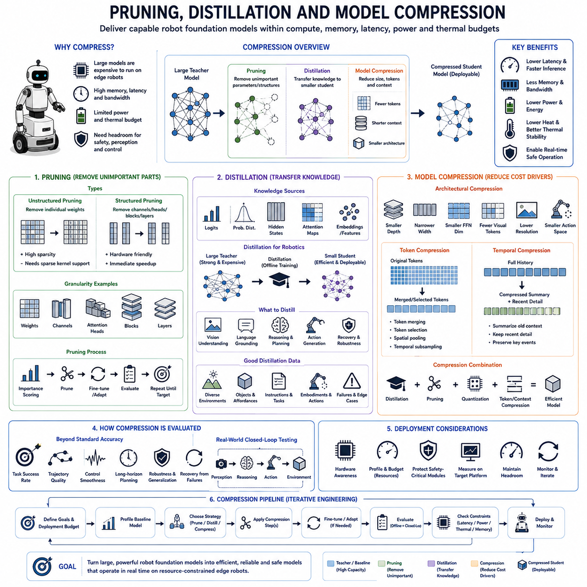{width="7.268055555555556in" height="7.268055555555556in"}

Pruning, knowledge distillation, and model compression reduce the computational burden of robot foundation models while attempting to preserve the capabilities required for physical interaction. Large multimodal models often contain redundant parameters, repeated representations, and capacity that is unnecessary for a particular deployment. Compression transforms these models into forms that better match the compute, memory, latency, power, and thermal limits of edge robots.

Pruning removes model parameters or structures that contribute relatively little to useful inference behavior. Neural networks are frequently overparameterized, meaning that some weights, neurons, attention heads, channels, or even entire layers can be removed with limited degradation. For robotics, the objective is not simply to maximize sparsity, but to eliminate computation that provides little value for perception, reasoning, language grounding, or action generation.

Unstructured pruning removes individual weights according to criteria such as magnitude or estimated importance. This approach can produce very high sparsity while retaining much of the original network architecture. However, irregular sparse matrices do not automatically provide faster inference because general-purpose GPUs and accelerators are optimized for dense operations. Practical benefits therefore depend on whether the target hardware and inference runtime efficiently support sparse computation.

Structured pruning removes larger computational units such as channels, neurons, attention heads, feed-forward dimensions, transformer blocks, or layers. Because the resulting model retains regular tensor structures, it can often execute efficiently on conventional edge accelerators without specialized sparse kernels. Structured pruning may produce more immediate reductions in latency and memory traffic, although removing complete structures can affect model capability more strongly than eliminating isolated weights.

Pruning criteria should reflect functional importance rather than parameter magnitude alone. A component that is rarely active may still be essential during unusual obstacles, ambiguous instructions, manipulation failures, or safety-critical situations. Robot foundation models therefore benefit from sensitivity analysis using diverse physical tasks. Pruning decisions should consider not only average performance but also robustness, generalization, recovery behavior, and rare operational conditions.

Iterative pruning can reduce the risk of abrupt capability loss. Instead of removing a large fraction of the model in one operation, parameters or structures are gradually eliminated, followed by fine-tuning or adaptation. This allows the remaining network to reorganize its representations and recover performance. The process can continue until additional compression begins to produce unacceptable degradation in task success, reasoning quality, or physical control.

Knowledge distillation takes a different approach by transferring useful behavior from a larger teacher model into a smaller student model. The teacher may possess broad visual, linguistic, reasoning, and action capabilities that are too expensive for continuous edge execution. A compact student learns to approximate selected teacher behaviors while using fewer parameters and less computation, creating a practical path from large-scale pretrained intelligence to deployable robot policies.

The student can learn from more than the teacher\'s final outputs. Distillation may use logits, probability distributions, hidden representations, attention patterns, visual embeddings, predicted actions, or intermediate features as supervision. Matching richer internal signals can help the student inherit useful structure that would be difficult to learn from hard labels alone, particularly when robot demonstration data is limited or expensive to collect.

For Vision-Language-Action models, distillation can operate across multiple functional levels. A student may learn semantic visual representations from a large vision-language teacher, task reasoning from a multimodal model, and action behavior from a generalist robot policy. This allows deployment models to preserve selected capabilities from much larger systems without reproducing the complete architecture or computational requirements of every teacher component.

Robot-specific distillation should emphasize behavior that matters in the physical world. A student model does not need to reproduce every linguistic or general-knowledge capability of its teacher if those capabilities are irrelevant to deployment. Training can prioritize object understanding, spatial relationships, affordances, instruction following, trajectory selection, manipulation, navigation, and recovery. Distillation therefore becomes a form of capability selection as well as model compression.

Distillation data strongly influences what the student retains. Training examples should represent the environments, objects, instructions, embodiments, failure modes, and task variations expected during operation. If the teacher is queried only on routine situations, the student may fail to inherit behavior required for unusual conditions. Diverse teacher-generated trajectories and difficult examples can therefore be especially valuable for robust robot deployment.

Model compression can also reduce architectural dimensions directly. Transformer depth, hidden width, feed-forward dimensions, visual token counts, image resolution, context length, and action representation size can all influence deployment cost. Smaller architectural configurations reduce compute and memory more predictably than sparsity alone, but each reduction may remove representational capacity. Profiling is required to determine which dimensions dominate the target platform\'s resource consumption.

Token compression is particularly relevant to multimodal robot models. Multiple cameras and video sequences can generate thousands of visual tokens before language or action reasoning begins. Token merging, feature pooling, learned token selection, spatial compression, or temporal subsampling can reduce this burden. Preserving task-relevant objects, geometry, motion, and interaction regions is critical because indiscriminate token reduction may remove information required for safe action.

Temporal compression can similarly reduce the cost of long robot histories. Instead of retaining every previous observation, the system can summarize older context into compact state representations while preserving recent information at greater detail. This approach reduces attention cost and memory consumption while maintaining task continuity. Effective compression must retain information about goals, previous actions, failures, object states, and other events that influence future decisions.

Compression methods are often most effective when combined. A model may first be distilled into a smaller architecture, structurally pruned to remove unnecessary components, and then quantized for efficient low-precision execution. Visual tokens and temporal context can be compressed simultaneously. These techniques address different sources of cost, allowing substantial reductions in memory, bandwidth, compute, power, and latency when their effects are carefully coordinated.

The order of compression operations can affect the final result. Aggressive pruning followed by aggressive quantization may amplify approximation errors, while distillation after structural modification can help recover lost behavior. Fine-tuning between stages can stabilize representations. Consequently, compression should be treated as an iterative engineering pipeline rather than a collection of independent transformations applied blindly to a pretrained model.

Hardware awareness remains essential because theoretical compression does not guarantee practical acceleration. A highly sparse model may occupy less storage yet execute slowly if sparse kernels are inefficient. A smaller dense student can sometimes outperform a larger sparse model because its operations map more naturally onto GPU or NPU hardware. Actual deployment decisions should therefore compare measured latency, memory, energy, and sustained throughput on the target platform.

Evaluation must extend beyond conventional model accuracy. Compression can subtly affect spatial reasoning, object recognition, instruction grounding, action smoothness, long-horizon planning, uncertainty estimation, or failure recovery. These changes may appear insignificant in offline benchmarks but become important during closed-loop physical interaction. Robot models should therefore be evaluated through complete tasks and trajectories under realistic environmental variation.

Safety-critical capabilities deserve special protection during compression. Modules responsible for action generation, uncertainty detection, constraint awareness, or interaction with safety monitors may require additional capacity or precision. Compression policies can preserve sensitive layers while reducing less critical components more aggressively. The objective is to remove redundancy without weakening the behaviors that prevent unsafe or unstable physical actions.

The final compression target should be determined by deployment budgeting rather than by the highest achievable compression ratio. A robot may require enough memory headroom for perception, mapping, safety processes, and temporal context, while also satisfying latency, power, and thermal limits. Once these requirements are met, further compression may provide little practical value if it begins to reduce robustness or generalization.

Pruning, distillation, and model compression ultimately provide complementary mechanisms for transforming large pretrained robot intelligence into efficient edge intelligence. Pruning removes unnecessary computation, distillation transfers valuable capabilities into smaller models, and architectural or token compression reduces representational cost. Combined with quantization and hardware-aware profiling, these techniques enable capable robot foundation models to operate continuously within realistic physical deployment constraints.

가지치기(Pruning), 지식 증류(Knowledge Distillation), 모델 압축(Model Compression)은 물리적 상호작용(Physical Interaction)에 필요한 능력을 유지하면서 로봇 파운데이션 모델(Robot Foundation Model)의 연산 부담을 줄이는 기술이다. 대규모 다중모달 모델(Multimodal Model)은 특정 배포 환경에서 불필요한 중복 파라미터, 반복적인 표현, 과도한 모델 용량을 포함하는 경우가 많다. 압축은 이러한 모델을 엣지 로봇(Edge Robot)의 연산, 메모리, 지연시간, 전력, 열 제약에 더욱 적합한 형태로 변환한다.

가지치기(Pruning)는 유용한 추론 동작에 상대적으로 적게 기여하는 모델 파라미터 또는 구조를 제거한다. 신경망(Neural Network)은 필요한 것보다 많은 파라미터를 포함하는 과매개변수화(Overparameterization) 상태인 경우가 많기 때문에 일부 가중치, 뉴런(Neuron), 어텐션 헤드(Attention Head), 채널(Channel), 심지어 전체 계층을 제거하더라도 성능 저하가 제한적일 수 있다. 로보틱스에서는 단순히 희소성(Sparsity)을 극대화하는 것이 아니라 지각, 추론, 언어 그라운딩(Language Grounding), 행동 생성에 거의 기여하지 않는 연산을 제거하는 것이 목적이다.

비구조적 가지치기(Unstructured Pruning)는 크기(Magnitude) 또는 추정된 중요도와 같은 기준에 따라 개별 가중치를 제거한다. 이 방법은 원래의 네트워크 아키텍처 대부분을 유지하면서 매우 높은 희소성을 만들 수 있다. 그러나 불규칙한 희소 행렬(Sparse Matrix)은 범용 GPU와 가속기가 밀집 연산(Dense Operation)에 최적화되어 있기 때문에 자동으로 빠른 추론을 제공하지 않는다. 따라서 실제 효과는 목표 하드웨어와 추론 런타임(Inference Runtime)이 희소 연산을 얼마나 효율적으로 지원하는지에 따라 달라진다.

구조적 가지치기(Structured Pruning)는 채널, 뉴런, 어텐션 헤드, 피드포워드 차원(Feed-Forward Dimension), 트랜스포머 블록(Transformer Block), 계층과 같은 더 큰 연산 단위를 제거한다. 결과 모델은 규칙적인 텐서 구조(Tensor Structure)를 유지하므로 특수한 희소 커널(Sparse Kernel) 없이도 일반적인 엣지 가속기에서 효율적으로 실행할 수 있다. 구조적 가지치기는 지연시간과 메모리 트래픽을 직접적으로 감소시킬 수 있지만, 전체 구조를 제거하기 때문에 개별 가중치 제거보다 모델 능력에 더 큰 영향을 줄 수 있다.

가지치기 기준(Pruning Criterion)은 단순한 파라미터 크기뿐 아니라 기능적 중요성(Functional Importance)을 반영해야 한다. 거의 활성화되지 않는 구성 요소라도 비정상적인 장애물, 모호한 명령, 조작 실패 또는 안전 필수 상황에서 중요한 역할을 수행할 수 있다. 따라서 로봇 파운데이션 모델에는 다양한 물리적 작업을 활용한 민감도 분석(Sensitivity Analysis)이 필요하며, 평균 성능뿐 아니라 강건성(Robustness), 일반화(Generalization), 복구 행동(Recovery Behavior), 드물게 발생하는 운용 조건까지 고려하여 가지치기를 결정해야 한다.

반복적 가지치기(Iterative Pruning)는 갑작스러운 능력 손실의 위험을 줄일 수 있다. 한 번에 모델의 많은 부분을 제거하는 대신 파라미터나 구조를 점진적으로 제거하고 이후 미세조정(Fine-Tuning) 또는 적응(Adaptation)을 수행한다. 이를 통해 남아 있는 네트워크가 표현을 재구성하고 성능을 회복할 수 있다. 추가적인 압축이 작업 성공률, 추론 품질 또는 물리적 제어에 허용할 수 없는 성능 저하를 일으키기 전까지 이 과정을 반복할 수 있다.

지식 증류(Knowledge Distillation)는 더 큰 교사 모델(Teacher Model)의 유용한 동작을 더 작은 학생 모델(Student Model)로 전달하는 다른 접근법이다. 교사 모델은 지속적인 엣지 실행에는 지나치게 많은 자원을 요구하지만 광범위한 시각, 언어, 추론, 행동 능력을 보유할 수 있다. 소형 학생 모델은 더 적은 파라미터와 연산량을 사용하면서 선택된 교사 모델의 동작을 근사하도록 학습함으로써 대규모 사전학습 지능(Pretrained Intelligence)을 실제 배포 가능한 로봇 정책(Robot Policy)으로 변환할 수 있다.

학생 모델은 교사 모델의 최종 출력만으로 학습할 필요가 없다. 증류 과정에서는 로짓(Logit), 확률 분포(Probability Distribution), 은닉 표현(Hidden Representation), 어텐션 패턴(Attention Pattern), 시각 임베딩(Visual Embedding), 예측 행동, 중간 특징(Intermediate Feature) 등을 감독 신호(Supervision)로 사용할 수 있다. 이러한 풍부한 내부 신호를 일치시키면 특히 로봇 시연 데이터가 제한적이거나 수집 비용이 높은 경우 단순한 하드 레이블(Hard Label)만으로 학습하기 어려운 유용한 구조를 학생 모델이 상속받을 수 있다.

비전-언어-행동 모델(Vision-Language-Action Model, VLA)에서 증류는 여러 기능 수준에 걸쳐 적용할 수 있다. 학생 모델은 대규모 비전-언어 교사 모델로부터 의미적 시각 표현(Semantic Visual Representation)을 학습하고, 다중모달 모델에서 작업 추론(Task Reasoning)을 학습하며, 범용 로봇 정책(Generalist Robot Policy)으로부터 행동을 학습할 수 있다. 이를 통해 모든 교사 구성 요소의 전체 아키텍처와 연산 요구량을 재현하지 않고도 훨씬 큰 시스템의 선택된 능력을 보존할 수 있다.

로봇 특화 증류(Robot-Specific Distillation)는 물리적 세계에서 중요한 행동을 중심으로 이루어져야 한다. 배포에 필요하지 않다면 학생 모델이 교사 모델의 모든 언어 능력이나 일반 지식을 재현할 필요는 없다. 학습은 물체 이해(Object Understanding), 공간 관계, 어포던스(Affordance), 명령 수행, 궤적 선택(Trajectory Selection), 조작, 주행, 복구 등에 우선순위를 둘 수 있다. 따라서 증류는 모델 압축뿐 아니라 필요한 능력을 선택하는 능력 선택(Capability Selection)의 과정이 된다.

증류 데이터(Distillation Data)는 학생 모델이 어떤 능력을 유지하는지에 큰 영향을 준다. 학습 예제는 실제 운용에서 예상되는 환경, 물체, 명령, 체화 형태(Embodiment), 실패 모드(Failure Mode), 작업 변화를 대표해야 한다. 교사 모델에 일상적인 상황만 입력한다면 학생 모델은 비정상적인 상황에서 필요한 행동을 상속받지 못할 수 있다. 따라서 다양한 교사 생성 궤적(Teacher-Generated Trajectory)과 어려운 사례는 강건한 로봇 배포를 위해 특히 중요하다.

모델 압축은 아키텍처 차원(Architectural Dimension)을 직접 줄이는 방식으로도 수행할 수 있다. 트랜스포머 깊이(Transformer Depth), 은닉 차원 폭(Hidden Width), 피드포워드 차원, 시각 토큰 수(Visual Token Count), 이미지 해상도, 문맥 길이(Context Length), 행동 표현 크기(Action Representation Size)는 모두 배포 비용에 영향을 준다. 작은 아키텍처 구성은 희소성만 활용하는 것보다 연산과 메모리를 예측 가능하게 줄일 수 있지만 표현 능력도 감소시킬 수 있으므로 어떤 차원이 목표 플랫폼의 자원을 가장 많이 소비하는지 프로파일링(Profiling)해야 한다.

토큰 압축(Token Compression)은 다중모달 로봇 모델에서 특히 중요하다. 여러 카메라와 비디오 시퀀스(Video Sequence)는 언어나 행동 추론을 시작하기 전에 수천 개의 시각 토큰을 생성할 수 있다. 토큰 병합(Token Merging), 특징 풀링(Feature Pooling), 학습 기반 토큰 선택(Learned Token Selection), 공간 압축(Spatial Compression), 시간적 서브샘플링(Temporal Subsampling)을 통해 이러한 부담을 줄일 수 있다. 그러나 무분별한 토큰 감소는 안전한 행동에 필요한 정보를 제거할 수 있으므로 작업 관련 물체, 기하학적 구조, 움직임, 상호작용 영역을 보존해야 한다.

시간적 압축(Temporal Compression) 역시 긴 로봇 이력의 처리 비용을 줄일 수 있다. 모든 과거 관측을 유지하는 대신 오래된 문맥을 압축된 상태 표현(State Representation)으로 요약하고 최근 정보는 더 높은 세부 수준으로 유지할 수 있다. 이 방법은 작업 연속성을 유지하면서 어텐션 비용과 메모리 사용량을 감소시킨다. 효과적인 압축을 위해서는 목표, 이전 행동, 실패, 물체 상태 및 미래 의사결정에 영향을 미치는 사건에 관한 정보를 유지해야 한다.

압축 방법은 서로 결합할 때 가장 효과적인 경우가 많다. 모델을 먼저 더 작은 아키텍처로 증류한 다음 불필요한 구성 요소를 구조적으로 가지치기하고, 이후 효율적인 저정밀 실행을 위해 양자화(Quantization)를 적용할 수 있다. 동시에 시각 토큰과 시간적 문맥을 압축할 수도 있다. 이러한 기술은 서로 다른 비용 요인을 대상으로 하므로 효과를 신중하게 조정하면 메모리, 대역폭, 연산량, 전력, 지연시간을 상당히 줄일 수 있다.

압축 연산의 적용 순서도 최종 결과에 영향을 줄 수 있다. 공격적인 가지치기 이후 다시 공격적인 양자화를 적용하면 근사 오차(Approximation Error)가 증폭될 수 있지만, 구조 변경 이후 증류를 수행하면 손실된 동작을 회복하는 데 도움이 될 수 있다. 각 단계 사이의 미세조정은 표현을 안정화할 수 있다. 따라서 압축은 사전학습 모델에 독립적인 변환을 무작정 적용하는 것이 아니라 반복적인 엔지니어링 파이프라인(Engineering Pipeline)으로 다루어야 한다.

이론적인 압축이 실제 가속을 보장하지 않기 때문에 하드웨어 인식(Hardware Awareness)은 여전히 필수적이다. 높은 희소성을 가진 모델은 저장 공간은 적게 사용하더라도 희소 커널의 효율이 낮다면 실행 속도가 느릴 수 있다. 작은 밀집 학생 모델(Dense Student Model)은 연산이 GPU나 NPU 하드웨어에 자연스럽게 매핑되기 때문에 더 큰 희소 모델보다 높은 성능을 보일 수 있다. 따라서 실제 배포 결정은 목표 플랫폼에서 측정된 지연시간, 메모리, 에너지, 지속 처리량(Sustained Throughput)을 비교하여 이루어져야 한다.

평가는 일반적인 모델 정확도(Model Accuracy)를 넘어 이루어져야 한다. 압축은 공간 추론(Spatial Reasoning), 물체 인식(Object Recognition), 명령 그라운딩(Instruction Grounding), 행동 부드러움(Action Smoothness), 장기 계획(Long-Horizon Planning), 불확실성 추정(Uncertainty Estimation), 실패 복구에 미묘한 영향을 줄 수 있다. 이러한 변화는 오프라인 벤치마크에서는 중요하지 않아 보일 수 있지만 폐루프 물리적 상호작용(Closed-Loop Physical Interaction)에서는 중요해질 수 있으므로 현실적인 환경 변화에서 전체 작업과 궤적을 평가해야 한다.

안전 필수 능력(Safety-Critical Capability)은 압축 과정에서 특별히 보호되어야 한다. 행동 생성, 불확실성 탐지, 제약 인식(Constraint Awareness), 안전 모니터(Safety Monitor)와 상호작용하는 모듈은 추가적인 모델 용량이나 정밀도를 필요로 할 수 있다. 압축 정책(Compression Policy)은 민감한 계층을 보존하면서 중요도가 낮은 구성 요소를 더 적극적으로 축소할 수 있다. 목적은 위험하거나 불안정한 물리적 행동을 방지하는 능력을 약화시키지 않으면서 중복성을 제거하는 것이다.

최종 압축 목표(Compression Target)는 가능한 최대 압축률이 아니라 배포 예산(Deployment Budget)에 의해 결정되어야 한다. 로봇은 지각, 매핑, 안전 프로세스, 시간적 문맥을 위한 충분한 메모리 여유(Headroom)를 확보하면서 지연시간, 전력, 열 제한도 만족해야 한다. 이러한 요구사항이 충족된 이후 추가적인 압축이 강건성이나 일반화를 감소시키기 시작한다면 더 높은 압축률은 실질적인 가치를 거의 제공하지 못할 수 있다.

궁극적으로 가지치기, 지식 증류, 모델 압축은 대규모 사전학습 로봇 지능을 효율적인 엣지 지능(Edge Intelligence)으로 변환하기 위한 상호보완적인 방법을 제공한다. 가지치기는 불필요한 연산을 제거하고, 증류는 가치 있는 능력을 더 작은 모델로 전달하며, 아키텍처 또는 토큰 압축은 표현 비용을 줄인다. 이러한 기술을 양자화와 하드웨어 인식 프로파일링(Hardware-Aware Profiling)과 결합하면 현실적인 물리적 배포 제약 안에서 로봇 파운데이션 모델을 지속적으로 실행할 수 있다.

## 10.06. Efficient Attention and KV Cache Management

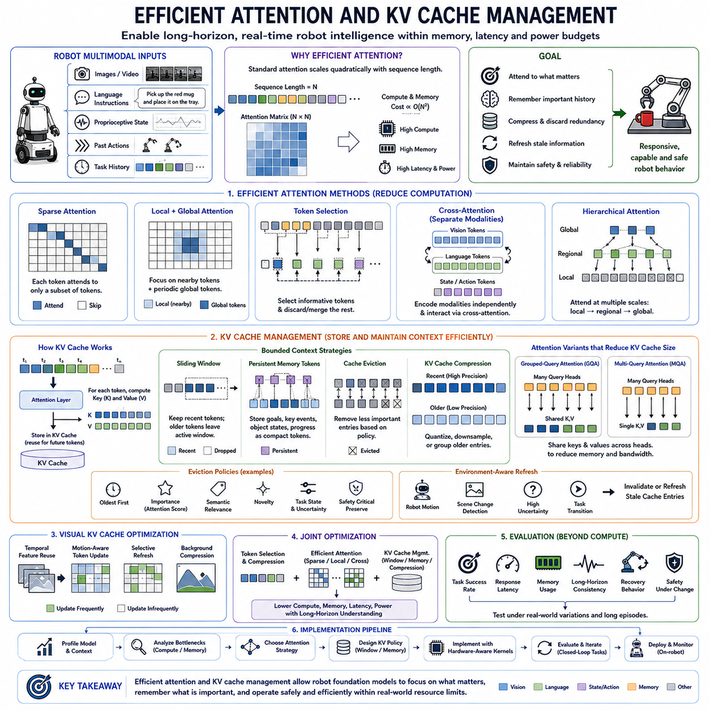{width="7.268055555555556in" height="7.268055555555556in"}

Efficient attention is essential for deploying robot foundation models because multimodal robotic inputs can create very long token sequences. Camera images, video frames, language instructions, proprioceptive states, previous actions, and task history may all enter the same reasoning context. Conventional attention becomes increasingly expensive as this context grows, creating substantial compute, memory, latency, and power demands on edge hardware.

Standard self-attention compares tokens with other tokens to determine which information should influence each representation. For a sequence containing N tokens, the attention matrix can grow approximately with the square of sequence length. This quadratic behavior becomes problematic when robot models process multiple cameras, high-resolution visual tokens, long instructions, and temporal histories simultaneously. Efficient attention seeks to reduce this scaling burden without losing critical physical information.

Robot foundation models require selective rather than uniformly detailed attention. A mobile robot may observe large static backgrounds while only a few objects, people, obstacles, or interaction regions are immediately relevant. A manipulation system may need precise attention around the gripper and target object while representing distant regions more coarsely. Efficient architectures can exploit this structure by concentrating computation on information most relevant to the current physical task.

Sparse attention reduces computation by allowing each token to interact with only a subset of other tokens. Attention patterns may emphasize nearby spatial regions, recent temporal observations, task-related objects, or selected global tokens. When designed appropriately, sparsity avoids constructing a fully connected attention pattern while preserving important relationships. The challenge is ensuring that information required for unexpected events is not excluded by an overly restrictive attention structure.

Local attention is particularly useful when relationships are primarily spatially or temporally nearby. Visual tokens can attend to neighboring image regions, while temporal tokens can focus on recent observations. Periodic global tokens or cross-region connections can then preserve broader context. Such hierarchical attention patterns can reduce computational cost while still allowing a robot to combine local geometric detail with global scene and task understanding.

Token selection provides another path to efficient attention. Before expensive transformer layers are executed, a model can identify informative visual or temporal tokens and discard, merge, or downsample redundant ones. Background regions, repeated frames, or unchanged scene features may require less representation than moving objects or contact regions. The resulting shorter sequence reduces both attention computation and the memory required for intermediate activations.

Cross-attention can also control computational cost by separating modalities instead of concatenating every input into one enormous sequence. Visual, language, state, and action representations may first be encoded independently and then exchange information through selected cross-attention layers. This design can restrict expensive multimodal interaction to stages where it is useful, while allowing specialized encoders to process each modality more efficiently.

KV cache management becomes critical when transformer-based robot models generate outputs autoregressively or repeatedly reason over persistent context. Attention layers compute key and value representations for previous tokens. Storing these representations in a key-value cache, commonly called a KV cache, prevents the model from recomputing the same historical states every time a new token or action representation is processed.

Caching can significantly reduce repeated computation, but it transfers pressure from compute to memory. Long contexts, large hidden dimensions, many transformer layers, and multiple attention heads can make KV caches consume substantial accelerator memory. In robot systems, this memory competes with model weights, visual features, perception buffers, mapping data, and other runtime processes. Cache size must therefore be treated as part of the deployment budget.

Temporal robot operation makes uncontrolled KV cache growth especially problematic. A robot can operate for minutes or hours while continuously receiving observations and generating actions. Retaining every historical token would eventually exceed practical memory limits and increase attention cost. Robot foundation models therefore require bounded memory policies that determine which historical representations remain directly accessible and which should be compressed, summarized, or removed.

Sliding-window attention is one practical strategy for bounded context. The model preserves detailed representations for the most recent portion of the sequence while older tokens leave the active attention window. This works well when immediate decisions depend strongly on recent observations. However, important long-term information such as the task objective, previous failures, object locations, or completed subtasks may need to remain accessible beyond the sliding window.

Persistent memory tokens can complement recent-context windows by storing important long-term information in compact form. Instead of preserving every previous observation, the system can maintain representations of goals, environment states, significant events, or task progress. These persistent tokens allow the model to combine detailed short-term context with compressed long-term memory, reducing KV cache growth while maintaining continuity across extended robot tasks.

Cache eviction policies determine which stored representations should be removed when memory becomes constrained. Simple policies may discard the oldest entries, while more advanced approaches can consider attention importance, semantic relevance, novelty, task state, or uncertainty. For robotics, eviction should preserve information that may affect future physical decisions, including unresolved hazards, object interactions, instructions, and recovery-related events.

KV cache compression can further reduce memory requirements. Cached keys and values may be quantized to lower precision, represented using fewer attention heads, grouped, or compressed according to temporal importance. Older cache entries may use lower precision than recent ones because exact detail often becomes less important over time. Such hierarchical precision can provide additional memory savings without applying the same approximation level to every part of the history.

Grouped-query attention and multi-query attention reduce KV cache size by allowing multiple query heads to share key and value representations. Traditional multi-head attention may maintain separate keys and values for many heads, increasing memory consumption. Sharing these representations can substantially reduce cache bandwidth and storage while preserving multiple query perspectives, making these attention variants attractive for memory-constrained edge inference.

Visual KV caches require special consideration because consecutive robot camera frames often contain extensive redundancy. Recomputing complete visual representations for every frame can waste resources when much of the scene remains unchanged. Temporal feature reuse, selective refresh, motion-aware token updates, or cached scene representations can reduce repeated processing. Dynamic objects and interaction regions can be updated more frequently than stable background information.

Cache management must remain synchronized with the physical environment. A representation that was valid several seconds ago may become misleading after the robot moves, an object changes position, or the scene is occluded. Efficient caching therefore requires mechanisms for invalidation and refresh. Robot motion, scene change detection, uncertainty, or task transitions can trigger updates so that computational efficiency does not come at the cost of stale physical understanding.

Attention efficiency and cache management should be optimized together. Reducing the number of active tokens lowers attention cost and also reduces the number of key-value states that must be stored. Conversely, effective cache compression allows longer useful contexts without exceeding memory limits. Combining token selection, sparse attention, bounded windows, persistent memory, and compressed caches can therefore produce larger gains than optimizing any single mechanism independently.

Hardware-aware implementation remains essential. An attention method with attractive theoretical complexity may perform poorly if it requires irregular memory access or unsupported kernels. Flash-style attention, fused operators, optimized tensor layouts, and accelerator-specific kernels can reduce memory movement and improve practical latency. Deployment decisions should therefore be based on measured performance on the target GPU, NPU, or edge accelerator rather than algorithmic complexity alone.

Evaluation must examine physical task behavior as well as computational savings. Aggressive token reduction or cache eviction may improve latency while causing the robot to forget instructions, overlook hazards, repeat completed actions, or lose track of objects. Long-horizon closed-loop testing should measure task success, response latency, memory consumption, recovery behavior, temporal consistency, and safety under realistic changes in the environment.

The goal of efficient attention and KV cache management is ultimately to preserve the information required for intelligent physical action while avoiding unnecessary computation and memory growth. A well-designed robot foundation model attends selectively, remembers important history, compresses redundant context, and refreshes stale representations. These mechanisms enable longer-horizon reasoning and responsive multimodal inference within the limited memory, power, and latency budgets of edge robots.

효율적 어텐션(Efficient Attention)은 다중모달 로봇 입력(Multimodal Robotic Input)이 매우 긴 토큰 시퀀스(Token Sequence)를 생성할 수 있기 때문에 로봇 파운데이션 모델(Robot Foundation Model)의 배포에서 필수적이다. 카메라 영상, 비디오 프레임, 언어 명령, 고유수용성 상태(Proprioceptive State), 이전 행동, 작업 이력 등이 모두 동일한 추론 문맥(Reasoning Context)에 포함될 수 있다. 기존 어텐션은 문맥이 길어질수록 연산, 메모리, 지연시간, 전력 요구량이 크게 증가한다.

표준 자기 어텐션(Standard Self-Attention)은 각 토큰이 다른 토큰과 비교되면서 어떤 정보가 각 표현에 영향을 주어야 하는지를 결정한다. N개의 토큰을 포함하는 시퀀스에서 어텐션 행렬(Attention Matrix)은 시퀀스 길이의 제곱에 비례하여 증가할 수 있다. 이러한 이차적 증가(Quadratic Scaling)는 로봇 모델이 여러 카메라, 고해상도 시각 토큰, 긴 명령, 시간적 이력을 동시에 처리할 때 문제가 된다. 효율적 어텐션은 중요한 물리적 정보를 잃지 않으면서 이러한 확장 부담을 줄이는 것을 목표로 한다.

로봇 파운데이션 모델에는 모든 정보에 동일한 수준으로 주의를 기울이는 방식이 아니라 선택적 어텐션(Selective Attention)이 필요하다. 이동 로봇은 넓고 정적인 배경을 관측하면서도 실제로는 소수의 물체, 사람, 장애물 또는 상호작용 영역에 즉각적으로 집중해야 할 수 있다. 조작 시스템은 그리퍼(Gripper)와 목표 물체 주변에는 정밀한 어텐션을 적용하면서 멀리 떨어진 영역은 더 거칠게 표현할 수 있다. 효율적인 아키텍처는 현재 물리적 작업에 중요한 정보에 연산을 집중함으로써 이러한 구조를 활용할 수 있다.

희소 어텐션(Sparse Attention)은 각 토큰이 다른 모든 토큰이 아니라 일부 토큰과만 상호작용하도록 하여 연산량을 줄인다. 어텐션 패턴은 인접한 공간 영역, 최근 시간적 관측, 작업 관련 물체 또는 선택된 전역 토큰(Global Token)을 강조할 수 있다. 적절하게 설계된 희소성은 중요한 관계를 유지하면서 완전 연결형 어텐션 패턴을 생성하는 비용을 줄인다. 그러나 지나치게 제한적인 어텐션 구조로 인해 예상하지 못한 사건에 필요한 정보가 제외되지 않도록 해야 한다.

지역 어텐션(Local Attention)은 관계가 주로 공간적 또는 시간적으로 가까운 위치에서 형성될 때 특히 유용하다. 시각 토큰은 인접한 이미지 영역에 집중하고 시간 토큰은 최근 관측에 집중할 수 있다. 여기에 주기적인 전역 토큰이나 영역 간 연결(Cross-Region Connection)을 추가하면 더 넓은 문맥을 유지할 수 있다. 이러한 계층형 어텐션 패턴(Hierarchical Attention Pattern)은 연산 비용을 줄이면서 로봇이 지역적인 기하학적 세부 정보와 전체 장면 및 작업 이해를 결합하도록 한다.

토큰 선택(Token Selection)은 효율적인 어텐션을 구현하는 또 다른 방법이다. 비용이 높은 트랜스포머 계층(Transformer Layer)을 실행하기 전에 유용한 시각 또는 시간 토큰을 식별하고 중복된 토큰을 제거, 병합 또는 다운샘플링(Downsampling)할 수 있다. 배경 영역, 반복되는 프레임, 변화하지 않는 장면 특징은 움직이는 물체나 접촉 영역보다 적은 표현으로 충분할 수 있다. 이렇게 짧아진 시퀀스는 어텐션 연산량과 중간 활성값(Intermediate Activation)에 필요한 메모리를 동시에 감소시킨다.

교차 어텐션(Cross-Attention)은 모든 입력을 하나의 거대한 시퀀스로 연결하는 대신 모달리티(Modality)를 분리하여 연산 비용을 제어할 수도 있다. 시각, 언어, 상태, 행동 표현을 먼저 독립적으로 인코딩한 다음 선택된 교차 어텐션 계층을 통해 정보를 교환할 수 있다. 이러한 설계는 비용이 높은 다중모달 상호작용(Multimodal Interaction)을 실제로 필요한 단계로 제한하면서 전문화된 인코더가 각 모달리티를 더욱 효율적으로 처리할 수 있게 한다.

KV 캐시 관리(KV Cache Management)는 트랜스포머 기반 로봇 모델이 자기회귀적(Autoregressive)으로 출력을 생성하거나 지속적인 문맥에 대해 반복적으로 추론할 때 중요해진다. 어텐션 계층은 이전 토큰에 대한 키(Key)와 값(Value) 표현을 계산한다. 이러한 표현을 키-값 캐시(Key-Value Cache), 즉 KV 캐시(KV Cache)에 저장하면 새로운 토큰이나 행동 표현을 처리할 때 동일한 과거 상태를 반복적으로 계산할 필요가 없다.

캐싱(Caching)은 반복 연산을 크게 줄일 수 있지만 연산 부담을 메모리 부담으로 전환한다. 긴 문맥, 큰 은닉 차원(Hidden Dimension), 많은 트랜스포머 계층, 다수의 어텐션 헤드(Attention Head)는 KV 캐시가 상당한 가속기 메모리를 사용하도록 만든다. 로봇 시스템에서는 이 메모리를 모델 가중치, 시각 특징, 지각 버퍼(Perception Buffer), 매핑 데이터, 기타 런타임 프로세스와 공유해야 한다. 따라서 캐시 크기는 배포 예산(Deployment Budget)의 일부로 관리해야 한다.

시간적으로 지속되는 로봇 운용에서는 제어되지 않는 KV 캐시 증가가 특히 문제가 된다. 로봇은 수분 또는 수시간 동안 지속적으로 관측을 입력받고 행동을 생성할 수 있다. 모든 과거 토큰을 유지하면 결국 현실적인 메모리 한계를 초과하고 어텐션 비용도 증가한다. 따라서 로봇 파운데이션 모델에는 어떤 과거 표현을 직접 접근 가능한 상태로 유지하고 어떤 정보를 압축, 요약 또는 제거할 것인지 결정하는 제한된 메모리 정책(Bounded Memory Policy)이 필요하다.

슬라이딩 윈도 어텐션(Sliding-Window Attention)은 제한된 문맥을 구현하는 실용적인 방법이다. 모델은 시퀀스의 가장 최근 구간에 대한 상세한 표현을 유지하고 오래된 토큰은 활성 어텐션 윈도(Active Attention Window)에서 제거한다. 이는 즉각적인 의사결정이 최근 관측에 크게 의존할 때 효과적이다. 그러나 작업 목표, 이전 실패, 물체 위치, 완료된 하위 작업(Subtask)과 같은 중요한 장기 정보는 슬라이딩 윈도 범위를 벗어난 이후에도 접근 가능해야 할 수 있다.

지속 메모리 토큰(Persistent Memory Token)은 중요한 장기 정보를 압축된 형태로 저장하여 최근 문맥 윈도를 보완할 수 있다. 모든 과거 관측을 보존하는 대신 목표, 환경 상태, 중요한 사건 또는 작업 진행 상태(Task Progress)에 대한 표현을 유지할 수 있다. 이러한 지속 토큰을 사용하면 상세한 단기 문맥과 압축된 장기 메모리(Long-Term Memory)를 결합하여 장시간 작업의 연속성을 유지하면서 KV 캐시 증가를 억제할 수 있다.

캐시 축출 정책(Cache Eviction Policy)은 메모리가 제한될 때 어떤 저장 표현을 제거할 것인지 결정한다. 단순한 정책은 가장 오래된 항목을 제거할 수 있지만, 고급 방식은 어텐션 중요도(Attention Importance), 의미적 관련성(Semantic Relevance), 신규성(Novelty), 작업 상태, 불확실성 등을 고려할 수 있다. 로보틱스에서는 해결되지 않은 위험, 물체와의 상호작용, 명령, 복구 관련 사건 등 미래의 물리적 의사결정에 영향을 줄 수 있는 정보를 보존해야 한다.

KV 캐시 압축(KV Cache Compression)은 메모리 요구량을 추가로 감소시킬 수 있다. 캐시된 키와 값은 낮은 정밀도로 양자화(Quantization)하거나 더 적은 어텐션 헤드로 표현하고, 그룹화하거나 시간적 중요도에 따라 압축할 수 있다. 시간이 오래된 캐시 항목은 정확한 세부 정보의 중요성이 감소하는 경우가 많기 때문에 최근 항목보다 낮은 정밀도를 사용할 수 있다. 이러한 계층형 정밀도(Hierarchical Precision)는 전체 이력에 동일한 근사 수준을 적용하지 않고 추가적인 메모리 절감을 제공한다.

그룹드 쿼리 어텐션(Grouped-Query Attention, GQA)과 멀티 쿼리 어텐션(Multi-Query Attention, MQA)은 여러 쿼리 헤드(Query Head)가 키와 값 표현을 공유하도록 하여 KV 캐시 크기를 줄인다. 기존 멀티헤드 어텐션(Multi-Head Attention)은 여러 헤드마다 별도의 키와 값을 유지하여 메모리 사용량을 증가시킬 수 있다. 이러한 표현을 공유하면 여러 쿼리 관점을 유지하면서 캐시 대역폭과 저장 공간을 크게 줄일 수 있어 메모리가 제한된 엣지 추론(Edge Inference)에 유리하다.

시각 KV 캐시(Visual KV Cache)는 연속적인 로봇 카메라 프레임 사이에 상당한 중복성이 존재하기 때문에 특별한 고려가 필요하다. 장면의 대부분이 변하지 않는 상황에서 모든 프레임에 대해 완전한 시각 표현을 다시 계산하는 것은 자원 낭비가 될 수 있다. 시간적 특징 재사용(Temporal Feature Reuse), 선택적 갱신(Selective Refresh), 움직임 인식 토큰 업데이트(Motion-Aware Token Update), 캐시된 장면 표현을 사용하면 반복 처리를 줄일 수 있다. 동적 물체와 상호작용 영역은 안정적인 배경보다 더 자주 갱신할 수 있다.

캐시 관리는 물리적 환경과 동기화되어야 한다. 몇 초 전에 유효했던 표현도 로봇이 이동하거나 물체의 위치가 변경되거나 장면이 가려지면 잘못된 정보가 될 수 있다. 따라서 효율적인 캐싱에는 무효화(Invalidation)와 갱신(Refresh) 메커니즘이 필요하다. 로봇의 움직임, 장면 변화 탐지(Scene Change Detection), 불확실성 또는 작업 전환(Task Transition)을 기반으로 갱신을 수행하여 연산 효율성 때문에 오래된 물리적 이해(Stale Physical Understanding)를 사용하지 않도록 해야 한다.

어텐션 효율성과 캐시 관리는 함께 최적화해야 한다. 활성 토큰 수를 줄이면 어텐션 비용뿐 아니라 저장해야 하는 키-값 상태의 수도 감소한다. 반대로 효과적인 캐시 압축은 메모리 한계를 초과하지 않으면서 더 긴 유용한 문맥을 유지할 수 있게 한다. 따라서 토큰 선택, 희소 어텐션, 제한된 윈도, 지속 메모리, 압축 캐시를 결합하면 하나의 메커니즘만 독립적으로 최적화하는 것보다 더 큰 효과를 얻을 수 있다.

하드웨어 인식 구현(Hardware-Aware Implementation)은 여전히 필수적이다. 이론적으로 뛰어난 계산 복잡도를 가진 어텐션 방식도 불규칙한 메모리 접근이나 지원되지 않는 커널을 요구한다면 실제 성능이 낮을 수 있다. 플래시 방식 어텐션(Flash-Style Attention), 융합 연산자(Fused Operator), 최적화된 텐서 레이아웃(Tensor Layout), 가속기 전용 커널은 메모리 이동을 줄이고 실제 지연시간을 개선할 수 있다. 따라서 배포 결정은 알고리즘의 복잡도만이 아니라 목표 GPU, NPU 또는 엣지 가속기에서 측정한 실제 성능을 기반으로 해야 한다.

평가에서는 계산 자원 절감뿐 아니라 실제 물리적 작업 행동도 확인해야 한다. 지나친 토큰 감소나 캐시 축출은 지연시간을 개선하면서도 로봇이 명령을 잊거나 위험을 놓치고, 이미 완료한 행동을 반복하거나 물체 추적을 상실하게 만들 수 있다. 따라서 장기 폐루프 테스트(Long-Horizon Closed-Loop Testing)를 통해 현실적인 환경 변화에서 작업 성공률, 응답 지연시간, 메모리 소비, 복구 행동, 시간적 일관성(Temporal Consistency), 안전성을 함께 측정해야 한다.

궁극적으로 효율적 어텐션과 KV 캐시 관리의 목표는 불필요한 연산과 메모리 증가를 방지하면서 지능적인 물리적 행동에 필요한 정보를 보존하는 것이다. 잘 설계된 로봇 파운데이션 모델은 중요한 정보에 선택적으로 집중하고, 중요한 이력을 기억하며, 중복 문맥을 압축하고, 오래된 표현을 적절하게 갱신한다. 이러한 메커니즘은 엣지 로봇의 제한된 메모리, 전력, 지연시간 예산 안에서 장기 추론(Long-Horizon Reasoning)과 반응성 높은 다중모달 추론을 가능하게 한다.

## 10.07. GPU NPU and Heterogeneous Inference

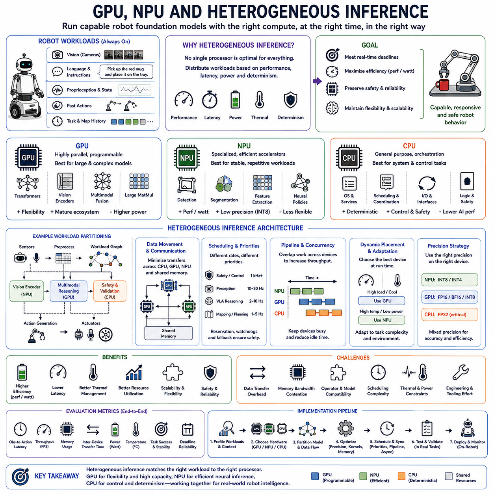{width="7.268055555555556in" height="7.268055555555556in"}

GPU, NPU, and heterogeneous inference architectures are central to deploying robot foundation models under edge constraints. A modern robot may execute vision encoding, multimodal reasoning, language processing, action generation, localization, mapping, and safety functions simultaneously. No single processor is optimal for every workload, so practical systems distribute computation across specialized devices according to performance, latency, power, and determinism requirements.

Graphics Processing Units, or GPUs, provide highly parallel programmable computation and remain particularly effective for large neural networks. Their tensor and matrix-processing capabilities efficiently accelerate transformer layers, convolutional networks, vision encoders, multimodal fusion, and large matrix multiplications. Mature software ecosystems also make GPUs flexible platforms for rapidly deploying evolving robot foundation models without redesigning dedicated hardware.

The flexibility of GPUs is especially valuable during model development and early deployment. Robot foundation models frequently change as new perception modules, attention mechanisms, action representations, or compression techniques are introduced. GPUs can execute diverse operators and numerical formats while supporting optimized frameworks and kernels. This programmability reduces the engineering friction associated with deploying rapidly evolving VLM and VLA architectures.

GPU flexibility comes with costs in power consumption, thermal load, memory bandwidth, and physical integration. High-performance GPUs can provide substantial inference capability but may require significant electrical power and active cooling. For battery-powered robots, this consumption directly affects mission endurance. The deployment problem is therefore not simply whether a GPU can run the model, but whether it can sustain the required performance within the robot\'s power and thermal envelope.

Neural Processing Units, or NPUs, are specialized accelerators designed to execute neural-network operations efficiently. Compared with general-purpose processors, NPUs typically emphasize high-throughput tensor operations, optimized dataflow, reduced memory movement, and low-precision arithmetic. These characteristics can provide attractive performance per watt for edge robotics, particularly when models can be compiled into operator patterns that the NPU supports efficiently.

NPUs are especially useful for stable, repetitive workloads such as image classification, object detection, segmentation, feature extraction, or compact neural policies. INT8 and other reduced-precision formats can often be executed efficiently on these accelerators. By moving predictable neural workloads away from the GPU, an NPU can reduce GPU contention and reserve more programmable compute capacity for multimodal reasoning, complex attention, or other rapidly changing model components.

However, NPU efficiency usually comes with less flexibility. Unsupported operators, unusual tensor shapes, dynamic control flow, new attention mechanisms, or custom model layers may require fallback execution on a CPU or GPU. Model conversion and compilation can also introduce additional engineering requirements. Consequently, theoretical NPU performance should not be treated as equivalent to practical performance for an arbitrary robot foundation model.

Central Processing Units, or CPUs, remain important even when GPUs and NPUs perform most neural inference. CPUs are well suited to operating-system services, orchestration, sensor interfaces, communication, task scheduling, deterministic logic, preprocessing, postprocessing, and many conventional robotics algorithms. They also coordinate data movement and execution across accelerators, making CPU performance and scheduling behavior important to the overall inference pipeline.

Heterogeneous inference combines these processors into a coordinated computing architecture. Rather than executing an entire model on one device, the system assigns components according to their computational characteristics. A vision encoder might run on an NPU, multimodal transformer layers on a GPU, and safety validation on a CPU. Such partitioning allows each processor to execute workloads for which its architecture provides an appropriate balance of speed, flexibility, and efficiency.

Model partitioning must account for communication overhead between processors. Moving tensors between CPU memory, GPU memory, NPU memory, or shared memory can introduce latency and consume bandwidth. A theoretically faster accelerator may provide little benefit if every model layer requires expensive transfers. Effective heterogeneous inference therefore minimizes unnecessary device boundaries and places strongly coupled operations on processors that can exchange data efficiently.

Shared-memory architectures can reduce some of this overhead by allowing multiple processors to access common physical memory. However, shared memory does not eliminate contention. Camera pipelines, neural models, mapping, and other processes may compete for the same bandwidth. Profiling should measure actual data movement and synchronization behavior because memory architecture can become the dominant bottleneck even when individual processors have substantial computational capability.

Scheduling is another central challenge. Robot workloads arrive at different frequencies and priorities: cameras may generate frames continuously, perception models may execute periodically, VLA reasoning may run at a lower frequency, and safety processes may require immediate access to compute resources. A heterogeneous runtime must schedule these workloads so that large AI inference tasks do not block latency-sensitive control and safety functions.

Pipeline parallelism can improve utilization by allowing different processors to work simultaneously. While an NPU processes visual features for the next observation, a GPU may reason over the current multimodal state and a CPU may validate the previous action. Proper pipelining can increase throughput and reduce idle hardware time. However, synchronization must ensure that actions are based on temporally consistent sensor information rather than mismatched processing stages.

Asynchronous inference is useful when every subsystem does not require identical update rates. Semantic scene understanding may run more slowly than obstacle detection, while high-level planning may update less frequently than either. Independent execution frequencies reduce unnecessary computation and allow expensive foundation-model components to operate only when required. Time stamps and state synchronization are essential for combining asynchronous outputs correctly.

Workload priority should reflect physical consequences. Safety monitoring, emergency obstacle detection, and low-level control should not lose compute access because a large reasoning model temporarily consumes accelerator resources. Resource reservation, execution priorities, watchdogs, and fallback controllers can protect critical functions. Heterogeneous inference architecture must therefore incorporate real-time system design rather than treating accelerator scheduling solely as a throughput optimization problem.

Dynamic workload placement can extend this idea by selecting processors at runtime. When GPU utilization is low, a model component may execute there for maximum performance; under thermal or power pressure, a smaller NPU implementation may be preferred. Routine situations can use efficient low-power pathways, while uncertain scenes activate more capable GPU inference. Compute placement then becomes adaptive to task complexity and robot operating conditions.

Precision can also vary across processors. NPUs may efficiently execute INT8 perception models, GPUs may use FP16, BF16, INT8, or mixed precision for foundation-model inference, and CPUs may retain higher precision for selected numerical or safety-related calculations. Hardware-aware mixed precision allows each processor to exploit its strongest numerical formats while preserving accuracy where approximation could affect physical behavior.

Thermal management should be considered across the complete heterogeneous platform. Moving computation from a GPU to an NPU may reduce total power, but sustained simultaneous utilization of multiple accelerators can still create substantial heat. Temperature can alter clock frequencies and latency over long missions. Profiling must therefore evaluate sustained multi-device operation rather than benchmarking each processor independently under short-duration workloads.

Software integration is as important as hardware selection. Inference engines, device drivers, graph compilers, model formats, memory allocators, and scheduling frameworks determine whether workloads can move efficiently across processors. Operator compatibility and conversion accuracy must be verified carefully. A theoretically optimal hardware configuration can become impractical if software boundaries create excessive copies, synchronization delays, or unsupported model components.

Evaluation should use complete robotic workloads rather than isolated accelerator benchmarks. Measurements should include end-to-end observation-to-action latency, throughput, memory consumption, inter-device transfer time, power, temperature, and deadline reliability while perception, localization, communication, and safety functions operate concurrently. Physical task success and control stability must remain the final criteria for determining whether heterogeneous execution is beneficial.

The most effective architecture is therefore not necessarily the system with the highest combined TOPS. A robot needs a balanced compute platform in which programmable GPU performance, efficient NPU acceleration, CPU orchestration, memory bandwidth, communication, and real-time scheduling work together. Hardware resources should be selected and partitioned according to measured workload characteristics rather than peak specifications alone.

GPU, NPU, and heterogeneous inference ultimately provide a way to match different forms of robot intelligence with the processors best suited to execute them. GPUs provide flexible high-capacity reasoning, NPUs provide efficient specialized neural inference, and CPUs coordinate deterministic system functions. When integrated through careful partitioning, scheduling, synchronization, and profiling, they enable capable robot foundation models to operate reliably within edge latency, energy, memory, and thermal constraints.

그래픽 처리 장치(Graphics Processing Unit, GPU), 신경망 처리 장치(Neural Processing Unit, NPU), 이기종 추론(Heterogeneous Inference) 아키텍처는 엣지 제약(Edge Constraint) 환경에서 로봇 파운데이션 모델(Robot Foundation Model)을 배포하기 위한 핵심 요소다. 현대 로봇은 비전 인코딩(Vision Encoding), 다중모달 추론(Multimodal Reasoning), 언어 처리(Language Processing), 행동 생성(Action Generation), 위치 추정(Localization), 매핑(Mapping), 안전 기능을 동시에 실행할 수 있다. 하나의 프로세서가 모든 워크로드에 최적인 것은 아니므로 실제 시스템은 성능, 지연시간, 전력, 결정성(Determinism) 요구사항에 따라 특화된 장치에 연산을 분산한다.

그래픽 처리 장치(Graphics Processing Unit, GPU)는 고도로 병렬화된 프로그래밍 가능 연산(Programmable Computation)을 제공하며 대규모 신경망(Neural Network)에 특히 효과적이다. GPU의 텐서 및 행렬 처리 능력은 트랜스포머 계층(Transformer Layer), 합성곱 신경망(Convolutional Network), 비전 인코더(Vision Encoder), 다중모달 융합(Multimodal Fusion), 대규모 행렬 곱셈(Matrix Multiplication)을 효율적으로 가속한다. 또한 성숙한 소프트웨어 생태계를 통해 전용 하드웨어를 재설계하지 않고도 변화하는 로봇 파운데이션 모델을 신속하게 배포할 수 있다.

GPU의 유연성은 모델 개발과 초기 배포 단계에서 특히 중요하다. 로봇 파운데이션 모델은 새로운 지각 모듈(Perception Module), 어텐션 메커니즘(Attention Mechanism), 행동 표현(Action Representation), 압축 기술(Compression Technique)이 도입되면서 지속적으로 변화한다. GPU는 다양한 연산자와 수치 형식을 실행하면서 최적화된 프레임워크와 커널(Kernel)을 지원할 수 있다. 이러한 프로그래밍 가능성(Programmability)은 빠르게 발전하는 VLM과 VLA 아키텍처를 배포하는 과정에서 발생하는 엔지니어링 부담을 줄인다.

GPU의 유연성에는 전력 소비(Power Consumption), 열 부하(Thermal Load), 메모리 대역폭(Memory Bandwidth), 물리적 통합(Physical Integration) 측면의 비용이 따른다. 고성능 GPU는 상당한 추론 능력을 제공하지만 많은 전력과 능동 냉각(Active Cooling)을 요구할 수 있다. 배터리 구동 로봇에서는 이러한 소비전력이 임무 지속시간(Mission Endurance)에 직접적인 영향을 준다. 따라서 배포 문제는 단순히 GPU가 모델을 실행할 수 있는지가 아니라 로봇의 전력 및 열 한계(Power and Thermal Envelope) 안에서 필요한 성능을 지속적으로 유지할 수 있는지를 판단하는 것이다.

신경망 처리 장치(Neural Processing Unit, NPU)는 신경망 연산을 효율적으로 실행하도록 설계된 특수 가속기(Specialized Accelerator)다. 범용 프로세서와 비교하여 NPU는 일반적으로 높은 처리량의 텐서 연산, 최적화된 데이터 흐름(Dataflow), 감소된 메모리 이동, 저정밀 연산(Low-Precision Arithmetic)을 강조한다. 이러한 특성은 특히 모델을 NPU가 효율적으로 지원하는 연산자 패턴으로 컴파일할 수 있는 경우 엣지 로보틱스(Edge Robotics)에서 높은 와트당 성능(Performance per Watt)을 제공할 수 있다.

NPU는 이미지 분류(Image Classification), 물체 탐지(Object Detection), 세분화(Segmentation), 특징 추출(Feature Extraction), 소형 신경망 정책(Compact Neural Policy)과 같이 안정적이고 반복적인 워크로드에 특히 유용하다. INT8과 같은 저정밀 형식도 이러한 가속기에서 효율적으로 실행되는 경우가 많다. 예측 가능한 신경망 워크로드를 GPU에서 NPU로 이동하면 GPU 자원 경합(Resource Contention)을 줄이고 다중모달 추론, 복잡한 어텐션 또는 빠르게 변화하는 모델 구성 요소를 위해 더 많은 프로그래밍 가능한 연산 자원을 확보할 수 있다.

그러나 NPU의 높은 효율성은 일반적으로 유연성 감소라는 비용을 수반한다. 지원되지 않는 연산자(Unsupported Operator), 비정상적인 텐서 형태, 동적 제어 흐름(Dynamic Control Flow), 새로운 어텐션 메커니즘 또는 사용자 정의 모델 계층(Custom Model Layer)은 CPU나 GPU에서 대체 실행(Fallback Execution)이 필요할 수 있다. 모델 변환과 컴파일도 추가적인 엔지니어링 작업을 요구할 수 있다. 따라서 이론적인 NPU 성능을 임의의 로봇 파운데이션 모델에서 얻을 수 있는 실제 성능과 동일하게 간주해서는 안 된다.

중앙 처리 장치(Central Processing Unit, CPU)는 GPU와 NPU가 대부분의 신경망 추론을 수행하는 경우에도 여전히 중요하다. CPU는 운영체제 서비스, 오케스트레이션(Orchestration), 센서 인터페이스, 통신, 작업 스케줄링(Task Scheduling), 결정론적 로직(Deterministic Logic), 전처리(Preprocessing), 후처리(Postprocessing), 다양한 기존 로보틱스 알고리즘을 처리하는 데 적합하다. 또한 가속기 사이의 데이터 이동과 실행을 조정하므로 CPU 성능과 스케줄링 동작은 전체 추론 파이프라인에서 중요하다.

이기종 추론(Heterogeneous Inference)은 이러한 프로세서를 하나의 조정된 컴퓨팅 아키텍처(Computing Architecture)로 결합한다. 전체 모델을 하나의 장치에서 실행하는 대신 시스템은 각 구성 요소의 계산 특성에 따라 작업을 할당한다. 예를 들어 비전 인코더는 NPU에서, 다중모달 트랜스포머 계층은 GPU에서, 안전 검증(Safety Validation)은 CPU에서 실행할 수 있다. 이러한 분할을 통해 각 프로세서는 속도, 유연성, 효율성의 적절한 균형을 제공하는 워크로드를 담당할 수 있다.

모델 분할(Model Partitioning)은 프로세서 사이의 통신 오버헤드(Communication Overhead)를 고려해야 한다. CPU 메모리, GPU 메모리, NPU 메모리 또는 공유 메모리(Shared Memory) 사이에서 텐서를 이동하면 지연시간이 증가하고 대역폭을 소비할 수 있다. 이론적으로 더 빠른 가속기라도 모든 모델 계층에서 비용이 높은 데이터 전송이 필요하다면 실질적인 이점을 거의 제공하지 못할 수 있다. 따라서 효과적인 이기종 추론은 불필요한 장치 경계를 최소화하고 강하게 결합된 연산을 효율적으로 데이터를 교환할 수 있는 프로세서에 배치해야 한다.

공유 메모리 아키텍처(Shared-Memory Architecture)는 여러 프로세서가 공통 물리 메모리에 접근하도록 하여 이러한 오버헤드의 일부를 줄일 수 있다. 그러나 공유 메모리가 자원 경합을 제거하는 것은 아니다. 카메라 파이프라인, 신경망 모델, 매핑, 기타 프로세스가 동일한 대역폭을 두고 경쟁할 수 있다. 따라서 개별 프로세서가 상당한 연산 능력을 가지고 있더라도 메모리 아키텍처가 주요 병목(Bottleneck)이 될 수 있으므로 실제 데이터 이동과 동기화(Synchronization) 동작을 프로파일링해야 한다.

스케줄링(Scheduling) 역시 핵심적인 문제다. 로봇 워크로드는 서로 다른 주기와 우선순위로 발생한다. 카메라는 지속적으로 프레임을 생성하고, 지각 모델은 주기적으로 실행되며, VLA 추론은 상대적으로 낮은 빈도로 수행될 수 있고, 안전 프로세스는 연산 자원에 즉각적으로 접근해야 할 수 있다. 이기종 런타임(Heterogeneous Runtime)은 대규모 AI 추론 작업이 지연시간에 민감한 제어 및 안전 기능을 차단하지 않도록 이러한 워크로드를 스케줄링해야 한다.

파이프라인 병렬성(Pipeline Parallelism)은 서로 다른 프로세서가 동시에 작업하도록 하여 활용률을 향상시킬 수 있다. NPU가 다음 관측에 대한 시각 특징을 처리하는 동안 GPU는 현재 다중모달 상태를 추론하고 CPU는 이전 행동을 검증할 수 있다. 적절한 파이프라이닝(Pipelining)은 처리량을 증가시키고 하드웨어 유휴시간을 줄인다. 그러나 행동이 서로 다른 처리 단계의 시간적으로 불일치하는 센서 정보를 기반으로 결정되지 않도록 동기화해야 한다.

비동기 추론(Asynchronous Inference)은 모든 하위 시스템이 동일한 업데이트 주기를 필요로 하지 않을 때 유용하다. 의미적 장면 이해(Semantic Scene Understanding)는 장애물 탐지보다 느리게 실행될 수 있으며 고수준 계획(High-Level Planning)은 이들보다 더 낮은 빈도로 갱신될 수 있다. 독립적인 실행 주기는 불필요한 연산을 감소시키고 비용이 높은 파운데이션 모델 구성 요소를 필요한 경우에만 실행할 수 있게 한다. 비동기 출력들을 정확하게 결합하려면 타임스탬프(Time Stamp)와 상태 동기화(State Synchronization)가 필수적이다.

워크로드 우선순위(Workload Priority)는 물리적 결과를 반영해야 한다. 안전 모니터링(Safety Monitoring), 긴급 장애물 탐지(Emergency Obstacle Detection), 저수준 제어(Low-Level Control)는 대규모 추론 모델이 일시적으로 가속기 자원을 사용한다고 해서 연산 접근 권한을 잃어서는 안 된다. 자원 예약(Resource Reservation), 실행 우선순위, 워치독(Watchdog), 폴백 제어기(Fallback Controller)를 통해 중요한 기능을 보호할 수 있다. 따라서 이기종 추론 아키텍처에는 단순한 처리량 최적화를 넘어 실시간 시스템 설계(Real-Time System Design)가 포함되어야 한다.

동적 워크로드 배치(Dynamic Workload Placement)는 런타임에서 프로세서를 선택함으로써 이러한 개념을 확장할 수 있다. GPU 활용률이 낮을 때는 최대 성능을 위해 특정 모델 구성 요소를 GPU에서 실행하고, 열 또는 전력 부담이 증가하면 더 작은 NPU 구현을 선택할 수 있다. 일상적인 상황에서는 효율적인 저전력 경로(Low-Power Pathway)를 사용하고 불확실한 장면에서는 더 강력한 GPU 추론을 활성화할 수 있다. 이에 따라 연산 배치는 작업 복잡도와 로봇 운용 조건에 적응하는 형태가 된다.

정밀도(Precision) 역시 프로세서에 따라 다르게 적용할 수 있다. NPU는 INT8 지각 모델을 효율적으로 실행하고, GPU는 파운데이션 모델 추론을 위해 FP16, BF16, INT8 또는 혼합 정밀도(Mixed Precision)를 사용할 수 있으며, CPU는 선택된 수치 연산이나 안전 관련 계산에 더 높은 정밀도를 유지할 수 있다. 하드웨어 인식 혼합 정밀도(Hardware-Aware Mixed Precision)를 사용하면 물리적 행동에 영향을 줄 수 있는 근사 오차를 제한하면서 각 프로세서에 가장 적합한 수치 형식을 활용할 수 있다.

열 관리(Thermal Management)는 전체 이기종 플랫폼을 대상으로 고려해야 한다. 연산을 GPU에서 NPU로 이동하면 전체 전력을 감소시킬 수 있지만 여러 가속기를 지속적으로 동시에 사용하면 여전히 상당한 열이 발생할 수 있다. 온도는 장시간 임무에서 클럭 주파수와 지연시간을 변화시킬 수 있다. 따라서 프로파일링(Profiling)은 각각의 프로세서를 짧은 시간 동안 독립적으로 벤치마킹하는 것이 아니라 여러 장치를 동시에 지속적으로 사용하는 조건을 평가해야 한다.

소프트웨어 통합(Software Integration)은 하드웨어 선택만큼 중요하다. 추론 엔진(Inference Engine), 장치 드라이버(Device Driver), 그래프 컴파일러(Graph Compiler), 모델 형식(Model Format), 메모리 할당기(Memory Allocator), 스케줄링 프레임워크가 워크로드를 프로세서 사이에서 얼마나 효율적으로 이동시킬 수 있는지를 결정한다. 연산자 호환성(Operator Compatibility)과 모델 변환 정확도를 신중하게 검증해야 하며, 소프트웨어 경계에서 과도한 복사, 동기화 지연 또는 지원되지 않는 구성 요소가 발생하면 이론적으로 최적인 하드웨어 구성도 비효율적일 수 있다.

평가는 개별 가속기 벤치마크가 아니라 완전한 로봇 워크로드를 사용해야 한다. 지각, 위치 추정, 통신, 안전 기능이 동시에 실행되는 상황에서 종단간 관측-행동 지연시간(End-to-End Observation-to-Action Latency), 처리량(Throughput), 메모리 소비, 장치 간 전송시간(Inter-Device Transfer Time), 전력, 온도, 데드라인 신뢰성(Deadline Reliability)을 측정해야 한다. 이기종 실행이 실제로 유용한지를 결정하는 최종 기준은 물리적 작업 성공률과 제어 안정성(Control Stability)이어야 한다.

따라서 가장 효과적인 아키텍처가 반드시 가장 높은 총 TOPS를 가진 시스템인 것은 아니다. 로봇에는 프로그래밍 가능한 GPU 성능, 효율적인 NPU 가속, CPU 오케스트레이션, 메모리 대역폭, 통신, 실시간 스케줄링이 함께 작동하는 균형 잡힌 컴퓨팅 플랫폼(Balanced Compute Platform)이 필요하다. 하드웨어 자원은 최대 성능 사양만을 기준으로 선택하고 분할하는 것이 아니라 실제로 측정된 워크로드 특성에 따라 구성해야 한다.

궁극적으로 GPU, NPU, 이기종 추론은 서로 다른 형태의 로봇 지능을 해당 작업 실행에 가장 적합한 프로세서와 연결하는 방법을 제공한다. GPU는 유연하고 높은 용량의 추론을 제공하고, NPU는 효율적인 특화 신경망 추론을 제공하며, CPU는 결정론적인 시스템 기능을 조정한다. 이들을 신중한 분할, 스케줄링, 동기화, 프로파일링을 통해 통합하면 엣지의 지연시간, 에너지, 메모리, 열 제약 안에서 강력한 로봇 파운데이션 모델을 신뢰성 있게 실행할 수 있다.

## 10.08. Real Time VLM and VLA Inference

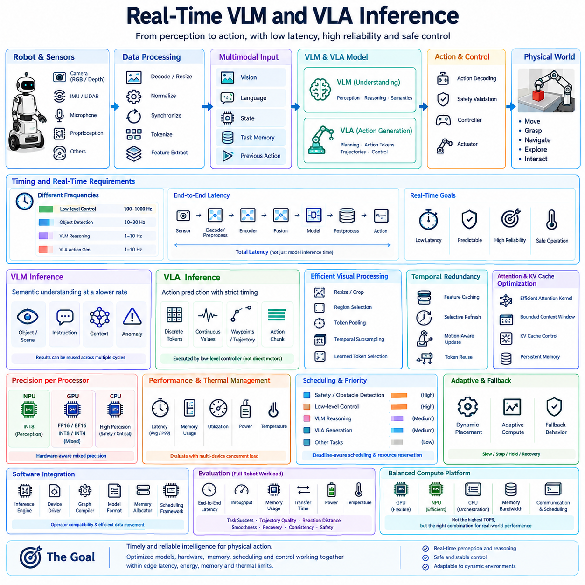{width="7.268055555555556in" height="7.268055555555556in"}

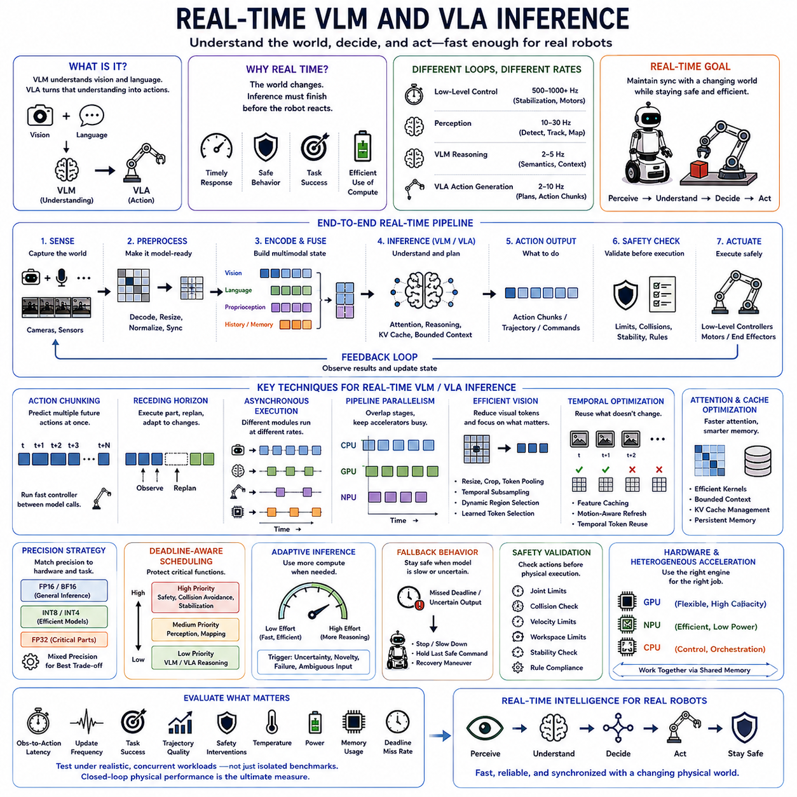{width="7.268055555555556in" height="7.268055555555556in"}

Real-time VLM and VLA inference connects multimodal understanding directly to physical robot behavior under strict timing constraints. A Vision-Language Model must interpret visual observations and language instructions quickly enough to remain synchronized with the environment, while a Vision-Language-Action model must additionally transform this understanding into executable actions before the physical state changes significantly.

The meaning of real time depends on the robotic function being performed. Low-level stabilization and motor control may operate at hundreds or thousands of updates per second, while object detection, semantic perception, VLM reasoning, and VLA action generation can operate at lower frequencies. Real-time deployment therefore requires a hierarchy of control loops rather than expecting one foundation model to execute every robotic function at the fastest rate.

A typical real-time pipeline begins with cameras and other sensors capturing the current environment. Observations are decoded, resized, normalized, synchronized, and transformed into model-ready representations before reaching visual encoders. Language instructions, proprioceptive states, task memory, and previous actions may then be fused with visual features. The model reasons over this multimodal state and produces semantic outputs, plans, or action representations.

End-to-end latency is more important than model inference latency alone. Sensor exposure, frame transfer, image decoding, preprocessing, tokenization, encoder execution, multimodal attention, action decoding, safety validation, and actuator communication all contribute to response time. A model reporting fast GPU inference can still produce slow physical reactions if other stages introduce substantial delays or synchronization barriers.

VLM inference is often used to provide semantic understanding at a slower temporal scale than conventional perception. The model may identify objects, interpret relationships, understand instructions, recognize task context, or evaluate unusual situations. These semantic results can remain useful across multiple control cycles, allowing faster conventional perception and control modules to continue operating without requiring the VLM to analyze every incoming sensor frame.

VLA inference introduces stricter timing requirements because its outputs influence physical motion. The model may predict discrete action tokens, continuous control values, end-effector commands, waypoints, trajectories, or short action chunks. The appropriate output representation depends on the embodiment and control architecture. In most practical systems, VLA outputs are executed through lower-level controllers rather than being sent directly to motors without validation.

Action chunking can improve real-time efficiency by predicting several future actions in a single inference step. Instead of invoking a large model for every control update, the VLA generates a short sequence of actions that a faster controller executes. This reduces foundation-model invocation frequency and computational cost. However, long chunks can become stale when the environment changes, so chunk length must balance efficiency against responsiveness.

Receding-horizon execution provides a useful compromise. The model predicts a sequence of future actions but executes only part of that sequence before observing the environment again and replanning. This maintains closed-loop feedback while reducing the number of expensive model calls. Unexpected obstacles, object movement, contact events, or uncertainty can trigger earlier replanning when the original action sequence is no longer appropriate.

Asynchronous execution is important because sensing, VLM reasoning, VLA generation, and low-level control naturally operate at different rates. Camera acquisition can continue while the foundation model processes a previous observation, and low-level controllers can execute existing commands while new high-level actions are generated. Proper buffering, timestamps, and state synchronization are required to ensure that model outputs correspond to a meaningful physical state.

Pipeline parallelism can further reduce effective latency. Image preprocessing may run on a CPU or dedicated hardware while a GPU processes the previous visual representation and an NPU performs another perception workload. Overlapping these stages prevents expensive accelerators from remaining idle. The objective is not merely to accelerate individual operations but to maintain a continuous flow of observations, reasoning, and actions through the system.

Visual processing frequently dominates the computational cost of real-time multimodal inference. Multiple cameras, high resolutions, and video streams can produce enormous numbers of visual tokens. Image resizing, region selection, token pooling, temporal subsampling, and learned token selection can reduce this burden. Dynamic areas and interaction regions can receive greater processing detail while stable background information is represented more compactly.

Temporal redundancy provides another opportunity for acceleration. Consecutive robot observations often contain largely unchanged scene information. Recomputing every visual feature from scratch can therefore be inefficient. Feature caching, selective visual refresh, motion-aware updates, and temporal token reuse can preserve stable representations while concentrating computation on changed regions, moving objects, robot motion, and newly relevant interaction areas.

Attention and KV cache optimization are also important for maintaining real-time performance as context grows. Efficient attention kernels reduce memory movement, while bounded context windows prevent historical information from increasing computation indefinitely. KV caches avoid repeated processing of previous states, but their size must remain controlled. Important long-term task information can be summarized into compact persistent memory while detailed recent observations remain directly accessible.

Inference precision should match both hardware capability and task sensitivity. FP16, BF16, INT8, INT4, and mixed-precision execution can reduce memory traffic and increase accelerator throughput. Vision backbones or language components may tolerate aggressive quantization, while action heads or numerically sensitive modules may require greater precision. The useful configuration is determined by measured physical performance rather than numerical format alone.

Real-time systems also require predictable latency rather than only low average latency. Occasional inference stalls can be dangerous when the robot is moving near people, obstacles, or manipulable objects. High-percentile latency, worst-case response time, queue growth, memory contention, and thermal throttling should therefore be monitored. A slower but predictable model may be more suitable for physical control than a faster model with severe timing variability.

Deadline-aware scheduling can protect critical robot functions from large foundation-model workloads. Emergency obstacle detection, collision avoidance, stabilization, and safety monitoring should receive higher priority than semantic reasoning that can tolerate delay. Compute resources can be reserved for these functions, while VLM or VLA execution is delayed, simplified, interrupted, or moved to another accelerator when the system approaches its real-time limits.

Adaptive inference can vary model effort according to task complexity. Routine navigation or familiar manipulation may use fewer visual tokens, shorter context, smaller models, or fewer reasoning iterations. Ambiguous instructions, unfamiliar objects, failed grasps, or uncertain scenes can trigger additional computation. This allows the robot to conserve latency and energy during simple situations while spending more inference resources when deeper reasoning provides meaningful value.

Fallback behavior is essential when a foundation model misses its deadline or produces an uncertain output. The robot should not simply wait indefinitely for inference while continuing unsafe motion. A conventional controller can slow or stop the robot, maintain a stable pose, preserve the previous safe command, or move into a predefined recovery state. Real-time VLA deployment therefore combines learned intelligence with deterministic mechanisms that remain available independently.

Safety validation should occur between generated actions and physical execution. Predicted trajectories or control commands can be checked against joint limits, collision constraints, velocity limits, workspace boundaries, stability requirements, and other safety rules. These checks should remain lightweight enough to meet the control deadline. Foundation-model capability does not eliminate the need for deterministic runtime protection around physical actions.

Real-time performance must be evaluated under realistic concurrent workloads. A VLA benchmark executed alone on a GPU does not represent a robot simultaneously performing camera processing, localization, mapping, networking, logging, obstacle detection, and safety monitoring. Evaluation should measure observation-to-action latency, update frequency, deadline misses, memory utilization, accelerator load, power consumption, and temperature while the complete robotic system is operating.

Closed-loop physical evaluation is ultimately more meaningful than raw tokens per second. The relevant question is whether the robot can perceive changes, reason about them, generate appropriate actions, and correct those actions before errors become significant. Task success, trajectory quality, reaction distance, control smoothness, recovery performance, temporal consistency, and safety interventions reveal whether inference is genuinely fast enough for the physical application.

Real-time VLM and VLA inference therefore requires coordinated optimization across models, hardware, memory, scheduling, and control architecture. Efficient visual encoding, bounded attention, caching, quantization, heterogeneous acceleration, asynchronous pipelines, action chunking, adaptive compute, and deterministic safety layers work together. The objective is not simply maximum inference speed, but timely and reliable intelligence that remains synchronized with a continuously changing physical world.

실시간 VLM 및 VLA 추론(Real-Time VLM and VLA Inference)은 엄격한 시간 제약 아래에서 다중모달 이해(Multimodal Understanding)를 로봇의 물리적 행동과 직접 연결한다. 비전-언어 모델(Vision-Language Model, VLM)은 환경과 동기화된 상태를 유지할 수 있을 만큼 빠르게 시각적 관측과 언어 명령을 해석해야 하며, 비전-언어-행동 모델(Vision-Language-Action Model, VLA)은 여기에 더해 물리적 상태가 크게 변화하기 전에 이러한 이해를 실행 가능한 행동으로 변환해야 한다.

실시간(Real Time)의 의미는 수행되는 로봇 기능에 따라 달라진다. 저수준 안정화(Low-Level Stabilization)와 모터 제어(Motor Control)는 초당 수백 또는 수천 회의 업데이트로 동작할 수 있지만, 물체 탐지(Object Detection), 의미적 지각(Semantic Perception), VLM 추론, VLA 행동 생성은 더 낮은 주파수에서 실행될 수 있다. 따라서 실시간 배포에는 하나의 파운데이션 모델이 모든 로봇 기능을 가장 빠른 속도로 실행하도록 하는 것이 아니라 계층형 제어 루프(Hierarchy of Control Loops)가 필요하다.

일반적인 실시간 파이프라인(Real-Time Pipeline)은 카메라와 기타 센서가 현재 환경을 획득하는 것에서 시작한다. 관측 데이터는 비전 인코더(Visual Encoder)에 전달되기 전에 디코딩, 크기 조정, 정규화(Normalization), 동기화(Synchronization)를 거쳐 모델 입력 표현으로 변환된다. 이후 언어 명령, 고유수용성 상태(Proprioceptive State), 작업 메모리(Task Memory), 이전 행동이 시각 특징과 융합될 수 있으며, 모델은 이러한 다중모달 상태를 추론하여 의미적 출력, 계획 또는 행동 표현(Action Representation)을 생성한다.

종단간 지연시간(End-to-End Latency)은 모델 추론 지연시간만을 측정하는 것보다 중요하다. 센서 노출(Sensor Exposure), 프레임 전송, 이미지 디코딩, 전처리(Preprocessing), 토큰화(Tokenization), 인코더 실행, 다중모달 어텐션(Multimodal Attention), 행동 디코딩(Action Decoding), 안전 검증(Safety Validation), 액추에이터 통신(Actuator Communication)이 모두 응답시간에 영향을 준다. GPU 추론 속도가 빠른 모델이라도 다른 단계에서 상당한 지연이나 동기화 장벽이 발생하면 실제 물리적 반응은 느려질 수 있다.

VLM 추론은 일반적으로 기존 지각(Conventional Perception)보다 느린 시간 규모에서 의미적 이해(Semantic Understanding)를 제공하는 데 활용된다. 모델은 물체를 식별하고 관계를 해석하며 명령을 이해하고 작업 문맥(Task Context)을 파악하거나 비정상적인 상황을 평가할 수 있다. 이러한 의미적 결과는 여러 제어 주기에 걸쳐 계속 유효할 수 있으므로 더 빠른 기존 지각 및 제어 모듈이 모든 센서 프레임을 VLM으로 분석하지 않고도 계속 동작할 수 있다.

VLA 추론은 출력이 물리적 움직임에 영향을 주기 때문에 더욱 엄격한 시간 요구사항을 가진다. 모델은 이산 행동 토큰(Discrete Action Token), 연속 제어값(Continuous Control Value), 엔드 이펙터 명령(End-Effector Command), 웨이포인트(Waypoint), 궤적(Trajectory) 또는 짧은 행동 청크(Action Chunk)를 예측할 수 있다. 적절한 출력 표현은 체화 형태(Embodiment)와 제어 아키텍처에 따라 달라지며, 대부분의 실제 시스템에서는 VLA 출력을 검증 없이 모터로 직접 전달하지 않고 저수준 제어기(Low-Level Controller)를 통해 실행한다.

행동 청킹(Action Chunking)은 한 번의 추론 단계에서 여러 미래 행동을 예측함으로써 실시간 효율을 높일 수 있다. 모든 제어 업데이트마다 대규모 모델을 호출하는 대신 VLA가 짧은 행동 시퀀스를 생성하고 더 빠른 제어기가 이를 실행한다. 이를 통해 파운데이션 모델 호출 빈도와 연산 비용을 줄일 수 있다. 그러나 행동 청크가 너무 길면 환경이 변화할 때 기존 행동이 오래된 정보에 기반하게 될 수 있으므로 청크 길이는 효율성과 반응성 사이에서 균형을 이루어야 한다.

이동 지평선 실행(Receding-Horizon Execution)은 유용한 절충 방법을 제공한다. 모델은 미래의 행동 시퀀스를 예측하지만 그중 일부만 실행한 후 환경을 다시 관측하고 재계획(Replanning)한다. 이를 통해 비용이 높은 모델 호출 횟수를 줄이면서 폐루프 피드백(Closed-Loop Feedback)을 유지할 수 있다. 예상하지 못한 장애물, 물체 이동, 접촉 사건(Contact Event), 불확실성이 발생하면 기존 행동 시퀀스가 더 이상 적절하지 않을 때 조기에 재계획을 수행할 수 있다.

비동기 실행(Asynchronous Execution)은 센싱, VLM 추론, VLA 생성, 저수준 제어가 본질적으로 서로 다른 속도로 동작하기 때문에 중요하다. 파운데이션 모델이 이전 관측을 처리하는 동안에도 카메라는 계속 데이터를 획득할 수 있고, 새로운 고수준 행동이 생성되는 동안 저수준 제어기는 기존 명령을 실행할 수 있다. 모델 출력이 의미 있는 물리적 상태와 대응되도록 하기 위해 적절한 버퍼링(Buffering), 타임스탬프(Time Stamp), 상태 동기화(State Synchronization)가 필요하다.

파이프라인 병렬성(Pipeline Parallelism)은 유효 지연시간(Effective Latency)을 추가로 줄일 수 있다. CPU 또는 전용 하드웨어가 이미지 전처리를 수행하는 동안 GPU는 이전 시각 표현을 처리하고 NPU는 다른 지각 워크로드를 실행할 수 있다. 이러한 처리 단계를 중첩하면 고가의 가속기가 유휴 상태로 남는 것을 방지할 수 있다. 목표는 개별 연산을 단순히 가속하는 것이 아니라 관측, 추론, 행동이 시스템 전체에서 지속적으로 흐르도록 유지하는 것이다.

시각 처리(Visual Processing)는 실시간 다중모달 추론에서 연산 비용의 상당 부분을 차지하는 경우가 많다. 여러 카메라, 고해상도 영상, 비디오 스트림은 매우 많은 시각 토큰(Visual Token)을 생성할 수 있다. 이미지 크기 조정, 관심 영역 선택(Region Selection), 토큰 풀링(Token Pooling), 시간적 서브샘플링(Temporal Subsampling), 학습 기반 토큰 선택(Learned Token Selection)을 통해 이러한 부담을 줄일 수 있다. 동적 영역과 상호작용 영역에는 더 높은 처리 세부도를 적용하고 안정적인 배경 정보는 더 압축된 형태로 표현할 수 있다.

시간적 중복성(Temporal Redundancy)은 추가적인 가속 기회를 제공한다. 연속적인 로봇 관측에는 대부분 변화하지 않은 장면 정보가 포함되는 경우가 많기 때문에 모든 시각 특징을 처음부터 다시 계산하는 것은 비효율적일 수 있다. 특징 캐싱(Feature Caching), 선택적 시각 갱신(Selective Visual Refresh), 움직임 인식 업데이트(Motion-Aware Update), 시간적 토큰 재사용(Temporal Token Reuse)을 활용하면 안정적인 표현을 유지하면서 변화한 영역, 움직이는 물체, 로봇의 움직임, 새롭게 중요해진 상호작용 영역에 연산을 집중할 수 있다.

어텐션(Attention)과 KV 캐시 최적화(KV Cache Optimization) 역시 문맥이 증가할 때 실시간 성능을 유지하는 데 중요하다. 효율적인 어텐션 커널(Attention Kernel)은 메모리 이동을 줄이고, 제한된 문맥 윈도(Bounded Context Window)는 과거 정보로 인해 연산량이 무한히 증가하는 것을 방지한다. KV 캐시는 이전 상태의 반복 처리를 줄이지만 크기를 제어해야 한다. 중요한 장기 작업 정보는 압축된 지속 메모리(Persistent Memory)로 요약하고 상세한 최근 관측은 직접 접근 가능한 형태로 유지할 수 있다.

추론 정밀도(Inference Precision)는 하드웨어 기능과 작업 민감도(Task Sensitivity)를 모두 고려하여 결정해야 한다. FP16, BF16, INT8, INT4, 혼합 정밀도 실행(Mixed-Precision Execution)은 메모리 트래픽을 줄이고 가속기 처리량을 높일 수 있다. 비전 백본(Vision Backbone)이나 언어 구성 요소에는 적극적인 양자화(Quantization)를 적용할 수 있지만, 행동 헤드(Action Head)나 수치적으로 민감한 모듈에는 더 높은 정밀도가 필요할 수 있다. 유용한 구성은 수치 형식 자체가 아니라 측정된 물리적 작업 성능을 기준으로 결정해야 한다.

실시간 시스템에는 낮은 평균 지연시간뿐 아니라 예측 가능한 지연시간(Predictable Latency)도 필요하다. 간헐적인 추론 정지(Inference Stall)는 로봇이 사람, 장애물 또는 조작 대상 물체 주변에서 움직일 때 위험할 수 있다. 따라서 상위 백분위 지연시간(High-Percentile Latency), 최악 조건 응답시간(Worst-Case Response Time), 큐 증가(Queue Growth), 메모리 경합(Memory Contention), 열 스로틀링(Thermal Throttling)을 모니터링해야 한다. 심각한 시간 변동성을 가진 빠른 모델보다 느리더라도 예측 가능한 모델이 물리적 제어에 더 적합할 수 있다.

데드라인 인식 스케줄링(Deadline-Aware Scheduling)은 대규모 파운데이션 모델 워크로드로부터 중요한 로봇 기능을 보호할 수 있다. 긴급 장애물 탐지, 충돌 회피(Collision Avoidance), 안정화, 안전 모니터링은 지연을 허용할 수 있는 의미적 추론보다 높은 우선순위를 가져야 한다. 이러한 기능을 위해 연산 자원을 예약할 수 있으며, 시스템이 실시간 한계에 접근하면 VLM 또는 VLA 실행을 지연하거나 단순화하고 중단하거나 다른 가속기로 이동할 수 있다.

적응형 추론(Adaptive Inference)은 작업 복잡도에 따라 모델이 사용하는 연산량을 변화시킬 수 있다. 일상적인 주행이나 익숙한 조작에서는 더 적은 시각 토큰, 짧은 문맥, 작은 모델 또는 적은 추론 반복을 사용할 수 있다. 모호한 명령, 익숙하지 않은 물체, 파지 실패(Grasp Failure), 불확실한 장면에서는 추가 연산을 활성화할 수 있다. 이를 통해 단순한 상황에서는 지연시간과 에너지를 절약하고 더 깊은 추론이 실질적인 가치를 제공하는 상황에 더 많은 추론 자원을 사용할 수 있다.

폴백 동작(Fallback Behavior)은 파운데이션 모델이 데드라인을 놓치거나 불확실한 출력을 생성할 때 필수적이다. 로봇은 추론 결과를 무기한 기다리면서 위험한 움직임을 계속해서는 안 된다. 기존 제어기(Conventional Controller)는 로봇을 감속하거나 정지시키고, 안정적인 자세를 유지하거나, 이전의 안전한 명령을 유지하고, 미리 정의된 복구 상태(Recovery State)로 전환할 수 있다. 따라서 실시간 VLA 배포는 학습된 지능과 독립적으로 사용할 수 있는 결정론적 메커니즘(Deterministic Mechanism)을 결합해야 한다.

생성된 행동과 실제 물리적 실행 사이에는 안전 검증(Safety Validation)이 이루어져야 한다. 예측된 궤적이나 제어 명령은 관절 제한(Joint Limit), 충돌 제약(Collision Constraint), 속도 제한(Velocity Limit), 작업 공간 경계(Workspace Boundary), 안정성 요구사항과 기타 안전 규칙을 기준으로 검사할 수 있다. 이러한 검사는 제어 데드라인을 충족할 수 있을 만큼 가볍고 빠르게 실행되어야 한다. 파운데이션 모델의 높은 능력이 물리적 행동을 보호하는 결정론적 런타임 보호(Deterministic Runtime Protection)의 필요성을 제거하지는 않는다.

실시간 성능은 현실적인 동시 워크로드(Concurrent Workload) 조건에서 평가해야 한다. GPU에서 VLA 벤치마크만 단독 실행하는 것은 카메라 처리, 위치 추정, 매핑, 네트워킹, 로깅, 장애물 탐지, 안전 모니터링을 동시에 수행하는 실제 로봇을 대표하지 못한다. 따라서 완전한 로봇 시스템이 동작하는 동안 관측-행동 지연시간(Observation-to-Action Latency), 업데이트 주파수, 데드라인 미준수(Deadline Miss), 메모리 사용량, 가속기 부하, 전력 소비, 온도를 함께 측정해야 한다.

궁극적으로 초당 토큰 수(Tokens per Second)와 같은 단순한 처리량보다 폐루프 물리적 평가(Closed-Loop Physical Evaluation)가 더 중요하다. 핵심은 로봇이 환경 변화를 감지하고, 이를 추론하며, 적절한 행동을 생성하고, 오류가 심각해지기 전에 행동을 수정할 수 있는지 여부다. 작업 성공률, 궤적 품질, 반응 거리(Reaction Distance), 제어 부드러움(Control Smoothness), 복구 성능, 시간적 일관성(Temporal Consistency), 안전 개입(Safety Intervention)을 통해 추론 속도가 실제 물리적 응용에 충분한지를 판단할 수 있다.

따라서 실시간 VLM 및 VLA 추론은 모델, 하드웨어, 메모리, 스케줄링, 제어 아키텍처 전반에 걸친 통합적인 최적화를 요구한다. 효율적인 시각 인코딩(Visual Encoding), 제한된 어텐션, 캐싱(Caching), 양자화, 이기종 가속(Heterogeneous Acceleration), 비동기 파이프라인, 행동 청킹, 적응형 연산(Adaptive Compute), 결정론적 안전 계층(Deterministic Safety Layer)이 함께 작동해야 한다. 목표는 단순한 최대 추론 속도가 아니라 지속적으로 변화하는 물리적 세계와 동기화된 상태를 유지하는 시기적절하고 신뢰할 수 있는 지능(Timely and Reliable Intelligence)을 구현하는 것이다.

## 10.09. Model Partitioning and Adaptive Inference

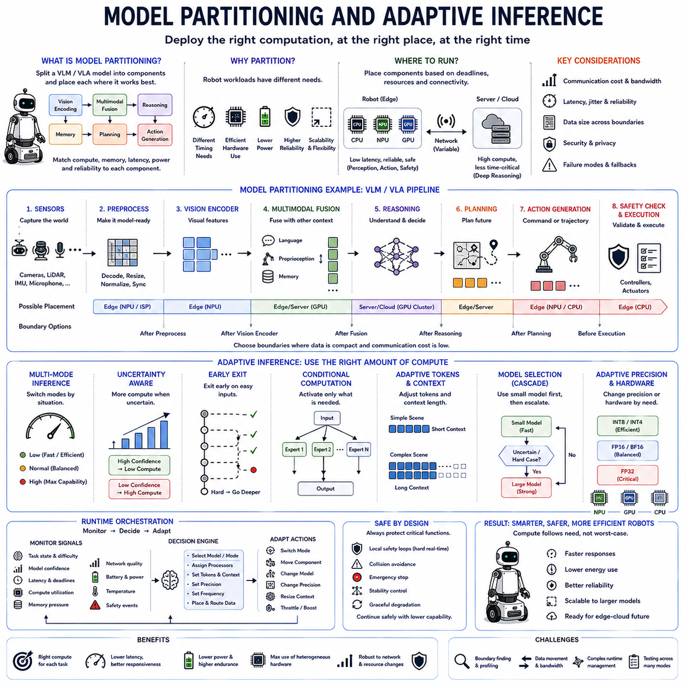{width="7.268055555555556in" height="7.268055555555556in"}

Model partitioning divides a robot foundation model into computational components that can be placed on different processors or computing locations. Instead of treating a VLM or VLA model as one indivisible network, engineers can separate vision encoding, multimodal fusion, reasoning, memory, planning, and action generation. Each component can then execute where its latency, compute, memory, power, and reliability requirements are best satisfied.

Partitioning is particularly valuable because robot workloads have very different timing requirements. Visual feature extraction may consume large amounts of regular tensor computation, while multimodal reasoning may require flexible transformer execution. Action generation must remain responsive, whereas long-horizon reasoning can sometimes tolerate greater delay. Separating these functions allows deployment architecture to reflect their actual physical and computational roles.

Hardware partitioning distributes model components across CPU, GPU, NPU, or other accelerators inside the robot. A compact perception network may run efficiently on an NPU, while a larger multimodal transformer executes on a GPU. CPU resources can coordinate preprocessing, scheduling, safety validation, and system logic. The objective is to match each computational workload with hardware that provides an appropriate combination of performance and energy efficiency.

Model partitioning can also occur between the robot and external computing infrastructure. Latency-sensitive perception, safety, and action functions should generally remain on the edge, while computationally intensive but less time-critical reasoning may execute on a nearby server or cloud platform. This creates an edge-server continuum in which computation is placed according to response deadlines, communication reliability, resource availability, and operational risk.

Network dependence must be considered carefully when partitioning across machines. Sending intermediate features, images, tokens, or model states introduces communication latency, bandwidth consumption, and uncertainty. Wireless connections can vary dramatically as robots move through buildings, factories, streets, or remote environments. Any partition that depends on remote computation must therefore define behavior for delayed, degraded, or completely unavailable connectivity.

The location of a partition boundary strongly affects system efficiency. Splitting between tightly coupled transformer layers may require large intermediate tensors to cross devices repeatedly, eliminating the expected computational advantage. Better boundaries often occur where representations become smaller or semantically compact, such as after visual encoding or high-level planning. Profiling data should determine where communication cost is sufficiently low to justify separation.

Adaptive inference extends static partitioning by changing the amount or location of computation during operation. A robot does not require maximum reasoning capacity for every observation. Routine motion through familiar environments may be handled by lightweight models, while ambiguous instructions, unfamiliar objects, complex manipulation, or unexpected events may justify activating more expensive inference pathways.

This creates multiple inference modes rather than one fixed operating point. A low-compute mode can prioritize energy efficiency and fast responses, a normal mode can provide balanced multimodal reasoning, and a high-compute mode can allocate additional model depth, tokens, context, or accelerators to difficult situations. Switching between these modes allows computational effort to follow the changing complexity of the physical environment.

Uncertainty can provide an important trigger for adaptive inference. When perception confidence is high and the planned action is familiar, a compact model may be sufficient. Low confidence, disagreement between models, ambiguous language, unexpected sensor observations, or uncertain action predictions can trigger deeper reasoning. Compute then becomes a resource that is allocated according to the robot\'s estimate of how difficult the current decision is.

Early-exit architectures provide one mechanism for implementing adaptive computation. Intermediate model layers can produce confidence estimates or candidate outputs, allowing inference to terminate before executing the entire network when the problem is simple. Difficult inputs continue through additional layers. This reduces average computation while preserving deeper processing capacity for situations where additional representation and reasoning are useful.

Conditional computation provides another mechanism by activating only selected model components. Mixture-of-experts architectures, routed transformer blocks, specialized perception modules, or task-specific adapters can process different observations using different computational paths. A navigation task may activate spatial reasoning components, while manipulation may emphasize object affordances and fine visual geometry. The complete model can remain capable without executing every component for every input.

Adaptive token processing changes computational effort at the representation level. Simple scenes can use fewer visual tokens, lower image resolution, shorter temporal context, or stronger token merging. Complex scenes can preserve more image regions and longer histories. By varying token budgets dynamically, the system can control attention cost and memory consumption while retaining additional detail when environmental complexity demands it.

Adaptive context management performs a similar function for temporal reasoning. Routine operation may require only recent observations and a compact task state, whereas recovery from failure may require access to longer histories. Context windows, persistent memory, and KV cache allocation can therefore expand or contract according to task requirements. This prevents long-duration operation from continuously paying the maximum memory and attention cost.

Model selection itself can also be adaptive. A robot may contain a small model optimized for routine local decisions and a larger model reserved for difficult reasoning. The smaller model handles most observations at low cost, while uncertain cases are escalated to the larger model. Such cascaded inference can reduce average energy and latency without permanently sacrificing access to stronger reasoning capabilities.

Adaptive precision adds another control dimension. Routine neural operations may execute using INT8 or other efficient formats, while numerically sensitive components retain FP16, BF16, or higher precision. In some architectures, precision can change according to task difficulty or hardware state. This allows the inference system to trade numerical fidelity against memory bandwidth, energy, and throughput according to current operational requirements.

Hardware utilization can also influence adaptive decisions. When a GPU is heavily loaded by perception or mapping, selected inference components may move to an NPU or execute using a smaller model. If accelerator resources become available, more capable reasoning can be restored. Runtime scheduling can therefore consider both task complexity and current compute availability rather than assigning models permanently to fixed processors.

Power and thermal conditions provide additional adaptation signals. A robot operating with a full battery and cool hardware may temporarily use more expensive inference, whereas low battery state or increasing temperature may require reduced model frequency, smaller token budgets, or lower-power accelerators. Adaptive inference can therefore become part of mission-level energy and thermal management rather than remaining only a model optimization technique.

Partitioning and adaptation must preserve deterministic safety behavior. Critical collision avoidance, emergency stopping, stability control, and hardware protection should not depend on remote services or optional high-compute reasoning. These functions require protected local execution paths. Foundation-model outputs can enhance decision making, but failure of an adaptive component should cause controlled degradation rather than loss of essential physical safety.

Graceful degradation is therefore a fundamental design requirement. If a large model cannot meet its deadline, network connectivity disappears, or an accelerator becomes thermally constrained, the robot should transition to a lower-capability but safe operating mode. It may slow down, restrict its operational envelope, use a compact local policy, request assistance, or stop safely until computational resources recover.

Runtime orchestration coordinates these changing inference pathways. It monitors task state, model confidence, latency, processor utilization, memory pressure, network quality, battery condition, and temperature. Based on these signals, the runtime can select models, processors, precision levels, token budgets, context lengths, and execution frequencies. Adaptive inference therefore requires a system-level controller that manages computational intelligence as a dynamic resource.

Evaluation must examine transitions between operating modes as carefully as the modes themselves. Switching models or processors can introduce latency spikes, cache invalidation, representation mismatches, or inconsistent actions. Testing should include rapidly changing scenes, network degradation, thermal throttling, low-confidence predictions, and workload contention. The robot must remain temporally consistent and physically stable while its computational configuration changes.

The effectiveness of partitioning and adaptive inference should ultimately be measured through complete missions rather than isolated benchmarks. Useful metrics include task success, observation-to-action latency, energy per task, memory usage, thermal stability, network dependence, deadline misses, recovery performance, and safety interventions. These measurements reveal whether computational adaptation actually improves robot capability and endurance under realistic conditions.

Model partitioning and adaptive inference transform deployment from a fixed model-on-device problem into dynamic computational orchestration. Different components can execute on the hardware or infrastructure best suited to them, while inference depth, token count, context, precision, and model size can change with task difficulty and system conditions. The result is an edge robot that spends computational resources where they create the greatest physical value while preserving responsiveness, efficiency, and safety.

모델 분할(Model Partitioning)은 로봇 파운데이션 모델(Robot Foundation Model)을 서로 다른 프로세서나 컴퓨팅 위치에 배치할 수 있는 연산 구성 요소로 나누는 것이다. VLM 또는 VLA 모델을 하나의 분할 불가능한 네트워크로 취급하는 대신, 엔지니어는 비전 인코딩(Vision Encoding), 다중모달 융합(Multimodal Fusion), 추론(Reasoning), 메모리(Memory), 계획(Planning), 행동 생성(Action Generation)을 분리할 수 있다. 이후 각 구성 요소를 지연시간, 연산, 메모리, 전력, 신뢰성 요구사항을 가장 잘 충족하는 위치에서 실행할 수 있다.

분할은 로봇 워크로드가 서로 매우 다른 시간적 요구사항(Timing Requirement)을 가지기 때문에 특히 중요하다. 시각 특징 추출(Visual Feature Extraction)은 대규모의 규칙적인 텐서 연산을 요구할 수 있는 반면, 다중모달 추론은 유연한 트랜스포머 실행(Transformer Execution)을 필요로 할 수 있다. 행동 생성은 높은 반응성을 유지해야 하지만 장기 추론(Long-Horizon Reasoning)은 경우에 따라 더 큰 지연을 허용할 수 있다. 이러한 기능을 분리하면 실제 물리적·계산적 역할에 맞게 배포 아키텍처를 구성할 수 있다.

하드웨어 분할(Hardware Partitioning)은 모델 구성 요소를 로봇 내부의 CPU, GPU, NPU 또는 기타 가속기(Accelerator)에 분산한다. 소형 지각 네트워크(Perception Network)는 NPU에서 효율적으로 실행할 수 있으며, 더 큰 다중모달 트랜스포머(Multimodal Transformer)는 GPU에서 실행할 수 있다. CPU 자원은 전처리(Preprocessing), 스케줄링(Scheduling), 안전 검증(Safety Validation), 시스템 로직(System Logic)을 조정할 수 있다. 목표는 각 연산 워크로드를 성능과 에너지 효율의 적절한 조합을 제공하는 하드웨어와 연결하는 것이다.

모델 분할은 로봇과 외부 컴퓨팅 인프라(External Computing Infrastructure) 사이에서도 이루어질 수 있다. 지연시간에 민감한 지각, 안전, 행동 기능은 일반적으로 엣지(Edge)에 유지해야 하지만, 연산량이 크면서 시간 민감도가 낮은 추론은 인접 서버(Nearby Server) 또는 클라우드 플랫폼(Cloud Platform)에서 실행할 수 있다. 이를 통해 응답 데드라인(Response Deadline), 통신 신뢰성, 자원 가용성, 운용 위험에 따라 연산을 배치하는 엣지-서버 연속체(Edge-Server Continuum)를 구성할 수 있다.

여러 시스템 사이에서 모델을 분할할 때는 네트워크 의존성(Network Dependence)을 신중하게 고려해야 한다. 중간 특징(Intermediate Feature), 이미지, 토큰, 모델 상태를 전송하면 통신 지연, 대역폭 소비, 불확실성이 발생한다. 로봇이 건물, 공장, 도로 또는 원격 환경을 이동함에 따라 무선 연결 상태는 크게 변할 수 있다. 따라서 원격 연산에 의존하는 모든 분할 방식은 통신이 지연되거나 성능이 저하되거나 완전히 사용할 수 없을 때의 동작을 정의해야 한다.

분할 경계(Partition Boundary)의 위치는 시스템 효율에 큰 영향을 준다. 강하게 결합된 트랜스포머 계층 사이를 분할하면 대규모 중간 텐서를 장치 간에 반복적으로 전송해야 하므로 기대했던 연산상의 이점을 상쇄할 수 있다. 일반적으로 시각 인코딩 이후 또는 고수준 계획(High-Level Planning) 이후처럼 표현의 크기가 작아지거나 의미적으로 압축되는 지점이 더 적합한 경계가 될 수 있다. 통신 비용이 분할을 정당화할 만큼 충분히 낮은지는 프로파일링(Profiling) 데이터를 기반으로 결정해야 한다.

적응형 추론(Adaptive Inference)은 운용 중 연산량이나 연산 위치를 변경함으로써 정적 분할(Static Partitioning)을 확장한다. 로봇이 모든 관측에서 최대 수준의 추론 능력을 사용할 필요는 없다. 익숙한 환경에서의 일상적인 움직임은 경량 모델(Lightweight Model)로 처리할 수 있지만, 모호한 명령, 익숙하지 않은 물체, 복잡한 조작 또는 예상하지 못한 사건에서는 더 많은 비용이 필요한 추론 경로를 활성화할 수 있다.

이러한 방식은 하나의 고정된 운용점(Fixed Operating Point)이 아니라 여러 추론 모드(Inference Mode)를 생성한다. 저연산 모드(Low-Compute Mode)는 에너지 효율과 빠른 응답을 우선할 수 있고, 일반 모드(Normal Mode)는 균형 잡힌 다중모달 추론을 제공하며, 고연산 모드(High-Compute Mode)는 어려운 상황에서 추가적인 모델 깊이(Model Depth), 토큰, 문맥(Context), 가속기를 할당할 수 있다. 이러한 모드 사이를 전환하면 물리적 환경의 변화하는 복잡도에 따라 연산량을 조절할 수 있다.

불확실성(Uncertainty)은 적응형 추론을 활성화하는 중요한 트리거(Trigger)가 될 수 있다. 지각 신뢰도(Perception Confidence)가 높고 계획된 행동이 익숙하다면 소형 모델만으로 충분할 수 있다. 낮은 신뢰도, 모델 간 불일치, 모호한 언어, 예상하지 못한 센서 관측 또는 불확실한 행동 예측은 더 깊은 추론을 활성화할 수 있다. 이를 통해 현재 의사결정이 얼마나 어려운지에 대한 로봇의 추정에 따라 연산 자원을 할당할 수 있다.

조기 종료 아키텍처(Early-Exit Architecture)는 적응형 연산(Adaptive Computation)을 구현하는 하나의 방법이다. 중간 모델 계층에서 신뢰도 추정(Confidence Estimation)이나 후보 출력을 생성하여 문제가 단순한 경우 전체 네트워크를 실행하기 전에 추론을 종료할 수 있다. 어려운 입력은 추가 계층을 계속 통과한다. 이를 통해 평균 연산량을 줄이면서 추가적인 표현과 추론이 필요한 상황에서는 더 깊은 처리 능력을 유지할 수 있다.

조건부 연산(Conditional Computation)은 선택된 모델 구성 요소만 활성화하는 또 다른 방법이다. 전문가 혼합(Mixture-of-Experts, MoE) 아키텍처, 라우팅된 트랜스포머 블록(Routed Transformer Block), 특화 지각 모듈(Specialized Perception Module), 작업별 어댑터(Task-Specific Adapter)를 사용하면 서로 다른 관측을 서로 다른 연산 경로로 처리할 수 있다. 주행 작업은 공간 추론 구성 요소를 활성화하고, 조작 작업은 물체 어포던스(Object Affordance)와 정밀한 시각 기하학(Fine Visual Geometry)을 강조할 수 있다. 이를 통해 전체 모델의 능력을 유지하면서 모든 입력에서 모든 구성 요소를 실행하지 않아도 된다.

적응형 토큰 처리(Adaptive Token Processing)는 표현 수준에서 연산량을 변화시킨다. 단순한 장면에서는 더 적은 시각 토큰, 낮은 이미지 해상도, 짧은 시간적 문맥 또는 더 강한 토큰 병합(Token Merging)을 사용할 수 있다. 복잡한 장면에서는 더 많은 이미지 영역과 긴 이력을 보존할 수 있다. 토큰 예산(Token Budget)을 동적으로 조절함으로써 환경 복잡도가 요구할 때 추가적인 세부 정보를 유지하면서 어텐션 비용과 메모리 소비를 제어할 수 있다.

적응형 문맥 관리(Adaptive Context Management)는 시간적 추론에서도 유사한 역할을 한다. 일상적인 운용에서는 최근 관측과 압축된 작업 상태만 필요할 수 있지만, 실패 복구(Recovery from Failure)에서는 더 긴 이력에 접근해야 할 수 있다. 따라서 문맥 윈도(Context Window), 지속 메모리(Persistent Memory), KV 캐시 할당(KV Cache Allocation)을 작업 요구사항에 따라 확장하거나 축소할 수 있다. 이를 통해 장시간 운용에서 항상 최대 메모리와 어텐션 비용을 지불하는 것을 방지할 수 있다.

모델 선택(Model Selection) 자체도 적응형으로 구성할 수 있다. 로봇은 일상적인 지역 의사결정(Local Decision)에 최적화된 소형 모델과 어려운 추론을 위해 예약된 대형 모델을 함께 사용할 수 있다. 소형 모델은 대부분의 관측을 낮은 비용으로 처리하고 불확실한 경우에만 대형 모델로 승격(Escalation)한다. 이러한 계단식 추론(Cascaded Inference)은 더 강력한 추론 능력에 대한 접근성을 유지하면서 평균 에너지 소비와 지연시간을 감소시킬 수 있다.

적응형 정밀도(Adaptive Precision)는 또 다른 제어 차원을 제공한다. 일상적인 신경망 연산은 INT8과 같은 효율적인 형식으로 실행하고, 수치적으로 민감한 구성 요소는 FP16, BF16 또는 더 높은 정밀도를 유지할 수 있다. 일부 아키텍처에서는 작업 난이도나 하드웨어 상태에 따라 정밀도를 변경할 수도 있다. 이를 통해 현재 운용 요구사항에 따라 수치적 충실도(Numerical Fidelity)와 메모리 대역폭, 에너지, 처리량 사이의 균형을 조정할 수 있다.

하드웨어 활용률(Hardware Utilization)도 적응형 의사결정에 영향을 줄 수 있다. GPU가 지각이나 매핑 작업으로 높은 부하를 받고 있다면 선택된 추론 구성 요소를 NPU로 이동하거나 더 작은 모델을 실행할 수 있다. 가속기 자원이 다시 확보되면 더 강력한 추론을 복원할 수 있다. 따라서 런타임 스케줄링(Runtime Scheduling)은 모델을 특정 프로세서에 영구적으로 할당하는 대신 작업 복잡도와 현재 연산 자원의 가용성을 함께 고려할 수 있다.

전력과 열 상태(Power and Thermal Conditions)는 추가적인 적응 신호를 제공한다. 배터리가 충분하고 하드웨어 온도가 낮은 로봇은 일시적으로 더 많은 비용이 필요한 추론을 사용할 수 있지만, 배터리 잔량이 낮거나 온도가 상승하면 모델 실행 빈도(Model Frequency), 토큰 예산 또는 저전력 가속기(Low-Power Accelerator)를 조정해야 할 수 있다. 따라서 적응형 추론은 단순한 모델 최적화 기술을 넘어 임무 수준의 에너지 및 열 관리(Mission-Level Energy and Thermal Management)의 일부가 될 수 있다.

분할과 적응은 결정론적 안전 동작(Deterministic Safety Behavior)을 보존해야 한다. 중요한 충돌 회피(Collision Avoidance), 긴급 정지(Emergency Stop), 안정성 제어(Stability Control), 하드웨어 보호 기능은 원격 서비스나 선택적인 고연산 추론에 의존해서는 안 된다. 이러한 기능에는 보호된 로컬 실행 경로(Protected Local Execution Path)가 필요하다. 파운데이션 모델 출력은 의사결정을 향상시킬 수 있지만 적응형 구성 요소의 실패가 필수적인 물리적 안전 기능의 상실로 이어져서는 안 된다.

따라서 점진적 성능 저하(Graceful Degradation)는 기본적인 설계 요구사항이다. 대형 모델이 데드라인을 충족하지 못하거나 네트워크 연결이 끊기거나 가속기가 열 제약을 받게 되면 로봇은 능력은 낮지만 안전한 운용 모드로 전환해야 한다. 로봇은 속도를 낮추고, 운용 범위(Operational Envelope)를 제한하며, 소형 로컬 정책(Compact Local Policy)을 사용하거나, 지원을 요청하거나, 연산 자원이 회복될 때까지 안전하게 정지할 수 있다.

런타임 오케스트레이션(Runtime Orchestration)은 이러한 변화하는 추론 경로를 조정한다. 런타임은 작업 상태, 모델 신뢰도, 지연시간, 프로세서 활용률, 메모리 압박(Memory Pressure), 네트워크 품질, 배터리 상태, 온도를 모니터링한다. 이러한 신호를 기반으로 모델, 프로세서, 정밀도 수준, 토큰 예산, 문맥 길이, 실행 빈도를 선택할 수 있다. 따라서 적응형 추론에는 연산 지능(Computational Intelligence)을 동적인 자원으로 관리하는 시스템 수준 제어기(System-Level Controller)가 필요하다.

평가에서는 각 운용 모드 자체뿐 아니라 운용 모드 사이의 전환(Transition)도 신중하게 검토해야 한다. 모델이나 프로세서를 전환하면 지연시간 급증(Latency Spike), 캐시 무효화(Cache Invalidation), 표현 불일치(Representation Mismatch), 일관되지 않은 행동이 발생할 수 있다. 테스트에는 빠르게 변화하는 장면, 네트워크 성능 저하, 열 스로틀링(Thermal Throttling), 낮은 신뢰도의 예측, 워크로드 경합(Workload Contention)이 포함되어야 한다. 로봇은 연산 구성이 변경되는 동안에도 시간적 일관성과 물리적 안정성을 유지해야 한다.

분할과 적응형 추론의 효과는 궁극적으로 개별 벤치마크가 아니라 완전한 임무(Complete Mission)를 통해 측정해야 한다. 유용한 평가 지표에는 작업 성공률, 관측-행동 지연시간(Observation-to-Action Latency), 작업당 에너지(Energy per Task), 메모리 사용량, 열 안정성(Thermal Stability), 네트워크 의존성, 데드라인 미준수(Deadline Miss), 복구 성능, 안전 개입(Safety Intervention)이 포함된다. 이러한 측정을 통해 연산 적응이 실제 조건에서 로봇의 능력과 운용 지속시간을 향상시키는지를 판단할 수 있다.

모델 분할과 적응형 추론은 배포 문제를 고정된 장치 위에서 하나의 모델을 실행하는 문제에서 동적 연산 오케스트레이션(Dynamic Computational Orchestration)의 문제로 변화시킨다. 서로 다른 구성 요소는 가장 적합한 하드웨어 또는 인프라에서 실행할 수 있으며, 추론 깊이, 토큰 수, 문맥, 정밀도, 모델 크기는 작업 난이도와 시스템 상태에 따라 변화할 수 있다. 그 결과 엣지 로봇(Edge Robot)은 반응성, 효율성, 안전성을 유지하면서 가장 큰 물리적 가치를 창출하는 곳에 연산 자원을 집중적으로 사용할 수 있다.

## 10.10. Edge On Premise and Cloud Collaboration

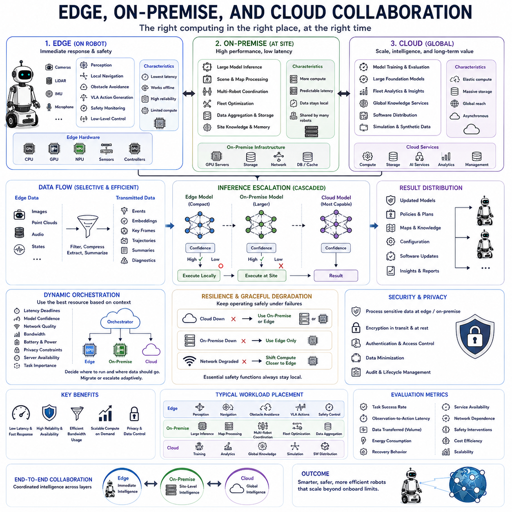{width="7.268055555555556in" height="7.268055555555556in"}

Edge, on-premise, and cloud collaboration provides a distributed computing architecture for robot foundation models in which each layer performs the tasks best matched to its latency, compute, reliability, and data requirements. Rather than placing all intelligence in one location, robotic systems can combine immediate onboard decision making, powerful local infrastructure, and scalable cloud services into a coordinated intelligence hierarchy.

The edge layer consists of computing resources physically integrated into or directly attached to the robot. CPUs, GPUs, NPUs, sensor processors, and embedded controllers execute functions that require immediate response or must remain available without network connectivity. Perception, local navigation, obstacle avoidance, VLA action generation, safety monitoring, and low-level decision making therefore naturally belong close to the physical system.

Edge execution provides the lowest communication latency because sensor data does not need to travel through an external network before being processed. This is particularly important when a robot moves near people, vehicles, machinery, or obstacles. Local processing also improves operational independence because critical functions can continue during network congestion, wireless interference, server outages, or complete disconnection from external infrastructure.

However, edge computing is constrained by onboard memory, electrical power, cooling capacity, physical volume, and accelerator performance. Large VLMs and VLA models may compete with localization, mapping, perception, logging, and communication workloads for limited resources. Edge deployment therefore emphasizes efficient models, quantization, pruning, bounded context, adaptive inference, heterogeneous acceleration, and carefully controlled resource allocation.

On-premise computing introduces a second layer located within the operating site, such as a factory, warehouse, hospital, campus, port, or logistics center. Local GPU servers can provide substantially greater computational capacity than individual robots while maintaining lower and more predictable network latency than distant cloud infrastructure. This makes on-premise systems valuable for workloads that exceed onboard capacity but still require relatively rapid responses.

Multiple robots can share on-premise compute resources. Instead of equipping every robot with enough hardware for occasional peak workloads, a local server cluster can provide additional reasoning capacity when required. Complex scene analysis, large-model inference, map processing, fleet optimization, multi-robot coordination, and intensive recovery reasoning can be centralized, allowing onboard systems to remain optimized for reliable real-time operation.

On-premise infrastructure can also function as a site-level memory and knowledge layer. Robots operating in the same environment can contribute maps, semantic observations, object states, task outcomes, and operational events to shared storage. Other robots can then access updated information without independently rediscovering everything. This creates collective situational awareness while keeping high-volume operational data relatively close to where it is generated.

The cloud provides the third layer and offers elastic computation, large-scale storage, centralized management, and access to models that may be impractical to maintain at every deployment site. Cloud systems can support fleet-wide analytics, large foundation-model services, long-term data aggregation, model training, simulation, evaluation, software distribution, and global knowledge services across geographically distributed robot deployments.

Cloud resources are especially valuable for workloads that are computationally intensive but not tightly coupled to immediate physical control. Training new models, analyzing large operational datasets, generating synthetic data, performing fleet-level optimization, maintaining global semantic knowledge, and evaluating model updates can occur asynchronously. Results can later be distributed to on-premise systems and edge robots as updated models, policies, maps, or configuration data.

The three layers should therefore be separated primarily by deadline and dependency rather than model size alone. Safety-critical and hard real-time functions remain at the edge. Tasks requiring substantial compute with moderate latency tolerance can move to on-premise servers. Large-scale, asynchronous, globally shared, or long-duration workloads can use cloud infrastructure. This hierarchy prevents communication delay from becoming part of critical physical control loops.

Data movement is one of the most important design considerations. Continuously uploading raw multi-camera video, LiDAR streams, audio, and internal model states can consume enormous bandwidth. Edge systems should therefore filter, compress, summarize, or extract useful features before transmission. Events, embeddings, selected frames, trajectories, diagnostics, and semantic summaries can often communicate useful information more efficiently than complete raw sensor streams.

Selective data escalation allows the system to transmit information according to importance. Routine observations can remain local, while unusual events, low-confidence predictions, failures, safety interventions, or novel environments can be forwarded to on-premise or cloud systems. This event-driven architecture reduces network and storage requirements while concentrating expensive centralized computation on situations where additional intelligence provides meaningful value.

Model inference can similarly be escalated across layers. A compact edge model may first attempt to solve a task. If confidence is insufficient, the request can be sent to a larger on-premise model, and exceptionally difficult or non-time-critical cases may use an even more capable cloud model. Such cascaded inference allows the system to access powerful models without making every physical decision dependent on remote computation.

Network conditions should influence this collaboration dynamically. When connectivity is fast and reliable, robots can use external resources more aggressively. When bandwidth decreases or latency rises, computation should migrate toward the edge and local systems. Network-aware orchestration can monitor round-trip latency, packet loss, available bandwidth, and server load to determine whether remote inference is appropriate for the current task.

Failure tolerance must be designed into every layer boundary. Loss of cloud access should not prevent essential site operation, and loss of the on-premise server should not eliminate a robot\'s ability to stop safely or perform basic navigation. Each lower layer should retain sufficient capability to maintain safe operation when higher layers disappear. This principle creates graceful degradation rather than catastrophic dependence on connectivity.

Security and privacy also influence where computation and data should reside. Raw camera images, audio, facility maps, operational records, or human interaction data may contain sensitive information. Processing such data at the edge or on-premise can reduce unnecessary external transmission. Cloud communication should use appropriate authentication, encryption, access control, data minimization, and lifecycle policies according to the operational environment.

Synchronization is essential when intelligence is distributed across multiple locations. Edge robots may operate on rapidly changing physical states while on-premise and cloud systems reason over delayed information. Every observation, event, model result, map update, and command should therefore carry meaningful timing and version information. Stale remote recommendations must be detected before they influence a physical situation that has already changed.

Shared models also require version management. A fleet may contain robots with different hardware capabilities, model revisions, quantization levels, or sensor configurations. On-premise and cloud services should know which model and software versions are active on each robot. Model registries, staged deployment, compatibility checks, rollback mechanisms, and fleet monitoring help prevent inconsistent behavior during updates.

The cloud can support continuous improvement by aggregating selected operational experience from many deployments. Difficult examples, failure cases, unusual environments, and human corrections can be collected and used for training or evaluation. Improved models can then be validated centrally, optimized for different edge hardware targets, distributed through on-premise infrastructure, and gradually deployed across the fleet under controlled release policies.

On-premise infrastructure provides an important validation boundary between global models and physical robots. New models can be downloaded from the cloud, tested against site-specific data or simulation, and verified for latency, compatibility, and safety before deployment. This allows global learning to be combined with local operational requirements and reduces the risk of distributing an unsuitable model directly to every robot.

Fleet coordination also benefits from the layered architecture. Individual robots maintain immediate autonomy, while on-premise systems optimize shared resources, traffic, task allocation, charging, and local maps. Cloud systems can analyze performance across multiple sites and longer time periods. Decision scope therefore expands naturally from robot-level control to site-level coordination and finally to fleet-wide strategic optimization.

Efficient collaboration requires an orchestration layer that continuously decides where workloads should execute and where data should flow. The decision can consider latency deadlines, model confidence, accelerator utilization, network quality, battery state, privacy constraints, server availability, and task importance. Computation can then migrate or escalate dynamically while protected safety functions remain permanently local.

Evaluation should reproduce realistic network and infrastructure conditions rather than assuming ideal connectivity. Tests should include variable latency, bandwidth limitations, packet loss, server overload, cloud outages, and complete disconnection. Metrics should measure task success, observation-to-action latency, transmitted data volume, energy consumption, recovery behavior, service availability, and the robot\'s ability to continue operating safely under degraded conditions.

Edge, on-premise, and cloud collaboration ultimately creates a layered intelligence architecture for scalable robotics. The edge provides immediate and dependable physical intelligence, on-premise infrastructure supplies powerful site-level computation and coordination, and the cloud enables large-scale learning, storage, and fleet intelligence. Their coordinated operation allows robot foundation models to scale beyond onboard hardware without sacrificing the responsiveness, autonomy, and safety required in the physical world.

엣지(Edge), 온프레미스(On-Premise), 클라우드(Cloud) 협업은 로봇 파운데이션 모델(Robot Foundation Model)을 위한 분산 컴퓨팅 아키텍처(Distributed Computing Architecture)를 제공하며, 각 계층은 지연시간, 연산 능력, 신뢰성, 데이터 요구사항에 가장 적합한 작업을 수행한다. 모든 지능을 하나의 위치에 배치하는 대신 로봇 시스템은 즉각적인 온보드 의사결정(Onboard Decision Making), 강력한 로컬 인프라(Local Infrastructure), 확장 가능한 클라우드 서비스를 하나의 조정된 지능 계층(Intelligence Hierarchy)으로 결합할 수 있다.

엣지 계층(Edge Layer)은 로봇 내부에 물리적으로 통합되거나 로봇에 직접 연결된 컴퓨팅 자원으로 구성된다. CPU, GPU, NPU, 센서 프로세서(Sensor Processor), 임베디드 제어기(Embedded Controller)는 즉각적인 응답이 필요하거나 네트워크 연결 없이도 지속되어야 하는 기능을 실행한다. 따라서 지각(Perception), 로컬 내비게이션(Local Navigation), 장애물 회피(Obstacle Avoidance), VLA 행동 생성(Action Generation), 안전 모니터링(Safety Monitoring), 저수준 의사결정(Low-Level Decision Making)은 자연스럽게 물리적 시스템 가까이에 배치된다.

엣지 실행(Edge Execution)은 센서 데이터를 처리하기 전에 외부 네트워크를 통해 전송할 필요가 없기 때문에 가장 낮은 통신 지연시간을 제공한다. 이는 로봇이 사람, 차량, 기계 또는 장애물 주변에서 움직일 때 특히 중요하다. 로컬 처리(Local Processing)는 네트워크 혼잡, 무선 간섭, 서버 장애 또는 외부 인프라와의 완전한 연결 단절 상황에서도 중요한 기능을 지속할 수 있기 때문에 운용 독립성(Operational Independence)도 향상시킨다.

그러나 엣지 컴퓨팅(Edge Computing)은 온보드 메모리, 전력, 냉각 용량, 물리적 공간, 가속기 성능의 제약을 받는다. 대규모 VLM과 VLA 모델은 위치 추정(Localization), 매핑(Mapping), 지각, 로깅(Logging), 통신 워크로드와 제한된 자원을 공유해야 할 수 있다. 따라서 엣지 배포(Edge Deployment)는 효율적인 모델, 양자화(Quantization), 가지치기(Pruning), 제한된 문맥(Bounded Context), 적응형 추론(Adaptive Inference), 이기종 가속(Heterogeneous Acceleration), 세밀하게 제어된 자원 할당(Resource Allocation)을 중요하게 고려한다.

온프레미스 컴퓨팅(On-Premise Computing)은 공장, 창고, 병원, 캠퍼스, 항만 또는 물류센터와 같은 실제 운용 현장 내부에 위치한 두 번째 계층을 제공한다. 로컬 GPU 서버(Local GPU Server)는 개별 로봇보다 훨씬 큰 연산 능력을 제공하면서 원거리 클라우드 인프라보다 낮고 예측 가능한 네트워크 지연시간을 유지할 수 있다. 따라서 온프레미스 시스템은 온보드 용량을 초과하지만 비교적 빠른 응답이 필요한 워크로드에 유용하다.

여러 로봇은 온프레미스 연산 자원을 공유할 수 있다. 모든 로봇에 간헐적으로 발생하는 최대 워크로드를 처리할 수 있는 하드웨어를 각각 탑재하는 대신 로컬 서버 클러스터(Local Server Cluster)가 필요할 때 추가적인 추론 능력을 제공할 수 있다. 복잡한 장면 분석, 대규모 모델 추론, 지도 처리, 플릿 최적화(Fleet Optimization), 다중 로봇 협조(Multi-Robot Coordination), 고비용 복구 추론(Recovery Reasoning)을 중앙화함으로써 온보드 시스템은 신뢰성 높은 실시간 운용에 최적화될 수 있다.

온프레미스 인프라는 현장 수준 메모리 및 지식 계층(Site-Level Memory and Knowledge Layer)으로도 기능할 수 있다. 동일한 환경에서 운용되는 로봇들은 지도, 의미적 관측(Semantic Observation), 물체 상태, 작업 결과, 운용 이벤트를 공유 저장소(Shared Storage)에 제공할 수 있다. 다른 로봇들은 모든 정보를 독립적으로 다시 발견하지 않고도 갱신된 정보를 활용할 수 있다. 이를 통해 대용량 운용 데이터를 생성 위치 가까이에 유지하면서 집단 상황 인식(Collective Situational Awareness)을 구축할 수 있다.

클라우드는 세 번째 계층으로 탄력적인 연산(Elastic Computation), 대규모 저장 공간, 중앙집중식 관리(Centralized Management), 개별 배포 현장에서 유지하기 어려운 모델에 대한 접근성을 제공한다. 클라우드 시스템은 플릿 전체 분석(Fleet-Wide Analytics), 대규모 파운데이션 모델 서비스, 장기 데이터 통합(Long-Term Data Aggregation), 모델 학습, 시뮬레이션, 평가, 소프트웨어 배포, 지리적으로 분산된 로봇 시스템의 글로벌 지식 서비스(Global Knowledge Service)를 지원할 수 있다.

클라우드 자원은 연산 집약적이지만 즉각적인 물리적 제어와 밀접하게 연결되지 않은 워크로드에서 특히 유용하다. 새로운 모델 학습, 대규모 운용 데이터셋 분석, 합성 데이터(Synthetic Data) 생성, 플릿 수준 최적화, 글로벌 의미 지식(Global Semantic Knowledge) 관리, 모델 업데이트 평가는 비동기적으로 수행할 수 있다. 이후 결과를 업데이트된 모델, 정책(Policy), 지도 또는 구성 데이터 형태로 온프레미스 시스템과 엣지 로봇에 배포할 수 있다.

따라서 세 계층은 모델 크기만을 기준으로 구분하기보다 데드라인(Deadline)과 의존성(Dependency)을 중심으로 분리해야 한다. 안전 필수 기능(Safety-Critical Function)과 하드 실시간 기능(Hard Real-Time Function)은 엣지에 유지한다. 상당한 연산량이 필요하면서 중간 수준의 지연을 허용할 수 있는 작업은 온프레미스 서버로 이동할 수 있다. 대규모, 비동기, 전역 공유 또는 장시간 워크로드는 클라우드 인프라를 활용할 수 있다. 이러한 계층 구조는 통신 지연이 중요한 물리적 제어 루프에 포함되는 것을 방지한다.

데이터 이동(Data Movement)은 가장 중요한 설계 고려사항 중 하나다. 여러 카메라의 원시 영상, LiDAR 스트림, 오디오, 내부 모델 상태를 지속적으로 업로드하면 막대한 대역폭을 소비할 수 있다. 따라서 엣지 시스템은 전송 전에 데이터를 필터링, 압축, 요약하거나 유용한 특징을 추출해야 한다. 이벤트, 임베딩(Embedding), 선택된 프레임, 궤적(Trajectory), 진단 정보, 의미적 요약(Semantic Summary)은 전체 원시 센서 스트림보다 훨씬 효율적으로 유용한 정보를 전달할 수 있다.

선택적 데이터 에스컬레이션(Selective Data Escalation)은 중요도에 따라 정보를 전송할 수 있도록 한다. 일상적인 관측은 로컬에 유지하고 비정상적인 사건, 낮은 신뢰도의 예측, 실패, 안전 개입(Safety Intervention), 새로운 환경은 온프레미스 또는 클라우드 시스템으로 전달할 수 있다. 이러한 이벤트 기반 아키텍처(Event-Driven Architecture)는 네트워크와 저장공간 요구량을 줄이면서 추가적인 지능이 실질적인 가치를 제공하는 상황에 고비용 중앙 연산을 집중할 수 있게 한다.

모델 추론 역시 계층 사이에서 단계적으로 에스컬레이션할 수 있다. 소형 엣지 모델(Compact Edge Model)이 먼저 작업 해결을 시도하고 신뢰도가 충분하지 않으면 요청을 더 큰 온프레미스 모델로 전송할 수 있다. 특히 어렵거나 시간 민감도가 낮은 경우에는 더욱 강력한 클라우드 모델을 활용할 수 있다. 이러한 계단식 추론(Cascaded Inference)을 통해 모든 물리적 의사결정을 원격 연산에 의존하지 않으면서 강력한 모델의 능력을 활용할 수 있다.

네트워크 상태(Network Condition)는 이러한 협업에 동적으로 영향을 주어야 한다. 연결이 빠르고 안정적인 경우 로봇은 외부 자원을 더욱 적극적으로 활용할 수 있다. 대역폭이 감소하거나 지연시간이 증가하면 연산을 엣지와 로컬 시스템으로 이동해야 한다. 네트워크 인식 오케스트레이션(Network-Aware Orchestration)은 왕복 지연시간(Round-Trip Latency), 패킷 손실(Packet Loss), 가용 대역폭, 서버 부하를 모니터링하여 현재 작업에 원격 추론이 적절한지를 결정할 수 있다.

장애 허용성(Failure Tolerance)은 모든 계층의 경계에 포함되어야 한다. 클라우드 접근이 중단되어도 필수적인 현장 운용이 중단되어서는 안 되며, 온프레미스 서버가 손실되어도 로봇이 안전하게 정지하거나 기본적인 주행을 수행하는 능력을 잃어서는 안 된다. 각 하위 계층은 상위 계층을 사용할 수 없을 때에도 안전한 운용을 유지할 수 있는 충분한 능력을 보유해야 한다. 이러한 원칙은 연결성에 대한 치명적인 의존 대신 점진적 성능 저하(Graceful Degradation)를 가능하게 한다.

보안(Security)과 개인정보 보호(Privacy) 역시 연산과 데이터를 어디에 배치할 것인지에 영향을 준다. 원시 카메라 영상, 오디오, 시설 지도, 운용 기록 또는 사람과의 상호작용 데이터에는 민감한 정보가 포함될 수 있다. 이러한 데이터를 엣지나 온프레미스에서 처리하면 불필요한 외부 전송을 줄일 수 있다. 클라우드 통신에는 운용 환경에 적합한 인증(Authentication), 암호화(Encryption), 접근 제어(Access Control), 데이터 최소화(Data Minimization), 수명주기 정책(Lifecycle Policy)을 적용해야 한다.

지능이 여러 위치에 분산되면 동기화(Synchronization)가 필수적이다. 엣지 로봇은 빠르게 변화하는 물리적 상태에서 동작하는 반면 온프레미스와 클라우드 시스템은 지연된 정보를 기반으로 추론할 수 있다. 따라서 모든 관측, 이벤트, 모델 결과, 지도 업데이트, 명령에는 의미 있는 시간 및 버전 정보가 포함되어야 한다. 오래된 원격 권고(Stale Remote Recommendation)가 이미 변화한 물리적 상황에 영향을 주기 전에 이를 탐지해야 한다.

공유 모델(Shared Model)은 버전 관리(Version Management)도 필요로 한다. 하나의 플릿에는 서로 다른 하드웨어 성능, 모델 버전, 양자화 수준, 센서 구성을 가진 로봇이 포함될 수 있다. 온프레미스 및 클라우드 서비스는 각 로봇에서 어떤 모델과 소프트웨어 버전이 활성화되어 있는지 파악해야 한다. 모델 레지스트리(Model Registry), 단계적 배포(Staged Deployment), 호환성 검사(Compatibility Check), 롤백(Rollback), 플릿 모니터링을 통해 업데이트 과정에서 발생할 수 있는 일관되지 않은 동작을 방지할 수 있다.

클라우드는 여러 배포 환경에서 선택적으로 수집된 운용 경험을 통합하여 지속적 개선(Continuous Improvement)을 지원할 수 있다. 어려운 사례, 실패 사례, 비정상적인 환경, 사람의 수정 데이터를 수집하여 학습이나 평가에 활용할 수 있다. 개선된 모델은 중앙에서 검증하고 서로 다른 엣지 하드웨어에 맞게 최적화한 후 온프레미스 인프라를 통해 배포하고 통제된 릴리스 정책(Controlled Release Policy)에 따라 플릿 전체에 점진적으로 적용할 수 있다.

온프레미스 인프라는 글로벌 모델(Global Model)과 실제 로봇 사이의 중요한 검증 경계(Validation Boundary)를 제공한다. 새로운 모델을 클라우드에서 다운로드한 후 현장 특화 데이터(Site-Specific Data) 또는 시뮬레이션을 사용하여 테스트하고 지연시간, 호환성, 안전성을 검증한 다음 배포할 수 있다. 이를 통해 글로벌 학습(Global Learning)과 로컬 운용 요구사항을 결합하고 부적합한 모델이 모든 로봇에 직접 배포될 위험을 줄일 수 있다.

플릿 협조(Fleet Coordination) 역시 계층형 아키텍처의 이점을 얻는다. 개별 로봇은 즉각적인 자율성(Immediate Autonomy)을 유지하고, 온프레미스 시스템은 공유 자원, 교통, 작업 할당(Task Allocation), 충전, 로컬 지도를 최적화한다. 클라우드 시스템은 여러 현장과 더 긴 시간 범위의 성능을 분석할 수 있다. 이에 따라 의사결정 범위는 자연스럽게 로봇 수준 제어에서 현장 수준 협조(Site-Level Coordination), 그리고 플릿 전체의 전략적 최적화(Strategic Optimization)로 확장된다.

효율적인 협업에는 워크로드를 어디에서 실행하고 데이터를 어디로 이동시킬 것인지를 지속적으로 결정하는 오케스트레이션 계층(Orchestration Layer)이 필요하다. 이러한 결정에는 지연시간 데드라인, 모델 신뢰도(Model Confidence), 가속기 활용률, 네트워크 품질, 배터리 상태, 개인정보 보호 제약, 서버 가용성, 작업 중요도를 고려할 수 있다. 보호된 안전 기능은 항상 로컬에 유지하면서 연산은 필요에 따라 동적으로 이동하거나 상위 계층으로 에스컬레이션할 수 있다.

평가는 이상적인 연결 상태를 가정하는 대신 현실적인 네트워크 및 인프라 조건을 재현해야 한다. 테스트에는 가변 지연시간(Variable Latency), 대역폭 제한, 패킷 손실, 서버 과부하(Server Overload), 클라우드 장애, 완전한 연결 단절이 포함되어야 한다. 평가 지표는 작업 성공률, 관측-행동 지연시간(Observation-to-Action Latency), 전송 데이터량, 에너지 소비, 복구 행동, 서비스 가용성(Service Availability), 성능 저하 조건에서도 로봇이 안전하게 계속 동작할 수 있는 능력을 측정해야 한다.

궁극적으로 엣지, 온프레미스, 클라우드 협업은 확장 가능한 로보틱스(Scalable Robotics)를 위한 계층형 지능 아키텍처(Layered Intelligence Architecture)를 구축한다. 엣지는 즉각적이고 신뢰할 수 있는 물리적 지능(Physical Intelligence)을 제공하고, 온프레미스 인프라는 강력한 현장 수준 연산과 협조 기능을 제공하며, 클라우드는 대규모 학습, 저장, 플릿 지능(Fleet Intelligence)을 지원한다. 이들의 조정된 운용을 통해 로봇 파운데이션 모델은 물리적 세계에서 요구되는 반응성, 자율성, 안전성을 유지하면서 온보드 하드웨어의 한계를 넘어 확장될 수 있다.

## 10.11. Offline Autonomy and Connectivity Loss

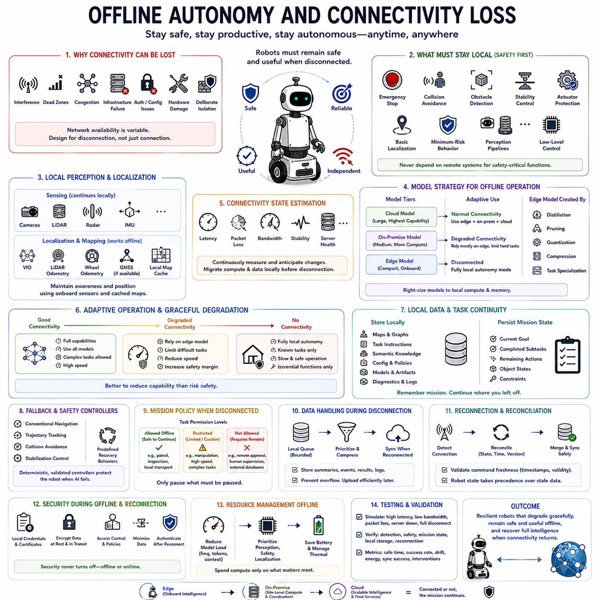{width="7.268055555555556in" height="7.268055555555556in"}

Offline autonomy is the ability of a robot to continue performing useful and safe physical tasks when communication with on-premise servers, cloud services, operators, or external knowledge systems becomes unavailable. For robot foundation models, offline operation is not merely a networking feature. It is a fundamental autonomy requirement because physical systems must remain stable, predictable, and safe even when connectivity disappears unexpectedly.

Connectivity loss can occur for many reasons, including wireless interference, cellular coverage gaps, network congestion, infrastructure failure, authentication problems, damaged communication hardware, or deliberate network isolation. Mobile robots may repeatedly move between regions with very different signal quality. A robust deployment must therefore treat network availability as a variable operating condition rather than assuming continuous access to remote computation and services.

The most important principle is that safety-critical functions must remain locally executable. Emergency stopping, collision avoidance, obstacle detection, stability control, actuator protection, basic localization, and minimum-risk behavior should not depend on cloud responses. If connectivity disappears at the worst possible moment, the robot must still possess enough onboard sensing, computation, and control capability to prevent unsafe physical behavior.

Offline autonomy also requires sufficient local perception. Cameras, LiDAR, radar, depth sensors, proprioception, and other sensing systems should continue feeding onboard perception pipelines without external processing dependencies. The robot may operate with reduced semantic understanding compared with a large remote model, but it must retain enough environmental awareness to detect obstacles, estimate free space, track motion, recognize critical objects, and maintain safe navigation or manipulation.

Localization and mapping strategies must also tolerate communication loss. A robot should maintain local pose estimation using available onboard sensors and previously downloaded maps when external positioning or centralized mapping services become unavailable. Local map caches, visual-inertial odometry, LiDAR odometry, wheel odometry, and GNSS where available can provide complementary information. The required redundancy depends on the robot\'s environment and operational risk.

Robot foundation models used offline must fit within the compute and memory resources available on the robot. A large cloud-hosted VLM or VLA may therefore require a smaller edge counterpart created through distillation, pruning, quantization, architectural compression, or task specialization. The local model does not necessarily need to reproduce every capability of the remote system; it must preserve the capabilities required for safe and useful degraded operation.

This leads naturally to capability tiers. Under normal connectivity, the robot may combine an edge model with larger on-premise or cloud models for complex reasoning. During degraded connectivity, it can rely primarily on onboard intelligence while limiting difficult tasks. During complete disconnection, it can enter a fully local autonomy mode containing only functions that can be executed reliably with available sensors, models, maps, memory, and compute resources.

Graceful degradation is preferable to an abrupt transition from full intelligence to complete shutdown. The robot can progressively reduce operating speed, restrict allowable actions, shorten mission scope, disable tasks requiring remote validation, or increase safety margins as connectivity quality declines. Such behavior preserves useful autonomy while reducing risk according to the amount of external intelligence and supervision that is no longer available.

Connectivity state should therefore be continuously estimated rather than represented by a simple connected-or-disconnected flag. Round-trip latency, packet loss, bandwidth, connection stability, server responsiveness, and recent communication failures provide a richer description of network quality. These measurements allow the runtime to anticipate degradation and migrate important computation or data locally before the connection disappears completely.

Local caching is essential for maintaining continuity. Robots can store maps, task instructions, navigation graphs, semantic information, configuration files, safety policies, frequently required knowledge, and model artifacts before they are needed. A well-designed cache allows the robot to continue operating without repeatedly requesting essential information from remote infrastructure. Cache contents should reflect the mission and expected connectivity conditions.

Task information should also be preserved locally. If a robot loses connectivity halfway through a mission, it should remember the current objective, completed subtasks, remaining actions, important object states, and relevant constraints. Persistent task memory prevents the robot from restarting incorrectly or repeating completed actions. This information should survive temporary process interruptions when operational requirements demand recovery after software or communication failures.

Offline VLM inference can provide local semantic understanding when remote language or vision services are unavailable. A compact VLM may interpret instructions, recognize relevant objects, or resolve common scene relationships using onboard resources. More difficult questions can be deferred until connectivity returns. This creates a distinction between knowledge required immediately for physical behavior and knowledge that can safely wait for external assistance.

Offline VLA inference is more directly connected to physical autonomy. A local VLA policy can generate actions for known tasks and familiar operating conditions without relying on remote servers. Its operational envelope should be explicitly defined through validation. When observations move outside this envelope or model uncertainty becomes excessive, the system should switch to a safer fallback rather than attempting increasingly uncertain actions.

Fallback controllers provide an important layer beneath foundation-model autonomy. Conventional navigation, trajectory tracking, collision avoidance, stabilization, and predefined recovery behaviors can remain available even if the VLM or VLA cannot produce a reliable result. These deterministic or extensively validated modules provide a minimum capability layer that protects the robot from failures in both connectivity and learned inference.

Mission policies should define what the robot is permitted to do while disconnected. Some tasks may safely continue autonomously, while others may require remote authorization, human supervision, external databases, or shared infrastructure. The robot can classify tasks according to offline permission levels and suspend only those that cannot be completed safely. This prevents unnecessary shutdown while respecting operational and safety constraints.

Multi-robot systems introduce additional challenges because robots may lose access not only to cloud services but also to fleet coordination. Each robot should retain enough local navigation and task logic to avoid becoming dependent on a central scheduler for every decision. Previously assigned tasks can continue when appropriate, while shared traffic management, global optimization, or new task allocation may be temporarily reduced until coordination is restored.

Disconnected robots also need strategies for handling data generated while offline. Sensor summaries, task results, diagnostic logs, safety events, map changes, and model observations can be stored locally in a bounded queue. Storage policies should prioritize important information and prevent uncontrolled growth. When connectivity returns, selected data can be synchronized with on-premise or cloud systems without overwhelming the recovered network connection.

Reconnection requires more than simply reopening a network socket. During disconnection, both the robot and remote infrastructure may have changed state. Maps, task assignments, model versions, fleet plans, and operational records may no longer agree. A reconciliation process should compare timestamps, versions, priorities, and authority before merging updates. Physical robot state should take precedence over stale assumptions held by remote systems.

Commands received after reconnection require freshness validation. A delayed command generated before connectivity loss may be unsafe if the robot has moved or the environment has changed. Commands and recommendations should therefore contain timestamps, validity intervals, task identifiers, or state references. The robot can reject stale instructions instead of executing them merely because communication has been restored.

Security must remain active during offline operation and reconnection. Loss of access to centralized authentication or monitoring services should not cause the robot to bypass security controls. Locally cached credentials, certificates, authorization policies, and secure storage may be required for bounded periods. Reconnection should authenticate remote systems before synchronization or command execution resumes, preventing degraded connectivity from becoming a security vulnerability.

Resource management becomes especially important offline because remote compute can no longer absorb expensive workloads. The runtime may reduce model frequency, visual resolution, token count, context length, or inference precision to preserve battery and thermal margins. Compute should be prioritized for perception, safety, localization, and essential decision making. Noncritical analytics and data processing can be deferred until external resources become available again.

Testing offline autonomy requires deliberate communication failures during realistic missions. Network latency should be increased, bandwidth reduced, packets dropped, servers disabled, and connections completely removed at different stages of operation. Evaluation should determine whether the robot detects degradation correctly, maintains safe control, preserves mission state, manages local storage, transitions between capability levels, and reconnects without inconsistent behavior.

Important metrics include safe operating time without connectivity, task completion rate, localization drift, fallback activation, memory and storage consumption, energy use, reconnection time, synchronization success, and safety interventions. Testing should also identify the minimum local compute, models, maps, and cached knowledge required to sustain each offline capability level. These measurements convert offline autonomy from a vague requirement into a verifiable engineering property.

Offline autonomy ultimately ensures that connectivity enhances robot intelligence without becoming a prerequisite for basic physical competence. Edge models, local perception, cached knowledge, persistent task state, fallback controllers, adaptive resource management, and carefully designed reconnection mechanisms allow robots to remain functional when external services disappear. The result is a resilient robot foundation model architecture that can degrade gracefully, preserve safety, and recover coordinated intelligence when connectivity returns.

오프라인 자율성(Offline Autonomy)은 온프레미스 서버(On-Premise Server), 클라우드 서비스(Cloud Service), 운영자 또는 외부 지식 시스템과의 통신을 사용할 수 없게 되었을 때에도 로봇이 유용하고 안전한 물리적 작업을 계속 수행할 수 있는 능력이다. 로봇 파운데이션 모델(Robot Foundation Model)에서 오프라인 운용은 단순한 네트워크 기능이 아니다. 연결이 예기치 않게 사라지더라도 물리적 시스템은 안정적이고 예측 가능하며 안전하게 유지되어야 하기 때문에 이는 기본적인 자율성 요구사항이다.

연결 손실(Connectivity Loss)은 무선 간섭, 셀룰러 통신 음영 지역, 네트워크 혼잡, 인프라 장애, 인증 문제, 통신 하드웨어 손상 또는 의도적인 네트워크 격리(Network Isolation) 등 다양한 원인으로 발생할 수 있다. 이동 로봇은 이동 과정에서 신호 품질이 크게 다른 영역을 반복적으로 통과할 수 있다. 따라서 강건한 배포(Robust Deployment)는 원격 연산과 서비스에 지속적으로 접근할 수 있다고 가정하지 않고 네트워크 가용성을 변화하는 운용 조건(Operating Condition)으로 취급해야 한다.

가장 중요한 원칙은 안전 필수 기능(Safety-Critical Function)을 로컬에서 실행할 수 있어야 한다는 것이다. 긴급 정지(Emergency Stop), 충돌 회피(Collision Avoidance), 장애물 탐지(Obstacle Detection), 안정성 제어(Stability Control), 액추에이터 보호(Actuator Protection), 기본 위치 추정(Localization), 최소 위험 동작(Minimum-Risk Behavior)은 클라우드 응답에 의존해서는 안 된다. 최악의 순간에 연결이 끊어지더라도 로봇은 위험한 물리적 행동을 방지할 수 있는 충분한 온보드 센싱, 연산, 제어 능력을 갖추어야 한다.

오프라인 자율성에는 충분한 로컬 지각(Local Perception) 능력도 필요하다. 카메라, LiDAR, 레이더(Radar), 깊이 센서(Depth Sensor), 고유수용성 감각(Proprioception) 및 기타 센싱 시스템은 외부 처리에 의존하지 않고 온보드 지각 파이프라인에 계속 데이터를 제공해야 한다. 대규모 원격 모델과 비교하여 의미적 이해 능력이 감소할 수 있지만, 로봇은 장애물 탐지, 자유 공간(Free Space) 추정, 움직임 추적, 중요 물체 인식, 안전한 주행 또는 조작을 유지할 수 있는 충분한 환경 인식 능력을 보유해야 한다.

위치 추정 및 매핑(Localization and Mapping) 전략 역시 통신 손실을 견딜 수 있어야 한다. 외부 위치 서비스나 중앙집중식 매핑 서비스를 사용할 수 없을 때 로봇은 사용 가능한 온보드 센서와 미리 다운로드된 지도를 활용하여 로컬 위치 추정을 유지해야 한다. 로컬 지도 캐시(Local Map Cache), 시각-관성 오도메트리(Visual-Inertial Odometry), LiDAR 오도메트리(LiDAR Odometry), 휠 오도메트리(Wheel Odometry), 사용 가능한 경우 GNSS가 상호보완적인 정보를 제공할 수 있다. 필요한 중복성(Redundancy)은 로봇의 환경과 운용 위험에 따라 결정된다.

오프라인에서 사용되는 로봇 파운데이션 모델은 로봇에서 사용할 수 있는 연산 및 메모리 자원 안에서 실행될 수 있어야 한다. 따라서 대규모 클라우드 기반 VLM 또는 VLA는 지식 증류(Distillation), 가지치기(Pruning), 양자화(Quantization), 아키텍처 압축(Architectural Compression), 작업 특화(Task Specialization)를 통해 생성된 더 작은 엣지 모델이 필요할 수 있다. 로컬 모델이 원격 시스템의 모든 능력을 재현할 필요는 없으며, 안전하고 유용한 성능 저하 운용(Degraded Operation)에 필요한 핵심 능력을 보존하는 것이 중요하다.

이러한 구조는 자연스럽게 능력 계층(Capability Tier)으로 이어진다. 정상적인 연결 상태에서는 로봇이 엣지 모델과 더 큰 온프레미스 또는 클라우드 모델을 결합하여 복잡한 추론을 수행할 수 있다. 연결 품질이 저하되면 어려운 작업을 제한하면서 주로 온보드 지능(Onboard Intelligence)에 의존할 수 있다. 완전히 연결이 끊어지면 사용 가능한 센서, 모델, 지도, 메모리, 연산 자원만으로 신뢰성 있게 실행할 수 있는 기능으로 구성된 완전 로컬 자율 모드(Fully Local Autonomy Mode)로 전환할 수 있다.

점진적 성능 저하(Graceful Degradation)는 완전한 지능에서 완전한 정지로 갑작스럽게 전환하는 것보다 바람직하다. 연결 품질이 낮아짐에 따라 로봇은 운용 속도를 점진적으로 낮추고, 허용되는 행동을 제한하고, 임무 범위를 축소하거나, 원격 검증이 필요한 작업을 비활성화하고, 안전 여유(Safety Margin)를 확대할 수 있다. 이러한 방식은 더 이상 사용할 수 없는 외부 지능과 감독 수준에 맞춰 위험을 줄이면서 유용한 자율성을 유지한다.

따라서 연결 상태(Connectivity State)는 단순한 연결 또는 연결 끊김 플래그로 표현하는 대신 지속적으로 추정해야 한다. 왕복 지연시간(Round-Trip Latency), 패킷 손실(Packet Loss), 대역폭(Bandwidth), 연결 안정성(Connection Stability), 서버 응답성(Server Responsiveness), 최근 통신 실패 정보는 네트워크 품질을 더욱 풍부하게 표현한다. 이러한 측정을 통해 런타임(Runtime)은 연결이 완전히 사라지기 전에 성능 저하를 예측하고 중요한 연산이나 데이터를 로컬로 이동할 수 있다.

로컬 캐싱(Local Caching)은 운용 연속성을 유지하는 데 필수적이다. 로봇은 지도, 작업 명령, 내비게이션 그래프(Navigation Graph), 의미 정보(Semantic Information), 구성 파일(Configuration File), 안전 정책(Safety Policy), 자주 필요한 지식, 모델 아티팩트(Model Artifact)를 필요하기 전에 저장할 수 있다. 잘 설계된 캐시는 로봇이 필수 정보를 원격 인프라에 반복적으로 요청하지 않고도 계속 동작하도록 한다. 캐시 내용은 임무와 예상되는 연결 조건을 반영해야 한다.

작업 정보(Task Information) 역시 로컬에 보존해야 한다. 로봇이 임무 중간에 연결을 잃더라도 현재 목표, 완료된 하위 작업(Subtask), 남은 행동, 중요한 물체 상태, 관련 제약조건을 기억해야 한다. 지속적 작업 메모리(Persistent Task Memory)는 로봇이 잘못된 상태에서 작업을 다시 시작하거나 이미 완료된 행동을 반복하는 것을 방지한다. 운용 요구사항상 소프트웨어 또는 통신 장애 이후 복구가 필요한 경우 이러한 정보는 일시적인 프로세스 중단 이후에도 유지되어야 한다.

오프라인 VLM 추론(Offline VLM Inference)은 원격 언어 또는 비전 서비스를 사용할 수 없을 때 로컬 의미 이해(Local Semantic Understanding)를 제공할 수 있다. 소형 VLM은 온보드 자원을 사용하여 명령을 해석하고 관련 물체를 인식하거나 일반적인 장면 관계를 파악할 수 있다. 더 어려운 질문은 연결이 복구될 때까지 연기할 수 있다. 이를 통해 즉각적인 물리적 행동에 필요한 지식과 외부 지원을 기다려도 안전한 지식을 구분할 수 있다.

오프라인 VLA 추론(Offline VLA Inference)은 물리적 자율성과 더욱 직접적으로 연결된다. 로컬 VLA 정책(Local VLA Policy)은 원격 서버에 의존하지 않고 알려진 작업과 익숙한 운용 조건에서 행동을 생성할 수 있다. 해당 정책의 운용 범위(Operational Envelope)는 검증을 통해 명확하게 정의되어야 한다. 관측이 이 범위를 벗어나거나 모델의 불확실성이 지나치게 증가하면 점점 더 불확실한 행동을 시도하는 대신 더 안전한 폴백(Fallback)으로 전환해야 한다.

폴백 제어기(Fallback Controller)는 파운데이션 모델 기반 자율성 아래에 중요한 보호 계층을 제공한다. 기존 내비게이션(Conventional Navigation), 궤적 추종(Trajectory Tracking), 충돌 회피, 안정화, 사전 정의된 복구 동작(Predefined Recovery Behavior)은 VLM이나 VLA가 신뢰할 수 있는 결과를 생성하지 못하더라도 계속 사용할 수 있다. 이러한 결정론적 또는 광범위하게 검증된 모듈은 연결 장애와 학습 기반 추론 실패 모두로부터 로봇을 보호하는 최소 능력 계층(Minimum Capability Layer)을 제공한다.

임무 정책(Mission Policy)은 연결이 끊어진 동안 로봇이 수행할 수 있는 작업의 범위를 정의해야 한다. 일부 작업은 안전하게 자율적으로 계속할 수 있지만, 다른 작업은 원격 승인(Remote Authorization), 사람의 감독, 외부 데이터베이스 또는 공유 인프라가 필요할 수 있다. 로봇은 작업을 오프라인 허용 수준(Offline Permission Level)에 따라 분류하고 안전하게 완료할 수 없는 작업만 중단할 수 있다. 이를 통해 운용 및 안전 제약을 준수하면서 불필요한 전체 시스템 정지를 방지할 수 있다.

다중 로봇 시스템(Multi-Robot System)은 로봇이 클라우드 서비스뿐 아니라 플릿 협조(Fleet Coordination)에 대한 접근도 잃을 수 있기 때문에 추가적인 문제를 가진다. 각 로봇은 모든 의사결정을 중앙 스케줄러(Central Scheduler)에 의존하지 않도록 충분한 로컬 내비게이션과 작업 로직을 유지해야 한다. 적절한 경우 기존에 할당된 작업은 계속 수행하고, 공유 교통 관리(Shared Traffic Management), 전역 최적화(Global Optimization), 새로운 작업 할당은 협조 기능이 복구될 때까지 일시적으로 축소할 수 있다.

연결이 끊어진 로봇에는 오프라인 상태에서 생성된 데이터를 처리하는 전략도 필요하다. 센서 요약, 작업 결과, 진단 로그(Diagnostic Log), 안전 이벤트, 지도 변화, 모델 관측 데이터를 제한된 로컬 큐(Bounded Local Queue)에 저장할 수 있다. 저장 정책은 중요한 정보에 우선순위를 부여하고 제어되지 않는 데이터 증가를 방지해야 한다. 연결이 복구되면 선택된 데이터를 온프레미스 또는 클라우드 시스템과 동기화하면서 복구된 네트워크 연결에 과도한 부하를 주지 않도록 해야 한다.

재연결(Reconnection)은 단순히 네트워크 소켓을 다시 여는 것 이상의 과정이 필요하다. 연결이 끊어진 동안 로봇과 원격 인프라 모두 상태가 변경되었을 수 있다. 지도, 작업 할당, 모델 버전, 플릿 계획(Fleet Plan), 운용 기록이 더 이상 일치하지 않을 수 있다. 따라서 업데이트를 병합하기 전에 타임스탬프, 버전, 우선순위, 권한(Authority)을 비교하는 조정 과정(Reconciliation Process)이 필요하다. 오래된 원격 시스템의 가정보다 실제 로봇의 물리적 상태가 우선되어야 한다.

재연결 이후 수신되는 명령에는 최신성 검증(Freshness Validation)이 필요하다. 연결이 끊어지기 전에 생성되었지만 지연된 명령은 로봇이 이미 이동했거나 환경이 변화한 경우 위험할 수 있다. 따라서 명령과 권고에는 타임스탬프, 유효 기간(Validity Interval), 작업 식별자(Task Identifier), 상태 참조(State Reference)가 포함되어야 한다. 로봇은 단순히 통신이 복구되었다는 이유만으로 오래된 명령을 실행하지 않고 이를 거부할 수 있어야 한다.

보안(Security)은 오프라인 운용과 재연결 과정에서도 계속 유지되어야 한다. 중앙 인증 또는 모니터링 서비스에 접근할 수 없다고 해서 로봇이 보안 제어(Security Control)를 우회해서는 안 된다. 제한된 기간 동안 사용할 수 있는 로컬 캐시 자격 증명(Credential), 인증서(Certificate), 권한 부여 정책(Authorization Policy), 보안 저장소(Secure Storage)가 필요할 수 있다. 재연결 이후에는 동기화나 명령 실행을 다시 시작하기 전에 원격 시스템을 인증하여 연결 품질 저하가 보안 취약점으로 이어지는 것을 방지해야 한다.

원격 연산이 고비용 워크로드를 대신 처리할 수 없기 때문에 오프라인에서는 자원 관리(Resource Management)가 특히 중요해진다. 런타임은 배터리와 열 여유(Thermal Margin)를 보존하기 위해 모델 실행 빈도, 시각 해상도, 토큰 수, 문맥 길이(Context Length), 추론 정밀도(Inference Precision)를 줄일 수 있다. 연산 자원은 지각, 안전, 위치 추정, 필수 의사결정에 우선적으로 할당해야 한다. 중요도가 낮은 분석과 데이터 처리는 외부 자원을 다시 사용할 수 있을 때까지 연기할 수 있다.

오프라인 자율성을 테스트하려면 현실적인 임무 중 의도적으로 통신 장애를 발생시켜야 한다. 네트워크 지연시간을 증가시키고, 대역폭을 감소시키며, 패킷을 손실시키고, 서버를 비활성화하며, 운용의 여러 단계에서 연결을 완전히 차단해야 한다. 평가에서는 로봇이 성능 저하를 정확하게 탐지하고, 안전한 제어를 유지하며, 임무 상태를 보존하고, 로컬 저장 공간을 관리하며, 능력 수준 사이를 적절하게 전환하고, 불일치 없이 다시 연결되는지를 확인해야 한다.

중요한 평가 지표에는 연결 없이 안전하게 운용할 수 있는 시간(Safe Operating Time), 작업 완료율(Task Completion Rate), 위치 추정 드리프트(Localization Drift), 폴백 활성화(Fallback Activation), 메모리 및 저장공간 소비, 에너지 사용량, 재연결 시간(Reconnection Time), 동기화 성공률(Synchronization Success), 안전 개입(Safety Intervention)이 포함된다. 또한 각 오프라인 능력 수준을 유지하기 위해 필요한 최소 로컬 연산, 모델, 지도, 캐시 지식을 식별해야 한다. 이러한 측정은 오프라인 자율성을 모호한 요구사항이 아니라 검증 가능한 엔지니어링 특성(Verifiable Engineering Property)으로 전환한다.

궁극적으로 오프라인 자율성은 연결성이 로봇 지능을 향상시키는 수단이면서도 기본적인 물리적 능력(Physical Competence)의 필수 전제조건이 되지 않도록 보장한다. 엣지 모델(Edge Model), 로컬 지각, 캐시된 지식(Cached Knowledge), 지속적 작업 상태(Persistent Task State), 폴백 제어기, 적응형 자원 관리(Adaptive Resource Management), 신중하게 설계된 재연결 메커니즘을 통해 외부 서비스를 사용할 수 없을 때에도 로봇은 기능을 유지할 수 있다. 그 결과 점진적으로 성능을 낮추면서 안전성을 보존하고, 연결이 복구되면 협력 지능(Coordinated Intelligence)을 다시 회복할 수 있는 회복탄력적인 로봇 파운데이션 모델 아키텍처(Resilient Robot Foundation Model Architecture)를 구축할 수 있다.

## 10.12. Safety Monitoring and Fallback Models

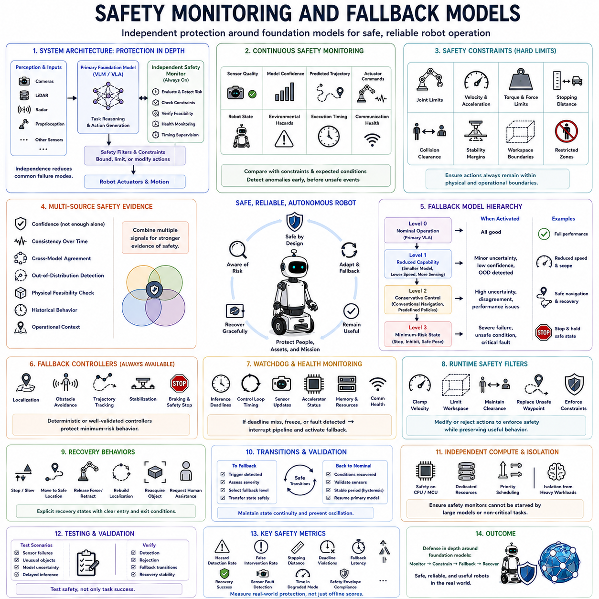{width="7.268055555555556in" height="7.268055555555556in"}

Safety monitoring and fallback models provide an independent protection layer around robot foundation models that operate in the physical world. VLM and VLA systems can produce powerful perception, reasoning, and action capabilities, but their outputs remain probabilistic and may fail under unfamiliar conditions. A robot therefore requires mechanisms that continuously evaluate whether generated decisions remain within acceptable operational and safety boundaries.

Safety monitoring should operate continuously rather than only after an obvious failure occurs. The system can observe sensor quality, model confidence, predicted trajectories, actuator commands, robot state, environmental hazards, and execution timing. By comparing these signals with predefined constraints and expected operating conditions, the safety layer can detect abnormal behavior before it develops into an unsafe physical event.

A useful architecture separates the primary foundation model from an independent safety monitor. The primary VLA may generate task-oriented actions, while the monitor evaluates those actions using simpler models, deterministic rules, geometric constraints, or verified controllers. Independence is important because a safety mechanism that shares exactly the same assumptions and failure modes as the primary model may fail at the same time.

Safety constraints can represent physical limits that should never be violated. Joint positions, actuator torque, velocity, acceleration, stopping distance, collision clearance, stability margins, workspace boundaries, and restricted zones can be checked before actions are executed. These constraints transform high-level model outputs into bounded commands and prevent a plausible but physically inappropriate prediction from directly controlling hardware.

Environmental monitoring provides another layer of protection. Cameras, LiDAR, radar, depth sensors, force sensors, and proximity sensors can independently detect people, obstacles, unexpected contact, unstable surfaces, or rapidly changing conditions. Safety-critical perception can operate separately from the foundation model so that basic hazard detection remains available even when multimodal reasoning becomes slow, uncertain, or unavailable.

Model confidence can contribute to safety decisions, but confidence alone is insufficient. Neural models may produce highly confident predictions in unfamiliar or out-of-distribution situations. Safety monitoring should therefore combine confidence with consistency checks, sensor agreement, novelty detection, physical feasibility, historical behavior, and operational context. Multiple signals provide stronger evidence that the current action is trustworthy.

Out-of-distribution detection attempts to identify observations that differ substantially from the environments represented during training and validation. Novel objects, unusual lighting, damaged sensors, unfamiliar terrain, unexpected human behavior, or new task configurations can reduce model reliability. When novelty becomes significant, the robot can reduce speed, request additional reasoning, activate another model, or transition to a safer operating mode.

Temporal consistency is especially important in physical AI. Predictions should normally evolve in ways that are compatible with recent observations and robot dynamics. Sudden changes in object identity, target location, intended action, or scene interpretation may indicate perception or reasoning failure. A temporal safety monitor can compare current outputs with recent history and reject abrupt transitions that lack supporting physical evidence.

Cross-model agreement provides another method for detecting unreliable decisions. A primary VLA model can be compared with a smaller independent perception model, trajectory predictor, collision detector, or rule-based planner. Agreement does not guarantee correctness, but significant disagreement can indicate uncertainty. The system can then delay execution, gather another observation, invoke additional reasoning, or switch to a conservative fallback behavior.

Fallback models provide reduced-capability alternatives when the primary foundation model cannot operate reliably. A fallback may be smaller, faster, more deterministic, more extensively validated, or specialized for a limited set of tasks. Instead of attempting to reproduce the complete intelligence of the primary model, it should preserve the minimum capabilities required to maintain control, avoid hazards, and reach a safe operational state.

Different fallback levels can support different failure severities. Minor uncertainty may trigger a smaller local model, reduced speed, or additional perception. Greater uncertainty can activate conventional navigation or a predefined recovery policy. Severe failures can result in controlled stopping, actuator inhibition, or transition to a minimum-risk state. This layered structure avoids treating every anomaly as either normal operation or an immediate emergency stop.

Fallback controllers are particularly valuable because they can remain independent of large learned models. Classical localization, obstacle avoidance, trajectory tracking, stabilization, and braking algorithms can continue operating when VLM or VLA inference fails. These controllers may provide less flexible behavior than foundation models, but their restricted functionality can make their operational characteristics easier to validate and predict.

Watchdog mechanisms supervise whether critical software components remain responsive. A watchdog can monitor inference deadlines, control-loop timing, sensor updates, accelerator status, memory pressure, and communication health. If a model stops responding or repeatedly exceeds its allowed execution time, the watchdog can interrupt the normal pipeline and activate a fallback before stale commands continue controlling the robot.

Deadline monitoring is essential because an action can become unsafe even when its content was originally correct. A trajectory generated from an old observation may no longer match the current environment. Every action should therefore be associated with timing information and validity conditions. Commands that arrive after their deadline or refer to outdated robot states can be rejected rather than executed.

Sensor health monitoring protects the model from corrupted inputs. Missing frames, frozen images, LiDAR dropout, calibration changes, time synchronization errors, abnormal noise, or inconsistent measurements can produce incorrect model reasoning. The system should estimate sensor validity and determine whether degraded sensing still supports the requested task. If not, it can switch sensors, reduce capability, stop, or request intervention.

Redundant sensing can improve fault tolerance when independent modalities observe related physical conditions. For example, camera perception can be compared with LiDAR or radar for obstacle presence, while odometry can be checked against inertial or visual motion estimates. Disagreement does not automatically identify which sensor is wrong, but it provides evidence that the robot should increase caution and avoid relying blindly on a single observation source.

Runtime safety filters can modify model-generated actions rather than simply accepting or rejecting them. A proposed velocity can be reduced near people, a trajectory can be clipped to remain inside a safe workspace, or an unsafe waypoint can be replaced with a nearby feasible target. Such filters allow useful model behavior to continue while enforcing constraints that remain external to the learned policy.

Recovery behavior should be explicitly designed rather than improvised after failure. Depending on the robot, recovery may include stopping, slowing down, moving to a known safe location, releasing force, retracting a manipulator, rebuilding localization, reacquiring an object, or requesting human assistance. Recovery states should have clear entry and exit conditions so that the robot does not repeatedly oscillate between failure and normal operation.

Human intervention remains an important fallback for situations beyond validated autonomous capability. The robot can request confirmation, remote assistance, or takeover when uncertainty remains unresolved. However, human availability and communication cannot be guaranteed, so the robot must maintain a safe state while waiting. Remote intervention should enhance autonomy rather than serve as the only mechanism preventing unsafe behavior.

Fallback transitions must preserve state continuity. When control moves from a foundation model to a fallback controller, the new controller needs an accurate understanding of robot pose, velocity, actuator state, active task, and nearby hazards. Poorly synchronized transitions can themselves create instability. Shared state representations, timestamps, command arbitration, and explicit ownership of actuators help make transitions predictable.

Returning from fallback operation to the primary model also requires validation. Recovery should not occur simply because the foundation model begins producing outputs again. Sensor health, timing, confidence, environmental conditions, and system resources should return to acceptable ranges before normal operation resumes. A hysteresis or stability period can prevent rapid switching between normal and fallback modes.

Safety monitoring should be computationally protected from the workloads it supervises. A large foundation model should not consume all GPU time, memory, or power needed by collision detection or emergency logic. Critical monitoring can run on dedicated CPU cores, microcontrollers, safety processors, or reserved accelerator resources. Computational isolation ensures that overload in intelligent reasoning does not disable the mechanisms responsible for containing that overload.

Testing must intentionally create conditions that activate safety mechanisms. Evaluation should include sensor failures, unusual objects, model uncertainty, delayed inference, corrupted inputs, blocked paths, actuator anomalies, communication loss, and resource exhaustion. The objective is not only to verify nominal task success but also to confirm that faults are detected, unsafe commands are rejected, fallback transitions occur correctly, and recovery remains stable.

Safety metrics should include hazard detection rate, false intervention rate, stopping distance, deadline violations, fallback activation latency, recovery success, sensor fault detection, and time spent in degraded modes. Physical testing should also measure whether the robot remains within defined safety envelopes during failures. These metrics reveal whether the safety architecture protects real behavior rather than merely improving offline model scores.

Safety monitoring and fallback models ultimately create defense in depth around robot foundation models. The primary VLM or VLA provides flexible intelligence, independent monitors detect abnormal conditions, runtime filters constrain actions, fallback models preserve essential autonomy, and deterministic controllers protect minimum-risk behavior. Together, these layers allow capable foundation models to control physical systems without making safety dependent on a single learned model behaving correctly at all times.

안전 모니터링(Safety Monitoring)과 폴백 모델(Fallback Model)은 물리적 세계에서 동작하는 로봇 파운데이션 모델(Robot Foundation Model)을 둘러싸는 독립적인 보호 계층(Protection Layer)을 제공한다. VLM과 VLA 시스템은 강력한 지각, 추론, 행동 능력을 제공할 수 있지만 그 출력은 확률적(Probabilistic)이며 익숙하지 않은 조건에서 실패할 수 있다. 따라서 로봇에는 생성된 의사결정이 허용 가능한 운용 및 안전 경계(Operational and Safety Boundary) 안에 있는지를 지속적으로 평가하는 메커니즘이 필요하다.

안전 모니터링은 명백한 장애가 발생한 이후에만 수행하는 것이 아니라 지속적으로 동작해야 한다. 시스템은 센서 품질(Sensor Quality), 모델 신뢰도(Model Confidence), 예측 궤적(Predicted Trajectory), 액추에이터 명령(Actuator Command), 로봇 상태, 환경 위험(Environmental Hazard), 실행 타이밍(Execution Timing)을 관찰할 수 있다. 이러한 신호를 사전에 정의된 제약조건과 예상 운용 조건과 비교함으로써 안전 계층은 비정상적인 행동이 위험한 물리적 사건으로 발전하기 전에 이를 탐지할 수 있다.

유용한 아키텍처는 주 파운데이션 모델(Primary Foundation Model)과 독립적인 안전 모니터(Independent Safety Monitor)를 분리한다. 주 VLA는 작업 지향적인 행동을 생성하고, 안전 모니터는 더 단순한 모델, 결정론적 규칙(Deterministic Rule), 기하학적 제약(Geometric Constraint) 또는 검증된 제어기(Verified Controller)를 사용하여 이러한 행동을 평가할 수 있다. 안전 메커니즘이 주 모델과 정확히 동일한 가정과 실패 모드(Failure Mode)를 공유한다면 동시에 실패할 수 있으므로 독립성은 중요하다.

안전 제약(Safety Constraint)은 절대로 위반해서는 안 되는 물리적 한계를 나타낼 수 있다. 관절 위치(Joint Position), 액추에이터 토크(Actuator Torque), 속도, 가속도, 정지 거리(Stopping Distance), 충돌 여유거리(Collision Clearance), 안정성 여유(Stability Margin), 작업 공간 경계(Workspace Boundary), 제한 구역(Restricted Zone)을 행동 실행 전에 검사할 수 있다. 이러한 제약은 고수준 모델 출력을 제한된 명령(Bounded Command)으로 변환하고, 그럴듯하지만 물리적으로 부적절한 예측이 하드웨어를 직접 제어하는 것을 방지한다.

환경 모니터링(Environmental Monitoring)은 또 다른 보호 계층을 제공한다. 카메라, LiDAR, 레이더(Radar), 깊이 센서(Depth Sensor), 힘 센서(Force Sensor), 근접 센서(Proximity Sensor)는 사람, 장애물, 예상하지 못한 접촉, 불안정한 표면 또는 빠르게 변화하는 환경을 독립적으로 탐지할 수 있다. 안전 필수 지각(Safety-Critical Perception)은 파운데이션 모델과 별도로 동작하여 다중모달 추론이 느려지거나 불확실해지거나 사용할 수 없을 때에도 기본적인 위험 탐지 기능을 유지할 수 있다.

모델 신뢰도(Model Confidence)는 안전 의사결정에 활용될 수 있지만 신뢰도만으로는 충분하지 않다. 신경망 모델은 익숙하지 않거나 분포 외(Out-of-Distribution) 상황에서도 높은 신뢰도의 예측을 생성할 수 있다. 따라서 안전 모니터링은 신뢰도와 함께 일관성 검사(Consistency Check), 센서 간 일치성(Sensor Agreement), 신규성 탐지(Novelty Detection), 물리적 실현 가능성(Physical Feasibility), 과거 행동, 운용 문맥(Operational Context)을 결합해야 한다. 여러 신호를 활용하면 현재 행동을 신뢰할 수 있는지에 대한 더욱 강력한 근거를 확보할 수 있다.

분포 외 탐지(Out-of-Distribution Detection)는 학습 및 검증 환경과 크게 다른 관측을 식별하는 것을 목표로 한다. 새로운 물체, 비정상적인 조명, 손상된 센서, 익숙하지 않은 지형, 예상하지 못한 사람의 행동 또는 새로운 작업 구성이 모델 신뢰성을 감소시킬 수 있다. 신규성이 크게 증가하면 로봇은 속도를 낮추거나 추가적인 추론을 요청하고, 다른 모델을 활성화하거나, 더욱 안전한 운용 모드(Safe Operating Mode)로 전환할 수 있다.

시간적 일관성(Temporal Consistency)은 물리 AI(Physical AI)에서 특히 중요하다. 예측 결과는 일반적으로 최근 관측 및 로봇 동역학(Robot Dynamics)과 일치하는 방식으로 변화해야 한다. 물체 식별, 목표 위치, 의도된 행동 또는 장면 해석(Scene Interpretation)이 갑자기 변경되면 지각 또는 추론 실패를 의미할 수 있다. 시간적 안전 모니터(Temporal Safety Monitor)는 현재 출력을 최근 이력과 비교하고 이를 뒷받침하는 물리적 근거가 없는 급격한 변화를 거부할 수 있다.

모델 간 일치성(Cross-Model Agreement)은 신뢰할 수 없는 의사결정을 탐지하는 또 다른 방법이다. 주 VLA 모델의 출력을 더 작은 독립 지각 모델(Independent Perception Model), 궤적 예측기(Trajectory Predictor), 충돌 탐지기(Collision Detector) 또는 규칙 기반 계획기(Rule-Based Planner)와 비교할 수 있다. 모델 간 일치가 정확성을 보장하지는 않지만 상당한 불일치는 불확실성을 나타낼 수 있다. 이 경우 시스템은 실행을 지연하고 추가 관측을 획득하거나 추가 추론을 수행하고 보수적인 폴백 동작(Conservative Fallback Behavior)으로 전환할 수 있다.

폴백 모델(Fallback Model)은 주 파운데이션 모델이 신뢰성 있게 동작할 수 없을 때 제한된 능력의 대안을 제공한다. 폴백 모델은 더 작고, 빠르고, 결정론적이며, 더 광범위하게 검증되었거나 제한된 작업에 특화될 수 있다. 주 모델의 전체 지능을 재현하는 대신 제어를 유지하고 위험을 회피하며 안전한 운용 상태(Safe Operational State)에 도달하는 데 필요한 최소 능력을 보존해야 한다.

서로 다른 폴백 수준(Fallback Level)은 서로 다른 장애 심각도를 지원할 수 있다. 경미한 불확실성은 더 작은 로컬 모델(Local Model), 속도 감소 또는 추가적인 지각을 활성화할 수 있다. 더 큰 불확실성은 기존 내비게이션(Conventional Navigation)이나 사전에 정의된 복구 정책(Predefined Recovery Policy)을 활성화할 수 있다. 심각한 장애는 제어된 정지(Controlled Stop), 액추에이터 억제(Actuator Inhibition) 또는 최소 위험 상태(Minimum-Risk State)로의 전환을 유발할 수 있다. 이러한 계층 구조는 모든 이상 상황을 정상 운용 또는 즉각적인 긴급 정지 중 하나로만 처리하는 것을 방지한다.

폴백 제어기(Fallback Controller)는 대규모 학습 모델과 독립적으로 유지될 수 있기 때문에 특히 중요하다. 전통적인 위치 추정, 장애물 회피, 궤적 추종(Trajectory Tracking), 안정화(Stabilization), 제동 알고리즘(Braking Algorithm)은 VLM 또는 VLA 추론이 실패하더라도 계속 동작할 수 있다. 이러한 제어기는 파운데이션 모델보다 유연성은 낮을 수 있지만 기능이 제한되어 있기 때문에 운용 특성을 보다 쉽게 검증하고 예측할 수 있다.

워치독 메커니즘(Watchdog Mechanism)은 중요한 소프트웨어 구성 요소가 정상적으로 응답하는지를 감시한다. 워치독은 추론 데드라인(Inference Deadline), 제어 루프 타이밍(Control-Loop Timing), 센서 업데이트, 가속기 상태, 메모리 압박(Memory Pressure), 통신 상태를 모니터링할 수 있다. 모델이 응답을 멈추거나 허용된 실행시간을 반복적으로 초과하면 워치독은 오래된 명령이 로봇을 계속 제어하기 전에 정상 파이프라인을 중단하고 폴백을 활성화할 수 있다.

데드라인 모니터링(Deadline Monitoring)은 행동 내용 자체가 처음에는 올바르더라도 시간이 지나면 위험해질 수 있기 때문에 필수적이다. 오래된 관측으로 생성된 궤적은 현재 환경과 더 이상 일치하지 않을 수 있다. 따라서 모든 행동에는 타이밍 정보(Timing Information)와 유효 조건(Validity Condition)이 연결되어야 한다. 데드라인 이후 도착하거나 오래된 로봇 상태를 참조하는 명령은 실행하는 대신 거부할 수 있어야 한다.

센서 상태 모니터링(Sensor Health Monitoring)은 손상되거나 잘못된 입력으로부터 모델을 보호한다. 누락된 프레임, 정지된 영상(Frozen Image), LiDAR 데이터 손실, 캘리브레이션 변화(Calibration Change), 시간 동기화 오류(Time Synchronization Error), 비정상적인 노이즈 또는 일관되지 않은 측정값은 잘못된 모델 추론을 발생시킬 수 있다. 시스템은 센서 유효성(Sensor Validity)을 평가하고 성능이 저하된 센싱 상태에서도 요청된 작업을 수행할 수 있는지 판단해야 한다. 그렇지 않으면 센서를 전환하거나 능력을 축소하고 정지하거나 개입을 요청할 수 있다.

중복 센싱(Redundant Sensing)은 독립적인 모달리티가 관련된 물리적 조건을 관측할 때 내결함성(Fault Tolerance)을 향상시킬 수 있다. 예를 들어 장애물 존재 여부에 대해 카메라 지각 결과를 LiDAR 또는 레이더와 비교할 수 있으며, 오도메트리(Odometry)를 관성 또는 시각 기반 움직임 추정과 비교할 수 있다. 불일치가 어떤 센서가 잘못되었는지를 자동으로 식별하지는 않지만 로봇이 주의 수준을 높이고 하나의 관측 소스에 맹목적으로 의존하지 않아야 한다는 근거를 제공한다.

런타임 안전 필터(Runtime Safety Filter)는 모델이 생성한 행동을 단순히 승인하거나 거부하는 대신 수정할 수 있다. 사람 주변에서는 제안된 속도를 낮추고, 궤적이 안전한 작업 공간 내부에 유지되도록 제한하거나, 위험한 웨이포인트(Waypoint)를 인접한 실행 가능한 목표로 대체할 수 있다. 이러한 필터를 사용하면 학습된 정책 외부에 존재하는 안전 제약을 강제하면서 유용한 모델 행동을 계속 활용할 수 있다.

복구 동작(Recovery Behavior)은 장애가 발생한 이후 즉흥적으로 결정하는 것이 아니라 명시적으로 설계해야 한다. 로봇의 종류에 따라 복구에는 정지, 감속, 알려진 안전 위치로 이동, 힘 해제(Force Release), 매니퓰레이터 후퇴(Manipulator Retraction), 위치 추정 재구축, 물체 재획득(Reacquisition), 사람의 지원 요청 등이 포함될 수 있다. 로봇이 장애 상태와 정상 운용 사이를 반복적으로 오가는 것을 방지하기 위해 복구 상태에는 명확한 진입 및 종료 조건이 필요하다.

사람의 개입(Human Intervention)은 검증된 자율 능력을 넘어서는 상황에서 중요한 폴백 수단으로 남아 있다. 불확실성이 해결되지 않을 경우 로봇은 확인, 원격 지원(Remote Assistance), 제어권 인수(Takeover)를 요청할 수 있다. 그러나 사람의 가용성과 통신 연결을 항상 보장할 수는 없으므로 로봇은 지원을 기다리는 동안에도 안전한 상태를 유지해야 한다. 원격 개입은 자율성을 향상시키는 수단이어야 하며 위험한 행동을 방지하는 유일한 메커니즘이 되어서는 안 된다.

폴백 전환(Fallback Transition)은 상태 연속성(State Continuity)을 유지해야 한다. 제어권이 파운데이션 모델에서 폴백 제어기로 이동할 때 새로운 제어기는 로봇의 위치, 속도, 액추에이터 상태, 활성 작업, 주변 위험에 대한 정확한 정보를 필요로 한다. 제대로 동기화되지 않은 전환 자체가 불안정성을 발생시킬 수 있다. 공유 상태 표현(Shared State Representation), 타임스탬프, 명령 중재(Command Arbitration), 명확한 액추에이터 제어권(Actuator Ownership)은 전환을 예측 가능하게 만드는 데 도움이 된다.

폴백 운용에서 주 모델로 복귀하는 과정 역시 검증이 필요하다. 파운데이션 모델이 다시 출력을 생성하기 시작했다는 이유만으로 즉시 정상 운용으로 복귀해서는 안 된다. 센서 상태, 타이밍, 신뢰도, 환경 조건, 시스템 자원이 허용 가능한 범위로 회복되었는지 확인해야 한다. 히스테리시스(Hysteresis) 또는 안정화 기간(Stability Period)을 적용하면 정상 모드와 폴백 모드 사이에서 빠르게 반복 전환되는 현상을 방지할 수 있다.

안전 모니터링은 자신이 감시하는 워크로드로부터 연산적으로 보호되어야 한다. 대규모 파운데이션 모델이 충돌 탐지 또는 긴급 로직에 필요한 GPU 시간, 메모리, 전력을 모두 소비해서는 안 된다. 중요한 모니터링 기능은 전용 CPU 코어, 마이크로컨트롤러(Microcontroller), 안전 프로세서(Safety Processor) 또는 예약된 가속기 자원에서 실행할 수 있다. 이러한 연산 격리(Computational Isolation)는 지능형 추론의 과부하가 그 과부하를 통제해야 하는 안전 메커니즘까지 비활성화하는 것을 방지한다.

테스트에서는 안전 메커니즘을 활성화하는 조건을 의도적으로 만들어야 한다. 평가에는 센서 장애, 비정상적인 물체, 모델 불확실성, 지연된 추론, 손상된 입력(Corrupted Input), 차단된 경로, 액추에이터 이상, 통신 손실, 자원 고갈(Resource Exhaustion)이 포함되어야 한다. 목표는 정상적인 작업 성공 여부만 검증하는 것이 아니라 장애를 탐지하고, 위험한 명령을 거부하며, 폴백 전환을 올바르게 수행하고, 복구 과정에서 안정성을 유지하는지를 확인하는 것이다.

안전 평가 지표(Safety Metric)에는 위험 탐지율(Hazard Detection Rate), 오탐 개입률(False Intervention Rate), 정지 거리, 데드라인 위반(Deadline Violation), 폴백 활성화 지연시간(Fallback Activation Latency), 복구 성공률, 센서 장애 탐지율, 성능 저하 모드(Degraded Mode)에서의 운용 시간이 포함되어야 한다. 물리적 테스트에서는 장애 상황에서도 로봇이 정의된 안전 운용 범위(Safety Envelope) 안에 유지되는지도 측정해야 한다. 이러한 지표를 통해 안전 아키텍처가 단순히 오프라인 모델 점수를 개선하는 것이 아니라 실제 물리적 행동을 보호하는지를 확인할 수 있다.

궁극적으로 안전 모니터링과 폴백 모델은 로봇 파운데이션 모델 주변에 심층 방어(Defense in Depth) 구조를 형성한다. 주 VLM 또는 VLA는 유연한 지능을 제공하고, 독립적인 모니터는 비정상 조건을 탐지하며, 런타임 필터는 행동을 제한하고, 폴백 모델은 필수적인 자율성을 유지하며, 결정론적 제어기(Deterministic Controller)는 최소 위험 동작을 보호한다. 이러한 계층들이 함께 작동함으로써 하나의 학습 모델이 항상 올바르게 동작한다는 가정에 안전을 의존하지 않으면서 강력한 파운데이션 모델이 실제 물리적 시스템을 제어할 수 있게 된다.

## 10.13. Edge VLA Optimization and Inference [w/Code]

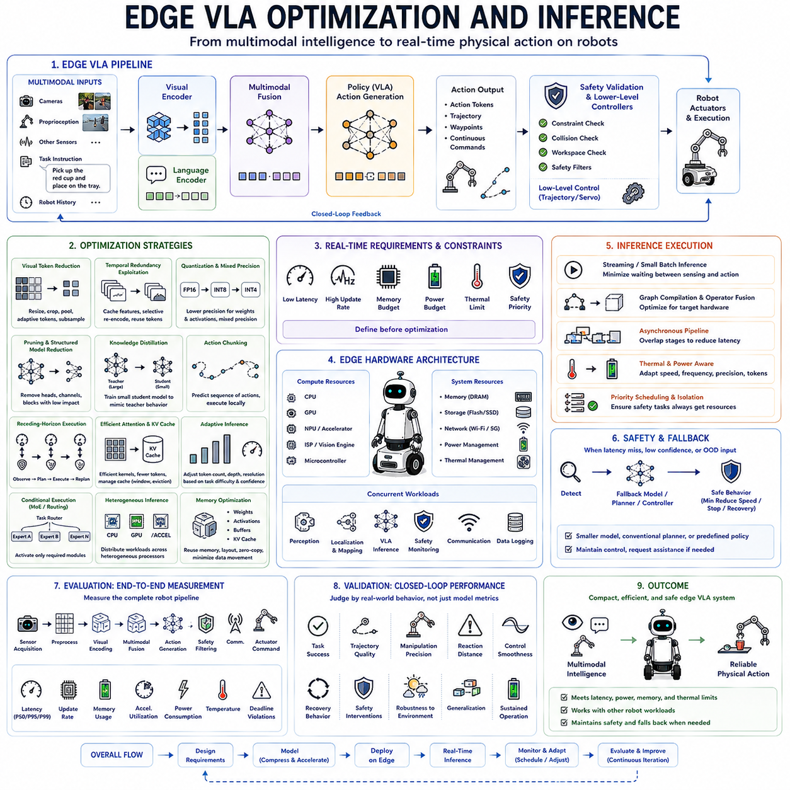{width="7.268055555555556in" height="7.268055555555556in"}

Edge VLA optimization focuses on transforming large Vision-Language-Action models into practical control systems that can operate directly on robots under strict limits of compute, memory, power, and latency. Unlike server inference, edge deployment must share resources with perception, localization, mapping, communication, and safety processes while continuously converting multimodal observations and language instructions into timely physical actions.

An edge VLA pipeline typically receives camera observations, proprioceptive states, task instructions, robot history, and optional information from additional sensors. Visual encoders transform images into compact representations, language encoders represent instructions, and multimodal fusion combines these signals with robot state. The policy then predicts action tokens, trajectories, waypoints, or continuous commands that are validated before execution by lower-level controllers.

Optimization begins by defining the real-time requirements of the physical task rather than maximizing generic model throughput. Manipulation, mobile navigation, and human-robot interaction can require different observation frequencies and response deadlines. Engineers should determine the maximum acceptable observation-to-action latency, required action update rate, memory budget, power envelope, and worst-case timing before selecting optimization techniques or deployment hardware.

Model profiling identifies where computation and memory are actually consumed. Vision encoders, transformer blocks, multimodal attention, KV caches, action decoders, preprocessing, and data transfers should be measured independently. Average inference latency alone is insufficient because memory movement, synchronization, kernel launch overhead, and concurrent robot workloads can create significant delays that are invisible in isolated model benchmarks.

Visual token reduction is one of the most effective optimization strategies because high-resolution robot observations can generate large token sequences. Images can be resized, cropped around task-relevant regions, pooled into compact representations, or processed using adaptive token selection. Multiple camera streams can also be temporally subsampled. The objective is to preserve information needed for action while avoiding repeated processing of visually redundant background content.

Temporal redundancy can further reduce edge computation. Consecutive video frames often contain similar scene structure, especially when the robot or environment moves slowly. Cached visual features, motion-aware updates, selective re-encoding, and temporal token reuse can avoid recomputing unchanged information. Dynamic objects, interaction regions, and newly visible areas can receive more computation while stable regions retain previously calculated representations.

Quantization reduces memory footprint and computational cost by representing model parameters and activations with lower numerical precision. FP16 or BF16 can provide a straightforward acceleration path, while INT8 and lower-bit representations can enable larger reductions in bandwidth and storage. Different VLA components may require different precision, so mixed-precision deployment can preserve sensitive action outputs while aggressively compressing tolerant transformer or vision layers.

Pruning and structured model reduction remove computation that contributes little to the deployed task distribution. Attention heads, channels, neurons, blocks, or other structures can be reduced when validation shows limited impact on physical performance. Structured pruning is especially useful on edge accelerators because removing complete computational structures is more likely to produce actual latency improvements than irregular sparsity unsupported by the target hardware.

Knowledge distillation can create a compact edge policy from a larger teacher model. The teacher may provide action distributions, intermediate representations, semantic features, trajectories, or reasoning targets during training. A smaller student model learns to reproduce the behavior most relevant to the robot\'s operational domain. This approach allows expensive training-time intelligence to be converted into a faster policy suitable for repeated onboard inference.

Action chunking reduces the frequency at which the complete VLA must execute. Instead of predicting only the next immediate action, the model generates a short sequence of future actions. A faster low-level controller executes this sequence while monitoring the environment. This amortizes expensive multimodal inference across several control updates, but chunk duration must remain short enough to prevent actions from becoming stale when the environment changes.

Receding-horizon execution improves the responsiveness of action chunks. The VLA can predict a longer sequence while executing only the first portion before observing the environment again. New observations continuously correct the plan, and unexpected events can trigger early replanning. This combines the computational efficiency of multi-step prediction with the closed-loop feedback required for robust physical interaction.

Efficient attention is essential when multimodal context becomes large. Optimized attention kernels, grouped-query attention, reduced token counts, bounded context windows, and appropriate KV cache strategies can reduce both memory traffic and computation. Robot histories should not grow indefinitely. Older observations can be summarized into compact task memory while detailed representations are preserved only for recent states that directly influence current actions.

KV cache management becomes particularly important when autoregressive components generate language, reasoning tokens, or action sequences. Cache reuse avoids recomputing previous attention states, but uncontrolled cache growth consumes valuable edge memory. Sliding windows, cache eviction, token compression, and persistent summaries can keep memory bounded while retaining information necessary for temporal consistency and task completion.

Adaptive inference allows computational effort to change with task difficulty. Familiar scenes and high-confidence actions may use fewer visual tokens, shorter context, lower-resolution inputs, or smaller model pathways. Ambiguous instructions, unexpected obstacles, failed manipulation attempts, or uncertain predictions can activate deeper reasoning. Edge computation is therefore spent according to decision complexity rather than uniformly across every observation.

Conditional model execution can extend this principle by activating only the modules required for the current task. Navigation may emphasize spatial perception and waypoint generation, while manipulation may require fine visual geometry and object affordance reasoning. Task-specific adapters, routed blocks, or expert modules can provide specialized capacity without requiring the complete VLA architecture to execute at maximum cost for every control cycle.

Heterogeneous inference distributes VLA workloads across available processors. CPUs can manage sensor preprocessing, scheduling, communication, and safety logic; GPUs can execute large transformer and vision workloads; NPUs or dedicated accelerators can process efficient perception networks. Parallel execution and asynchronous scheduling allow these devices to operate simultaneously, increasing system throughput while preventing one accelerator from becoming the bottleneck for the entire robot.

Memory optimization is as important as arithmetic throughput. Model weights, activations, KV caches, visual tokens, sensor buffers, and intermediate tensors compete for limited memory capacity and bandwidth. Memory reuse, preallocated buffers, reduced precision, efficient tensor layouts, zero-copy transfers, and minimized CPU-GPU synchronization can reduce overhead. Avoiding unnecessary data movement often produces substantial improvements in practical edge latency.

Inference engines should be optimized for the actual deployment hardware. Graph compilation, operator fusion, optimized kernels, static tensor shapes where practical, and accelerator-specific execution can reduce runtime overhead. However, theoretical throughput does not guarantee robot performance. Optimization should be validated using the exact model architecture, input dimensions, batch size, sensor configuration, and concurrent software workloads expected during operation.

Batch size is normally constrained by real-time requirements. Server inference can increase throughput by batching many requests, but a robot often needs an immediate response to its newest observation. Large batches may therefore increase physical reaction latency. Edge VLA deployment generally favors small batches, streaming inference, persistent execution contexts, and asynchronous pipelines that minimize waiting between sensing and action generation.

Thermal and power management must be included in inference optimization because peak accelerator performance may not be sustainable throughout a long mission. Continuous VLA execution can increase temperature and trigger clock throttling, causing latency to deteriorate over time. Runtime policies can adjust inference frequency, token budgets, precision, model size, or accelerator usage to maintain predictable performance within the robot\'s electrical and thermal envelope.

Safety workloads require protected computational resources. Collision detection, emergency stopping, sensor health monitoring, and command validation should not be delayed because the VLA consumes all available accelerator time or memory. Dedicated processors, reserved CPU cores, priority scheduling, or isolated execution paths can ensure that intelligent reasoning remains subordinate to mechanisms responsible for immediate physical safety.

Fallback inference is necessary when the optimized VLA cannot meet its deadline or encounters observations outside its validated operating range. A smaller policy, conventional planner, trajectory controller, or predefined safe behavior can temporarily assume control. The robot may reduce speed, restrict its operational envelope, request assistance, or enter a minimum-risk state until reliable VLA inference becomes available again.

Performance evaluation should use the complete robot pipeline rather than measuring neural-network inference in isolation. Sensor acquisition, preprocessing, visual encoding, multimodal fusion, action generation, safety filtering, communication, and actuator command delivery should all be included. Measurements should report average and high-percentile observation-to-action latency, update frequency, memory use, accelerator utilization, power consumption, temperature, and deadline violations.

Optimization quality must ultimately be judged through closed-loop physical behavior. Quantization or token reduction is useful only if the robot still performs tasks reliably. Evaluation should therefore measure task success, trajectory quality, manipulation precision, reaction distance, control smoothness, recovery behavior, safety interventions, and robustness to environmental changes. Model compression should be treated as a system tradeoff rather than a purely numerical benchmark.

Edge VLA optimization and inference combine model compression, efficient multimodal processing, hardware-aware execution, adaptive computation, and real-time control architecture. Quantization, distillation, token reduction, caching, efficient attention, action chunking, heterogeneous acceleration, and runtime scheduling work together to reduce computational cost. The objective is a compact and responsive VLA system that converts multimodal intelligence into reliable physical action within the power, memory, thermal, and safety constraints of an autonomous robot.

엣지 VLA 최적화(Edge VLA Optimization)는 대규모 비전-언어-행동 모델(Vision-Language-Action Model)을 연산, 메모리, 전력, 지연시간의 엄격한 제약 아래 로봇에서 직접 동작할 수 있는 실용적인 제어 시스템으로 변환하는 데 초점을 둔다. 서버 추론과 달리 엣지 배포(Edge Deployment)는 지각, 위치 추정, 매핑, 통신, 안전 프로세스와 자원을 공유하면서 다중모달 관측과 언어 명령을 적시에 물리적 행동으로 지속적으로 변환해야 한다.

엣지 VLA 파이프라인(Edge VLA Pipeline)은 일반적으로 카메라 관측, 고유수용성 상태(Proprioceptive State), 작업 명령, 로봇의 과거 상태, 추가 센서의 선택적 정보를 입력으로 받는다. 비전 인코더(Visual Encoder)는 이미지를 압축된 표현으로 변환하고, 언어 인코더(Language Encoder)는 명령을 표현하며, 다중모달 융합(Multimodal Fusion)은 이러한 신호를 로봇 상태와 결합한다. 이후 정책(Policy)은 저수준 제어기가 실행하기 전에 검증되는 행동 토큰, 궤적, 웨이포인트(Waypoint) 또는 연속 명령을 예측한다.

최적화는 일반적인 모델 처리량을 최대화하는 것보다 물리적 작업의 실시간 요구사항(Real-Time Requirement)을 정의하는 것에서 시작해야 한다. 조작, 이동 내비게이션(Mobile Navigation), 인간-로봇 상호작용(Human-Robot Interaction)은 서로 다른 관측 주파수와 응답 데드라인(Response Deadline)을 요구할 수 있다. 엔지니어는 최적화 기술이나 배포 하드웨어를 선택하기 전에 최대 허용 관측-행동 지연시간(Observation-to-Action Latency), 필요한 행동 업데이트 속도, 메모리 예산, 전력 한계(Power Envelope), 최악 조건의 타이밍을 결정해야 한다.

모델 프로파일링(Model Profiling)은 실제로 연산과 메모리가 어디에서 소비되는지를 식별한다. 비전 인코더, 트랜스포머 블록(Transformer Block), 다중모달 어텐션(Multimodal Attention), KV 캐시(KV Cache), 행동 디코더(Action Decoder), 전처리, 데이터 전송을 독립적으로 측정해야 한다. 평균 추론 지연시간만으로는 충분하지 않으며, 메모리 이동, 동기화, 커널 실행 오버헤드(Kernel Launch Overhead), 동시에 수행되는 로봇 워크로드가 독립적인 모델 벤치마크에서는 나타나지 않는 상당한 지연을 발생시킬 수 있다.

시각 토큰 감소(Visual Token Reduction)는 고해상도 로봇 관측이 매우 긴 토큰 시퀀스를 생성할 수 있기 때문에 가장 효과적인 최적화 전략 중 하나다. 이미지는 크기를 줄이거나 작업 관련 영역을 중심으로 잘라내고, 압축된 표현으로 풀링(Pooling)하거나 적응형 토큰 선택(Adaptive Token Selection)을 사용하여 처리할 수 있다. 여러 카메라 스트림 역시 시간적으로 서브샘플링(Temporal Subsampling)할 수 있다. 목표는 행동에 필요한 정보를 보존하면서 시각적으로 중복된 배경 정보를 반복 처리하지 않는 것이다.

시간적 중복성(Temporal Redundancy)을 활용하면 엣지 연산을 추가로 줄일 수 있다. 연속된 비디오 프레임은 특히 로봇이나 환경이 천천히 움직일 때 유사한 장면 구조를 포함하는 경우가 많다. 캐시된 시각 특징(Cached Visual Feature), 움직임 인식 업데이트(Motion-Aware Update), 선택적 재인코딩(Selective Re-Encoding), 시간적 토큰 재사용(Temporal Token Reuse)을 통해 변화하지 않은 정보를 반복 계산하는 것을 방지할 수 있다. 동적 물체, 상호작용 영역, 새롭게 나타난 영역에는 더 많은 연산을 할당하고 안정적인 영역에는 이전에 계산된 표현을 유지할 수 있다.

양자화(Quantization)는 모델 파라미터와 활성값(Activation)을 더 낮은 수치 정밀도로 표현하여 메모리 사용량과 연산 비용을 감소시킨다. FP16 또는 BF16은 비교적 직접적인 가속 방법을 제공하며, INT8과 더 낮은 비트 표현은 대역폭과 저장공간을 더욱 크게 줄일 수 있다. VLA의 각 구성 요소는 서로 다른 정밀도를 요구할 수 있으므로 혼합 정밀도 배포(Mixed-Precision Deployment)를 통해 민감한 행동 출력은 높은 정밀도를 유지하면서 허용도가 높은 트랜스포머 또는 비전 계층은 적극적으로 압축할 수 있다.

가지치기(Pruning)와 구조적 모델 축소(Structured Model Reduction)는 배포 대상 작업 분포에서 기여도가 낮은 연산을 제거한다. 검증 결과 물리적 성능에 미치는 영향이 제한적인 경우 어텐션 헤드(Attention Head), 채널, 뉴런, 블록 또는 기타 구조를 축소할 수 있다. 구조적 가지치기(Structured Pruning)는 완전한 연산 구조를 제거하기 때문에 대상 하드웨어가 지원하지 않는 불규칙한 희소성(Irregular Sparsity)보다 엣지 가속기에서 실제 지연시간 개선으로 이어질 가능성이 높다.

지식 증류(Knowledge Distillation)는 더 큰 교사 모델(Teacher Model)로부터 소형 엣지 정책(Compact Edge Policy)을 생성할 수 있다. 교사 모델은 학습 과정에서 행동 분포, 중간 표현, 의미적 특징, 궤적 또는 추론 목표를 제공할 수 있다. 더 작은 학생 모델(Student Model)은 로봇의 운용 영역에 가장 관련된 행동을 재현하도록 학습한다. 이를 통해 학습 단계에서 사용되는 고비용 지능을 반복적인 온보드 추론에 적합한 더 빠른 정책으로 변환할 수 있다.

행동 청킹(Action Chunking)은 전체 VLA를 실행해야 하는 빈도를 감소시킨다. 모델은 다음 하나의 즉각적인 행동만 예측하는 대신 짧은 미래 행동 시퀀스를 생성한다. 더 빠른 저수준 제어기는 환경을 모니터링하면서 이 시퀀스를 실행한다. 이를 통해 고비용 다중모달 추론을 여러 제어 업데이트에 분산할 수 있지만, 환경이 변화할 때 행동이 오래된 정보에 기반하지 않도록 청크 지속시간(Chunk Duration)을 충분히 짧게 유지해야 한다.

이동 지평선 실행(Receding-Horizon Execution)은 행동 청크의 반응성을 향상시킨다. VLA는 더 긴 행동 시퀀스를 예측하면서 실제로는 첫 번째 일부만 실행한 후 환경을 다시 관측할 수 있다. 새로운 관측을 이용하여 계획을 지속적으로 수정하고 예상하지 못한 사건이 발생하면 조기에 재계획(Replanning)을 수행할 수 있다. 이를 통해 다단계 예측(Multi-Step Prediction)의 연산 효율성과 강건한 물리적 상호작용에 필요한 폐루프 피드백(Closed-Loop Feedback)을 결합할 수 있다.

효율적인 어텐션(Efficient Attention)은 다중모달 문맥이 커질 때 필수적이다. 최적화된 어텐션 커널(Attention Kernel), 그룹 질의 어텐션(Grouped-Query Attention), 감소된 토큰 수, 제한된 문맥 윈도(Bounded Context Window), 적절한 KV 캐시 전략을 통해 메모리 트래픽과 연산량을 모두 줄일 수 있다. 로봇의 과거 정보가 무한히 증가해서는 안 된다. 오래된 관측은 압축된 작업 메모리(Task Memory)로 요약하고 현재 행동에 직접 영향을 주는 최근 상태에 대해서만 상세한 표현을 유지할 수 있다.

KV 캐시 관리(KV Cache Management)는 자기회귀 구성 요소(Autoregressive Component)가 언어, 추론 토큰 또는 행동 시퀀스를 생성할 때 특히 중요하다. 캐시 재사용(Cache Reuse)은 이전 어텐션 상태의 반복 계산을 방지하지만 제어되지 않는 캐시 증가는 제한된 엣지 메모리를 소비한다. 슬라이딩 윈도(Sliding Window), 캐시 제거(Cache Eviction), 토큰 압축(Token Compression), 지속적 요약(Persistent Summary)을 통해 시간적 일관성과 작업 완료에 필요한 정보를 유지하면서 메모리 사용량을 제한할 수 있다.

적응형 추론(Adaptive Inference)은 작업 난이도에 따라 연산량을 변화시킨다. 익숙한 장면과 높은 신뢰도의 행동에는 더 적은 시각 토큰, 짧은 문맥, 낮은 해상도 입력 또는 작은 모델 경로를 사용할 수 있다. 모호한 명령, 예상하지 못한 장애물, 조작 실패, 불확실한 예측은 더 깊은 추론을 활성화할 수 있다. 따라서 모든 관측에 동일한 연산을 사용하는 대신 의사결정 복잡도에 따라 엣지 연산 자원을 사용할 수 있다.

조건부 모델 실행(Conditional Model Execution)은 현재 작업에 필요한 모듈만 활성화함으로써 이러한 원리를 확장할 수 있다. 내비게이션은 공간 지각(Spatial Perception)과 웨이포인트 생성을 강조할 수 있는 반면, 조작은 정밀한 시각 기하학(Fine Visual Geometry)과 물체 어포던스(Object Affordance) 추론을 필요로 할 수 있다. 작업별 어댑터(Task-Specific Adapter), 라우팅 블록(Routed Block), 전문가 모듈(Expert Module)을 통해 모든 제어 주기마다 전체 VLA 아키텍처를 최대 비용으로 실행하지 않고도 특화된 능력을 제공할 수 있다.

이기종 추론(Heterogeneous Inference)은 VLA 워크로드를 사용 가능한 여러 프로세서에 분산한다. CPU는 센서 전처리, 스케줄링, 통신, 안전 로직을 관리하고, GPU는 대규모 트랜스포머 및 비전 워크로드를 실행하며, NPU 또는 전용 가속기는 효율적인 지각 네트워크를 처리할 수 있다. 병렬 실행(Parallel Execution)과 비동기 스케줄링(Asynchronous Scheduling)을 통해 여러 장치를 동시에 활용하여 시스템 처리량을 높이고 하나의 가속기가 전체 로봇의 병목이 되는 것을 방지할 수 있다.

메모리 최적화(Memory Optimization)는 산술 연산 처리량만큼 중요하다. 모델 가중치, 활성값, KV 캐시, 시각 토큰, 센서 버퍼, 중간 텐서는 제한된 메모리 용량과 대역폭을 공유한다. 메모리 재사용, 사전 할당 버퍼(Preallocated Buffer), 낮은 정밀도, 효율적인 텐서 배치(Tensor Layout), 제로 카피 전송(Zero-Copy Transfer), CPU-GPU 동기화 최소화를 통해 오버헤드를 줄일 수 있다. 불필요한 데이터 이동을 방지하는 것만으로도 실제 엣지 지연시간을 크게 개선할 수 있다.

추론 엔진(Inference Engine)은 실제 배포 하드웨어에 맞게 최적화해야 한다. 그래프 컴파일(Graph Compilation), 연산자 융합(Operator Fusion), 최적화된 커널, 가능한 경우 정적 텐서 형상(Static Tensor Shape), 가속기 특화 실행(Accelerator-Specific Execution)을 통해 런타임 오버헤드를 줄일 수 있다. 그러나 이론적인 처리량이 실제 로봇 성능을 보장하지는 않는다. 실제 운용에서 예상되는 모델 아키텍처, 입력 크기, 배치 크기, 센서 구성, 동시 실행 소프트웨어 워크로드를 사용하여 최적화를 검증해야 한다.

배치 크기(Batch Size)는 일반적으로 실시간 요구사항에 의해 제한된다. 서버 추론은 여러 요청을 배치 처리하여 처리량을 높일 수 있지만 로봇은 대부분 가장 최근 관측에 대해 즉각적인 응답을 필요로 한다. 따라서 큰 배치는 물리적 반응 지연시간을 증가시킬 수 있다. 엣지 VLA 배포는 일반적으로 작은 배치, 스트리밍 추론(Streaming Inference), 지속적 실행 문맥(Persistent Execution Context), 비동기 파이프라인을 활용하여 센싱과 행동 생성 사이의 대기시간을 최소화하는 것이 유리하다.

열 및 전력 관리(Thermal and Power Management)는 최대 가속기 성능이 장시간 임무 전체에서 지속되지 않을 수 있기 때문에 추론 최적화에 포함되어야 한다. 지속적인 VLA 실행은 온도를 상승시키고 클럭 스로틀링(Clock Throttling)을 발생시켜 시간이 지남에 따라 지연시간을 악화시킬 수 있다. 런타임 정책(Runtime Policy)은 로봇의 전력 및 열 한계 안에서 예측 가능한 성능을 유지하도록 추론 빈도, 토큰 예산, 정밀도, 모델 크기 또는 가속기 사용량을 조절할 수 있다.

안전 워크로드(Safety Workload)에는 보호된 연산 자원이 필요하다. 충돌 탐지, 긴급 정지, 센서 상태 모니터링(Sensor Health Monitoring), 명령 검증(Command Validation)이 VLA가 모든 가속기 시간이나 메모리를 소비하기 때문에 지연되어서는 안 된다. 전용 프로세서, 예약된 CPU 코어, 우선순위 스케줄링(Priority Scheduling), 격리된 실행 경로(Isolated Execution Path)를 통해 지능형 추론이 즉각적인 물리적 안전을 담당하는 메커니즘보다 항상 낮은 우선순위를 갖도록 할 수 있다.

최적화된 VLA가 데드라인을 충족하지 못하거나 검증된 운용 범위를 벗어난 관측을 만날 경우 폴백 추론(Fallback Inference)이 필요하다. 더 작은 정책, 기존 계획기(Conventional Planner), 궤적 제어기(Trajectory Controller), 사전에 정의된 안전 동작이 일시적으로 제어권을 맡을 수 있다. 신뢰할 수 있는 VLA 추론을 다시 사용할 수 있을 때까지 로봇은 속도를 줄이고 운용 범위를 제한하거나 지원을 요청하고 최소 위험 상태(Minimum-Risk State)로 전환할 수 있다.

성능 평가는 신경망 추론만을 독립적으로 측정하는 대신 완전한 로봇 파이프라인(Complete Robot Pipeline)을 사용해야 한다. 센서 획득, 전처리, 시각 인코딩, 다중모달 융합, 행동 생성, 안전 필터링(Safety Filtering), 통신, 액추에이터 명령 전달을 모두 포함해야 한다. 평균 및 상위 백분위 관측-행동 지연시간, 업데이트 주파수, 메모리 사용량, 가속기 활용률, 전력 소비, 온도, 데드라인 위반을 측정해야 한다.

최적화 품질은 궁극적으로 폐루프 물리적 행동(Closed-Loop Physical Behavior)을 통해 판단해야 한다. 양자화나 토큰 감소는 로봇이 작업을 계속 신뢰성 있게 수행할 수 있을 때만 유용하다. 따라서 평가는 작업 성공률, 궤적 품질, 조작 정밀도(Manipulation Precision), 반응 거리(Reaction Distance), 제어 부드러움(Control Smoothness), 복구 행동, 안전 개입(Safety Intervention), 환경 변화에 대한 강건성(Robustness)을 측정해야 한다. 모델 압축은 단순한 수치적 벤치마크가 아니라 시스템 수준의 트레이드오프(System Tradeoff)로 다루어야 한다.

엣지 VLA 최적화 및 추론(Edge VLA Optimization and Inference)은 모델 압축(Model Compression), 효율적인 다중모달 처리, 하드웨어 인식 실행(Hardware-Aware Execution), 적응형 연산(Adaptive Computation), 실시간 제어 아키텍처를 결합한다. 양자화, 지식 증류, 토큰 감소, 캐싱(Caching), 효율적인 어텐션, 행동 청킹, 이기종 가속, 런타임 스케줄링이 함께 작동하여 연산 비용을 줄인다. 목표는 자율 로봇의 전력, 메모리, 열, 안전 제약 안에서 다중모달 지능을 신뢰할 수 있는 물리적 행동으로 변환하는 작고 반응성이 높은 VLA 시스템을 구현하는 것이다.
