**Volume 08. Robot Foundation Models and VLA**

# Chapter 11. Case Studies

## 11.01. Large Scale Robot Foundation Model Case Study

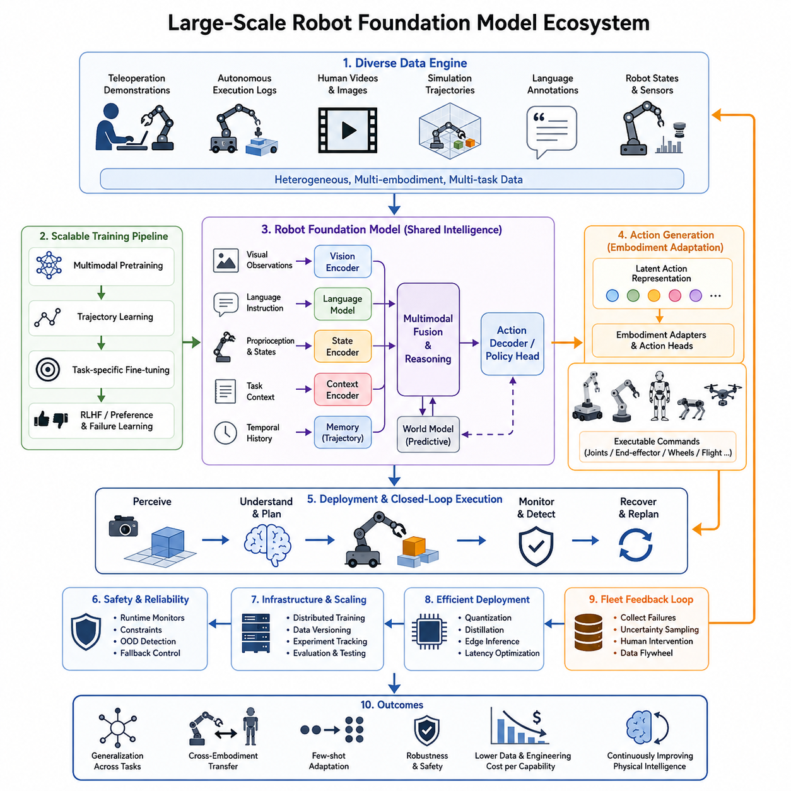{width="7.268055555555556in" height="7.268055555555556in"}

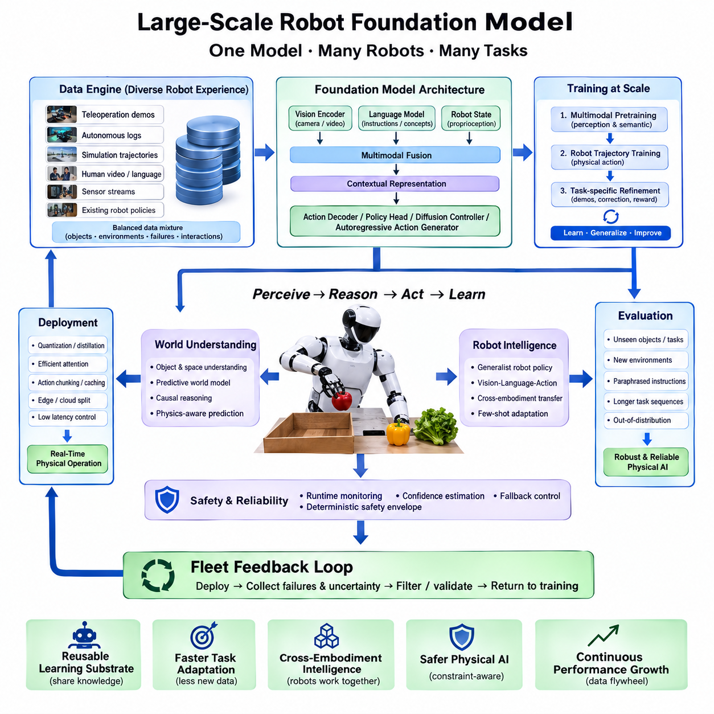{width="7.268055555555556in" height="7.268055555555556in"}

A large-scale robot foundation model is designed to replace collections of narrowly trained robot policies with a shared model that can learn reusable knowledge across tasks, environments, objects, and embodiments. Instead of building an independent controller for every behavior, the system learns common perceptual, semantic, spatial, and action representations from heterogeneous robot experience and transfers them to new tasks with limited additional training.

The case study begins with a data engine rather than with a single model architecture. Large robot datasets combine demonstrations collected through teleoperation, autonomous execution logs, simulation trajectories, human videos, language annotations, sensor streams, and previously deployed robot policies. The central challenge is not simply accumulating trajectories, but constructing a balanced data mixture that exposes the model to diverse objects, viewpoints, environments, failures, and interaction patterns.

Each training sample can be represented as a temporally aligned sequence containing visual observations, proprioceptive states, language instructions, task context, and robot actions. Images or video provide information about objects and geometry, while joint states, poses, forces, and other sensors describe the physical state of the embodiment. Language supplies semantic intent, and action trajectories connect perception and intent to executable behavior through supervised or self-supervised learning.

A scalable architecture typically separates reusable representation learning from embodiment-dependent control. Vision encoders transform camera observations into compact visual tokens, while a language model represents instructions, concepts, and task relationships. Multimodal fusion layers combine these signals with robot state and temporal history, producing contextual representations that can be consumed by an action decoder, policy head, diffusion controller, or autoregressive action generator.

Large-scale pretraining allows the model to discover regularities that appear across many robot tasks. Concepts such as graspability, containment, support, reachability, collision risk, object permanence, and goal progress can become shared internal features rather than task-specific labels. This shared representation is important because a robot encountering a new object does not need to relearn every physical relationship if similar structures were already captured during pretraining.

Multi-task training further changes the role of the robot policy. Instead of mapping one observation distribution to one fixed behavior, the policy conditions its output on instructions and context. Commands such as picking, placing, opening, moving, sorting, navigating, or handing over objects can therefore share the same backbone. Differences between tasks are represented through context, while common perceptual and motor knowledge remains reusable across the training distribution.

Scaling across environments is equally important because robot policies can easily overfit to backgrounds, camera poses, lighting conditions, object arrangements, or workspace geometry. Training across homes, laboratories, warehouses, factories, simulated environments, and other operational domains encourages the model to separate task-relevant structure from incidental visual details. Diversity therefore becomes a mechanism for improving robustness rather than merely increasing dataset size.

A large-scale system can also combine data from robots with different morphologies. Mobile manipulators, fixed arms, humanoids, and other platforms may observe similar semantic tasks even though their joint configurations and action spaces differ. Shared perception and task representations can be learned globally, while embodiment tokens, kinematic descriptions, adapters, or specialized action heads translate common intentions into commands compatible with each robot\'s physical capabilities.

The action representation is a critical architectural decision. Raw continuous joint commands preserve precise control information but make heterogeneous robot datasets difficult to combine. Discrete action tokens, learned latent actions, normalized end-effector commands, and temporal action chunks provide alternative interfaces. A practical foundation model may use a shared latent action representation internally and convert it into embodiment-specific commands near the output layer.

Training at scale usually proceeds through several stages rather than one monolithic optimization process. Broad multimodal pretraining first establishes perceptual and semantic representations, followed by robot trajectory training that connects those representations to physical actions. Task-specific demonstrations, corrective trajectories, reinforcement signals, preference information, and failure examples can then refine the policy while preserving capabilities acquired from the larger heterogeneous dataset.

Evaluation must measure more than average success on familiar demonstrations. A meaningful case study tests unseen objects, new object combinations, altered environments, paraphrased instructions, longer task sequences, and conditions outside the training distribution. Cross-embodiment transfer and few-shot adaptation provide additional evidence of whether the model has learned reusable physical knowledge or has merely memorized correlations within the original robot datasets.

Long-horizon tasks reveal another limitation of direct action prediction. Small errors accumulate, objects move unexpectedly, grasps fail, and intermediate states differ from the training trajectories. A robust foundation model therefore operates as a closed-loop agent that repeatedly observes the environment, estimates progress, generates actions, detects failures, and replans. Temporal memory and task-state representations help maintain consistency across extended interactions.

Failures generated during deployment are especially valuable because they identify regions where the original training distribution is weak. Fleet robots can record uncertain predictions, unsuccessful grasps, navigation conflicts, unusual objects, human interventions, and recovery attempts. After filtering and validation, these episodes can return to the training system, creating a data flywheel in which deployment continuously improves subsequent versions of the foundation model.

Scaling the model also requires scaling infrastructure. Distributed training systems must stream heterogeneous datasets, synchronize multimodal sequences, manage checkpoints, and support large vision-language-action models across many accelerators. Dataset versioning, experiment tracking, reproducible evaluation, and regression testing become essential because improvements on one family of tasks can otherwise introduce hidden degradation in previously learned behaviors.

Deployment introduces a different set of constraints from training. A model trained on large GPU clusters may be too expensive, slow, or power hungry for a mobile robot. Quantization, distillation, efficient attention, action chunking, caching, and heterogeneous GPU or NPU execution can reduce inference cost. Larger reasoning components may also be separated from latency-critical control so that fast local policies remain responsive while slower modules handle semantic planning.

Safety cannot depend exclusively on the learned foundation model. Runtime monitors can enforce velocity, workspace, collision, force, and operational constraints independently of policy predictions. Confidence estimation and out-of-distribution detection can trigger slower reasoning, human intervention, or fallback controllers. This layered architecture allows increasingly capable learned policies to operate within a deterministic safety envelope appropriate for physical systems.

The most important result of large-scale robot foundation modeling is therefore not a single universal robot that immediately performs every possible task. The practical achievement is a reusable learning substrate that reduces the amount of new data and engineering required for each additional capability. As datasets, embodiments, adaptation methods, edge inference, and fleet feedback loops improve together, robot development can shift from repeatedly building isolated policies toward continuously extending a shared physical intelligence platform.

대규모 로봇 파운데이션 모델(Large-Scale Robot Foundation Model)은 개별적으로 학습된 수많은 로봇 정책(robot policy)을 하나의 공유 모델(shared model)로 대체하여, 다양한 작업(task), 환경(environment), 객체(object), 임바디먼트(embodiment)에 걸쳐 재사용 가능한 지식을 학습하도록 설계된다. 각 행동마다 독립적인 제어기를 구축하는 대신, 이 시스템은 이질적인 로봇 경험으로부터 공통의 지각적(perceptual), 의미적(semantic), 공간적(spatial), 행동적(action) 표현을 학습하고, 제한된 추가 학습만으로 새로운 작업에 이를 전이(transfer)한다.

이 사례 연구(case study)는 단일 모델 아키텍처(model architecture)가 아니라 데이터 엔진(data engine)에서 시작한다. 대규모 로봇 데이터셋(robot dataset)은 원격조작(teleoperation)을 통해 수집된 시연(demonstration), 자율 실행 로그(autonomous execution log), 시뮬레이션 궤적(simulation trajectory), 인간 영상(human video), 언어 주석(language annotation), 센서 스트림(sensor stream), 기존에 배포된 로봇 정책 등을 결합한다. 핵심 과제는 단순히 궤적을 축적하는 것이 아니라 다양한 객체, 시점, 환경, 실패 상황, 상호작용 패턴을 모델에 노출하는 균형 잡힌 데이터 혼합(data mixture)을 구축하는 것이다.

각 학습 샘플(training sample)은 시각 관측(visual observation), 고유수용성 상태(proprioceptive state), 언어 명령(language instruction), 작업 문맥(task context), 로봇 행동(robot action)을 포함하는 시간적으로 정렬된 시퀀스(temporally aligned sequence)로 표현할 수 있다. 이미지 또는 영상은 객체와 기하학적 구조에 대한 정보를 제공하고, 관절 상태(joint state), 자세(pose), 힘(force), 기타 센서는 임바디먼트의 물리적 상태를 나타낸다. 언어는 의미적 의도(semantic intent)를 제공하며, 행동 궤적(action trajectory)은 지도학습(supervised learning) 또는 자기지도학습(self-supervised learning)을 통해 지각과 의도를 실행 가능한 행동으로 연결한다.

확장 가능한 아키텍처(scalable architecture)는 일반적으로 재사용 가능한 표현 학습(representation learning)과 임바디먼트 종속적 제어(embodiment-dependent control)를 분리한다. 비전 인코더(vision encoder)는 카메라 관측을 압축된 시각 토큰(visual token)으로 변환하고, 언어 모델(language model)은 명령, 개념, 작업 관계를 표현한다. 멀티모달 융합 계층(multimodal fusion layer)은 이러한 신호를 로봇 상태 및 시간적 이력(temporal history)과 결합하여 행동 디코더(action decoder), 정책 헤드(policy head), 확산 제어기(diffusion controller), 자기회귀 행동 생성기(autoregressive action generator)가 사용할 수 있는 문맥 표현(contextual representation)을 생성한다.

대규모 사전학습(large-scale pretraining)을 통해 모델은 여러 로봇 작업에서 반복적으로 나타나는 규칙성을 발견할 수 있다. 파지 가능성(graspability), 포함 관계(containment), 지지 관계(support), 도달 가능성(reachability), 충돌 위험(collision risk), 객체 영속성(object permanence), 목표 진행도(goal progress)와 같은 개념은 작업별 레이블(task-specific label)이 아니라 공유 내부 특징(shared internal feature)으로 형성될 수 있다. 이러한 공유 표현은 로봇이 새로운 객체를 만났을 때 유사한 구조가 사전학습 과정에서 이미 학습되었다면 모든 물리적 관계를 처음부터 다시 학습할 필요가 없도록 해준다.

멀티태스크 학습(multi-task learning)은 로봇 정책의 역할도 변화시킨다. 하나의 관측 분포(observation distribution)를 하나의 고정 행동에 매핑하는 대신, 정책은 명령과 문맥을 조건(condition)으로 사용하여 출력을 생성한다. 따라서 집기(picking), 놓기(placing), 열기(opening), 이동하기(moving), 분류하기(sorting), 내비게이션(navigating), 물체 전달하기(handing over)와 같은 명령이 동일한 백본(backbone)을 공유할 수 있다. 작업 간 차이는 문맥으로 표현되는 반면, 공통의 지각 및 운동 지식은 전체 학습 분포(training distribution)에 걸쳐 재사용된다.

환경 전반으로 학습을 확장하는 것도 중요하다. 로봇 정책은 배경(background), 카메라 자세(camera pose), 조명 조건(lighting condition), 객체 배치(object arrangement), 작업공간 기하구조(workspace geometry)에 쉽게 과적합(overfitting)될 수 있기 때문이다. 가정, 연구실, 창고, 공장, 시뮬레이션 환경 등 다양한 운영 영역에서 학습하면 모델이 작업과 관련된 구조와 우연한 시각적 세부사항을 분리하도록 유도할 수 있다. 따라서 다양성(diversity)은 단순히 데이터셋의 크기를 증가시키는 것이 아니라 강건성(robustness)을 향상시키는 메커니즘이 된다.

대규모 시스템은 서로 다른 형태를 가진 로봇의 데이터도 결합할 수 있다. 모바일 매니퓰레이터(mobile manipulator), 고정형 로봇 팔(fixed arm), 휴머노이드(humanoid) 및 기타 플랫폼은 관절 구성과 행동 공간이 서로 다르더라도 유사한 의미적 작업을 관측할 수 있다. 공유 지각(shared perception)과 작업 표현(task representation)은 전체적으로 학습하고, 임바디먼트 토큰(embodiment token), 운동학적 기술(kinematic description), 어댑터(adapter), 특화된 행동 헤드(specialized action head)를 사용하여 공통의 의도를 각 로봇의 물리적 능력에 적합한 명령으로 변환할 수 있다.

행동 표현(action representation)은 중요한 아키텍처 결정 요소이다. 원시 연속 관절 명령(raw continuous joint command)은 정밀한 제어 정보를 유지하지만, 서로 다른 로봇 데이터셋을 결합하기 어렵게 만든다. 이산 행동 토큰(discrete action token), 학습된 잠재 행동(learned latent action), 정규화된 엔드이펙터 명령(normalized end-effector command), 시간적 행동 청크(temporal action chunk)는 이러한 문제를 해결하기 위한 대안적 인터페이스를 제공한다. 실용적인 파운데이션 모델은 내부적으로 공유 잠재 행동 표현(shared latent action representation)을 사용하고 출력 계층 부근에서 이를 임바디먼트별 명령으로 변환할 수 있다.

대규모 학습(training at scale)은 일반적으로 하나의 단일 최적화 과정이 아니라 여러 단계로 진행된다. 먼저 광범위한 멀티모달 사전학습(multimodal pretraining)을 통해 지각적·의미적 표현을 형성하고, 이후 로봇 궤적 학습(robot trajectory training)을 통해 이러한 표현을 물리적 행동과 연결한다. 이후 작업별 시연(task-specific demonstration), 수정 궤적(corrective trajectory), 강화 신호(reinforcement signal), 선호 정보(preference information), 실패 사례(failure example)를 활용하여 대규모 이질적 데이터셋으로부터 획득한 능력을 유지하면서 정책을 정교화할 수 있다.

평가(evaluation)는 익숙한 시연에서의 평균 성공률만 측정해서는 안 된다. 의미 있는 사례 연구에서는 학습되지 않은 객체(unseen object), 새로운 객체 조합, 변경된 환경, 다른 표현으로 작성된 명령(paraphrased instruction), 더 긴 작업 시퀀스(task sequence), 학습 분포 밖의 조건(out-of-distribution condition)을 시험해야 한다. 교차 임바디먼트 전이(cross-embodiment transfer)와 퓨샷 적응(few-shot adaptation)은 모델이 실제로 재사용 가능한 물리적 지식을 학습했는지, 아니면 기존 로봇 데이터셋의 상관관계를 단순히 암기했는지를 평가하는 추가적인 근거를 제공한다.

장기 작업(long-horizon task)은 직접 행동 예측(direct action prediction)의 또 다른 한계를 드러낸다. 작은 오류가 누적되고, 객체가 예상과 다르게 움직이며, 파지가 실패하고, 중간 상태가 학습 궤적과 달라질 수 있다. 따라서 강건한 파운데이션 모델은 환경을 반복적으로 관측하고, 진행 상태를 추정하고, 행동을 생성하고, 실패를 탐지하고, 다시 계획하는 폐루프 에이전트(closed-loop agent)로 동작한다. 시간적 메모리(temporal memory)와 작업 상태 표현(task-state representation)은 장시간의 상호작용 동안 일관성을 유지하도록 지원한다.

배포 과정에서 생성되는 실패 사례는 기존 학습 분포가 취약한 영역을 식별하기 때문에 특히 가치가 높다. 플릿 로봇(fleet robot)은 불확실한 예측, 실패한 파지, 내비게이션 충돌, 비정상적인 객체, 인간 개입(human intervention), 복구 시도(recovery attempt)를 기록할 수 있다. 이러한 에피소드가 필터링과 검증을 거쳐 다시 학습 시스템으로 전달되면, 실제 배포가 이후 버전의 파운데이션 모델을 지속적으로 개선하는 데이터 플라이휠(data flywheel)이 형성된다.

모델의 확장에는 인프라(infrastructure)의 확장도 필요하다. 분산 학습 시스템(distributed training system)은 이질적인 데이터셋을 스트리밍하고, 멀티모달 시퀀스를 동기화하며, 체크포인트(checkpoint)를 관리하고, 다수의 가속기(accelerator)에서 대규모 비전-언어-행동 모델(Vision-Language-Action Model)을 지원해야 한다. 데이터셋 버전 관리(dataset versioning), 실험 추적(experiment tracking), 재현 가능한 평가(reproducible evaluation), 회귀 테스트(regression testing)는 한 작업군에서의 성능 개선이 기존에 학습된 행동의 숨겨진 성능 저하를 발생시키는 것을 방지하기 위해 필수적이다.

배포(deployment)는 학습과 다른 제약조건을 가진다. 대규모 GPU 클러스터에서 학습된 모델은 모바일 로봇에서 실행하기에는 비용, 지연시간(latency), 전력 소비가 지나치게 클 수 있다. 양자화(quantization), 지식 증류(distillation), 효율적 어텐션(efficient attention), 행동 청킹(action chunking), 캐싱(caching), 이기종 GPU 또는 NPU 실행(heterogeneous GPU/NPU execution)을 통해 추론 비용을 줄일 수 있다. 또한 대규모 추론 구성요소를 지연시간에 민감한 제어에서 분리하여, 빠른 로컬 정책(local policy)이 즉각적으로 반응하는 동안 느린 모듈이 의미적 계획(semantic planning)을 수행하도록 구성할 수 있다.

안전성(safety)은 학습된 파운데이션 모델에만 의존해서는 안 된다. 런타임 모니터(runtime monitor)는 정책 예측과 독립적으로 속도, 작업공간, 충돌, 힘, 운영상의 제약조건을 강제할 수 있다. 신뢰도 추정(confidence estimation)과 분포 외 탐지(out-of-distribution detection)는 더 느리고 정교한 추론, 인간 개입 또는 폴백 제어기(fallback controller)를 활성화할 수 있다. 이러한 계층적 아키텍처(layered architecture)는 점점 더 강력해지는 학습 정책이 물리 시스템에 적합한 결정론적 안전 경계(deterministic safety envelope) 안에서 작동하도록 한다.

따라서 대규모 로봇 파운데이션 모델링(large-scale robot foundation modeling)의 가장 중요한 결과는 모든 가능한 작업을 즉시 수행하는 하나의 범용 로봇(universal robot)을 만드는 것이 아니다. 실질적인 성과는 새로운 기능을 추가할 때마다 필요한 데이터와 엔지니어링 비용을 줄이는 재사용 가능한 학습 기반(reusable learning substrate)을 구축하는 것이다. 데이터셋, 임바디먼트, 적응 방법(adaptation method), 엣지 추론(edge inference), 플릿 피드백 루프(fleet feedback loop)가 함께 발전하면 로봇 개발은 고립된 정책을 반복적으로 구축하는 방식에서 공유된 물리 지능 플랫폼(shared physical intelligence platform)을 지속적으로 확장하는 방식으로 전환될 수 있다.

## 11.02. Vision Language Robot Model Case Study

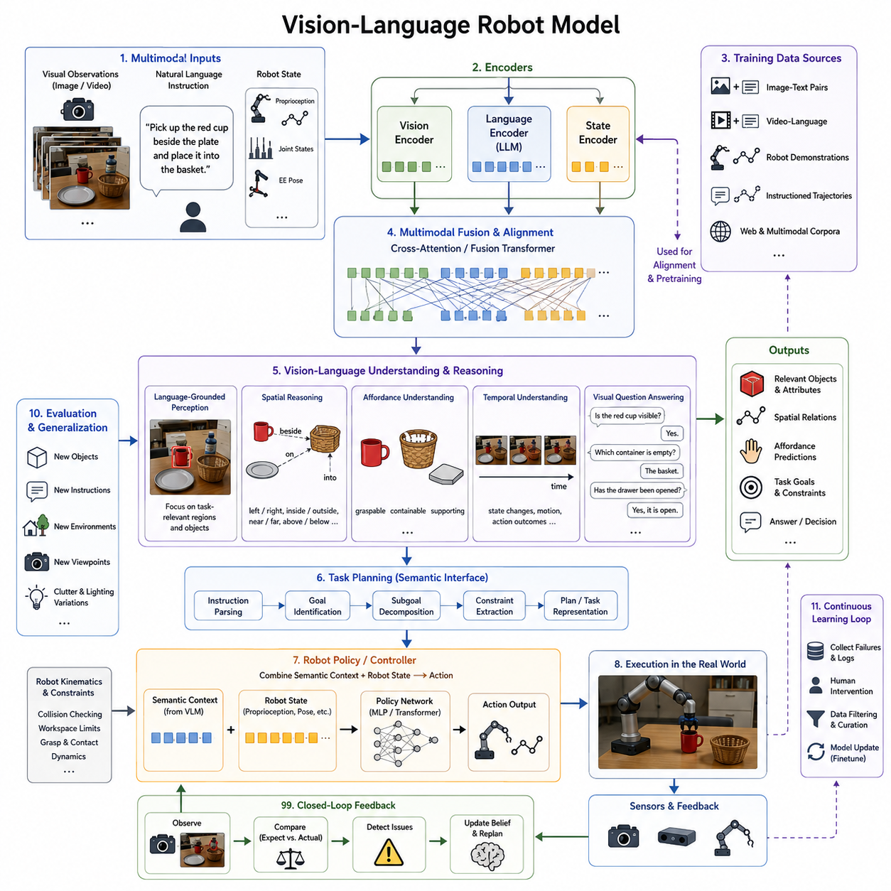{width="7.268055555555556in" height="7.268055555555556in"}

A vision-language robot model connects visual perception with linguistic understanding so that a robot can interpret scenes through task-relevant concepts rather than relying only on geometric or object-level detections. In a representative case study, camera observations and natural-language instructions are encoded into a shared multimodal representation that supports object recognition, spatial reasoning, affordance understanding, task interpretation, and subsequent robot decision making.

The visual subsystem begins with one or more cameras observing the robot workspace over time. A vision encoder transforms images or video frames into compact visual tokens that represent objects, attributes, spatial layouts, and contextual relationships. Rather than producing only predefined class labels, the encoder preserves rich features that can later be associated with language concepts, allowing the robot to reason about previously unseen objects through their appearance and context.

The language subsystem converts human instructions into semantic representations describing goals, objects, attributes, relationships, and constraints. An instruction such as "pick up the red cup beside the plate" contains more than an object category: it specifies an action, target attribute, object identity, and spatial relation. A language model provides representations capable of separating these elements while connecting them to knowledge learned from large-scale text and multimodal pretraining.

Multimodal alignment is the mechanism that connects visual observations with linguistic concepts. During training, image-text pairs, video-language examples, robot demonstrations, and instruction-conditioned trajectories can teach the model that particular visual structures correspond to words, descriptions, and actions. Cross-attention or related fusion mechanisms then allow language tokens to attend to relevant image regions while visual representations become conditioned on the current instruction.

This grounding capability changes how perception is used by the robot. Conventional perception pipelines may detect every known object before a separate planning module decides which detections matter. A vision-language model can instead perform language-grounded perception, emphasizing visual information that is relevant to the requested task. The same scene can therefore produce different task representations depending on whether the instruction concerns a cup, a container, an obstacle, or an accessible workspace.

Spatial reasoning is particularly important because physical actions depend on relationships rather than isolated object identities. The model must distinguish concepts such as left and right, above and below, inside and outside, near and far, in front of and behind, or supported by and contained within. These relationships can be represented implicitly in multimodal features or explicitly through detected regions, coordinates, depth information, scene graphs, or structured spatial tokens.

A robot also needs to reason about affordances, meaning what actions an observed object or region permits. Visual and linguistic knowledge can indicate that a handle may be grasped, a drawer can be pulled, a container can receive another object, or an open surface can support placement. Such predictions are not equivalent to geometric feasibility, but they provide semantic hypotheses that narrow the search space for downstream motion planning and control.

Temporal information extends the model from static scene understanding toward interaction understanding. Video observations can reveal object motion, state transitions, human demonstrations, and consequences of previous robot actions. A temporal vision-language representation helps the robot distinguish between states such as a drawer being closed, opening, or already open, and enables reasoning about whether an intermediate step has successfully changed the environment as expected.

A practical robot VLM can use visual question answering as an internal reasoning interface. Questions such as whether the target object is visible, which container is empty, where a requested tool is located, or whether an action has completed can be answered from current observations. These capabilities provide interpretable intermediate outputs that can support task planning, failure detection, human interaction, and debugging without directly generating low-level motor commands.

The model can also transform a high-level instruction into task-relevant semantic structure. For example, a request to place an object into a container may require identifying the source object, locating the destination, estimating whether the destination is appropriate, and determining which relationships should hold after execution. The VLM can supply these semantic constraints to a planner or robot policy while leaving precise trajectory generation to specialized control components.

This separation is important because visual-language understanding alone does not guarantee physically executable behavior. A model may correctly identify an object and describe the required action while lacking accurate knowledge of robot kinematics, collision constraints, contact dynamics, actuator limits, or grasp stability. The case study therefore treats the VLM primarily as a perception and reasoning component rather than assuming that linguistic competence automatically produces reliable physical control.

One effective architecture places the VLM above a robot policy in a hierarchical system. The VLM interprets observations and instructions, identifies relevant entities, estimates semantic goals, and produces structured task context. A downstream policy then combines this information with proprioception, geometry, and robot-specific state to generate executable actions. This architecture allows broad pretrained visual-language knowledge to complement specialized physical control.

Another approach uses VLM representations directly as features for policy learning. Visual and language embeddings produced by a pretrained model can be supplied to an action network trained from robot demonstrations. Because the upstream representations already encode extensive semantic knowledge, the policy may require fewer robot-specific examples to learn a new task. Fine-tuning, adapters, or parameter-efficient adaptation can further specialize selected model components without retraining the entire backbone.

Generalization should be evaluated by systematically modifying objects, instructions, environments, and viewpoints. A model trained to manipulate one set of household objects should be tested on visually different instances, unfamiliar arrangements, alternative linguistic descriptions, cluttered scenes, and changed lighting conditions. Performance under these variations reveals whether the model has learned semantic concepts that transfer or merely memorized associations present in the training demonstrations.

Failure analysis is equally important. The system may select the wrong object because of ambiguous language, misinterpret a spatial relation, hallucinate an object that is not present, confuse visually similar instances, or infer an affordance that is physically impossible. Confidence estimation, explicit visual grounding, geometric verification, and closed-loop observation can reduce these errors by requiring semantic predictions to remain consistent with current sensory evidence.

Real-world deployment introduces compute and latency constraints because large vision and language backbones can be expensive to execute continuously. Image resolution, frame sampling, attention complexity, model size, memory usage, and reasoning frequency must therefore be balanced against control requirements. Efficient encoders, quantization, caching, asynchronous inference, and hierarchical execution can preserve high-level semantic intelligence while maintaining responsive robot behavior at the edge.

The broader significance of the vision-language robot model is that it creates a semantic bridge between human intent and physical robot perception. Instead of requiring every task to be specified through fixed object IDs, manually engineered states, or rigid interfaces, users can communicate goals through natural language while the robot interprets relevant visual evidence. This capability provides an essential foundation for progressing from visually aware robots toward general vision-language-action systems capable of reasoning and acting in open physical environments.

비전-언어 로봇 모델(Vision-Language Robot Model)은 시각적 지각(visual perception)과 언어적 이해(linguistic understanding)를 연결하여 로봇이 단순히 기하학적 정보나 객체 수준의 탐지에 의존하는 것이 아니라 작업과 관련된 개념을 통해 장면을 해석할 수 있도록 한다. 대표적인 사례 연구(case study)에서는 카메라 관측(camera observation)과 자연어 명령(natural-language instruction)을 공유 멀티모달 표현(shared multimodal representation)으로 인코딩하여 객체 인식, 공간 추론, 어포던스 이해, 작업 해석 및 이후의 로봇 의사결정을 지원한다.

시각 서브시스템(visual subsystem)은 하나 이상의 카메라가 시간의 흐름에 따라 로봇 작업공간을 관측하는 것에서 시작한다. 비전 인코더(vision encoder)는 이미지 또는 비디오 프레임을 객체, 속성, 공간 배치 및 문맥적 관계를 나타내는 압축된 시각 토큰(visual token)으로 변환한다. 인코더는 사전에 정의된 클래스 레이블만 출력하는 대신, 이후 언어 개념과 연결할 수 있는 풍부한 특징을 유지하여 로봇이 외형과 문맥을 기반으로 이전에 보지 못한 객체에 대해서도 추론할 수 있도록 한다.

언어 서브시스템(language subsystem)은 인간의 명령을 목표, 객체, 속성, 관계 및 제약조건을 기술하는 의미 표현(semantic representation)으로 변환한다. 예를 들어 "접시 옆의 빨간 컵을 집어라"라는 명령은 단순한 객체 범주 이상의 정보를 포함하며, 행동, 대상의 속성, 객체의 정체성 및 공간적 관계를 지정한다. 언어 모델(language model)은 이러한 요소를 분리하면서 대규모 텍스트 및 멀티모달 사전학습(multimodal pretraining)을 통해 획득한 지식과 연결할 수 있는 표현을 제공한다.

멀티모달 정렬(multimodal alignment)은 시각적 관측과 언어적 개념을 연결하는 메커니즘이다. 학습 과정에서 이미지-텍스트 쌍(image-text pair), 비디오-언어 사례(video-language example), 로봇 시연(robot demonstration), 명령 조건부 궤적(instruction-conditioned trajectory)을 활용하여 특정한 시각적 구조가 단어, 설명 및 행동과 대응된다는 것을 모델이 학습할 수 있다. 교차 어텐션(cross-attention) 또는 관련 융합 메커니즘을 통해 언어 토큰은 관련 이미지 영역에 집중하고, 시각 표현은 현재 명령을 조건으로 변화한다.

이러한 그라운딩 능력(grounding capability)은 로봇이 지각 정보를 사용하는 방식을 변화시킨다. 기존의 지각 파이프라인(perception pipeline)은 별도의 계획 모듈이 어떤 탐지 결과가 중요한지를 결정하기 전에 알려진 모든 객체를 탐지하는 경우가 많다. 반면 비전-언어 모델은 언어 기반 지각(language-grounded perception)을 수행하여 요청된 작업과 관련된 시각 정보에 집중할 수 있다. 따라서 동일한 장면이라도 명령이 컵, 용기, 장애물 또는 접근 가능한 작업공간 중 무엇과 관련되는지에 따라 서로 다른 작업 표현을 생성할 수 있다.

공간 추론(spatial reasoning)은 물리적 행동이 개별 객체의 정체성보다 객체 간 관계에 의존하기 때문에 특히 중요하다. 모델은 왼쪽과 오른쪽, 위와 아래, 내부와 외부, 가까움과 멂, 앞과 뒤, 지지 관계(supported by)와 포함 관계(contained within) 등의 개념을 구별해야 한다. 이러한 관계는 멀티모달 특징에 암묵적으로 표현하거나 탐지 영역, 좌표, 깊이 정보(depth information), 장면 그래프(scene graph), 구조화된 공간 토큰(structured spatial token)을 통해 명시적으로 표현할 수 있다.

로봇은 또한 관측된 객체나 영역에서 어떤 행동이 가능한지를 의미하는 어포던스(affordance)를 추론해야 한다. 시각 및 언어 지식은 손잡이를 잡을 수 있고, 서랍을 당길 수 있으며, 용기 안에 다른 객체를 넣을 수 있고, 열린 표면 위에 물체를 놓을 수 있다는 것을 나타낼 수 있다. 이러한 예측은 기하학적 실행 가능성(geometric feasibility) 자체와 동일하지는 않지만, 이후의 모션 계획(motion planning)과 제어가 탐색해야 할 범위를 줄여주는 의미적 가설(semantic hypothesis)을 제공한다.

시간적 정보(temporal information)는 모델의 능력을 정적 장면 이해(static scene understanding)에서 상호작용 이해(interaction understanding)로 확장한다. 비디오 관측을 통해 객체의 움직임, 상태 전이(state transition), 인간의 시연 및 이전 로봇 행동의 결과를 파악할 수 있다. 시간적 비전-언어 표현(temporal vision-language representation)은 서랍이 닫혀 있는 상태, 열리는 중인 상태, 이미 열린 상태를 구분하도록 지원하며, 중간 단계가 예상한 대로 환경을 변화시켰는지 추론할 수 있도록 한다.

실용적인 로봇 비전-언어 모델(VLM)은 시각 질의응답(Visual Question Answering)을 내부 추론 인터페이스(internal reasoning interface)로 사용할 수 있다. 대상 객체가 보이는지, 어떤 용기가 비어 있는지, 요청된 도구가 어디에 있는지, 특정 행동이 완료되었는지 등의 질문에 현재 관측을 기반으로 답할 수 있다. 이러한 기능은 저수준 모터 명령을 직접 생성하지 않고도 작업 계획, 실패 탐지, 인간-로봇 상호작용(human-robot interaction), 디버깅을 지원하는 해석 가능한 중간 출력(interpretable intermediate output)을 제공한다.

모델은 고수준 명령(high-level instruction)을 작업과 관련된 의미 구조(semantic structure)로 변환할 수도 있다. 예를 들어 객체를 용기 안에 넣으라는 요청을 수행하려면 출발 객체를 식별하고, 목적지를 찾고, 목적지가 적절한지 판단하며, 실행 후 어떤 관계가 성립해야 하는지를 결정해야 한다. 비전-언어 모델은 이러한 의미적 제약조건(semantic constraint)을 플래너(planner) 또는 로봇 정책에 제공하면서 정밀한 궤적 생성은 전문화된 제어 구성요소에 맡길 수 있다.

이러한 분리는 비전-언어 이해만으로 물리적으로 실행 가능한 행동이 보장되지 않기 때문에 중요하다. 모델이 객체를 정확하게 식별하고 필요한 행동을 설명하더라도 로봇 운동학(robot kinematics), 충돌 제약조건(collision constraint), 접촉 동역학(contact dynamics), 액추에이터 한계(actuator limit), 파지 안정성(grasp stability)에 대한 정확한 지식이 부족할 수 있다. 따라서 이 사례 연구에서는 언어 능력이 자동으로 신뢰성 높은 물리 제어를 제공한다고 가정하지 않고, 비전-언어 모델을 주로 지각 및 추론 구성요소로 다룬다.

효과적인 아키텍처 중 하나는 계층형 시스템(hierarchical system)에서 비전-언어 모델을 로봇 정책(robot policy)의 상위 계층에 배치하는 것이다. 비전-언어 모델은 관측과 명령을 해석하고, 관련 개체(entity)를 식별하며, 의미적 목표를 추정하고, 구조화된 작업 문맥(structured task context)을 생성한다. 이후 하위 정책은 이 정보를 고유수용감각(proprioception), 기하학적 정보 및 로봇별 상태와 결합하여 실행 가능한 행동을 생성한다. 이러한 구조를 통해 광범위하게 사전학습된 비전-언어 지식과 전문화된 물리 제어를 상호 보완적으로 사용할 수 있다.

또 다른 접근법은 비전-언어 모델 표현(VLM representation)을 정책 학습(policy learning)의 특징으로 직접 사용하는 것이다. 사전학습된 모델이 생성한 시각 및 언어 임베딩(embedding)을 로봇 시연으로 학습되는 행동 네트워크(action network)에 제공할 수 있다. 상위 표현이 이미 광범위한 의미적 지식을 포함하고 있으므로 새로운 작업을 학습하는 데 필요한 로봇별 사례를 줄일 수 있다. 미세조정(fine-tuning), 어댑터(adapter), 매개변수 효율적 적응(parameter-efficient adaptation)을 사용하면 전체 백본을 다시 학습하지 않고 선택된 모델 구성요소만 추가적으로 특화할 수 있다.

일반화(generalization)는 객체, 명령, 환경 및 시점을 체계적으로 변화시키면서 평가해야 한다. 특정 가정용 객체 집합을 조작하도록 학습된 모델이라면 시각적으로 다른 객체 인스턴스, 익숙하지 않은 배치, 대체된 언어 표현, 복잡한 장면(cluttered scene), 변경된 조명 조건에서 시험해야 한다. 이러한 변화에 대한 성능은 모델이 전이 가능한 의미적 개념을 실제로 학습했는지, 아니면 학습 시연에 포함된 연관성을 단순히 암기했는지를 보여준다.

실패 분석(failure analysis)도 마찬가지로 중요하다. 시스템은 모호한 언어 때문에 잘못된 객체를 선택하거나, 공간 관계를 잘못 해석하거나, 존재하지 않는 객체를 환각(hallucination)하거나, 시각적으로 유사한 객체를 혼동하거나, 물리적으로 불가능한 어포던스를 추론할 수 있다. 신뢰도 추정(confidence estimation), 명시적 시각 그라운딩(explicit visual grounding), 기하학적 검증(geometric verification), 폐루프 관측(closed-loop observation)은 의미적 예측이 현재의 센서 증거와 일관성을 유지하도록 함으로써 이러한 오류를 줄일 수 있다.

실세계 배포(real-world deployment)에서는 대규모 비전 및 언어 백본을 지속적으로 실행하는 데 상당한 연산 비용이 필요하므로 컴퓨팅 및 지연시간 제약(compute and latency constraint)이 발생한다. 따라서 이미지 해상도, 프레임 샘플링(frame sampling), 어텐션 복잡도(attention complexity), 모델 크기, 메모리 사용량 및 추론 빈도를 제어 요구사항과 균형 있게 조정해야 한다. 효율적인 인코더, 양자화(quantization), 캐싱(caching), 비동기 추론(asynchronous inference), 계층적 실행(hierarchical execution)을 활용하면 엣지(edge)에서 반응성 높은 로봇 동작을 유지하면서 고수준 의미 지능을 보존할 수 있다.

비전-언어 로봇 모델의 더 큰 의미는 인간의 의도(human intent)와 물리적 로봇 지각 사이에 의미적 연결고리(semantic bridge)를 형성한다는 것이다. 모든 작업을 고정된 객체 ID, 수작업으로 설계된 상태 또는 경직된 인터페이스를 통해 지정하는 대신 사용자는 자연어를 통해 목표를 전달하고 로봇은 관련 시각적 증거를 해석할 수 있다. 이러한 능력은 시각적으로 인식하는 로봇에서 개방된 물리 환경에서 추론하고 행동할 수 있는 범용 비전-언어-행동 시스템(Vision-Language-Action system)으로 발전하기 위한 핵심 기반을 제공한다.

## 11.03. Vision Language Action Model Case Study

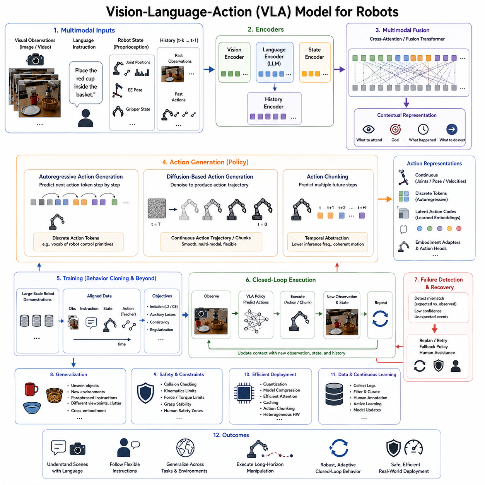{width="7.268055555555556in" height="7.268055555555556in"}

A Vision-Language-Action model extends multimodal understanding into direct physical behavior by learning a mapping from visual observations and language instructions to robot actions. In a representative case study, the robot observes its environment, interprets a natural-language goal, combines this information with its current physical state and recent history, and generates executable actions within a unified policy. This closes the gap between semantic understanding and embodied control.

The input representation typically combines camera images or video, language instructions, proprioceptive state, and temporal context. Visual observations describe objects, geometry, and scene configuration, while language specifies the desired outcome. Joint positions, end-effector poses, gripper states, velocities, and other robot signals provide embodiment-specific context. Recent observations and actions help the model infer motion, progress, and changes caused by previous decisions.

A vision encoder converts images into visual tokens representing task-relevant objects, regions, attributes, and spatial relationships. These representations may originate from large-scale vision or vision-language pretraining, giving the policy semantic knowledge beyond the available robot demonstrations. Instead of requiring fixed object identifiers, the robot can associate visual evidence with concepts expressed in natural language and use those associations during action generation.

Language instructions are transformed into tokens or embeddings that represent goals, entities, relationships, and constraints. Commands such as "place the red cup inside the basket" implicitly specify a target object, destination, action, and desired final relationship. A pretrained language or multimodal backbone provides semantic representations that allow differently worded instructions to produce similar task context when they express equivalent physical intentions.

Multimodal fusion integrates vision, language, robot state, and history into a contextual representation used for action prediction. Transformer attention can dynamically associate instruction tokens with relevant visual regions and physical states. The resulting representation does more than describe the scene: it encodes what the robot should attend to, what goal must be achieved, what has already happened, and which physical behavior is appropriate next.

The action representation determines how this contextual intelligence becomes robot motion. One approach predicts continuous values such as end-effector translation, rotation, gripper commands, joint targets, or mobile-base velocities. Another discretizes actions into tokens that can be generated autoregressively like language. Learned latent action codes provide an intermediate alternative, allowing the model to represent reusable patterns of physical behavior without tying every internal representation to a specific actuator command.

Action chunking predicts several future control steps together rather than generating only one command at a time. This temporal abstraction can reduce inference frequency and capture coherent motion patterns such as approaching an object, closing a gripper, lifting, or moving toward a destination. However, longer chunks reduce opportunities to react to unexpected changes, so chunk length must balance computational efficiency, temporal consistency, and closed-loop responsiveness.

Autoregressive VLA models treat action generation as sequential prediction. Given observations, instructions, states, and previously generated actions, the model predicts the next action token or control element. This provides a natural interface with transformer architectures and discrete action vocabularies. The approach can represent complex multimodal dependencies, although sequential generation may introduce latency and allow prediction errors to accumulate across longer action sequences.

Diffusion-based action generation provides another strategy by learning to transform noise into coherent action trajectories conditioned on observations and instructions. Instead of committing immediately to a single next action, a diffusion policy can model multimodal action distributions and generate smooth action chunks. This is useful when several valid trajectories can accomplish the same goal, although iterative denoising introduces computational requirements that must be considered for real-time deployment.

Training commonly begins with behavior cloning from large collections of robot demonstrations. Each trajectory provides aligned observations, instructions, robot states, and target actions, allowing the model to learn the conditional relationship between what the robot sees, what it is asked to accomplish, and what an expert does. Diversity across tasks, objects, environments, camera viewpoints, and interaction styles is essential because the objective is transferable behavior rather than memorization of individual demonstrations.

Large-scale VLA training can combine demonstrations from multiple tasks and robot embodiments. Shared vision-language representations capture semantic knowledge, while embodiment information identifies the physical platform responsible for executing an action. Robot-specific adapters, action heads, normalization schemes, or morphology encodings can translate common task representations into different action spaces, creating a pathway toward policies that transfer knowledge across manipulators, mobile robots, and other embodiments.

Long-horizon manipulation exposes the difference between generating plausible actions and completing an entire task. A robot may correctly grasp an object but fail during transport, placement, or subsequent interaction. Temporal context and memory therefore help the VLA model track intermediate states, previous actions, and task progress. Hierarchical representations can additionally separate high-level subgoals from short-horizon motor behavior when tasks require many sequential interactions.

Closed-loop execution is essential because physical environments rarely evolve exactly as predicted. After executing an action or action chunk, the robot observes the resulting scene again and conditions subsequent predictions on the updated state. If an object slips, a grasp fails, or the environment changes, new observations can alter the next action. Repeated perception-action cycles therefore transform the VLA model from an open-loop trajectory generator into an adaptive embodied policy.

Failure recovery requires the model to recognize when observed outcomes disagree with expected progress. Training data containing unsuccessful grasps, interrupted motions, corrections, and recovery demonstrations can teach useful responses to these conditions. Runtime confidence estimation or external monitors can additionally identify uncertain situations and trigger replanning, a conservative fallback policy, or human assistance rather than allowing an unreliable action sequence to continue.

Evaluation must test generalization beyond the demonstrations used for training. Relevant conditions include unseen object instances, altered object arrangements, new environments, paraphrased instructions, different viewpoints, clutter, and longer task sequences. Success rate should be considered together with completion time, intervention frequency, recovery capability, robustness, and safety because a policy that succeeds only under carefully controlled conditions does not demonstrate general physical intelligence.

Physical feasibility remains a critical limitation of end-to-end VLA prediction. Semantic understanding does not automatically enforce collision avoidance, actuator limits, force constraints, grasp stability, or safe interaction with humans. Practical systems can therefore combine learned VLA policies with motion constraints, runtime safety monitors, collision checking, low-level servo controllers, and fallback mechanisms. The learned model provides flexible intelligence while deterministic components protect essential operational boundaries.

Edge deployment introduces another tradeoff because vision-language-action inference combines expensive perception, multimodal reasoning, and action generation under real-time constraints. Quantization, model compression, efficient attention, caching, reduced visual token counts, action chunking, and heterogeneous accelerators can lower inference cost. High-level reasoning may run at a slower frequency while low-level controllers maintain faster stabilization and safety loops.

The VLA case study illustrates an important architectural transition in robot foundation models: perception, language grounding, task reasoning, and action prediction are no longer isolated pipelines connected only through manually designed interfaces. They can be optimized as components of a shared multimodal policy whose representations are shaped by physical interaction. This allows semantic knowledge learned at scale to influence robot behavior directly while preserving feedback from the physical world.

Ultimately, a Vision-Language-Action model provides a foundation for robots that can receive flexible human instructions, interpret unfamiliar scenes, reuse behaviors across tasks, and continuously select actions from sensory feedback. Its practical value depends not only on model scale but on diverse robot data, effective action representations, temporal reasoning, cross-embodiment adaptation, closed-loop recovery, efficient inference, and safety mechanisms working together as an integrated physical intelligence system.

비전-언어-행동 모델(Vision-Language-Action Model)은 멀티모달 이해(multimodal understanding)를 직접적인 물리적 행동으로 확장하여 시각적 관측(visual observation)과 언어 명령(language instruction)으로부터 로봇 행동(robot action)으로의 매핑을 학습한다. 대표적인 사례 연구(case study)에서 로봇은 환경을 관측하고 자연어 목표를 해석하며, 이 정보를 현재의 물리적 상태 및 최근 이력과 결합하여 통합 정책(unified policy) 내에서 실행 가능한 행동을 생성한다. 이를 통해 의미적 이해와 임바디드 제어(embodied control) 사이의 간극을 연결한다.

입력 표현(input representation)은 일반적으로 카메라 이미지 또는 비디오, 언어 명령, 고유수용성 상태(proprioceptive state), 시간적 문맥(temporal context)을 결합한다. 시각 관측은 객체, 기하학적 구조, 장면 구성을 설명하고 언어는 원하는 결과를 지정한다. 관절 위치, 엔드이펙터 자세(end-effector pose), 그리퍼 상태(gripper state), 속도 및 기타 로봇 신호는 임바디먼트별 문맥을 제공한다. 최근의 관측과 행동은 모델이 움직임, 진행 상태 및 이전 결정으로 발생한 변화를 추론하도록 돕는다.

비전 인코더(vision encoder)는 이미지를 작업과 관련된 객체, 영역, 속성 및 공간 관계를 나타내는 시각 토큰(visual token)으로 변환한다. 이러한 표현은 대규모 비전 또는 비전-언어 사전학습(vision-language pretraining)에서 획득할 수 있으며, 이를 통해 정책은 사용 가능한 로봇 시연(robot demonstration)을 넘어서는 의미적 지식을 확보한다. 로봇은 고정된 객체 식별자에 의존하는 대신 시각적 증거를 자연어로 표현된 개념과 연결하고, 이러한 연관성을 행동 생성 과정에서 활용할 수 있다.

언어 명령은 목표, 개체(entity), 관계 및 제약조건을 표현하는 토큰(token) 또는 임베딩(embedding)으로 변환된다. 예를 들어 "빨간 컵을 바구니 안에 놓아라"라는 명령은 암묵적으로 대상 객체, 목적지, 행동 및 원하는 최종 관계를 지정한다. 사전학습된 언어 또는 멀티모달 백본(multimodal backbone)은 서로 다르게 표현된 명령이라도 동일한 물리적 의도를 나타낸다면 유사한 작업 문맥(task context)을 생성할 수 있는 의미 표현을 제공한다.

멀티모달 융합(multimodal fusion)은 비전, 언어, 로봇 상태 및 이력을 행동 예측에 사용되는 문맥 표현(contextual representation)으로 통합한다. 트랜스포머 어텐션(transformer attention)은 명령 토큰을 관련 시각 영역 및 물리적 상태와 동적으로 연결할 수 있다. 이렇게 생성된 표현은 단순히 장면을 설명하는 것을 넘어 로봇이 무엇에 주의를 기울여야 하는지, 어떤 목표를 달성해야 하는지, 지금까지 무엇이 발생했는지, 다음에 어떤 물리적 행동이 적절한지를 인코딩한다.

행동 표현(action representation)은 이러한 문맥적 지능이 실제 로봇 움직임으로 변환되는 방식을 결정한다. 한 가지 접근법은 엔드이펙터의 병진 이동, 회전, 그리퍼 명령, 관절 목표값 또는 모바일 베이스 속도와 같은 연속값을 예측한다. 다른 접근법은 행동을 이산 토큰(discrete token)으로 변환하여 언어처럼 자기회귀적으로 생성한다. 학습된 잠재 행동 코드(latent action code)는 중간적인 대안으로, 모든 내부 표현을 특정 액추에이터 명령에 직접 연결하지 않고 재사용 가능한 물리적 행동 패턴을 표현할 수 있도록 한다.

행동 청킹(action chunking)은 한 번에 하나의 명령만 생성하는 대신 미래의 여러 제어 단계를 함께 예측한다. 이러한 시간적 추상화(temporal abstraction)는 추론 빈도를 줄이고 객체에 접근하기, 그리퍼 닫기, 들어 올리기 또는 목적지로 이동하기와 같은 일관된 움직임 패턴을 포착할 수 있다. 그러나 긴 행동 청크는 예상하지 못한 변화에 대응할 기회를 줄이므로, 청크 길이는 계산 효율성, 시간적 일관성, 폐루프 반응성(closed-loop responsiveness) 사이에서 균형을 이루어야 한다.

자기회귀 VLA 모델(autoregressive VLA model)은 행동 생성을 순차 예측(sequential prediction) 문제로 다룬다. 관측, 명령, 상태 및 이전에 생성된 행동을 바탕으로 모델은 다음 행동 토큰이나 제어 요소를 예측한다. 이는 트랜스포머 아키텍처(transformer architecture) 및 이산 행동 어휘(discrete action vocabulary)와 자연스럽게 결합할 수 있다. 복잡한 멀티모달 의존성을 표현할 수 있지만 순차적 생성으로 인해 지연시간이 증가할 수 있으며, 긴 행동 시퀀스에서는 예측 오류가 누적될 수 있다.

확산 기반 행동 생성(diffusion-based action generation)은 노이즈(noise)를 관측 및 명령에 의해 조건화된 일관된 행동 궤적(action trajectory)으로 변환하는 방법을 학습하는 또 다른 전략을 제공한다. 확산 정책(diffusion policy)은 단일한 다음 행동을 즉시 결정하는 대신 멀티모달 행동 분포(multimodal action distribution)를 모델링하고 부드러운 행동 청크를 생성할 수 있다. 동일한 목표를 달성하는 여러 유효한 궤적이 존재하는 경우 유용하지만, 반복적인 디노이징(iterative denoising)에 필요한 계산량은 실시간 배포에서 고려해야 한다.

학습은 일반적으로 대규모 로봇 시연 데이터로부터 행동 복제(behavior cloning)를 수행하는 것으로 시작한다. 각 궤적은 정렬된 관측, 명령, 로봇 상태 및 목표 행동을 제공하며, 모델은 로봇이 무엇을 보고 있는지, 무엇을 수행하도록 요청받았는지, 전문가가 어떤 행동을 수행하는지 사이의 조건부 관계를 학습한다. 개별 시연을 암기하는 것이 아니라 전이 가능한 행동을 학습하는 것이 목표이므로 작업, 객체, 환경, 카메라 시점 및 상호작용 방식의 다양성이 중요하다.

대규모 VLA 학습은 여러 작업과 로봇 임바디먼트(robot embodiment)에서 수집된 시연을 결합할 수 있다. 공유 비전-언어 표현(shared vision-language representation)은 의미적 지식을 포착하고, 임바디먼트 정보는 행동을 실행하는 물리적 플랫폼을 식별한다. 로봇별 어댑터(robot-specific adapter), 행동 헤드(action head), 정규화 방식(normalization scheme), 형태 인코딩(morphology encoding)을 사용하여 공통 작업 표현을 서로 다른 행동 공간으로 변환함으로써 매니퓰레이터, 모바일 로봇 및 기타 임바디먼트 사이에서 지식을 전이할 수 있는 경로를 제공한다.

장기 조작 작업(long-horizon manipulation task)은 그럴듯한 행동을 생성하는 것과 전체 작업을 완료하는 것의 차이를 드러낸다. 로봇이 객체를 정확하게 파지하더라도 운반, 배치 또는 후속 상호작용 과정에서 실패할 수 있다. 따라서 시간적 문맥과 메모리(memory)는 VLA 모델이 중간 상태, 이전 행동 및 작업 진행 상황을 추적하도록 지원한다. 여러 순차적 상호작용이 필요한 작업에서는 계층적 표현(hierarchical representation)을 통해 고수준 하위 목표와 단기적인 모터 행동을 추가적으로 분리할 수 있다.

물리적 환경은 예상한 대로 정확하게 변화하는 경우가 드물기 때문에 폐루프 실행(closed-loop execution)이 필수적이다. 행동 또는 행동 청크를 실행한 후 로봇은 결과 장면을 다시 관측하고 업데이트된 상태를 조건으로 이후의 행동을 예측한다. 객체가 미끄러지거나 파지가 실패하거나 환경이 변화하면 새로운 관측을 통해 다음 행동을 수정할 수 있다. 이러한 반복적인 지각-행동 순환(perception-action cycle)은 VLA 모델을 개루프 궤적 생성기(open-loop trajectory generator)에서 적응형 임바디드 정책(adaptive embodied policy)으로 변화시킨다.

실패 복구(failure recovery)를 위해서는 모델이 관측된 결과와 예상된 진행 상태가 일치하지 않는 상황을 인식해야 한다. 실패한 파지, 중단된 움직임, 수정 행동 및 복구 시연(recovery demonstration)을 포함하는 학습 데이터는 이러한 조건에 적절하게 대응하는 방법을 학습하는 데 활용할 수 있다. 런타임 신뢰도 추정(runtime confidence estimation) 또는 외부 모니터는 불확실한 상황을 추가로 탐지하고, 신뢰할 수 없는 행동 시퀀스를 계속 실행하는 대신 재계획, 보수적인 폴백 정책(fallback policy) 또는 인간 지원을 활성화할 수 있다.

평가(evaluation)는 학습에 사용된 시연을 넘어서는 일반화(generalization)를 검증해야 한다. 주요 평가 조건에는 학습되지 않은 객체 인스턴스, 변경된 객체 배치, 새로운 환경, 다른 표현으로 작성된 명령(paraphrased instruction), 다양한 시점, 복잡한 장면(clutter), 더욱 긴 작업 시퀀스가 포함된다. 성공률뿐만 아니라 완료 시간, 인간 개입 빈도, 복구 능력, 강건성(robustness), 안전성을 함께 고려해야 한다. 통제된 조건에서만 성공하는 정책은 범용 물리 지능(general physical intelligence)을 입증한다고 보기 어렵다.

물리적 실행 가능성(physical feasibility)은 엔드투엔드 VLA 예측(end-to-end VLA prediction)의 중요한 한계로 남아 있다. 의미적 이해가 충돌 회피, 액추에이터 한계, 힘 제약조건, 파지 안정성 또는 인간과의 안전한 상호작용을 자동으로 보장하지는 않는다. 따라서 실용적인 시스템은 학습된 VLA 정책을 모션 제약조건, 런타임 안전 모니터(runtime safety monitor), 충돌 검사(collision checking), 저수준 서보 제어기(low-level servo controller), 폴백 메커니즘과 결합할 수 있다. 학습 모델이 유연한 지능을 제공하는 동안 결정론적 구성요소는 핵심적인 운영 경계를 보호한다.

엣지 배포(edge deployment)는 비전-언어-행동 추론이 높은 비용의 지각, 멀티모달 추론 및 행동 생성을 실시간 제약조건 아래에서 함께 수행해야 하기 때문에 또 다른 절충 관계를 발생시킨다. 양자화(quantization), 모델 압축(model compression), 효율적 어텐션(efficient attention), 캐싱(caching), 시각 토큰 수 감소, 행동 청킹, 이기종 가속기(heterogeneous accelerator)를 통해 추론 비용을 낮출 수 있다. 고수준 추론은 상대적으로 낮은 주기로 실행하면서 저수준 제어기가 더 빠른 안정화 및 안전 루프를 유지하도록 구성할 수 있다.

이 VLA 사례 연구는 로봇 파운데이션 모델(robot foundation model)의 중요한 아키텍처적 전환을 보여준다. 지각, 언어 그라운딩(language grounding), 작업 추론(task reasoning), 행동 예측(action prediction)은 더 이상 수작업으로 설계된 인터페이스를 통해서만 연결되는 독립적인 파이프라인이 아니다. 이들은 물리적 상호작용에 의해 표현이 형성되는 공유 멀티모달 정책(shared multimodal policy)의 구성요소로 함께 최적화될 수 있다. 이를 통해 대규모로 학습된 의미적 지식이 물리 세계의 피드백을 유지하면서 로봇 행동에 직접적인 영향을 미칠 수 있다.

궁극적으로 비전-언어-행동 모델은 로봇이 유연한 인간 명령을 받아들이고, 익숙하지 않은 장면을 해석하며, 여러 작업에서 행동을 재사용하고, 센서 피드백을 기반으로 지속적으로 행동을 선택할 수 있도록 하는 기반을 제공한다. 실질적인 가치는 단순한 모델 규모가 아니라 다양한 로봇 데이터, 효과적인 행동 표현, 시간적 추론, 교차 임바디먼트 적응(cross-embodiment adaptation), 폐루프 복구, 효율적인 추론 및 안전 메커니즘이 하나의 통합된 물리 지능 시스템(integrated physical intelligence system)으로 함께 작동하는 데서 나온다.

## 11.04. Generalist Manipulation Model Case Study

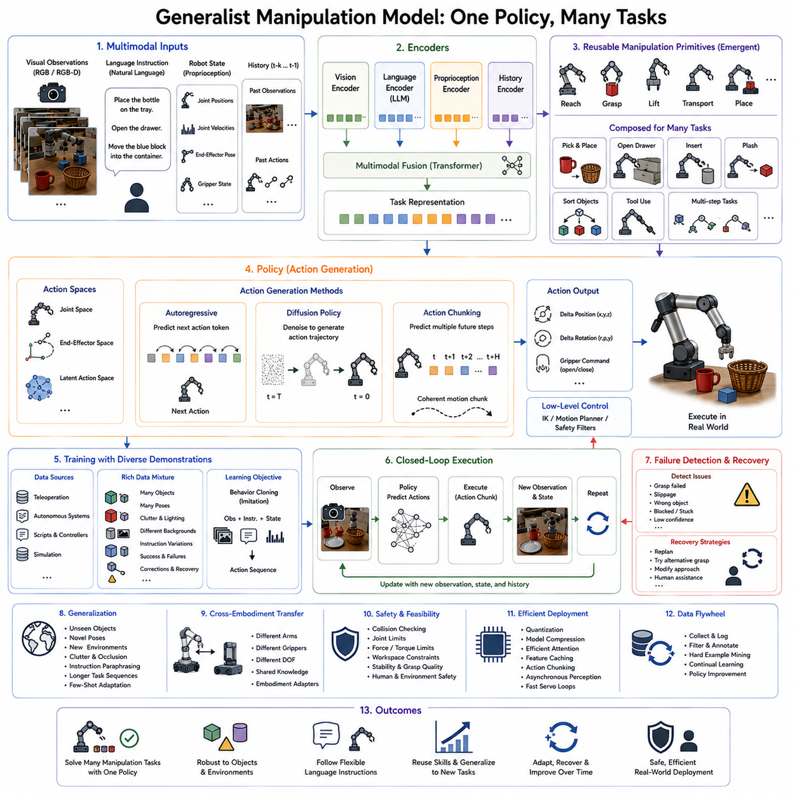{width="7.268055555555556in" height="7.268055555555556in"}

A generalist manipulation model is designed to perform many object-interaction tasks with a shared policy rather than maintaining a separate controller for every skill. In a representative case study, one manipulation model learns from heterogeneous demonstrations covering grasping, placing, pushing, opening, closing, inserting, sorting, tool use, and multi-step interaction. The objective is reusable manipulation competence that transfers across objects, instructions, environments, and task variations.

The observation space combines visual information with the physical state of the manipulator. RGB or RGB-D cameras provide object appearance, geometry, workspace configuration, and contextual cues, while proprioceptive signals describe joint positions, velocities, gripper state, and end-effector pose. Temporal history provides information about previous observations and actions, enabling the policy to distinguish static configurations from ongoing interaction and task progress.

Language provides a flexible interface for specifying manipulation goals. Instructions such as "place the bottle on the tray," "open the drawer," or "move the blue block into the container" describe tasks without requiring a predefined controller identifier. A language encoder transforms these instructions into semantic representations that can be aligned with visual observations, allowing one policy to select different behaviors according to objects, relationships, and requested outcomes.

The visual representation must support more than conventional object classification. Manipulation depends on object boundaries, orientation, graspable regions, free space, contact surfaces, handles, containers, and relationships between objects. A pretrained vision or vision-language encoder can provide broad semantic features, while robot-specific training connects those features to physical interaction. Depth, segmentation, or spatial features may additionally improve geometric reasoning where precise manipulation is required.

Multimodal fusion combines vision, language, proprioception, and temporal context into a shared task representation. Attention mechanisms can associate words such as "red cup," "drawer handle," or "inside the box" with relevant visual regions while conditioning those associations on the robot\'s current configuration. The resulting representation simultaneously describes the scene, the requested goal, the robot\'s physical state, and the interaction history required for selecting the next behavior.

A generalist policy benefits from learning reusable manipulation primitives without restricting itself to a manually defined skill library. Reaching, grasping, lifting, transporting, aligning, inserting, releasing, pushing, and pulling appear repeatedly across many tasks. Large-scale multi-task training allows internal representations of these patterns to emerge and be recombined according to context, providing a foundation for solving task variations that were not explicitly represented as separate controllers.

Action prediction can operate in joint space, end-effector space, or a learned latent action space. End-effector commands are particularly useful for combining demonstrations across tasks because they describe motion in a representation closer to manipulation intent than individual joint movements. Actions may contain translational and rotational changes together with gripper commands, while inverse kinematics and low-level controllers translate these outputs into actuator-level execution.

Action chunking allows the policy to predict short sequences of future actions instead of issuing only one control command per inference step. A chunk may represent a coherent motion such as approaching a grasp point, lifting an object, or moving toward a placement region. This improves temporal consistency and reduces inference overhead, although shorter horizons remain valuable when contact uncertainty or environmental changes require frequent observation and correction.

Behavior cloning provides a practical starting point for training the manipulation policy. Demonstrations collected through teleoperation, scripted controllers, autonomous systems, or simulation provide observation-action sequences conditioned on task instructions. Large and diverse datasets are especially important because a generalist model must learn which behavior remains invariant across tasks and which aspects must change according to object geometry, scene arrangement, or linguistic context.

Data mixture design strongly affects generalization. If most demonstrations involve similar objects, camera viewpoints, backgrounds, or successful trajectories, the model can exploit superficial correlations rather than learning robust manipulation concepts. Training therefore benefits from variation in object identity, size, texture, pose, clutter, lighting, workspace geometry, instruction phrasing, execution speed, and initial robot configuration, together with examples of corrections and failures.

Long-horizon manipulation can be understood as repeated composition of shorter interaction patterns. A task such as retrieving an object from a drawer may require locating the handle, reaching, grasping, pulling, releasing, locating the target object, grasping again, and transporting it. Temporal context allows the generalist model to recognize which stage has been completed and select behavior appropriate to the current state rather than replaying a fixed trajectory.

Closed-loop execution is essential because contact-rich manipulation contains uncertainty that cannot be eliminated through visual prediction alone. Objects may slip, deform, rotate unexpectedly, become occluded, or move differently after contact. After executing an action or short chunk, the policy observes the resulting state and updates its next prediction. This continuous observation-action cycle enables correction when execution diverges from the expected manipulation sequence.

Failure recovery becomes a defining capability of a truly generalist manipulator. A failed grasp should not necessarily terminate the task; the robot can observe the new object pose, approach again, select another grasp, or modify its strategy. Training with corrective demonstrations, unsuccessful interactions, intervention data, and recovery trajectories teaches the model how task execution changes when nominal assumptions fail in the physical world.

Generalization evaluation should separate memorized performance from transferable manipulation competence. Tests can introduce unseen object instances, novel poses, unfamiliar containers, altered backgrounds, clutter, new instruction formulations, and combinations of previously learned skills. Few-shot adaptation provides another useful measure: a broadly pretrained manipulation model should require substantially fewer demonstrations than a specialist policy when adapting to a related new task.

Cross-embodiment transfer extends this idea beyond a single manipulator. Different robot arms may have different joint structures, workspaces, grippers, control frequencies, and action limits while sharing similar semantic manipulation objectives. Common visual-language representations and normalized task-space actions can capture reusable knowledge, while embodiment encodings, robot-specific adapters, or specialized action heads translate that knowledge into commands appropriate for each physical platform.

Safety and physical feasibility must remain explicit parts of the deployment architecture. A learned policy may generate semantically reasonable actions that violate joint limits, approach obstacles, apply excessive force, or create unstable grasps. Collision checking, workspace constraints, force and torque limits, low-level control, confidence monitoring, and fallback behaviors can therefore surround the learned policy with a runtime safety layer that protects the robot, environment, and nearby humans.

Efficient deployment requires balancing model capacity with manipulation control frequency. Large vision-language backbones improve semantic generalization but increase memory consumption and inference latency. Quantization, distillation, efficient attention, feature caching, reduced image-token counts, action chunking, and asynchronous perception can lower computational cost. Fast servo loops can remain separate from slower semantic inference so physical stability does not depend on foundation-model latency.

A deployed manipulation fleet can become part of the learning system itself. Robots can record successful executions, failed grasps, unusual objects, low-confidence predictions, recovery attempts, and human interventions. Selected episodes can be filtered, annotated, and incorporated into subsequent training rounds. This creates a data flywheel in which difficult real-world interactions gradually expand the policy\'s competence instead of remaining isolated deployment failures.

The generalist manipulation case study therefore illustrates a shift from programming collections of manipulation skills toward training reusable physical intelligence. The strongest system is not merely a larger policy, but an integrated combination of multimodal representations, diverse demonstrations, reusable action abstractions, temporal reasoning, closed-loop correction, cross-task transfer, embodiment adaptation, safety constraints, and continuous data collection that improves manipulation capability over time.

제너럴리스트 조작 모델(generalist manipulation model)은 각각의 기술(skill)마다 별도의 제어기를 유지하는 대신 하나의 공유 정책(shared policy)을 사용하여 다양한 객체 상호작용 작업을 수행하도록 설계된다. 대표적인 사례 연구(case study)에서 하나의 조작 모델은 파지(grasping), 배치(placing), 밀기(pushing), 열기(opening), 닫기(closing), 삽입(inserting), 분류(sorting), 도구 사용(tool use), 다단계 상호작용(multi-step interaction)을 포함하는 이질적인 시연으로부터 학습한다. 목표는 객체, 명령, 환경 및 작업 변화 전반으로 전이할 수 있는 재사용 가능한 조작 능력(manipulation competence)을 확보하는 것이다.

관측 공간(observation space)은 시각 정보와 매니퓰레이터(manipulator)의 물리적 상태를 결합한다. RGB 또는 RGB-D 카메라는 객체의 외형, 기하학적 구조, 작업공간 구성 및 문맥 정보를 제공하며, 고유수용성 신호(proprioceptive signal)는 관절 위치, 속도, 그리퍼 상태(gripper state), 엔드이펙터 자세(end-effector pose)를 나타낸다. 시간적 이력(temporal history)은 이전 관측과 행동에 관한 정보를 제공하여 정책이 정적인 구성과 진행 중인 상호작용 및 작업 진행 상태를 구분할 수 있도록 한다.

언어는 조작 목표(manipulation goal)를 지정하기 위한 유연한 인터페이스를 제공한다. "병을 트레이 위에 놓아라", "서랍을 열어라", "파란 블록을 용기 안으로 옮겨라"와 같은 명령은 사전에 정의된 제어기 식별자(controller identifier)를 요구하지 않고 작업을 설명한다. 언어 인코더(language encoder)는 이러한 명령을 시각 관측과 정렬할 수 있는 의미 표현(semantic representation)으로 변환하여 하나의 정책이 객체, 관계 및 요청된 결과에 따라 서로 다른 행동을 선택하도록 한다.

시각 표현(visual representation)은 기존의 객체 분류(object classification) 이상의 정보를 지원해야 한다. 조작은 객체 경계, 방향, 파지 가능한 영역, 빈 공간, 접촉 표면, 손잡이, 용기 및 객체 간 관계에 의존한다. 사전학습된 비전 또는 비전-언어 인코더(vision-language encoder)는 광범위한 의미 특징을 제공할 수 있으며, 로봇별 학습은 이러한 특징을 물리적 상호작용과 연결한다. 정밀한 조작이 필요한 경우 깊이(depth), 분할(segmentation), 공간 특징(spatial feature)을 추가하여 기하학적 추론을 향상시킬 수 있다.

멀티모달 융합(multimodal fusion)은 비전, 언어, 고유수용감각(proprioception), 시간적 문맥을 공유 작업 표현(shared task representation)으로 결합한다. 어텐션 메커니즘(attention mechanism)은 "빨간 컵", "서랍 손잡이", "상자 내부"와 같은 단어를 관련 시각 영역과 연결하면서 현재 로봇 구성(configuration)을 조건으로 사용할 수 있다. 결과적으로 생성되는 표현은 장면, 요청된 목표, 로봇의 물리적 상태 및 다음 행동을 선택하는 데 필요한 상호작용 이력을 동시에 나타낸다.

제너럴리스트 정책(generalist policy)은 수작업으로 정의된 기술 라이브러리(skill library)에 제한되지 않으면서 재사용 가능한 조작 프리미티브(manipulation primitive)를 학습함으로써 이점을 얻을 수 있다. 접근하기(reaching), 파지하기, 들어 올리기, 운반하기, 정렬하기, 삽입하기, 놓기, 밀기, 당기기는 여러 작업에서 반복적으로 나타난다. 대규모 멀티태스크 학습(multi-task learning)을 통해 이러한 패턴의 내부 표현이 형성되고 문맥에 따라 재조합됨으로써 별도의 제어기로 명시적으로 정의되지 않은 작업 변형에도 대응할 수 있다.

행동 예측(action prediction)은 관절 공간(joint space), 엔드이펙터 공간(end-effector space), 또는 학습된 잠재 행동 공간(latent action space)에서 수행할 수 있다. 엔드이펙터 명령은 개별 관절 움직임보다 조작 의도에 가까운 표현으로 동작을 기술하기 때문에 여러 작업의 시연을 결합하는 데 특히 유용하다. 행동에는 병진 및 회전 변화와 그리퍼 명령이 포함될 수 있으며, 역기구학(inverse kinematics)과 저수준 제어기(low-level controller)가 이러한 출력을 액추에이터 수준의 실행으로 변환한다.

행동 청킹(action chunking)은 추론 단계마다 하나의 제어 명령만 출력하는 대신 미래의 짧은 행동 시퀀스를 예측하도록 한다. 하나의 청크(chunk)는 파지 지점으로 접근하거나 객체를 들어 올리거나 배치 영역으로 이동하는 것과 같은 일관된 움직임을 표현할 수 있다. 이를 통해 시간적 일관성을 향상시키고 추론 오버헤드를 줄일 수 있지만, 접촉의 불확실성이나 환경 변화로 인해 빈번한 관측과 수정이 필요한 경우에는 더 짧은 예측 구간이 유리하다.

행동 복제(behavior cloning)는 조작 정책을 학습하기 위한 실용적인 출발점을 제공한다. 원격조작(teleoperation), 스크립트 기반 제어기(scripted controller), 자율 시스템 또는 시뮬레이션을 통해 수집된 시연은 작업 명령을 조건으로 하는 관측-행동 시퀀스를 제공한다. 제너럴리스트 모델은 개별 시연을 암기하는 것이 아니라 작업 전반에서 어떤 행동이 유지되고 객체 형상, 장면 배치 또는 언어적 문맥에 따라 어떤 부분이 변화해야 하는지를 학습해야 하므로 크고 다양한 데이터셋이 중요하다.

데이터 혼합 설계(data mixture design)는 일반화(generalization)에 큰 영향을 미친다. 대부분의 시연이 유사한 객체, 카메라 시점, 배경 또는 성공적인 궤적으로 구성되면 모델은 강건한 조작 개념 대신 표면적인 상관관계를 이용할 수 있다. 따라서 객체 종류, 크기, 질감, 자세, 복잡도(clutter), 조명, 작업공간 기하구조, 명령 표현, 실행 속도, 초기 로봇 구성의 다양성과 함께 수정 행동 및 실패 사례를 포함하는 것이 학습에 유리하다.

장기 조작(long-horizon manipulation)은 짧은 상호작용 패턴을 반복적으로 조합하는 과정으로 이해할 수 있다. 예를 들어 서랍에서 객체를 꺼내는 작업은 손잡이 위치 파악, 접근, 파지, 당기기, 놓기, 목표 객체 탐색, 재파지, 운반의 순서로 구성될 수 있다. 시간적 문맥을 활용하면 제너럴리스트 모델이 어떤 단계가 완료되었는지를 인식하고 고정된 궤적을 단순히 재생하는 대신 현재 상태에 적합한 행동을 선택할 수 있다.

접촉이 많은 조작(contact-rich manipulation)에는 시각적 예측만으로 제거할 수 없는 불확실성이 존재하기 때문에 폐루프 실행(closed-loop execution)이 필수적이다. 객체는 미끄러지거나 변형되거나 예상과 다르게 회전하거나 가려질 수 있으며 접촉 이후 예상과 다르게 움직일 수도 있다. 정책은 행동 또는 짧은 행동 청크를 실행한 후 결과 상태를 다시 관측하고 다음 예측을 업데이트한다. 이러한 지속적인 관측-행동 순환(observation-action cycle)을 통해 실행 결과가 예상된 조작 시퀀스에서 벗어날 때 이를 수정할 수 있다.

실패 복구(failure recovery)는 진정한 제너럴리스트 매니퓰레이터를 정의하는 핵심 능력이 된다. 파지가 실패했다고 해서 반드시 작업 전체를 종료할 필요는 없다. 로봇은 변화된 객체 자세를 다시 관측하고 재접근하거나 다른 파지 지점을 선택하거나 전략을 변경할 수 있다. 수정 시연(corrective demonstration), 실패한 상호작용, 인간 개입 데이터(intervention data), 복구 궤적(recovery trajectory)을 포함하여 학습하면 정상적인 가정이 물리 세계에서 성립하지 않을 때 작업 실행 방식을 어떻게 변경해야 하는지를 모델이 학습할 수 있다.

일반화 평가는 암기된 성능과 전이 가능한 조작 능력을 구분해야 한다. 학습되지 않은 객체 인스턴스, 새로운 자세, 익숙하지 않은 용기, 변경된 배경, 복잡한 장면, 새로운 명령 표현 및 이전에 학습된 기술의 새로운 조합을 평가에 사용할 수 있다. 퓨샷 적응(few-shot adaptation) 역시 유용한 평가 기준이며, 광범위하게 사전학습된 조작 모델이라면 관련된 새로운 작업에 적응할 때 전문화된 정책(specialist policy)보다 훨씬 적은 시연만을 필요로 해야 한다.

교차 임바디먼트 전이(cross-embodiment transfer)는 이러한 개념을 하나의 매니퓰레이터를 넘어 확장한다. 서로 다른 로봇 팔은 관절 구조, 작업공간, 그리퍼, 제어 주기 및 행동 한계가 다를 수 있지만 유사한 의미적 조작 목표를 공유한다. 공통 비전-언어 표현과 정규화된 작업 공간 행동(normalized task-space action)은 재사용 가능한 지식을 포착할 수 있으며, 임바디먼트 인코딩(embodiment encoding), 로봇별 어댑터 또는 특화된 행동 헤드(action head)가 이러한 지식을 각 물리 플랫폼에 적합한 명령으로 변환한다.

안전성(safety)과 물리적 실행 가능성(physical feasibility)은 배포 아키텍처의 명시적인 구성요소로 유지되어야 한다. 학습된 정책은 의미적으로 타당해 보이더라도 관절 한계를 위반하거나 장애물에 접근하거나 과도한 힘을 가하거나 불안정한 파지를 생성할 수 있다. 따라서 충돌 검사(collision checking), 작업공간 제약조건, 힘 및 토크 제한, 저수준 제어, 신뢰도 모니터링(confidence monitoring), 폴백 행동(fallback behavior)을 통해 학습 정책을 둘러싼 런타임 안전 계층(runtime safety layer)을 구성하여 로봇, 환경 및 주변 사람을 보호할 수 있다.

효율적인 배포(efficient deployment)를 위해서는 모델 용량(model capacity)과 조작 제어 주기 사이의 균형이 필요하다. 대규모 비전-언어 백본은 의미적 일반화를 향상시키지만 메모리 사용량과 추론 지연시간을 증가시킨다. 양자화(quantization), 지식 증류(distillation), 효율적 어텐션(efficient attention), 특징 캐싱(feature caching), 이미지 토큰 수 감소, 행동 청킹, 비동기 지각(asynchronous perception)을 통해 계산 비용을 낮출 수 있다. 빠른 서보 루프(servo loop)를 상대적으로 느린 의미 추론과 분리하면 물리적 안정성이 파운데이션 모델의 추론 지연시간에 의존하지 않도록 할 수 있다.

배포된 조작 로봇 플릿(manipulation robot fleet)은 그 자체로 학습 시스템의 일부가 될 수 있다. 로봇은 성공적인 실행, 실패한 파지, 비정상적인 객체, 낮은 신뢰도의 예측, 복구 시도 및 인간 개입을 기록할 수 있다. 선택된 에피소드를 필터링하고 주석 처리한 뒤 이후의 학습 과정에 다시 포함할 수 있다. 이를 통해 어려운 실세계 상호작용이 단순한 배포 실패로 남는 대신 정책의 능력을 점진적으로 확장하는 데이터 플라이휠(data flywheel)이 형성된다.

따라서 제너럴리스트 조작 사례 연구(generalist manipulation case study)는 여러 조작 기술을 개별적으로 프로그래밍하는 방식에서 재사용 가능한 물리 지능(reusable physical intelligence)을 학습하는 방식으로의 전환을 보여준다. 가장 강력한 시스템은 단순히 더 큰 정책이 아니라 멀티모달 표현, 다양한 시연, 재사용 가능한 행동 추상화(action abstraction), 시간적 추론, 폐루프 수정, 교차 작업 전이(cross-task transfer), 임바디먼트 적응, 안전 제약조건 및 지속적인 데이터 수집이 통합되어 시간이 지남에 따라 조작 능력을 향상시키는 시스템이다.

## 11.05. Mobile Manipulator Foundation Model

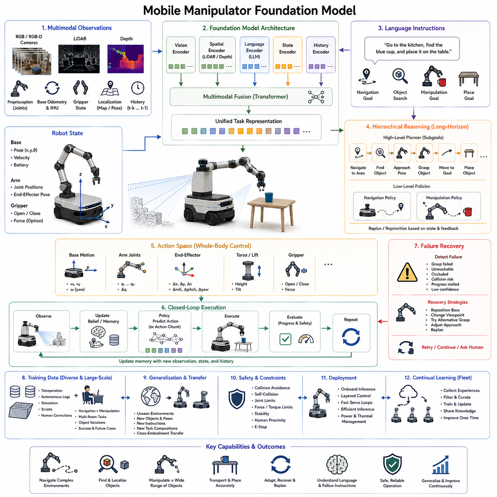{width="7.268055555555556in" height="7.268055555555556in"}

A mobile manipulator foundation model combines locomotion and manipulation within a shared learning architecture, allowing a robot to move through an environment, position its body, interact with objects, and complete extended physical tasks. Unlike a fixed robotic arm, a mobile manipulator must continuously coordinate navigation, perception, base motion, arm configuration, and contact-rich manipulation while maintaining a unified representation of the task and surrounding world.

The observation space is inherently multimodal because the robot must understand both distant navigation structure and nearby manipulation geometry. RGB or RGB-D cameras, LiDAR, depth sensors, proprioception, base odometry, joint states, gripper state, and localization estimates can be combined with language instructions. Temporal observations provide additional information about motion, previous interactions, changing obstacles, and progress toward the current physical objective.

Language provides a high-level interface connecting navigation and manipulation goals. An instruction such as "go to the kitchen, find the blue cup, and place it on the table" implicitly defines multiple stages involving navigation, object search, localization, approach, grasping, transportation, and placement. A foundation model can encode the complete instruction while dynamically emphasizing different semantic components as the robot progresses through each stage.

Visual representations must support reasoning at multiple spatial scales. During navigation, the model needs information about rooms, corridors, obstacles, landmarks, and traversable regions. During manipulation, it requires finer representations of object boundaries, handles, grasp points, surfaces, containers, and contact geometry. Shared vision encoders can capture semantic features, while depth and spatial representations provide geometric information required for physically precise interaction.

A central challenge is coordinating the mobile base and manipulator as one embodied system. The base determines which regions the arm can reach, while the arm configuration influences balance, collision risk, and the space required for movement. Instead of treating navigation and manipulation as completely independent problems, a mobile manipulation foundation model can represent whole-body state and learn relationships between base pose, arm configuration, target geometry, and task feasibility.

Multimodal fusion combines visual observations, language, robot state, spatial context, and temporal history into a shared representation. Attention mechanisms can connect instruction concepts to objects and locations while considering the robot\'s current configuration. This representation allows the model to reason simultaneously about where the target is, whether it is reachable, how the robot should approach it, what interaction is required, and what should happen afterward.

Hierarchical reasoning is especially useful for long-horizon mobile manipulation. High-level reasoning can identify subgoals such as navigate to a workspace, locate an object, approach a manipulation pose, grasp the object, move to another location, and place it. Lower-level policies then execute navigation or manipulation behaviors appropriate to each subgoal. The hierarchy reduces the difficulty of predicting one extremely long sequence of low-level actions directly.

The action space may include base linear and angular velocities, arm joint targets, end-effector motion, torso or lift commands, and gripper actions. These heterogeneous controls operate at different temporal scales and have different physical constraints. A shared policy can predict structured actions or latent action representations that are translated into subsystem commands, while low-level controllers maintain stable base motion, arm tracking, and actuator-level safety.

Navigation and manipulation can also be coupled through learned affordances. The robot must determine not only whether an object is graspable but where the mobile base should be positioned to make the grasp feasible. Candidate approach poses can therefore be evaluated according to visibility, collision risk, reachability, arm manipulability, and expected task progress. This transforms navigation from simple point-to-point movement into task-conditioned positioning for physical interaction.

Training requires data that covers transitions between locomotion and manipulation rather than isolated examples of each capability. Demonstrations can include searching for objects, approaching workspaces, repositioning after failed reaches, opening doors or drawers, transporting items, and interacting across multiple locations. Teleoperation, autonomous logs, simulation, scripted behaviors, and human corrections can contribute complementary trajectories to a large-scale training mixture.

Simulation is particularly valuable because mobile manipulation produces an enormous combination of environments, object configurations, navigation routes, and manipulation states. Randomized layouts, obstacles, object poses, lighting, sensor noise, and robot configurations can expand coverage beyond expensive real-world demonstrations. Simulation data can pretrain broad behavior, while real-world demonstrations and post-training reduce the remaining simulation-to-reality gap.

Temporal memory helps the robot maintain task continuity when relevant information disappears from the current camera view. An object observed before navigation may later become occluded, or the robot may leave one room before returning to it. Memory can preserve target identity, approximate location, completed subgoals, previous failures, and interaction history. This prevents the policy from treating every observation as an unrelated instantaneous decision.

Closed-loop execution remains essential throughout the task. During navigation, unexpected obstacles or localization errors can require route correction. During manipulation, failed grasps, object displacement, or contact uncertainty may require new actions. The robot repeatedly observes the environment, updates its internal task state, predicts an action or short action chunk, executes it, and evaluates the resulting state before continuing toward the goal.

Failure recovery must operate across both mobility and manipulation. If an object is outside the reachable workspace, the appropriate response may be to reposition the base rather than stretching the arm further. If the target is occluded, the robot may move to another viewpoint. If a grasp fails, it can reacquire the object and retry from a different pose. Such recovery behavior demonstrates coordination between perception, navigation, and manipulation rather than isolated subsystem competence.

Generalization should be tested across unseen environments, object instances, layouts, instructions, and task compositions. A strong model should navigate through a modified environment, identify unfamiliar instances of known semantic categories, manipulate objects from new poses, and execute familiar skills in previously unseen sequences. Few-shot adaptation can further measure whether broad pretraining reduces the amount of robot-specific data required for a new deployment environment.

Cross-embodiment learning can extend mobile manipulation knowledge across robots with different bases, arms, sensors, grippers, and kinematics. Shared semantic and spatial representations capture task-level knowledge, while morphology encodings and embodiment-specific adapters account for physical differences. A common model can therefore learn that a task requires approaching, grasping, transporting, and placing even when the precise motor realization differs between platforms.

Safety requires coordinated constraints over the entire robot rather than independent protection of individual subsystems. Base collision avoidance, arm self-collision, joint limits, force limits, human proximity, stability, workspace boundaries, and emergency stopping must operate alongside the learned policy. Runtime monitors can reject unsafe commands or transfer control to deterministic fallback behaviors when model confidence or physical feasibility falls below acceptable limits.

Edge deployment must support both computationally intensive semantic reasoning and low-latency physical control. Large vision-language components can operate at a slower rate for scene interpretation and subgoal reasoning, while navigation, collision avoidance, servo control, and stabilization execute at higher frequencies. Quantization, caching, efficient attention, model partitioning, and heterogeneous accelerators help maintain this layered architecture within mobile power and thermal constraints.

Fleet deployment creates a continuous improvement mechanism for the foundation model. Mobile manipulators operating in different environments can collect unusual navigation situations, difficult grasps, failed approaches, human interventions, and successful recovery trajectories. Curated examples can return to training, allowing the shared model to improve from distributed physical experience and transferring useful lessons from one deployment to other robots.

The mobile manipulator foundation model therefore represents more than the combination of a navigation model and a manipulation policy. Its central objective is unified embodied intelligence that understands how movement changes interaction possibilities and how manipulation goals determine where the robot should move. By integrating multimodal perception, language, spatial reasoning, whole-body control, memory, recovery, safety, and continual learning, the system can progress toward general-purpose robots capable of completing complex tasks across extended physical environments.

모바일 매니퓰레이터 파운데이션 모델(mobile manipulator foundation model)은 이동(locomotion)과 조작(manipulation)을 하나의 공유 학습 아키텍처(shared learning architecture) 안에서 결합하여 로봇이 환경을 이동하고, 몸체 위치를 조정하며, 객체와 상호작용하고, 장시간에 걸친 물리적 작업을 완료할 수 있도록 한다. 고정형 로봇 팔과 달리 모바일 매니퓰레이터는 작업과 주변 세계에 대한 통합 표현을 유지하면서 내비게이션, 지각, 베이스 움직임, 로봇 팔 구성 및 접촉 중심 조작(contact-rich manipulation)을 지속적으로 조정해야 한다.

관측 공간(observation space)은 로봇이 원거리의 내비게이션 구조와 근거리의 조작 기하구조를 모두 이해해야 하므로 본질적으로 멀티모달(multimodal)이다. RGB 또는 RGB-D 카메라, 라이다(LiDAR), 깊이 센서(depth sensor), 고유수용감각(proprioception), 베이스 오도메트리(base odometry), 관절 상태, 그리퍼 상태 및 위치추정 결과(localization estimate)를 언어 명령과 결합할 수 있다. 시간적 관측은 움직임, 이전 상호작용, 변화하는 장애물 및 현재 물리적 목표를 향한 진행 상태에 관한 추가 정보를 제공한다.

언어는 내비게이션과 조작 목표를 연결하는 고수준 인터페이스(high-level interface)를 제공한다. "주방으로 이동하여 파란 컵을 찾고 테이블 위에 놓아라"라는 명령은 내비게이션, 객체 탐색, 위치추정, 접근, 파지, 운반 및 배치를 포함하는 여러 단계를 암묵적으로 정의한다. 파운데이션 모델은 전체 명령을 인코딩하면서 로봇이 각 단계를 진행함에 따라 서로 다른 의미적 구성요소(semantic component)에 동적으로 집중할 수 있다.

시각 표현(visual representation)은 여러 공간적 규모(spatial scale)에서의 추론을 지원해야 한다. 내비게이션 과정에서는 방, 복도, 장애물, 랜드마크 및 주행 가능 영역(traversable region)에 대한 정보가 필요하다. 조작 과정에서는 객체 경계, 손잡이, 파지 지점, 표면, 용기 및 접촉 기하구조에 대한 더욱 정밀한 표현이 요구된다. 공유 비전 인코더(shared vision encoder)는 의미 특징을 포착하고, 깊이 및 공간 표현(spatial representation)은 물리적으로 정밀한 상호작용에 필요한 기하학적 정보를 제공할 수 있다.

핵심 과제 중 하나는 모바일 베이스(mobile base)와 매니퓰레이터를 하나의 임바디드 시스템(embodied system)으로 조정하는 것이다. 베이스는 로봇 팔이 도달할 수 있는 영역을 결정하고, 로봇 팔의 구성은 균형, 충돌 위험 및 이동에 필요한 공간에 영향을 준다. 내비게이션과 조작을 완전히 독립된 문제로 취급하는 대신 모바일 조작 파운데이션 모델은 전신 상태(whole-body state)를 표현하고 베이스 자세, 로봇 팔 구성, 목표 기하구조 및 작업 실행 가능성(task feasibility) 사이의 관계를 학습할 수 있다.

멀티모달 융합(multimodal fusion)은 시각 관측, 언어, 로봇 상태, 공간적 문맥 및 시간적 이력을 하나의 공유 표현으로 결합한다. 어텐션 메커니즘(attention mechanism)은 로봇의 현재 구성을 고려하면서 명령의 개념을 관련 객체 및 위치와 연결할 수 있다. 이러한 표현을 통해 모델은 목표가 어디에 있는지, 도달 가능한지, 로봇이 어떻게 접근해야 하는지, 어떤 상호작용이 필요한지, 그리고 그 이후 무엇을 수행해야 하는지를 동시에 추론할 수 있다.

계층적 추론(hierarchical reasoning)은 장기 모바일 조작(long-horizon mobile manipulation)에 특히 유용하다. 고수준 추론은 작업공간으로 이동하기, 객체 찾기, 조작 가능한 자세로 접근하기, 객체 파지하기, 다른 위치로 이동하기, 객체 배치하기와 같은 하위 목표(subgoal)를 식별할 수 있다. 이후 저수준 정책(low-level policy)은 각 하위 목표에 적합한 내비게이션 또는 조작 행동을 실행한다. 이러한 계층 구조는 매우 긴 저수준 행동 시퀀스를 한 번에 직접 예측해야 하는 어려움을 줄인다.

행동 공간(action space)은 베이스의 선속도 및 각속도, 로봇 팔 관절 목표값, 엔드이펙터 움직임(end-effector motion), 몸통 또는 리프트 명령, 그리퍼 행동을 포함할 수 있다. 이러한 이질적인 제어는 서로 다른 시간적 규모와 물리적 제약조건을 가진다. 공유 정책은 구조화된 행동(structured action) 또는 잠재 행동 표현(latent action representation)을 예측하여 각 서브시스템의 명령으로 변환할 수 있으며, 저수준 제어기는 안정적인 베이스 이동, 로봇 팔 추종 및 액추에이터 수준의 안전성을 유지한다.

내비게이션과 조작은 학습된 어포던스(learned affordance)를 통해서도 결합될 수 있다. 로봇은 객체를 파지할 수 있는지뿐만 아니라 파지가 가능하도록 모바일 베이스를 어디에 위치시켜야 하는지도 결정해야 한다. 따라서 후보 접근 자세(candidate approach pose)는 가시성, 충돌 위험, 도달 가능성(reachability), 로봇 팔 조작성(manipulability), 예상 작업 진행도를 기준으로 평가할 수 있다. 이를 통해 내비게이션은 단순한 지점 간 이동에서 물리적 상호작용을 위한 작업 조건부 위치 결정(task-conditioned positioning)으로 확장된다.

학습에는 이동과 조작 능력을 각각 분리한 사례뿐만 아니라 두 능력 사이의 전환을 포함하는 데이터가 필요하다. 시연(demonstration)은 객체 탐색, 작업공간 접근, 도달 실패 이후의 위치 재조정, 문이나 서랍 열기, 물체 운반 및 여러 장소에 걸친 상호작용을 포함할 수 있다. 원격조작(teleoperation), 자율 실행 로그, 시뮬레이션, 스크립트 기반 행동(scripted behavior), 인간 수정(human correction)은 대규모 학습 데이터 혼합(training mixture)에 상호 보완적인 궤적을 제공할 수 있다.

시뮬레이션(simulation)은 모바일 조작에서 환경, 객체 구성, 내비게이션 경로 및 조작 상태의 조합이 매우 방대하기 때문에 특히 중요하다. 무작위화된 레이아웃, 장애물, 객체 자세, 조명, 센서 노이즈 및 로봇 구성을 사용하면 비용이 높은 실제 환경 시연을 넘어 학습 범위를 확장할 수 있다. 시뮬레이션 데이터로 광범위한 행동을 사전학습하고, 실제 환경의 시연과 후속 학습(post-training)을 통해 남아 있는 시뮬레이션-현실 간극(sim-to-real gap)을 줄일 수 있다.

시간적 메모리(temporal memory)는 현재 카메라 시야에서 관련 정보가 사라지는 경우에도 로봇이 작업의 연속성을 유지하도록 돕는다. 내비게이션 이전에 관측한 객체가 이후 가려지거나 로봇이 한 공간을 떠났다가 다시 돌아올 수 있다. 메모리는 목표 객체의 정체성, 대략적인 위치, 완료된 하위 목표, 이전 실패 및 상호작용 이력을 보존할 수 있다. 이를 통해 정책이 각각의 관측을 서로 관련 없는 순간적인 의사결정으로 처리하는 것을 방지한다.

폐루프 실행(closed-loop execution)은 전체 작업 과정에서 필수적이다. 내비게이션 과정에서는 예상하지 못한 장애물이나 위치추정 오류 때문에 경로를 수정해야 할 수 있으며, 조작 과정에서는 파지 실패, 객체 이동 또는 접촉의 불확실성으로 인해 새로운 행동이 필요할 수 있다. 로봇은 환경을 반복적으로 관측하고 내부 작업 상태를 업데이트하며, 행동 또는 짧은 행동 청크(action chunk)를 예측하여 실행한 뒤 결과 상태를 평가하면서 목표를 향해 계속 진행한다.

실패 복구(failure recovery)는 이동성과 조작 능력 모두에서 작동해야 한다. 객체가 로봇 팔의 도달 가능 작업공간 밖에 있다면 팔을 더 뻗는 대신 베이스 위치를 재조정하는 것이 적절한 대응이 될 수 있다. 목표가 가려져 있다면 로봇은 다른 시점(viewpoint)으로 이동할 수 있다. 파지가 실패하면 객체를 다시 인식하고 다른 자세에서 재시도할 수 있다. 이러한 복구 행동은 개별 서브시스템의 능력이 아니라 지각, 내비게이션 및 조작 사이의 통합적 조정을 보여준다.

일반화(generalization)는 학습되지 않은 환경, 객체 인스턴스, 레이아웃, 명령 및 작업 조합에 걸쳐 평가해야 한다. 강력한 모델은 변경된 환경을 이동하고, 알려진 의미 범주에 속하지만 처음 보는 객체를 식별하며, 새로운 자세의 객체를 조작하고, 이전에 보지 못한 순서로 익숙한 기술을 실행할 수 있어야 한다. 퓨샷 적응(few-shot adaptation)을 통해 광범위한 사전학습이 새로운 배포 환경에 필요한 로봇별 데이터의 양을 얼마나 줄이는지도 평가할 수 있다.

교차 임바디먼트 학습(cross-embodiment learning)은 서로 다른 베이스, 로봇 팔, 센서, 그리퍼 및 운동학 구조를 가진 로봇 사이로 모바일 조작 지식을 확장할 수 있다. 공유된 의미 및 공간 표현은 작업 수준의 지식을 포착하고, 형태 인코딩(morphology encoding)과 임바디먼트별 어댑터(embodiment-specific adapter)는 물리적 차이를 반영한다. 따라서 공통 모델은 실제 모터 동작이 플랫폼마다 다르더라도 작업에 접근, 파지, 운반 및 배치가 필요하다는 공통 구조를 학습할 수 있다.

안전성(safety)은 개별 서브시스템을 독립적으로 보호하는 것을 넘어 로봇 전체에 대한 통합된 제약조건을 요구한다. 베이스 충돌 회피, 로봇 팔 자기충돌(self-collision), 관절 한계, 힘 제한, 인간과의 거리, 안정성, 작업공간 경계 및 비상 정지는 학습된 정책과 함께 동작해야 한다. 런타임 모니터(runtime monitor)는 모델 신뢰도 또는 물리적 실행 가능성이 허용 수준 아래로 떨어지면 위험한 명령을 거부하거나 결정론적 폴백 행동(deterministic fallback behavior)으로 제어권을 전환할 수 있다.

엣지 배포(edge deployment)는 높은 연산량을 요구하는 의미적 추론과 낮은 지연시간이 필요한 물리적 제어를 동시에 지원해야 한다. 대규모 비전-언어 구성요소는 장면 해석과 하위 목표 추론을 위해 상대적으로 낮은 주기로 실행하고, 내비게이션, 충돌 회피, 서보 제어 및 안정화는 더 높은 주기로 실행할 수 있다. 양자화(quantization), 캐싱(caching), 효율적 어텐션(efficient attention), 모델 분할(model partitioning), 이기종 가속기(heterogeneous accelerator)를 활용하면 모바일 플랫폼의 전력 및 열 제약조건 내에서 이러한 계층형 아키텍처를 유지할 수 있다.

플릿 배포(fleet deployment)는 파운데이션 모델을 지속적으로 개선할 수 있는 메커니즘을 형성한다. 서로 다른 환경에서 운영되는 모바일 매니퓰레이터는 비정상적인 내비게이션 상황, 어려운 파지, 실패한 접근, 인간 개입 및 성공적인 복구 궤적을 수집할 수 있다. 선별된 사례를 다시 학습에 활용하면 공유 모델이 분산된 물리적 경험으로부터 개선되고, 하나의 배포 환경에서 얻은 유용한 경험을 다른 로봇으로 전이할 수 있다.

따라서 모바일 매니퓰레이터 파운데이션 모델은 단순히 내비게이션 모델과 조작 정책(manipulation policy)을 결합한 것 이상의 의미를 가진다. 핵심 목표는 이동이 상호작용 가능성을 어떻게 변화시키는지, 그리고 조작 목표가 로봇의 이동 위치를 어떻게 결정하는지를 이해하는 통합 임바디드 지능(unified embodied intelligence)을 구축하는 것이다. 멀티모달 지각, 언어, 공간 추론, 전신 제어(whole-body control), 메모리, 복구, 안전성 및 지속 학습(continual learning)을 통합함으로써 복잡하고 확장된 물리 환경에서 다양한 작업을 수행할 수 있는 범용 로봇(general-purpose robot)으로 발전할 수 있다.

## 11.06. Humanoid Foundation Model

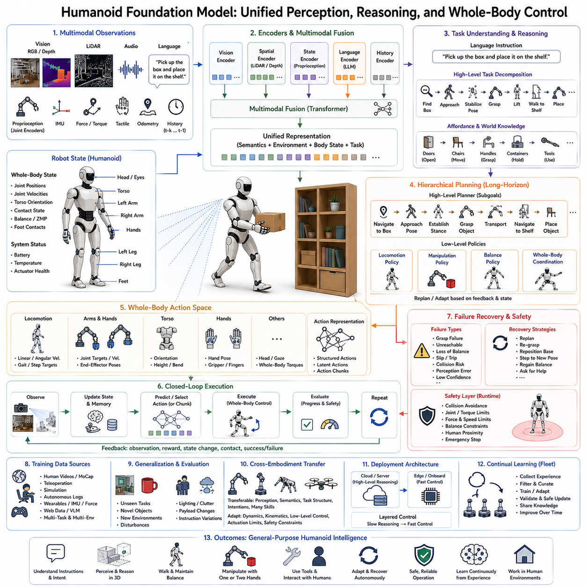{width="7.268055555555556in" height="7.268055555555556in"}

A humanoid foundation model is designed to unify perception, language understanding, reasoning, locomotion, manipulation, and whole-body control within a reusable learning framework. Unlike fixed manipulators or wheeled robots, humanoids must coordinate many degrees of freedom while maintaining balance and interacting with environments designed for humans. The foundation-model approach therefore connects high-level semantic intelligence with embodiment-aware physical behavior.

The humanoid observation space is highly multimodal. RGB and depth cameras provide visual information about objects, people, surfaces, and obstacles, while LiDAR and spatial sensors contribute geometric structure. IMUs, joint encoders, force-torque sensors, tactile sensing, and proprioception describe the robot\'s body state. Audio and language instructions can additionally provide information about human intent, communication, and task context.

These sensory streams must be temporally synchronized and transformed into representations that describe both the external environment and the humanoid itself. Vision encoders extract semantic and spatial features, while state encoders represent joint configuration, contact state, velocity, and body orientation. Language encoders represent goals and instructions, and temporal context preserves recent observations, actions, contacts, and task progress.

Multimodal fusion combines these representations into a shared internal state that supports perception, reasoning, and action. The model can associate language concepts with visual regions, body configurations, objects, people, and affordances while maintaining information about the current task. This shared representation allows high-level knowledge and physical state to influence each other rather than operating through completely independent perception and control pipelines.

Humanoid embodiment creates a particularly difficult control problem because locomotion and manipulation are strongly coupled. Moving an arm changes the distribution of momentum, carrying an object affects balance, and reaching may require stepping or repositioning the torso. A foundation model must therefore understand relationships between whole-body configuration, contact conditions, task geometry, and feasible motion instead of treating each limb as an independent actuator.

Whole-body action representations can include joint targets, joint velocities, torques, end-effector commands, hand actions, torso motion, foot placement, and locomotion commands. Directly predicting every actuator variable can be difficult for a general model, so hierarchical or latent representations are useful. High-level actions can describe behaviors such as reach, grasp, lift, walk, turn, place, open, or hand over, while specialized controllers translate them into stable physical motion.

Hierarchical reasoning separates semantic task understanding from high-frequency control. A command such as "pick up the box and carry it to the shelf" can first be decomposed into locating the box, approaching it, establishing a stable stance, grasping, lifting, walking, approaching the shelf, and placing the object. Lower-level controllers then execute the required gait, balance, manipulation, force, and contact behaviors while the higher-level model monitors progress.

Locomotion requires continuous reasoning about balance, support, terrain, obstacles, and future contact states. The humanoid must determine where to step while maintaining a dynamically feasible body configuration. Learned locomotion policies can generate gait behavior, but deterministic or specialized controllers may operate underneath the foundation model to maintain rapid stabilization. This layered organization separates slower semantic reasoning from the faster dynamics required to prevent falls.

Manipulation introduces additional challenges because humanoids may use one hand, both hands, the torso, and locomotion together. Bimanual tasks require coordination between two end effectors, while tool use may require precise grasp orientation and force control. A generalist humanoid model can reuse manipulation concepts across objects and tasks while adapting trajectories according to hand configuration, reachability, contact geometry, and the current whole-body posture.

Human environments also require the model to reason about affordances. Doors can be opened, chairs can be moved, containers can hold objects, handles can be grasped, and tools can enable actions that are impossible with bare hands. Visual-language pretraining can provide broad semantic knowledge about these relationships, while robot interaction data connects semantic affordances to the geometric and dynamic requirements of actual humanoid execution.

Human-to-robot transfer is especially relevant for humanoid learning because human demonstrations naturally contain movement patterns, object interactions, and task strategies compatible with human-shaped environments. Video, motion capture, teleoperation, and wearable sensing can provide demonstrations at much greater scale than autonomous robot collection alone. However, human motion cannot be copied directly because body proportions, joint limits, dynamics, strength, and control interfaces differ.

Retargeting therefore converts human demonstrations into representations appropriate for the humanoid embodiment. Task-space trajectories, object-relative motions, contact sequences, motion phases, and semantic skills can transfer more readily than raw joint angles. The foundation model can learn shared concepts from human behavior while embodiment-specific modules resolve differences in morphology, kinematics, dynamics, actuator capabilities, and safety constraints.

Simulation provides another major source of humanoid experience. Walking, balancing, falling, recovering, carrying, reaching, and interacting with diverse environments can be generated at scale without risking physical hardware. Domain randomization can vary mass, friction, actuator properties, sensor noise, terrain, objects, and disturbances. Real-world demonstrations and post-training can then adapt the pretrained behaviors to physical hardware and reduce the simulation-to-reality gap.

Closed-loop execution is fundamental because humanoid interaction produces continuous deviations from predicted states. Foot contact may occur earlier than expected, an object may shift during grasping, or external forces may disturb balance. The robot repeatedly observes its body and environment, updates its internal state, predicts or selects actions, executes them, and evaluates the result. Feedback transforms predefined motion generation into adaptive embodied behavior.

Failure recovery must include both task-level and whole-body recovery. A failed grasp may require another approach, while an unreachable target may require stepping closer. Loss of balance may require corrective foot placement or abandoning the current manipulation action entirely. The policy therefore needs to distinguish whether failure originates from perception, manipulation, locomotion, contact, or task reasoning and select a recovery strategy appropriate to the physical situation.

Safety is especially important because humanoids operate with large numbers of actuators and may work directly around people. Runtime supervision can enforce collision avoidance, joint limits, force and torque limits, balance constraints, velocity restrictions, thermal limits, and human proximity rules. Uncertainty estimation can further identify situations where the learned policy should slow down, replan, request assistance, or transfer control to a deterministic safety behavior.

Generalization should be evaluated across tasks, objects, environments, instructions, and disturbances rather than only repeated laboratory demonstrations. Tests can modify object locations, furniture arrangements, terrain, payloads, lighting, human activity, and task sequences. A strong humanoid foundation model should preserve previously learned semantic and physical concepts while adapting its motion to configurations that were not explicitly represented in the original training trajectories.

Cross-embodiment learning can further improve humanoid intelligence by transferring knowledge from manipulators, mobile robots, quadrupeds, and other robotic systems. Perception, semantics, task structure, intentions, and many skills can be shared, while dynamics, kinematics, low-level control, actuation limits, and safety constraints require adaptation. Morphology encoders, embodiment tokens, adapters, and robot-specific policy heads provide mechanisms for separating transferable knowledge from platform-specific execution.

Real-world deployment requires a layered computing architecture because high-level multimodal reasoning and dynamic stabilization operate at very different timescales. Large vision-language-action components can perform instruction understanding, scene reasoning, and task planning at moderate frequency, while balance, gait, force control, collision avoidance, and actuator control operate through faster local loops. Quantization, efficient attention, caching, and model partitioning can reduce onboard computational demands.

Continual learning can turn deployed humanoids into distributed sources of physical experience. Robots can collect difficult interactions, failed grasps, unusual objects, balance disturbances, human corrections, recovery attempts, and successful task executions. Carefully filtered data can return to the training pipeline for additional pretraining or adaptation, creating a feedback cycle in which deployment gradually improves the shared model while validation protects previously acquired capabilities.

The humanoid foundation model therefore represents a convergence of robot foundation models, vision-language-action learning, generalist policies, embodiment adaptation, and whole-body control. Its goal is not simply to make a humanoid imitate human motion, but to create reusable physical intelligence that understands tasks, environments, objects, people, and its own embodiment. Such integration provides a pathway toward humanoids that can learn broadly, adapt efficiently, and perform complex physical work in human-centered environments.

휴머노이드 파운데이션 모델(humanoid foundation model)은 지각(perception), 언어 이해(language understanding), 추론(reasoning), 이동(locomotion), 조작(manipulation), 전신 제어(whole-body control)를 하나의 재사용 가능한 학습 프레임워크(reusable learning framework) 안에서 통합하도록 설계된다. 고정형 매니퓰레이터나 바퀴형 로봇과 달리 휴머노이드는 균형을 유지하면서 인간을 위해 설계된 환경과 상호작용하고 많은 자유도(degrees of freedom)를 동시에 조정해야 한다. 따라서 파운데이션 모델 접근법은 고수준 의미 지능과 임바디먼트 인식 물리 행동(embodiment-aware physical behavior)을 연결한다.

휴머노이드의 관측 공간(observation space)은 매우 높은 수준의 멀티모달(multimodal) 특성을 가진다. RGB 및 깊이 카메라는 객체, 사람, 표면 및 장애물에 대한 시각 정보를 제공하고, 라이다(LiDAR)와 공간 센서는 기하학적 구조를 제공한다. 관성측정장치(IMU), 관절 인코더(joint encoder), 힘-토크 센서(force-torque sensor), 촉각 센싱(tactile sensing), 고유수용감각(proprioception)은 로봇의 신체 상태를 나타낸다. 오디오와 언어 명령은 인간의 의도, 의사소통 및 작업 문맥에 관한 추가 정보를 제공할 수 있다.

이러한 센서 스트림(sensor stream)은 시간적으로 동기화되어야 하며 외부 환경과 휴머노이드 자체를 동시에 설명하는 표현으로 변환되어야 한다. 비전 인코더(vision encoder)는 의미적·공간적 특징을 추출하고, 상태 인코더(state encoder)는 관절 구성, 접촉 상태, 속도 및 신체 방향을 표현한다. 언어 인코더(language encoder)는 목표와 명령을 표현하며, 시간적 문맥(temporal context)은 최근의 관측, 행동, 접촉 및 작업 진행 상태를 유지한다.

멀티모달 융합(multimodal fusion)은 이러한 표현을 지각, 추론 및 행동을 지원하는 공유 내부 상태(shared internal state)로 결합한다. 모델은 현재 작업에 대한 정보를 유지하면서 언어 개념을 시각 영역, 신체 구성, 객체, 사람 및 어포던스(affordance)와 연결할 수 있다. 이러한 공유 표현을 통해 고수준 지식과 물리적 상태가 완전히 독립적인 지각 및 제어 파이프라인으로 작동하는 대신 서로 영향을 주고받을 수 있다.

휴머노이드 임바디먼트(humanoid embodiment)는 이동과 조작이 강하게 결합되어 있기 때문에 특히 어려운 제어 문제를 발생시킨다. 팔을 움직이면 운동량 분포가 변하고, 객체를 운반하면 균형에 영향을 주며, 목표에 손을 뻗기 위해 발걸음을 이동하거나 몸통 위치를 조정해야 할 수도 있다. 따라서 파운데이션 모델은 각각의 팔다리를 독립적인 액추에이터로 처리하는 대신 전신 구성, 접촉 조건, 작업 기하구조 및 실행 가능한 움직임 사이의 관계를 이해해야 한다.

전신 행동 표현(whole-body action representation)은 관절 목표값, 관절 속도, 토크, 엔드이펙터 명령(end-effector command), 손 동작, 몸통 움직임, 발 위치(foot placement), 이동 명령을 포함할 수 있다. 범용 모델이 모든 액추에이터 변수를 직접 예측하는 것은 어려울 수 있으므로 계층적 표현(hierarchical representation)이나 잠재 표현(latent representation)이 유용하다. 고수준 행동은 접근, 파지, 들어 올리기, 걷기, 회전, 배치, 열기 또는 전달하기 등을 표현하고, 전문화된 제어기가 이를 안정적인 물리적 움직임으로 변환할 수 있다.

계층적 추론(hierarchical reasoning)은 의미적 작업 이해와 고주파 제어(high-frequency control)를 분리한다. "상자를 집어 선반으로 운반하라"라는 명령은 먼저 상자 찾기, 접근하기, 안정적인 자세 확보하기, 파지하기, 들어 올리기, 걷기, 선반으로 접근하기, 객체 배치하기 등의 단계로 분해할 수 있다. 이후 저수준 제어기(low-level controller)가 필요한 보행, 균형, 조작, 힘 및 접촉 행동을 실행하는 동안 고수준 모델은 작업 진행 상황을 모니터링한다.

이동(locomotion)은 균형, 지지 상태, 지형, 장애물 및 미래의 접촉 상태에 대한 지속적인 추론을 요구한다. 휴머노이드는 동역학적으로 실행 가능한 신체 구성을 유지하면서 발을 어디에 놓을지 결정해야 한다. 학습된 이동 정책은 보행 행동을 생성할 수 있지만, 파운데이션 모델 아래에서는 결정론적 또는 전문화된 제어기가 빠른 안정화를 담당할 수 있다. 이러한 계층적 구성은 상대적으로 느린 의미적 추론과 넘어짐을 방지하기 위한 빠른 동역학 제어를 분리한다.

조작은 휴머노이드가 한 손, 양손, 몸통 및 이동을 함께 사용할 수 있기 때문에 추가적인 과제를 발생시킨다. 양손 작업(bimanual task)은 두 개의 엔드이펙터 사이의 협응이 필요하며, 도구 사용에는 정밀한 파지 방향과 힘 제어가 요구될 수 있다. 범용 휴머노이드 모델은 객체와 작업 전반에서 조작 개념을 재사용하면서 손의 구성, 도달 가능성(reachability), 접촉 기하구조 및 현재의 전신 자세에 따라 궤적을 조정할 수 있다.

인간 환경에서는 모델이 어포던스(affordance)에 대해서도 추론해야 한다. 문은 열 수 있고, 의자는 이동할 수 있으며, 용기에는 객체를 넣을 수 있고, 손잡이는 잡을 수 있으며, 도구는 맨손으로 수행하기 어려운 행동을 가능하게 한다. 비전-언어 사전학습(vision-language pretraining)은 이러한 관계에 관한 광범위한 의미 지식을 제공하고, 로봇 상호작용 데이터는 의미적 어포던스를 실제 휴머노이드 실행에 필요한 기하학적·동역학적 요구조건과 연결한다.

인간-로봇 전이(human-to-robot transfer)는 인간의 시연이 인간 중심 환경과 호환되는 움직임 패턴, 객체 상호작용 및 작업 전략을 자연스럽게 포함하기 때문에 휴머노이드 학습에서 특히 중요하다. 비디오, 모션 캡처(motion capture), 원격조작(teleoperation), 웨어러블 센싱(wearable sensing)을 활용하면 자율적인 로봇 데이터 수집만으로 가능한 것보다 훨씬 큰 규모의 시연을 확보할 수 있다. 그러나 신체 비율, 관절 한계, 동역학, 힘 및 제어 인터페이스가 다르므로 인간의 움직임을 그대로 복제할 수는 없다.

따라서 리타게팅(retargeting)은 인간 시연을 휴머노이드 임바디먼트에 적합한 표현으로 변환한다. 작업 공간 궤적(task-space trajectory), 객체 상대 움직임(object-relative motion), 접촉 시퀀스(contact sequence), 동작 단계(motion phase), 의미적 기술(semantic skill)은 원시 관절 각도보다 쉽게 전이될 수 있다. 파운데이션 모델은 인간 행동으로부터 공유 개념을 학습하고, 임바디먼트별 모듈은 형태, 운동학, 동역학, 액추에이터 성능 및 안전 제약조건의 차이를 처리할 수 있다.

시뮬레이션(simulation)은 휴머노이드 경험을 확보하기 위한 또 하나의 주요 데이터 공급원이다. 걷기, 균형 유지, 넘어짐, 복구, 운반, 접근 및 다양한 환경과의 상호작용을 실제 하드웨어의 위험 없이 대규모로 생성할 수 있다. 도메인 랜덤화(domain randomization)는 질량, 마찰, 액추에이터 특성, 센서 노이즈, 지형, 객체 및 외란을 변화시킬 수 있다. 이후 실제 환경 시연과 후속 학습(post-training)을 통해 사전학습된 행동을 물리적 하드웨어에 적응시키고 시뮬레이션-현실 간극(sim-to-real gap)을 줄일 수 있다.

휴머노이드 상호작용에서는 예측된 상태와 실제 상태 사이에 지속적인 편차가 발생하므로 폐루프 실행(closed-loop execution)이 기본적으로 필요하다. 발 접촉이 예상보다 빨리 발생하거나 파지 중 객체가 이동하거나 외력이 균형을 방해할 수 있다. 로봇은 신체와 환경을 반복적으로 관측하고 내부 상태를 업데이트하며 행동을 예측하거나 선택한 뒤 이를 실행하고 결과를 평가한다. 이러한 피드백은 미리 정의된 움직임 생성을 적응형 임바디드 행동(adaptive embodied behavior)으로 전환한다.

실패 복구(failure recovery)는 작업 수준의 복구와 전신 수준의 복구를 모두 포함해야 한다. 파지가 실패하면 다른 접근이 필요할 수 있고, 목표에 도달할 수 없다면 더 가까이 이동해야 할 수 있다. 균형을 잃으면 발 위치를 수정하거나 현재의 조작 행동 자체를 중단해야 할 수도 있다. 따라서 정책은 실패 원인이 지각, 조작, 이동, 접촉 또는 작업 추론 중 어디에서 발생했는지를 구분하고 물리적 상황에 적합한 복구 전략을 선택할 수 있어야 한다.

안전성(safety)은 휴머노이드가 많은 수의 액추에이터를 사용하고 사람 주변에서 직접 작업할 수 있기 때문에 특히 중요하다. 런타임 감독(runtime supervision)은 충돌 회피, 관절 한계, 힘 및 토크 제한, 균형 제약조건, 속도 제한, 열적 한계(thermal limit), 인간 근접성 규칙을 적용할 수 있다. 불확실성 추정(uncertainty estimation)은 학습된 정책이 속도를 낮추거나 재계획하거나 도움을 요청하거나 결정론적 안전 행동으로 제어를 전환해야 하는 상황을 추가로 식별할 수 있다.

일반화(generalization)는 반복적인 실험실 시연만이 아니라 작업, 객체, 환경, 명령 및 외란 전반에서 평가되어야 한다. 객체 위치, 가구 배치, 지형, 페이로드(payload), 조명, 인간 활동 및 작업 시퀀스를 변경하여 평가할 수 있다. 강력한 휴머노이드 파운데이션 모델은 기존에 학습한 의미적·물리적 개념을 유지하면서 원래 학습 궤적에 명시적으로 포함되지 않았던 새로운 구성에 맞게 움직임을 적응시킬 수 있어야 한다.

교차 임바디먼트 학습(cross-embodiment learning)은 매니퓰레이터, 모바일 로봇, 사족보행 로봇(quadruped) 및 기타 로봇 시스템으로부터 지식을 전이하여 휴머노이드 지능을 더욱 향상시킬 수 있다. 지각, 의미, 작업 구조, 의도 및 많은 기술은 공유할 수 있지만 동역학, 운동학, 저수준 제어, 구동 한계 및 안전 제약조건에는 적응이 필요하다. 형태 인코더(morphology encoder), 임바디먼트 토큰(embodiment token), 어댑터(adapter), 로봇별 정책 헤드(robot-specific policy head)는 전이 가능한 지식과 플랫폼별 실행을 분리하는 메커니즘을 제공한다.

실제 환경 배포(real-world deployment)에는 고수준 멀티모달 추론과 동적 안정화(dynamic stabilization)가 매우 다른 시간 규모에서 작동하기 때문에 계층화된 컴퓨팅 아키텍처(layered computing architecture)가 필요하다. 대규모 비전-언어-행동 구성요소(Vision-Language-Action component)는 명령 이해, 장면 추론 및 작업 계획을 중간 정도의 주기로 수행하고, 균형, 보행, 힘 제어, 충돌 회피 및 액추에이터 제어는 더 빠른 로컬 루프(local loop)를 통해 실행할 수 있다. 양자화, 효율적 어텐션, 캐싱 및 모델 분할(model partitioning)은 온보드 연산 요구량을 줄일 수 있다.

지속 학습(continual learning)은 배포된 휴머노이드를 분산된 물리 경험의 데이터 공급원으로 변화시킬 수 있다. 로봇은 어려운 상호작용, 실패한 파지, 비정상적인 객체, 균형 외란(balance disturbance), 인간의 수정, 복구 시도 및 성공적인 작업 실행을 수집할 수 있다. 신중하게 필터링된 데이터는 추가적인 사전학습 또는 적응을 위해 학습 파이프라인으로 다시 전달될 수 있으며, 검증 과정을 통해 기존 능력을 보호하면서 배포 경험이 공유 모델을 점진적으로 개선하는 피드백 사이클(feedback cycle)을 형성할 수 있다.

따라서 휴머노이드 파운데이션 모델은 로봇 파운데이션 모델(robot foundation model), 비전-언어-행동 학습(Vision-Language-Action learning), 제너럴리스트 정책(generalist policy), 임바디먼트 적응(embodiment adaptation), 전신 제어의 융합을 의미한다. 목표는 단순히 휴머노이드가 인간의 움직임을 모방하도록 만드는 것이 아니라 작업, 환경, 객체, 사람 및 자신의 임바디먼트를 이해하는 재사용 가능한 물리 지능(reusable physical intelligence)을 구축하는 것이다. 이러한 통합은 휴머노이드가 폭넓게 학습하고 효율적으로 적응하며 인간 중심 환경에서 복잡한 물리적 작업을 수행할 수 있도록 하는 발전 경로를 제공한다.

## 11.07. AMR and Navigation Foundation Model

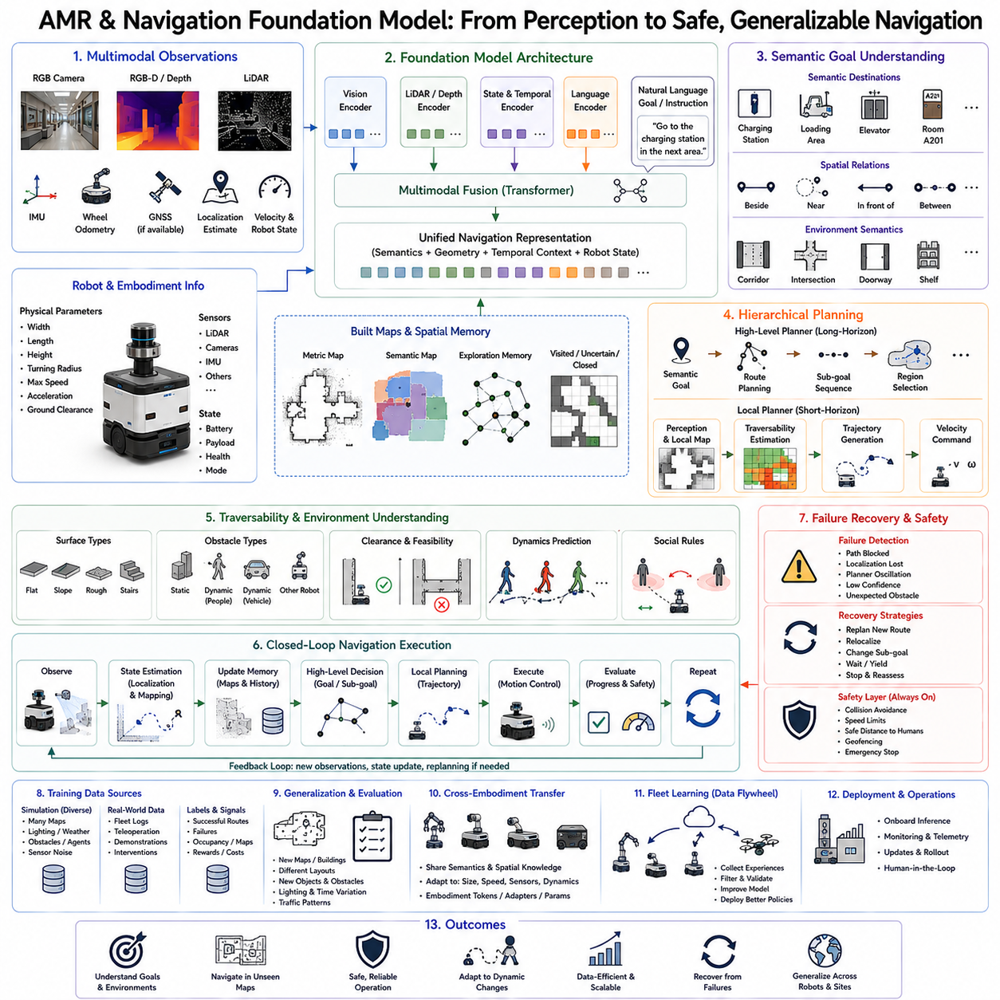{width="7.268055555555556in" height="7.268055555555556in"}

An AMR and navigation foundation model extends robot foundation learning from isolated navigation policies toward a reusable spatial intelligence system capable of operating across buildings, warehouses, factories, campuses, and other dynamic environments. Rather than learning one map or route, the model learns transferable relationships among perception, localization, semantic goals, traversability, motion, obstacles, and navigation outcomes, enabling adaptation to environments not explicitly encountered during training.

The observation space combines complementary sensors because reliable autonomous navigation cannot depend on a single perceptual modality. RGB or RGB-D cameras provide semantic and appearance information, LiDAR captures geometric structure, and depth sensors estimate nearby free space and obstacles. IMU, wheel odometry, GNSS where available, localization estimates, velocity, and robot state provide motion context that connects external observations with the AMR\'s current physical condition.

A foundation-model architecture converts these heterogeneous observations into reusable representations. Vision encoders extract objects, landmarks, scene categories, and spatial cues, while geometric encoders process LiDAR, depth, occupancy, or point-based information. State and temporal encoders represent robot motion and observation history. Language encoders can additionally translate natural-language destinations or task instructions into semantic goals that participate in navigation reasoning.

Multimodal fusion creates a unified navigation representation containing semantic, geometric, temporal, and robot-state information. Instead of maintaining completely independent pipelines for perception and planning, the model can associate visual landmarks with spatial structure, connect instructions to destinations, and reason about traversability in the context of the robot\'s dimensions and motion capabilities. This representation becomes the common substrate for localization, planning, and navigation decisions.

Semantic navigation extends conventional coordinate-based navigation by allowing destinations to be described through meaning rather than only map coordinates. Commands such as "go to the loading area," "find the charging station," or "move to the room beside the elevator" require the robot to associate language with visual landmarks and spatial relationships. A navigation foundation model can use pretrained semantic knowledge together with local observations and maps to infer where such goals are likely to be located.

Spatial memory is essential because navigation decisions depend on information extending beyond the current sensor field of view. The model can maintain representations of previously observed corridors, intersections, rooms, obstacles, landmarks, and explored regions. This memory may complement conventional metric maps rather than replace them, providing semantic and temporal context that helps the robot remember where important locations were observed and which routes have already been attempted.

Mapping and localization remain fundamental components of practical AMR operation. Learned representations can assist place recognition, loop closure, visual localization, map interpretation, and correspondence across changing appearances. However, foundation-model reasoning does not eliminate the need for geometrically consistent localization. A robust system can combine learned semantic representations with SLAM, odometry, LiDAR localization, GNSS, or other established estimators according to the operating environment.

Navigation planning can be organized hierarchically. A high-level planner determines semantic destinations, intermediate regions, or route-level subgoals, while a local planner converts nearby observations into collision-free motion. This separation allows the foundation model to reason over longer distances without directly predicting every wheel command. Conventional planners or learned local policies can execute short-horizon movement while higher-level reasoning monitors whether the selected route continues to support the task.

Traversability estimation connects perception directly to physical mobility. A region that appears visually open may still be unsuitable because of stairs, narrow passages, low obstacles, slopes, slippery surfaces, or insufficient clearance. The model therefore benefits from learning relationships between observed terrain and embodiment-specific motion capability. Robot width, turning radius, ground clearance, acceleration limits, and sensor coverage can condition predictions about whether a route is physically usable.

Dynamic environments introduce another major challenge because people, vehicles, carts, doors, and other robots continuously alter the navigable space. Temporal perception allows the model to distinguish persistent structures from moving objects and estimate how the scene may evolve. Navigation decisions can then consider not only current obstacle positions but also predicted motion, interaction patterns, and uncertainty, supporting safer behavior in crowded or rapidly changing environments.

Social navigation becomes important when AMRs share human-centered spaces. The shortest geometric path may not be the most appropriate route when people are walking, standing, working, or forming groups. Learned models can capture patterns such as maintaining comfortable distance, avoiding abrupt crossings, yielding when appropriate, and approaching people from understandable directions. These learned conventions should operate together with explicit safety constraints rather than replacing them.

The navigation action space can range from high-level waypoints to direct velocity commands. Foundation models are particularly useful for predicting semantic subgoals, candidate trajectories, local waypoints, or latent navigation actions, while fast controllers convert these outputs into linear and angular velocities. This layered structure allows computationally expensive multimodal reasoning to operate at moderate frequency while deterministic motion control and emergency responses remain fast.

Training requires diverse navigation experience rather than repeated trajectories through a single facility. Useful data includes successful routes, exploration behavior, localization failures, obstacle encounters, blocked passages, human interactions, recovery trajectories, and alternative paths. Simulation, autonomous fleet logs, teleoperation, conventional planners, and human demonstrations can all contribute training signals, creating a mixture that covers both normal operation and difficult edge cases.

Simulation can dramatically expand environmental diversity by varying building layouts, corridor widths, obstacles, lighting, textures, sensor noise, robot dynamics, and moving agents. Procedurally generated environments allow the model to encounter navigation situations that would be expensive or dangerous to reproduce physically. Real-world data remains necessary for adapting learned representations to actual sensors, localization errors, wheel slip, environmental appearance, and human behavior.

Closed-loop navigation continuously alternates between observation, state estimation, planning, action, and evaluation. After moving, the AMR receives new sensor data and updates its representation of position, obstacles, route progress, and uncertainty. If the environment differs from expectations, the next decision can change accordingly. This repeated feedback cycle prevents long open-loop predictions from accumulating errors and enables the robot to respond to unexpected physical events.

Failure recovery is a central capability for scalable autonomous deployment. A blocked route may require selecting another corridor, localization degradation may require relocalization, repeated local-planner oscillation may require a new subgoal, and an unexpected obstacle may require stopping and replanning. The foundation model can use temporal context and previous attempts to distinguish temporary disturbances from persistent failures and select an appropriate recovery strategy.

Generalization should be evaluated across new maps, buildings, layouts, lighting conditions, obstacle configurations, semantic instructions, and traffic patterns. A strong navigation foundation model should transfer concepts such as corridor following, doorway traversal, intersection reasoning, obstacle avoidance, and destination search rather than memorizing coordinates. Few-shot adaptation can further measure how rapidly the model incorporates a new facility using limited additional navigation experience.

Cross-embodiment transfer allows navigation knowledge to be shared among AMRs with different dimensions, drive systems, sensor configurations, speeds, and turning capabilities. Semantic understanding and broad spatial structure may transfer directly, while local feasibility and motion behavior must account for each platform. Embodiment tokens, physical parameters, adapters, or specialized control heads can condition the shared model on the characteristics of the robot being operated.

Safety remains separate from probabilistic navigation intelligence. Collision monitors, emergency stopping, speed limits, geofenced regions, minimum obstacle distances, human proximity rules, and hardware-level protections should constrain model-generated behavior. Confidence and out-of-distribution detection can identify uncertain situations in which the robot should slow down, stop, replan, request assistance, or fall back to a validated conventional navigation stack.

Fleet deployment provides a powerful data flywheel for navigation foundation models. Many AMRs operating across different facilities can collect route failures, map changes, unusual obstacles, difficult localization conditions, congestion, interventions, and successful recoveries. After filtering and validation, these experiences can improve later model versions, allowing knowledge learned by one robot or site to contribute to better behavior across the broader fleet.

The AMR and navigation foundation model therefore represents a transition from map-specific autonomous navigation toward reusable embodied spatial intelligence. Its value comes from combining multimodal perception, semantic understanding, geometric localization, spatial memory, hierarchical planning, dynamic-scene reasoning, closed-loop control, recovery, safety, cross-robot transfer, and fleet learning. Together, these capabilities provide a foundation for AMRs that can adapt to increasingly diverse and changing real-world environments.

AMR 및 내비게이션 파운데이션 모델(AMR and Navigation Foundation Model)은 로봇 파운데이션 학습(robot foundation learning)을 개별적인 내비게이션 정책에서 건물, 창고, 공장, 캠퍼스 및 기타 동적 환경 전반에서 활용할 수 있는 재사용 가능한 공간 지능 시스템(reusable spatial intelligence system)으로 확장한다. 하나의 지도나 경로를 학습하는 대신 지각, 위치추정, 의미적 목표, 주행 가능성, 움직임, 장애물 및 내비게이션 결과 사이의 전이 가능한 관계를 학습하여 학습 과정에서 직접 경험하지 않은 환경에도 적응할 수 있도록 한다.

관측 공간(observation space)은 신뢰성 높은 자율 내비게이션이 하나의 지각 모달리티(perceptual modality)에만 의존할 수 없기 때문에 상호 보완적인 센서를 결합한다. RGB 또는 RGB-D 카메라는 의미 및 외형 정보를 제공하고, 라이다(LiDAR)는 기하학적 구조를 포착하며, 깊이 센서(depth sensor)는 주변의 자유 공간과 장애물을 추정한다. 관성측정장치(IMU), 휠 오도메트리(wheel odometry), 사용 가능한 경우의 위성항법시스템(GNSS), 위치추정 결과(localization estimate), 속도 및 로봇 상태는 외부 관측과 AMR의 현재 물리적 상태를 연결하는 움직임 문맥(motion context)을 제공한다.

파운데이션 모델 아키텍처(foundation-model architecture)는 이러한 이질적인 관측을 재사용 가능한 표현(reusable representation)으로 변환한다. 비전 인코더(vision encoder)는 객체, 랜드마크, 장면 범주 및 공간적 단서를 추출하고, 기하학 인코더(geometric encoder)는 라이다, 깊이, 점유 정보(occupancy) 또는 포인트 기반 정보를 처리한다. 상태 및 시간 인코더(state and temporal encoder)는 로봇 움직임과 관측 이력을 표현한다. 언어 인코더(language encoder)는 자연어 목적지나 작업 명령을 내비게이션 추론에 활용할 수 있는 의미적 목표(semantic goal)로 변환할 수 있다.

멀티모달 융합(multimodal fusion)은 의미적, 기하학적, 시간적 정보와 로봇 상태 정보를 포함하는 통합 내비게이션 표현(unified navigation representation)을 생성한다. 지각과 계획을 완전히 독립적인 파이프라인으로 유지하는 대신 모델은 시각적 랜드마크를 공간 구조와 연결하고, 명령을 목적지와 연계하며, 로봇의 크기와 이동 능력을 고려하여 주행 가능성을 추론할 수 있다. 이러한 표현은 위치추정, 계획 및 내비게이션 의사결정을 위한 공통 기반으로 활용된다.

의미적 내비게이션(semantic navigation)은 목적지를 단순한 지도 좌표뿐만 아니라 의미를 통해 표현할 수 있도록 기존의 좌표 기반 내비게이션을 확장한다. "적재 구역으로 이동하라", "충전소를 찾아라", "엘리베이터 옆의 방으로 이동하라"와 같은 명령은 로봇이 언어를 시각적 랜드마크 및 공간 관계와 연결할 것을 요구한다. 내비게이션 파운데이션 모델은 사전학습된 의미 지식과 로컬 관측 및 지도를 함께 사용하여 이러한 목표가 위치할 가능성이 높은 장소를 추론할 수 있다.

공간 메모리(spatial memory)는 내비게이션 의사결정이 현재 센서 시야를 넘어서는 정보에 의존하기 때문에 필수적이다. 모델은 이전에 관측한 복도, 교차로, 방, 장애물, 랜드마크 및 탐색된 영역에 대한 표현을 유지할 수 있다. 이러한 메모리는 기존의 메트릭 지도(metric map)를 대체하기보다 보완하면서 의미적·시간적 문맥을 제공하여 로봇이 중요한 위치를 어디에서 관측했는지, 어떤 경로를 이미 시도했는지를 기억하도록 지원한다.

매핑(mapping)과 위치추정(localization)은 실용적인 AMR 운영에서 여전히 기본적인 구성요소이다. 학습된 표현은 장소 인식(place recognition), 루프 폐쇄(loop closure), 시각적 위치추정(visual localization), 지도 해석 및 변화된 외형 사이의 대응 관계를 지원할 수 있다. 그러나 파운데이션 모델의 추론이 기하학적으로 일관된 위치추정의 필요성을 제거하지는 않는다. 강건한 시스템은 운영 환경에 따라 학습된 의미 표현과 동시적 위치추정 및 지도작성(SLAM), 오도메트리, 라이다 위치추정, GNSS 또는 기타 기존 추정기를 결합할 수 있다.

내비게이션 계획(navigation planning)은 계층적으로 구성할 수 있다. 고수준 플래너(high-level planner)는 의미적 목적지, 중간 영역 또는 경로 수준의 하위 목표(subgoal)를 결정하고, 로컬 플래너(local planner)는 주변 관측을 충돌 없는 움직임으로 변환한다. 이러한 분리를 통해 파운데이션 모델은 모든 휠 명령을 직접 예측하지 않고도 장거리 경로에 대해 추론할 수 있다. 기존 플래너 또는 학습된 로컬 정책은 단기 이동을 실행하고, 고수준 추론은 선택된 경로가 작업 목표에 계속 부합하는지를 모니터링할 수 있다.

주행 가능성 추정(traversability estimation)은 지각을 실제 이동 능력과 직접 연결한다. 시각적으로 개방되어 보이는 영역이라도 계단, 좁은 통로, 낮은 장애물, 경사면, 미끄러운 표면 또는 부족한 여유 공간 때문에 주행에 적합하지 않을 수 있다. 따라서 모델은 관측된 지형과 임바디먼트별 이동 능력(embodiment-specific motion capability) 사이의 관계를 학습하는 것이 유용하다. 로봇 폭, 회전 반경, 지상고, 가속도 한계 및 센서 범위를 조건으로 사용하여 특정 경로가 물리적으로 주행 가능한지를 예측할 수 있다.

동적 환경(dynamic environment)은 사람, 차량, 카트, 문 및 다른 로봇이 지속적으로 주행 가능 공간을 변화시키기 때문에 또 다른 주요 과제를 발생시킨다. 시간적 지각(temporal perception)을 통해 모델은 지속적으로 존재하는 구조와 움직이는 객체를 구분하고 장면이 어떻게 변화할지를 추정할 수 있다. 따라서 내비게이션 의사결정은 현재 장애물 위치뿐만 아니라 예측된 움직임, 상호작용 패턴 및 불확실성을 함께 고려하여 혼잡하거나 빠르게 변화하는 환경에서 더욱 안전한 행동을 지원할 수 있다.

소셜 내비게이션(social navigation)은 AMR이 인간 중심 공간을 공유할 때 중요해진다. 사람이 걷거나 서 있거나 작업하거나 집단을 형성하고 있는 경우 기하학적으로 가장 짧은 경로가 항상 가장 적절한 경로는 아니다. 학습된 모델은 적절한 거리 유지, 갑작스러운 횡단 회피, 필요한 경우 양보하기, 사람이 이해하기 쉬운 방향으로 접근하기 등의 패턴을 학습할 수 있다. 이러한 학습된 관행은 명시적인 안전 제약조건을 대체하는 것이 아니라 함께 작동해야 한다.

내비게이션 행동 공간(navigation action space)은 고수준 웨이포인트(waypoint)부터 직접적인 속도 명령까지 다양하게 구성할 수 있다. 파운데이션 모델은 의미적 하위 목표, 후보 궤적(candidate trajectory), 로컬 웨이포인트 또는 잠재 내비게이션 행동(latent navigation action)을 예측하는 데 특히 유용하며, 빠른 제어기가 이러한 출력을 선속도 및 각속도로 변환할 수 있다. 이러한 계층적 구조를 통해 높은 연산 비용의 멀티모달 추론은 중간 수준의 주기로 실행하고, 결정론적 모션 제어와 비상 대응은 빠른 주기로 유지할 수 있다.

학습에는 하나의 시설에서 반복적으로 수집한 궤적이 아니라 다양한 내비게이션 경험이 필요하다. 유용한 데이터에는 성공적인 경로, 탐색 행동, 위치추정 실패, 장애물 조우, 차단된 통로, 인간과의 상호작용, 복구 궤적 및 대체 경로가 포함된다. 시뮬레이션, 자율 플릿 로그(autonomous fleet log), 원격조작(teleoperation), 기존 플래너 및 인간 시연은 모두 학습 신호를 제공하여 정상적인 운영 상황과 어려운 엣지 케이스(edge case)를 함께 포함하는 데이터 혼합을 구성할 수 있다.

시뮬레이션(simulation)은 건물 레이아웃, 복도 폭, 장애물, 조명, 텍스처, 센서 노이즈, 로봇 동역학 및 이동 객체를 변화시킴으로써 환경 다양성을 크게 확장할 수 있다. 절차적으로 생성된 환경(procedurally generated environment)을 활용하면 실제 환경에서 재현하기에 비용이 많이 들거나 위험한 내비게이션 상황을 모델이 경험할 수 있다. 실제 환경 데이터는 학습된 표현을 실제 센서, 위치추정 오류, 휠 슬립(wheel slip), 환경 외형 및 인간 행동에 적응시키기 위해 여전히 필요하다.

폐루프 내비게이션(closed-loop navigation)은 관측, 상태 추정, 계획, 행동 및 평가를 지속적으로 반복한다. AMR은 이동한 후 새로운 센서 데이터를 수신하고 위치, 장애물, 경로 진행 상태 및 불확실성에 대한 표현을 업데이트한다. 환경이 예상과 다르면 다음 의사결정도 그에 따라 변경할 수 있다. 이러한 반복적인 피드백 사이클(feedback cycle)은 긴 개루프 예측(open-loop prediction)에서 오류가 누적되는 것을 방지하고 로봇이 예상하지 못한 물리적 사건에 대응할 수 있도록 한다.

실패 복구(failure recovery)는 확장 가능한 자율 배포에서 핵심적인 능력이다. 경로가 차단되면 다른 복도를 선택해야 할 수 있고, 위치추정 성능이 저하되면 재위치추정(relocalization)이 필요할 수 있으며, 로컬 플래너가 반복적으로 진동하면 새로운 하위 목표가 필요할 수 있다. 예상하지 못한 장애물이 나타나면 정지하고 다시 계획해야 한다. 파운데이션 모델은 시간적 문맥과 이전 시도를 활용하여 일시적인 장애와 지속적인 실패를 구분하고 적절한 복구 전략을 선택할 수 있다.

일반화(generalization)는 새로운 지도, 건물, 레이아웃, 조명 조건, 장애물 구성, 의미적 명령 및 교통 패턴에 걸쳐 평가해야 한다. 강력한 내비게이션 파운데이션 모델은 좌표를 암기하는 대신 복도 추종(corridor following), 출입구 통과, 교차로 추론, 장애물 회피 및 목적지 탐색과 같은 개념을 전이할 수 있어야 한다. 퓨샷 적응(few-shot adaptation)을 통해 제한된 추가 내비게이션 경험만으로 새로운 시설을 얼마나 빠르게 학습하는지도 평가할 수 있다.

교차 임바디먼트 전이(cross-embodiment transfer)를 통해 서로 다른 크기, 구동 시스템, 센서 구성, 속도 및 회전 능력을 가진 AMR 사이에서 내비게이션 지식을 공유할 수 있다. 의미적 이해와 광범위한 공간 구조는 직접 전이될 수 있지만, 로컬 실행 가능성과 이동 행동은 각 플랫폼의 특성을 고려해야 한다. 임바디먼트 토큰(embodiment token), 물리적 매개변수, 어댑터(adapter) 또는 특화된 제어 헤드(control head)를 통해 공유 모델을 현재 운용되는 로봇의 특성에 맞게 조건화할 수 있다.

안전성(safety)은 확률적 내비게이션 지능과 분리되어 유지되어야 한다. 충돌 모니터(collision monitor), 비상 정지, 속도 제한, 지오펜스 영역(geofenced region), 최소 장애물 거리, 인간 근접성 규칙 및 하드웨어 수준 보호 기능이 모델이 생성한 행동을 제한해야 한다. 신뢰도 및 분포 외 탐지(out-of-distribution detection)를 통해 로봇이 감속, 정지, 재계획, 지원 요청 또는 검증된 기존 내비게이션 스택으로의 폴백(fallback)이 필요한 불확실한 상황을 식별할 수 있다.

플릿 배포(fleet deployment)는 내비게이션 파운데이션 모델을 위한 강력한 데이터 플라이휠(data flywheel)을 제공한다. 서로 다른 시설에서 운영되는 다수의 AMR은 경로 실패, 지도 변화, 비정상적인 장애물, 어려운 위치추정 조건, 혼잡, 인간 개입 및 성공적인 복구 사례를 수집할 수 있다. 이러한 경험을 필터링하고 검증한 후 이후 모델 버전의 학습에 활용하면 하나의 로봇이나 현장에서 학습된 지식이 전체 플릿의 더 나은 행동에 기여할 수 있다.

따라서 AMR 및 내비게이션 파운데이션 모델은 특정 지도에 종속된 자율 내비게이션(map-specific autonomous navigation)에서 재사용 가능한 임바디드 공간 지능(reusable embodied spatial intelligence)으로의 전환을 의미한다. 그 가치는 멀티모달 지각, 의미적 이해, 기하학적 위치추정, 공간 메모리, 계층적 계획, 동적 장면 추론, 폐루프 제어, 실패 복구, 안전성, 교차 로봇 전이 및 플릿 학습을 결합하는 데 있다. 이러한 능력의 통합은 점점 더 다양하고 변화하는 실제 환경에 적응할 수 있는 AMR을 구축하기 위한 기반을 제공한다.

## 11.08. Quadruped and Legged Robot Foundation Model

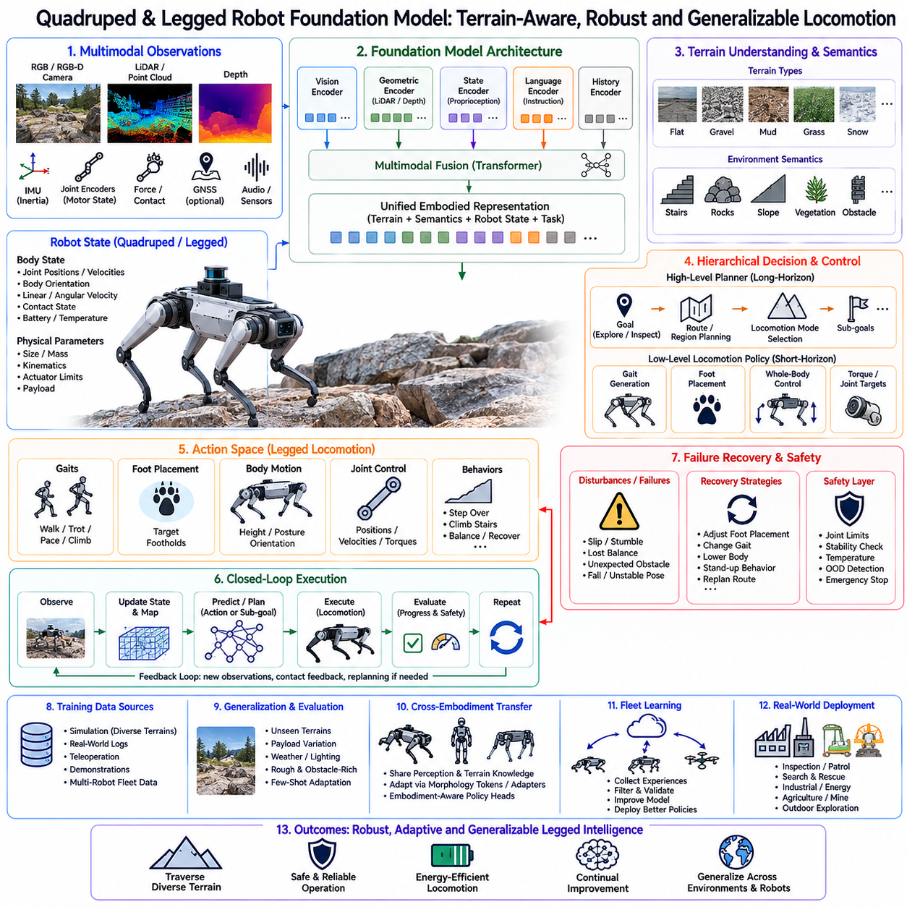{width="7.268055555555556in" height="7.268055555555556in"}

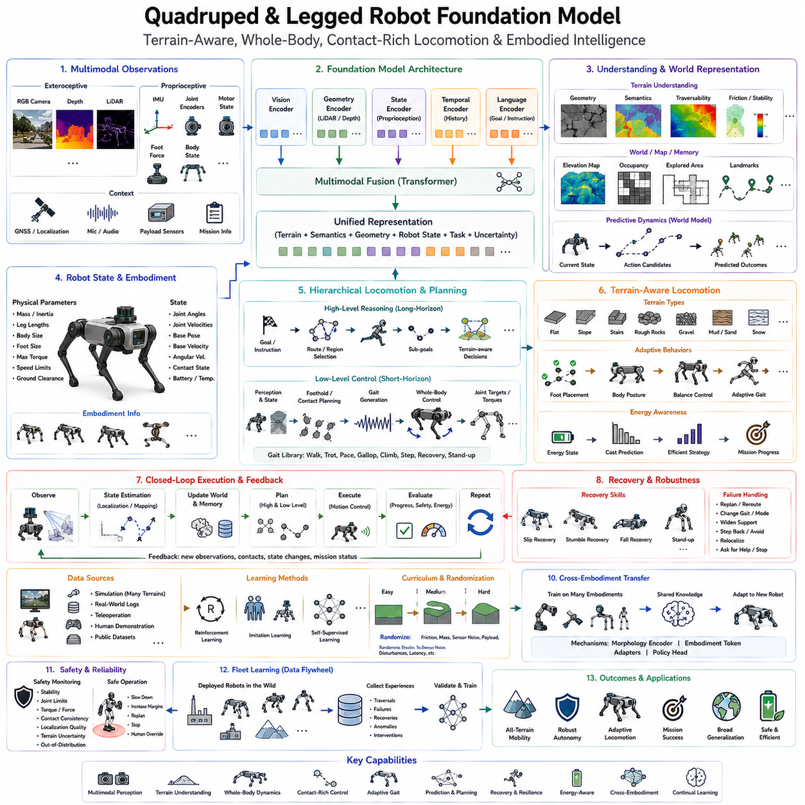{width="7.268055555555556in" height="7.268055555555556in"}

A quadruped and legged robot foundation model extends foundation-model learning into terrain-aware mobility, whole-body dynamics, and contact-rich locomotion. Unlike wheeled robots operating primarily on structured surfaces, legged robots can traverse stairs, rocks, slopes, gravel, vegetation, and irregular industrial terrain. The model therefore learns reusable relationships among perception, terrain, body state, contacts, locomotion strategy, and mission objectives rather than memorizing a single gait or environment.

The observation space combines exteroceptive and proprioceptive sensing. Cameras, depth sensors, and LiDAR describe terrain geometry, obstacles, objects, and surrounding structures, while IMUs, joint encoders, motor states, and force measurements describe body orientation, joint configuration, contact, and motion. GNSS, localization, microphones, payload sensors, and mission information can provide additional context depending on the deployment scenario.

These heterogeneous signals must be converted into a temporally consistent representation of both the world and the robot. Vision and geometric encoders extract terrain shape, semantic categories, obstacles, and traversability cues, while state encoders represent joint motion, body velocity, orientation, and contact conditions. Temporal history helps distinguish transient disturbances from persistent terrain structure and allows the model to relate previous actions to subsequent physical consequences.

Terrain understanding is a central capability because surfaces that appear geometrically similar can have very different physical properties. Concrete, gravel, mud, wet grass, sand, snow, and loose rocks differ in friction, compliance, deformation, and stability. A foundation model can combine visual appearance, depth, contact history, and proprioceptive feedback to infer terrain characteristics and estimate whether a region is safe, difficult, unstable, or energetically expensive to traverse.

Multimodal fusion produces a shared representation containing terrain semantics, geometry, robot state, mission context, and uncertainty. This representation can connect observations such as a staircase or loose surface with the robot\'s physical capabilities and current state. Instead of asking only where the robot should move, the model can reason about how it should move, which gait is appropriate, where feet should contact the ground, and whether additional stability margins are necessary.

Legged locomotion is fundamentally a contact-planning problem. Each step changes the support configuration and redistributes forces through the robot body. The policy must coordinate foot placement, body orientation, joint motion, ground reaction forces, friction, momentum, and actuator limits. Small errors can cause slipping, stumbling, or falling, making accurate contact reasoning and rapid feedback substantially more important than in many conventional navigation systems.

A hierarchical architecture separates semantic navigation from dynamic locomotion. High-level reasoning can select destinations, terrain regions, route segments, locomotion modes, or behavioral objectives such as inspect, patrol, climb, avoid, search, and explore. Lower-level locomotion policies then convert these objectives into gait patterns, footholds, body trajectories, joint targets, or torques while maintaining stability and tracking the desired direction.

Gait adaptation enables the robot to modify locomotion according to terrain and task demands. Walking, trotting, pacing, climbing, stepping carefully, or using recovery motions may be appropriate under different conditions. The foundation model does not need to represent every gait as an isolated controller; shared latent skills can encode reusable movement structures while contextual information determines speed, step length, body height, contact timing, and stability strategy.

Reinforcement learning provides an important mechanism for acquiring these dynamic behaviors because manually specifying optimal whole-body motion across every terrain configuration is extremely difficult. Policies can learn through repeated interaction with physics simulation, receiving objectives related to velocity tracking, stability, energy consumption, foot placement, collision avoidance, and task progress. Foundation-model representations can then connect these learned locomotion skills with broader semantic perception and mission reasoning.

Simulation is particularly important for legged robots because failures during locomotion can damage expensive physical hardware. High-fidelity environments can model rigid-body dynamics, actuator behavior, friction, contact mechanics, sensor noise, payload inertia, and environmental disturbances. Large numbers of simulated robots can explore diverse conditions in parallel, producing experience at a scale that would be impractical to collect exclusively through physical deployment.

Domain randomization improves robustness by varying parameters that cannot be modeled perfectly. Terrain geometry, friction, mass, center of gravity, actuator strength, latency, sensor noise, payload, external forces, and contact properties can change across simulated episodes. The resulting policy learns to operate across distributions of physical conditions rather than depending on one ideal simulator configuration, supporting subsequent simulation-to-reality transfer.

Curriculum learning can progressively increase locomotion difficulty. Training may begin on flat terrain before introducing slopes, steps, gaps, rough surfaces, disturbances, and complex obstacle combinations. This progression allows the policy to establish fundamental balance and gait behavior before confronting harder scenarios. Eventually, randomized curricula can expose the model to combinations of terrain and disturbances that approximate the diversity expected during field operation.

A world representation or predictive dynamics model can further support terrain-aware locomotion. The system can maintain information about local elevation, obstacles, candidate footholds, robot contact state, localization confidence, mission progress, and uncertainty. Predicting the consequences of candidate actions allows planning to consider whether a particular route or gait is likely to cause slipping, instability, excessive energy consumption, or loss of mission progress.

Closed-loop execution continuously connects prediction with physical feedback. After each motion segment, new visual, inertial, joint, and contact observations update the internal state. Unexpected slip, impact, terrain deformation, or external disturbance can immediately change subsequent actions. Fast low-level control stabilizes the body, while higher-level components revise footholds, gait, path, or mission strategy according to the updated situation.

Recovery behavior is a defining capability of robust legged autonomy. A robot may stumble, lose traction, encounter an unexpectedly high obstacle, or fall into a configuration not represented by nominal gait trajectories. Recovery policies can adjust foot placement, widen the support region, lower the body, step away from unstable terrain, or execute stand-up behaviors after a fall. Successful recovery therefore requires both rapid dynamic control and awareness of the broader task context.

Energy-aware locomotion becomes important during long inspection or exploration missions. Aggressive gaits may increase speed or terrain capability but also increase actuator load and battery consumption. The model can reason jointly about route difficulty, locomotion mode, payload, remaining energy, and mission priority. Conservative energy-efficient gaits can extend operational duration, while higher-energy behaviors remain available when difficult terrain or urgent objectives justify their use.

Generalization should be evaluated across terrain types, payloads, disturbances, environmental conditions, and mission objectives. A strong foundation model should transfer balance, stepping, terrain interpretation, obstacle negotiation, and recovery concepts rather than memorizing specific simulated surfaces. Real-world evaluation should include variations in friction, slopes, stairs, loose terrain, weather, sensor degradation, and unexpected contact events.

Cross-embodiment transfer can connect quadrupeds with humanoids, other legged robots, manipulators, and mobile platforms. Perception, semantic understanding, mission structure, terrain concepts, and some latent skills can be shared, while morphology, kinematics, dynamics, actuator limits, contact patterns, and low-level control must remain embodiment-aware. Morphology encoders, embodiment tokens, adapters, and specialized policy heads provide mechanisms for this separation.

Safety requires deterministic supervision around the learned locomotion policy. Runtime monitoring can track stability, joint limits, actuator temperature, contact consistency, localization quality, terrain uncertainty, communication integrity, and out-of-distribution conditions. Elevated uncertainty can trigger slower motion, larger stability margins, replanning, stopping, or human supervision rather than allowing the learned policy to continue operating without constraint.

Fleet deployment creates a data flywheel for continual improvement. Multiple quadrupeds operating in industrial facilities, infrastructure sites, farms, mines, or other environments can collect unusual terrain encounters, slips, actuator anomalies, recovery maneuvers, localization failures, and successful traversals. After validation, these experiences can become new training scenarios so that lessons learned by one deployed robot improve future policies across the fleet.

The quadruped and legged robot foundation model therefore represents a transition from specialized gait control toward reusable terrain-aware physical intelligence. By integrating multimodal perception, semantic reasoning, whole-body dynamics, reinforcement learning, predictive world representations, adaptive gait selection, closed-loop control, recovery, safety, and fleet learning, legged robots can progress from laboratory locomotion demonstrations toward reliable autonomous operation across complex real-world environments.

사족보행 및 다족보행 로봇 파운데이션 모델(quadruped and legged robot foundation model)은 파운데이션 모델 학습(foundation-model learning)을 지형 인식 이동(terrain-aware mobility), 전신 동역학(whole-body dynamics), 접촉 중심 보행(contact-rich locomotion)으로 확장한다. 주로 구조화된 표면에서 이동하는 바퀴형 로봇과 달리 다족보행 로봇은 계단, 암석, 경사면, 자갈, 식생 및 불규칙한 산업 지형을 횡단할 수 있다. 따라서 모델은 하나의 보행 패턴이나 환경을 암기하는 대신 지각, 지형, 신체 상태, 접촉, 보행 전략 및 임무 목표 사이의 재사용 가능한 관계를 학습한다.

관측 공간(observation space)은 외부수용 센싱(exteroceptive sensing)과 고유수용 센싱(proprioceptive sensing)을 결합한다. 카메라, 깊이 센서(depth sensor), 라이다(LiDAR)는 지형의 기하학적 구조, 장애물, 객체 및 주변 구조물을 파악하고, 관성측정장치(IMU), 관절 인코더(joint encoder), 모터 상태 및 힘 측정값은 신체 방향, 관절 구성, 접촉 및 움직임을 나타낸다. 배포 환경에 따라 위성항법시스템(GNSS), 위치추정(localization), 마이크, 페이로드 센서(payload sensor), 임무 정보도 추가적인 문맥을 제공할 수 있다.

이러한 이질적인 신호는 외부 세계와 로봇 자체를 모두 나타내는 시간적으로 일관된 표현(temporally consistent representation)으로 변환되어야 한다. 비전 및 기하학 인코더는 지형 형상, 의미 범주, 장애물 및 주행 가능성 단서를 추출하고, 상태 인코더(state encoder)는 관절 움직임, 신체 속도, 방향 및 접촉 상태를 표현한다. 시간적 이력(temporal history)은 일시적인 외란과 지속적인 지형 구조를 구분하고 이전 행동과 이후의 물리적 결과 사이의 관계를 모델이 파악하도록 지원한다.

지형 이해(terrain understanding)는 기하학적으로 유사하게 보이는 표면도 매우 다른 물리적 특성을 가질 수 있기 때문에 핵심적인 능력이다. 콘크리트, 자갈, 진흙, 젖은 잔디, 모래, 눈 및 느슨한 암석은 마찰, 순응성(compliance), 변형 및 안정성에서 차이가 있다. 파운데이션 모델은 시각적 외형, 깊이, 접촉 이력 및 고유수용성 피드백을 결합하여 지형 특성을 추론하고 특정 영역이 안전한지, 어려운지, 불안정한지 또는 에너지 소비가 높은지를 추정할 수 있다.

멀티모달 융합(multimodal fusion)은 지형 의미 정보, 기하학적 구조, 로봇 상태, 임무 문맥 및 불확실성을 포함하는 공유 표현(shared representation)을 생성한다. 이러한 표현은 계단이나 느슨한 표면과 같은 관측 결과를 로봇의 물리적 능력 및 현재 상태와 연결할 수 있다. 모델은 단순히 로봇이 어디로 이동해야 하는지만 판단하는 것이 아니라 어떻게 이동해야 하는지, 어떤 보행 패턴(gait)이 적절한지, 발을 어디에 접촉시켜야 하는지, 추가적인 안정성 여유(stability margin)가 필요한지를 추론할 수 있다.

다족보행(legged locomotion)은 본질적으로 접촉 계획(contact planning) 문제이다. 각각의 걸음은 지지 구성(support configuration)을 변화시키고 로봇 신체 전체의 힘을 재분배한다. 정책은 발 위치(foot placement), 신체 방향, 관절 움직임, 지면 반력(ground reaction force), 마찰, 운동량 및 액추에이터 한계를 조정해야 한다. 작은 오류도 미끄러짐, 발 헛디딤 또는 넘어짐을 발생시킬 수 있기 때문에 정확한 접촉 추론과 빠른 피드백은 많은 기존 내비게이션 시스템보다 훨씬 중요하다.

계층적 아키텍처(hierarchical architecture)는 의미적 내비게이션(semantic navigation)과 동적 보행(dynamic locomotion)을 분리한다. 고수준 추론은 목적지, 지형 영역, 경로 구간, 보행 모드 또는 검사, 순찰, 등반, 회피, 탐색 등의 행동 목표를 선택할 수 있다. 이후 저수준 보행 정책(low-level locomotion policy)은 안정성을 유지하고 원하는 이동 방향을 추종하면서 이러한 목표를 보행 패턴, 발 디딤 위치(foothold), 신체 궤적, 관절 목표값 또는 토크로 변환한다.

보행 적응(gait adaptation)은 로봇이 지형 및 작업 요구조건에 따라 이동 방식을 변경할 수 있도록 한다. 걷기(walking), 트로팅(trotting), 페이싱(pacing), 등반, 조심스럽게 발 디디기 또는 복구 동작 등이 서로 다른 조건에서 적합할 수 있다. 파운데이션 모델은 모든 보행 패턴을 독립된 제어기로 표현할 필요 없이 공유 잠재 기술(shared latent skill)을 통해 재사용 가능한 움직임 구조를 인코딩하고, 문맥 정보에 따라 속도, 보폭, 신체 높이, 접촉 타이밍 및 안정화 전략을 결정할 수 있다.

강화학습(reinforcement learning)은 모든 지형 구성에 대해 최적의 전신 움직임을 수작업으로 지정하기가 매우 어렵기 때문에 이러한 동적 행동을 획득하는 중요한 방법을 제공한다. 정책은 물리 시뮬레이션과 반복적으로 상호작용하면서 속도 추종, 안정성, 에너지 소비, 발 위치, 충돌 회피 및 작업 진행과 관련된 목표를 통해 학습할 수 있다. 이후 파운데이션 모델 표현은 이렇게 학습된 보행 기술을 더욱 광범위한 의미적 지각 및 임무 추론과 연결할 수 있다.

시뮬레이션(simulation)은 보행 실패가 고가의 실제 하드웨어를 손상시킬 수 있기 때문에 다족보행 로봇에서 특히 중요하다. 고충실도 환경(high-fidelity environment)은 강체 동역학, 액추에이터 동작, 마찰, 접촉 역학(contact mechanics), 센서 노이즈, 페이로드 관성 및 환경 외란을 모델링할 수 있다. 다수의 시뮬레이션 로봇이 다양한 조건을 병렬로 탐색함으로써 실제 로봇 배포만으로 수집하기 어려운 규모의 경험을 생성할 수 있다.

도메인 랜덤화(domain randomization)는 완벽하게 모델링하기 어려운 매개변수를 변화시켜 강건성(robustness)을 향상시킨다. 지형 기하구조, 마찰, 질량, 무게중심(center of gravity), 액추에이터 출력, 지연시간, 센서 노이즈, 페이로드, 외력 및 접촉 특성을 시뮬레이션 에피소드마다 변화시킬 수 있다. 결과적으로 정책은 하나의 이상적인 시뮬레이터 구성에 의존하는 대신 다양한 물리적 조건의 분포에서 동작하는 방법을 학습하여 이후의 시뮬레이션-현실 전이(sim-to-real transfer)를 지원한다.

커리큘럼 학습(curriculum learning)은 보행 난이도를 점진적으로 증가시킬 수 있다. 평탄한 지형에서 학습을 시작한 후 경사면, 계단, 틈, 거친 표면, 외란 및 복잡한 장애물 조합을 점차 추가할 수 있다. 이러한 과정은 정책이 어려운 상황을 경험하기 전에 기본적인 균형과 보행 행동을 먼저 확립하도록 한다. 이후 무작위화된 커리큘럼(randomized curriculum)을 통해 실제 현장 운영에서 예상되는 다양한 지형과 외란의 조합을 모델에 제공할 수 있다.

월드 표현(world representation) 또는 예측 동역학 모델(predictive dynamics model)은 지형 인식 보행을 추가적으로 지원할 수 있다. 시스템은 로컬 고도, 장애물, 후보 발 디딤 위치, 로봇 접촉 상태, 위치추정 신뢰도, 임무 진행 상태 및 불확실성에 관한 정보를 유지할 수 있다. 후보 행동의 결과를 예측함으로써 특정 경로나 보행 방식이 미끄러짐, 불안정성, 과도한 에너지 소비 또는 임무 진행 손실을 발생시킬 가능성이 있는지를 계획 단계에서 고려할 수 있다.

폐루프 실행(closed-loop execution)은 예측을 물리적 피드백과 지속적으로 연결한다. 각각의 움직임 구간 이후 새로운 시각, 관성, 관절 및 접촉 관측을 통해 내부 상태를 업데이트한다. 예상하지 못한 미끄러짐, 충격, 지형 변형 또는 외부 외란은 이후의 행동을 즉시 변화시킬 수 있다. 빠른 저수준 제어(low-level control)가 신체를 안정화하는 동안 고수준 구성요소는 업데이트된 상황에 따라 발 디딤 위치, 보행 방식, 경로 또는 임무 전략을 수정한다.

복구 행동(recovery behavior)은 강건한 다족보행 자율성(legged autonomy)을 정의하는 핵심 능력이다. 로봇은 발을 헛디디거나 접지력을 잃거나 예상보다 높은 장애물을 만나거나 정상적인 보행 궤적에 포함되지 않은 자세로 넘어질 수 있다. 복구 정책은 발 위치를 조정하고, 지지 영역을 넓히고, 신체를 낮추고, 불안정한 지형에서 벗어나거나, 넘어진 후 다시 일어서는 행동(stand-up behavior)을 실행할 수 있다. 따라서 성공적인 복구에는 빠른 동적 제어와 전체 작업 문맥에 대한 인식이 모두 필요하다.

에너지 인식 보행(energy-aware locomotion)은 장시간의 검사 또는 탐사 임무에서 중요해진다. 공격적인 보행 방식은 속도와 지형 돌파 능력을 높일 수 있지만 액추에이터 부하와 배터리 소비도 증가시킨다. 모델은 경로 난이도, 보행 모드, 페이로드, 잔여 에너지 및 임무 우선순위를 함께 고려할 수 있다. 에너지 효율적인 보수적 보행은 운용 시간을 연장하고, 어려운 지형이나 긴급한 목표에서는 더 많은 에너지를 사용하는 행동을 선택할 수 있다.

일반화(generalization)는 지형 유형, 페이로드, 외란, 환경 조건 및 임무 목표 전반에서 평가해야 한다. 강력한 파운데이션 모델은 특정 시뮬레이션 표면을 암기하는 것이 아니라 균형, 발 디딤, 지형 해석, 장애물 극복 및 복구 개념을 전이할 수 있어야 한다. 실제 환경 평가에는 마찰, 경사면, 계단, 느슨한 지형, 날씨, 센서 성능 저하 및 예상하지 못한 접촉 사건의 변화가 포함되어야 한다.

교차 임바디먼트 전이(cross-embodiment transfer)는 사족보행 로봇을 휴머노이드, 다른 다족보행 로봇, 매니퓰레이터 및 모바일 플랫폼과 연결할 수 있다. 지각, 의미적 이해, 임무 구조, 지형 개념 및 일부 잠재 기술은 공유할 수 있지만 형태, 운동학, 동역학, 액추에이터 한계, 접촉 패턴 및 저수준 제어는 임바디먼트를 고려해야 한다. 형태 인코더(morphology encoder), 임바디먼트 토큰(embodiment token), 어댑터(adapter), 특화된 정책 헤드(policy head)는 이러한 요소를 분리하기 위한 메커니즘을 제공한다.

안전성(safety)을 위해서는 학습된 보행 정책 주변에 결정론적 감독(deterministic supervision)이 필요하다. 런타임 모니터링(runtime monitoring)은 안정성, 관절 한계, 액추에이터 온도, 접촉 일관성, 위치추정 품질, 지형 불확실성, 통신 무결성 및 분포 외 조건(out-of-distribution condition)을 추적할 수 있다. 불확실성이 증가하면 학습된 정책을 제한 없이 계속 실행하는 대신 이동 속도를 낮추고 안정성 여유를 확대하거나 재계획, 정지 또는 인간 감독을 요청할 수 있다.

플릿 배포(fleet deployment)는 지속적인 개선을 위한 데이터 플라이휠(data flywheel)을 형성한다. 산업 시설, 인프라 현장, 농장, 광산 및 기타 환경에서 운영되는 여러 사족보행 로봇은 비정상적인 지형 조우, 미끄러짐, 액추에이터 이상, 복구 동작, 위치추정 실패 및 성공적인 지형 통과 경험을 수집할 수 있다. 검증된 이후 이러한 경험을 새로운 학습 시나리오로 활용하면 하나의 배포 로봇에서 얻은 경험이 전체 플릿의 향후 정책을 개선할 수 있다.

따라서 사족보행 및 다족보행 로봇 파운데이션 모델은 전문화된 보행 제어(specialized gait control)에서 재사용 가능한 지형 인식 물리 지능(reusable terrain-aware physical intelligence)으로의 전환을 의미한다. 멀티모달 지각, 의미적 추론, 전신 동역학, 강화학습, 예측 월드 표현, 적응형 보행 선택, 폐루프 제어, 실패 복구, 안전성 및 플릿 학습을 통합함으로써 다족보행 로봇은 실험실 수준의 보행 시연을 넘어 복잡한 실제 환경에서 신뢰성 높은 자율 운용으로 발전할 수 있다.

## 11.09. Cross Embodiment Generalist Policy

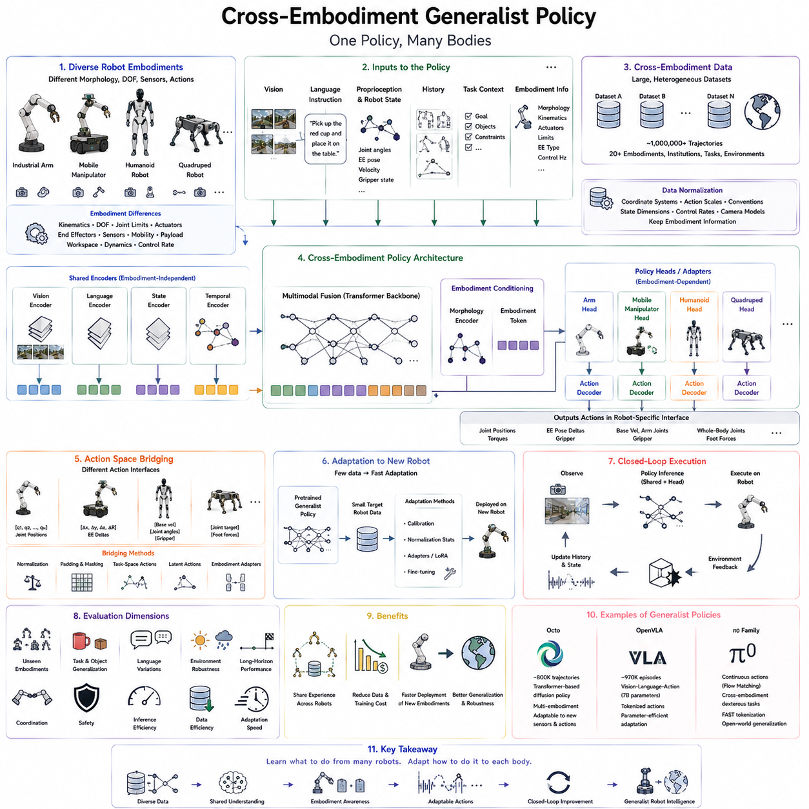{width="7.268055555555556in" height="7.268055555555556in"}

A cross-embodiment generalist policy aims to reuse learned robot intelligence across platforms with different bodies, sensors, kinematics, and control interfaces. Instead of training an independent policy for every robot, it separates broadly transferable knowledge from embodiment-specific execution. The central objective is a shared policy foundation that understands tasks and physical interactions while adapting its motor behavior to the capabilities of each robot.

Robot embodiment describes the physical realization through which intelligence interacts with the world. It includes morphology, degrees of freedom, joint limits, actuator characteristics, end effectors, sensing configuration, mobility mechanisms, workspace, payload, compliance, and control frequency. Consequently, an industrial arm, mobile manipulator, humanoid, and quadruped may share the same conceptual task while requiring fundamentally different trajectories and control commands.

The key architectural principle is to distinguish embodiment-independent knowledge from embodiment-dependent execution. Object recognition, language understanding, spatial relationships, task structure, intentions, affordances, and many manipulation concepts can be shared broadly. Kinematics, dynamics, balance, actuator limits, grasp geometry, joint commands, and low-level control remain closely coupled to the physical platform and therefore require explicit adaptation.

A cross-embodiment policy receives observations together with information describing the robot itself. Visual observations, language instructions, proprioceptive states, temporal history, and task context can be supplemented with morphology, kinematic structure, available actuators, end-effector type, and control limits. Embodiment information tells the model not only what task should be performed but also what physical system is available for performing it.

Shared perceptual and semantic encoders transform heterogeneous inputs into representations that are less dependent on a particular robot. A cup remains a cup whether it is observed by a stationary arm, mobile manipulator, or humanoid. Likewise, concepts such as grasping, transporting, inserting, opening, and placing preserve semantic structure across platforms even though the required motor commands differ. This shared abstraction provides the foundation for transferring experience between embodiments.

Multimodal fusion integrates vision, language, robot state, history, and embodiment information into a unified task-level representation. A transformer or related architecture can attend simultaneously to relevant objects, instructions, previous actions, and physical constraints. The representation therefore captures both common task semantics and the conditions imposed by the current robot, enabling one backbone to support multiple embodiments without assuming that their raw interfaces are identical.

Embodiment conditioning provides an explicit mechanism for adapting shared intelligence to different bodies. Morphology encoders can represent link structure, dimensions, degrees of freedom, and kinematic relationships, while embodiment tokens can identify platform characteristics inside the shared network. Robot-specific adapters or policy heads then transform common representations into commands appropriate for each system, preserving shared knowledge while respecting physical differences.

Action-space mismatch is one of the most difficult problems in cross-robot learning. One robot may use joint positions, another Cartesian end-effector deltas, and another a combination of base velocity, arm motion, and gripper commands. Padding, masking, normalization, task-space representations, latent actions, and embodiment-specific action adapters can bridge these differences rather than forcing every robot to expose exactly the same raw control interface.

Normalized or latent action representations can further increase transferability. Instead of directly learning platform-specific actuator values, the model can represent intentions such as moving toward an object, closing a gripper, transporting an item, or repositioning the body. An embodiment-aware decoder translates these representations into feasible commands. This preserves common behavioral structure while allowing each robot to realize the behavior according to its own kinematics and control system.

Large cross-robot datasets are essential because transferable structure emerges from diversity. Training data can combine demonstrations from different institutions, robots, camera arrangements, tasks, environments, and action spaces. Open X-Embodiment illustrates this strategy by aggregating approximately one million real-world robot episodes across more than twenty embodiments, providing heterogeneous experience from which shared perceptual, semantic, temporal, and manipulation patterns can be learned.

Data normalization becomes particularly important when trajectories originate from many robots. Differences in coordinate systems, action scales, camera configurations, state dimensions, control rates, and conventions can create artificial incompatibilities that obscure shared behavior. Preprocessing therefore aligns numerical ranges and interface conventions while retaining embodiment information needed for execution. Systems such as π0 emphasize normalization when adapting pretrained cross-embodiment policies to new robots.

Generalist policies such as Octo demonstrate how cross-embodiment pretraining can provide an adaptable initialization rather than claiming universal direct control. Octo was pretrained on roughly 800,000 trajectories from a heterogeneous mixture of Open X-Embodiment data and supports different observations, task specifications, and action interfaces. The model emphasizes efficient downstream adaptation, recognizing that substantial embodiment differences often make fine-tuning more practical than unrestricted zero-shot execution.

OpenVLA provides another example of this direction through a vision-language-action architecture trained on approximately 970,000 robot episodes from the Open X-Embodiment ecosystem. Visual observations and language instructions are processed through a shared multimodal architecture, while robot actions are represented as tokens. Parameter-efficient adaptation enables the pretrained model to be specialized for new robot configurations without necessarily retraining the entire foundation model.

The π0 family demonstrates an alternative approach based on continuous generative actions. A pretrained vision-language backbone provides semantic context, while a specialized action expert generates continuous trajectories using flow matching. Training across multiple robot platforms encourages the model to discover common structures in reaching, grasping, transporting, coordinated contact, and task completion even though exact control semantics remain dependent on each embodiment.

These systems illustrate that cross-embodiment generalization does not require one universal action representation. Discrete action tokens integrate naturally with language-model architectures, whereas diffusion and flow-based approaches preserve continuous multimodal action distributions. The more fundamental requirement is that shared representations capture transferable task knowledge while the action-generation mechanism preserves sufficient information about embodiment-specific geometry, dynamics, and control requirements.

Adaptation can occur at several levels depending on the similarity between source and target robots. A closely related manipulator may require only calibration, normalization statistics, or a lightweight action adapter. A substantially different embodiment may require new policy heads, adapters, LoRA modules, or additional fine-tuning. Few-shot adaptation uses a small number of demonstrations to connect pretrained representations with the behavior required by the new physical platform.

Zero-shot transfer remains an important objective but should not be confused with guaranteed universal control. A pretrained policy may immediately recognize objects, interpret instructions, understand task structure, or propose meaningful behaviors on a new robot while still requiring adaptation for precise execution. Cross-embodiment pretraining is therefore valuable even when zero-shot motor performance is imperfect because it can dramatically reduce how much platform-specific learning must begin from scratch.

Closed-loop execution allows embodiment adaptation to interact continuously with real physical outcomes. The robot observes the environment, reasons through the shared policy, applies embodiment-specific transformation, executes an action, and observes the result. Deviations caused by kinematic differences, actuator response, contact uncertainty, or perception errors can then influence subsequent decisions. Repeated feedback supports correction and recovery rather than assuming perfect transfer from the pretrained policy.

Evaluation must measure more than success on robots represented heavily in the training data. Relevant dimensions include transfer to unseen embodiments, task and object generalization, language variation, environmental robustness, long-horizon performance, coordination, safety, inference efficiency, and data efficiency. Particularly important is measuring how much target-robot data is required to achieve useful performance compared with training an equivalent specialist policy from the beginning.

Cross-embodiment learning changes the economics of robot development because experience collected by one platform can contribute to another. Traditional robot learning repeatedly pays the cost of operators, hardware time, calibration, data collection, and training for each system. A shared foundation converts heterogeneous robot experience into reusable knowledge, allowing new embodiments to inherit perception, semantics, task understanding, and behavioral structure before receiving comparatively smaller amounts of specialized data.

The long-term outcome is not a policy that ignores embodiment, but one that understands embodiment explicitly. Shared intelligence should capture what must be accomplished and which physical concepts transfer, while specialized interfaces determine how a particular body can accomplish them safely. This combination of heterogeneous data, shared representations, embodiment conditioning, adaptable action interfaces, closed-loop correction, and efficient fine-tuning provides a practical path toward increasingly universal generalist robot policies.

교차 임바디먼트 제너럴리스트 정책(cross-embodiment generalist policy)은 서로 다른 신체 구조, 센서, 운동학(kinematics), 제어 인터페이스를 가진 로봇 플랫폼 전반에서 학습된 로봇 지능을 재사용하는 것을 목표로 한다. 각 로봇마다 독립적인 정책을 학습하는 대신 광범위하게 전이 가능한 지식과 임바디먼트별 실행(embodiment-specific execution)을 분리한다. 핵심 목표는 작업과 물리적 상호작용을 이해하면서 각 로봇의 능력에 맞게 모터 행동을 적응시키는 공유 정책 기반(shared policy foundation)을 구축하는 것이다.

로봇 임바디먼트(robot embodiment)는 지능이 물리 세계와 상호작용하는 물리적 구현 형태를 의미한다. 여기에는 형태(morphology), 자유도(degrees of freedom), 관절 한계, 액추에이터 특성, 엔드이펙터(end effector), 센서 구성, 이동 메커니즘, 작업공간, 페이로드(payload), 순응성(compliance), 제어 주기 등이 포함된다. 따라서 산업용 로봇 팔, 모바일 매니퓰레이터, 휴머노이드 및 사족보행 로봇은 동일한 개념적 작업을 공유할 수 있지만 근본적으로 다른 궤적과 제어 명령을 필요로 할 수 있다.

핵심적인 아키텍처 원칙은 임바디먼트 독립적 지식(embodiment-independent knowledge)과 임바디먼트 의존적 실행(embodiment-dependent execution)을 구분하는 것이다. 객체 인식, 언어 이해, 공간 관계, 작업 구조, 의도, 어포던스(affordance) 및 다양한 조작 개념은 폭넓게 공유할 수 있다. 반면 운동학, 동역학, 균형, 액추에이터 한계, 파지 기하구조, 관절 명령 및 저수준 제어는 물리적 플랫폼과 밀접하게 결합되어 있으므로 명시적인 적응이 필요하다.

교차 임바디먼트 정책은 관측 정보와 함께 로봇 자체를 설명하는 정보를 입력으로 받는다. 시각 관측, 언어 명령, 고유수용성 상태(proprioceptive state), 시간적 이력 및 작업 문맥에 형태, 운동학적 구조, 사용 가능한 액추에이터, 엔드이펙터 유형 및 제어 한계 정보를 추가할 수 있다. 임바디먼트 정보는 모델에 어떤 작업을 수행해야 하는지만 알려주는 것이 아니라 해당 작업을 수행하기 위해 어떤 물리적 시스템을 사용할 수 있는지도 알려준다.

공유 지각 및 의미 인코더(shared perceptual and semantic encoder)는 이질적인 입력을 특정 로봇에 대한 의존성이 상대적으로 낮은 표현으로 변환한다. 컵은 고정형 로봇 팔, 모바일 매니퓰레이터 또는 휴머노이드가 관측하더라도 동일한 컵이다. 마찬가지로 파지, 운반, 삽입, 열기 및 배치와 같은 개념은 필요한 모터 명령이 서로 다르더라도 플랫폼 전반에서 의미적 구조를 유지한다. 이러한 공유 추상화(shared abstraction)는 서로 다른 임바디먼트 사이에서 경험을 전이하기 위한 기반을 제공한다.

멀티모달 융합(multimodal fusion)은 비전, 언어, 로봇 상태, 이력 및 임바디먼트 정보를 통합된 작업 수준 표현(unified task-level representation)으로 결합한다. 트랜스포머(transformer) 또는 관련 아키텍처는 관련 객체, 명령, 이전 행동 및 물리적 제약조건에 동시에 어텐션(attention)을 적용할 수 있다. 따라서 이러한 표현은 공통적인 작업 의미와 현재 로봇이 갖는 조건을 모두 포착하여 하나의 백본(backbone)이 원시 인터페이스가 동일하다고 가정하지 않고도 여러 임바디먼트를 지원할 수 있도록 한다.

임바디먼트 조건화(embodiment conditioning)는 공유 지능을 서로 다른 신체에 적응시키기 위한 명시적인 메커니즘을 제공한다. 형태 인코더(morphology encoder)는 링크 구조, 크기, 자유도 및 운동학적 관계를 표현할 수 있으며, 임바디먼트 토큰(embodiment token)은 공유 네트워크 내부에서 플랫폼의 특성을 식별할 수 있다. 이후 로봇별 어댑터(robot-specific adapter) 또는 정책 헤드(policy head)가 공통 표현을 각 시스템에 적합한 명령으로 변환하여 공유 지식을 유지하면서 물리적 차이를 반영한다.

행동 공간 불일치(action-space mismatch)는 교차 로봇 학습에서 가장 어려운 문제 중 하나이다. 하나의 로봇은 관절 위치를 사용하고, 다른 로봇은 카테시안 엔드이펙터 변화량(Cartesian end-effector delta)을 사용하며, 또 다른 로봇은 베이스 속도, 로봇 팔 움직임 및 그리퍼 명령을 조합할 수 있다. 패딩(padding), 마스킹(masking), 정규화(normalization), 작업 공간 표현(task-space representation), 잠재 행동(latent action), 임바디먼트별 행동 어댑터를 사용하면 모든 로봇에 동일한 원시 제어 인터페이스를 강제하지 않고 이러한 차이를 연결할 수 있다.

정규화된 행동 표현(normalized action representation) 또는 잠재 행동 표현(latent action representation)은 전이 가능성을 더욱 높일 수 있다. 플랫폼별 액추에이터 값을 직접 학습하는 대신 모델은 객체를 향해 이동하기, 그리퍼 닫기, 물체 운반하기 또는 몸체 위치 조정하기와 같은 의도를 표현할 수 있다. 임바디먼트 인식 디코더(embodiment-aware decoder)는 이러한 표현을 실행 가능한 명령으로 변환한다. 이를 통해 공통적인 행동 구조를 유지하면서 각 로봇이 자신의 운동학 및 제어 시스템에 따라 행동을 구현할 수 있다.

대규모 교차 로봇 데이터셋(cross-robot dataset)은 다양성으로부터 전이 가능한 구조가 형성되기 때문에 필수적이다. 학습 데이터는 서로 다른 기관, 로봇, 카메라 구성, 작업, 환경 및 행동 공간에서 수집된 시연을 결합할 수 있다. 오픈 X-임바디먼트(Open X-Embodiment)는 20개 이상의 임바디먼트에서 수집된 약 100만 개의 실제 로봇 에피소드를 통합함으로써 이러한 전략을 보여주며, 공유된 지각, 의미, 시간 및 조작 패턴을 학습할 수 있는 이질적인 경험을 제공한다.

데이터 정규화(data normalization)는 여러 로봇에서 수집된 궤적을 사용할 때 특히 중요하다. 좌표계, 행동 스케일, 카메라 구성, 상태 차원, 제어 주기 및 규약의 차이는 공유 행동을 가리는 인위적인 비호환성을 만들 수 있다. 따라서 전처리(preprocessing)는 실행에 필요한 임바디먼트 정보를 유지하면서 수치 범위와 인터페이스 규약을 정렬한다. π0와 같은 시스템은 사전학습된 교차 임바디먼트 정책을 새로운 로봇에 적응시킬 때 정규화의 중요성을 강조한다.

Octo와 같은 제너럴리스트 정책(generalist policy)은 교차 임바디먼트 사전학습이 범용적인 직접 제어를 의미하기보다 적응 가능한 초기화(adaptable initialization)를 제공할 수 있음을 보여준다. Octo는 오픈 X-임바디먼트 데이터의 이질적인 혼합으로부터 약 80만 개의 궤적을 사용하여 사전학습되었으며 서로 다른 관측, 작업 명세 및 행동 인터페이스를 지원한다. 임바디먼트 차이가 큰 경우 무제한적인 제로샷 실행보다 파인튜닝(fine-tuning)이 더욱 현실적이라는 점을 고려하여 효율적인 다운스트림 적응(downstream adaptation)을 강조한다.

OpenVLA는 오픈 X-임바디먼트 생태계에서 수집된 약 97만 개의 로봇 에피소드를 기반으로 학습된 비전-언어-행동 아키텍처(Vision-Language-Action architecture)를 통해 이러한 방향의 또 다른 사례를 제공한다. 시각 관측과 언어 명령은 공유 멀티모달 아키텍처(shared multimodal architecture)를 통해 처리되고, 로봇 행동은 토큰(token)으로 표현된다. 매개변수 효율적 적응(parameter-efficient adaptation)을 활용하면 전체 파운데이션 모델을 반드시 다시 학습하지 않고도 사전학습된 모델을 새로운 로봇 구성에 특화할 수 있다.

π0 계열은 연속 생성 행동(continuous generative action)에 기반한 또 다른 접근법을 보여준다. 사전학습된 비전-언어 백본(vision-language backbone)이 의미적 문맥을 제공하고, 특화된 행동 전문가(action expert)가 플로 매칭(flow matching)을 사용하여 연속적인 궤적을 생성한다. 여러 로봇 플랫폼에서 학습함으로써 정확한 제어 의미가 각 임바디먼트에 따라 달라지더라도 접근, 파지, 운반, 협응 접촉(coordinated contact) 및 작업 완료 과정에서 공통적인 구조를 발견하도록 모델을 유도할 수 있다.

이러한 시스템들은 교차 임바디먼트 일반화(cross-embodiment generalization)를 위해 반드시 하나의 범용 행동 표현(universal action representation)이 필요한 것은 아니라는 점을 보여준다. 이산 행동 토큰(discrete action token)은 언어 모델 아키텍처와 자연스럽게 통합되며, 확산(diffusion) 및 플로 기반 접근법(flow-based approach)은 연속적인 멀티모달 행동 분포를 유지한다. 보다 근본적인 요구조건은 공유 표현이 전이 가능한 작업 지식을 포착하면서 행동 생성 메커니즘이 임바디먼트별 기하구조, 동역학 및 제어 요구조건에 관한 충분한 정보를 유지하는 것이다.

적응(adaptation)은 소스 로봇과 타깃 로봇 사이의 유사성에 따라 여러 수준에서 이루어질 수 있다. 매우 유사한 매니퓰레이터는 캘리브레이션(calibration), 정규화 통계 또는 경량 행동 어댑터만 필요할 수 있다. 크게 다른 임바디먼트는 새로운 정책 헤드, 어댑터, LoRA 모듈 또는 추가적인 파인튜닝이 필요할 수 있다. 퓨샷 적응(few-shot adaptation)은 소수의 시연을 사용하여 사전학습된 표현을 새로운 물리적 플랫폼에 필요한 행동과 연결한다.

제로샷 전이(zero-shot transfer)는 중요한 목표이지만 보장된 범용 제어와 동일한 개념으로 이해해서는 안 된다. 사전학습된 정책은 새로운 로봇에서 객체를 즉시 인식하고, 명령을 해석하고, 작업 구조를 이해하거나 의미 있는 행동을 제안할 수 있지만 정밀한 실행에는 여전히 적응이 필요할 수 있다. 따라서 제로샷 모터 성능이 완벽하지 않더라도 교차 임바디먼트 사전학습은 플랫폼별 학습을 처음부터 시작하는 데 필요한 데이터와 학습 비용을 크게 줄일 수 있다는 점에서 가치가 있다.

폐루프 실행(closed-loop execution)은 임바디먼트 적응을 실제 물리적 결과와 지속적으로 연결한다. 로봇은 환경을 관측하고 공유 정책을 통해 추론한 뒤 임바디먼트별 변환을 적용하고 행동을 실행하여 결과를 다시 관측한다. 운동학적 차이, 액추에이터 응답, 접촉 불확실성 또는 지각 오류로 발생하는 편차는 이후의 의사결정에 반영될 수 있다. 이러한 반복적인 피드백은 사전학습된 정책으로부터 완벽한 전이가 이루어진다고 가정하는 대신 지속적인 수정과 복구를 지원한다.

평가(evaluation)는 학습 데이터에서 높은 비중으로 포함된 로봇에서의 성공률만 측정해서는 안 된다. 중요한 평가 항목에는 학습되지 않은 임바디먼트로의 전이, 작업 및 객체 일반화, 언어 변화, 환경 강건성, 장기 작업 성능, 협응, 안전성, 추론 효율성 및 데이터 효율성이 포함된다. 특히 새로운 전문 정책을 처음부터 학습하는 경우와 비교하여 유용한 성능에 도달하기 위해 타깃 로봇 데이터가 얼마나 필요한지를 측정하는 것이 중요하다.

교차 임바디먼트 학습은 하나의 플랫폼에서 수집한 경험을 다른 플랫폼에 활용할 수 있도록 함으로써 로봇 개발의 경제성을 변화시킨다. 기존의 로봇 학습은 각각의 시스템마다 작업자, 하드웨어 사용 시간, 캘리브레이션, 데이터 수집 및 학습 비용을 반복적으로 부담해야 한다. 공유 파운데이션(shared foundation)은 이질적인 로봇 경험을 재사용 가능한 지식으로 변환하여 새로운 임바디먼트가 상대적으로 적은 양의 특화 데이터를 학습하기 전에 지각, 의미, 작업 이해 및 행동 구조를 먼저 상속받을 수 있도록 한다.

장기적인 결과는 임바디먼트를 무시하는 정책이 아니라 임바디먼트를 명시적으로 이해하는 정책이다. 공유 지능(shared intelligence)은 무엇을 달성해야 하는지와 어떤 물리적 개념을 전이할 수 있는지를 포착하고, 특화된 인터페이스는 특정 신체가 이를 어떻게 안전하게 수행할지를 결정해야 한다. 이질적인 데이터, 공유 표현, 임바디먼트 조건화, 적응 가능한 행동 인터페이스, 폐루프 수정 및 효율적인 파인튜닝의 결합은 점차 범용성이 높아지는 제너럴리스트 로봇 정책(generalist robot policy)을 구축하기 위한 실용적인 경로를 제공한다.

## 11.10. Edge Deployed Robot Foundation Model

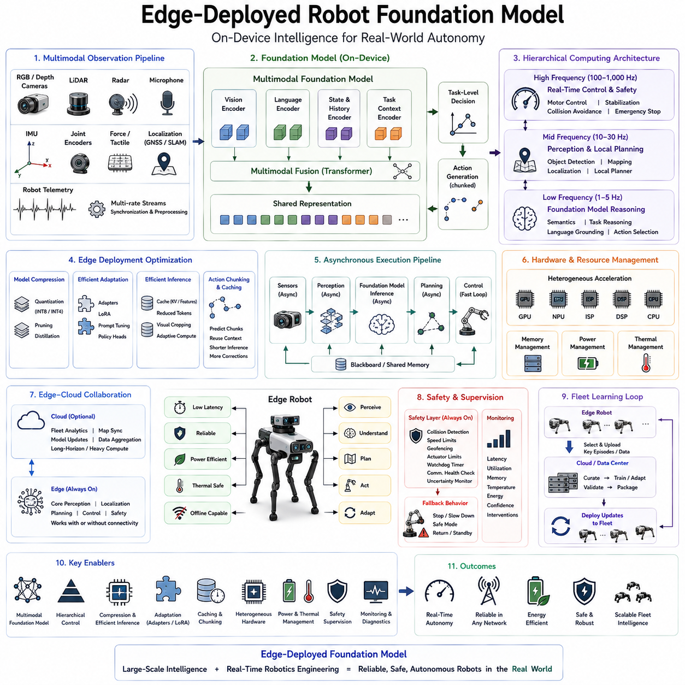{width="7.268055555555556in" height="7.268055555555556in"}

An edge-deployed robot foundation model brings large-scale multimodal intelligence directly onto the robot, allowing perception, reasoning, and action generation to operate without continuous dependence on remote cloud infrastructure. The objective is not simply to execute a compressed model locally, but to construct an autonomous intelligence stack that balances foundation-model capability with strict requirements for latency, reliability, power consumption, thermal limits, memory, and physical safety.

Edge deployment is especially important for robots because physical interaction imposes timing requirements that conventional cloud AI applications do not face. A delayed language response may be inconvenient, but a delayed navigation or manipulation decision can cause task failure or unsafe motion. Local inference reduces network-dependent latency and allows critical perception-action loops to continue even when wireless connectivity becomes unstable, congested, or completely unavailable.

The edge observation pipeline may integrate RGB and depth cameras, LiDAR, radar, microphones, IMUs, joint encoders, force sensors, tactile sensors, localization systems, and robot telemetry. These streams operate at different frequencies and data rates, making synchronization and preprocessing essential. Rather than forwarding every raw sensor stream into a large model, practical architectures extract compact features, select relevant observations, and maintain temporal context before multimodal reasoning.

A layered computing architecture separates functions according to their latency and computational requirements. High-frequency motor control, stabilization, collision avoidance, and emergency responses remain in deterministic real-time loops. Mid-level perception and local planning operate at intermediate frequencies, while a larger foundation model performs semantic interpretation, task reasoning, language grounding, and longer-horizon action selection at a slower rate. This hierarchy prevents physical stability from depending directly on large-model inference latency.

The foundation model can combine vision, language, robot state, temporal history, and task context into a shared representation. Instead of maintaining completely separate AI systems for object recognition, instruction interpretation, scene understanding, and task selection, multimodal representations allow these functions to exchange information. The model can identify relevant objects, understand the requested goal, evaluate the robot\'s current state, and generate an appropriate task-level or action-level response.

Model size creates a fundamental deployment tradeoff. Larger models generally provide stronger semantic knowledge and broader generalization, but require more memory bandwidth, accelerator capacity, energy, and inference time. Edge deployment therefore focuses on maximizing useful physical intelligence per unit of computation rather than simply maximizing parameter count. Model architecture, numerical precision, visual token count, context length, and action-generation method all influence the resulting computational budget.

Quantization is one of the most important techniques for reducing edge inference cost. Parameters and activations represented in FP16, INT8, INT4, or mixed precision can significantly reduce memory usage and bandwidth compared with higher-precision execution. However, aggressive quantization can degrade perception, reasoning, or action accuracy. Deployment therefore requires task-level validation because small numerical errors may have larger consequences when model outputs influence physical motion.

Knowledge distillation provides another path toward smaller edge models. A large teacher model can generate representations, predictions, trajectories, explanations, or action targets that guide a smaller student model. The student does not need to reproduce every capability of the teacher; it can be optimized for the subset of tasks required by the deployed robot. This specialization can preserve useful foundation-model knowledge while substantially reducing runtime computation and memory requirements.

Parameter-efficient adaptation allows a shared pretrained model to support different robots without storing or retraining a complete model for every deployment. Lightweight adapters, LoRA modules, prompt parameters, or specialized policy heads can encode robot-specific behavior while leaving most backbone parameters unchanged. This reduces training cost and makes it practical to maintain a common foundation while adapting to different sensors, embodiments, environments, and operational tasks.

Visual processing often dominates edge computation because high-resolution multi-camera input produces large numbers of tokens or feature maps. Efficient systems can reduce image resolution selectively, crop task-relevant regions, reuse cached visual features, process cameras asynchronously, or apply lightweight detectors before expensive multimodal reasoning. Adaptive computation can allocate more resources to uncertain or safety-critical observations while processing routine scenes with a cheaper pathway.

Temporal caching further reduces redundant computation. Consecutive robot observations often contain substantial overlap because the environment changes gradually between frames. Cached visual features, language embeddings, map representations, key-value attention states, or task memory can be reused instead of recomputing the entire context. The challenge is determining when cached information remains valid and when environmental change requires a complete refresh of the representation.

Action chunking can reduce the required foundation-model inference frequency by predicting a short sequence of future actions in a single forward pass. The robot executes the chunk while faster controllers maintain tracking and stability. Short chunks preserve frequent opportunities for correction, while longer chunks reduce computational load. Adaptive chunk lengths can therefore respond to uncertainty: predictable motion permits longer execution horizons, whereas contact-rich or dynamic situations require faster replanning.

Asynchronous execution prevents slow semantic reasoning from blocking faster robot processes. Perception, mapping, foundation-model inference, planning, control, logging, and communication can run as separate pipelines with explicit timing and synchronization mechanisms. A new high-level decision can update the active plan when available, while local controllers continue executing safe behavior. This architecture is particularly valuable when inference latency varies according to scene complexity or model workload.

Hardware acceleration is central to practical deployment. GPUs, NPUs, tensor accelerators, embedded AI modules, and specialized inference engines can execute different portions of the workload efficiently. Heterogeneous computing allows image preprocessing, neural inference, classical planning, and control to be assigned to suitable processors. The design objective is system-level efficiency rather than maximum utilization of a single accelerator, because thermal and power limits affect sustained robot operation.

Memory management is equally important because model parameters compete with sensor buffers, maps, perception networks, planning modules, operating-system resources, and application software. Techniques such as weight quantization, activation compression, selective model loading, reduced context windows, and shared feature representations can lower memory pressure. Predictable memory usage is particularly important for long-running autonomous systems where resource exhaustion can become an operational failure.

Power-aware inference connects AI computation directly to mission endurance. Running a large accelerator continuously at maximum performance can substantially reduce battery operating time and increase thermal load. Dynamic inference policies can reduce model frequency, precision, camera processing, or accelerator power during routine operation and temporarily increase computation for difficult scenes. The robot can therefore allocate computational energy according to task complexity and mission priority.

Thermal management constrains sustained edge intelligence because peak benchmark performance may not be available continuously inside a compact robot enclosure. Accelerator throttling can increase latency precisely when workloads become demanding. Practical systems must therefore evaluate sustained inference under realistic ambient temperature, airflow, enclosure, and workload conditions. Cooling design and model optimization become part of the AI architecture rather than independent hardware considerations.

Cloud connectivity can complement edge intelligence without becoming a prerequisite for safe operation. The robot may use remote infrastructure for fleet analytics, large-scale map synchronization, model updates, data upload, or computationally expensive non-real-time reasoning. Critical perception, localization, safety, and control remain local. This edge-first architecture allows cloud resources to expand capability while preserving autonomous operation during network interruption.

Safety supervision must remain outside the assumptions of probabilistic foundation-model behavior. Independent collision detection, emergency stopping, speed limits, geofencing, actuator constraints, watchdog timers, communication health checks, and confidence monitoring can constrain generated actions. If inference fails, exceeds a deadline, produces an invalid command, or encounters an out-of-distribution situation, the system should transition to a validated fallback behavior rather than waiting indefinitely for the model.

Deployment monitoring provides the information needed to improve both reliability and efficiency. Logs can capture inference latency, accelerator utilization, memory consumption, temperature, energy usage, confidence, interventions, task failures, and recovery events. These measurements reveal whether failures originate from model capability, computing saturation, sensor degradation, control behavior, or environmental novelty, enabling targeted improvements instead of treating every operational failure as a model problem.

Fleet operation creates a feedback loop between edge deployment and centralized learning. Robots can identify difficult episodes locally and upload selected data rather than transmitting continuous raw sensor streams. Central infrastructure can curate these episodes, retrain or adapt the foundation model, validate new versions, and distribute optimized updates back to the fleet. Edge inference and centralized training therefore form complementary parts of a continuously improving robot intelligence system.

The edge-deployed robot foundation model ultimately represents the integration of large-scale learned intelligence with real-time robotic systems engineering. Successful deployment depends on more than model accuracy: multimodal perception, hierarchical control, quantization, efficient adaptation, caching, asynchronous execution, hardware acceleration, power and thermal management, safety supervision, and fleet learning must operate together. The result is a robot that can retain broad foundation-model capabilities while acting reliably within the computational and physical constraints of real-world autonomy.

엣지 배포형 로봇 파운데이션 모델(edge-deployed robot foundation model)은 대규모 멀티모달 지능(large-scale multimodal intelligence)을 로봇에 직접 탑재하여 원격 클라우드 인프라에 지속적으로 의존하지 않고 지각, 추론 및 행동 생성을 수행할 수 있도록 한다. 목표는 단순히 압축된 모델을 로컬에서 실행하는 것이 아니라 파운데이션 모델의 능력과 지연시간, 신뢰성, 전력 소비, 열적 한계, 메모리 및 물리적 안전성에 대한 엄격한 요구조건 사이의 균형을 유지하는 자율 지능 스택(autonomous intelligence stack)을 구축하는 것이다.

엣지 배포(edge deployment)는 물리적 상호작용이 기존 클라우드 인공지능 애플리케이션에는 존재하지 않는 시간적 요구조건을 발생시키기 때문에 로봇에서 특히 중요하다. 언어 응답의 지연은 불편함에 그칠 수 있지만 내비게이션이나 조작 의사결정의 지연은 작업 실패 또는 위험한 움직임을 발생시킬 수 있다. 로컬 추론(local inference)은 네트워크 의존적 지연시간을 줄이고 무선 연결이 불안정하거나 혼잡하거나 완전히 단절된 경우에도 핵심적인 지각-행동 루프(perception-action loop)를 지속할 수 있도록 한다.

엣지 관측 파이프라인(edge observation pipeline)은 RGB 및 깊이 카메라, 라이다(LiDAR), 레이더(radar), 마이크, 관성측정장치(IMU), 관절 인코더(joint encoder), 힘 센서, 촉각 센서, 위치추정 시스템 및 로봇 텔레메트리(robot telemetry)를 통합할 수 있다. 이러한 스트림은 서로 다른 주기와 데이터 속도로 작동하기 때문에 동기화와 전처리가 필수적이다. 실용적인 아키텍처는 모든 원시 센서 스트림을 대규모 모델에 직접 전달하는 대신 압축된 특징을 추출하고 관련 관측을 선택하며 멀티모달 추론 전에 시간적 문맥(temporal context)을 유지한다.

계층화된 컴퓨팅 아키텍처(layered computing architecture)는 지연시간 및 연산 요구조건에 따라 기능을 분리한다. 고주파 모터 제어, 안정화, 충돌 회피 및 비상 대응은 결정론적 실시간 루프(deterministic real-time loop)에서 유지된다. 중간 수준의 지각 및 로컬 계획은 중간 주기로 동작하며, 더 큰 파운데이션 모델은 의미 해석, 작업 추론, 언어 그라운딩(language grounding), 장기 행동 선택을 상대적으로 느린 주기로 수행한다. 이러한 계층 구조는 물리적 안정성이 대규모 모델의 추론 지연시간에 직접 의존하는 것을 방지한다.

파운데이션 모델은 비전, 언어, 로봇 상태, 시간적 이력 및 작업 문맥을 공유 표현(shared representation)으로 결합할 수 있다. 객체 인식, 명령 해석, 장면 이해 및 작업 선택을 위해 완전히 분리된 인공지능 시스템을 유지하는 대신 멀티모달 표현(multimodal representation)을 통해 이러한 기능이 서로 정보를 교환하도록 한다. 모델은 관련 객체를 식별하고 요청된 목표를 이해하며 현재 로봇 상태를 평가하여 적절한 작업 수준 또는 행동 수준의 응답을 생성할 수 있다.

모델 크기(model size)는 배포 과정에서 근본적인 절충 관계를 발생시킨다. 더 큰 모델은 일반적으로 더 강력한 의미 지식과 폭넓은 일반화 능력을 제공하지만 더 많은 메모리 대역폭, 가속기 성능, 에너지 및 추론 시간을 필요로 한다. 따라서 엣지 배포는 단순히 매개변수 수를 최대화하는 대신 단위 연산량당 유용한 물리 지능(physical intelligence)을 최대화하는 데 초점을 둔다. 모델 아키텍처, 수치 정밀도, 시각 토큰 수, 문맥 길이 및 행동 생성 방식은 모두 최종 연산 예산에 영향을 준다.

양자화(quantization)는 엣지 추론 비용을 줄이기 위한 가장 중요한 기술 중 하나이다. FP16, INT8, INT4 또는 혼합 정밀도(mixed precision)로 표현된 매개변수와 활성값은 높은 정밀도의 연산에 비해 메모리 사용량과 대역폭 요구량을 크게 줄일 수 있다. 그러나 공격적인 양자화는 지각, 추론 또는 행동 정확도를 저하시킬 수 있다. 작은 수치적 오류도 모델 출력이 물리적 움직임에 영향을 미칠 경우 더 큰 결과를 발생시킬 수 있으므로 배포 단계에서는 작업 수준 검증(task-level validation)이 필요하다.

지식 증류(knowledge distillation)는 더 작은 엣지 모델을 구축하기 위한 또 다른 방법을 제공한다. 대규모 교사 모델(teacher model)은 표현, 예측, 궤적, 설명 또는 행동 목표를 생성하여 더 작은 학생 모델(student model)의 학습을 지도할 수 있다. 학생 모델은 교사 모델의 모든 능력을 재현할 필요가 없으며 배포되는 로봇에 필요한 작업의 일부에 최적화할 수 있다. 이러한 특화를 통해 유용한 파운데이션 모델 지식을 유지하면서 런타임 연산량과 메모리 요구량을 크게 줄일 수 있다.

매개변수 효율적 적응(parameter-efficient adaptation)을 활용하면 로봇마다 전체 모델을 별도로 저장하거나 다시 학습하지 않고 하나의 공유 사전학습 모델을 다양한 로봇에서 사용할 수 있다. 경량 어댑터(adapter), LoRA 모듈, 프롬프트 매개변수(prompt parameter), 특화된 정책 헤드(policy head)는 대부분의 백본 매개변수를 변경하지 않고 로봇별 행동을 인코딩할 수 있다. 이를 통해 공통 파운데이션을 유지하면서 서로 다른 센서, 임바디먼트, 환경 및 운영 작업에 적응하는 것이 실용적으로 가능해진다.

고해상도 다중 카메라 입력은 많은 수의 토큰 또는 특징 맵(feature map)을 생성하기 때문에 시각 처리가 엣지 연산량의 상당 부분을 차지하는 경우가 많다. 효율적인 시스템은 이미지 해상도를 선택적으로 낮추거나 작업 관련 영역을 잘라내고, 캐시된 시각 특징을 재사용하거나, 카메라를 비동기적으로 처리하거나, 고비용 멀티모달 추론 전에 경량 검출기를 적용할 수 있다. 적응형 연산(adaptive computation)을 통해 불확실하거나 안전이 중요한 관측에는 더 많은 자원을 할당하고 일상적인 장면은 더 저렴한 경로로 처리할 수 있다.

시간적 캐싱(temporal caching)은 중복 연산을 추가적으로 줄인다. 연속적인 로봇 관측은 프레임 사이에서 환경이 점진적으로 변화하기 때문에 상당한 중복성을 가진다. 캐시된 시각 특징, 언어 임베딩(language embedding), 지도 표현, 키-값 어텐션 상태(key-value attention state), 작업 메모리를 전체 문맥을 매번 다시 계산하는 대신 재사용할 수 있다. 핵심 과제는 캐시된 정보가 언제까지 유효한지를 판단하고 환경 변화로 인해 전체 표현을 새롭게 갱신해야 하는 시점을 결정하는 것이다.

행동 청킹(action chunking)은 한 번의 순전파(forward pass)에서 짧은 미래 행동 시퀀스를 예측하여 파운데이션 모델의 추론 빈도를 줄일 수 있다. 로봇이 행동 청크를 실행하는 동안 더 빠른 제어기가 추종과 안정성을 유지한다. 짧은 청크는 빈번한 수정 기회를 제공하고 긴 청크는 연산 부하를 줄인다. 따라서 적응형 청크 길이(adaptive chunk length)를 활용하면 예측 가능한 움직임에서는 긴 실행 구간을 사용하고, 접촉 중심 또는 동적인 상황에서는 더 빠르게 재계획할 수 있다.

비동기 실행(asynchronous execution)은 느린 의미 추론이 빠른 로봇 프로세스를 차단하는 것을 방지한다. 지각, 매핑, 파운데이션 모델 추론, 계획, 제어, 로깅 및 통신은 명시적인 타이밍 및 동기화 메커니즘을 갖춘 별도의 파이프라인으로 실행할 수 있다. 새로운 고수준 의사결정이 준비되면 현재 계획을 업데이트하고, 그동안 로컬 제어기는 안전한 행동을 계속 실행할 수 있다. 이러한 아키텍처는 장면 복잡도나 모델 워크로드에 따라 추론 지연시간이 달라지는 경우 특히 유용하다.

하드웨어 가속(hardware acceleration)은 실용적인 엣지 배포의 핵심 요소이다. GPU, NPU, 텐서 가속기(tensor accelerator), 임베디드 AI 모듈(embedded AI module), 특화된 추론 엔진은 워크로드의 서로 다른 부분을 효율적으로 실행할 수 있다. 이기종 컴퓨팅(heterogeneous computing)을 통해 이미지 전처리, 신경망 추론, 기존 계획 알고리즘 및 제어를 적절한 프로세서에 할당할 수 있다. 열적 및 전력 한계가 로봇의 지속 운용에 영향을 주기 때문에 설계 목표는 하나의 가속기 활용률을 극대화하는 것이 아니라 시스템 수준의 효율성을 높이는 것이다.

메모리 관리(memory management) 역시 중요하다. 모델 매개변수는 센서 버퍼, 지도, 지각 네트워크, 계획 모듈, 운영체제 자원 및 애플리케이션 소프트웨어와 메모리를 공유해야 한다. 가중치 양자화(weight quantization), 활성값 압축(activation compression), 선택적 모델 로딩, 축소된 문맥 윈도(context window), 공유 특징 표현을 활용하여 메모리 부담을 낮출 수 있다. 자원 고갈이 운영 실패로 이어질 수 있는 장시간 자율 시스템에서는 예측 가능한 메모리 사용량이 특히 중요하다.

전력 인식 추론(power-aware inference)은 인공지능 연산을 임무 지속시간과 직접 연결한다. 대규모 가속기를 최대 성능으로 지속적으로 실행하면 배터리 운용 시간이 크게 감소하고 열 부하가 증가할 수 있다. 동적 추론 정책(dynamic inference policy)은 일반적인 운용 상황에서 모델 실행 빈도, 정밀도, 카메라 처리량 또는 가속기 전력을 낮추고 어려운 장면에서는 일시적으로 연산량을 증가시킬 수 있다. 이를 통해 로봇은 작업 복잡도와 임무 우선순위에 따라 연산 에너지를 배분할 수 있다.

열 관리(thermal management)는 소형 로봇 인클로저(robot enclosure) 내부에서 벤치마크상의 최대 성능을 지속적으로 유지하기 어렵기 때문에 지속적인 엣지 지능을 제한한다. 가속기의 열 스로틀링(thermal throttling)은 워크로드가 증가하는 시점에 오히려 지연시간을 증가시킬 수 있다. 따라서 실제 시스템은 현실적인 주변 온도, 공기 흐름, 인클로저 및 워크로드 조건에서 지속 추론 성능을 평가해야 한다. 냉각 설계와 모델 최적화는 서로 독립적인 하드웨어 문제가 아니라 인공지능 아키텍처의 일부가 된다.

클라우드 연결(cloud connectivity)은 안전한 운용을 위한 필수 조건이 되지 않으면서 엣지 지능을 보완할 수 있다. 로봇은 플릿 분석(fleet analytics), 대규모 지도 동기화, 모델 업데이트, 데이터 업로드 또는 실시간성이 필요하지 않은 고비용 추론에 원격 인프라를 활용할 수 있다. 핵심 지각, 위치추정, 안전 및 제어 기능은 로컬에서 유지된다. 이러한 엣지 우선 아키텍처(edge-first architecture)는 네트워크 단절 상황에서도 자율 운용을 유지하면서 클라우드 자원을 통해 추가적인 능력을 확보할 수 있도록 한다.

안전 감독(safety supervision)은 확률적 파운데이션 모델 행동의 가정과 독립적으로 유지되어야 한다. 독립적인 충돌 감지, 비상 정지, 속도 제한, 지오펜싱(geofencing), 액추에이터 제약조건, 워치독 타이머(watchdog timer), 통신 상태 검사 및 신뢰도 모니터링을 통해 생성된 행동을 제한할 수 있다. 추론이 실패하거나 마감시간을 초과하거나 잘못된 명령을 생성하거나 분포 외 상황(out-of-distribution situation)을 만나면 모델을 무기한 기다리는 대신 검증된 폴백 행동(validated fallback behavior)으로 전환해야 한다.

배포 모니터링(deployment monitoring)은 신뢰성과 효율성을 모두 개선하는 데 필요한 정보를 제공한다. 로그는 추론 지연시간, 가속기 사용률, 메모리 소비량, 온도, 에너지 사용량, 신뢰도, 인간 개입, 작업 실패 및 복구 이벤트를 기록할 수 있다. 이러한 측정값을 통해 실패가 모델 능력, 컴퓨팅 자원 포화, 센서 성능 저하, 제어 동작 또는 새로운 환경 조건 중 어디에서 발생했는지를 파악할 수 있으며, 모든 운영 실패를 단순히 모델 문제로 취급하는 대신 원인별 개선이 가능해진다.

플릿 운영(fleet operation)은 엣지 배포와 중앙집중형 학습(centralized learning) 사이에 피드백 루프를 형성한다. 로봇은 연속적인 원시 센서 스트림 전체를 전송하는 대신 어려운 에피소드를 로컬에서 식별하고 선택된 데이터만 업로드할 수 있다. 중앙 인프라는 이러한 에피소드를 선별하고 파운데이션 모델을 재학습하거나 적응시키며, 새로운 버전을 검증한 후 최적화된 업데이트를 다시 플릿에 배포할 수 있다. 따라서 엣지 추론과 중앙집중형 학습은 지속적으로 개선되는 로봇 지능 시스템의 상호 보완적인 구성요소가 된다.

궁극적으로 엣지 배포형 로봇 파운데이션 모델은 대규모 학습 지능(large-scale learned intelligence)과 실시간 로봇 시스템 엔지니어링(real-time robotic systems engineering)의 통합을 의미한다. 성공적인 배포는 모델 정확도만으로 결정되지 않으며, 멀티모달 지각, 계층적 제어, 양자화, 효율적 적응, 캐싱, 비동기 실행, 하드웨어 가속, 전력 및 열 관리, 안전 감독, 플릿 학습이 함께 작동해야 한다. 그 결과 로봇은 실제 자율 운용의 연산적·물리적 제약조건 안에서도 폭넓은 파운데이션 모델 능력을 유지하면서 신뢰성 있게 행동할 수 있다.

## 11.11. World Model and VLA Integration

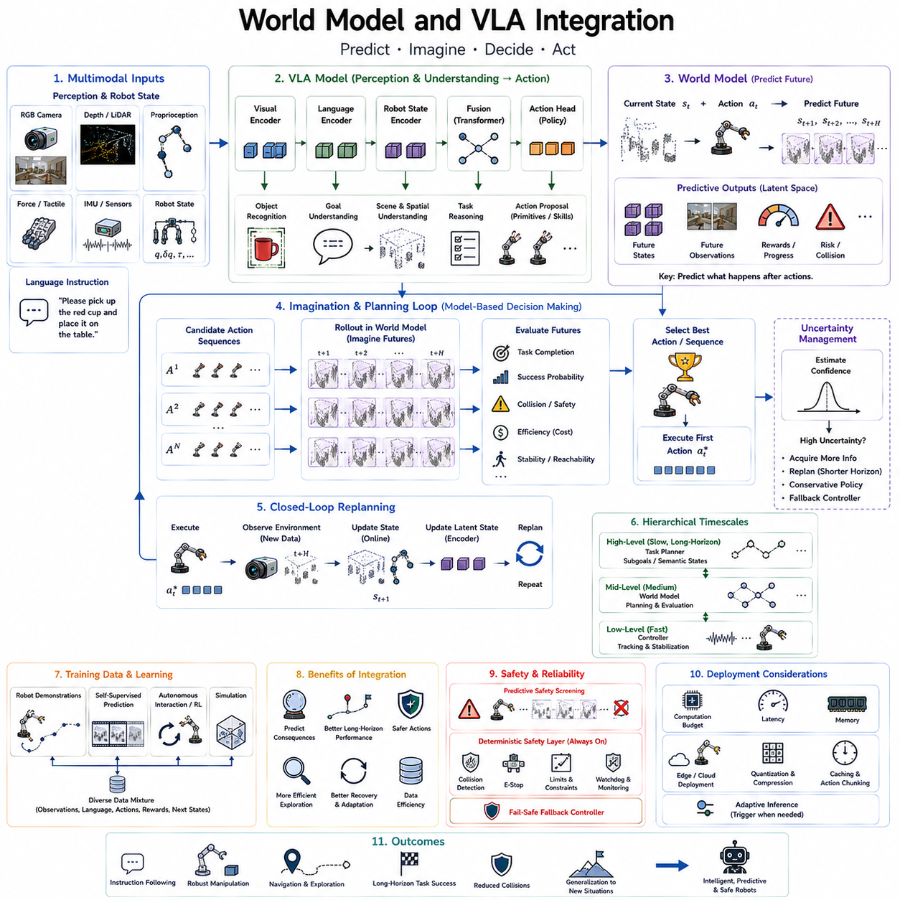{width="7.268055555555556in" height="7.268055555555556in"}

World model and Vision-Language-Action integration combines predictive understanding of physical dynamics with multimodal robot policies that connect perception and language directly to action. A VLA model can interpret what the robot sees and what a user requests, while a world model estimates how the environment may change after an action. Their integration extends reactive action generation toward predictive, consequence-aware embodied intelligence.

A conventional VLA policy learns a mapping from visual observations and language instructions to robot actions. This architecture is powerful because semantic understanding and control can be learned within a common representation. However, direct observation-to-action prediction does not necessarily require an explicit representation of future physical consequences. Integrating a world model adds the ability to predict possible next states before committing to an action.

The world model represents aspects of environment dynamics in a learned predictive space. Given current observations, robot state, and candidate actions, it estimates future states, observations, rewards, task progress, or other behaviorally relevant variables. These predictions do not need to reconstruct every pixel perfectly. For robotic control, the most useful representation preserves information needed to distinguish successful, unsafe, inefficient, and physically infeasible futures.

Multimodal perception provides the shared starting point for both components. Cameras, depth sensors, proprioception, force sensing, robot state, and language instructions are encoded into compact representations. The VLA component interprets objects, goals, spatial relationships, and intended behaviors, while the world model uses current state and action context to predict how these elements may evolve through physical interaction.

Language gives predictive modeling an explicit task context. The same physical scene can require very different behavior depending on whether the instruction is to grasp, move, inspect, avoid, open, or deliver an object. By conditioning world-model predictions and VLA action generation on language, the integrated system can evaluate future states according to their relevance to the requested task rather than predicting environmental change without a behavioral objective.

A shared latent representation can connect semantic reasoning with physical dynamics efficiently. Visual and state observations are encoded into latent tokens, language supplies task semantics, and candidate actions condition future prediction. The world model then predicts future latent states rather than necessarily generating full-resolution observations. The VLA policy can use these predicted states to determine which actions are most likely to produce useful physical outcomes.

Action-conditioned prediction is the central interface between the world model and VLA policy. If the robot considers reaching left, reaching right, moving its base, changing its grasp, or waiting, the world model can estimate different consequences for each possibility. The policy therefore gains information about what may happen after an action, transforming action selection from a purely reactive mapping into a limited form of prospective physical reasoning.

Planning can be implemented by generating multiple candidate action sequences and evaluating their predicted futures. The VLA policy proposes semantically meaningful actions, while the world model rolls them forward through latent imagination. Candidate trajectories can then be compared according to task completion, collision risk, reachability, stability, efficiency, or other objectives. Only the most promising action or short action sequence is executed on the physical robot.

This mechanism resembles model-based control but benefits from the broad semantic representations learned by modern foundation models. Traditional dynamics models often focus on compact physical state variables, whereas foundation-model world representations can incorporate objects, visual context, language goals, and interaction history. The resulting planner can reason not only about motion feasibility but also about whether predicted outcomes remain semantically aligned with the task.

Long-horizon tasks particularly benefit from this integration because errors compound across multiple actions. A command such as retrieving an object from another room requires navigation, object search, approach, grasping, transport, and placement. The VLA model can provide semantic task decomposition, while the world model evaluates intermediate consequences and predicts whether current behavior is moving the robot toward a state from which later subtasks remain feasible.

Hierarchical integration can separate different prediction and control timescales. High-level reasoning predicts task states and semantic subgoals over longer horizons, while local predictive models estimate short-term motion, contact, and manipulation outcomes. Fast deterministic controllers remain responsible for actuator-level stabilization. This organization prevents a large generative model from becoming responsible for every millisecond of control while retaining predictive reasoning where it provides the greatest benefit.

World models can also improve manipulation because contact-rich interactions are difficult to solve through static visual reasoning alone. During grasping, pushing, opening, insertion, or tool use, small actions can change object pose and contact relationships. Predicting these transitions allows the policy to compare alternative interaction strategies and recognize when a visually plausible action is likely to produce an undesirable physical result.

Uncertainty is important because learned world models are approximations rather than exact simulators. Prediction quality may deteriorate for unfamiliar objects, unusual contacts, new environments, or long imagined horizons. The integrated system should therefore estimate confidence and limit planning depth when uncertainty grows. Highly uncertain predictions can trigger additional observation, conservative behavior, replanning, or execution through a validated fallback controller.

Closed-loop replanning prevents prediction errors from accumulating indefinitely. The robot predicts future outcomes, selects an action, executes only part of the plan, and then receives new observations from the real environment. The latent state is updated and future possibilities are evaluated again. This receding-horizon structure allows the robot to benefit from imagination while repeatedly grounding its predictions in actual physical feedback.

Training the integrated system requires data that connects observations, language, actions, and temporal consequences. Robot demonstrations provide task-relevant behavior, while autonomous interaction and reinforcement learning provide failures, alternatives, and recovery experience. Video can contribute broad visual dynamics, and simulation can generate controlled physical transitions at scale. Combining these sources helps the model learn both semantic task structure and action-conditioned environmental change.

Self-supervised predictive objectives are particularly valuable because future observations naturally provide training targets. The model can learn to predict future latent states, masked temporal features, object motion, contact transitions, or other representations from recorded trajectories without requiring manual annotation for every transition. VLA supervision can then connect these predictive representations with language-conditioned actions and task completion.

Latent imagination can reduce the cost of physical exploration. Instead of testing every candidate behavior on real hardware, the policy can evaluate many alternatives internally using the learned world model. This does not eliminate real-world interaction because prediction errors must still be corrected through experience, but it can improve data efficiency by directing physical trials toward actions that appear informative, promising, or uncertain.

Reinforcement learning can further exploit the predictive model by evaluating actions according to expected future return rather than immediate imitation targets alone. Imagined rollouts can expose the policy to alternative trajectories that were not present in demonstrations. The resulting system combines demonstration-based knowledge, predictive dynamics, and goal-directed optimization, creating a bridge between VLA foundation policies and model-based reinforcement learning.

Safety can benefit from predictive integration when candidate actions are screened before execution. The world model can estimate potential collisions, unstable configurations, unreachable states, or undesirable object interactions, while deterministic safety systems enforce hard constraints independently. Predictive safety therefore acts as an additional reasoning layer rather than replacing emergency stops, collision monitors, actuator limits, or certified control mechanisms.

Edge deployment creates a practical constraint because world-model rollouts multiply the computation required for each decision. Efficient integration may use compact latent dynamics, short planning horizons, limited candidate actions, cached representations, action chunking, quantization, or hierarchical triggering. Expensive predictive reasoning can be activated only when uncertainty or task complexity justifies it, while straightforward situations continue through faster VLA inference.

Evaluation should measure whether world-model integration produces better physical decisions rather than only more accurate predictions. Relevant measures include task success, long-horizon completion, recovery, planning efficiency, collision reduction, adaptation to disturbances, data efficiency, and robustness to unseen situations. Prediction accuracy is useful only insofar as the learned future representation preserves information that improves downstream robot behavior.

The integration of world models and VLA systems ultimately connects three capabilities: understanding the current situation, imagining possible physical futures, and selecting actions that move toward a language-defined objective. VLA models provide broad semantic and action knowledge, while world models provide predictive structure over consequences. Together they offer a pathway from reactive multimodal robot policies toward robots capable of planning, adapting, and reasoning through physical interaction before acting.

월드 모델과 비전-언어-행동 통합(World Model and Vision-Language-Action Integration)은 물리적 동역학(physical dynamics)에 대한 예측적 이해와 지각 및 언어를 행동에 직접 연결하는 멀티모달 로봇 정책(multimodal robot policy)을 결합한다. VLA 모델은 로봇이 무엇을 보고 사용자가 무엇을 요청하는지를 해석할 수 있으며, 월드 모델(world model)은 행동 이후 환경이 어떻게 변화할지를 추정한다. 두 모델의 통합은 반응적 행동 생성(reactive action generation)을 예측적이고 결과를 고려하는 임바디드 지능(consequence-aware embodied intelligence)으로 확장한다.

기존의 VLA 정책(VLA policy)은 시각적 관측과 언어 명령을 로봇 행동으로 매핑하는 방법을 학습한다. 이러한 아키텍처는 의미적 이해와 제어를 공통 표현(common representation) 안에서 학습할 수 있다는 점에서 강력하다. 그러나 관측에서 행동으로 직접 예측하는 방식은 미래의 물리적 결과에 대한 명시적 표현을 반드시 필요로 하지는 않는다. 월드 모델을 통합하면 행동을 실제로 실행하기 전에 가능한 다음 상태(next state)를 예측할 수 있는 능력이 추가된다.

월드 모델은 학습된 예측 공간(learned predictive space)에서 환경 동역학(environment dynamics)의 여러 측면을 표현한다. 현재 관측, 로봇 상태 및 후보 행동(candidate action)이 주어지면 미래 상태, 관측, 보상, 작업 진행 상태 또는 행동과 관련된 기타 변수를 추정한다. 이러한 예측이 모든 픽셀을 완벽하게 복원할 필요는 없다. 로봇 제어에서는 성공적이거나 위험하거나 비효율적이거나 물리적으로 실행 불가능한 미래를 구분하는 데 필요한 정보를 보존하는 표현이 가장 유용하다.

멀티모달 지각(multimodal perception)은 두 구성요소가 공유하는 출발점을 제공한다. 카메라, 깊이 센서, 고유수용감각(proprioception), 힘 센싱(force sensing), 로봇 상태 및 언어 명령은 압축된 표현(compact representation)으로 인코딩된다. VLA 구성요소는 객체, 목표, 공간 관계 및 의도된 행동을 해석하고, 월드 모델은 현재 상태와 행동 문맥(action context)을 사용하여 이러한 요소가 물리적 상호작용을 통해 어떻게 변화할지를 예측한다.

언어는 예측 모델링(predictive modeling)에 명시적인 작업 문맥(task context)을 제공한다. 동일한 물리적 장면에서도 명령이 객체를 파지하거나, 이동하거나, 검사하거나, 회피하거나, 열거나, 전달하는 것인지에 따라 매우 다른 행동이 필요하다. 월드 모델 예측과 VLA 행동 생성을 언어에 조건화(conditioning)하면 통합 시스템은 단순히 행동 목적 없이 환경 변화를 예측하는 것이 아니라 요청된 작업과의 관련성을 기준으로 미래 상태를 평가할 수 있다.

공유 잠재 표현(shared latent representation)은 의미적 추론과 물리적 동역학을 효율적으로 연결할 수 있다. 시각 및 상태 관측은 잠재 토큰(latent token)으로 인코딩되고, 언어는 작업 의미를 제공하며, 후보 행동은 미래 예측을 조건화한다. 이후 월드 모델은 반드시 전체 해상도의 관측을 생성하는 대신 미래 잠재 상태(future latent state)를 예측할 수 있다. VLA 정책은 이러한 예측 상태를 이용하여 어떤 행동이 유용한 물리적 결과를 만들어낼 가능성이 가장 높은지를 판단할 수 있다.

행동 조건부 예측(action-conditioned prediction)은 월드 모델과 VLA 정책을 연결하는 핵심 인터페이스이다. 로봇이 왼쪽으로 손을 뻗기, 오른쪽으로 손을 뻗기, 모바일 베이스 이동하기, 파지 방식 변경하기 또는 기다리기 등을 고려한다면 월드 모델은 각각의 가능성에 대해 서로 다른 결과를 추정할 수 있다. 따라서 정책은 행동 이후에 무엇이 발생할지를 고려할 수 있게 되며, 행동 선택은 순수한 반응적 매핑에서 제한적인 형태의 미래 지향적 물리 추론(prospective physical reasoning)으로 발전한다.

계획(planning)은 여러 후보 행동 시퀀스(candidate action sequence)를 생성하고 예측된 미래를 평가하는 방식으로 구현할 수 있다. VLA 정책은 의미적으로 타당한 행동을 제안하고, 월드 모델은 잠재 상상(latent imagination)을 통해 이러한 행동을 미래로 전개한다. 이후 후보 궤적(candidate trajectory)을 작업 완료, 충돌 위험, 도달 가능성, 안정성, 효율성 또는 기타 목표를 기준으로 비교하고 가장 유망한 행동이나 짧은 행동 시퀀스만 실제 로봇에서 실행할 수 있다.

이러한 메커니즘은 모델 기반 제어(model-based control)와 유사하지만 현대 파운데이션 모델이 학습한 광범위한 의미 표현(semantic representation)을 활용한다는 장점을 가진다. 기존 동역학 모델은 주로 압축된 물리적 상태 변수에 초점을 맞추지만, 파운데이션 모델 기반 월드 표현은 객체, 시각적 문맥, 언어 목표 및 상호작용 이력을 포함할 수 있다. 따라서 계획기는 움직임의 실행 가능성뿐만 아니라 예측된 결과가 작업의 의미적 목표와 계속 일치하는지도 추론할 수 있다.

장기 작업(long-horizon task)은 여러 행동에 걸쳐 오류가 누적되기 때문에 이러한 통합의 이점을 특히 크게 얻을 수 있다. 다른 방에서 객체를 가져오는 명령은 내비게이션, 객체 탐색, 접근, 파지, 운반 및 배치를 요구한다. VLA 모델은 의미적 작업 분해(semantic task decomposition)를 제공하고, 월드 모델은 중간 단계의 결과를 평가하면서 현재 행동이 이후 하위 작업(subtask)을 계속 실행할 수 있는 상태로 로봇을 이동시키고 있는지를 예측할 수 있다.

계층적 통합(hierarchical integration)은 서로 다른 예측 및 제어 시간 규모(timescale)를 분리할 수 있다. 고수준 추론은 더 긴 시간 범위에서 작업 상태와 의미적 하위 목표를 예측하고, 로컬 예측 모델(local predictive model)은 단기적인 움직임, 접촉 및 조작 결과를 추정한다. 빠른 결정론적 제어기(deterministic controller)는 액추에이터 수준의 안정화를 담당한다. 이러한 구조는 대규모 생성 모델이 모든 밀리초 단위의 제어를 담당하지 않으면서도 예측적 추론이 가장 큰 가치를 제공하는 영역에서 활용될 수 있도록 한다.

월드 모델은 접촉 중심 상호작용(contact-rich interaction)을 정적인 시각적 추론만으로 해결하기 어렵기 때문에 조작 성능도 향상시킬 수 있다. 파지, 밀기, 열기, 삽입 또는 도구 사용 과정에서는 작은 행동이 객체 자세와 접촉 관계를 변화시킬 수 있다. 이러한 상태 전이(state transition)를 예측하면 정책은 여러 상호작용 전략을 비교하고 시각적으로는 타당해 보이지만 실제로는 바람직하지 않은 물리적 결과를 발생시킬 가능성이 높은 행동을 식별할 수 있다.

학습된 월드 모델은 정확한 시뮬레이터가 아니라 근사 모델(approximate model)이므로 불확실성(uncertainty)이 중요하다. 익숙하지 않은 객체, 비정상적인 접촉, 새로운 환경 또는 긴 상상 예측 구간에서는 예측 품질이 저하될 수 있다. 따라서 통합 시스템은 신뢰도를 추정하고 불확실성이 증가하면 계획 깊이(planning depth)를 제한해야 한다. 불확실성이 매우 높은 예측은 추가 관측, 보수적인 행동, 재계획 또는 검증된 폴백 제어기(fallback controller)를 통한 실행을 유도할 수 있다.

폐루프 재계획(closed-loop replanning)은 예측 오류가 무한히 누적되는 것을 방지한다. 로봇은 미래 결과를 예측하고 행동을 선택한 뒤 전체 계획이 아니라 일부만 실행하고 실제 환경에서 새로운 관측을 획득한다. 이후 잠재 상태를 업데이트하고 미래 가능성을 다시 평가한다. 이러한 리시딩 호라이즌 구조(receding-horizon structure)는 로봇이 상상 능력을 활용하면서도 예측을 실제 물리적 피드백에 반복적으로 그라운딩(grounding)할 수 있도록 한다.

통합 시스템을 학습하려면 관측, 언어, 행동 및 시간적 결과를 연결하는 데이터가 필요하다. 로봇 시연(robot demonstration)은 작업과 관련된 행동을 제공하고, 자율 상호작용과 강화학습(reinforcement learning)은 실패, 대안 및 복구 경험을 제공한다. 비디오는 광범위한 시각 동역학(visual dynamics)을 제공할 수 있으며, 시뮬레이션은 통제된 물리적 상태 전이를 대규모로 생성할 수 있다. 이러한 데이터 소스를 결합하면 의미적 작업 구조와 행동 조건부 환경 변화를 함께 학습할 수 있다.

자기지도 예측 목표(self-supervised predictive objective)는 미래 관측 자체가 자연스럽게 학습 목표를 제공하기 때문에 특히 유용하다. 모델은 모든 상태 전이에 수작업 레이블을 요구하지 않고 기록된 궤적으로부터 미래 잠재 상태, 마스킹된 시간적 특징(masked temporal feature), 객체 움직임, 접촉 상태 전이 또는 기타 표현을 예측하도록 학습할 수 있다. 이후 VLA 지도학습(VLA supervision)은 이러한 예측 표현을 언어 조건부 행동 및 작업 완료와 연결할 수 있다.

잠재 상상(latent imagination)은 물리적 탐색 비용을 줄일 수 있다. 실제 하드웨어에서 모든 후보 행동을 시험하는 대신 정책은 학습된 월드 모델을 사용하여 내부적으로 여러 대안을 평가할 수 있다. 예측 오류는 여전히 실제 경험을 통해 수정해야 하므로 현실 세계와의 상호작용 자체가 제거되는 것은 아니지만, 정보 가치가 높거나 성공 가능성이 높거나 불확실한 행동을 중심으로 실제 시험을 수행함으로써 데이터 효율성(data efficiency)을 향상시킬 수 있다.

강화학습은 즉각적인 모방 목표(imitation target)에만 의존하는 대신 예상 미래 리턴(expected future return)을 기준으로 행동을 평가함으로써 예측 모델을 더욱 적극적으로 활용할 수 있다. 상상 롤아웃(imagined rollout)은 시연 데이터에 존재하지 않았던 대체 궤적을 정책에 제공할 수 있다. 결과적으로 시스템은 시연 기반 지식, 예측 동역학 및 목표 지향적 최적화(goal-directed optimization)를 결합하여 VLA 파운데이션 정책과 모델 기반 강화학습(model-based reinforcement learning)을 연결한다.

안전성(safety)은 후보 행동을 실행 전에 검토할 수 있다는 점에서 예측적 통합의 이점을 얻을 수 있다. 월드 모델은 잠재적 충돌, 불안정한 구성, 도달 불가능한 상태 또는 바람직하지 않은 객체 상호작용을 추정할 수 있으며, 결정론적 안전 시스템은 이와 독립적으로 하드 제약조건(hard constraint)을 적용한다. 따라서 예측적 안전성(predictive safety)은 비상 정지, 충돌 모니터, 액추에이터 한계 또는 검증된 제어 메커니즘을 대체하는 것이 아니라 추가적인 추론 계층으로 작동한다.

엣지 배포(edge deployment)는 월드 모델 롤아웃(world-model rollout)이 각 의사결정에 필요한 연산량을 증가시키기 때문에 실질적인 제약조건을 발생시킨다. 효율적인 통합에서는 압축된 잠재 동역학(compact latent dynamics), 짧은 계획 범위, 제한된 후보 행동, 캐시된 표현, 행동 청킹(action chunking), 양자화(quantization) 또는 계층적 트리거링(hierarchical triggering)을 사용할 수 있다. 불확실성이나 작업 복잡도가 충분히 높은 경우에만 고비용 예측 추론을 활성화하고 단순한 상황에서는 더 빠른 VLA 추론을 사용할 수 있다.

평가(evaluation)는 단순히 월드 모델의 예측 정확도가 높아졌는지가 아니라 통합을 통해 실제 물리적 의사결정이 향상되었는지를 측정해야 한다. 관련 평가 항목에는 작업 성공률, 장기 작업 완료, 실패 복구, 계획 효율성, 충돌 감소, 외란 적응, 데이터 효율성 및 학습되지 않은 상황에 대한 강건성이 포함된다. 예측 정확도는 학습된 미래 표현이 실제 로봇의 후속 행동을 개선하는 데 필요한 정보를 보존하는 경우에만 실질적인 의미를 가진다.

궁극적으로 월드 모델과 VLA 시스템의 통합은 현재 상황 이해, 가능한 물리적 미래의 상상, 언어로 정의된 목표를 향해 이동하는 행동 선택이라는 세 가지 능력을 연결한다. VLA 모델은 광범위한 의미 및 행동 지식(semantic and action knowledge)을 제공하고, 월드 모델은 행동 결과에 대한 예측적 구조(predictive structure)를 제공한다. 두 시스템의 결합은 반응적인 멀티모달 로봇 정책을 넘어 실제로 행동하기 전에 물리적 상호작용의 결과를 계획하고, 적응하고, 추론할 수 있는 로봇으로 발전하기 위한 경로를 제공한다.

## 11.12. End to End Robot Foundation Model and VLA [w/Code]

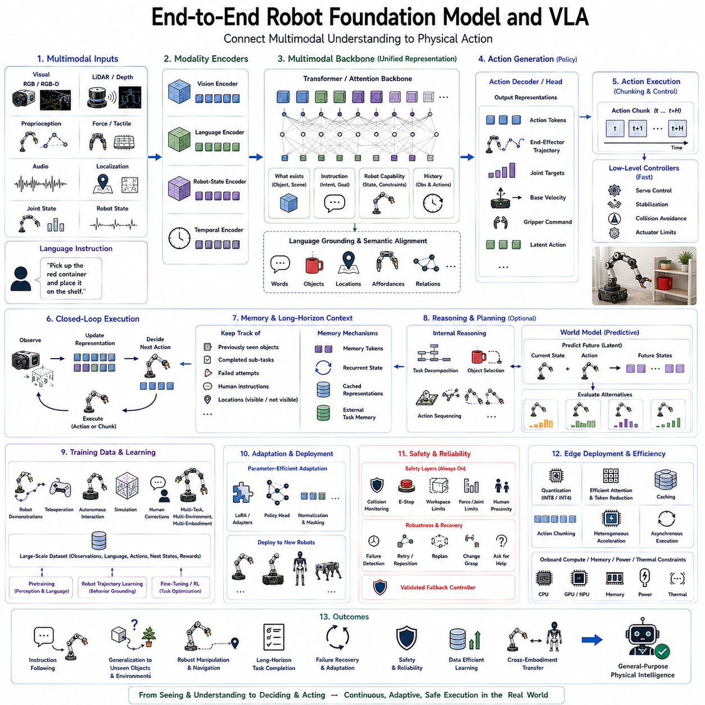{width="7.268055555555556in" height="7.268055555555556in"}

An end-to-end robot foundation model and Vision-Language-Action system seeks to connect multimodal observations and human instructions directly with physical robot behavior through a unified learned architecture. Instead of treating perception, language understanding, task planning, and action generation as completely independent modules, the model learns shared representations that allow semantic knowledge, spatial understanding, robot state, and control decisions to influence one another.

The input layer combines information required to understand both the external world and the robot itself. RGB or RGB-D cameras provide visual semantics and geometry, while LiDAR, depth, force, tactile, audio, proprioceptive, localization, and joint-state signals describe complementary aspects of the physical situation. Natural-language instructions provide task intent, allowing the same observed environment to produce different behaviors according to the requested objective.

Modality-specific encoders transform raw observations into compact representations before integration. Vision encoders extract objects, scenes, spatial relationships, and affordances, while language encoders represent instructions, goals, constraints, and semantic concepts. Robot-state encoders capture embodiment, configuration, velocity, contact, and actuator information. Temporal encoding preserves recent observations and actions so decisions reflect interaction history rather than only the current frame.

A multimodal backbone integrates these representations into a common latent space. Transformer-based attention can associate words with objects, locations, robot states, and previous actions while selectively emphasizing information relevant to the current task. This shared representation becomes the central interface between perception and behavior, enabling the model to reason about what exists, what the instruction requires, what the robot can physically accomplish, and what action should follow.

Language grounding connects abstract instructions to concrete elements of the physical environment. A request such as "pick up the red container and place it on the shelf" requires identifying the correct object, locating the destination, understanding the manipulation relationship, and maintaining the instruction throughout execution. Grounded representations therefore connect linguistic concepts with visual regions, spatial locations, affordances, and action-relevant physical states.

The action-generation component transforms multimodal representations into executable robot behavior. Depending on the architecture, outputs may be discrete action tokens, continuous end-effector trajectories, joint targets, base velocities, gripper commands, latent actions, or combinations of these representations. Generative approaches such as autoregressive decoding, diffusion, or flow-based action generation can represent multiple valid behaviors instead of forcing the policy toward a single deterministic trajectory.

Action chunking allows the policy to predict several future control steps during one inference cycle. This reduces repeated large-model computation and captures short temporal structures such as reaching, grasping, lifting, or moving toward a waypoint. The robot can execute part of the predicted chunk and then observe the environment again, balancing efficient inference with the need for frequent physical feedback and correction when conditions change.

Although the architecture is described as end-to-end, practical robotic systems still benefit from hierarchical control. The foundation model can generate task-level decisions, skills, trajectories, or action chunks, while faster local controllers handle servo control, stabilization, collision avoidance, and actuator constraints. End-to-end learning therefore refers primarily to learned connectivity between multimodal understanding and action rather than eliminating every deterministic component of the robot control stack.

Training requires large and heterogeneous datasets connecting observations, instructions, actions, and task outcomes. Robot demonstrations provide direct examples of successful physical behavior, while teleoperation, autonomous interaction, simulation, scripted policies, and human corrections broaden coverage. Combining data across tasks, environments, institutions, and embodiments encourages the foundation model to learn reusable structures rather than memorizing one robot configuration or laboratory setting.

Pretraining provides broad perceptual and semantic knowledge before specialization for a particular robot. Large-scale vision and language representations can supply concepts about objects, environments, relationships, and instructions, while robot trajectory training connects these concepts to physical actions. This combination is important because internet-scale visual-language knowledge is broad but lacks direct grounding in robot dynamics, whereas robot data is physically grounded but comparatively expensive and limited.

Cross-embodiment training further expands the reusable knowledge available to the model. Demonstrations from manipulators, mobile manipulators, humanoids, and other robots may share concepts such as reaching, grasping, transporting, opening, and placing despite different action spaces. Embodiment information, normalization, masking, adapters, and specialized action heads allow a common backbone to retain transferable task knowledge while generating commands appropriate for each physical platform.

Parameter-efficient adaptation provides a practical mechanism for transferring a pretrained end-to-end model to new deployments. Instead of retraining every parameter, LoRA modules, adapters, specialized policy heads, or other lightweight components can learn robot-specific characteristics from comparatively small datasets. This reduces training cost while preserving general representations acquired during large-scale pretraining and makes one foundation model more reusable across hardware and applications.

Closed-loop execution is essential because even a powerful end-to-end policy cannot predict physical interaction perfectly. After generating and executing an action or action chunk, the robot observes the resulting state and updates its multimodal representation. Object motion, contact errors, localization drift, human movement, or actuator differences can therefore modify subsequent actions. Continuous feedback prevents small prediction errors from accumulating through long open-loop sequences.

Temporal memory extends closed-loop control across longer tasks. The model may need to remember previously observed objects, completed subtasks, failed attempts, human instructions, and locations that are no longer visible. Explicit memory tokens, recurrent latent states, cached representations, or external task memory can preserve this context. Long-horizon behavior then becomes a sequence of context-aware decisions rather than disconnected reactions to individual observations.

Reasoning can be incorporated at multiple levels without requiring textual reasoning to be exposed as robot control. Internal representations can support task decomposition, object selection, spatial reasoning, affordance evaluation, and action sequencing before the policy produces physical commands. More computationally expensive reasoning can be triggered for ambiguous or difficult situations, while familiar interactions can follow faster direct policy pathways to maintain practical inference speed.

World-model integration can add predictive capability to the end-to-end VLA architecture. Instead of selecting actions solely from current observations, the system can estimate how candidate behaviors may change the environment and robot state. Short latent rollouts can compare alternatives according to task progress, reachability, stability, or risk. This creates a continuum between direct VLA control and model-based planning rather than requiring them to exist as separate robot intelligence paradigms.

Failure recovery must be represented as part of the learned behavior distribution rather than treated only as an external exception. Training data should include missed grasps, blocked routes, displaced objects, unsuccessful insertions, localization problems, and corrective demonstrations. The model can then recognize deviations from expected progress and generate behaviors such as retrying, repositioning, changing a grasp, seeking another viewpoint, replanning, or requesting assistance.

Safety requires independent constraints around the learned end-to-end policy. Collision monitoring, emergency stopping, workspace limits, joint and force constraints, speed restrictions, human proximity rules, watchdogs, and validated fallback controllers should remain capable of overriding generated behavior. Confidence estimation and out-of-distribution detection can additionally identify observations for which the foundation model has insufficient evidence to continue autonomous execution safely.

Edge inference places strong efficiency requirements on the architecture because perception, language processing, multimodal fusion, and action generation must compete for onboard computation, memory, power, and thermal capacity. Quantization, efficient attention, visual-token reduction, caching, action chunking, model distillation, and heterogeneous acceleration can reduce runtime cost. Different components may also execute asynchronously according to their required control frequency.

Evaluation should measure complete physical behavior rather than isolated multimodal prediction accuracy. Important dimensions include task success, generalization to unseen objects and environments, instruction following, manipulation precision, navigation performance, recovery, long-horizon completion, safety, inference latency, and data efficiency. Cross-embodiment evaluation can additionally determine whether pretraining genuinely reduces the amount of robot-specific experience required for a new platform.

Fleet deployment transforms end-to-end models from static trained artifacts into continuously improving systems. Robots can collect difficult interactions, interventions, failures, successful recoveries, and novel environmental conditions during operation. Selected episodes can be returned to centralized training, used for adaptation and validation, and incorporated into updated models. New versions can then be redistributed while maintaining deployment-specific safety and performance checks.

The end-to-end robot foundation model and VLA architecture ultimately creates a continuous learned pathway from seeing and understanding to deciding and acting. Its strength comes not from removing all modular robotics, but from learning transferable connections among multimodal perception, language, embodiment, temporal context, reasoning, and action. Combined with closed-loop feedback, predictive models, efficient adaptation, safety layers, and edge deployment, this approach provides a scalable foundation for increasingly general-purpose physical intelligence.

엔드투엔드 로봇 파운데이션 모델 및 비전-언어-행동 시스템(end-to-end robot foundation model and Vision-Language-Action system)은 멀티모달 관측(multimodal observation)과 인간의 명령을 통합된 학습 아키텍처(unified learned architecture)를 통해 물리적 로봇 행동과 직접 연결하는 것을 목표로 한다. 지각, 언어 이해, 작업 계획 및 행동 생성을 완전히 독립적인 모듈로 처리하는 대신 의미 지식, 공간 이해, 로봇 상태 및 제어 의사결정이 서로 영향을 줄 수 있는 공유 표현(shared representation)을 학습한다.

입력 계층(input layer)은 외부 세계와 로봇 자체를 모두 이해하는 데 필요한 정보를 결합한다. RGB 또는 RGB-D 카메라는 시각적 의미와 기하학적 정보를 제공하고, 라이다(LiDAR), 깊이, 힘, 촉각, 오디오, 고유수용감각(proprioception), 위치추정 및 관절 상태 신호는 물리적 상황의 상호 보완적인 측면을 나타낸다. 자연어 명령(natural-language instruction)은 작업 의도를 제공하여 동일한 환경을 관측하더라도 요청된 목표에 따라 서로 다른 행동을 생성할 수 있도록 한다.

모달리티별 인코더(modality-specific encoder)는 통합 이전에 원시 관측을 압축된 표현으로 변환한다. 비전 인코더(vision encoder)는 객체, 장면, 공간 관계 및 어포던스(affordance)를 추출하고, 언어 인코더(language encoder)는 명령, 목표, 제약조건 및 의미 개념을 표현한다. 로봇 상태 인코더(robot-state encoder)는 임바디먼트, 구성, 속도, 접촉 및 액추에이터 정보를 포착한다. 시간 인코딩(temporal encoding)은 최근의 관측과 행동을 보존하여 현재 프레임뿐만 아니라 상호작용 이력을 반영한 의사결정을 가능하게 한다.

멀티모달 백본(multimodal backbone)은 이러한 표현을 공통 잠재 공간(common latent space)으로 통합한다. 트랜스포머 기반 어텐션(transformer-based attention)은 단어를 객체, 위치, 로봇 상태 및 이전 행동과 연결하면서 현재 작업에 관련된 정보를 선택적으로 강조할 수 있다. 이러한 공유 표현은 지각과 행동 사이의 핵심 인터페이스가 되어 무엇이 존재하는지, 명령이 무엇을 요구하는지, 로봇이 물리적으로 무엇을 수행할 수 있는지, 그리고 다음에 어떤 행동을 해야 하는지를 모델이 추론할 수 있도록 한다.

언어 그라운딩(language grounding)은 추상적인 명령을 물리 환경의 구체적인 요소와 연결한다. "빨간 용기를 집어 선반 위에 놓아라"라는 요청은 올바른 객체를 식별하고, 목적지를 찾고, 조작 관계를 이해하며, 실행 과정 전체에서 명령을 유지해야 한다. 따라서 그라운딩된 표현(grounded representation)은 언어적 개념을 시각 영역, 공간 위치, 어포던스 및 행동과 관련된 물리적 상태에 연결한다.

행동 생성 구성요소(action-generation component)는 멀티모달 표현을 실행 가능한 로봇 행동으로 변환한다. 아키텍처에 따라 출력은 이산 행동 토큰(discrete action token), 연속 엔드이펙터 궤적(continuous end-effector trajectory), 관절 목표값, 베이스 속도, 그리퍼 명령, 잠재 행동(latent action) 또는 이들의 조합이 될 수 있다. 자기회귀 디코딩(autoregressive decoding), 확산(diffusion), 플로 기반 행동 생성(flow-based action generation)과 같은 생성형 접근법은 정책을 하나의 결정론적 궤적에 제한하지 않고 여러 개의 유효한 행동을 표현할 수 있다.

행동 청킹(action chunking)은 한 번의 추론 주기에서 여러 개의 미래 제어 단계를 예측할 수 있도록 한다. 이를 통해 반복적인 대규모 모델 연산을 줄이는 동시에 접근, 파지, 들어 올리기 또는 웨이포인트로 이동하기와 같은 짧은 시간적 구조를 포착할 수 있다. 로봇은 예측된 청크의 일부를 실행한 후 환경을 다시 관측함으로써 효율적인 추론과 환경 변화에 대한 빈번한 물리적 피드백 및 수정의 필요성 사이에서 균형을 유지할 수 있다.

아키텍처가 엔드투엔드(end-to-end)로 설명되더라도 실제 로봇 시스템은 계층적 제어(hierarchical control)를 활용함으로써 이점을 얻을 수 있다. 파운데이션 모델은 작업 수준의 의사결정, 기술(skill), 궤적 또는 행동 청크를 생성하고, 더 빠른 로컬 제어기(local controller)는 서보 제어, 안정화, 충돌 회피 및 액추에이터 제약조건을 처리할 수 있다. 따라서 엔드투엔드 학습은 로봇 제어 스택의 모든 결정론적 구성요소를 제거한다는 의미라기보다 멀티모달 이해와 행동 사이의 연결을 학습한다는 의미에 가깝다.

학습에는 관측, 명령, 행동 및 작업 결과를 연결하는 대규모의 이질적인 데이터셋(heterogeneous dataset)이 필요하다. 로봇 시연(robot demonstration)은 성공적인 물리 행동의 직접적인 사례를 제공하고, 원격조작(teleoperation), 자율 상호작용, 시뮬레이션, 스크립트 기반 정책(scripted policy), 인간 수정(human correction)은 데이터 범위를 확장한다. 여러 작업, 환경, 기관 및 임바디먼트에서 데이터를 결합하면 하나의 로봇 구성이나 실험실 환경을 암기하는 대신 재사용 가능한 구조를 학습하도록 유도할 수 있다.

사전학습(pretraining)은 특정 로봇에 특화하기 전에 광범위한 지각 및 의미 지식을 제공한다. 대규모 비전 및 언어 표현은 객체, 환경, 관계 및 명령에 관한 개념을 제공하고, 로봇 궤적 학습(robot trajectory training)은 이러한 개념을 물리적 행동과 연결한다. 인터넷 규모의 시각-언어 지식은 광범위하지만 로봇 동역학에 직접 그라운딩되어 있지 않고, 로봇 데이터는 물리적으로 그라운딩되어 있지만 상대적으로 수집 비용이 높고 제한적이므로 두 데이터의 결합이 중요하다.

교차 임바디먼트 학습(cross-embodiment training)은 모델이 활용할 수 있는 재사용 가능한 지식을 더욱 확장한다. 매니퓰레이터, 모바일 매니퓰레이터, 휴머노이드 및 다른 로봇의 시연은 서로 다른 행동 공간을 가지더라도 접근, 파지, 운반, 열기 및 배치와 같은 개념을 공유할 수 있다. 임바디먼트 정보, 정규화(normalization), 마스킹(masking), 어댑터(adapter), 특화된 행동 헤드(action head)를 사용하면 공통 백본이 전이 가능한 작업 지식을 유지하면서 각 물리적 플랫폼에 적합한 명령을 생성할 수 있다.

매개변수 효율적 적응(parameter-efficient adaptation)은 사전학습된 엔드투엔드 모델을 새로운 배포 환경으로 전이하기 위한 실용적인 메커니즘을 제공한다. 모든 매개변수를 다시 학습하는 대신 LoRA 모듈, 어댑터, 특화된 정책 헤드 또는 기타 경량 구성요소를 사용하여 비교적 작은 데이터셋으로 로봇별 특성을 학습할 수 있다. 이를 통해 대규모 사전학습에서 획득한 일반적인 표현을 유지하면서 학습 비용을 줄이고 하나의 파운데이션 모델을 다양한 하드웨어와 애플리케이션에서 더욱 쉽게 재사용할 수 있다.

폐루프 실행(closed-loop execution)은 강력한 엔드투엔드 정책이라도 물리적 상호작용을 완벽하게 예측할 수 없기 때문에 필수적이다. 행동 또는 행동 청크를 생성하고 실행한 후 로봇은 결과 상태를 다시 관측하고 멀티모달 표현을 업데이트한다. 객체 이동, 접촉 오류, 위치추정 드리프트(localization drift), 사람의 움직임 또는 액추에이터 차이를 이후 행동에 반영할 수 있다. 지속적인 피드백은 작은 예측 오류가 긴 개루프 시퀀스(open-loop sequence)를 통해 누적되는 것을 방지한다.

시간적 메모리(temporal memory)는 폐루프 제어를 장기 작업으로 확장한다. 모델은 이전에 관측한 객체, 완료된 하위 작업, 실패한 시도, 인간의 명령 및 더 이상 보이지 않는 위치를 기억해야 할 수 있다. 명시적인 메모리 토큰(memory token), 순환 잠재 상태(recurrent latent state), 캐시된 표현 또는 외부 작업 메모리(external task memory)를 통해 이러한 문맥을 보존할 수 있다. 따라서 장기 행동은 개별 관측에 대한 서로 단절된 반응이 아니라 문맥을 고려한 일련의 의사결정으로 구성된다.

추론(reasoning)은 텍스트 형태의 추론을 로봇 제어 명령으로 직접 노출하지 않고도 여러 수준에서 통합할 수 있다. 내부 표현은 정책이 물리적 명령을 생성하기 전에 작업 분해, 객체 선택, 공간 추론, 어포던스 평가 및 행동 시퀀싱(action sequencing)을 지원할 수 있다. 모호하거나 어려운 상황에서는 더 많은 연산이 필요한 추론을 활성화하고, 익숙한 상호작용에서는 빠른 직접 정책 경로(direct policy pathway)를 사용하여 실용적인 추론 속도를 유지할 수 있다.

월드 모델 통합(world-model integration)은 엔드투엔드 VLA 아키텍처에 예측 능력을 추가할 수 있다. 현재 관측만으로 행동을 선택하는 대신 시스템은 후보 행동이 환경과 로봇 상태를 어떻게 변화시킬지를 추정할 수 있다. 짧은 잠재 롤아웃(latent rollout)을 통해 작업 진행, 도달 가능성, 안정성 또는 위험을 기준으로 여러 대안을 비교할 수 있다. 이를 통해 직접적인 VLA 제어와 모델 기반 계획(model-based planning)을 서로 분리된 로봇 지능 패러다임으로 취급하지 않고 연속적인 구조로 결합할 수 있다.

실패 복구(failure recovery)는 단순한 외부 예외 처리로 취급하는 것이 아니라 학습된 행동 분포(learned behavior distribution)의 일부로 표현되어야 한다. 학습 데이터에는 실패한 파지, 차단된 경로, 이동된 객체, 실패한 삽입, 위치추정 문제 및 수정 시연(corrective demonstration)이 포함되어야 한다. 이를 통해 모델은 예상된 작업 진행 상태로부터의 편차를 인식하고 재시도, 위치 재조정, 파지 방식 변경, 다른 시점 탐색, 재계획 또는 지원 요청과 같은 행동을 생성할 수 있다.

안전성(safety)을 위해서는 학습된 엔드투엔드 정책 주변에 독립적인 제약조건이 필요하다. 충돌 모니터링, 비상 정지, 작업공간 제한, 관절 및 힘 제약조건, 속도 제한, 인간 근접성 규칙, 워치독(watchdog), 검증된 폴백 제어기(fallback controller)는 생성된 행동을 언제든지 무효화할 수 있어야 한다. 신뢰도 추정(confidence estimation)과 분포 외 탐지(out-of-distribution detection)를 통해 파운데이션 모델이 자율 실행을 안전하게 지속하기 위한 충분한 근거를 갖지 못한 관측도 식별할 수 있다.

엣지 추론(edge inference)은 지각, 언어 처리, 멀티모달 융합 및 행동 생성이 온보드 연산, 메모리, 전력 및 열 용량을 공유해야 하므로 아키텍처에 강력한 효율성 요구조건을 부여한다. 양자화(quantization), 효율적 어텐션(efficient attention), 시각 토큰 감소(visual-token reduction), 캐싱(caching), 행동 청킹, 모델 증류(model distillation), 이기종 가속(heterogeneous acceleration)을 활용하여 런타임 비용을 줄일 수 있다. 필요한 제어 주기에 따라 서로 다른 구성요소를 비동기적으로 실행할 수도 있다.

평가(evaluation)는 개별적인 멀티모달 예측 정확도가 아니라 완전한 물리 행동(complete physical behavior)을 측정해야 한다. 중요한 평가 항목에는 작업 성공률, 학습되지 않은 객체 및 환경에 대한 일반화, 명령 수행 능력, 조작 정밀도, 내비게이션 성능, 실패 복구, 장기 작업 완료, 안전성, 추론 지연시간 및 데이터 효율성이 포함된다. 교차 임바디먼트 평가를 통해 사전학습이 새로운 플랫폼에 필요한 로봇별 경험의 양을 실제로 감소시키는지도 확인할 수 있다.

플릿 배포(fleet deployment)는 엔드투엔드 모델을 정적으로 학습된 결과물에서 지속적으로 개선되는 시스템으로 변화시킨다. 로봇은 실제 운영 과정에서 어려운 상호작용, 인간 개입, 실패, 성공적인 복구 및 새로운 환경 조건을 수집할 수 있다. 선택된 에피소드를 중앙집중형 학습(centralized training)으로 다시 전달하여 적응 및 검증에 활용하고 업데이트된 모델에 통합할 수 있다. 이후 새로운 모델 버전을 배포 환경별 안전 및 성능 검증을 유지하면서 다시 플릿에 배포할 수 있다.

궁극적으로 엔드투엔드 로봇 파운데이션 모델 및 VLA 아키텍처(end-to-end robot foundation model and VLA architecture)는 보고 이해하는 과정에서 의사결정하고 행동하는 과정까지 이어지는 연속적인 학습 경로(continuous learned pathway)를 구축한다. 그 강점은 모든 모듈형 로보틱스(modular robotics)를 제거하는 데 있는 것이 아니라 멀티모달 지각, 언어, 임바디먼트, 시간적 문맥, 추론 및 행동 사이의 전이 가능한 연결을 학습하는 데 있다. 폐루프 피드백, 예측 모델, 효율적인 적응, 안전 계층 및 엣지 배포와 결합하면 이러한 접근법은 점차 범용성이 높아지는 물리 지능(general-purpose physical intelligence)을 위한 확장 가능한 기반을 제공한다.
